# WORK IN PROGRESS

# Game Boy Camera disassembly - the definitive version

**The purpose of this project is not to make alternative Game Boy Camera roms as best open source alternatives yet exist, but to understand finely a piece of video game history and reveal definitively all the possible secrets buried into the code.**

This project so proposes a disassembly of the Game Boy Camera / Pocket Camera ROMs. The Japanese Rev A ROM is disassembled first; the international, Gold, Hello Kitty and prototype ROMs follow with the same tools. Work in progress, stay tuned.

The work is produced by AI (Claude), from reading the code and running it in emulators (BGB and the project's own core), with the owner's checks and answers; findings tagged **C** were confirmed in code, in BGB or by the owner, **I** are inferred, **?** are open.

One map per ROM, in the same colours: what each byte is (code by function, data by kind). Grey-blue is what is not analysed yet: it gives way to the colours as the work on a ROM lands.

**Pocket Camera (Japan) (Rev A)**: outlines = what no emulator run reached (the full reachability map is in [`roms/jp_rev_a/`](roms/jp_rev_a/README.md)).


*Screens reached in BGB* (2026-11-08): power-on at the left, each column one step further; the boot row holds the boot screen, the calibration check and the factory calibration; one panel per mode (or part of one) with its BGB screenshots at 1x, each arrow labelled with its keys, a two-headed arrow when B leads back (measured in BGB, `tools/screen_cancel.py`), grey notes under a screenshot for the keys inside the panel and for B elsewhere. Drawn by `tools/make_screen_trees.py`; the checker redraws it.

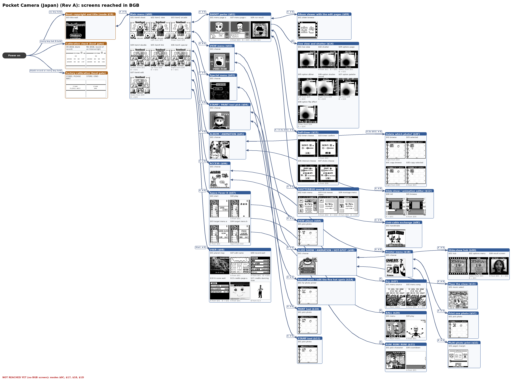

*Never-reached assets of the Japanese ROM*: the assets that no emulator replay put on screen in a run without state pokes (unused maps beside their tile sets, TCRF graphics, blocks never shown or shown only in forced runs, scraps, sounds never requested; docs §16.24, list in [`really_unused.md`](tcrf_check/assets/unidentified/really_unused.md)).

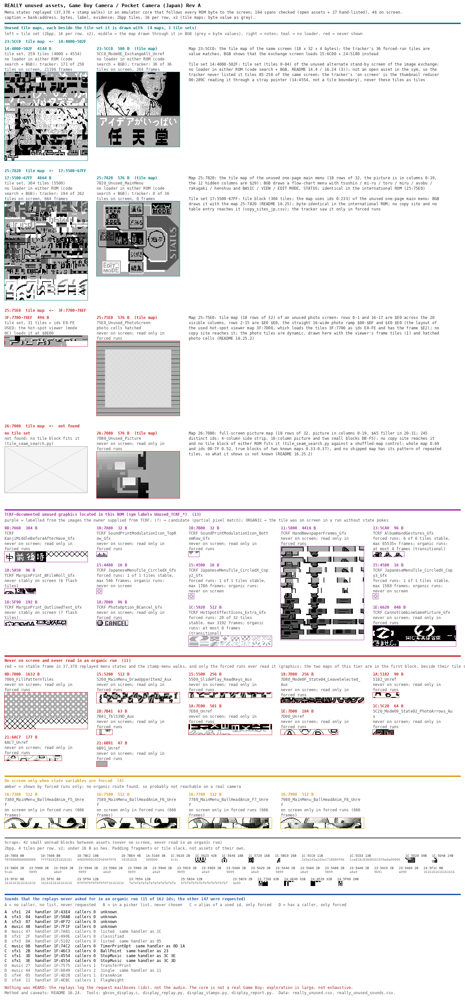

*The two unused full screens, large*: left, the alternate stand-by screen of the image exchange (map `23:5CC0` with the tiles `14:4000`); right, the one-page main menu with the "DEBA GAME" logo (map `25:7820` with the tiles `17:5500`). No code loads either of them, in either ROM (docs §16.24, §16.25).

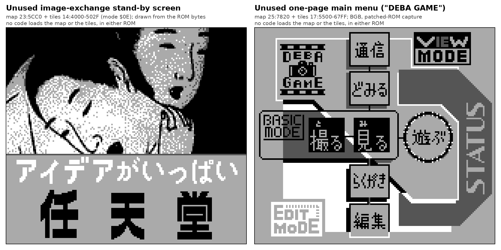

*The unused ball head animation*: left, the head turn the main menu plays (frames F4 to F0 and back, on the front body); right, the twin set of frames F9 to F5 and back that no code plays (`MainMenu_SlideA_Tbl2` / `Tbl3` have no caller; same heads, another collar, on the back body it fits). A red line marks the unused tiles: the head frames F5 to F8, which nothing reads (F9 is the resting head of the menu's lower page, and the back body is used). Drawn from the ROM tiles at 4x on the game's timing (docs §16.24).

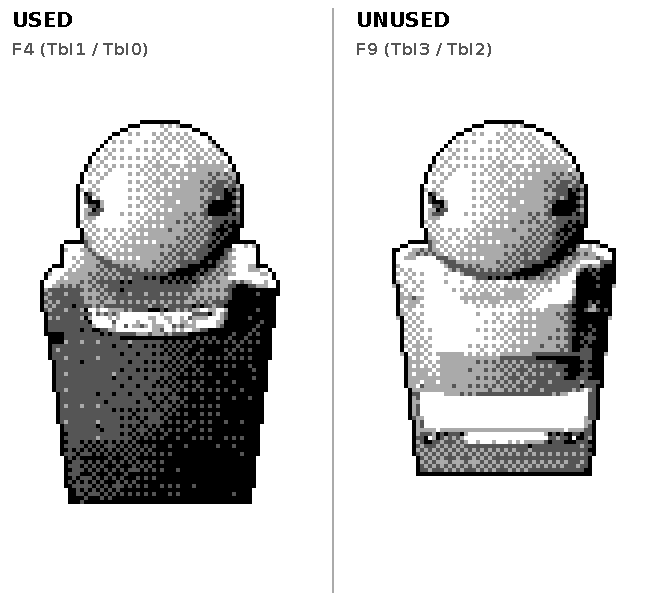

*The hand flipping a newspaper* (TCRF B16, `11:5800-693F`): nine 40 x 40 sprite frames, arranged by the sprite list `$BA`, that no code draws. Animated from the ROM tiles at 4x in slot order (0 to 8 and back); the order and the speed are chosen here, since no code plays them (docs §16.24).

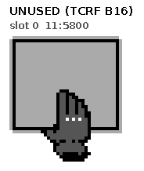

*The two hidden boot screens and how to open them* (hold the buttons while switching the camera on): the **factory calibration** (every button, or a blank calibration record: STORE / PLEASE WAIT, then STORE / END; it measures the sensor and stores the calibration vector) and the **fast calibration sanity check** (every button except B: it measures again, writes nothing, and shows OK or NG for the two highest-gain references), BGB screenshots from synthetic saves (docs §8).

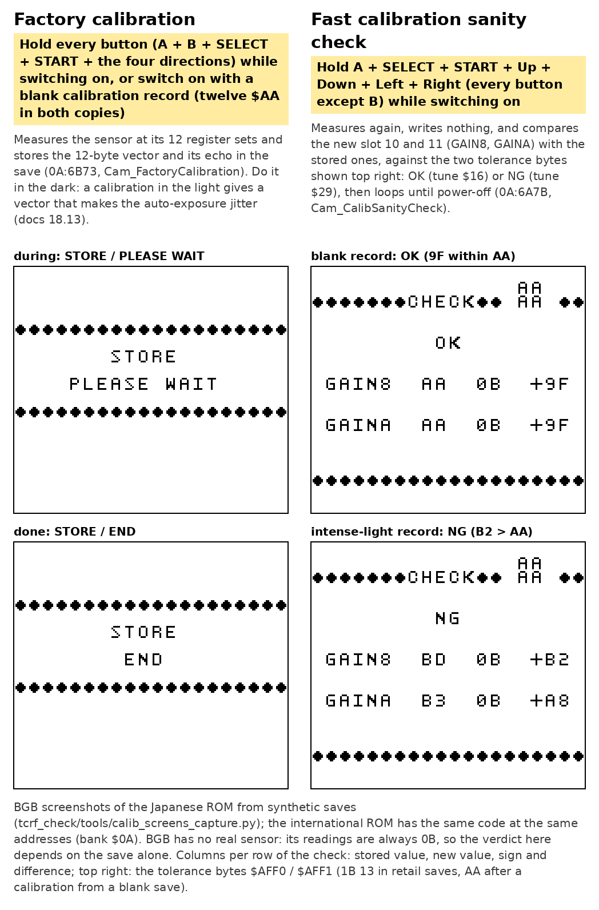

*The real credits, Japanese vs international* (unlocked by a RUN! RUN! RUN! record of 22:00 or lower, then USER > CREDITS): the international build drops the "One Love" page and plays two scenes of Nintendo's arcade game Sheriff instead, one of them in a credits state that the Japanese ROM does not have (BGB screenshots, docs §1.5).

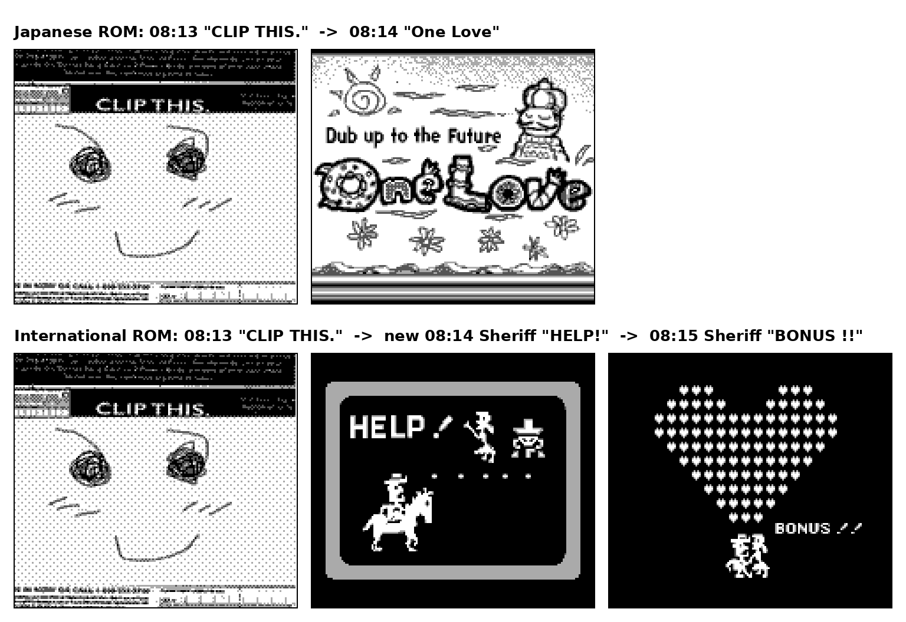

**Game Boy Camera (USA, Europe)**: ported from the Japanese tables.


*Screens reached in BGB* (2026-11-08): power-on at the left, each column one step further; the boot row holds the boot screen, the calibration check and the factory calibration; one panel per mode (or part of one) with its BGB screenshots at 1x, each arrow labelled with its keys, a two-headed arrow when B leads back (measured in BGB, `tools/screen_cancel.py`), grey notes under a screenshot for the keys inside the panel and for B elsewhere. Drawn by `tools/make_screen_trees.py`; the checker redraws it.


*Never-reached assets* (first pass, 2026-10-31, from about 55 minutes of the international coverage run (twice cut by a container restart; state kept on the branch `wip/intl-coverage-state`); table [`jp_never_reached_in_us.csv`](roms/us_eu/assets/jp_never_reached_in_us.csv)): of the 131 never-reached assets of the Japanese ROM (27,156 bytes), 90 are in this ROM byte for byte at the same address and 5 more elsewhere (in banks $25 and $26, which moved: the "DEBA GAME" menu map, the unused photo screen and picture, the option-page head rows). The leftovers survive here: the unused exchange stand-by screen, the "DEBA GAME" menu, the hand-and-newspaper frames, the ball-head frames F5-F8, the other TCRF graphics. None of these 95 blocks was read in an organic run of the international core (the only organic reads are 8 small blocks of 2 to 10 bytes, mostly the Space Fever II HUD bytes that the Japanese ROM also reads without showing them). 11 are not in this ROM: six slots of the Japanese font, two tile sets of bank $15 and three small blocks. The sheet below draws them from the international ROM's own bytes (each block checked against its Japanese source; the Gold ROM has the same bytes), with two Japanese blocks of the name font that the international keyboard cannot type; the unused exchange stand-by screen and the "DEBA GAME" menu are left out (they are in the Japanese picture above). Whether a block reaches the screen is still to be confirmed by international display replays (`tools/intl_jp_leftovers_sheet.py`).

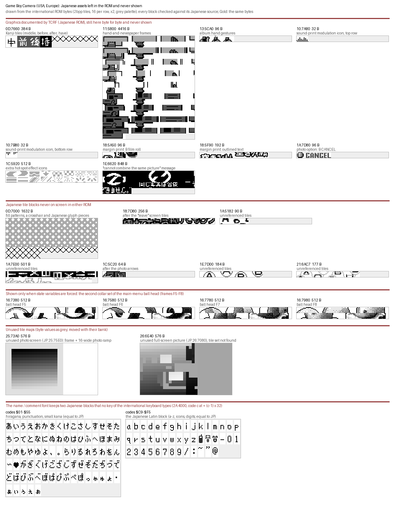

*Hidden in the international USER planet map* (TCRF, Regional Differences, "Space"): the top three rows are drawn black, but the tiles of the Japanese sky are still loaded; put back from BGB's VRAM (docs/20):

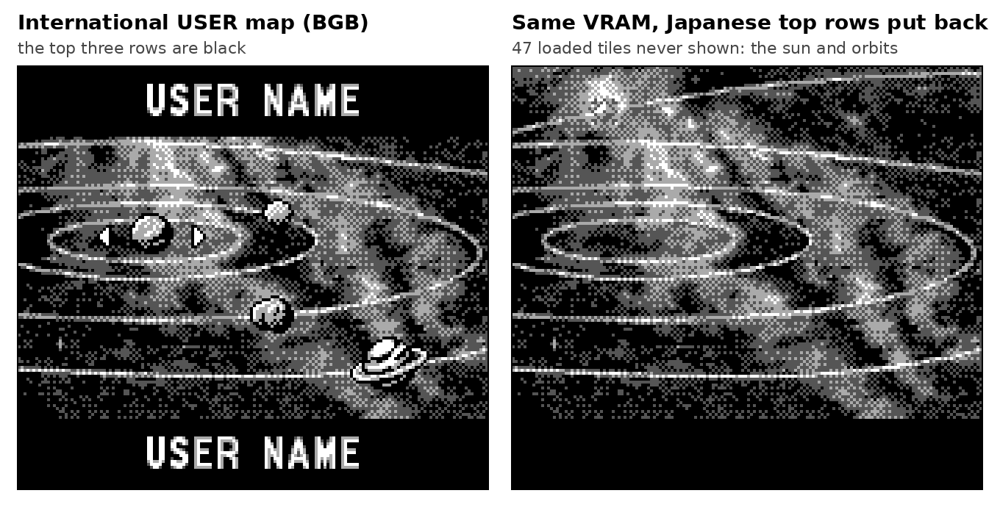

*Receiving by browsing the partner's album cannot work, and a Game Genie code that makes it work* (international, Gold and Japanese ROMs). When the player who starts the exchange chooses to receive, the game asks the partner for a page of 8 thumbnails and waits for it at most 180 frames, 3 seconds (`LinkPick_RequestRemotePage`, `07:5126`; the counter is `Link_TimeoutTick`). A page is 2,055 byte exchanges, and each exchange costs about 5,980 CPU cycles (8 bits at the fixed serial clock of 8,192 Hz, a 275 µs timer pause that the code inserts between bytes, and the interrupt handlers of both units): about 175 frames on the wire alone, before the partner has even loaded its 8 thumbnails. In BGB, two linked units, the first page arrives after 201 frames and the next one, asked for with the receiver's D-pad, after 207: both too late, so the receiver always lands on the link error screen (message `$0C`). Since the delay comes from the clock rates and the code, a real Game Boy cannot do better. Exchanges started by the sender do not browse and are not affected. The Game Genie code below removes the deadline (`dec [hl]` -> `nop`, the only bank whose byte matches is bank 7); with it on both Game Boys, the receiver browses the partner's album page by page with the D-pad, picks a photo, the partner confirms with A and the photo is transferred (BGB, docs §1.5). Side effect: every link time-out is gone, so a cable pulled during a transfer leaves both units waiting instead of showing the error screen.

| ROM | Game Genie | patch |
|---|---|---|
| Game Boy Camera (USA, Europe), Game Boy Camera Gold | `00A-8BB-3AE` | `07:4A8B` `$35` -> `$00` |
| Pocket Camera (Japan) | `00A-CEB-3AE` | `07:4ACE` `$35` -> `$00` |

The codes are derived from the byte changes that were tested in BGB, not tried on a Game Genie: digits 1-2 = new value, 3-6 = address, 7 and 9 = the expected old value `$35` (the 8th digit is not part of either). The Hello Kitty and prototype ROMs have no such routine.

*An unused result message* (all three ROMs, not on TCRF): the result screen has 15 text strips; no code ever asks for strip `$07`, 「まだおしえたらん」 ("I won't tell you yet") in the Japanese ROM, which the international build replaced by a blank strip (docs §16.32, with the other 14 texts and the printer conditions behind *Print error #01-#04*):

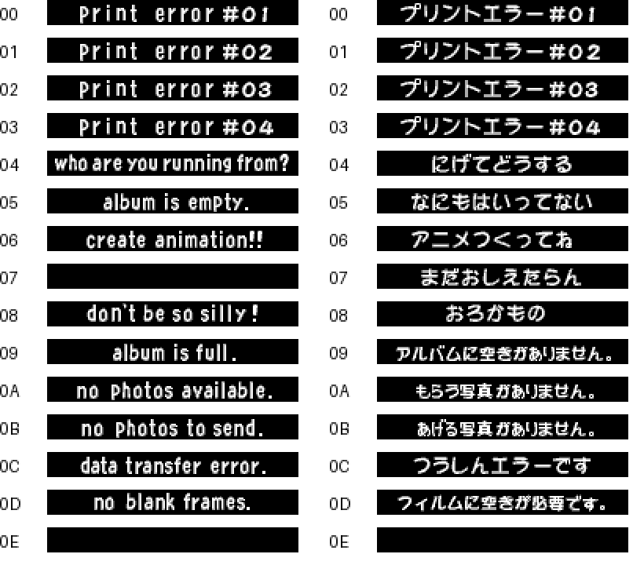

*An unused wild frame* (international and Gold ROMs, not on TCRF): the wild-frame table keeps 8 pages but the picker offers 7; the 8th is the Super Mario World frame without its TM mark (docs/20):

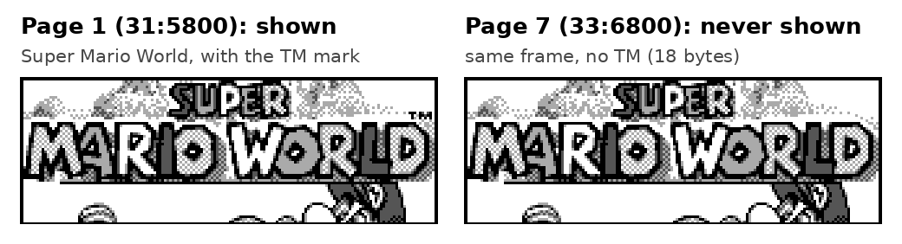

**Game Boy Camera Gold (USA)**: ported from the Japanese symbol file with the international tools (L0-L5: names, types, constants, the code executed in the coverage runs and BGB scenarios, and an editable source tree `roms/gold/src/` built by `make TREE=gold check`, byte-exact; L6: its character set and keyboard tables as text, shared with the international ROM). Besides its new assets (Zelda stamps instead of Pokémon, the three Zelda pictures of album B), one routine changed: `Photo_RenumberVector` (02:4466) repairs a damaged photo order table instead of counting bad entries as photos ([`roms/gold/`](roms/gold/)).


*Never-reached assets* (2026-11-02, from three one-hour coverage runs of the Gold ROM in the project's core: a fresh start, the unlocking saves and a third seed; `tools/never_reached_gold.py`): of the 131 never-reached assets of the Japanese ROM, 86 are in the Gold ROM (81 at the same address, 5 moved) and no organic Gold run read them, the same leftovers as in the international ROM ([`jp_never_reached_in_gold.csv`](roms/gold/assets/jp_never_reached_in_gold.csv)); 9 small blocks were read (the Space Fever II HUD bytes, as in the other builds, and the TCRF album hand gestures `13:5CA0`, which a larger tile copy of the album screen loads without showing them). The Gold edition's own content (18 blocks whose bytes differ from the international ROM: the Zelda stamps of banks $2B / $2C, the three Zelda pictures of album B with their thumbnails, the album B slot and gate tables, two icon sources) is a plain asset substitution: the same code loads it from the same places as the international stamps and album B pictures, so any player sees it. The automatic runs simply did not get there in normal play, in either build (the international run did not read the international stamps and album B pictures at these addresses either); they were read only by runs with forced states ([`gold_own_never_read.csv`](roms/gold/assets/gold_own_never_read.csv)). This is a limit of the runs, not unused content.

**Pocket Camera (Hello Kitty)** (prototype): L0-L2 done (2026-11-07: intake, own tracer, every byte typed, byte-exact round trip with the symbol file, 0 unresolved indirect sites, code observed in the core and in BGB); L3 done (2026-11-08: every routine entry named, 2,296 names of which 15 are not C, a doubts list, an unused-asset pass; [`roms/hello_kitty/`](roms/hello_kitty/README.md)).


*Screens reached in BGB* (2026-11-08): power-on at the left, each column one step further; the boot row holds the boot screen, the calibration check and the factory calibration; one panel per mode (or part of one) with its BGB screenshots at 1x, each arrow labelled with its keys, a two-headed arrow when B leads back (measured in BGB, `tools/screen_cancel.py`), grey notes under a screenshot for the keys inside the panel and for B elsewhere. Drawn by `tools/make_screen_trees.py`; the checker redraws it.

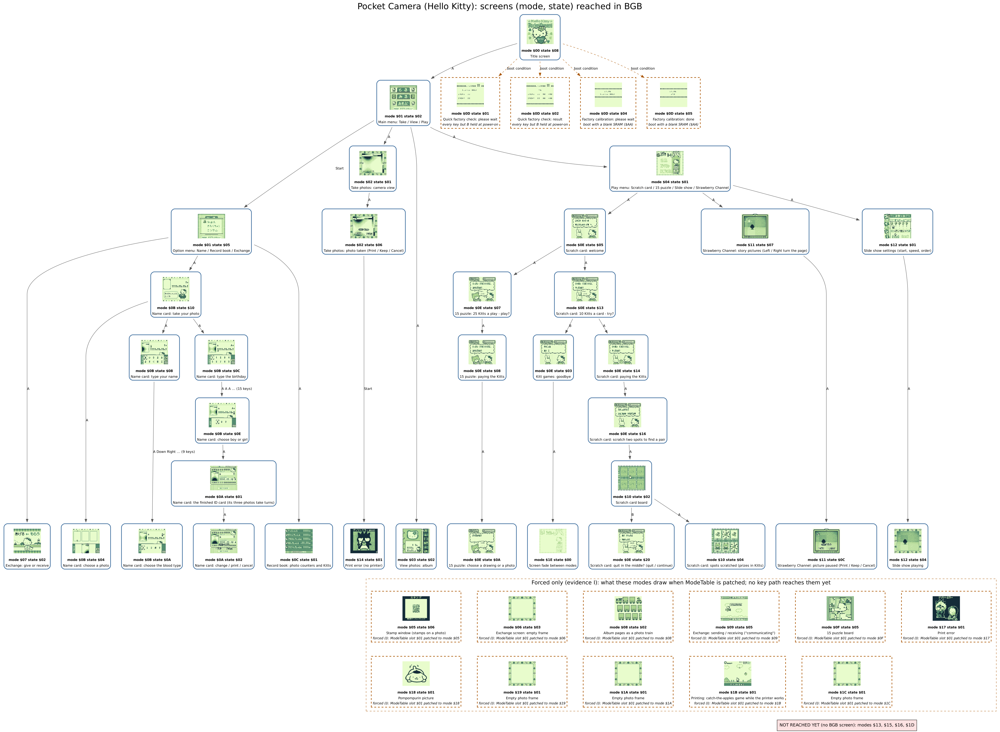

*Never-reached assets*: not investigated yet (no emulator run of this ROM).

**Pocket Camera Prototype (Japan) ("DEBAGAME")**: L0-L2 (`roms/prototype_debagame/README.md`). The ROM is a hardware tester, デバガメテスター ("Debagame Tester") SECOND IMPACT Ver10.24: its running code is bank `$00` alone, traced with 0 unresolved sites and 97 % of it run in the core, and its 13 screens reached in BGB (SRAM, bank, protect and sensor tests).


*Never-reached assets*: not investigated yet.

The three last maps are drawn by `python3 tools/status_maps.py --gold GOLD.gb --kitty KITTY.gb --proto PROTO.gb`, which reads whatever names, types and trace each folder holds: rerun it after any work on these ROMs.

## ROMs

| ROM | MD5 | Folder | Status |
|---|---|---|---|
| Pocket Camera (Japan) (Rev A) (SGB Enhanced) | `fdcfe686cf4df461e870b6e53b2b5a8b` | [`roms/jp_rev_a/`](roms/jp_rev_a/) | L0-L5 done |
| Game Boy Camera (USA, Europe) (SGB Enhanced) | `42d2f65e2549be9d1d126a6828b5d1c1` | [`roms/us_eu/`](roms/us_eu/) | ported from JP: L0-L1, L2 static, L3 (C 5,281 / I 130: I = unused, by evidence), L4, L5 (`make TREE=us_eu check`; docs §1.5), L6 character set and keyboard tables as text |
| Game Boy Camera Gold (USA) (SGB Enhanced) | `b2999cfb6dacb439f501a71f30f91762` | [`roms/gold/`](roms/gold/) | ported (L0-L5; source tree `roms/gold/src/`; L6 character set) |
| Pocket Camera (Hello Kitty) (prototype) | `0a323bddc4f0159cea76cf44ed0c1a3c` | [`roms/hello_kitty/`](roms/hello_kitty/) | L0-L3 (own trace, 0 unresolved, observed in the core and BGB; symbol file, round trip byte-exact; every routine named) |
| Pocket Camera Prototype (Japan) ("DEBAGAME") | `19b50a5f67ef4f0d015e7d813370756e` as dumped (`1d8097de3497db8b182bcd2a984b6063`: the header-patched copy for BGB) | [`roms/prototype_debagame/`](roms/prototype_debagame/) | L0-L2 (own trace, 0 unresolved, all code in bank $00; symbol file, round trip byte-exact without rgbfix; 97 % of the code run, 13 screens confirmed in BGB) |

The ROMs are not in the repository (md5 values in §1.1; the owner supplies them outside it).

## Contents

| Path | What it is |
|---|---|
| [`roms/jp_rev_a/`](roms/jp_rev_a/) | the Japanese Rev A disassembly: the symbol file `pocketcamera_jp.sym` (every byte typed and named), the RAM symbols, `disasm/` (the name, type, constant and charset tables the listing is built from, the rename log, the owner's answers), `wram/` (WRAM / HRAM map and the static trace), `assets/` (asset catalog, layout and reach tables), the two ROM maps |
| [`docs/`](docs/) | the project notes, one file per section (memory maps, SRAM, boot, sensor, link cable, printing, coverage, TCRF, menus and the international ROM, open questions); [`docs/index.md`](docs/index.md) maps every `§N.M` to its file; [`docs/19_sensor_guide.md`](docs/19_sensor_guide.md) is a readable guide to the sensor: registers, offset search, calibration vector, auto-exposure |
| [`tools/`](tools/) | the pipeline: static tracer, symbol-file builder, listing post-processor (`sym_fix.py`: tables, RAM names, constants, charmap), RAM / constant / state / charmap generators, doubts list, consistency checker |
| [`tcrf_check/`](tcrf_check/) | the evidence: BGB harness and probes, TCRF checklist, sensor, printer and link tools, and their results (`tcrf_check/assets/`) |
| [`coverage/`](coverage/) | the project's own emulator core, fuzzer and coverage results |
| [`link_protocol/`](link_protocol/) | Game Link Cable captures between two emulated cameras |
| [`source/`](source/) | the owner's material: source pack, Spriters Resource sheets, TCRF pages and pictures, the cameras' SRAM summary |
| [`HOWTO_NEW_ROM.md`](HOWTO_NEW_ROM.md), [`skills/`](skills/) | the playbook (levels L0-L6) for the next ROM |
| [`CLAUDE.md`](CLAUDE.md) | working rules for the AI sessions |

## Building

The international ROM: `make TREE=us_eu check` builds `build/us_eu/gbcam_usa_eu.gb` from `roms/us_eu/src/` (md5 `42d2f65e2549be9d1d126a6828b5d1c1`; docs §1.5).

### Japanese Rev A

From the source tree (rgbds 1.0.4 in `PATH`, or `RGBDS=/path/to/rgbds/`):

```bash
make check                       # build/jp_rev_a/pocketcamera_jp.gb, md5 fdcfe686cf4df461e870b6e53b2b5a8b
```

`roms/jp_rev_a/src/` holds 64 bank files, 899 `INCBIN` files (675,384 bytes; 494 tile blocks as PNG), 4,908 label notes, 837 far pointers written as labels (13 left as numbers) (docs §1.4), and uses the macros of `macros.inc` (far copies and calls, far pointer rows, states, sound requests, screen on / off, `REPT`). Its ROM addresses are labels, so code and data can move: `tools/relocation_test.py` moved 29 banks, rebuilt and replayed 2,835 corpus entries with no difference but one read the original program makes past its font (docs §1.4). It is generated: `make source ROM=pocketcamera_jp.gb` rewrites it from the tables of `roms/jp_rev_a/disasm/` (and overwrites hand edits).

The listing the tree comes from, by hand. Tools: [mgbdis](https://github.com/mattcurrie/mgbdis) master (commit 95d951a) and rgbds 1.0.4. mgbdis reads `<rom basename>.sym` beside the ROM.

```bash
mkdir build && cp pocketcamera_jp.gb roms/jp_rev_a/pocketcamera_jp.sym build/
python3 mgbdis.py build/pocketcamera_jp.gb --output-dir build/disasm --print-hex
python3 tools/sym_fix.py build/disasm --tables --const --rom build/pocketcamera_jp.gb
cd build/disasm && make          # rgbasm -> rgblink -> rgbfix
md5sum game.gb                   # fdcfe686cf4df461e870b6e53b2b5a8b
```

`sym_fix.py --const` writes the RAM names, the hardware, mode, state and sound constants and the character map into the listing (docs §1.1, §2.13, §2.14). After editing a table of `roms/jp_rev_a/disasm/`, rebuild the symbol file with `python3 tools/sym_build.py ROM` and run `python3 tools/check_repo_consistency.py --rom ROM --roundtrip` (0 failures, four byte-exact rebuilds plus the source tree), then `make source ROM=ROM`.

## Disassembly status (Japanese Rev A)

| Level | State |
|---|---|
| L0 ROM identified, header, banks | done |
| L1 every byte typed (code, data, padding, text) | done |
| L2 code proven by a static trace and observed in emulators | done |
| L3 every routine and asset named | done: no `?` name, no doubtful row; the `I` names are all proven unused |
| L4 RAM names and constants in the source | done |
| L5 buildable, editable source tree (committed `.asm`, split assets) | done: `roms/jp_rev_a/src/`, `make check` |
| L6 understanding | partial |

Details and counts: [`docs/01_toolchain_and_status.md`](docs/01_toolchain_and_status.md) and [`roms/jp_rev_a/`](roms/jp_rev_a/). The overview of the findings (the ROM maps, what was settled): [`docs/00_overview.md`](docs/00_overview.md).

## Sources

Every public source the project used since the start, in one place. None of them was taken as an authority over the ROM: what a source says and the ROM cannot confirm is tagged **I** or **?** in the sections quoted below, never **C**. The addresses were supplied by the owner on 2026-10-20 (the repository had recorded only some of them); a source with no address is marked "URL not recorded" and no address is guessed.

- The Cutting Room Floor, page [Game Boy Camera](https://tcrf.net/Game_Boy_Camera), revision read: [1968673](https://tcrf.net/index.php?title=Game_Boy_Camera&oldid=1968673)
  - *What the project took from it:* the list of unused and hidden content that became the TCRF checklist and the `Unused_TCRF_*` labels; the pictures compared with the ROM
  - *Where:* §15, §16.24, §16.29
  - *How it reached the project:* printed copy of 2026-09-27 supplied by the owner, read by OCR (the figures and names were checked against the ROM before use)
- The Cutting Room Floor, page [Game Boy Camera/Regional Differences](https://tcrf.net/Game_Boy_Camera/Regional_Differences), revision read: [1846909](https://tcrf.net/index.php?title=Game_Boy_Camera/Regional_Differences&oldid=1846909)
  - *What the project took from it:* the documented differences between the Japanese and international builds (only the Japanese side of that page is counted in the checklist)
  - *Where:* §15
  - *How it reached the project:* printed copy of 2026-09-27 supplied by the owner, read by OCR
- Jonathan Traynor's blog post "Secrets of the Pocket Camera" (jofamo.com): [original address](https://www.jofamo.com/blog/secrets-of-the-pocket-camera) (the site is dead), read from the [Wayback Machine copy of 2025-09-27](https://web.archive.org/web/20250927101352/https://www.jofamo.com/blog/secrets-of-the-pocket-camera), 48 pages
  - *What the project took from it:* the claims about the Album B stock pictures, BGM 04, the P.VOICE and the character table, each compared with the ROM and run in BGB; what the article takes from the guide book, the manual, nintendo.co.jp and Tanaka's tweets was not seen and is not used
  - *Where:* §16.27
  - *How it reached the project:* PDF of the Wayback copy supplied by the owner on 2026-10-14
- [GameFAQs, Game Boy Camera cheats](https://gamefaqs.gamespot.com/gameboy/564359-game-boy-camera/cheats) (the game's [FAQ list](https://gamefaqs.gamespot.com/gameboy/564359-game-boy-camera/faqs) was also given by the owner; the README cites no individual FAQ)
  - *What the project took from it:* the cheat and secret list, every line tried in BGB
  - *Where:* §16.18 (also cited in §2, §15.4, §16.4, §16.6, §16.17, §17.6)
  - *How it reached the project:* read on 2026-10-12
- [Nintendo Wiki (Fandom), Totaka's Song](https://nintendo.fandom.com/wiki/Totaka%27s_Song)
  - *What the project took from it:* the description of the tune on the "no blank frames" screen
  - *Where:* §16.20
  - *How it reached the project:* fetched during the Totaka's Song check
- [cristofercruz/gb-camera-frames](https://github.com/cristofercruz/gb-camera-frames) (`gbc-fr.py`)
  - *What the project took from it:* the frame and wild-frame layout constants (flat offsets, tile counts) checked against the ROM
  - *Where:* §16.23
  - *How it reached the project:* shallow clone read for the constants
- [HerrZatacke/dither-pattern-gen](https://github.com/HerrZatacke/dither-pattern-gen) (MIT; read at `master` b153952, 2023-02-10)
  - *What the project took from it:* the dither-matrix cell order, compared with the ROM and with MAME (a software model: **I** at best)
  - *Where:* §18.12
  - *How it reached the project:* read for §18.12
- MAME, `src/devices/bus/gameboy/camera.cpp` (BSD-3-Clause, header "Vas Crabb")
  - *What the project took from it:* the MAC-GBD window and a simplified M64282FP model; its header gives the sensor as 128 x 123 pixels
  - *Where:* §9, §18.12
  - *How it reached the project:* copy attached by the owner, revision not stated; URL not recorded
- [Mitsubishi M64282FP datasheet](https://github.com/Raphael-Boichot/Mitsubishi-M64282FP-dashcam/blob/main/Docs%20and%20research/Bibliography/Mitsubishi%20Integrated%20Circuit%20M64282FP%20Image%20Sensor.pdf), ver. 1.1E (the bibliography of the owner's Mitsubishi-M64282FP-dashcam repository)
  - *What the project took from it:* register names and bit meanings, read against the owner's bus recordings; the datasheet section numbers quoted in the README are the datasheet's own
  - *Where:* §18 (18.2, 18.8)
  - *How it reached the project:* document read for §18
- The Funtography guide: the Internet Archive item [Nintendo Game Boy Camera Funtography Guide](https://archive.org/details/nintendofuntographyguide) (1998, described there as a Nintendo Power guide; this README calls it "the US manual")
  - *What the project took from it:* the menu names, the five flowcharts (USER, SHOOT, VIEW, PLAY, STUDIO), the build differences it reveals; printed page numbers are the guide's own
  - *Where:* §16 (introduction, 16.4, 16.5, 16.11)
  - *How it reached the project:* attached by the owner; address supplied on 2026-10-20
- [GameFAQs map "Game Boy Camera - Menu Guide"](https://gamefaqs.gamespot.com/gameboy/564359-game-boy-camera/map/63-menu-guide) by FunkyLizard (fan-made, same five sections; the picture itself is titled "Menu of Gamboy Camera")
  - *What the project took from it:* the second reading of the menu tree, compared with the guide's charts
  - *Where:* §16.11
  - *How it reached the project:* attached by the owner on 2026-10-14 with the blog link above
- [The Spriters Resource, Game Boy Camera](https://www.spriters-resource.com/game_boy_gbc/gameboycamera/): 16 sheets (17 files kept in `source/Spriter_ressources_check/`, one a byte-identical duplicate)
  - *What the project took from it:* names and layouts of graphics, matched tile by tile against the ROM (`sheet_tile_match.py`); the sheet names in the `Sheet_*` labels
  - *Where:* §1.1.1, §16.13
  - *How it reached the project:* files supplied by the owner
- Pan Docs: [Game Boy Camera](https://gbdev.io/pandocs/Gameboy_Camera.html) and the "SGB Border" page (address not recorded)
  - *What the project took from it:* the `$A000` register (bits 1-2, the P/M bits of its sample code; the meaning of bit 1 stays open, §18) and the SGB border layout (4 bpp tiles, 32 x 28 map cells, palettes 4-5)
  - *Where:* §16.13, §18
  - *How it reached the project:* consulted as reference
- [mgbdis](https://github.com/mattcurrie/mgbdis) master (commit 95d951a, after the v3.0 tag) and rgbds v1.0.4 (`rgbasm`, `rgblink`, `rgbfix`; rgbds address not recorded)
  - *What the project took from it:* the disassembler and the assembler of the byte-exact round trip
  - *Where:* §1.1, §1.1.1, `HOWTO_NEW_ROM.md`
  - *How it reached the project:* installed in the workspace; versions pinned in §1.1
- [BGB](https://bgb.bircd.org/) 1.5.x (run under Wine, headless)
  - *What the project took from it:* the emulator behind every **C** tag marked "BGB": watchpoints, screenshots, the printer helper link
  - *Where:* §16.6, §17 and the sections that cite it
  - *How it reached the project:* attached by the owner
- [Raphael-Boichot/Play-with-the-Game-Boy-Camera-Mitsubishi-M64282FP-sensor](https://github.com/Raphael-Boichot/Play-with-the-Game-Boy-Camera-Mitsubishi-M64282FP-sensor), folders `Research on real camera 2024` and `Research on real Camera`
  - *What the project took from it:* the owner's bus-analyser recordings of two real cameras (boot, calibration, a calibration under strong light, normal use, the Hello Kitty and prototype ROMs, a zeroed vector) and the saves before and after a calibration
  - *Where:* §18.4-18.6, §18.13
  - *How it reached the project:* supplied by the owner on 2026-10-26; decoded by `tcrf_check/tools/sensor_more_recordings.py`
- [untoxa's gb-photo](https://github.com/untoxa/gb-photo)
  - *What the project took from it:* only named, to identify the third-party save (`2022-03-05`) whose unused bytes hold its settings; not read as a source
  - *Where:* §3.8
  - *How it reached the project:* identified from the save content

Not public, so not listed above: the 33 real saves are the owner's own data (§3, §11); the three calibration saves of camera `CE10245109` (dark, intense light, varying light, §18.13), which hold no photo, are the one exception, kept as examples in `tcrf_check/assets/sensor/calibration_saves/`; the bus-analyser workbooks are public, in the sensor repository above; the ROMs themselves are not listed (md5 values in §1.1).
