# Pocket Camera (Japan) — Disassembly Findings
# Work in progress, stay tuned

Primary target: **Pocket Camera (Japan) (Rev A)**, MD5 `fdcfe686cf4df461e870b6e53b2b5a8b`.
The international ROM is **not** a trivial derivative. Bank $0A, the sensor driver, differs from
the international ROM by only **61 bytes** out of 16384 (the exposure/dithering algorithm itself is
effectively region-independent), but the code banks $00–$09 differ by 8,874–14,932 bytes each: the
two ROMs are different builds that share the numbering of the modes and the flow of the states
(§16.1). The Zelda-edition ROM was not examined.

## Current status


*What the map shows:* the whole Japanese ROM drawn as 2bpp tiles (64 banks of 32 × 32 tiles; code, data and padding alike). Blue = executed or read by the v8 coverage run (dark: joypad and save only, light: only after a forced RAM or mode state), **red = never executed nor read and not identified** (4 bytes: 1 B of code, `00:1137`, the clamp of the D.J. envelope, + 3 B of data in `$1F`), **purple = code that never ran and is proven dead** (1,191 B, 0.1 %: dead functions that nothing calls and branches that no value can select, UNREFERENCED / UNREACHABLE, evidence I; sorted in §16.15, the attempts to force every piece with WRAM / SRAM pokes and the list of the desperate cases are in §16.21; the same pieces forced by a program-counter jump and a flipped branch and replayed in BGB, with the tile sets, maps and sounds they produce, are in §16.26), **green = never run or read by the v8 run, but a later targeted run did** (12,868 B, 1.2 %: **4,076 B of code**, 0.4 %: the SGB sender, the printer-only code and the printer error-status handlers in BGB, the hot-spot effect handlers, the hold-A stamp mirror, music-editor fields, the Game Face hidden choice, the RUN! RUN! RUN! podium and flag code, the Space Fever II boss code, the D.J. sound effects 4, 8 and 9, the two erase-all-photos shortcuts, the APU-gated branch, the link receive counters and the `$55` hello, the blank-calibration loader, D.J. page handlers, the copy badge of the editor save-back, the hidden Game Face editor and its save-back, the COMPOSE photo pickers, the slide-show repeat markers, and the cases forced by a WRAM / SRAM poke in my core (an armed hot spot, out-of-range cursors and effect indexes, printer size tables, a place counter, D.J. chords with A held; 421 B) or by a state number poked past the end of its table (137 B, not a designed path); §16.14, §16.18, §16.19, §16.21, `assets/witness_jp.csv`, C; **+ 8,792 B of data** that the v8 run never read and that later runs showed to be used: the **wild-frame lateral strips** (4,379 B, 0.4 %, of which 2,290 B are `$FF` runs that the padding rule would have hidden: the BGB blanking test changes exactly those tiles of the print, so the print path uses them, §16.13 (1), C on frames 02, 03, 05, 06, 07, 08), the **small-kana stamp pictures** `2A:6000-7E9F` (1,610 B: the stamp-menu walks of the display tracker put them on screen, median 264 frames, §16.24, C for the replays) and the **data sent to the Super Game Boy** (2,803 B: the border BGB shows in SGB mode equals the one rebuilt from them, §16.13 (5), C)), **orange = never read but identified as asset data** (2,372 B, 0.2 %, all evidence I: BG tilemaps 1,280 B, kana glyph and text tiles 679 B, SGB border tilemap blocks 199 B, tile-set gaps and tile data 214 B; §16.13, `assets/asset_map_jp.csv`), **yellow = the really unused assets** (21,422 B, 2.0 %, 34 spans, 12 of them TCRF-documented; evidence I: the spans of `tcrf_check/assets/unidentified/really_unused.csv` that no replay ever put on screen in a run without state pokes, §16.24: **the unused alternate stand-by screen of the image exchange `14:4000-502F` + `23:5CC0`** (4,724 B, §14.4), **the unused one-page main menu `25:7820` + `17:5500`** (5,440 B, §16.25), the TCRF-documented graphics (the hand flipping a newspaper `11:5800`, the kanji strip `0D:7660`, B CANCEL, the SOUND icon, …), the never-shown strips and tile maps; yellow takes 1,143 B from orange, 3,561 B from blue and 16,718 B from light blue, because most of these spans are read by a generic copier or by forced runs; the list is in §16.24 and in the section below the map, and nobody saw or heard any of it on a real camera), muted red = untouched padding (25,934 B). Generated by `tcrf_check/tools/rom_reach_map.py` from `coverage/v8/report_v8/rom_map.csv`, `assets/asset_map_jp.csv`, `assets/witness_jp.csv`, `assets/reach_ranges_jp.csv` and `tcrf_check/assets/unidentified/really_unused.csv` (§13, §15.1, §16.13, §16.14, §16.15, §16.16, §16.18, §16.21, §16.24). There is no equivalent run for the international ROM yet: its code is a different build (§16.1).

### What each byte is, bank by bank (the second map)


*What the map shows:* the same 64 banks drawn as 2bpp tiles as above, but the colour is **what the bytes are**, not whether a run reached them; the shade inside a colour is the tile pixel. **Code** (117,627 B, 11.2 %: every byte of the static trace) takes the colour of the function of the routine that owns it: system 9,532 B (boot, interrupts, VRAM / OAM, blit, math, RNG, bank switching, SRAM storage, the SGB sender), camera 26,210 B (sensor driver, image processing, effects, the SHOOT modes and the parlor), album 11,341 B, editors 19,998 B, link cable 5,552 B, printer 8,343 B, mini-games 10,979 B, D.J. 14,181 B, menus 7,134 B, sound driver 4,323 B, and 34 B in no group. **Data** is coloured by kind, **even when no code calls it**: tile sets 669,767 B (63.9 %: 406,797 B screens, menus, fonts, sprites and the SGB border; 66,100 B stamps; 73,990 B print frames and photo borders; 122,880 B the 30 stock photos of Album B), tile maps 82,717 B (7.9 %), sprite layouts 24,780 B, sound data 12,466 B, other tables and text 59,655 B (stamp masks, the staff roll, SGB packets, the print layout scripts, jump and lookup tables), **uncertain 32 B**, and padding 81,532 B (7.8 %). A **magenta cross** marks every pure padding tile, i.e. a 16-byte tile whose 16 bytes are all padding (4,910 tiles, 78,560 B of the padding; shorter runs are not marked). An **outline** marks the 16-byte tiles that no run reached, with the classes of the first map: black = code that never ran (1,192 B), red = unused data (21,425 B), blue = identified data the v8 run never read (2,372 B); of the padding, 25,934 B were never touched. Per-bank byte counts of every colour: `assets/layout_by_bank_jp.csv`; generator `tcrf_check/tools/rom_layout_map.py` (shares `rom_reach_classes.py` with the first map).

*How a byte gets its colour:* code is a byte of the static trace (coverage classes `C`, `F`, `N` of `coverage/v8/report_v8/rom_map.csv`); its function group is the one of the label that owns it (nearest label at or before it in the bank, `disasm/sym_names_jp.csv`; the `ModeNN_` labels follow the mode table of §16.2). Everything else takes its kind from the name of its label: `Gfx_` / `Sheet_` / `Kana_` / `TileGap_` = tile set, `StampCat*_Gfx`, `WildFrame*` / `Border*` tiles and `AlbumB*_Tiles` / `_Thumb` = the stamp, frame and stock-photo tile sets, `Map_` / `BgMap_` / `*_Map` = tile map, `Song` / `Sfx` / `Snd` = sound, `OamList` / `OamPtrTbl` = sprite layouts, the rest of a code bank = tables. A `?` on a label doubts the role of the bytes, not their kind, so a `?` graphic stays a tile set. The 50 blocks named after the far pointer that loads them (`Src_*`, `Data_*`) get their kind from one evidence row each in `assets/layout_kind_overrides_jp.csv`. The kind is therefore as certain as the label or the row (C where a loader, a screenshot or a replay shows it, I where it is the reading of the bytes or of their neighbours, which is the case of most tile and map ranges that no code references). Padding is a run of 16+ `00` / `FF` that no typed range of `disasm/sym_types_jp.csv` covers, plus the zero fill the symbol file names `Bank*_Padding` / `ZeroFill`; forced runs read part of it (the 3,654 B of zero fill at the ends of banks $00-$02, for instance), so it is more than the 25,934 B nobody touched.

*The uncertain colour (32 B, magenta fill, not to be confused with the cross):* only the 32 bytes after the 12-row map at `19:7FE0` (no loader reaches them). The 7,520 B at `08:54DE-723D` are tables (C): the print progress packets and the five layout scripts of the printer job (§17.8). The other spans that were uncertain are classified by evidence (18,126 B): the 3 graphic spans tagged `?` (2,908 B: `13:5CA0`, `14:4554`, `1A:7C90`) are tile sets of doubtful role, and the 50 `Src_*` / `Data_*` blocks (15,218 B in banks $0C, $13, $14, $17, $19, $1C, $1D, $20, $21, $23, $25, $26 and $27) are 7,648 B of tile maps (C: the copy routine shows the BG-map destination: the animated background of the View menu, the main-menu slide strips, the stamp-category tile maps, the equaliser) and 7,570 B of tile sets (C where the copy shows a tile destination, as for the stamp-category icons loaded by `Stamp_LoadCategoryIcons`; I where the bytes render as digit, panel, picker or podium tiles). `disasm/sym_unconclusive_jp.md` lists the doubtful names with the test that would settle each.

*How the banks are organised (shares of the 16 KB of each bank; the first map's classes give the reach):*

| banks | what they hold |
|---|---|
| `$00` | the fixed bank: system code 32 %, tables 23 %, print code 17 % (printer driver and the print job), camera code 8 % |
| `$01`-`$02` | sprite layouts (OAM lists and pointer tables): 88 % of `$01`, 63 % of `$02`; `$02` also holds the storage manager (system code 23 %) |
| `$03`-`$09` | the mode code: editors (`$03` 73 %), album, editors and the parlor (`$04`), D.J. and BALL (`$05` 75 % + 15 %), the shooting modes (`$06` 78 %), main menu, link, Space Fever II and slide show (`$07`), print screens and the print layout scripts (`$08`: 49 % tables, of which 7,520 B are the layout scripts and progress packets at `08:54DE`, 30 % print code, 17 % padding), RUN! RUN! RUN!, the comment editor and keyboard, the user screens and the credits (`$09`) |
| `$0A` | the camera: sensor driver and effects, 68 % code, 17 % tables |
| `$0B` | the Super Game Boy data: border tiles 42 %, border map 10 %, packets and palettes 4 %, padding 44 % |
| `$0C`-`$22` | tile sets, 61-100 % of each bank (`$22`: 61 % tile sets, 39 % tile maps), except `$1F` |
| `$1F` | sound: 75 % song, effect and parameter data, 25 % sound driver code |
| `$23`-`$27` | tile maps, 72-88 % of each bank, the rest tile sets (9-25 %) and padding |
| `$28`-`$2A` | `$28` tile sets 78 % (padding 22 %); `$29` the staff-roll tables 46 % and padding 52 %; `$2A` the character glyphs and stamp sheets (tile sets 45 %) and the small-kana stamps (46 %) |
| `$2B`-`$30` | the stamp categories: stamp tiles 29-98 % of each bank and their 1bpp masks (tables) |
| `$31`-`$35` | print frames (`$31`-`$33`, 87-95 % frame tiles) and photo borders (`$34`-`$35`, 84 % tiles, 7 % maps) |
| `$36`-`$3D` | the 30 stock photos of Album B, 94 % picture tiles and thumbnails per bank, 5-6 % footers and tables |
| `$3E`-`$3F` | tile sets (88 % and 82 %), border tiles 9 % in `$3E`, tile maps 10 % in `$3F` |

*What nothing reaches, by bank (the outlines; bytes):* the never-run code sits in banks `$00` and `$02`-`$0A` and in the sound driver of `$1F`; the unused data sits in the tile and map banks `$0D`-`$26` (plus 3 B of `$1F`); banks `$27`-`$3F` hold nothing that no run reached except padding and 904 B of identified data the v8 run never read. The last column is the largest span of the list of §16.24 in the bank, counted whole (part of a span can be padding or read, so it can exceed the outlined bytes of the bank).

| bank | never-run code | unused data | unread, identified | largest unused span (listed in §16.24) |
|---|---:|---:|---:|---|
| `$00` | 357 |  |  |  |
| `$02` | 5 |  |  |  |
| `$03` | 11 |  |  |  |
| `$04` | 122 |  |  |  |
| `$05` | 71 |  |  |  |
| `$06` | 60 |  |  |  |
| `$07` | 154 |  |  |  |
| `$08` | 6 |  |  |  |
| `$09` | 52 |  |  |  |
| `$0A` | 232 |  |  |  |
| `$0B` |  |  | 199 |  |
| `$0D` |  | 2,016 |  | 1,632 B `Gfx_0D_7000_FillPatternTiles` |
| `$10` |  | 64 | 20 | 32 B `Unused_TCRF_SoundPrintModulationIcon_TopRow_Gfx` |
| `$11` |  | 2,855 |  | 4,416 B `Unused_TCRF_HandNewspaperFrames_Gfx` |
| `$14` |  | 4,066 |  | 2,780 B `Gfx_14_4554_Mode0E_ExchangeAlt_StrayPtr` |
| `$15` |  | 797 |  | 512 B `Gfx_15_5200_MainMenu_DrawUpperItem2_Aux` |
| `$16` |  | 1,960 |  | 512 B `Gfx_16_7380_MainMenu_BallHeadAnim_F5_Unref` |
| `$17` |  | 4,524 |  | 4,864 B `Gfx_17_5500_Unused_MainMenuTiles` |
| `$18` |  | 542 |  | 256 B `Gfx_18_7D80_Mode0F_State04_LeaveSelected_Aux` |
| `$19` |  |  | 16 |  |
| `$1A` |  | 687 | 31 | 501 B `Gfx_1A_7E00_Unref` |
| `$1C` |  | 573 | 78 | 512 B `Unused_TCRF_HotSpotEffectIcons_Extra_Gfx` |
| `$1D` |  | 63 |  | 63 B `Gfx_1D_7B41_Tbl539D_Aux` |
| `$1E` |  | 744 |  | 848 B `Unused_TCRF_CannotCombineSamePicture_Gfx` |
| `$1F` | 122 | 3 |  |  |
| `$21` |  | 223 |  | 177 B `Gfx_21_6AC7_Unref` |
| `$23` |  | 580 |  | 580 B `Map_23_5CC0_Mode0E_ExchangeAlt_Unref` |
| `$25` |  | 1,152 | 585 | 576 B `Map_25_7820_Unused_MainMenu` |
| `$26` |  | 576 | 539 | 576 B `Map_26_7080_Unused_Picture` |
| `$27` |  |  | 225 |  |
| `$28` |  |  | 330 |  |
| `$2A` |  |  | 349 |  |
| **all** | **1,192** | **21,425** | **2,372** | |

### The really never used assets (the yellow of the map)


*The sheet* (`tcrf_check/assets/unidentified/really_unused.png`, built by `tcrf_check/tools/display_report.py`, regenerated 2026-10-14 after the L3 loader hunt; list in `really_unused.md` / `.csv`, sounds in `really_unused_sounds.csv`; method and every span in §16.24 and §16.25): a core that follows each ROM byte to the screen replayed 37,370 menu states and the stamp-menu walks; a graphic span counts as **never used** when none of its tiles was on screen (at least 15 frames) in a run without a state poke. The first block of the sheet shows each unused tile map right beside the tile set it is drawn with (`23:5CC0` with `14:4000-502F`, `25:7820` with `17:5500-67FF`, both drawn in BGB); the third, `25:75E0`, sits beside the frame tiles of the hot-spot viewer (`3F:7700-78EF`) with its photo cells hatched (a photo area is drawn with dynamic tiles, §16.25.2), and `26:7080`, for which no tile block of either ROM fits, shows an empty box. The verdict is **I**: nothing was seen or heard on a real camera, a tile composed by software would not have been seen, and "never on screen" is strong evidence, not proof.

**Today's count: 34 spans, 23,802 B** in 16 banks (30 graphic spans, 4 tile maps); 21,422 B of them are yellow on the map, the other 2,380 B are runs of 16+ `00` / `FF` that the map keeps as padding.

| tier (evidence I) | spans | bytes | what it is |
|---|---|---|---|
| no loader in either ROM (code search + BGB, `unused_manual.csv`) | 5 | 10,164 | the **unused alternate stand-by screen of the image exchange** (`14:4000-502F` + map `23:5CC0`, 4,724 B, §14.4) and the **unused one-page main menu** (map `25:7820` + tiles `17:5500`, 5,440 B, drawn in BGB, §16.25.1) |
| TCRF-documented graphics (`Unused_TCRF_*`, `tcrf_check/TCRF_CHECKLIST.md`) never on screen in an organic run | 12 | 6,656 | the hand flipping a newspaper `11:5800` (4,416 B), the kanji strip `0D:7660`, B CANCEL `1A:7D80`, the SOUND icon `10:7A80` / `10:7B80`, the circled X `15:4480` / `4500` / `4580`, the margin-print pieces `18:5A50` / `18:5F90`, the extra hot-spot icons `1C:5920`, the "cannot combine" text `1E:6620` (two more TCRF spans, `13:5CA0` and `1A:7C90`, are on screen in normal play and are not in the list) |
| never on screen, never read organically | 13 | 4,934 | 11 graphic spans (`0D:7000`, `15:5200`, `15:5500`, `18:7D80`, `1A:5182`, `1A:7E00`, `1C:5C20`, `1D:7B41`, `1E:7D00`, `21:6AC7`, `21:6B91`) and 2 tile maps (`25:75E0`, `26:7080`); read only by forced runs, no loader found |
| on screen only in forced runs | 4 | 2,048 | the frames 5-8 of the ten-frame camera ball head animation (`16:7380`, `7580`, `7780`, `7980`; the owner named them on 2026-10-14: assets of the head animation of the main camera menu, played on Up / Down): the shipped code plays frames 0-4 only, the second set is listed only by Tbl2 / Tbl3 of the page transition A (`07:7C33` / `07:7C3F`), and those two tables have no caller in the Japanese or the international ROM |
| **total** | **34** | **23,802** | |

*Sounds* (`really_unused_sounds.csv`, §16.24): 147 of the 162 sound ids were requested in an organic run, **15 were not**: 4 with no caller and no list (song `48`, `sfx1 24`, `sfx3 04`, `sfx3 07`), 3 in a picker list but never chosen (song `47`, `sfx1 2F`, `sfx3 0A`), 4 that share their data with a used id (song `08`, `sfx1 2B`, `3D`, `3E`) and 4 that have a static caller but were reached only by forced runs (songs `27`, `44`, `sfx4 05`, `11`; not proof of dead code). Nobody listened: the sound results are mailbox logs.

*Spans that look unused but are used by code* (they are in `unused_manual.csv` with the tier `used (withdrawn)` and are not in the count above). `10:74A3-753F` (157 B) is the tail of the numeral table `10:7400` that `DjTitle_LoadNumeralTile` (`05:423A`) indexes by digit (`$7400` + digit x 32 in bank `$10`, C from the code); it holds the tiles of the digits 5-9, which no replay put on that screen: value-gated, not unused. The eight spans `10:7602`, `10:78B8`, `10:7908`, `10:7A24`, `10:7ADE`, `10:7BF8`, `10:7D52` and `10:7F00` (2,089 B) are glyphs of the **printer text font** `10:7600-7FFF`: slot k is 16 bytes at `$7600` + 16 k, copied by `Gfx_Copy16FromBank10` (`00:1615`), which the D.J. score print renderer (`05:60EE`, calls `05:610D` / `05:611B`) feeds with the character codes of the 20-code row tables `05:5ABB-5EBE`. The rows are printed only to a Game Boy Printer, so no replay can put them on a screen: they are never *displayed*, not unused. They are labelled `Gfx_10_*_DjPrintFont_Tiles*` (C for the loader, I that every glyph of the span occurs in a printed row). No other yellow span lies inside a loader range (checked against every copy site with a constant length, the Parlor page lists and the numeral tables; `18:5A50`, `18:5F90`, `1C:5920` and `1D:7B41` are copied to VRAM by used screens but never shown, as the list says). The four frames `16:7380-7B7F` (2,048 B) are frames 5-8 of the ten-frame camera ball head animation (the owner's name, 2026-10-14); only Tbl2 / Tbl3 of the page transition A list them and those tables have no caller.

## Contents

| § | Topic |
|---|---|
| 1 | Toolchain, reassembly procedure, **disassembly status and what is lacking** (1.2), **distance to a full disassembly** (1.3, and `HOWTO_NEW_ROM.md` for the next ROM) |
| 2 | **WRAM / HRAM map** — overview, boot / DMA / soft reset, the 34 modes, seven region maps, SRAM mirrors, open points |
| 3 | **SRAM structure** (128 KB), byte-level map, self-repair rules, atypical saves |
| 4 | Asset catalog |
| 5 | The lookup table at `$02B300` / bank `$0A:$7300` |
| 6 | Calibration procedure (`$04FF2` / `$11FF2`) |
| 7 | Dithering pattern selection |
| 8 | Boot procedure, hidden factory test, hidden key combinations |
| 9 | Masked pixel lines |
| 10 | Auto-exposure |
| 11 | SRAM evidence from the 33 real saves |
| 12 | Open questions |
| 13 | **Emulator coverage run** — what executes, what never does and why, the 14 unreferenced data banks, dead-root verdict |
| 14 | **Game Link Cable photo exchange** — byte-level protocol sniffed on two emulated cameras, roles, commands, thumbnails, abort/cancel/time-out, and the SRAM signature of an exchanged photo |
| 15 | **TCRF and unlock cross-check** — what the unlocking saves reach (credits, CoroCoro, Album B, stamps, mini-games), the documented-content checklist (54 items), re-classification of code that never ran (the hold-A stamp branch, the hot-spot effect handlers), mode names from screenshots, asset inventory |
| 16 | **Menu names, the international ROM, BGB cross-validation** — the 34 modes named from the screens (Japanese / international / the Funtography guide), the mirrored main menu, the two ROMs are different builds, Album B (8 vs 14 conditions) and the CoroCoro flag in the international ROM, BGB results (sweep, credits gate, tag, Pokémon pages, hold-A, hot-spots, link, gender bits), hot-spot effect behaviour, the 20 Pokémon stamps, the five Funtography flowcharts walked in BGB, the CoroCoro content on the international build (§16.12), **the code that later runs executed (§16.14), what keeps the rest from running (§16.15) and what the Camera does with each printer status bit (§16.16), the RUN! RUN! RUN! rules, the three podium places, the flag and the sounds it asks for (§16.17), the GameFAQs cheats page tried line by line and Space Fever II and BALL played to their Album B scores (§16.18)**, **easy wins on the never-run code: link counters, the `$55` hello, a blank calibration, the D.J. pages, the editor copy badge, the Game Face editor, the COMPOSE pickers, the slide-show repeat markers (§16.19); Totaka's Song on the "no blank frames" screen and the factory-test NG jingle (§16.20); the last never-run pieces forced with WRAM / SRAM pokes in the core, what is proven dead and the desperate cases (§16.21)**, **the real credits run end to end (13 dancer frames, the staff-roll text as a table, the ending plate), the SHOOT-parlor RUN (seven results, four pictures), the owner's 42 worklist answers, Space Fever II and stamp-tool sound inventories (§16.22)** (§16.14), **what the never-read data is** (§16.13: wild-frame side strips, glyph banks, tilemaps, the SGB border rebuilt from bank `$0B` and matched to BGB; the orange of the map, of which the wild-frame strips, the SGB data and the small-kana stamps are green since 2026-10-13), **which assets are really unused: ROM-to-screen display tracking, the TCRF pictures against the ROM (2x enlargements!), the exact stamp ranges, the sounds no replay requested (§16.24), **banks `$23-$27`: the unused one-page main menu (map `25:7820`, tiles `17:5500`, drawn in BGB), the head rows of the mode-`$16` option pages, the dead-code tile-map loader and the remaining orange blocks, and an experiment showing that the unused menu is a picture the shipped menu code does not drive (§16.25)**, **the purple code forced by a program-counter jump and a flipped branch in a fast core and replayed in BGB: the dead loaders' tile sets and maps, the nine unused sound presets recorded, the effect-table slots (§16.26)**, **the jofamo.com article against the repository: the character table, the names and comments of the 21 stock pictures of Album B, BGM 04 and the P.VOICE (§16.27)**, **the 96 image-effect slots of bank `$0A` run in BGB and named by what they write, the Magic menu's lenses and montage layouts mapped to them, the flip options, one wrong look-up byte, and the 14 hot-spot helpers (§16.28)** |
| 17 | **Printing in BGB** — a printer helper for BGB (link protocol, status model), the print screens (single photo, the Start option = the 「Camera コメント」 card with its tag-field mapping, several photos, the TRIPY-H score), and the **BGB re-trace of the coverage run** (81 % of the core's blocks re-hit, SGB-only and APU-gated blocks, where the two disagree) |
| 18 | **The sensor registers** — what the ROM sends to the M64282FP through the MAC-GBD, in datasheet names; boot, calibration and normal use traced against bus-analyser recordings of a real camera and against BGB (offset search, threshold scan, auto-exposure bands, dither keys), and what the datasheet gets wrong; the scan that finds no register or code path beyond the five registers and the matrix (18.11), the cell order of the dither matrix and two outside implementations (MAME, dither-pattern-gen) compared (18.12) |
| Appendix | Tools |

---

Everything below is graded by confidence:
- **Confirmed** — read directly from disassembled code and/or verified against raw ROM bytes.
- **Strong hypothesis** — code traced and consistent with the idea, but not independently cross-checked.
- **Open** — genuinely unresolved.

---

## 1. Toolchain, reassembly procedure and disassembly status

### 1.1 Toolchain and reassembly procedure

```
rgbds v1.0.4  (rgbasm/rgblink/rgbfix)  — installed, matches what mgbdis's Makefile expects
mgbdis v3.0   — github.com/mattcurrie/mgbdis, used for the static disassembly pass
```

Procedure (byte-exact, verified working). mgbdis v3.0 has no `--sym` option: it reads `<rom basename>.sym` from the folder of the ROM, so the symbol file must sit beside `pocketcamera_jp.gb` under that name:

```bash
cp pocketcamera_jp.sym /path/to/rom/folder/            # beside pocketcamera_jp.gb
python3 mgbdis.py --output-dir disasm_labeled pocketcamera_jp.gb
cd disasm_labeled
make            # runs rgbasm -> rgblink -> rgbfix -> md5sum
# md5sum must print fdcfe686cf4df461e870b6e53b2b5a8b
```

Optional readability pass (does not change a byte, checked by the same md5): `python3 mgbdis.py --print-hex --output-dir out pocketcamera_jp.gb && python3 tools/sym_fix.py out --tables --ram && (cd out && make)`. mgbdis v3.0 prints a label for *any* 16-bit operand equal to the address of a label of the current bank (or of bank 0 below `$4000`), whatever the operand means (`ld bc, Label` for a byte count, `ld [Label], a` for an MBC register write, a far pointer read in the wrong bank, a word table as `db $lo, $hi`). `tools/sym_fix.py` rewrites the cases that the code itself decides (74 MBC writes, 28 byte counts and 3 sprite positions in `bc`, 39 far-pointer loads, 1,762 + 274 word-table rows as `dw`, 260 `{lo,hi,bank}` rows as `dw Label` + `db BANK(Label)`); what is left of the artefact is cosmetic (a number printed as the label that happens to share its value). `--ram` is the L4 step: it writes every WRAM / HRAM operand with its name from `disasm/ram_names_jp.csv` and adds `disasm/ram_jp.inc` to the listing (§2.13); without it the listing keeps the raw `[$D5CE]`.

#### 1.1.1 The complete symbol file (`pocketcamera_jp.sym`, `disasm/sym_*_jp.csv`)

`pocketcamera_jp.sym` now covers **every byte of the 1 MiB ROM**: 5,243 labels and 7,467 lines in mgbdis v3.0 syntax (`BB:AAAA Name`, plus the block types `.code:LEN`, `.data:LEN[:WIDTH]`, `.text:LEN`, `.padding:LEN`).
Bytes by type: code 117,627 (the 60,449 instructions of the trace, so every `.code` block starts on a proven instruction and the disassembler agrees with the trace on every boundary), data 860,295 (with a row width per structure: 2 for word tables, 3 for `{lo,hi,bank}` far pointers, 32 for tile maps, 16 for tiles), padding 70,639 (1,042 B less than before the L3 pass: fill that sat inside tile tables and maps is typed with its table now), text 15 (`MAIN PASS` at `00:2E88` and the SRAM check string `Magic` at `02:4000`).
It is **generated, not hand-edited**: `tools/sym_build.py` builds it from two layered tables,
`disasm/sym_names_jp.csv` (`bank,addr,name,conf,note,source`: later layers win: assets < auto < hand < fixes) and `disasm/sym_types_jp.csv` (the block rows), and the trace `wram/trace_jp_v3.json`:

```bash
python3 tools/sym_build.py pocketcamera_jp.gb --names disasm/sym_names_jp.csv --types disasm/sym_types_jp.csv --trace wram/trace_jp_v3.json --out pocketcamera_jp.sym --report
```

To rename or retype something, edit a row of the two CSV files and rebuild; the builder refuses duplicate names, a label inside an instruction, a hole or overlap between blocks, and a `.padding` block that is not one repeated byte.

*Naming.* `Module_Verb` in PascalCase (`Album_DrawPhotoNumber`, `Cam_Calib_ValidityCheck`, `Sfx1_Init_3B_EraseAnim`); a data asset carries its type, bank, address and consumer: `Gfx_17_5500_Unused_MainMenuTiles` (2bpp tiles), `Map_24_4B20_PenMenuSizePanel0` (tile-map rows), `Src_BB_AAAA_Owner` (loaded through a far pointer, destination class unknown), `Sheet_<Name>_BB_AAAA` (a Spriters Resource sheet), `*_Part<addr>` (a continuation of the same asset). Each name has a confidence tag in the CSV: **C** confirmed (code read, README, emulator), **I** inferred (consumer or neighbour evidence), **?** doubtful: 3,790 / 1,448 / 5 (3,499 / 1,666 / 169 before the L3 pass of 2026-10-14).
*Where the names come from:* the 134 trace roots and the hand names of the earlier passes (README sections); the WRAM map (§2) for variable-driven names; the table-driven extents (message strips 15 x `$280` bytes, heads 24 x `$380`, the credits rows 234 x 32 bytes, the Album B slots, the stamp tables of `04:5337`, the pen-menu panel tables of `04:67A5`/`67EF`/`6839`); the TCRF and Spriters Resource sheets (`assets/spriter_sheet_map_jp.csv`, `assets/catalog_jp.csv`) for graphics; and, for 22 ranges, the picture of the bytes (`disasm/sym_unconclusive_banks/`).
A load site only counts as a far pointer when the immediate really reaches the banked helper unchanged: `ld hl,TABLE` + `add hl,bc` + `ld a,[hl+]` (a pointer table of the current bank, as in the pen-menu builders) is not one, while `ld hl,BASE` + `add hl,de` (a digit-indexed tile table) is.

*What is not settled* is listed in `disasm/sym_unconclusive_jp.md` / `.csv` (253 rows: every `?` name plus the `I` names of the groups below with their best guess, evidence and what would settle each): 102 mode-state handlers, 95 sound-effect tags, 31 dead-code names, 17 spans classified by content only (map rows vs tiles, named after the neighbouring consumer: `_Aux` / `_Unref`), 4 hand names not confirmed, 2 main-menu slide tables, 1 identified from the picture, 1 Run mini-game name. The 75 small unread data blocks, the 17 far-pointer assets of unknown extent, the 41 Run, 19 keyboard / glyph and 12 arrow names that the list held before the L3 pass are settled or reduced to the rows above (see *The L3 pass* below). All the graphic ones on one sheet: `tcrf_check/assets/unidentified/open_assets.png` (§16.23; a 2026-10-13 snapshot, 154 rows in the csv, most of which the L3 pass settled: the list above is the current one), and the really unused ones on `really_unused.png` (§16.24 and the section under the map at the top). Bank pictures of the unresolved data are in `disasm/sym_unconclusive_banks/` (`tools/bank_pics.py`; orange = span in the list, blue = other `?` asset).
Limits: names are inferred from code, README, WRAM map, TCRF, Spriters Resource and the pictures; they are not hardware-verified. Stamp storage (`2D:7000-7FFF`, noise-like) is open; the 96 effect slots of bank `$0A` and the 14 hot-spot helpers of bank `$03` are settled (§16.28).

*The L3 pass of 2026-10-14 and the effect-slot pass of 2026-10-18 (§16.28)* (names C / I / ? 3,499 / 1,666 / 169 -> 3,790 / 1,448 / 5; doubtful rows 610 -> 253; distinct doubtful bytes 50,221 -> 22,554, 2.2 % of the ROM; md5 round trip unchanged, also after `sym_fix.py --tables`; `08:54DE-723D` is typed as `Print_ProgressPackets` and the five `Print_Layout0` to `4` scripts, §17). Every change of a label is in `disasm/renamed_jp.csv` (584 rows against the start of the pass: 330 renames with old / new tag and the reason, 113 names kept with a better evidence tag, 116 labels removed, 25 new). What settled the rows, all C from the code unless a row says otherwise:
* **Loaders the copy-site scan does not see.** `Parlor_LoadPage` (`04:73EF`) walks lists of 7-byte records `{src, bank, dst, len}` (`Parlor_PageTbl`, `04:7436`: 7 records, `1D:6B00` / `7300`, `1C:4000` / `4800`, `21:5A00` / `6200` +`$800` each, `21:6560` +`$10`), which load eight spans of the SHOOT-parlor tile pages that were `?` (`_Aux` / `_Unref`); `SpaceFever_CopyTextRows` (`07:68D6`); the numeral tables indexed by value (`swap a`, x16 or x32: Album page numbers, D.J. title and tempo digits, hot-spot editor numbers, COMPOSE photo number, interval digits); and the **glyph font `2A:4000`**, 256 slots of 32 B read by `Kb_LoadGlyphList` (slot lists A / B / C at `09:53D3` / `53F5` / `5417`: `n, slot` = n glyphs, `$80+n, slot` = n copies) and by `Glyph_LoadFromCharCode` (`09:4802`, slot = char code - 1; base `$6000` for the small kana): the 17 "unread gaps" of the Spriters stamp sheet in bank `$2A` and the block `2A:59FF` are bytes of glyph slots that the coverage log shows read in full.
* **Fill-run splits hide extents.** A run of 16+ equal bytes becomes `.padding`, which cut tables and maps in two and left `Data_BB_AAAA` placeholders (75 of them) whose owner was the table around them; maps carry their `$FF` / `$FD` fill rows (columns 20-31 and rows after the copied span), counted with the map.
* **Names that embed a caller go stale** when function labels are refined: 115 asset names carried an owner from an earlier label set (`renamed_jp.csv`, reason "stale owner label").
* **False labels.** `09:6000` (`OwnerCard_LoadNameGlyphs_Gfx6000`) was made by `ld hl,$6000` with `C = $2A` (a pointer into bank `$2A`) and cut the last three entries off `Mode21_StateTable` (15 states = `09:5FE7-6005`): removed. A scan for the same shape (a bank put in a register, then `ld hl,imm` equal to an auto label of the current bank) found 23 sites; of the eight read by hand, seven (`06:5000`, `07:5340`, `09:5790` and four more) are real local tables that share their address with a far target, and `06:4008` is a sprite position (below). The auto labeller turns any executed 16-bit immediate that equals a ROM address into a data label, and `ld bc,$xxxx` is also how the code sets a **sprite position** for `Oam_AddMeta_*` (B = x offset, C = y offset). Reading the keyboard, slide, arrow and Run code found 19 false labels of that kind (`00:3780`, `00:3818`, `00:3878`, `00:3910`, `00:3D81`, `00:3E54`, `00:3F78`, `04:5018`, `05:5048`, `06:4008`, `06:7034`, `06:706C`, `08:5033`, `08:5833`, `08:5A59`, `08:6244`, `08:6259`, `08:6A44`, `09:6874`; six of them cut `Blit_ShiftTbl`, which is the whole of `00:3800-3FFF`, 8 pages of 256 bytes); they are removed (list in `renamed_jp.csv`, reason "sprite position of an Oam_AddMeta call"), the tables they cut are whole again, and `tools/sym_fix.py` knows the pattern now (`COORD_CALLEES`, `bc_coords()`: the operand is printed as `$XXYY` in the listing's coordinate form, not as a label).
* **Four groups read from the code (C unless a row says otherwise).** *Run mini game* (41 rows to 1): the player, rival and confetti sprite animations are lists of `{meta id, duration}` pairs run by `Run_DrawMeta` (`$FF, n` jumps to entry n), the line-up logic, the landing states, the finish-line x formula and the podium banner; `Run_ScaledPosition` was renamed `Run_OffscreenTest` (it tests whether a scaled position is off screen). *Keyboard and glyph* (19 to 0): the name-entry key pages, the cursor index to key position tables (`Kb_Page1..3_NavIndexToPosTbl`, read by `Kb_NavigateGeneric`), the voiced / semi-voiced mark maps `Kb_DakutenMapTbl` (key `$30`) and `Kb_HandakutenMapTbl` (key `$31`): records `{first code, count, new first code}` that move the character before the cursor to its dakuten or handakuten form. *Main-menu slide* (18 to 2): the strips are 10 frames A (`16:6980-7D7F`, 32 tiles each: the **camera ball head animation** in the centre of the main menu, the owner's name of 2026-10-14; renamed `Gfx_16_*_MainMenu_BallHeadAnim_F0-F9`) and 7 frames B (4 in bank `$16`, 3 in `$11`, 80 tiles each); `MainMenu_SlideA_Tbl2` / `Tbl3` (`07:7C33` / `07:7C3F`) have **no caller in the Japanese or the international ROM**, so the frames 5-8 of strip A (`16:7380-7B7F`) are listed only by dead tables (they join the really-unused list, §16.24). **Owner note (2026-10-14, 12:50): these four frames are assets of the camera ball head animation played when Up / Down is pressed on the main camera menu (SHOOT, VIEW, PLAY).** Checked in BGB (replay from the title: Start, then Down / Up / Left / Right on the upper page and the same on the lower page after Select, read watchpoints on all ten frames and on the four tables): only frames 0-4 are read (Tbl0 forward 6B80 / 6D80 / 6F80 / 7180, Tbl1 backward), never 5-8 and not 9; so the head that animates on Up / Down is made of frames 0-4, and 5-8 are its second set: the same 8 x 4 tile block with 10 or 11 of the 32 tiles changed (16 and 22-31, the lower rows) against frames 0-3, frame 9 being the resting frame of the lower page (`MainMenu_LoadIconTilesA`, `07:7827`). Evidence C for what they are and that nothing loads them in this ROM; the owner may have seen them play on a real camera or another ROM: if so the key path is not in my replays. Labels renamed, the four names went from I to C. *Arrows* (12 to 0): the arrow and cursor drawing routines (D.J. title arrows, hot-spot editor arrows, ...), each with its `Oam_AddMeta` meta list.
* **Loader hunt and read checks.** Two more loader kinds: **indexed font and record-list loaders** (the printer text font `10:7600-7FFF`, slot k = `$7600` + 16 k, read by `Gfx_Copy16FromBank10` with character codes from the row tables; `10:7A80` / `10:7B80`, the TCRF SOUND icon, is printed by `DjPrintRow_S2WaveTitle` when `$D985` = 1; the Shoot timer and digit tables `17:4000` / `4200` / `4820`, the comment-card digits `21:4D00` / `4E00`, `1E:6590`, `21:7BC0`, `23:7DC0` / `7E20`, the Parlor maps `23:7280` / `24:60A0` / `24:6140` / `24:62E0`). Two stray blocks were checked on the real BGB with **logging watchpoints** (a `-wp` read / execute watchpoint writes a line per hit and emulation goes on; a control watchpoint on bytes that certainly are read proves that a count of 0 means "not read"): `02:46E6` (3 bytes `00 C0 00` after the `jp` at `02:46E3` of `Photo_SaveReceived_Far`) on two linked BGB instances during a photo exchange (`tcrf_check/tools/bgb_link_wp.py`: the receiver executes the `jp` and never reads the 3 bytes), and `04:4D09` (18 bytes after the `ret` of `Mode0F_State09_EraseOne`, which read like 9 `{frame, duration}` pairs) on the replay of the corpus entry that erases one photo (`tcrf_check/tools/bgb_wp_probe.py`: the state ran twice, the 18 bytes were never read). Both are `Unused_*` labels (evidence I for the verdict, C for the BGB check).
What is left of the 5 `?`: the graphic span `14:4554` (the second half of the tile set of the unused image-exchange stand-by screen; its only reader is the thumbnail reducer, through a stray pointer, so only the picture or the owner can name it), the two TCRF candidates `13:5CA0` and `1A:7C90` (both lie in sheets that the album loaders copy whole to VRAM, the tiles have no copy elsewhere in the ROM, and the display tracker sees them on screen in organic runs, 22-26 frames and 65,535 frames: they match the TCRF pictures without being unused), and the two Space Fever II sound handlers of effect 24 (heard by the owner; no request of id `$24` in either ROM: the 334 call sites of `Snd_Sfx1` load 40 other ids, the one computed request `05:7B11` is `$20` + `[$D9E5]` and the six (id, channel) tables of `00:2A4B` hold no (24, channel 1)). The graphic spans `0C:5800` (23 of its 36 tiles are exact copies of tiles of the Animation-editor menu labels `0C:4D50`; no loader, no organic read) and `0D:7000` (fill and dither tiles; no loader in either ROM) stay `I`. The 253 doubtful rows are mostly generic names (mode states, sound effects) that need the owner or a debugger.

### 1.2 Disassembly status: what is proven, and what is lacking for a confident disassembly

**Byte identity is not the problem.** `mgbdis` + `rgbasm` already reassemble the whole ROM to the exact md5 above, because every byte it cannot type is emitted as `db`.
The open work is *confidence in the classification*: which bytes are code, which are tables / strings / tiles / song streams, and what to call them. That is measured with a
recursive-descent tracer, `tools/rom_trace.py` (v2: `--roots tools/extra_roots.json`; without `--roots` it reproduces the first version bit for bit; its symbol input is `tools/rom_trace_labels.sym`, the 183 labels of the first pass, because the tracer takes every non-`.data` name as a code root; `python3 -I tools/rom_trace.py pocketcamera_jp.gb tools/rom_trace_labels.sym OUT.json --roots tools/extra_roots.json` writes `wram/trace_jp_v3.json` exactly). A byte is *proven code* only if it lies on a decoded path.

| Trace | Proven instructions | Proven code bytes (banks 00, 02-0A, 1F) | Unresolved indirect jumps |
|---|---:|---:|---:|
| first tracer (vectors, `.sym` labels, mode and state tables) | 56,799 | 111,808 | 14 |
| + 89 live roots and four rules (`jp hl` tables, callbacks, cooperative tasks, soft reset, OAM-DMA stub) | 59,866 | 116,613 | 0 |
| + 45 unreferenced "dead-code" roots (all 134 roots) | 60,449 | 117,627 | 0 |

The 11 code banks hold 180,224 bytes: **117,627 proven code (65 %)**, 1,256 inline jump / mode tables, 2,164 padding, 2,400 unreferenced (2,251 of them `0A:6BDD-74A7`: 1,827 zero bytes plus the popcount table `$7300` and the bit-reverse table `$7400`, both verified), and 56,777 bytes of data of unknown type.
The biggest single gain was the bank `$0A` jump table at `0A:541A` (96 entries, reached through `06:781D → 0A:7CFE`, the first tracer capped it at 32): +2,444 instructions of image-effect code. Indirect flow after the work: 31 `jp hl` (8 by table idiom, 23 by hand or rule), 46 inline `rst $18` tables, 276 far calls (72 distinct targets), 0 unresolved.
All consistency checks pass (no overlapping instructions, every callback ends in `ret`/`jp`, no invalid opcode on a proven path). The 45 dead-code roots decode cleanly but nothing calls them: they are *reachable by decoding*, not proven live.

**What is lacking, by importance**

1. **The data banks are unstructured.** *(Update, §13.5: the emulator run reads all 14 banks that no code references and logs which mode, state and routine reads which range; the type and extent of each asset inside a bank are still open.)* Banks `$0B-$3F` except the sound bank `$1F` (52 banks, 851,968 bytes) are not described: the asset catalog (`assets/catalog_jp.csv`, 385 copy sites) accounts for 254,546 bytes (29.9 %). 25 of these banks have no catalogued byte, and **14 banks (`2B 2D 2E 30-35 37 3A-3D`, 229,376 bytes) have no static reference at all** yet hold real content (not padding). They are reached through computed bank numbers and pointer tables that static tracing cannot follow. Until that is solved a source file can only `INCBIN` them, not name sections.
   Bank `$01` is not in these 52: it is the one data bank that is **already fully typed**. It holds the sprite-composition lists drawn by the OAM adders `00:24AF` (pointer table `$4000`, 249 entries) and `00:2496` (pointer table `$5D47`, 246 entries): each pointer leads to 4-byte OAM records (Y, X, tile, attribute) ended by `$80` (3,247 records in all; `A` = list number, `C`/`B` = Y/X offset added to every record, written to the OAM shadow at `$D400 + FF9A`). Parsing both tables covers `$4000-$7888` (14,473 bytes) with no gap; `$7889-$7FFF` (1,911 bytes) is zero padding. Bank `$02` has two more tables of the same kind (`$6E4B` for `00:2464`, `$5272` for `00:247D`), not parsed yet.
2. **About 57 KB of data inside the code banks has no known type or extent** (bank `$02` 11.9 KB, `$1F` sound data 12.3 KB, `$08` 10.0 KB (7,440 B of it are the five print layout scripts of `08:552E`, reached through the word table `00:32E8` and typed since), `$09` 5.3 KB, `$00` 4.1 KB, `$06` 3.4 KB, `$0A` 2.3 KB…): word tables vs strings vs tiles vs song streams. This is an upper bound: `tools/rom_coverage.py` credits a table as referenced when any `ld rr,nn` constant lands near it, and a bank-0 `ld hl,nn` ≥ `$4000` is credited to every bank. The only data of known extent is the 254,344 bytes copied through `call $0450` with a constant length.
3. **Reachable is not live.** 45 roots (1,014 bytes) are unreferenced code (library stubs, an unused sound-effect starter, twin routines `05:7F1C` / `09:721D`…). *(§13.3: in the emulator run none of the 45 executed from joypad input; one ran once in a forced run through an edge that is not in the static control flow, an artefact.)*
4. **Heuristic completeness.** The cooperative-task entries of bank 3 (program counters stored as split immediates `ld a,lo ; ld [$D6FD],a ; …`) and the 23 hand-resolved callbacks come from pattern scans, not from a proof that none is missing. The tracer also had one real bug, fixed in v2: an `rst $18` table at `05:48C4` was read one word too long and swallowed the first instruction of `Bank005_State12` as table data (bytes unchanged, labelling wrong).
5. **Charset table: only for the name / comment fields.** Strings other than the ASCII `MAIN PASS` (`00:2E88`) are not typed as text; the Japanese table of the photo name and comment fields is extracted since 2026-10-14 (`disasm/charset_jp.csv`, §16.27: glyph rule C, readings I), the other texts (menus, credits, printer font) are tile graphics and the international character set is not extracted.

**What needs the emulator or the hardware.** *Done:* the coverage run (§13; with the unlocking and link runs of §15.1, 57,582 of the 60,449 traced instructions (95.3 %) executed, 50,008 (82.7 %) from joypad input and an SRAM image alone, **0 executed instructions outside the trace**, none of the 45 dead roots executed from joypad input), the ROM-read log for the 14 unreferenced banks (§13.5), the link partner (§14), Super Game Boy (§16.13), the BGB re-trace of the covered paths (§17.7) and the never-run code (§16.14-§16.21, §16.26: 1,192 B left, all classified). *Still open:* what only hardware or a cycle-exact emulator can settle: the timing of link bytes, sensor-dependent decisions (§18.9), and anything seen or heard on a real camera.

**Choices left open for a rebuilt source:** the policy for the 45 dead roots (assemble as code tagged `unreferenced`, or leave as `db`; recommendation in §13.6), the character table for the texts other than the name / comment fields (§16.27), and a naming convention for the ~130 new code roots. Quirks that a rebuilt source must keep bit-exact are real ROM behaviour, e.g. `0A:4C51` is an unconditional `jr` that skips an `inc b` (it looks like a `jr z` that was meant, but the bytes are what they are).

Full report with the per-bank table, the resolved indirect sites and the verdict on the 15 unreferenced regions: `disasm/code_gaps.md` and `disasm/coverage_jp_v3.csv`. The runtime counterpart (what executes, what never does) is §13 and the package folder `coverage/`.

### 1.3 How far from a "full disassembly"? (measured 2026-10-14; the how-to for the next ROM is `HOWTO_NEW_ROM.md`)

"Full disassembly" means six different things (levels L0-L6 of the how-to). Measured from `pocketcamera_jp.sym` and from a listing regenerated with mgbdis v3.0 + rgbasm 1.0.4 (md5 `fdcfe686...` again, plain listing):

| Level | State | Measure |
|---|---|---|
| L0 byte-exact reassembly | **done** | md5 OK, also after `tools/sym_fix.py --tables` |
| L1 every byte typed | **done** | 2,224 blocks cover the 1 MiB: code 117,627 B, data 860,295 B, padding 70,639 B, text 15 B |
| L2 code proven and observed | **done** (dead-code verdicts are evidence I) | 60,449 instructions, 0 unresolved indirect jumps, 95.3 % executed, 1,192 B never run and classified (§16.21, §16.26) |
| L3 every routine / asset named | **mostly**: 0 `Call_` labels left, 5 `?` names (none of them the placeholder `Data_BB_AAAA` any more) and 1,448 `I` names | 5,243 names: C 3,790, I 1,448, ? 5 (start of the pass of 2026-10-14: 5,334 names, C 3,499, I 1,666, ? 169); the 253 rows of `disasm/sym_unconclusive_jp.csv` sit on 22,554 distinct ROM bytes (2.2 %), 197 of them generic mode-state / sound-effect names; every rename is in `disasm/renamed_jp.csv` |
| L4 RAM names and constants in the source | **names done, constants not** | 788 RAM names (C 674 / I 62 / U 47 / ? 5; `disasm/ram_names_jp.csv`, §2.13) are applied by `tools/sym_fix.py --ram`: 10,239 instructions use a RAM name (5,632 absolute loads and stores, 2,583 `ldh`, 1,926 address loads, 98 `ld hl, rIE`), the listing keeps no raw WRAM / HRAM operand except the 11 excluded numbers (`disasm/ram_exclude_jp.csv`), md5 `fdcfe686...` again. Not done: the constants (`MODE_*` for the values stored in `wMode`, the sound requests, the key masks are still numbers) and 8 accesses through a constant high byte (`ld h, $D3`) |
| L5 buildable, editable source tree | **not done** | no committed `.asm` (regenerated by mgbdis), no constants / enums / macros, assets not split into `INCBIN` files; 3,178 `jr_` local labels and 110 `Jump_` labels are mgbdis' own (normal for a disassembly, the 110 `Jump_` ones could be named) |
| L6 understanding | **partial** | a charset table only for the name / comment fields (`disasm/charset_jp.csv`, §16.27); the other texts and the international set are not extracted (the kana sheets of banks `$2D`, `$2E`, `$30`, §12), 14 banks with no static reference (§1.2), about 57 KB of data inside the code banks typed as data but without structure, the international ROM has no `.sym` (44 % of its bytes differ), the 45 dead roots and the purple code stay evidence I |

*Honest summary:* the ROM is **fully mapped and byte-exact**, and every instruction in it is proven and mostly observed; it is **not yet a decomp-grade source**. The RAM names are in the listing (§2.13). The next steps are the constants (`MODE_*`, sound requests, key masks), then the 5 `?` and the 253 doubtful rows (they need the owner or a debugger), then the text table, then L5 (split tree). The international ROM is a separate job of the same size as L1-L3.

---

## 2. WRAM / HRAM map (`$C000-$DFFF`, `$FE00-$FFFF`) — the consolidated, byte-level map

*Rebuilt from a recursive-descent trace of the ROM.*

### 2.0 Conventions, method and legend

* **Source of truth.** Every row comes from the instructions that a **recursive-descent tracer** (`tools/rom_trace.py`) proves reachable
  (56,799 instructions on proven paths, starting from the reset/interrupt vectors, the main loop `00:2E92`, the 34-entry mode table, every
  `rst $18` state table and the hand-labelled entries of the `.sym` file). `tools/wram_db.py` turns them into an access table: every `ld`/`ldh`
  that touches `$C000-$DFFF` or `$FE00-$FFFE` as **R**ead, **W**rite or **P**ointer load (`ld rr,ADDR`, i.e. the address is the base of an array or
  buffer). **1,135 distinct addresses** are touched (1,153 with the extended trace, see the re-check bullet below). A linear sweep of the ROM (what `mgbdis` prints) was *not* used as evidence: data decoded as
  code produces phantom addresses.
* **Blind spot, stated once.** Accesses made through a register pair that was loaded with the base address (`ld hl,ARRAY … inc [hl]`, `ld a,[hl+]`) show up only as a **P** row
  for the base. For arrays and buffers the extent, stride and role were therefore read from the code around the P rows and are written in the *Meaning* column.
  Targets of **data-driven callbacks** (bank 3 `$5F68`/`$5F91`, bank 7 `$792C`/`$7BF3`/`$7C62`/`$7CD1`, `call $FF80` = OAM-DMA routine in HRAM) are not followed by the tracer; the rows
  that depend on them say so.
* **Overlays.** Mode banks are overlays: only one mode is active at a time, and nothing clears `$D500-$D9FF` when a mode ends, so the same WRAM bytes
  have a different meaning in each mode (the *Banks* column lists every bank whose proven code touches the row). A row therefore describes **one use**; several
  rows may cover the same bytes (notably `$C000-$CFFF`).
* **Status** (same spirit as §3.0 for the SRAM): **C** = code-traced (writer and reader found, role evident from the code), **I** = inferred (consistent use, no instruction states the meaning),
  **U** = unused or dead (only written, only read, or touched only by unreachable code), **?** = inconclusive (the row says what is known and what is not). A name is never taken from a label.
* **Banks column.** Hex ROM banks (`00` = fixed bank, `0A` = bank `$0A`, `1F` = sound driver), `hw` = hardware register, `all` = used by every bank. Bank:address citations (`07:4A24`) are JP Rev A.
* **Re-check with the extended trace (§1.2).** The maps were written against the first trace. The extended trace (60,449 instructions: 134 hand-resolved roots, `tools/extra_roots.json`) adds **18 addresses and 520 live accesses**;
  all 18 addresses fall inside existing rows (`$C070 $C30E $C4F0 $C68E $C6FE $C770 $C7F0 $C90E $CA3E $CAF0 $CD0C $CD8E $CDFE $DA0D $DA0E $DA24 $DA29 $FF46`). The new live accesses are 479 in bank `0A`, 33 in bank 0 and 8 in bank 7.
  The bank-`0A` ones belong to the 96-entry jump table at `0A:541A` (image-effect routines of the SHOOT modes, reached from bank 6 through `06:781D → 0A:7CFE`, index byte from `06:60DB`, OR `$00/$20/$40` from `$D7EB`):
  they load start pointers into the photo area (`$C070 $C0F0 $C30E $C3C0 $C4F0 $C60E $C68E $C6FE $C770 $C7F0 $C90E $CA3E $CAF0 $CD0C $CD0E $CD8E $CDFE`) and use `$FF8A-$FF8D` as scratch (130+ accesses each), which agrees with the rows of those bytes.
  The bank-0 ones are the soft-reset path (`00:0210-028F`, already described in §2.2) and the bank-7 ones are the menu callbacks `07:7AF1-7B43` / `07:7BF4-7D30`, so the five rows `$DA1A $DA1F $DA24 $DA29 $DA2E` moved from I to C.
  `wram/wram_access.csv` and `wram_summary.csv` are the extended-trace tables; the per-row counts quoted in the region files come from the first trace and are therefore low by those amounts.
* **Where the full evidence is.** The tables below condense each row to about 150 characters. The un-condensed rows (with `bank:pc` of every key instruction), the per-region write-ups and the raw access tables are in
  `wram/` of the package: `wram_<region>.md` / `.csv` (7 regions), `wram_access.csv`, `wram_summary.csv`, `trace_jp.json`.

**Coverage of the accessed addresses** (mechanically checked on the extended table, 1,153 addresses: every address of `wram_summary.csv` lies inside at least one row; rows of a few bytes with a size cover arrays and buffers):

| Region | Section | Objects (rows) | C | I | U | ? |
|---|---|---:|---:|---:|---:|---:|
| `$C000-$D4FF` and the stack `$DE00-$DFFF` | §2.4 | 69 | 65 | 1 | 3 | 0 |
| `$D500-$D5FF` | §2.5 | 80 | 65 | 11 | 3 | 1 |
| `$D600-$D7FF` | §2.6 | 140 | 131 | 4 | 5 | 0 |
| `$D800-$D9FF` | §2.7 | 192 | 149 | 35 | 7 | 1 |
| `$DA00-$DBFF` | §2.8 | 102 | 92 | 2 | 4 | 4 |
| `$DC00-$DDFF` | §2.9 | 95 | 73 | 0 | 22 | 0 |
| HRAM `$FF80-$FFFE`, OAM `$FE00-$FE9F`, I/O registers `$FF00-$FF7F`, IE | §2.10 | 125 | 112 | 3 | 10 | 0 |
| **total** | | **803** | **687** | **56** | **54** | **6** |

### 2.1 Whole-WRAM overview

| Range | What lives there (details and evidence in the section named in the last column) | Banks | § |
|---|---|---|---|
| `$C000-$CFFF` | **4 KB overlay area.** Base use: slot work buffer (photo `C000-CDFF`, thumbnail `CE00-CEFF`, tag `CF00-CF5B`, echo `CF5C-CFB7`) = the 4096-byte **link exchange buffer** = VRAM staging; then tile / text / effect scratch for each mode | all | 2.4 |
| `$D000-$D0BF` | image-reduction accumulators, three 56-byte collision masks of bank 7, a BG-row buffer of bank 5, the race state of RUN! RUN! RUN! (bank 9) | 0, 5, 7, 9 | 2.4, 2.13 |
| `$D200-…` | print-animation packet | 8 | 2.4 |
| `$D300-$D3FF` | **VBlank VRAM write queue** (4-byte entries; indices `$D520` / `$D521`) | 0, 8 (via `ld h,$D3`) | 2.4, 2.5 |
| `$D400-$D49F` | **OAM shadow** (DMA source page `$D4`, write cursor `$FF9A`) | 0, 4 | 2.2, 2.4 |
| `$D500-$D51F` | sprite-animation pairs: frame byte `$D500+n`, tick byte `$D510+n` | 0, 3, 4, 6, 7, 8 | 2.5 |
| `$D520-$D529` | VRAM-queue indices, soft-reset enable `$D523`, palette fade targets `$D524-$D526`, RNG state `$D527-$D529` (**not** a sound sequencer) | all | 2.5 |
| `$D52A-$D560` | 55-byte subtractive RNG table, seeded at boot from SRAM `$02FFF` | 0 | 2.5, 2.11 |
| `$D561-$D582` | photo count, copy of the photo-state vector (`$D563-$D580`), CoroCoro and Game Face flags | 0, 2-9 | 2.5, 2.11 |
| `$D583-$D5CD` | camera / exposure / dither / calibration working set, calibration vector `$D5B5-$D5C0` | 0A, 6 | 2.5 |
| `$D5CE`, `$D5CF` | **mode and state** of the state machine; `$D5D0-$D5FF` = shared UI state, per-screen cursors, album photo index `$D5D8` | all (0, 3-9) | 2.3, 2.5 |
| `$D600-$D642` | bank 4 pen / stamp tools; bank 6 compose flag `$D600` | 4, 6 | 2.6 |
| `$D643-$D7C1` | hotspot block mirror, hotspot editor, slide-show list mirror, slide-show editor / player (bank 3), border number `$D7C1` | 2-8 | 2.6, 2.11 |
| `$D7C2-$D7FF` | bank 7 auto-play viewer; bank 6 SHOOT state (timer, variant, options, burst list) | 4, 6, 7 | 2.6 |
| `$D800-$D816` | print job state | 8, 0 | 2.7 |
| `$D818-$D88F` | mode `$07` game (and its game-selection menu) | 7 | 2.7 |
| `$D890-$D9D6` | **music editor / player** (mode `$1F`) | 0, 2, 5 | 2.7 |
| `$D9D7-$D9FF` | mode `$20` / `$21` mini-games, link-screen sprite animators | 5, 7, 9 | 2.7 |
| `$DA00-$DA48` | link screen, copy screen, main menu, pen / stamp edge detector, owner-registration keyboard, SHOOT effect vector | 4, 6, 7, 9 | 2.8 |
| `$DA49-$DA95` | owner block buffer, tag-head buffer, comment editor | 0, 2, 4, 7, 8, 9 | 2.8, 2.11 |
| `$DA96-$DAAB` | camera statistics and game records (shadow of SRAM `10BB-10D0`) | 0, 2, 4-9 | 2.8, 2.11 |
| `$DAAC-$DB4C` | delete-photo scatter effect | 4 | 2.8 |
| `$DB4D-$DBFE` | print engine tables and state, shared print / result flags, dead printer-link leftovers | 0, 3, 4, 6-9 | 2.8 |
| `$DC00-$DC42` | **GB Printer packet driver** | 0, 5 | 2.9 |
| `$DC43-$DC5E` | **link-cable protocol** (serial IRQ `00:2AE9`) | 0, 7 | 2.9 |
| `$DD00-$DD7F` | **sound-driver state** (bank `$1F`) | 0, 1F | 2.9 |
| `$DE00-$DFFE` | the stack (first push writes `$DFFE`); `$DFFF` is only the `ld sp` immediate | — | 2.2 |
| `$FF80-$FFFE`, `$FE00`, `$FF00-$FF7F` | HRAM variables, OAM, I/O registers | all | 2.10 |

### 2.2 Boot, stack, OAM DMA, soft reset

* **Cold-boot clear** (`00:0181-0187`): `ld hl,$C000 / ld bc,$1FFF / call $043F` (`$043F` = store 0, `inc hl`, `dec bc`, repeat until BC=0) clears `$C000-$DFFE`; **`$DFFF` is not cleared on the cold path**. HRAM `$FF80-$FFFD` is cleared at `00:01A0-01A6` (`bc=$007E`); `$FFFE` and `$FFFF` are not. OAM shadow is initialised by `00:0895` (all `$F0`), BG maps by `00:087F`/`00:088A`, `$D520-$D522` zeroed at `00:01B6-01BC` (queue indices, see section 2).
* **Soft reset** (`00:0210` -> `00:0224-0246`): entered from the VBlank handler at `00:0317` (`push $0210 ; reti`) when `[$D523] != 0`, the held-buttons byte `$FFA1 == $0F` and `$FFA2 & $0F != 0` (`00:02F3-0319`). Joypad byte layout from `00:0A0E-0A33`: high nibble = d-pad, low nibble = A (bit 0), B (bit 1), Select (bit 2), Start (bit 3), active-high, so the condition is "A+B+Select+Start held, no d-pad, and a new press in the low nibble". It clears **all** `$C000-$DFFF` (`bc=$2000`, `00:023D-0243`) but **does not clear HRAM** (only `$FFB0-$FFB2` are zeroed at `00:0214-0218`, the DMA routine is re-copied at `00:0249`, `$FFC5` is zeroed at `00:025F`).
* **Stack**: `ld sp,$FFFE` (`00:0150`, `00:0210`, `00:0224`) is used only while WRAM is being cleared (the return address of `call $043F` then lives in HRAM `$FFFC-$FFFD`); `ld sp,$DFFF` at `00:019D` (cold) and `00:0246` (soft). So the stack is at the **top of WRAM, first push writes `$DFFE/$DFFD`**. There is no other `ld sp,nn`, `ld sp,hl` or `add sp,n` in proven code; SP is only *read* (`ld hl,sp+n` at `00:08D2`, `00:256B`, `03:5C5B`, `06:5424`, `06:54A5`, `06:5526`, `06:55A7`, `06:5624`, `06:566B`) and `ld [nn],sp` does not occur.
* **OAM DMA**: `00:03E2` copies the 10 bytes at ROM `$03F0` (`3E D4 / E0 46 / 3E 28 / 3D / 20 FD / C9` = `ld a,$D4 ; ldh [$FF46],a ; ld a,$28 ; dec a ; jr nz ; ret`) to HRAM `$FF80-$FF89` (called at `00:01A9` cold, `00:0249` soft). The VBlank handler calls it first (`00:02A7 call $FF80`) and then, in this order, `00:0AB9` (VRAM queue), `00:07EC` (HRAM word-copy request), `00:0868` (HRAM zero-fill request), then writes the LCD registers from the HRAM shadows `$FFAB...`.
* **For the HRAM map (§2.10)**: `$FF9A` = byte cursor into the OAM shadow (page `$D4`); `$FF9B` = ROM-bank shadow (every `ld [$2000],a` is paired with `ldh [$FF9B],a`, e.g. `00:1720-1729`, `00:08BB`); `$FFC7` is incremented once per VBlank (`00:031C-0320`), carry into `$FFC8`, and `$FFC9` free-running (`00:0328-032B`); `$FFCB-$FFCF` + `$FFD0` = VRAM word-copy request executed in VBlank by `00:07EC` (HL source = `$FFCB:$FFCC`, DE dest = `$FFCD:$FFCE`, count `$FFCF`, flag `$FFD0` cleared after use); `$FFD1-$FFD3` + `$FFD4` = zero-fill request executed by `00:0868` (address `$FFD1:$FFD2`, count `$FFD3` words, flag `$FFD4`).

### 2.3 The state machine: `$D5CE` (mode), `$D5CF` (state), and the 34-entry mode table

Every screen is a *mode* (`$D5CE`) made of *states* (`$D5CF`). The main loop (`00:2E92-2F37`, entered by the far-jump helper `call $08BB` from `00:020D` / `00:02A0`) runs the self-test far call (bank `0A:$6A52`), sets mode `$19` state 0
(title/logo), clears `$D5E0-$D600`, sets `$D523 := 1` (soft reset enabled) and then loops: `call $2F39` (mode dispatch) / `call $08A4` (OAM tail clear) / `call $0A82` / `rst $08` (wait for VBlank).
`$2F39` reads the 3-byte entry (lo, hi, bank) at ROM `$2F3F + 3·mode`; each mode bank starts with `ld a,[$D5CF] ; rst $18 ; dw state0, state1 …` (`rst $18` = inline jump table indexed by A).
The table has **34 entries (`$00-$21`)**; entry `$22` would decode as bank `$F7`, so the table ends at `$21` (verified on the ROM bytes).

| Mode | Entry | What it is | St |
|---|---|---|---|
| `$00` | 7:`$71AF` | **Main menu**: upper page items 0-2, lower page items 3-6. A → mode `[07:7804 + item]` = `$01 $02 $07 $04 $06 $03 $05` for items 0..6 (`FF` refused); B → mode `$19` state 2; Start → mode `$08`. On screen: Japanese みる / とる / あそぶ, international VIEW / SHOOT / PLAY with the upper-left and upper-right items **mirrored** (§16.3); the lower page is the guide's *Studio Menu* (§16.2) | C |
| `$01` | 4:`$6F96` | **SHOOT parlor**, an RPG-battle window (states 0/2/4): **SHOOT / ITEMS / MAGIC / CHECK / RUN** (Japanese とる / アイテム / まほう / チェック / にげる). Replayed in the core: SHOOT → `$15` → `$14`; ITEMS → states 6-7 of this mode, then `$15`; MAGIC → `$16`; CHECK → `$09` (the guide: "Check mode serves essentially the same function as Album"); RUN → states 9-A of this mode (`04:7084`; the guide: "a joke command") (§16.2) | C |
| `$02` | 7:`$51AC` | **VIEW menu** over an animated background: **ALBUM / SHOW** (Japanese みる / どみーる, §16.2); next mode `$0A` or `$0B`, B → mode 0 | C |
| `$03` | 7:`$53BE` | Main-menu item 5 = **とくしゅ ("special")**: two choices ピクトリップ (the hot-spot function) and ごうせい (compose), over a picture of a stone lantern and a doll captioned "Happy?" (screenshot `03:01`, §15.7); international **SPECIAL: HOT-SPOT / COMPOSE** (guide, Special p.44, §16.2) | C |
| `$04`, `$05`, `$06` | 3:`$7AA8`, 3:`$7BFD`, 3:`$7695` | Main-menu items 3, 6, 4: cursor-choice screens of bank 3 (`$D5EF-$D5F2`, Up/Down or Left/Right, sound `$02` on a move). Matched to the lower page of the main menu by their screenshots (§15.7) and by the international screens (§16.2): `$04` = **らくがき** / **DOODLE** (caption スタンプ / [STAMP]), `$05` = **へんしゅう** / **EDIT** (choice アルバム / アニメーション = ALBUM / ANIMATION), `$06` = **つうしん** / **LINK** (Japanese screen headed ACCESS, with プリント / こうかん = PRINT / TRANSFER) | C |
| `$07` | 7:`$54ED` | **Space Fever II** (its own logo on the screen, §16.2): vertical shoot-'em-up whose first wave is the menu **? / D.J. / BALL** that starts modes `$1F`, `$20`, `$21` (target-to-mode pairing by the names of the screens that open: I); the third target is shifted when the best score is below 2,000 (§16.4) | C (behaviour, name) / I (pairing) |
| `$08` | 9:`$4883` | Owner registration / statistics (on-screen keyboard `$DA33-$DA43`, statistics `$DA96-$DAAB`, comment editor `$DA91`). On screen: **RECORD** (SHOTS / DELETED / TRANSFERS / RECEIVED ♂♀ / PRINTS), **HI-SCORE**, NAME & SEX, BIRTH DATE, credits (the guide's "User Screen") | C |
| `$09` | 4:`$683F` | Album photo-option menu (single-photo viewer with film-strip border and photo number): photo-number slider (`$D67B-$D67E`); Left → pen (`$10`) / stamp (`$11`) tool, Right → far calls `8:4DF2` / `9:4281`, Up → mode `$1C` (print), Down → mode `$0F` (erase viewer) | C |
| `$0A` | 4:`$7488` | Same menu with the photo fixed (`$D5ED`); the photo grid is captioned **view which photo?** with the VIEW icon (Japanese どの写真を見ますか?) | C |
| `$0B` | 3:`$78E9` | **SHOW menu**, reached from mode `$02`: **SLIDE SHOW / ANIMATION / HOT-SPOT** (Japanese スライドショー / アニメーション / ピクトリップ; guide: Show) | C |
| `$0C` | 3:`$6310` | **Hotspot viewer**: tests the pointer against the five hotspots of a photo (grid caption HOT-SPOT, then the photo) | C |
| `$0D` | 7:`$6B03` | **Auto-play viewer**: hub with two wandering sprites, then a photo show (interval `$D7D4`, random or sequential, `$D5FC`); international **SLIDE SHOW #1 — A ROLL IT, B CUT**, option **SHUFFLE** ON/OFF (Japanese ランダム再生) | C |
| `$0E` | 7:`$4000` | **Link-cable exchange screen** (states 4/9/13/17 use the whole `$C000-$CFFF` as exchange buffer). On screen: **SEND / RECEIVE** (Japanese あげる / もらう); after the exchange sent / received + GOOD (あげました / もらいました + よろしい) | C |
| `$0F` | 4:`$4649` | Album **copy and erase viewer** (delete-photo scatter effect `$DAAC-$DB4C`; the "erase ALL photos?" confirm of §8 is in this mode); screens **delete which photo?** and **DELETE?? YES / NO** | C |
| `$10` | 4:`$604B` | **Pen tool** (8.8 fixed-point cursor with inertia, size / pattern / speed options); title **PAINT** (Japanese ペイント) | C |
| `$11` | 4:`$56F9` | **Stamp tool** (17 categories, category 3 only if the CoroCoro flag `$D582` = 1; A held 3 s, then every 100 frames, **mirrors (reverses) the stamp**, period 2 (§15.4); the guide says "about two seconds", §16.4); title STAMP, confirm SAVE? YES / NO | C |
| `$12` | 3:`$4000` | **Slide-show (animation) editor**, 35 states; tools bar **LOOP / SORT / PACK / TEST / CLEAR** (the SORT popup also offers Normal / Shuffle, which the guide does not mention) | C |
| `$13` | 3:`$5FA0` | Slide-show (animation) player, title **ANIMATION** ("press A to begin", Up/Down chooses the music) | C |
| `$14` | 6:`$5DE6` | SHOOT live view / shot (variant `$D7E3`); option cross **flip / palette / dither / shutter**, SAVE / CANCEL | C |
| `$15` | 6:`$4000` | Self-timer and interval parameter screens (**Self-timer**, **Interval / Exposures**; guide: Items, Self-timer, Time-lapse) | C |
| `$16` | 6:`$44D9` | **MAGIC menu** (Japanese header とーるくん, international SHUTTERBUG): **TRICK LENSES / MONTAGE / PANORAMA / GAME FACE** (4-item menu, 3 sub-screens; writes a selection code 3..`$15` to `$D7E3`, then mode `$14`); what each variant does to the picture is measured for every effect slot in BGB (§16.28; lenses 8 and 9 and the Game Face: 50 % reduction into the quadrants, §18.12); the on-screen icons of lenses 1-7 and of the montage layouts were not compared | C (flow, names, effects) / I (lens words) |
| `$17` | 6:`$4C9F` | Photo composition (4-photo / 2-photo layout, flag `$D600`); screen **SPLIT / FUSION** (Japanese 4ぶんかつ / フュージョン; guide: Special, Compose) | C |
| `$18` | 6:`$598E` | 4-photo list; screen **PANORAMA** print (A PRINT / B CANCEL) | C |
| `$19` | 8:`$723E` | **Title / logo scenes** (boot mode, entered by the main-loop prologue; B from the main menu returns here): "© 1995 Creatures / © 1995 GAME FREAK"; in the Japanese ROM with the CoroCoro tag a second copyright screen follows, in the international ROM never (§16.5) | C |
| `$1A` | 3:`$69F5` | **Hotspot editor** (five hotspots, block `$D643-$D660`); grid caption **select photo. HOT-SPOT** | C |
| `$1B` | 8:`$4000` | Print menu (state 2 = photo page); **PRINT / OPTION** (Japanese プリント / オプション) | C |
| `$1C` | 8:`$40F8` | Print one photo (14 states, option screen = state 3); grid caption **print which photo?** | C |
| `$1D` | 0:`$3015` | **Print engine**, a mode that lives in the fixed bank; entered by constant writes in `06:5A9F`, `08:464D`, `08:469A`, `08:4776`; screen **transferring…** (Japanese データ転送中) | C |
| `$1E` | 8:`$4887` | Print several photos (6 states, 60-bit selection bitmap `$D808`); not entered by a constant write; printer **OPTION: FEED MARGIN / TOTAL PRINT** (Japanese かんかく / ごうけい) | C |
| `$1F` | 5:`$4000` | **Music ("sound") editor and player** (SOUND I, SOUND II, NOISE pages); entered by `07:56CB`; its name **D.J.** is the label of a first-wave target of mode `$07` (guide, Music: DJ) | C |
| `$20` | 5:`$74CC` | **BALL** (Japanese 顔ボル; "FACE 12?"; guide, Arcade: Ball): three-object action mini-game with a two-row menu (entered by `06:48C2`, `07:56E9`) | C |
| `$21` | 9:`$5FE3` | **RUN! RUN! RUN!** (§16.2): mini-game with a character pick (`$D9F8`) and a score lock (entered by `07:5707`) | C (name) / I (rest) |

Bank 5 is therefore a **mode bank** (`$1F`, `$20`).

### 2.4 `$C000-$D4FF` and the stack `$DE00-$DFFF`: work buffers, link buffer, print packet, VRAM queue, OAM shadow

**How to read this region.**
* `$C000-$CFFF` (4096 bytes) is *one big overlay area*. Its base meaning is the **photo-slot work buffer**: a RAM image of the first `$FB8` bytes of one album slot (photo `$C000-$CDFF`, thumbnail `$CE00-$CEFF`, tag `$CF00-$CF5B`, tag echo `$CF5C-$CFB7`). The same 4096 bytes are the **link-cable exchange buffer** (RX and TX base = `$C000`, `$1000` bytes). In nearly every mode it is also the staging copy from which the picture is uploaded to VRAM (or into which it is read back from VRAM); once uploaded, the WRAM copy is free and several banks reuse parts of it as tile/graphics/text scratch (section 3).
* `$D000-$D0BF` is small scratch (image-reduction accumulators, bank-7 collision masks, a bank-5 BG-row buffer). `$D200` is the print-animation packet, `$D300` the VBlank VRAM write queue, `$D400-$D49F` the **OAM shadow** (DMA source page `$D4`). `$DE00-$DFFE` is the stack.
* There is no `$C000-$D4FF` byte that is *never* touched by proven code except those listed as **U**.

**Evidence note (what the access table misses).** `the access table` records only accesses through absolute operands. Accesses made through a base register whose *high byte is a constant* (`ld h,$D3`, `ld h,$D4`, `ld b,$D4`, `ld d,$CE`) do not appear. I scanned every proven `ld h/d/b,imm`: hits are `00:0A8F`, `00:0AC2` (-> `$D3`, VRAM queue), `00:08AB`, `00:24CE`, `00:255B`, `04:530A` (-> `$D4`, OAM shadow), `02:45C3`, `02:47FE` (-> `$CE`, thumbnail). `ld de,$C0C0` at `03:6642` and `04:504B` is a pair of byte constants (D=E=`$C0`, tile-number bases) and **not** an address (false positive).

**Per-overlay summary of `$C000-$CFFF` / `$D000-$D0BF` (which bank puts what there).**

**Bank 0 (fixed code, runs on behalf of any mode).** The image reducers `00:2583` (thumbnail), `00:2656` (64x56), `00:2734` (quadrant to 4x4-tile grid) and `00:27F4` use `$D000-$D011` as scratch (a result pair written by `00:289C` and eight 16-bit accumulators). The software sprite-to-BG blit `00:1EA4` keeps a 5-byte-record patch list at `$C800-` that `00:213D` applies to a tile buffer.

**Bank 3 (slide-show editor and player, hotspot editor / viewer, cursor-choice screens).** `$C000-$C37F` holds a 64x56-px reduced preview made by `00:2656` from the photo; `$C000-$CDFF` is also edited in place by flash/transition effects before upload. A delay counter `[$D72B]` paces the preview reduction.

**Bank 4 (album / VIEW).** Four icon buffers: two tile buffers of 30 tiles at `$C000` and `$C1E0`, the icon source graphics at `$C3C0` and the blit mask at `$C5A0`.

**Bank 5 (modes `$1F`/`$20`, looks like a sound or note-sheet screen, **I**).** `$C000-$C058` is a packed settings preset, `$C000-$C1FF` stages the tiles of a 4-row level display, `$C200-$C47F` is a 160x16-px band (curve plot or text line, `$0280` bytes = one printer band), `$C480-$C493` a 20-tile text/notes source line, and `$D000-$D013` a 20-tile BG-row buffer.

**Bank 6 (SHOOT and related modes, plus the shared reducers).** `$C000-$C0FF` is the output of `00:2734` (4x4-tile grid), `$C000-$C1BF` the output of `00:27F4`, `$C000-$C1FF` is the two-photo blend rows, `$C080-$C0FF` quadrant composite pieces; `$C330`, `$C400`, `$CA00` are 16-byte effect regions and `$C700-$C7FF` is tile row 7 of the photo.

**Bank 7 (menus, frames, stamps, link).** `$CE00-$CEFF` is a motion-path table of (x,y) byte pairs and `$D000/$D040/$D080` are three 56-byte collision masks selected by `[$D866]`; the link transfers in `Bank007_State04/09/13/17` use the whole `$C000-$CFFF` as exchange buffer (section 2).

**Bank 8 (print).** `$C000-$C031` is an animation script (frame, duration) list; `$C000-$CEFF` holds the print page read back from VRAM for the printer packet builder.

**Bank 9 (scroll engine, thumbnail upload, RUN! RUN! RUN!).** `$C018-$C3D7` is a tilemap row buffer for the scroller and `$C000-$C017` hold animation scalars; the album thumbnail upload `09:45B0-45E8` reads `$CE00` (section 2). Mode `$21` keeps its race state at `$D000-$D092` (named in §2.13).

**Bank 0A (sensor, calibration, Tricks).** Sensor data from SRAM `$A100/$A800` is transformed into `$C000-$CFFF` photo rows, including the vertical mirror effects written through the second cursor `BC=$C60E` / `$CD0E`; `$C700-$C7FF` receives tile row 7.

<details><summary><b>Object table (69 rows; meaning condensed, full evidence in <code>wram/wram_lowwram.md</code>)</b></summary>

| Address | Size | Name | Type / format | Banks | Meaning | St |
|---|---:|---|---|---|---|---|
| `$C000-$CFFF` | 4096 | Link-cable exchange buffer (RX and TX) | [$DC47] pages of 256 bytes, normally $10 = $1000 bytes | 00/07 | The serial interrupt handler 00:2AE9 stores each received byte at [$DC48:$DC49] + index and loads the next byte to send from [$DC4A:$DC4B] + index + … | C (buffer role) / ? ($0800 variant) |
| `$C000-$CEFF` | 3840 | [8] print page read back from VRAM | 240 tiles x 16 B (16 x 15 tiles): $C000-$C7FF = VRAM $9000-$97FF, $C800-$CEFF = VRAM $8800-$8EFF | 08 | After drawing the print layout with far calls to bank 9 (09:461E, 463F, 465F, 4687, 46C6, 4706, 474D, 4775, 45B0 = thumbnail upload) Bank008 … | C (read-back, pointer) / ? (consumer) |
| `$C000-$CDFF` | 3584 | Photo image (slot bytes 000-DFF) | 224 tiles x 16 B, 2bpp tile format; 16 tiles per row, 14 rows (tile row = $100 B) | shared | The 128x112-pixel picture being viewed / shot / edited / printed (or the Game Face). "Album layout" used by banks 2, 4, 6, 7, 8: $C000-$C7FF <-> VRAM … | C |
| `$C000-$CDFF` | 3584 | [3] photo effect/transition sequences on the VRAM copy | whole photo buffer, bank-3 layout | 03 | 03:66DC: reads VRAM $9000/$8800 back into $C000/$C800 ($0586, 03:66E1-66F5), then 4 passes of a bit-plane operation [hl+1] \|= [hl] / [hl] = … | C (copies) / I (effect names) |
| `$C000-$C37F` | 896 | [3] reduced preview image (64x56 px) | 8x7 tiles x 16 B | 03 | [$D72B] is a delay counter (03:5C2D-5C3D): when it equals 5, 03:5C40-5C64 reduces photo [$D717] (bit 7 -> +$1E special photos; pointer from 02:517B) … | C |
| `$C000-$C1FF` | 512 | [6] two-photo blend rows | 2 x $100 B: tile row of photo A at $C000, of photo B at $C100; result left in $C000 | 06 | For each of the 14 tile rows (06:578D, bc=$0E00): 06:57C3 copies row c ($100 B, call $0450) of photo [$D7F7] to $C000 and of [$D7F8] to $C100 (source … | C (copy/upload) / I (blend) |
| `$C000-$C1FF` | 512 | [5] tile staging for a 4-row level display | 4 blocks x $80 B (8 tiles), uploaded to VRAM $9000/$9100/$9200/$9300 | 05 | 05:6F92 (A = value, C = column 0..31) writes bar patterns at $C001 + ((c&$10)<<4) + ((c&$0C)<<4) … | C (copy/upload) / I (meaning) |
| `$C000-$C1DF` | 480 | [4] icon tile buffer 1 (30 tiles) | 30 x 16 B | 04 | Built from the graphics source $C3C0 by 04:5AAD: 16-byte groups copied to $C000 with +$10 gaps (04:5AC7-5AD6); uploaded to $8A00 (bc=$01E0) … | C |
| `$C000-$C1BF` | 448 | [6] 2:1 reduced image rows (output of 00:27F4) | 224 x 2 bytes (plane0,plane1) of one pixel row each, consumed in pairs | 06 | The output is copied byte pair by byte pair into VRAM with the safe writer $0744, skipping 2 bytes in between (every other pixel row): $9700 x64 … | C (copy pattern) / ? (reduction) |
| `$C000-$C0FF` | 256 | [6] 4x4-tile thumbnail grid (output of 00:2734) | 16 tiles x 16 B, row-major (4 tiles per row), 32x28 px: last tile row only 8 bytes per tile valid | 06 | Each routine reduces one 64x56-px quadrant (source = photo pointer from 02:517B for [$D7F9..$D7FC], plus offset 0, $600, $80, ... passed on the … | C |
| `$C000-$C058` | 89 | [5] packed settings preset (staging) | $59 = 89 bytes | 05/02 | 05:627A: a3 indexes the 3-byte (lo,hi,bank) pointer table at 05:62A3, $59 bytes are copied to $C000 (call $0450), then 02:4F27 is far-called with … | C |
| `$C000-$C031` | 50 | [8] animation script (frame, duration) list | pairs (frame number, duration), end marker $FF at $C030, $C031 = 0 | 08 | 08:74F1 copies 12 BG-map entries x 4 rows from VRAM $9814 and $9834 (rows 0,2 into the even bytes of $C000-$C02F, rows 1,3 into the odd bytes … | C |
| `$C000` | 1 | [9] anim phase / frame index | byte | 09 | Zeroed by the init of states 18-20 (09:4D22, 4D9A, 4E45, 4F06) … | C |
| `$C001` | 1 | [9] frame timer (divider) | byte | 09 | Counts frames: State19/20 inc; cp $08; wrap (events every 8th frame); State21 [$C001]+1 < table[$509F+4[C000]] else wrap (09:4FED-4FF5); State23 … | C |
| `$C002` | 1 | [9] sprite phase | byte 0..5 | 09 | State20 (09:4F9D-4FC8): after 16 frames ([$C003] wraps) advances 0..5 (cp $06) and selects a sprite template word from the table at 09:4FC9 (call … | C |
| `$C003` | 1 | [9] sub-divider / loop counter | byte | 09 | State20: inc; and $0F frame divider driving [$C002] (09:4F9D-4FA3). State23: slide loop counter, >= $0A triggers 09:5155 (09:512D-5138). | C |
| `$C004` | 1 | [9] script finished flag | byte | 09 | Set to 1 by the scroll engine sub-state 5 (09:40FB-40FD) when the script ends; State21 leaves the loop when it is non-zero (09:5049-504E). | C |
| `$C005` | 1 | [9] step counter / toggle | byte | 09 | State19 counts steps to $34 (09:4E1F-4E26), State20 to $43 (09:4EDE-4EE8) then switches screen; State21 toggles 0/1 (xor $01, 09:5007-5009) to choose … | C |
| `$C006-$C00D` | 8 | [9] four (dx,dy) jitter pairs | 4 x (dx,dy), signed -1..+1 | 09 | State20 (09:4EC8-4EE5): pair [C000] is refreshed with random(3)-1 twice (call $09D4, 09:4EDB); 09:4F6A-4F84 draws 8 sprites at table positions … | C |
| `$C00E` | 1 | [9] scroll-engine sub-state | byte 0..10 | 09 | Index of the 11-entry rst $18 table at 09:4004 (09:4000-4003): handlers 401A, 4026, 4053, 4084, 40A4, 40C5, 4106, 4137, 4157, 4179, 4105(ret) … | C (variable) / I (purpose) |
| `$C00F` | 1 | [9] scroll: ROM source row | byte | 09 | Row index (x32) into the bank-$29 source at $4000 (09:4031-403B); advanced by the row count returned in B by 00:1720 (09:4041-4045). | C |
| `$C010` | 1 | [9] scroll: buffer write row | byte | 09 | Destination row in the $C018 buffer ($C018+32n, 09:4026-4030); set to the count d at the end of the row-type scan (09:41B6) or 0 (09:414E, 4170). | C |
| `$C011` | 1 | [9] scroll: display row | byte | 09 | Row currently shown from the $C018 buffer ($C018+32n, 09:4056-405D), +1/+2 per step, cap $1E/$10 (09:40D3-40DD, 41B2). | C |
| `$C012` | 1 | [9] scroll: BG row cursor | byte | 09 | BG-map row counter, pre-decremented (09:4202-4203, 4237-4238); the VRAM row is $9800 + 32(([C012]-1)&$1F) (09:4206-420E); compared with [$C014] … | C |
| `$C013` | 1 | [9] scroll: record byte 0 (flag) | byte | 09 | From byte 0 of the 5-byte control record at $C018+32[C011]: non-zero -> sub-state 4/8 (loop), zero -> next (09:4073-4083, 4126-4136). | C |
| `$C014` | 1 | [9] scroll: stop row | byte | 09 | Record byte 2 (or $FC) = the value of [$C012] at which the scroll step ends (09:4232, 4270). | C |
| `$C015` | 1 | [9] scroll: record byte 3 (pause) | byte | 09 | Pause counter in sub-state 5: while joypad $FFA1 is 0 and [$C015] is non-zero it counts [$C011] to $1E then decrements itself (09:40C5-40E0). | C |
| `$C016` | 1 | [9] scroll: record byte 4 (type) | byte 0/1/2 | 09 | Exit selector: 0 -> keep scrolling, 1 -> next sub-state, 2 -> sub-state 9, else [$C004]=1 and sub-state 10 (09:40E5-4105). | C |
| `$C018-$C3D7` | 960 | [9] scroll: tilemap row buffer | rows of 32 bytes (BG-map tile numbers; first 5 bytes of a row also hold the control record) | 09 | At least 30 rows x 32 B ([C011] up to $1E): $C018-$C3D7; each 00:1720 call copies up to 18 rows (b stops at $12, 00:1763-1766) of the bank-$29 source … | C (layout) / ? (extent) |
| `$C080-$C0FF` | 128 | [6] quadrant composite pieces (top-right, etc.) | 8 tiles ($80 B) per tile row x 7 rows, row stride $100 | 06 | 06:5871 builds a 2x2 composite of 4 photos: [$D7F9] -> $C000, [$D7FB] -> $C080, [$D7FA] -> $C700, [$D7FC] -> $C780 (offsets passed in HL … | C |
| `$C1E0-$C3BF` | 480 | [4] icon tile buffer 2 (30 tiles) | 30 x 16 B | 04 | Second icon plane (inverted mask), uploaded to $8520 (bc=$01E0). | C |
| `$C200-$C47F` | 640 | [5] 160x16-px band: curve plot / text line | 20 x 2 tiles (2 tile rows of 20 tiles x 16 B = $280 bytes; row 0 $C200-$C33F, row 1 $C340-$C47F) | 05 | Cleared by 05:5FAE; ruler marks at $C210, $C250, $C291, $C2D0, $C310 (05:5FBC-5FD6, 16 bytes of $01 each, second tile row +$130); horizontal lines at … | C (buffer/format) / I (printer) |
| `$C330-$C33F` | 16 | [6]/[0A] effect region: tile (3,3) | entry address inside the photo | 06/0A | Entry of the block routine 06:76C0 (a=8) in the region-entry list 06:73EF-7477; the 0A twin (0A:5A19-5A1C) copies sensor-buffer data from SRAM $A430 … | C (entry) / I (effect) |
| `$C3C0-$C59F` | 480 | [4] icon source graphics (blit source) | 30 tiles x 16 B | 04 | Sprite graphics for the software blit 00:1EA4 (record bytes 2-4 = {$C0,$C3,$00} = source $C3C0, bank/WRAM 0) and for the icon builders. | C |
| `$C400-$C40F` | 16 | [6]/[0A] effect region: row 4 | entry address inside the photo | 06/0A | Entry 06:746F-7474 (a=$0A, jp $7480); 0A:5A0D-5A18 copies SRAM $A500 -> $C400, 10 tile rows (b=$0A, helper 0A:5100): tile rows 4-13. | C (entry) |
| `$C480-$C493` | 20 | [5] 20-tile text/notes source line | 20 tile codes: 9F x5, 4F, 9F x4, 4F, 9F x4, 4F, 9F x4 template, filled in place | 05 | The 20-byte template at 05:5C7E is copied to $C480 (05:5C0C-5C19), then 4 groups of 5 bytes are filled from 4 values (ld hl,$D9BD ...): value 0 -> … | C (format) / I (note names) |
| `$C5A0-$C68F` | 240 | [4] icon source mask (blit mask) | 15 tiles x 16 B (bc=$00F0 cleared at 04:5A38) | 04 | Mask for the blit (record bytes 5-7 = {$A0,$C5,$00} = $C5A0) and source of buffer 2. | C |
| `$C60E-$C60F` | 2 | [0A] second write cursor (mirror) | pointer in BC | 0A | 0A:5577-55B9: copies 7 tile rows of the SRAM sensor buffer ($A800...) to $C700 … | C (copy pattern) / ? (effect) |
| `$C700-$C7FF` | 256 | [6]/[0A] photo tile row 7 (halves $C700/$C780) | entry addresses inside the photo | 06/0A | Entry points (HL = $C700 or $C780, a=7 tile rows) of the region routines 06:758F/7480; 0A:590C copies SRAM $A800 -> $C700 (7 rows), 0A:5A70 copies … | C (entry) |
| `$C800-$CDA1` | 1442 | [0] software sprite-to-BG blit: patch list | entries of 5 bytes: addr_lo, addr_hi, and_mask, or_byte0, or_byte1; list ended by a zero address word | 00/04 | 00:1EA4 copies an 8-byte sprite record (width px, height px, source ptr/bank, mask ptr/bank) to $FFD5-$FFDC, then builds for every pixel row x tile … | C (format) / I (max size) |
| `$C802` | 1 | [0] blit patch list: first entry AND mask | byte | 00 | Third byte of entry 0 (see $C800). | C |
| `$C803` | 1 | [0] blit patch list: first entry OR bytes (cleared) | byte | 00 | Fourth/fifth byte of entry 0, zeroed by 00:209C before ORing. | C |
| `$CA00-$CA0F` | 16 | [6]/[0A] effect region: row 10 | entry address inside the photo | 06/0A | Entry 06:745F-7464 (a=4, jp $7480); 0A:59F5-5A00 copies SRAM $AB00 -> $CA00, 4 tile rows (10-13). | C (entry) |
| `$CD0E-$CD0F` | 2 | [0A] second write cursor (mirror) | pointer in BC | 0A | Same pattern as $C60E in 0A:55BA-55FC: SRAM $A100... is copied to $C000 … | C (copy pattern) / ? (effect) |
| `$CE00-$CEFF` | 256 | Thumbnail (slot bytes E00-EFF) | 4x4 tiles x 16 B, 2bpp; valid area 32x28 px, 1-px frame | 02/09 (07 reuse) | Cleared (02:471D-4723, 02:47DE-47E4), built from the photo by 00:2583 (02:472C, 02:47ED; HL -> 3-byte record {$00,$C0,$00} at 02:47B3 = source $C000 … | C |
| `$CE00-$CEFF` | 256 | [7] motion-path table (x,y pairs) | byte pairs: x at $CE00+2n, y at $CE01+2n, n = step | 07 | 07:6557 decodes a delta-coded list (run lengths with bit 7 = repeat, running sum in A) into every second byte of $CE00 (ld [de],a ; inc de ; inc de … | C (format) / ? (extent, screens) |
| `$CF00-$CF11` | 18 | Tag: owner copy F00-F11 | ID 4 + name 9 + gender/blood 1 + birth 4 | 02 | On a new shot 02:46F0 copies 18 bytes from the camera-owner buffer $DA49-$DA5A (02:4742-4747) into both tag copies (primary at $CF00, echo at $CF5C … | C |
| `$CF12-$CF14` | 3 | Tag: reception counters F12-F14 | 3 bytes, binary, cap 99 | 02 | 02:462F (store a received picture): +1 on F12 if [$DA56] bit 0, on F13 if bit 1, on F14 always (cap $63, 00:4668-4684), once for each tag copy (de=0 … | C |
| `$CF15-$CF32` | 30 | Tag: F15-F32 (comments + 3 zero bytes) | tile codes | 02 | Not accessed individually in proven code of this range; comments are written to SRAM directly (02:494B, per README) … | I |
| `$CF33` | 1 | Tag: copy flag F33 | byte 0/1 | 02 | Album Copy (02:45A1) sets [$CF33]=1 (02:45CA) and the echo [$CF8F] (02:45CD); the editor save-back 02:47C4 reads $CF33 and, if non-zero, re-stamps … | C |
| `$CF34-$CF35` | 2 | Tag: photo checksum F34-F35 | (sum8, xor8) | 02 | Stored from $DA8F/$DA90 (computed by 02:4005 over the photo bytes at shot time, called from 02:46FA) into both tag copies; not refreshed by the … | C |
| `$CF36-$CF53` | 30 | Tag: hotspot fields F36-F53 | 5 flags, 5 X, 5 Y, 5 sound, 5 effect, 5 jump | 02 | Zeroed in both copies when a received picture is stored (02:462F) and (as part of F12-F54) at a new shot … | C |
| `$CF55-$CF59` | 5 | Tag: Magic | 4D 61 67 69 63 | 02 | 5 bytes copied from ROM 02:4000; the 2 checksum bytes F5A-F5B are then computed over $5A bytes by 02:432F (bc=$005A, 02:46A7, 02:4774). | C |
| `$CF5C-$CFB7` | 92 | Tag echo F5C-FB7 | copy of F00-F5B incl. checksum | 02 | Second tag copy ($CF5C+x = $CF00+x + $5C). $CF8F = echo of F33. $CFB8 is the first byte not stored. | C |
| `$CF8F` | 1 | Tag echo: copy flag | byte | 02 | $CF5C+$33. | C |
| `$CFB8-$CFFE` | 71 | Beyond the slot image | - | - | $CFB8-$CFFE is neither loaded (bc=$0FB8, 02:4CA8) nor stored (bc=$0FB8, 02:46CA); only cleared with the rest (07:43E9-43EF, 07:475D-4763 … | U (as slot data) |
| `$CFFF` | 1 | Link buffer: gender/blood byte of the sender | byte (copy of $DA56) | 07 | Last byte of the $1000-byte exchange area … | C (writer/reader) / I (travels) |
| `$D000-$D037` | 56 | [7] collision mask 0 (silhouette of image A; Space Fever II boss, §16.18) | 56 bytes = 8 columns x 7 rows of 8x8-px cells; non-zero = cell contains pixels | 00/07 | 00:1668 runs 00:16C4 three times (de=$D000, $D040, $D080; photo pointer via 05:7F69, c=2,0,1, 00:1672-169F): for each of 56 cells (b=$38) the 16 … | C (format, reader, game: the Space Fever II boss, §16.18) |
| `$D000-$D013` | 20 | [5] BG-row buffer (20 tiles) | 20 tile numbers | 05 | 05:51C9 copies 20 bytes from bank $27 $5AB0 (call $0450), then, depending on [$D8B4/$D8B5/$D8B6] and the per-channel arrays [$D945+..], [$D98A+..] … | C (format) / I (meaning) |
| `$D000-$D001` | 2 | [0] image-reducer result pair | 2 bytes | 00 | 00:289C combines two source bytes (each nibble mapped through the 16-entry table at ROM $36F0, 00:289E-28BF) into two result bytes $D000, $D001; the … | C |
| `$D002-$D011` | 16 | [0] image-reducer accumulators | 8 x 2-byte (hi,lo) sums | 00 | 00:25B6-25D4: for each 4-source-byte group the pair at [hl] is zeroed (ld [hl+],a ; ld [hl],a) and then, four times (ld c,4), the high nibble of the … | C |
| `$D040-$D077` | 56 | [7] collision mask 1 | 56 bytes | 00/07 | Second mask ([$D866] = 1). | C |
| `$D080-$D0B7` | 56 | [7] collision mask 2 | 56 bytes | 00/07 | Third mask ([$D866] = 2). | C |
| `$D200-$D213` | 20 | Print-animation packet buffer | VRAM packet: H L ctl + 16 data bytes + 00 | 08 | $D200=$8F, $D201=$E0 (VRAM $8FE0), $D202=$10 (ctl: 16 plain bytes), $D203-$D212 = 16 tile bytes copied (call $0450, 08:4ECF) from bank $21 $7BB0 + … | C |
| `$D300-$D3FF` | 256 | VRAM write queue (ring buffer) | 64 entries x 4 bytes FF, ptr_lo, ptr_hi, bank; page $D3 | 00/08 | Write index $D520, read index $D521 (byte offsets inside page $D3, only L is incremented so they wrap at 256; zeroed at boot 00:01B6-01B9) … | C |
| `$D400-$D49F` | 160 | OAM shadow buffer | 40 x 4 bytes (Y, X, tile, attr) | shared | Source of the VBlank OAM DMA (page $D4, 00:03F0). 00:0895 fills all 160 bytes with $F0 (Y=240, off-screen) and zeroes the cursor $FF9A … | C |
| `$D4A0-$D4FF` | 96 | (after the OAM shadow) free | - | - | No proven access; the DMA reads only $D400-$D49F. A sprite list longer than 40 entries would spill into it unchecked (never DMA'd). | U |
| `$DE00-$DFFE` | 511 | Stack (top of WRAM) | stack, grows down (first push writes $DFFE,$DFFD) | hw | No absolute access in the table … | C (location) / ? (depth) |
| `$DFFF` | 1 | Initial SP value (top of stack) | - | hw | Only used as the immediate of ld sp,$DFFF; the byte itself is never addressed or pushed to (first push writes $DFFE,$DFFD); not cleared by the … | U (the byte itself) / C (SP value) |

</details>

### 2.5 `$D500-$D5FF`: animation pairs, VRAM queue indices, RNG, state vector, camera working set, mode / state, shared cursors

**`$D500-$D51F` sprite-animation pairs.** Slot n has a frame byte at `$D500+n` and a tick byte at `$D510+n`. A per-frame routine draws the sprite group of the current frame, increments the tick, and when the tick equals the duration stored with the frame in a ROM table it advances the frame and zeroes the tick (verified for the `$D50F/$D51F` pair at `04:7832-786E`; the other pairs use the same pattern, e.g. `03:649B`, `03:7117`, `03:7162`, `03:7774`, `07:55BA`, `07:620F`, `04:72E3`). `00:100B` clears the whole 32-byte area (callers `03:6371`, `07:558F`); other screens zero individual slots on entry. Which sprite each slot drives is only inferred (bank 3: cursor blink, sprite loops and two-actor scripts of the registration screens; bank 7: frame/stamp screens; bank 8: print animation, frame 0..4; bank 4: mode-1 cursor and the pointer-arrow `$D50F`). `$D509`, `$D50A`, `$D50E`, `$D516`, `$D51E` do not appear in the access table; `$D506` has no tick partner.

**`$D520-$D529` and the table.** Not a sound sequencer. The sound engine is bank `$1F` with its own state in `$DC00-$DC5E` and `$D9xx` (other regions). `$D520/$D521` are the write/read indices of the VBlank VRAM-transfer queue; the queue has only two writers (`08:4EE9`, `08:5290`), so most screens upload through direct copies (`$0450`, `$05F8`, `$0721`) instead. `$D524-$D526` are loaded with the constants of the next screen and faded in by `00:0D18`.

**Camera chain (bank 0A): how the 12-byte vector is used.** (1) Factory sweep `Cam_FactoryMeasure1` fills `$D59D-$D5B4` (12 REG4-bit results, 12 O-register results); `Cam_FactoryMeasure2` turns them into the 12-byte vector `$D5B5-$D5C0`, which `Cam_CommitVectorToSRAM` writes to SRAM (`$AFF2` bank 2 and `$BFF2` bank 8). (2) At normal start `Cam_Calib_ValidityCheck` loads the vector from SRAM, or the default `7E 7F 7F 7F 7E 7D 7E 7E 7D 7E 7D 6A`, into `$D5B5-$D5C0`. (3) Unless both SRAM copies are blank (`Cam_Calib_Loader`, §6), `Cam_Calib_BootMeasureSeq` (`0a:4724`) first calls `Cam_ExposureBandSelect` (`0a:4859`), which tries gains 0, 1, 2 (`$D587`), stores the winner in `$D588`, sets `$D589` (4 or 5) and copies three vector bytes into `$D5CB-$D5CD`; it then fills the sensor array `$A006-$A035` with each of five reference levels (`$D5CB`, `$D5CC`, `$D5CD`, `$D5BF`, `$D5C0`) in turn, runs the register search `0a:4B6A` and records REG4 & 7 in `$D5C1-$D5C5` and REG5 & $7F in `$D5C6-$D5CA`. (4) `Cam_MainDispatch` (auto-exposure step; A = `$D59A`) reads `$D5C1-$D5CA` and `$D587-$D589` per band, builds the dither matrix with `Cam_BuildDitherMatrix` (`$D583-$D586` from `0a:7C20`/`0a:7C60`) and updates `$D596/$D597` from the shift table `0a:7B00`.

**Photo-index family.** `$D5D8` is the album's current photo index (0..29, `$1E+n` stock pictures when `$D5DB` != 0). Bank-local copies: `$D5ED` (mode `$0A`), `$D5EE` (mode `$09` slider), `$D5F3` (print, bank 8), `$D5F6` (04 State05), `$D5F7`, `$D5F9` (via `$D671`), `$D5F8` (bank 3), `$D5FB` (bank 3), `$D5FC` (bank 7 random/slideshow). They are passed in `$FF9E` to bank-2 routines (`$5110` draw, `$4DD7`, `$4E31`, `$4C80`, `$4E5F`). Modes `$09` and `$0A` on 'A = yes' write `D5D8 := D5ED/D5EE`, `D5DF := 1`, `D5D6 := 2`, `D5D7 := 0`, `D5CE := $0F`, `D5CF := 5` (`04:6D28`, `04:7AC8`): this confirms the README §8 route into the erase viewer. `D5D6`/`D5D7` choose the prompt strip (`$8800`, 40 tiles) and the icon (`$8B00`, 16 tiles) of those pickers.

**`$D5D0` sub-states.** Seven dispatchers read it with `rst $18`: `04:4000` (3 sub-states `$400A` build/draw, `$40CF` browse, `$410D` confirm/exit), `07:4C08` (3), `07:699C` (4), `08:4DF2` (3), `08:5191` (3), `09:4281` (4), `09:7290` (3). Banks 3 and 6 only write 0 to it (`03:51F3`, `03:62F5`, `03:6329`, `03:6A24`, `03:6F9E`, `06:53F6`, `06:726A`).

**Bank 6 mode `$16` (option screens, `06:44D9`).** `D5E3` is the 4-item menu cursor; each item opens one of three sub-screens whose widgets are `D5E4/D5E5`, `D5E6/D5E7`, `D5E8/D5E9/D5EA`, plus a fourth screen with `D5EB`. All use two generic helpers: `06:4ABC` (vertical, HL = cursor byte, C = maximum) and `06:4ADA` (horizontal). The 'row' bytes `D5E4` and `D5E6` are called with maximum 0 so they never leave 0. On exit `06:4935` writes a selection code 3..`$15` to `D7E3` and sets mode `$14`. What the choices mean on the screen is not established (the strips are graphics in bank `$0D`).

**Bank 4 mode 1 (`04:6F96`).** `D5E0` and `D5E1` use the generic menu helper `04:720D` (DE = cursor byte, HL = table of (button mask, new index)); `04:7084` maps the chosen index to `(D5CE, D5CF)` = (`$15`,0), (`$01`,6), (`$16`,0), (`$09`,0), (`$01`,9). Selecting the `$09` entry goes through `04:7059`, which presets `D5EE := D561-1`.

**Cursor/choice bytes of other banks.** Bank 3: `D5EF` (mode 4), `D5F0`, `D5F1` (mode 5), `D5F2` (mode 6): Up/Down or Left/Right via `$FFA3`, bounded by compare constants, sound `$02` on a move. Bank 7: `D5EC` (mode 2, left/right), `D5FE` (mode 7, up/down). Bank 8: `D5FA` (2-way), `D5FF` (6-8 pages). Bank 9: `D5FD` (4-way, mode `$08`).

**Settings block and WRAM.** The 217-byte settings block (SRAM bank 0 `$B000-$B0D8`, flat `$01000`) has **no flat WRAM image**. Bank 2 moves it field by field: `$B000-$B02F` <- `$D681-$D6B0`, `$B030-$B05E` <- `$D6B2-$D6E0` (47 bytes each, `02:4A19-4A3C`), `$B05F/$B060` <- `$D6E2/$D6E3`, `$B061...` <- sound editor shadows `$D93D...` (`02:4A7D-`), `$B0BB-$B0D0` <-> `$DA96-$DAAB` (22 bytes, `02:5043`), owner block `$AFB8...` -> `$DA49-$DA5A` (`02:5054`). The only byte of it in `$D500-$D5FF` is `$D581` (= `$B0D1`, Game Face present). The other pieces are in §2.6-§2.8 and §2.11.

<details><summary><b>Object table (80 rows; meaning condensed, full evidence in <code>wram/wram_d500.md</code>)</b></summary>

| Address | Size | Name | Type / format | Banks | Meaning | St |
|---|---:|---|---|---|---|---|
| `$D500-$D50E` | 15 | sprite_anim_frame[15] | u8[15]; slot n = $D500+n (slots 0-14) | 3,4,7,8 | Frame index of a table-driven sprite animation; the partner byte `$D510+n` is the tick counter (see overlay notes) … | I |
| `$D50F` | 1 | arrow_anim_frame | u8 0,1,2 (2 = finished) | 4,6,7,8 | Frame index of a 2-frame pointer-arrow flash: table `04:7873` = (sprite group, duration) pairs `($BC,$10) ($BD,$0B)`; at frame 2 the routine returns … | I |
| `$D510-$D51E` | 15 | sprite_anim_tick[15] | u8[15]; partner of $D500+n | 3,4,7,8 | Tick counter: incremented once per call, compared with the frame duration read from the animation table; on equality the frame byte advances and the … | I |
| `$D51F` | 1 | arrow_anim_tick | u8 | 4,6,7,8 | Tick partner of `$D50F` (compared with the duration byte of the current frame at 04:7857; written 0 on advance) [used by: same routines as `$D50F`] | I |
| `$D520` | 1 | vq_write_idx | u8 (low byte of $D300+x) | 0 (+8 callers) | Write index of the VBlank VRAM-transfer queue `$D300-$D3FF`: `$0A8A` stores a 4-byte record `[$FF marker, C = descriptor lo, B = descriptor hi, A = … | C |
| `$D521` | 1 | vq_read_idx | u8 (low byte of $D300+x) | 0 | Read index … | C |
| `$D522` | 1 | unused_d522 | u8 | 0 | Only ever written (0) at boot, never read, no pointer load [used by: boot zeroings 00:01BC, 00:025C only] | U |
| `$D523` | 1 | soft_reset_enable | u8 flag | 0 | If non-zero and the held buttons are exactly A+B+Select+Start (`$FFA1 == $0F`) with a newly pressed one (`$FFA2 & $0F`), the VBlank handler blanks … | C |
| `$D524-$D526` | 3 | palette_target[3] | BGP, OBP0, OBP1 (3 x u8) | 0,3-9,0A | Target palettes of the next screen … | C |
| `$D527` | 1 | rng_seed_tmp | u8 | 0 | Temporary of the boot seed generator (the 'mj' of Knuth's subtractive generator) [used by: 00:091A (writes 092C/094D, reads 0944)] | C |
| `$D528` | 1 | rng_modulus | u8 = $FF | 0 | Modulus M of the subtractive generator (255) [used by: boot 00:01F7, 00:0289 (write $FF); 00:091A, 00:09AD (read)] | C |
| `$D529` | 1 | rng_index | u8 0..54 | 0 | Read pointer into the table: `$08F9` returns table[d529], increments, and on reaching `$37` (55) calls `$09AD` and wraps to 0 [used by: 00:08F9] | C |
| `$D52A-$D560` | 55 | rng_table[55] | u8[55] ($D52A-$D560), values 0..254 | 0 | Knuth / Numerical-Recipes 'ran3' subtractive table … | C |
| `$D561` | 1 | photo_count | u8 0..30 | 2,3,4,6,7 | Number of used slots = entries != $FF in `$D563` … | C |
| `$D562` | 1 | stock_picture_count | u8 ($18 or $1E) | 8 (writer); 3,4,6 (readers) | Number of built-in 'stock' pictures that may be browsed after the user's photos: indices `$1E+n` are valid for n < d562 (04:41F6-4202); wrap size of … | C |
| `$D563-$D580` | 30 | photo_vector_ram[30] | u8[30], slot -> rank | 2 (+0:15ED, 3,4) | RAM copy of the SRAM state vector (flat `$011B2-$011CF`, bank 0 `$B1B2`, 30 bytes + Magic + checksum, echo at `$011D7`) renumbered to a dense 0..n-1 … | C |
| `$D581` | 1 | gameface_present | u8 0/1 | 2 (writer); 0,5,6,7 (readers) | Copy of settings byte SRAM `$B0D1` (flat `$010D1`, Game Face present flag; README §3.4), taken before the Game Face image is copied to `$C000` … | C |
| `$D582` | 1 | coro_flag | u8 0/1 | 8 (writer); 4,8 (readers) | 1 when at least 2 of the 3 bytes SRAM bank 0 `$BFFD-$BFFF` equal the ROM constant `56 56 53` (08:7319; the same routine then rewrites the 3 bytes … | C |
| `$D583-$D586` | 4 | dither_params[4] | u8[4] | 0A | 4-byte row copied from table `0a:7C20` (if B == d588, or B == 8, or default) or `0a:7C60` (if B == d589); row = register C - 1 (4 bytes per row; C = … | C |
| `$D587` | 1 | cam_gain_sel | u8 | 6,0A (8,0: consts) | Active REG1 gain selector: 0,1,2 during the coarse search (0a:485F, 48CE), forced to `$08` / `$0A` for the special band captures (0a:417F, 420A … | C |
| `$D588` | 1 | cam_gain_committed | u8 0..3 | 0A | Gain candidate that ended the coarse search (3 = fallback) [used by: writer 0a:48D9 (Cam_ExposureBandSelect); readers Cam_MainDispatch … | C |
| `$D589` | 1 | cam_gain_alt | u8 = 4 or 5 | 0A (+4,5 reads) | Gain index of live band 2: 4 when the gain-probe winner is 0 or 1, 5 when it is 2 or the fallback (`0a:48DF-4931`) … | C |
| `$D594` | 1 | cam_a000_shadow | u8 (only value ever stored: $02) | 0A,6 | Shadow of `$A000`, the MAC-GBD control byte: `$02` is stored once; at each capture start the ROM writes `$D594 \| 1` = `$03` and polls bit 0 until it clears … | C |
| `$D595` | 1 | cam_a001_shadow | u8 | 0A | Shadow of `$A001` = sensor register 1 (N, VH1-VH0, G4-G0): `$20 \| G` in band 0 (H-edge), `$E0 \| G` in bands 1-3 (2-D edge), `$0A` in band 4 (positive image) … | C |
| `$D596-$D597` | 2 | cam_exposure_shadow | u16 big-endian (d596 hi, d597 lo) | 0A,6 | Shadow of `$A002/$A003` = sensor registers 2 and 3 = exposure C1:C0, big-endian; time = value x 16 us (`$0010` = 0.256 ms floor, `$1000` = 65.5 ms at live … | C |
| `$D598` | 1 | cam_a004_shadow | u8 | 0A | Shadow of `$A004` = sensor register 7 (E3-E0, I, V2-V0): the ROM uses E = 0 or 2, I = 0; after an offset search `& 7` (V) is stored in `$D5C1+n` … | C |
| `$D599` | 1 | cam_a005_shadow | u8 | 0A | Shadow of `$A005` = sensor register 0 (Z1 Z0, O5-O0): the ROM sets bit 7 (Z = 10) except in the last capture of each gain trial of the gain probe (Z = 00) … | C |
| `$D59A` | 1 | cam_brightness_setpoint | u8 ($54 seen) | 6,0A | BRIGHTNESS setpoint, default `$54` (84), 12..192 in steps of 12 (key handler `06:6133`): the divisor of the metering loop `0a:4018-402B`; the pixel sum … | C |
| `$D59B` | 1 | cam_contrast_row | u8 (1-based row) | 6,0A | CONTRAST setting 1..16, default 8 (key handler `06:615E`): row index (register C) passed to Cam_BuildDitherMatrix; row = C-1 in the 4-byte table … | C |
| `$D59C` | 1 | cam_dither_mode | u8 | 6,0A | Dither variant: 0 = flat fill (jp `0a:440C`, the same three bytes in all 16 cells), 1 = ramp A (jp `0a:4427`; set when the live view is entered … | C |
| `$D59D-$D5B4` | 24 | cam_factory_vo[24] | u8[24] = $D59D-$D5B4 | 0A | Results of the 12 `Cam_FactoryMeasure1` offset searches: `$D59D-$D5A8` = V (sensor register 7 bits 2-0), `$D5A9-$D5B4` = O (register 0 & `$7F`), one pair per … | C |
| `$D5B5-$D5C0` | 12 | cam_calib_vector[12] | u8[12] | 0A | Working copy of the 12-byte calibration vector (SRAM flat `$04FF2-$04FFD` and `$11FF2-$11FFD`, README §3.8) = the 12 results of the factory threshold scans … | C |
| `$D5C1-$D5C5` | 5 | cam_boot_v[5] | u8[5] (values 0..7) | 0A | V = `$D598 & 7` (sensor register 7 bits 2-0) found by boot offset search n = 1..5, one entry per live band 0..4 (the searches use the matrix bytes D5CB, D5CC … | C |
| `$D5C6-$D5CA` | 5 | cam_boot_o[5] | u8[5] (values 0..$7F) | 0A | O = `$D599 & $7F` (the 6-bit offset of sensor register 0; the live registers use `$80 \| O`) found by the same 5 boot searches, one per live band 0..4 … | C |
| `$D5CB-$D5CD` | 3 | cam_boot_matrix_ref[3] | u8[3] | 0A | Flat matrix bytes of boot offset searches 1-3 (the black-level reference of that mode, I), copied from the vector by winning gain: `d5cb`/`d5cc`/`d5cd` <- … | C |
| `$D5CE` | 1 | mode | u8 $00-$21 | shared (3-9; 0) | Current mode (first mode after boot = `$19`, the CoroCoro-tag check, 00:2EA4-2EAD): index into the 34-entry table at `$2F3F` (3-byte entries … | C |
| `$D5CF` | 1 | state | u8 | shared (all mode banks) | State inside the mode; the dispatcher of every mode bank indexes an inline pointer table with it … | C |
| `$D5D0` | 1 | substate | u8 | 3,4,6,7,8,9 | Second-level state used by the multi-phase screens of banks 4, 7, 8, 9 (phase 0 = build screen and fade in, then browse, then confirm/exit) … | C |
| `$D5D1` | 1 | jitter_x | u8 (bit 0 used) | 4,6,7,8 | Random jitter bit: refreshed from the RNG `$08F9` on even frames (`$FFC8` bit 0 = 0), then `(d5d1 & 1)` is added to the X of the two sprite groups … | C |
| `$D5D2` | 1 | jitter_y | u8 (bit 0 used) | 4,6,7,8 | Same, for the Y coordinate (`$6B+j`, `$30+(j^1)`) [used by: same routines as D5D1] | C |
| `$D5D3` | 1 | blink_counter | u8 | 3,4,6,7,8 | Free-running frame counter; bit 4 toggles the four corner sprites `$A2-$A5` at (x,y) = ($50,$78) ($50,$18) ($18,$48) ($88,$48) (04:697D-699A; same … | C |
| `$D5D5` | 1 | page_is_stock | u8 0/1 | 4 | Set to 1 by the thumbnail-page draw routine `04:440B` when the first index of the page (A & $3F) is >= $1E (stock-picture page), else 0; bounds the … | C |
| `$D5D6` | 1 | msg_strip_sel | u8 $00-$0E | 3,4,7,8 (readers 4,7) | Selects the 40-tile (`$280`-byte) message strip loaded to VRAM `$8800` by `04:4474` from the 3-byte (ptr,bank) table at `04:4493` (bank `$0E`, last … | C |
| `$D5D7` | 1 | icon_sel | u8 $00-$06 | 3,4,7,8 (readers 4,7) | Selects the 16-tile (`$100`-byte) icon loaded to VRAM `$8B00` by `04:44BD` from the table at `04:44DC` (bank `$13`, one icon each; 2 = みる, 0 = けす per … | C |
| `$D5D8` | 1 | photo_index | u8 (0..29 own photos, $1E+n stock) | 3,4,7,8 | Index of the photo currently selected/shown in the album screens (cursor on the thumbnail grid and photo viewer); copied to `D5ED`, `D5F3` … | C |
| `$D5D9` | 1 | neighbor_or_page_target | u8 ($FF = none; bit 7 = page flip) | 4,7 | Two uses … | I |
| `$D5DA` | 1 | cursor_sprite_var | u8 ($00,$01,$0F,$10,$11) | 4,7 | Sprite-group id of the selection cursor = D5DA + `$0F` (`$24AF`), drawn at the thumbnail cell given by `D5D8 & 7` (table `04:41BD`, (x,y) in hex … | C |
| `$D5DB` | 1 | stock_nav_allowed | u8 0/1 | 3,4,8 | 1 when the current screen may navigate to stock pictures (`$1E+`): set by 04:74AC (mode $0A) and 08:411A; cleared by the other entries [used by … | C |
| `$D5DC` | 1 | scroll_wobble_phase | u8 0..15 | 4 | Phase of a 16-step table `04:417D` of (SCX, SCY) pairs written to shadows `$FFAE/$FFAD`, advanced every second frame (`$FFC8` bit 1): small screen … | C |
| `$D5DF` | 1 | ab_result | u8: 1 = A, 2 = B (0 = none) | 3,4,6,7,8,9 | Latch of the button that answered a confirm/choice state: newly pressed A -> 1, B -> 2 (A+B -> 1; a few writers store the constant directly: 04:4C6E … | C |
| `$D5E0` | 1 | mode1_cursor_a | u8 0..4 | 4 | (`$D5E0-$D600` are cleared once at start by 00:2EB0-2EB5, so every UI byte below starts at 0.) 5-position cursor of mode 1 (04:6F96): generic cursor … | C |
| `$D5E1` | 1 | mode1_cursor_b | u8 0..? | 4 | Cursor of another menu of mode 1 (same helper, sprite `$DF`) [used by: 04:714F (via 04:720D, table `04:7271`, positions `04:7182`)] | C |
| `$D5E3` | 1 | opt_menu_cursor | u8 0..3 | 6 | Vertical cursor (4 items) of the bank-6 option menu = mode $16 (06:44D9); `06:4659` gives the target state per item (a value >= $22 plays the 'not … | C |
| `$D5E4` | 1 | opt1_row | u8 (always 0) | 6 | Row cursor whose maximum is passed as 0 (`06:466B`), so it can never leave 0; the branches for a non-zero row are unreachable [used by: 06:4665-46B4 … | U |
| `$D5E5` | 1 | opt1_value | u8 0..8 | 6 | Horizontal value of option sub-screen 1 (9 choices); left/right changes it; selects the tile image at VRAM `$9300` from table `06:46EF`; becomes … | C |
| `$D5E6` | 1 | opt2_row | u8 (always 0) | 6 | Same as D5E4 for sub-screen 2 [used by: 06:470A-4750 (`ld c,0` at 06:4710)] | U |
| `$D5E7` | 1 | opt2_value | u8 0..6 | 6 | Horizontal value of sub-screen 2 (7 choices); tile image at `$9400` from `06:478F`; `D7E3 = $0C + d5e7` on exit [used by: 06:471B (C=6), 06:455F … | C |
| `$D5E8` | 1 | opt3_cursor | u8 0..1 | 6 | Row cursor (2 rows) of sub-screen 3; selects which of the toggles D5E9 / D5EA is edited (`ld hl,$D5E9; add hl,bc`) [used by: 06:47A7 (helper … | C |
| `$D5E9` | 1 | opt3_toggle_a | u8 0/1 | 6 | Toggle 0/1 shown with sprite `$35`/`$36` (06:4833); on exit `D7E3 = $13 + (d5e9 ^ 1)` [used by: 06:47B5 (via `06:4ADA`), 06:4833, 06:4858, 06:4961] | C |
| `$D5EA` | 1 | opt3_toggle_b | u8 0/1 | 6 | Second toggle, edited through the pointer arithmetic of D5E8 (hence no direct write in the access table); also read by later bank-6 states … | C |
| `$D5EB` | 1 | opt4_cursor | u8 0..2 | 6 | Vertical cursor of a further bank-6 option screen; 0 -> state 8 (06:48A6) [used by: 06:487A (C=1, or 2 while Select is held: `$FFA1` bit 2), 06:488A … | C |
| `$D5EC` | 1 | yesno_h | u8 0/1 | 7 | Horizontal 2-way choice (left = 0, right = 1) of mode 2 (07:51AC): table `07:52E5` = ($0A, $0B): confirm with A goes to mode `$0A` (4:7488) or `$0B` … | C |
| `$D5ED` | 1 | copy_photo_idx_a | u8 | 4 | Copy of D5D8 made at the init of mode $0A (04:7488); passed in `$FF9E` to the photo display `02:5110` and `02:4E31` … | C |
| `$D5EE` | 1 | photo_number_sel | u8 0..29 | 4 | 0-based photo number chosen with Left/Right in mode $09 (04:683F): `D67C = 2*D5EE` is the slider target, `D67D` steps toward it, `D5EE = D67D>>1` … | C |
| `$D5EF` | 1 | reg_cursor_a | u8 0..2 | 3 | 3-item vertical cursor of bank-3 mode 4 (03:7AA8); `03:7A5E` resets animation frame `D500` to 2 on a move. Which screen: ? … | I |
| `$D5F0` | 1 | reg_cursor_b | u8 0..1 | 3 | 2-item cursor of bank-3 mode 5 (03:7BFD); writes `$D7C0 = $20` on a move … | I |
| `$D5F1` | 1 | reg_cursor_c | u8 0..1 | 3 | 2-item cursor of another bank-3 mode-5 state; `03:7D17` maps it to the next mode (a value >= $22 = 'not available' sound `$0B`, state decremented) … | I |
| `$D5F2` | 1 | reg_cursor_d | u8 | 3 | Cursor-like index of bank-3 mode 6 (03:7695) / mode $0B region; read 6 times, written 3 times (03:7734, 03:773B, 03:7873) … | ? |
| `$D5F3` | 1 | copy_photo_idx_b | u8 | 8 | Copy of D5D8 at the init of the bank-8 print screen (08:4149, 08:45E0, 08:47ED); passed in `$FF9E` to `02:4E31` [used by: write 08:4215, reads … | C |
| `$D5F5` | 1 | link_role_flag | u8: 0 = this unit sends, 1 = this unit receives | 7 | Two meanings in sequence (§14.3): before a link exists it is the **Left (0) / Right (1) choice** (`07:4272`), and on the initiator it becomes bit 7 of the info byte when A is pressed (`07:4141-414C`); once a link is up it is **overwritten with the protocol role `$DC52`** (`07:418A-418D`), so the responder's own choice never matters. It then selects the 'store as new photo' (1) or 'delete the sent photo' (0) branch of states 9 / 17 and the receive/send variants of states 4, 11, 13. Observed on two cores, all combinations. | C |
| `$D5F6` | 1 | copy_photo_idx_c | u8 | 4 | Copy of D5D8 in Bank004_State05; passed in `$FF9E` to far calls `02:5110`, `02:4DD7`, `02:4E31` [used by: 04:4B4B (copy of D5D8), reads 04:4B4B-4BBF] | C |
| `$D5F7` | 1 | copy_photo_idx_d | u8 | 4 | Copy of D5D8; stored into `D671` at 04:5D28 [used by: 04:57D6 (only if `D800 == 0`), read 04:5D28] | C |
| `$D5F8` | 1 | copy_photo_idx_e | u8 | 3 | Copy of D5D8 in bank 3 (03:6A19) [used by: 03:6AD9 (write), reads 03:6AEA, 03:6F97] | C |
| `$D5F9` | 1 | copy_photo_idx_f | u8 | 4 | Copy of D5D8; stored into `D671` at 04:63C9 [used by: 04:611A (only if `D800 == 0`), read 04:63C9] | C |
| `$D5FA` | 1 | yesno_h8 | u8 0/1 | 8 | 2-way horizontal choice cursor of bank 8: sprite `$F6` at (x,y) = ($08,$30) or ($39,$30) from table `08:40D8`, nudged +-2 pixels by Up/Down [used by … | C |
| `$D5FB` | 1 | photo_arg_b3 | u8 | 3 | Photo index kept across the bank-3 loader calls: passed in `$FF9E` to `02:4C80` / `02:4DD7` … | I |
| `$D5FC` | 1 | slideshow_idx | u8 | 7 | Photo index shown by the bank-7 slideshow-like routine: if `D7D3 == 0` a random value in [0, D561) from `00:09D4` (via `$08F9`), else `D5FC += D7D6` … | C |
| `$D5FD` | 1 | choice4_cursor | u8 0..3 | 9 | 4-way horizontal cursor of bank 9 (mode $08, 09:4883): sprite group `$6F/$6F/$6F/$71 + blink` at the positions of table `09:5293`; State02 uses … | C |
| `$D5FE` | 1 | yesno_v7 | u8 0/1 | 7 | 2-way vertical choice of mode 7 (07:54ED): `07:5495` = ($1A, $17) gives the next mode (mode `$1A` or `$17`); without A (`D5DF` bit 0 clear) returns … | C |
| `$D5FF` | 1 | page_index_8 | u8 0..5 (0..7 if D582 = 1) | 8 | Page number of a paged bank-8 screen: 6 pages, 8 when the CoroCoro flag `D582` is set (08:52E0-52E7); a 10-step transition slides to the new page … | C |

</details>

### 2.6 `$D600-$D7FF`: pen / stamp tools, hotspot and slide-show mirrors, SHOOT state

Only one *mode bank* is active at a time (`$D5CE` = mode, `$D5CF` = state, both dispatched with `rst $18` tables), and boot clears `$C000-$DFFE` once (00:0181-0187). Nothing clears `$D600-$D7FF` when a mode ends, so each mode initialises the bytes it uses in its first states and the range is reused as follows (banks 2, 3, 4, 5, 6, 7, 8 all touch it; banks 0, 9 and 0A do not write it):

| Sub-range | Bank / mode that uses it | Role |
|---|---|---|
| `$D600` | bank 6, mode `$17` | layout flag of the 4-photo / 2-photo composition screen |
| `$D602-$D614` | bank 4, modes `$10` (pen) and `$11` (stamp) | cursor position + velocity, pen option panel, stamp palette focus |
| `$D615-$D642` | bank 4, mode `$11` (stamp) | stamp category, per-category page / item memory, rotation timer |
| `$D643-$D660` | **shared, banks 2/3/4** | hotspot block of the current photo (mirror of SRAM slot bytes F36-F53) |
| `$D661-$D66C`, `$D66E-$D672` | bank 3 mode `$1A` (hotspot editor), bank 3 mode `$0C` (hotspot viewer), bank 7 save routine `07:699C` (with banks 3/4 as callers) | edit copies, cursors, pickers, save-dialog parameters |
| `$D66D` | banks 3, 4, 5 | shared "modified" flag (decides whether leaving an editor asks to save) |
| `$D673` | bank 3 mode `$12` | auto-fill option |
| `$D674-$D675` | banks 4, 6, 7, 8 | two choice cursors, a different meaning in each bank |
| `$D678-$D679` | bank 7 mode `$02` | animated-background frame / speed mask |
| `$D67A` | banks 4, 8 | "who launched this tool" code |
| `$D67B-$D67E` | bank 4 modes `$09` / `$0A` | photo-number slider |
| `$D680-$D6E3` | **shared, banks 2/3/4** | slide-show (animation) list mirror of SRAM 1000-1060 |
| `$D6E4-$D72D` | bank 3 mode `$12` | coroutine contexts, cursor and player state of the slide-show editor |
| `$D73D-$D7BC` | bank 3 mode `$12` | 16 spark sprites (position / velocity words) |
| `$D7BD-$D7C0` | bank 3 modes `$13` (`$D7BD`, `$D7BE`), `$05` (`$D7BF`), `$04` (`$D7C0`) | player pause / music, decoration-sprite X counter, blink hold |
| `$D7C1` | **shared, banks 2/3/4/8** | border (frame) number, mirror of SRAM slot byte F54 |
| `$D7C2-$D7D6` | bank 7 mode `$0D` | two wandering sprites; options and timer of the auto-play viewer |
| `$D7D7-$D7FF` | bank 6 modes `$14-$18` ( $D7D8-$D7DB: bank 4 mode `$01`) | SHOOT state: timer, options, burst list, compose screens |

**Buffers that mirror SRAM (all three are loaded / saved by bank 2).** (1) Hotspot block `$D643-$D660` = 30 bytes of the photo slot footer (slot bytes `F36-F53`): `02:4D88` (raw read, `HL=$AF36+slot`), `02:4DD7` (read + conversion of the 5 jump targets with `$15ED`), `02:4832` (raw write) and `02:488F` (write, conversion back with `$1600`); stock pictures (number >= `$1E`) come from the ROM table `02:5218`. (2) Slide-show data `$D680-$D6E3` = SRAM `1000-1060` (list 47 + loop flag, timing 47, speed, border), not per photo: `02:4EAE` / `02:4EE8` (load; the second converts the 47 entries slot -> photo number with `$15ED`), `02:49A8` / `02:4A07` (save, `$1600`). (3) Border `$D7C1` = slot byte `F54`: `02:4E31` (load, photo >= `$1E` -> default `$12`), `02:48F7` (save). Nothing else in this range is persistent. **Arrays indexed by album slot:** none live here (the per-slot tables are in `$D563+`, see §2.5); the only slot numbers in this range are *values* (list entries `$D681[]`, hotspot jump targets `$D65C[]`, `$D671`, `$D7EE/$D7F7/$D7F9` photo numbers). The two 20-byte arrays `$D615/$D629` are indexed by *stamp category*, not by photo.

**Bank 4, mode `$11` (04:56F9) = stamp tool.** State 2 (04:5733) initialises the cursor at (64,56) and loads the category graphics; the user moves a stamp cursor with the D-pad (04:5D92, about 1 px per frame), holding A for 3 s (180 frames), and then every 100 frames, runs a bit-reversal routine on the stamp bitmaps (04:5E4C-5FE1, timer `$D641`). **Confirmed in the emulator with joypad input only (§15.4):** the four work buffers change at each firing and are back to their original content after two firings, so the operation is an involution (a mirror-type flip), **not** a 90-degree rotation; a mirror of the stamp (the owner reports that holding A reverses it, §15.4); releasing A stamps it into the picture with the software blitter 00:1EA4 (04:5FE2; sets the dirty flag `$D66D`), Start or pushing against the picture edge for 10 frames opens the palette (state 3, 04:596D) in which Left/Right change page (`$D63E`), the D-pad moves in the stamp grid (`$D63F`) and moving onto the category column (`$D614`) lets Up/Down change category (`$D63D`, 17 categories; category 3 only if the CoroCoro flag `$D582` = 1). The last page and stamp of each category are remembered in `$D629[cat]` / `$D615[cat]` for the next visit (no other bank writes them, so they survive mode changes but not a reset). B leaves (state 5) or, when `$D66D` is set, goes through the bank-7 save dialog (states 6-8, `$D66E-$D671`).

**Bank 4, mode `$10` (04:604B) = pen tool.** Same skeleton (init 04:6089, drawing state 3 = 04:618D, option panel states 4-6, exit states 7-10) but a floating pen with inertia: 8.8 fixed-point position `$D602-$D605` and velocity `$D606-$D609`, updated by 04:6454 at a rate chosen by the speed option `$D60B`; A held draws the brush (blit data selected by size `$D60C` and pattern `$D60D`) at the cursor and sets `$D66D`. The option panel has three rows (size 4 choices, pattern 4, speed 3) navigated with `$D610` (row), `$D611` (focus), `$D612` (item), `$D613` (row shown).

**Bank 4, modes `$09` / `$0A` / `$0F` / `$01`.** Mode `$09` (04:683F) is the photo-option menu of the album: a photo-number slider (`$D67B-$D67E`, `$D5EE`) and four directional sub-menus: Left (04:6AC0, choice `$D674`: 0 = pen mode `$10`, 1 = stamp mode `$11`), Right (04:6B72, choice `$D675`: far calls 08:4DF2 / 09:4281), Up (04:6BF5: mode `$1C`, print) and Down (04:6C94: mode `$0F`, erase viewer); mode `$0A` (04:7488) is the same with the photo fixed (`$D5ED`). Before jumping to a tool they set `$D67A` to 1 (mode `$09`) or 2 (mode `$0A`) so the tool knows where to return (04:4C0B, 04:5CF8, 04:6389, 08:45B5). Mode `$01` (04:6F96, main menu) has three pages (states 0/2/4); each loads graphics and a tile-map pointer `$D7D9-$D7DB` for 00:0DA0.

**Bank 3 (modes `$12`, `$13`, `$1A`, `$0C`, `$04`, `$05`).** Mode `$12` (03:4000, 35 states) is the *slide-show (animation) editor*, not an owner-registration screen: it edits the 47-entry list `$D681` with timing / loop markers `$D6B2` (cursor `$D717/$D718`, Select menu `$D719`, range editing `$D71B-$D71E`), runs three cooperative drawing contexts (`$D6E4-$D714`, switched by 03:5649), previews the entry under the cursor after a short delay (`$D72B`) and draws spark sprites (`$D72C-$D7BC`); mode `$13` (03:5FA0) plays the show (`$D725-$D72A`, `$D7BD`, `$D7BE`). Mode `$1A` (03:69F5) edits the five hotspots of a photo (`$D643` block, working copies `$D661-$D664`, pointer `$D665-$D668`, number picker `$D669/$D66A`, dialogs `$D66B/$D66C`), mode `$0C` (03:6310) is the viewer that tests the pointer position against the hotspots. Dirty flag `$D66D` and the save-dialog parameters `$D66E-$D671` are shared with banks 4/5/7. Modes `$04` (03:7AA8) and `$05` (03:7BFD) use only `$D7C0` (cursor blink hold) and `$D7BF` (decoration sprite X).

**Bank 6, modes `$14-$18` (SHOOT).** `$D7DC-$D7FF` (+ `$D600`) are the working set of the shooting modes: `$14` (06:5DE6, live view / shot), `$15` (06:4000, self-timer and interval parameter screens), `$16` (06:44D9, option screens), `$17` (06:4C9F, photo composition), `$18` (06:598E, 4-photo list). `$D7E3` is the shooting *variant* (0 plain, 1 self-timer, 2 interval, 3-`$0B`, `$0C-$12`, `$13/$14` = 4-shot sequences, `$15`), `$D7DC-$D7E2` the countdown (frames / seconds / minutes derived from `$FFC9` deltas), `$D7E9-$D7EC` the four options of the option cross (shared with `$D674` as working copy), `$D7ED/$D7EE` the burst list, `$D7F3-$D7FF` cursor animation and photo pickers of the compose / list screens.

**Bank 7 (mode `$02`, mode `$0D`, save routine).** Mode `$02` (07:51AC) is a two-choice screen with a background tile-map animation (`$D678/$D679`, choice in `$D5EC`, next mode `$0A` or `$0B`). Mode `$0D` (07:6B03) is an *auto-play viewer*: a hub screen with two randomly wandering animated sprites (`$D7C2-$D7D1`, stepped by 07:6C10 / 6CCB / 6CF9), two options chosen with the working cursors `$D674` / `$D675` and committed to `$D7D2` / `$D7D3`, then a photo show with interval `$D7D4` (`$D7D5` countdown, `$D7D6` direction) that picks the next photo at random or in sequence (`$D5FC`, 07:7138). The save routine 07:699C takes its parameters from `$D66E-$D671` (shared with banks 3 and 4).

**Bank 8 (print).** Mode `$1C` (08:40F8) uses `$D674` as a 0/1 option cursor (08:452C, 08:4489), `$D67A` as return code (08:4128 / 08:45B5) and `$D7C1` as the border being picked (08:4F45-4FA0 Left/Right, 08:4EF9 shows `$D7C1+1` as two digits, 08:5037 loads it; a value `$12` is replaced by 0 and `$DBCC` := 1 at 08:4231-423E and 08:4825-4832).

<details><summary><b>Object table (140 rows; meaning condensed, full evidence in <code>wram/wram_d600.md</code>)</b></summary>

| Address | Size | Name | Type / format | Banks | Meaning | St |
|---|---:|---|---|---|---|---|
| `$D600` | 1 | compose_layout | u8 0/1 | 06 | Mode $17 (06:4C9F, photo-composition screen): 0 = four-photo layout (2x2: photos $D7F9-$D7FC, tile builders 06:5414/5491/5512/5593, drawn at … | C |
| `$D602` | 1 | cursor_x_frac | u8 (fraction of d603) | 04 | Low byte (1/256 px) of the 16-bit X position of the pen / stamp cursor; $D603 is the integer part … | C |
| `$D603` | 1 | cursor_x | u8 px (init $40) | 04 | Integer X (pixels inside the 128x112 image) of the pen / stamp cursor; starts at $40 = mid image … | C |
| `$D604` | 1 | cursor_y_frac | u8 | 04 | Fraction byte of the cursor Y position (see $D602). | C |
| `$D605` | 1 | cursor_y | u8 px (init $38) | 04 | Integer Y of the pen / stamp cursor; starts at $38 = mid image. | C |
| `$D606-$D607` | 2 | cursor_vx | mode $11: u8 code; mode $10: s8.8 velocity | 04 | X velocity … | C |
| `$D608-$D609` | 2 | cursor_vy | same format as $D606 | 04 | Y velocity, same as $D606: $D608 byte code for mode $11 (Down held = $FD, Up held = $FE via the swap code at 04:5DB9-5DC6), signed word $D608/$D609 … | C |
| `$D60A` | 1 | pen_idle_timer | u8 0..3 | 04 | Mode $10 (pen): 3 while a direction key is held; counts down to 0 once the keys are released, then the four velocity bytes $D606-$D609 are cleared … | C |
| `$D60B` | 1 | pen_speed | u8 0..2 | 04 | Third option row of the pen panel … | C |
| `$D60C` | 1 | pen_size | u8 0..3 | 04 | First option row of the pen panel: brush size / shape, 4 choices … | C |
| `$D60D` | 1 | pen_pattern | u8 0..3 | 04 | Second option row: brush pattern (4 variants per size): the blit data pointer is table[04:6650 + 4*[$D60C] + [$D60D]] (04:6630-6644) … | C |
| `$D60E` | 1 | pen_ramp_index | u8 (const $38) | 04 | Index (x2) into the speed table 04:658C used by the pen update (04:646F-647D: c = friction, b = acceleration). Always $38 -> entry (c=$01, b=$0D) … | C |
| `$D60F` | 1 | pen_keys | u8 | 04 | Copy of the held-button byte $FFA1 taken at the start of a pen update; decoded in 04:6486-64F4 (bits 5/4 horizontal, 7/6 vertical). | C |
| `$D610` | 1 | pen_menu_row | u8 0..2 | 04 | Pen option panel (opened from the drawing state 3 = 04:618D with Start, or by pushing the cursor against the picture edge for 10 frames … | C |
| `$D611` | 1 | pen_menu_focus | u8 0/1 | 04 | Panel focus: 0 = cursor inside the item strip of the current row ($D612), 1 = cursor on the row selector ($D610). A is only accepted when 0. | C |
| `$D612` | 1 | pen_menu_item | u8 0..max | 04 | Highlighted item inside the current row (limit = table 04:6309 by row: 3, 3, 2) … | C |
| `$D613` | 1 | pen_menu_page | u8 0..2 | 04 | Which row (page) is currently expanded: written by the three page builders 04:6764 (size), 04:67AD (pattern), 04:67F7 (speed); selects the item count … | C |
| `$D614` | 1 | stamp_palette_focus | u8 0/1 | 04 | Mode $11 palette (state 3 = 04:596D): 0 = cursor in the stamp grid, 1 = cursor on the category column (set when the key table entry has code 3 at … | C |
| `$D615-$D628` | 20 | category_pos_A[20] | u8[20] | 04 | Per-category saved value, index = $D63D (category 0..16) … | C |
| `$D629-$D63C` | 20 | category_pos_B[20] | u8[20] | 04 | Same, second array; copied to/from $D63E (04:57bd, 04:59d7, 04:598c). | C |
| `$D63D` | 1 | category_index | u8 0..16 | 04 | Current category (17 categories: tables of 3-byte (lo,hi,bank) at 04:539d/53d0/5403 have 17 entries) … | C |
| `$D63E` | 1 | stamp_page | u8 0..max | 04 | Current page of stamps inside the category $D63D: 04:589E uploads the page graphics (base = table 04:5337 + $D63E * page size) to VRAM $8A00 / $8510 … | C |
| `$D63F` | 1 | stamp_item | u8 | 04 | Currently selected stamp inside the category (absolute index, not page-relative; the page-relative position is $D63F minus the page base from 04:5C36 … | C |
| `$D640` | 1 | stamp_return_state | u8 (always 4) | 04 | State to return to when the save dialog launched by B in the placement state (04:5CAC-5CBD) is cancelled: only written in state 4 so it always holds … | C |
| `$D641` | 1 | stamp_rotate_timer | u8 180 / 100 | 04 | Hold-A countdown of the placement state: $B4 = 180 frames after each stamp / palette close; while A is held it counts down and when it reaches 0 it … | C |
| `$D642` | 1 | stamp_page_limit_c2 | u8 4..9 | 04 | Highest page index of category 2 of the stamp palette: depends on the owner-profile byte $DAA5 (clamped to 5, plus 4) … | C |
| `$D643-$D660` | 30 | hotspot_block | 5 x 6 arrays | 02,03,04 | Mirror of SRAM slot bytes F36-F53 (30 bytes). d643[5] enabled flags, d648[5] X, d64d[5] Y, d652[5] sound, d657[5] effect, d65c[5] jump target (photo … | C |
| `$D661` | 1 | hs_edit_sound | u8 0..3F/FF | 03 | Hotspot editor (mode $1A) working copy of the selected hotspot sound (0..63, $FF = off); loaded by 03:6c0a, committed by 03:6ceb. | C |
| `$D662` | 1 | hs_edit_effect | u8 0..6/FF | 03 | Working copy of the selected hotspot visual effect (d657[i]). | C |
| `$D663` | 1 | hs_edit_jump | u8 | 03 | Working copy of the jump-target photo (d65c[i]); $FF = none. | C |
| `$D664` | 1 | hs_is_new | u8 0/1 | 03 | "hotspot just created" flag: decides which state follows the value dialogs (03:6cd6-6cde: 0 -> state 3, 1 -> state 4). | C |
| `$D665` | 1 | hs_selected | u8 0..4, FF | 03 | Index (0..4) of the hotspot under the cursor / being edited; $FF = none (03:6b2c, 03:71bc). | C |
| `$D666` | 1 | hs_cursor_mode | u8 0/1 | 03 | 0 = free pointer cursor on the photo grid (03:7117), 1 = cursor on the 5-slot hotspot list (03:7162/7225). | C |
| `$D667` | 1 | cursor_x | u8 0..14 (list: 0..4) | 03 | Pointer cell X (grid of 15 columns, cell = 8 px) used by hotspot editor (mode $1A) and hotspot viewer (mode $0C) … | C |
| `$D668` | 1 | cursor_y | u8 0..12 | 03 | Pointer cell Y (13 rows). Sprite Y = 8*y+$20. | C |
| `$D669` | 1 | picker_scroll_phase | u8 0..$12 step 2 | 03 | Phase of the scrolling number picker of the hotspot value dialogs: Up/Down starts a scroll, 03:75b0 steps it by 2 per frame and increments/decrements … | C |
| `$D66A` | 1 | picker_dir | u8 ($40/$80) | 03 | Latched direction (Up=$40, Down=$80) of the picker scroll in progress. | C |
| `$D66B` | 1 | picker_button_anim | u8 0/1/2 | 03 | Selects the OK-arrow sprite ($D2 idle/blink, $D3 pressed, $D2/$D3 alternating when 2) in the jump dialog. | C |
| `$D66C` | 1 | dialog_choice | u8 0/1 | 03 | Left/Right choice of the 2-option confirm dialogs of the hotspot editor (State10/State11); tile strip at $9C80 is swapped on change. | C |
| `$D66D` | 1 | dirty_flag | u8 0 / non-zero (bit0 set, or inc, or $B4) | 03,04,05 | "edited since load" flag shared by the editors of bank 3 (slide-show, hotspots) and read by banks 4/5; tested on leaving the editor to choose between … | C |
| `$D66E` | 1 | save_dialog_what | u8 bit0/bit1 | 03,04,07 | Parameter of the bank-7 save routine 07:699c: bit 0 = write the edited image + thumbnail ($47C4, or Game Face $4C37 when [$D800]!=0), bit 1 = write … | C |
| `$D66F` | 1 | save_dialog_scratch | u8 | 07 | Written 0 at dialog init, never read. | U |
| `$D670` | 1 | save_dialog_result | u8 0/FF | 03,04,07 | Result of the bank-7 save dialog: 0 = confirmed (saved), $FF = refused/cancelled; bank 3 then goes to state $0C (exit) or back to state 3 … | C |
| `$D671` | 1 | save_target_photo | u8 | 03,04,07 | Photo slot/number to which the bank-7 save routine writes. | C |
| `$D673` | 1 | autofill_mode | u8 0..2 | 03 | Slide-show editor auto-fill dialog (State29-31): 0 = cancel, 1 = fill list from cursor with 0,1,2.. up to [$D561] photos (03:5154), 2 = same then … | C |
| `$D674` | 1 | choice_cursor_a | u8 0/1 (bank 6: 0..5) | 04,06,07,08 | Working cursor of a two-or-more-way choice, re-used by four banks (each with its own meaning): bank 4 modes $09 / $0A, Left sub-menu (04:6AC0 / … | C |
| `$D675` | 1 | choice_cursor_b | u8 0/1 | 04,07 | Second choice cursor … | C |
| `$D678` | 1 | bg_anim_frame | u8 0..7 | 07 | Mode $02 (07:51AC): frame 0..7 of the animated background … | C |
| `$D679` | 1 | bg_anim_mask | u8 $07/$03/$0F | 07 | Speed of the mode-$02 background animation: the frame advances when ([$FFC8] AND mask) == 0: every 8 frames normally, every 4 with Up, every 16 with … | C |
| `$D67A` | 1 | caller_code | u8 0/1/2 | 04,08 | Return address code for the photo tools (modes $0F erase viewer, $10 pen, $11 stamp, $1C print): 0 = launched from the main menu path (exit returns … | C |
| `$D67B` | 1 | slider_timer | u8 (0..$B4) | 04 | Frame countdown of the photo-number slider: mode $09 reloads it with $40 after every move / arrival (the pointer sprite is drawn in its moving form … | C |
| `$D67C` | 1 | slider_target | u8 0..$3A (even) | 04 | Mode $09 (04:6911): target position of the photo-number slider = 2 x photo number (30 photos, $3C = wrap) … | C |
| `$D67D` | 1 | slider_pos | u8 0..$3A | 04 | Displayed slider position: moves one unit per frame toward $D67C (04:6E81-6E93); when it arrives D5EE := $D67D>>1 (04:6E9A-6E9C), $D67E := 1, $D67B … | C |
| `$D67E` | 1 | slider_redraw | u8 0/1 | 04 | Request to redraw the photo and the "x/30" counter after the slider settled (mode $09 state 1: 04:691A-6943 reloads the photo with 02:5110 and … | C |
| `$D680` | 1 | anim_list_guard | u8 | 02 | Cleared to 0 when the slide-show list is loaded; no proven reader (the byte just below the list). Likely just a guard. | U |
| `$D681-$D6AF` | 47 | anim_list[47] | u8[47] | 02,03,04 | Slide-show entry i = photo number (bit 7 = album B = stock pictures, value+$1E for bank-2 helpers 03:5bdc), $FE = empty, $FF = end … | C |
| `$D6B0` | 1 | anim_loop_flag | u8 0/FF | 02,03 | Slide-show "repeat" flag = SRAM 102F (0 / $FF). Copied raw by 02:4ee8 / 4a07 as 48th byte of the list. | C |
| `$D6B1` | 1 | anim_timing_guard_lo | u8 | 02,03 | Sentinel $FF in the byte before the timing array (not stored in SRAM); read through HL (bit 6) when moving the range end left (03:48f6). | I |
| `$D6B2-$D6E0` | 47 | anim_timing[47] | u8[47] | 02,03 | Per-entry timing marker: 0 = none; range start = $80+t, interior = t, end = $40+t (t = repeat 1..50): bit 7 start, bit 6 end, low 6 bits t … | C |
| `$D6E1` | 1 | anim_timing_guard_hi | u8 | 02 | Sentinel $FF after the timing array (bit 6 stops the scan loops 03:4b8d/4bd4); not stored in SRAM. | I |
| `$D6E2` | 1 | anim_speed | u8 0..99 | 02,03 | Slide-show speed: number of frames per entry compared with the player tick $D726. Default 9 after clear (03:5d86). | C |
| `$D6E3` | 1 | anim_border | u8 | 02,03 | Slide-show border number (SRAM 1060) … | C |
| `$D6E4` | 1 | coro_index | u8 0..2 | 03 | Index of the running cooperative context (0..2). | C |
| `$D6E5-$D714` | 48 | coro_context[3x16] | 3 x (5 words + pad) | 03 | Context switcher used by the slide-show editor to run 3 drawing/animation routines … | C |
| `$D6ED-$D6EE` | 2 | ctx0_ret | u16 (code ptr) | 03 | Saved return address of context 0 = start of the grid/list drawer ($5691) in editor mode, or $59F7 when 03:5900 re-initialises it. | C |
| `$D6EF-$D6F4` | 6 | ctx0_pad | - | 03 | Unused tail of context-0 slot ($D6EF-$D6F4); likewise $D6FF-$D704 and $D70F-$D714. | U |
| `$D6FD-$D6FE` | 2 | ctx1_ret | u16 (code ptr) | 03 | Context 1 start = title banner animation loop at $57BE (never returns). | C |
| `$D70D-$D70E` | 2 | ctx2_ret | u16 (code ptr) | 03 | Context 2 start = second animation loop at $5847. | C |
| `$D715` | 1 | spr_x_tmp | u8 | 03 | Scratch sprite X offset (register B) passed to the OAM metasprite adder 00:24AF (B added to X byte, C to Y byte, 00:24D5-24D9). | C |
| `$D716` | 1 | spr_y_tmp | u8 | 03 | Scratch sprite Y offset (register C of 00:24AF). | C |
| `$D717` | 1 | cur_entry_value | u8 | 03 | Value of the list entry under the cursor (= [$D681+cursor]): photo number, bit 7 = album B, $FE empty. | C |
| `$D718` | 1 | cur_entry_index | u8 0..2E (+bit 7) | 03 | Cursor position in the list (0..$2E, 47 entries, 16 columns, 3 rows; 03:5599-5613: Left/Right +-1, Up/Down +-$10, off-the-edge returns carry) … | C |
| `$D719` | 1 | editor_menu_option | u8 0..4 | 03 | Select-button menu of the slide-show editor (State07/08): option -> next state (timing 09, auto-fill 1D, tidy 10, play 11, clear all 1A). | C |
| `$D71B` | 1 | editor_range_mode | u8 0/1 | 03 | 0 = list editing, 1 = timing/loop-range editing. | C |
| `$D71C` | 1 | range_anchor | u8 | 03 | Index where the loop range was started (A press in State09, 03:4555). | C |
| `$D71D` | 1 | range_moving_end | u8 | 03 | Other end of the loop range being edited (moved with Left/Right). | C |
| `$D71E` | 1 | range_direction | u8 0/1/$FF | 03 | Side of the moving end $D71D relative to the anchor $D71C: 0 = end after the anchor, 1 = end before it, $FF = end == anchor (03:4955-4971: cp … | C |
| `$D71F-$D722` | 4 | range_cursor_xy | u8[4] | 03 | Two range-marker sprites: X at $D71F/$D720, Y at $D721/$D722 (b=[d71f+i], c=[d71f+i+2], 03:470e-4715) … | C |
| `$D723-$D724` | 2 | range_anim_done | u8[2] | 03 | Per-marker "animation finished" flags polled by State10 (03:45e9, 03:466f). | C |
| `$D725` | 1 | play_entry | u8 | 03 | Entry value currently shown by the slide-show player/preview (passed to bank-2 $5110 via $FF9E at 03:531e). | C |
| `$D726` | 1 | play_tick | u8 | 03 | Frame counter since the last entry change; compared with speed $D6E2 (03:4de3, 03:624d). | C |
| `$D727` | 1 | play_loop_start | u8 | 03 | Index of the first entry of the loop range being repeated. | C |
| `$D728` | 1 | play_loop_count | u8 | 03 | Repeat counter of the current range (compared with the low 6 bits of the end marker). | C |
| `$D729` | 1 | play_flags | u8 bit0 | 03 | bit 0 = range end reached (jump back to loop start on next entry); init 1 or 0 depending on whether entry 0 starts a range. | C |
| `$D72A` | 1 | play_done | u8 | 03 | Non-zero when the whole list has been played (then the player waits for B). | C |
| `$D72B` | 1 | preview_wait | u8 0..6, FF | 03 | Preview delay counter of the slide-show editor: reset to 0 whenever the cursor moves (03:5BC9); 03:5C2D increments it each frame; when it equals 5 … | C |
| `$D72C` | 1 | spark_ring_idx | u8 0..15 | 03 | Next slot of the 16-entry spark ring buffer (incremented and masked, 03:5e21-5e27). | C |
| `$D72D-$D73C` | 16 | spark_life[16] | u8[16] | 03 | Remaining frames of each spark sprite (tiles $7B/$7C at 03:5f0f/5f15, y offset table $5F1B). | C |
| `$D73D-$D75C` | 32 | spark_x[16] | s8.8 LE | 03 | Spark X position, 16 words little-endian 8.8 fixed point (integer part at $D73E+2i). | C |
| `$D75D-$D77C` | 32 | spark_y[16] | s8.8 LE | 03 | Spark Y position. | C |
| `$D77D-$D79C` | 32 | spark_vx[16] | s8.8 LE | 03 | Spark X velocity. | C |
| `$D79D-$D7BC` | 32 | spark_vy[16] | s8.8 LE | 03 | Spark Y velocity (end of range $D7BC). | C |
| `$D7BD` | 1 | player_pause | u8 0/FF | 03 | Slide-show player (mode $13) pause flag toggled by Start ($FFA8 bit 3). | C |
| `$D7BE` | 1 | player_music | u8 0..31 | 03 | Number of the sound/music of the slide show, edited with Select (wraps at 32) and played through 00:2A4B; not saved in SRAM (never written outside … | I |
| `$D7BF` | 1 | sprite_x_counter | u8 free-running | 03 | Free-running X position of the bank-3 mode $05 (03:7BFD) decoration sprite: 03:7D9F (called from 03:7C7F and 03:7D05) increments it on every call … | I |
| `$D7C0` | 1 | blink_hold | u8 0..$20 | 03 | Mode $04 (2-option screen, option in $D5F0): countdown after a cursor move; while non-zero the cursor sprite blinks (drawn only if $FFC8 bit 3). | C |
| `$D7C1` | 1 | border_number | u8 | 02,03,04,08 | Border (frame) number of the current photo / slide show; NOT a one-shot signal. Corrects README. | C |
| `$D7C2-$D7C3` | 2 | actor_frame[2] | u8[2] | 07 | Mode $0D hub screen (07:6BBB): index of the current frame of each of the two wandering sprites inside the animation table at 07:6C7B (pairs: sprite … | C |
| `$D7C4-$D7C5` | 2 | actor_tick[2] | u8[2] | 07 | Ticks spent in the current frame; compared with the duration byte of the table (07:6C3C-6C3E); reset to 0 when the frame changes. | C |
| `$D7C6-$D7C7` | 2 | actor_phase[2] | u8[2] | 07 | 8-bit phase accumulator: each frame it adds the actor speed $D7CE; a carry out (07:6C65-6C69) adds one tick to $D7C4 … | C |
| `$D7C8-$D7C9` | 2 | actor_cycle_flag[2] | u8[2] | 07 | Set (non-zero) for one update when an actor completes its animation loop; the random speed changer 07:6CCB runs only then … | C |
| `$D7CA-$D7CB` | 2 | actor_x[2] | u8 px (init $20,$70) | 07 | X position of the two sprites; each does a random walk of -1,0,0,+1 per frame (07:6CFC-6D1D) and is confined to $10..$30 (first actor) and $60..$80 … | C |
| `$D7CC-$D7CD` | 2 | actor_y[2] | u8 px (init $36,$36) | 07 | Y position of the two sprites; random walk as above, confined to $2E..$3D. | C |
| `$D7CE-$D7CF` | 2 | actor_speed[2] | u8 (init $55,$55) | 07 | Animation speed (added into the phase accumulator $D7C6); re-rolled to a random value >= $55 each time the speed timer expires. | C |
| `$D7D0-$D7D1` | 2 | actor_speed_timer[2] | u8 (init 5,5) | 07 | Counts animation loops (decremented only when $D7C8 is set) until the speed is re-rolled; reload value 2..9. | C |
| `$D7D2` | 1 | play_opt_a | u8 0/1 | 07 | Mode $0D (07:6B03, auto-play viewer): first option (screen opened with Up in state 2; Left/Right toggle $D674; A commits) … | C |
| `$D7D3` | 1 | play_opt_b | u8 0/1 | 07 | Second option (Down in state 2): 0 = next photo is a random one in [0,$D561) (RNG via 00:09D4 / $08F9) at every interval; 1 = sequential: $D5FC += … | C |
| `$D7D4` | 1 | play_interval | u8 1..$FA (init $3C) | 07 | Frames between two photos of the auto-play show (60 = 1 s at start); adjustable while playing: Up shorter, Down longer. | C |
| `$D7D5` | 1 | play_countdown | u8 | 07 | Frame countdown to the next photo; at 0 it is reloaded from $D7D4 and 07:7138 selects and shows the next photo. | C |
| `$D7D6` | 1 | play_direction | s8 $01 / $FF | 07 | Step of the sequential mode: +1 or -1 (Right / Left pressed during the show). | C |
| `$D7D7` | 1 | shoot_init_flag | u8 | 06 | Written 1 once per SHOOT entry, no proven reader anywhere. | U |
| `$D7D8` | 1 | menu_page_shadow | u8 0/1/2 | 04 | Write-only: the main menu (mode $01) has three pages loaded by states 0, 2 and 4 (04:6FB2, 04:708E, 04:7135); each stores its page number here and … | U |
| `$D7D9-$D7DB` | 3 | menu_map_ptr | 3 bytes (lo,hi,bank) | 04 | Far pointer of the background tile map of the current main-menu page (page 0: 24:60A0, page 1: 23:7040, page 2: 26:7BC0) … | C |
| `$D7DC` | 1 | timer_running | u8 0/1 | 06 | Countdown flag of the SHOOT timer: self-timer (variant $D7E3=1: A toggles it) and interval shooting (variant 2: set to 1 at the first shot) … | C |
| `$D7DD` | 1 | timer_last_vbl | u8 | 06 | Snapshot of the VBlank counter $FFC9 (incremented once per frame in the VBlank handler, 00:0328-032B) … | C |
| `$D7DE` | 1 | timer_frames | u8 0..59 | 06 | Low byte of the 3-byte countdown $D7DE-$D7E0: frames (1/60 s units, borrow at 60) … | C |
| `$D7DF` | 1 | timer_seconds | u8 0..59 | 06 | Middle byte of the countdown: seconds … | C |
| `$D7E0` | 1 | timer_minutes | u8 0..60 | 06 | High byte of the countdown: minutes; only used for the interval choices >= 25 (index 25..29 -> 5,10,15,30,60 min) … | C |
| `$D7E1` | 1 | timer_beep_acc | u8 0..14 | 06 | Frames accumulated since the last countdown beep; when it reaches 15 the code plays sound $0B (06:722E: ld a,$0B / call $2A7C) and clears it: a tick … | C |
| `$D7E2` | 1 | shots_left | u8 | 06 | Interval shooting (variant 2): number of pictures still to be taken. A press is ignored when it is 0 (06:60A2-60A6) … | C |
| `$D7E3` | 1 | shoot_variant | u8 0..$15 | 06 | Shooting variant chosen before mode $14 starts: 0 = plain shot (mode $15 state 0 sets it), 1 = self-timer (mode $15 state 4 on A), 2 = interval … | C |
| `$D7E4` | 1 | shoot_phase | u8 0..3 | 06 | Step within a multi-step variant: the maximum c comes from the variant (06:719E: 1 for variants $0C,$0D,$0E,$10,$12; 2 for $11; 3 for $0B,$0F,$15; no … | C |
| `$D7E6` | 1 | selftimer_delay | u8 1..25 | 06 | Self-timer delay in seconds (default 5) edited on the first mode-$15 screen (states 1-4), shown as 2 digits (06:43BC). | C |
| `$D7E7` | 1 | interval_index | u8 0..29 | 06 | Interval choice of interval shooting: index into the display table 06:4289 = 0..15 (seconds), 20,25,30,35,40,45,50,55,60 (seconds), then … | C |
| `$D7E8` | 1 | interval_shots | u8 0..30 | 06 | Number of pictures to take in interval shooting; default = number of free album slots; also the reload value of $D7E2. | C |
| `$D7E9` | 1 | shoot_effect_sel | u8 0..5 | 06 | Fourth option of the SHOOT option cross (Down key, state 8 = 06:69B4): selects one of 6 five-byte vectors at 06:6C74 that 06:6C54-6C72 copies to … | C |
| `$D7EA` | 1 | shoot_ramp_sel | u8 0..2 | 06 | First option of the SHOOT option cross (Left key, state 5 = 06:66F6; a 3-position selector, Up = 2 or 1, Down = 0, 06:6769-678E) … | C |
| `$D7EB` | 1 | shoot_capture_sel | u8 0..2 | 06 | Third option of the SHOOT option cross (Up key, state 7 = 06:68B2) … | C |
| `$D7EC` | 1 | shutter_sound | u8 0..4 | 06 | Second option of the option cross (Right key, state 6 = 06:67E2): shutter-sound choice … | C |
| `$D7ED` | 1 | burst_count | u8 0..3 | 06 | Number of pictures already taken in the current 4-shot sequence (variants $13/$14); wraps to 0 after the fourth, which ends the sequence (state 9) … | C |
| `$D7EE-$D7F1` | 4 | burst_photos[4] | u8[4] photo numbers, bit 7 = none | 06 | Array $D7EE-$D7F1 (only $D7EE and $D7F1 appear in the access table; the middle two are reached through HL) … | C |
| `$D7F3` | 1 | cursor_anim_frame | u8 | 06 | Mode $16 (option screens): frame counter of the pulsating cursor sprite: [$D7F3]&3 selects the sprite template from the table at 06:4A9B … | C |
| `$D7F4` | 1 | cursor_anim_tick | u8 | 06 | Tick counter of that animation: compared with the hold byte (9) of the current frame; reset to 0 on advance, incremented every call. | C |
| `$D7F5` | 1 | compose4_cursor | u8 0..3 (bit0 row, bit1 column) | 06 | Mode $17 four-photo layout (d600=0), state 2: which of the four quadrants is selected; A jumps to the picker state of that quadrant (table 06:4ED9 = … | C |
| `$D7F6` | 1 | compose2_cursor | u8 0/1 | 06 | Mode $17 two-photo layout (d600=1), state $0A: which of the two pictures is selected; A jumps to state $0B/$0C (table 06:51DB). | C |
| `$D7F7-$D7F8` | 2 | compose2_photos[2] | u8[2] | 06 | Photo numbers (0..$1D own, $1E+n stock) of the two pictures of the 2-up layout; edited with the picker 06:5750 (Up = +1, Down = -1, wrap at … | C |
| `$D7F9-$D7FC` | 4 | compose4_photos[4] | u8[4] | 06 | Photo numbers of the four quadrants of the 4-up layout (top-left, top-right, bottom-left, bottom-right = $D7F9,$D7FA,$D7FB,$D7FC as read by the … | C |
| `$D7FD` | 1 | sel_cursor_tick | u8 | 06 | Mode $18: tick counter of the 3-frame selection-cursor animation (sprites $54,$55,$56, 5 ticks each; table 06:5C3E / 06:5C84). | C |
| `$D7FE` | 1 | sel_cursor_frame | u8 0..2 | 06 | Mode $18: current frame of that animation (0..2; the table is terminated by $FF, then the frame restarts at 0). | C |
| `$D7FF` | 1 | sel_slot | u8 0..3 | 06 | Mode $18: which of the four photo slots of $D7EE is selected (cursor at (x,y) = (8*..)); Up/Down changes the photo number of that slot. | C |

</details>

### 2.7 `$D800-$D9FF`: print job, mode `$07` game, music editor / player, mini-games

The page is **not** one structure. It is a stack of unrelated overlays that happen to share the addresses:

| Range | What | Mode / bank |
|---|---|---|
| `$D800-$D816` | print job state (`$D801-$D814`), plus three unrelated bytes: `$D800` (launch flag), `$D815` (title scene), `$D816` (bank-3 sprite sweep) | bank 8 modes `$1B/$1C/$1D/$1E`, the margin consumer is in the fixed bank (`0:3339`) |
| `$D818-$D88F` | working set of **mode `$07`** (`7:54ED`): a vertical shoot-'em-up whose first wave is the menu that starts modes `$1F`, `$20`, `$21` | bank 7 |
| `$D890-$D9D6` | **the music ("sound") editor/player** (mode `$1F`) | bank 5 `$4000-$74CB`; playback engine in **bank 0 `$1017-$1560`** (called every frame from bank 5); RAM<->SRAM pack/unpack in **bank 2 `$4A6B` / `$4F2B`** |
| `$D9D7-$D9F7` | mode `$20` (`5:74CC`): a small three-object action game with its own two-row menu | bank 5 `$74CC-$7FFF` |
| `$D9F8-$D9F9` | character pick of mode `$21` (`9:5FE3`) | bank 9 |
| `$D9FA-$D9FF` | four sprite animators of mode `$0E` (`7:4000`, link-cable exchange screen) | bank 7 |

(The Game Boy Camera documentation names its games "Space Fever II", "Ball", "Run! Run! Run!" and the music editor "DJ"; matching them to modes `$07`, `$20`, `$21`, `$1F` is an inference from behaviour, not from text found in the ROM, and is tagged I wherever it appears. The code facts do not depend on it.)

The three 3-byte cursors of `$D890-$D9F8` are the *field cursors of the three channel pages* (SOUND I, SOUND II, NOISE) of the sound editor; `$D9D1` is the **tempo**, `$D9D2` the "sound saved" flag, `$D9D3/$D9D5/$D9D6` menu selections of the sound editor's start menu.

**The 217-byte settings block is NOT mirrored in WRAM as one block.** The sound part of the SRAM settings block (`$1061-$10BA`, 90 bytes) is *unpacked* into a byte-per-field layout at `$D93D-$D9D2`; the animation list (`$1000-$105E`) is at `$D681-$D6E3` (other region); a flat 22-byte image of `$10BB-$10D0` sits at `$DA96-$DAAB` (other region); the Game Face flag `$10D1` is `$D581`. The base of the sound image and the full field-by-field map are in section 3.1.

**SRAM settings block <-> WRAM (sound editor).**

The README §3.2 block is **217 bytes = 215 data bytes `$1000-$10D6` + 2 checksum bytes, echoed at +`$D9`**: the writer `2:4BB2-4BF1` saves two copies (`DE = 0` and `DE = $D9`, `B = 2`) and calls the checksum routine `2:432F` with `HL = $B000 + DE`, `BC = $00D7`. Bank 2 never moves it as one block: each part has its own WRAM image.

| SRAM offset (flat) | Size | WRAM image | Format in WRAM | Moved by |
|---|---|---|---|---|
| `$1000-$105E` | 47 | `$D681-$D6E3` (animation list, not this page) | see `wram_d600.md` | other region |
| `$1061` | 1 | `$D93D` duty (bits 5-4), `$D93E` length index (bits 3-0) | 1 byte per field | unpack `2:4F32`, pack `2:4A81` |
| `$1062` | 1 | `$D93F` U/D (bit 7), `$D940` period (bits 6-4), `$D941` volume (bits 3-0) | 1 byte per field | `2:4F38` / `2:4A87` |
| `$1063-$1064` | 2 | `$D942` depth, `$D943` speed (low 7 bits), `$D944` mode (bit 7 of `$1063` = bit 0, bit 7 of `$1064` = bit 1) | | `2:4F3E` / `2:4A8D` |
| `$1065-$1074` | 16 | `$D945-$D954` SOUND I notes | 1 byte per step | `2:4F44` / `2:4A93` |
| `$1075-$1078` | 4 | `$D955-$D964` SOUND I stereo codes | 2 bits per step, MSB first | `2:4F4A` / `2:4A99` |
| `$1079-$1088` | 16 | `$D965-$D984` user wave | 1 nibble per byte, high nibble first | `2:4F50` / `2:4A9F` |
| `$1089` | 1 | `$D985` wave pattern (bits 5-4), `$D986` length index (bits 3-0) | | `2:4F56` / `2:4AA5` |
| `$108A-$108B` | 2 | `$D987-$D989` SOUND II modulation depth, speed, mode | as `$1063-$1064` | `2:4F5C` / `2:4AAB` |
| `$108C-$109B` | 16 | `$D98A-$D999` SOUND II notes | | `2:4F62` / `2:4AB1` |
| `$109C-$109F` | 4 | `$D99A-$D9A9` SOUND II stereo codes | 2 bits per step | `2:4F68` / `2:4AB7` |
| `$10A0` | 1 | `$D9AA` (high nibble + 1), `$D9AB` (low nibble + 1) = loop lengths SOUND I / II | | `2:4F6E` / `2:4ABD` |
| `$10A1` | 1 | `$D9AC` U/D, `$D9AD` period, `$D9AE` volume (NOISE) | as `$1062` | `2:4F7E` / `2:4ACE` |
| `$10A2` | 1 | `$D9AF` gate (high nibble), `$D9B0` loop length (low nibble + 1) | | `2:4F84` / `2:4AD4` |
| `$10A3-$10B2` | 16 | `$D9B1-$D9C0` NOISE notes | | `2:4F93` / `2:4AE4` |
| `$10B3-$10B6` | 4 | `$D9C1-$D9D0` bits 1-0 = stereo code | 2 bits per step | `2:4F99` / pack `2:4AEA` |
| `$10B7-$10B8` | 2 | `$D9C1-$D9D0` bit 4 = width flag | 1 bit per step, MSB = step 1 | `2:5028` / `2:4AF0` |
| `$10B9` | 1 | `$D9D1` tempo | byte | `2:4FA6` / `2:4AF6` |
| `$10BA` | 1 | `$D9D2` "saved tune present" flag | byte | `2:4FAA` |
| `$10BB-$10D0` | 22 | `$DA96-$DAAB` (outside this page): flat 22-byte image saved by `2:4BB2`; contains the two best scores `$DAA0-$DAA3` (shooter, SRAM `$10C5-$10C8`) and `$DAA4-$DAA5` (mode `$20`, SRAM `$10C9-$10CA`) | flat | `2:4BC4-4BD1` |
| `$10D1` | 1 | `$D581` Game Face present flag (bank 2 `02:506A`) | byte | other region |

So `$1061-$10BA` (90 bytes) is unpacked into the 150 bytes `$D93D-$D9D2`. The base of the sound-settings image is `$D93D`; there is no WRAM address from which `$1000-$10D8` can be read as one block.

<details><summary><b>Object table (192 rows; meaning condensed, full evidence in <code>wram/wram_d800.md</code>)</b></summary>

| Address | Size | Name | Type / format | Banks | Meaning | St |
|---|---:|---|---|---|---|---|
| `$D800` | 1 | `extras_launch_flag` (return-to-mode-4 flag) | byte 0/1 | 3,4,6,7 | 0 = album flow entered normally; 1 = the mode-4 photo flow was entered from the bank-6 option screen (mode `$16`, `6:487A` option 2) … | I |
| `$D801` | 1 | `print_custom_margin` | byte 0/1 | 8,6,0 | Flag selecting the margin source of the print packet builder: 0 = default `$10,$03`, 1 = take both nibbles from `D802` … | C |
| `$D802` | 1 | `print_margin_byte` | byte (hi nibble = lines before, lo nibble = lines after) | 8,0 | GB Printer margin byte as defined by the printer protocol: `$10` = 1 line before / 0 after (used when `D806` bit 0 is set), `$13` = 1 / 3 for the … | C |
| `$D803` | 1 | `print_job_index` | byte 0..`$3B` | 8 | Index of the job being processed … | C |
| `$D804` | 1 | `print_first_photo_flag` | byte 0/1 | 8 | 1 while the first photo of a job has not been sent yet; selects the top margin `$10` in `D802` … | C |
| `$D805` | 1 | `print_idle_counter` | byte 0..`$FF` | 8 | Frames since the last cursor move, counted only while no key except A/Start is held (`FFA1 & $F6 == 0`, `8:4D16-4D1A`); saturates at `$FF` (`8:4D22`) … | C |
| `$D806` | 1 | `print_extra_flag` (bit 0) | byte, bit 0 used | 8,4 | Option toggled by Start on the single-photo print screen (speech-bubble marker); adds a second page = the 「Camera コメント」 card (§17.4) … | C |
| `$D807` | 1 | `print_margin_lines` | byte 0..9 | 8,0 | Bottom margin in lines chosen on page 1 of mode `$1E` (Left/Right, `$FFA3`, clamp 0..9 at `8:496A`); shown as a two-tile digit from `bank $20:$7180 + … | C |
| `$D808-$D80F` | 8 | `print_select_bitmap[8]` | bitfield, bit 7 of byte 0 = photo 0 | 8 | Selection bitmap of the multi-photo print: bit (`index & 7`) of byte (`index >> 3`) with mask table `8:4B48` = `80 40 20 10 08 04 02 01` … | C |
| `$D810` | 1 | `print_cursor` | byte 0..29 | 8 | Album slot under the cursor on the photo-selection page … | C |
| `$D811` | 1 | `print_cursor_blink` | byte 0..9 | 8 | Blink phase of the cursor sprite: sprite drawn while `< 6` (`8:4B6F`). Used by: `8:4B6C` (inc mod 10); R `8:4B63` | C |
| `$D812` | 1 | `print_marker_blink_a` | byte 0..`$3F` | 8 | Counter (mod `$40`) for the blinking marker sprite `$AE`, shown while `< $1E` (`8:4DAD-4DB5`). Used by: `8:4D6B`(=0), `8:4DAA`; R `8:4DA1` | C |
| `$D813` | 1 | `print_marker_blink_b` | byte 0..`$3F` | 8 | Same for the "selected photo" marker sprite `$B2`, only when the photo under the cursor is selected (`8:4DB9-4DD9`) … | C |
| `$D814` | 1 | `print_abort_flag` | byte 0/1 | 8,0 | Set to 1 by the print engine (`0:3015` state machine) when the job ends abnormally: `0:3440` after an error status from the printer (`DBCF` = error … | C |
| `$D815` | 1 | `title_scene_id` | byte (`$FF` = none) | 8 | Id of the title/logo scene whose graphics are currently loaded in mode `$19` (`8:723E`) … | C |
| `$D816-$D817` | 2 | `sweep_pos16` | u16 (lo, hi) | 3 | Position accumulator of a sweeping sprite in bank 3 (mode `$0B` code, `3:787A-7899`): when `(hi & 3) == 0` and `lo < $5D`, sprite `$F0 + (FFC8 & 1)` … | I |
| `$D818` | 1 | `shoot_rapid_flag` | byte | 7 | Selects the auto-fire branch `7:583A-5867` (A held, up to 8 shot slots, `FFC8 & 3 == 0`) … | U |
| `$D819` | 1 | `shoot_player_x` | byte 0..`$50` (even) | 7 | Player x (sprite x = value + `$48`); copied into the new shot (`D81F+slot`) and used for collisions with enemies (`7:662E`) and bullets (`7:6671`) … | C |
| `$D81A` | 1 | `shoot_fire_count` | byte | 7 | Incremented per shot: bit 0 clear = single shot in slot 0 (`7:5806-5818`), bit 0 set = double shot in slots 1 and 2 at x-4 and x+4 (`7:5819-5839`) … | C |
| `$D81B` | 1 | `shoot_double_hits` | byte 0..2 | 7 | Counts hits scored by the two bullets of one double shot; the second hit sets bit 7 of the enemy status `D84A+E` (`7:65F9-65FD`), which doubles that … | C |
| `$D81C` | 1 | `shoot_flash_timer` | byte 0..`$2D` | 7 | Frames left of the hit flash (sprite `$61` at `D81D+$48`, `D81E`); sound `$0E` when it reaches `$23` (`7:589A-58A2`) … | C |
| `$D81D-$D81E` | 2 | `shoot_flash_xy` | byte x2 (x offset, y) | 7 | Position of the hit flash (`D81D` x without the `$48` offset, `D81E` y) … | C |
| `$D81F-$D826` | 8 | `shoot_shot_x[8]` | byte x8 | 7 | X of each player shot slot (sprite x = value + `$48`); slots 0-2 are used (see `D818`) … | C |
| `$D827-$D82E` | 8 | `shoot_shot_y[8]` | byte x8 (`$FC..$FF` = free) | 7 | Y of each shot (starts at `$88`, moves up 4 px per frame, drawn as sprite `$5D`, `7:5868-588E`); a slot is free when `>= $FC` … | C |
| `$D82F-$D831` | 3 | `shoot_enemy_base_x[3]` | signed byte x3 | 7 | Per-enemy x offset added to the path point … | C |
| `$D832-$D834` | 3 | `shoot_enemy_base_y[3]` | signed byte x3 | 7 | Per-enemy y offset added to the path point (`7:63F5`,`7:6411`). Used by: W `7:59CF`,`7:5B39`,`7:5D22`,`7:5F00`,`7:61DA` (=0 or random) | C |
| `$D835-$D837` | 3 | `shoot_enemy_x[3]` | byte x3 | 7 | Screen x of the three enemies (sprite x = value + `$48`; `>= $B0` draws at `$60`, `7:6437`). Reset to `$60` with y `$E0` (off screen) by `7:5A4B` … | C |
| `$D838-$D83A` | 3 | `shoot_enemy_y[3]` | byte x3 (`$E0` = off screen) | 7 | Screen y of the three enemies. Used by: W `7:63FE`,`7:641A`,`7:5A58` (=`$E0`),`7:61E4` | C |
| `$D83B-$D840` | 6 | `shoot_path_pos[3]` | u16 x3 (lo = fraction, hi = path index) | 7 | Path progress of enemy E at `D83B+2E` / `D83C+2E`. Used by: W `7:63A3`,`7:63A7` (+= `2*D844+E`), `7:5A61` (=0), `7:627F-6282` (boss: lo 0, hi `$45`) | C |
| `$D841-$D843` | 3 | `shoot_path_end[3]` | byte x3 | 7 | Path index at which the pass of enemy E ends. Used by: W `7:59DB-59E1` (from `7:5A38`), `7:5B42`,`7:5B45`,`7:5D2B`,`7:5F0E`,`7:60D8`; R `7:63BC` | C |
| `$D844-$D846` | 3 | `shoot_path_speed[3]` | byte x3 | 7 | Path speed (x2/256 table steps per frame); the per-round table makes enemies faster as `D88E` grows … | C |
| `$D847-$D849` | 3 | `shoot_path_mirror[3]` | byte x3 (0 or `$FF`) | 7 | Bit 7 mirrors the path in x (`7:6400`) … | C |
| `$D84A-$D84C` | 3 | `shoot_enemy_state[3]` | byte x3 (bit 0 = hit, bit 7 = double-hit bonus) | 7 | 0 = alive; non-zero stops the path stepping (`7:63CF`) and starts the death animation (`D502+E := 6`, `7:5ADB`), the kill handlers (`7:5AC9` wave 0 … | C |
| `$D84D` | 1 | `shoot_bullet_rr` | byte (mod 8) | 7 | Round-robin slot for the next enemy bullet. Used by: inc `7:648A`,`7:64F7` | C |
| `$D84E-$D855` | 8 | `shoot_bullet_x[8]` | byte x8 | 7 | Enemy bullet x (drawn at `+ $48`) … | C |
| `$D856-$D85D` | 8 | `shoot_bullet_y[8]` | byte x8 (`>= $A0` = free) | 7 | Enemy bullet y; moves down 2 px per frame, drawn as sprite `$5D` (`7:6532-6556`) … | C |
| `$D85E` | 1 | `shoot_wave_pass` | byte | 7 | Counts completed passes of the current wave; the first completion sets `D862` (`7:5A8F-5A92`) … | I |
| `$D85F` | 1 | `shoot_finished_mask` | bitfield (bit E = enemy E finished) | 7 | Wave 0: `(D85F & 7) == 7` re-arms the three targets (`7:5AAF-5AB3`); other waves test their own bits … | C |
| `$D860` | 1 | `shoot_start_delay` | byte | 7 | Frames to wait before the enemies start moving along their paths … | C |
| `$D861` | 1 | `shoot_wave_enemies` | byte | 7 | Written at every wave init; **never read in proven code**. Looks like the enemy count of the wave … | ? |
| `$D862` | 1 | `shoot_wave_done` | byte (bit 0) | 7 | Bit 0 set = wave over: wave 0 sets `D863 := 2` (`7:5AB6-5AC5`) … | C |
| `$D863` | 1 | `shoot_wave_state` | byte 0..11 | 7 | Jump table `7:59A9` (12 entries): even = wave init (59C1, 5B38, 5D21, 5EFF, 60D1), odd = wave play (5A94, 5CB9, 5E5D, 604B, 620F boss); 10 `62D5` and … | C |
| `$D864` | 1 | `shoot_bullet_pair_toggle` | byte 0/1 | 7 | Alternates every call of `7:64DE`: one call fires a single bullet, the next a pair at x-16 and x+16. Used by: W `7:64E7`; R `7:64E1` | C |
| `$D865` | 1 | `shoot_boss_hits` | byte 0..`$32` | 7 | Hits on the boss; `< 50`: boss frame `D502 := 3`, sound `$03`; `>= 50`: boss destroyed (`D502 := 5`, sound `$26`, bonus of 50 points x `7:6792[D88F]` … | C |
| `$D866` | 1 | `shoot_boss_mask_idx` | byte | 7 | Mask page selector (sprite id - `$62`) for the boss collision test. Used by: W `7:6478`; R `7:671F` | C |
| `$D867` | 1 | `shoot_boss_timer` | byte 0..`$32` | 7 | Frames of the boss's final animation; at 50 `D502 := $0C` and sound `$38` (`7:6232-6246`). Used by: W `7:6248` (inc), `7:6774` (=0); R `7:6232` | C |
| `$D868-$D86B` | 4 | `shoot_score_bcd[4]` | u32 packed BCD, little endian | 7 | Current score (8 digits, saturates at 99,999,999 by `00:0F9C`, §16.18), shown at VRAM `$980A` by `7:6871` (the digit routine skips leading zeros) … | C |
| `$D86C` | 1 | `shoot_new_best_flag` | byte 0/1 | 7 | Set when the score beat the stored best (`DAA0-DAA3`, SRAM `$10C5-$10C8`). Used by: W `7:596D` (=0), `7:67BA` (=1) | C |
| `$D86D-$D876` | 10 | `shoot_star_type[10]` | byte x10 (0/1) | 7 | Star sprite variant: sprite `$5E + type`. Used by: W via `7:5909` (random & 1), `7:599A` (=0); R `7:58D6` | C |
| `$D877-$D880` | 10 | `shoot_star_x[10]` | byte x10 | 7 | Star x (sprite x = value + `$48`). Used by: W via `7:58F3` (random: `(rnd & $F) * 4 + $0C`), `7:598A` | C |
| `$D881-$D88A` | 10 | `shoot_star_y[10]` | byte x10 (`>= $D0` = respawn) | 7 | Star vertical counter: inc every other frame (`FFC8 \| slot` bit 0), sprite y = value - `$40`; at `$D0` the star respawns at the top with a new x … | C |
| `$D88B` | 1 | `shoot_choice` | byte 0/1 | 7 | Left/Right choice of the continue/quit dialogs (states 3 and 4); A with 0 = continue, A with 1 or B = leave (state 8, `7:5671-5688`, `7:569B-56C5`) … | C |
| `$D88C` | 1 | `shoot_choice_bob` | byte 0..`$0B` | 7 | Bobbing phase of the choice cursor sprite `$60` (x from tables `7:5747`/`7:5749`) … | C |
| `$D88D` | 1 | `shoot_player_died` | byte 0/1 | 7 | Set when the player explodes this round; if still 0 when the boss wave starts, the third graphics set is loaded and music `$42` starts … | C |
| `$D88E` | 1 | `shoot_round` | byte 0..7 | 7 | Round counter; indexes the enemy path-speed tables `7:5B82`, `7:5D6B`, `7:5F55` and the boss table `7:6130` (8 bytes each); stays at 7 for ever after the 7th boss (§16.18). Used by: W `7:5973` (=0), inc `7:626B` (cap 7); R `7:5B48`,`7:5D31`,`7:5F17`,`7:60DB`,`7:6263` | C |
| `$D88F` | 1 | `shoot_boss_variant` | byte 0..2 | 7,0 | Boss/graphics variant: picks the tile set through `7:6932` (table `7:694C` = `05 04 06 01`, index 2 becomes 3 when no Game Face, `D581` bit 0 = 0) … | C |
| `$D890` | 1 | `mode20_caller` | byte (mode number) | 5,6 | Return marker of mode `$20`: at exit (`5:793A`, `5:79CA`) the value `$16` sends the player back to mode `$16` state 1, any other value restarts mode … | C |
| `$D891` | 1 | cursor-sprite pop-in frame counter | byte 0..6 | 5 | animation frame of the highlighted field's cursor sprite Used by: 5:4D1F (inc, clamp 6; adds table 4D3B[x] to the sprite tile); cleared by every … | C |
| `$D892` | 1 | note-cursor blink counter | byte | 5 | counts up to the value in table 4B84+1, then D893++ Used by: 5:4B4F | I |
| `$D893` | 1 | note-cursor blink phase | byte (&3) | 5 | index into the 4-entry table at 5:4B84 (sprite tile, hold time) Used by: 5:4B4F | I |
| `$D894` | 1 | performer animation: frame group | byte | 5 | selects `5:4F15[x]` = +0/+$48/+$90 added to `$FFBA` Used by: 5:4E9D,4F04,4D42 | I |
| `$D895` | 1 | performer animation: beat phase (0..5) | byte | 5 | NOISE note value mod 6 Used by: 5:4E9D | I |
| `$D896` | 1 | performer animation: bounce counter | byte | 5 | Used by: 5:4E9D,4F04 | I |
| `$D897` | 1 | performer animation script id (0 = idle, 1..8) | byte | 5 | set by input events: tempo change 1, ch toggles 2/3/4, level 5, A 6, Start 7, B 8 Used by: W 5:5495,5591,55B9..,54CC,5522; dispatched by 5:4F18 | C |
| `$D898-$D89B` | 4 | performer sprite tiles: D898 target, D899 target2, D89A shown, D89B shown2 | byte x4 | 5 | `$DD` = none Used by: 5:5125,532A,4F18 | I |
| `$D89C` | 1 | frame counter for D898->D89A update (min 4 frames) | byte | 5 | Used by: 5:5125 | I |
| `$D89D` | 1 | pose (0..2) | byte | 5 | derived from tile D89A Used by: 5:4E4D,4E84,4E9D | I |
| `$D89E` | 1 | beat accumulator (&7) | byte | 5 | adds D904 each tick Used by: 5:4E4D | I |
| `$D89F-$D8A2` | 4 | animator slots: frame timers | byte x4 | 5 | slot k: timer D89F+k, frame index D8A3+k, X D8A7+k, Y D8AB+k, done-flag D8AF+k Used by: 5:52FB/532A | I |
| `$D8A3-$D8A6` | 4 | animator slots: frame index | byte x4 | 5 | slots 0-1 = speaker blink (5177), slot 2 = control cursor (4DD6), slot 3 = performer (`$D8A6`, set by `5:5495..`) Used by: 5:52FB,5177 | I |
| `$D8A7-$D8AA` | 4 | animator slots: sprite X | byte x4 | 5 | Used by: 5:52FB | I |
| `$D8AB-$D8AE` | 4 | animator slots: sprite Y | byte x4 | 5 | Used by: 5:52FB | I |
| `$D8AF-$D8B2` | 4 | animator slots: finished flags (`$D8B2` = slot 3) | byte x4 | 5 | Used by: 5:532A (sets 1/0), 5:4F18 (reads D8B2) | I |
| `$D8B3` | 1 | performance-screen control cursor 0..4 | byte | 5 | 0 tempo, 1 SOUND I on/off, 2 SOUND II, 3 NOISE, 4 level (`D8B7`) Used by: 5:53EF (`5:5467` via 499B BC=$0004) | C |
| `$D8B4-$D8B6` | 3 | channel states SOUND I / SOUND II / NOISE | byte x3 (0 off, 1 on, 2 fading out, 3 fading in) | 5,0 | `$D8B4` SOUND I, `$D8B5` SOUND II, `$D8B6` NOISE Used by: 5:56AE (state machine), 5:5651 (Up/Down edits), 0:1017 (tests !=0 before writing … | C |
| `$D8B7` | 1 | performance-screen level 0..8 (control 4) = the sound effect "SE 1..9" | byte | 5 | drives a digit tile (5:580F), a slider sprite (5:52ED via D8BE) and animation 5, **and is the SE selector: `05:547D` reads it when A is newly pressed and posts `[05:554D + 2*D8B7]` (= `$2C` + SE - 1) on the channel-1 mailbox `$DD60`** (§16.18). Used by: 5:547D,5616,580F,4D42 | C |
| `$D8B8` | 1 | performer "speaking" icon flag | byte | 5 | selects sprite position of the icon `$D2` Used by: W 5:4F18 (=0), 5:5087/5488 (=1); R 5:52D5 | I |
| `$D8B9` | 1 | NR51 mask (channel enables) | byte | 5,0 | bits 1/5 SOUND I, 2/6 SOUND II, 3/7 NOISE, 0/4 always set Used by: W 5:56AE,582E,5828 (=$11),4D55 (=$FF); R 0:10A5 (`NR51 = (D93C\|$11) & D8B9`) | C |
| `$D8BA-$D8BC` | 3 | per-channel indicator blink toggle | byte x3 | 5 | flips every call while the channel state is >=2; cleared while paused Used by: 5:574C via 578B/57B7/57E3 | I |
| `$D8BD` | 1 | tempo value at last button release | byte | 5 | Used by: 5:5581 (=D9D1), 5:52A0 (needle sprite) | I |
| `$D8BE` | 1 | level value at last button release | byte | 5 | Used by: 5:5637, 52ED | I |
| `$D8BF` | 1 | equaliser animation phase (&3) | byte | 5 | chooses the BG tiles built in `$D000-$D013` Used by: 5:51D7 (+= D904, &3) | I |
| `$D8C0` | 1 | paused flag (bit 0) | byte | 5 | 1 = stopped Used by: W 5:4D42 (=0), 54B8 (=1 on Start press), 5505 (=0); R 5:49FB (no tick while !=0), 5651, 57A0... | C |
| `$D8C1` | 1 | copy of D8C0 for the play/pause icon | byte | 5 | Used by: 5:50ED, 5288 | I |
| `$D8C2` | 1 | D8C0 saved at Start press | byte | 5 | Used by: 5:54B3, 54ED | I |
| `$D8C3` | 1 | Start hold counter | byte | 5 | short tap (<30 frames) while playing = rewind to step 0 Used by: 5:54AD (=0), 54E4 (inc), 54F6 (`cp $1E`) | I |
| `$D8C4` | 1 | playback step increment (+1; `$FF` = backwards while Left is held) | signed byte | 5 | Used by: W 5:4D50 (=1), 5:541F (=$FF); R 5:4A20: added to the three step counters each tick | C |
| `$D8C5` | 1 | pitch shift (semitones, -12..+11), decays to 0 | signed byte | 5,0 | added to the note index of SOUND I and SOUND II Used by: W 5:5408,5452,5463 (Right + Up/Down), decay when Right is not held; R 0:1161 and 0:121D … | C |
| `$D8C6` | 1 | print row counter (0..$27) | byte | 5 | score printing Used by: 5:5959 loop: R/W 5:5A53 (jump-table index into 5:5A67), 5:592D... | C |
| `$D8C7` | 1 | print band flags (bit 0 first band, bit 1 last band) | byte | 5 | Used by: 5:5963 (set 0), 5:599A (set 1), 5:5A06 -> margin byte `$DC09` = `$30` / `$03` | C |
| `$D8C8-$D8CA` | 3 | **SOUND I field cursor**: field / previous field (`$FF` = force redraw) / field to return to | 3 bytes | 5 | fields 0 duty, 1 U/D, 2 volume, 3 env period, 4 length, 5 mod depth, 6 mod speed, 7 mod mode, 8 loop length, 9 note grid, 10 note edit, 11 stereo … | C |
| `$D8CB` | 1 | (unused byte after the SOUND I cursor struct) | byte | 5 | Padding between the cursor struct `D8C8-D8CA` and the playback step `D8CC`. Used by: no access in the proven code (not in the access table) | U |
| `$D8CC` | 1 | SOUND I playback step (0..D9AA-1) | byte | 5,0 | (+= D8C4, wrap at D9AA), 5:4AB3 (=0) | C |
| `$D8CD` | 1 | SOUND I note-grid cursor (0..15) | byte | 5 | Used by: 5:67CA,6855,686F,6906 (`D945+D8CD`) | C |
| `$D8CE` | 1 | SOUND I stereo value being edited (0..2) | byte | 5 | Used by: 5:68D1,68EB (writes `D955[D8CD]`) | C |
| `$D8CF` | 1 | SOUND I volume attenuation (0 full .. 15 silent) | byte | 5,0 | fade in/out of the channel Used by: W 5:4D74 (=0), 5:56AE (fade); R 0:112D (`NR22 volume = D941 - D8CF`) | C |
| `$D8D0` | 1 | SOUND II wave-grid cursor (`$FF` = none, 0..31) | byte | 5 | Used by: 5:6A8B,6ABD (call 4960 BC=$FF1F) | C |
| `$D8D1-$D8F0` | 32 | wave staging buffer (32 nibbles, one per byte, volume-attenuated) | byte x32 (contains `$D8D9` = byte 8) | 5,0 | Used by: W 0:13C9 (from ROM wave `1:13F7/1417` or user wave `D965`, minus D8F9-1), 5:6AD1 (edits); R 0:1355 -> wave RAM `$FF30-$FF3F` (swap/or pairs) | C |
| `$D8F1` | 1 | wave-graph redraw phase (4..0) | byte | 5 | Used by: W 5:6F69,464B (=4); 5:6F6F (dec, redraws 8 columns per frame) | C |
| `$D8F2` | 1 | `wave_redraw_countdown` | byte 0..3 | 5 | When it reaches 0 the rebuilt wave graph is copied from `$C100/$C180` to VRAM `$9200/$9300` (`$80` bytes each, `5:7005-701E`, far `0:05F8`); the … | C |
| `$D8F3-$D8F5` | 3 | **SOUND II field cursor**: field / previous / return | 3 bytes | 5 | fields 0 wave pattern, 1 wave grid, 2 length, 3 mod depth, 4 mod speed, 5 mod mode, 6 loop length, 7 note grid, 8 note edit, 9 stereo edit Used by … | C |
| `$D8F6` | 1 | SOUND II playback step | byte | 5,0 | Used by: R 0:120F,1271; 5:4A2A.. | C |
| `$D8F7` | 1 | SOUND II note-grid cursor | byte | 5 | (`D98A+D8F7`) | C |
| `$D8F8` | 1 | SOUND II stereo value being edited | byte | 5 | Used by: 5:6EE5,6EFF | C |
| `$D8F9` | 1 | SOUND II volume attenuation | byte | 5,0 | Used by: W 5:4D77, 5:56AE; R 0:13DB (`c = D8F9-1`, subtracted from every wave nibble) | C |
| `$D8FA-$D8FC` | 3 | **NOISE field cursor**: field / previous / return | 3 bytes | 5 | fields 0 U/D (`D9AC`), 1 volume (`D9AE`), 2 envelope period (`D9AD`), 3 gate (`D9AF`), 4 loop length (`D9B0`), 5 note grid, 6 note edit (Left/Right = … | C |
| `$D8FD` | 1 | NOISE playback step | byte | 5,0 | Used by: R 0:12E2,131F; 5:4A31.. | C |
| `$D8FE` | 1 | NOISE note-grid cursor | byte | 5 | Used by: 5:72EB,73BE,7312,7466.. | C |
| `$D8FF` | 1 | NOISE stereo/width value being edited | byte | 5 | Used by: 5:7445,742B | C |
| `$D900` | 1 | (unused byte after the NOISE edit value) | byte | 5 | Sits between `D8FF` (NOISE stereo/width value being edited) and `D901` (NOISE attenuation); the SOUND I/II counterparts `D8CE`/`D8F8` are followed by … | U |
| `$D901` | 1 | NOISE volume attenuation | byte | 5,0 | Used by: W 5:4D7A, 5:56AE; R 0:12BC (`NR42 volume = D9AE - D901`) | C |
| `$D902-$D903` | 2 | tempo accumulator (16-bit) | word | 5 | tick rate = D9D1/900 per frame Used by: 5:49FB: `+= D9D1` every frame; when >= $0384 (900) subtract 900 and set a tick | C |
| `$D904` | 1 | tick flag (set for one frame) | byte | 5,0 | Used by: W 5:49FB (=0 then inc on tick); R 0:1017 (0 -> only per-frame modulation `$1437`), 5:4E68,51D7,567B | C |
| `$D905-$D906` | 2 | modulation random-phase memory: SOUND I / SOUND II | byte x2 | 0 | used by modulation modes 2/3 Used by: 0:14A0-14D2 (compares bit 6 of the phase accumulator `$D90C`; on change gets a new `$08F9` value), 0:151C | I |
| `$D907` | 1 | SOUND I modulation base (per note, from table `1F:41BE`) | byte | 0 | Used by: W 0:1195, R 0:1475 | C |
| `$D908` | 1 | (unused partner byte of `D907`) | byte | 0 | Between the SOUND I modulation base `D907` and the SOUND II one `D909`; never read or written. Used by: no access in the proven code | U |
| `$D909` | 1 | SOUND II modulation base | byte | 0 | Used by: W 0:1251, R 0:14F1 | C |
| `$D90A` | 1 | (unused partner byte of `D909`) | byte | 0 | Between `D909` and the phase accumulators `D90B`; never read or written. Used by: no access in the proven code | U |
| `$D90B-$D90C` | 2 | SOUND I modulation phase accumulator (16-bit) | word | 0 | Used by: 0:148E (`+= (100-D943)*$80 + $0D80`) | C |
| `$D90D-$D90E` | 2 | SOUND II modulation phase accumulator | word | 0 | Used by: 0:150A | C |
| `$D90F-$D910` | 2 | SOUND I frequency (NR23, NR24 bits 2-0), current | byte x2 | 0 | Used by: W 0:11A1,14B6.., R 0:1049,1449 | C |
| `$D911-$D912` | 2 | SOUND II frequency (NR33, NR34 bits 2-0), current | byte x2 | 0 | Used by: 0:125D,1535, 105A.. | C |
| `$D913-$D914` | 2 | SOUND I base frequency (from table `1F:4051`) | byte x2 | 0 | Used by: 0:11A4,14B2 | C |
| `$D915-$D916` | 2 | SOUND II base frequency | byte x2 | 0 | Used by: 0:1260,152E | C |
| `$D917` | 1 | NOISE NR43 value (table `1F:4000[note-1]`, bit 3 = width flag from `D9C1+k` bit 4) | byte | 0 | Used by: W 0:131C,1344; R 0:1096 (-> NR43) | C |
| `$D918-$D91A` | 3 | rest flags (1 = current step is a rest) SOUND I / II / NOISE | byte x3 | 0 | Used by: W 0:114F,1169,120C,1225,12DF,12F2; R 0:1033,1057,1086 (skip register write) | C |
| `$D91B-$D91D` | 3 | ticks since last note (rest counters) SOUND I / II / NOISE | byte x3 | 0 | while resting, counts up; when it reaches the loop length (`D9AA/D9AB/D9B0`) the channel's NR51 pan bits are cleared Used by … | I |
| `$D91E-$D92D` | 16 | (unreferenced block before the sound-effect request) | byte x16 | 0,5 | 16 bytes between the rest counters `D91B-D91D` and `D92E`; possibly the spare area of the dead sound-effect path (`0:10AC`, `D92E`), never referenced … | U |
| `$D92E` | 1 | UI sound-effect request (1..8) written by the editor | byte | 5 | dead in this ROM: the table at `0:10D0` would load NR10-NR14 Used by: W x80 in bank 5 (e.g … | U |
| `$D92F-$D930` | 2 | NR21 / NR22 shadows (SOUND I) | byte x2 | 0 | NR21 = duty<<6 \| `1F:4025[D93E-1]`, NR22 = (D941-D8CF)<<4 \| (D93F^1)<<3 \| D940 Used by: W 0:112A,114C; R 0:103A.. | C |
| `$D931` | 1 | (NR23 slot of the register-shadow array, unused) | byte | 0 | The shadows `D92F-D932` follow the register order NR21, NR22, NR23, NR24; the SOUND I frequency lives in `D90F`, so the NR23 slot is never used … | I |
| `$D932` | 1 | NR24 control bits (SOUND I) | byte | 0 | Used by: W 0:110D (=$C0, res 6 if length 0) | C |
| `$D933-$D935` | 3 | NR30 / NR31 / NR32 shadows (SOUND II) | byte x3 | 0 | Used by: W 0:1201 ($80), 11FE ($C0 \| `1F:4025[D986-1]`), 1208 ($20) | C |
| `$D936` | 1 | (NR33 slot of the register-shadow array, unused) | byte | 0 | Same for SOUND II (`D933-D937` = NR30, NR31, NR32, NR33, NR34; frequency in `D911`). Used by: no access | I |
| `$D937` | 1 | NR34 control bits (SOUND II) | byte | 0 | Used by: W 0:11E8 (=$C0) | C |
| `$D938-$D939` | 2 | NR41 / NR42 shadows (NOISE) | byte x2 | 0 | Used by: W 0:12B9, 12DB | C |
| `$D93A` | 1 | (NR43 slot of the register-shadow array, unused) | byte | 0 | Same for NOISE (`D938-D93B` = NR41, NR42, NR43, NR44; the NR43 value is `D917`). Used by: no access | I |
| `$D93B` | 1 | NR44 control bits (NOISE) | byte | 0 | Used by: W 0:12A4 | C |
| `$D93C` | 1 | NR51 pan shadow | byte | 0 | Used by: 0:10A0 (`NR51 = (D93C \| $11) & D8B9`), per-channel pan from tables `0:11D8`, `0:1294`, `0:1350` | C |
| `$D93D-$D93E` | 2 | **SOUND I**: duty (0..2), length index | byte x2 | 5,2,0 | SRAM `1061`: bits 5-4 = duty, bits 3-0 = length index (0 = no length counter) Used by: W 2:4F32 (unpack), 5:6358; R 0:1120,110F, 2:4A81 (pack) | C |
| `$D93F-$D941` | 3 | **SOUND I** envelope: U/D, period (0..7), volume (0..15) | byte x3 | 5,2,0 | SRAM `1062`: bit 7 U/D, bits 6-4 period, bits 3-0 volume; the engine uses `U/D xor 1` as NR22 bit 3 Used by: 2:4F38 / 4A87 | C |
| `$D942-$D944` | 3 | **SOUND I** modulation: depth (0..99), speed (0..99), mode (0..2) | byte x3 | 5,2,0 | SRAM `1063-1064`: 7-bit values + the 2 mode bits in the bit 7s Used by: 2:4F3E / 4A8D; 0:1471 | C |
| `$D945-$D954` | 16 | **SOUND I** notes (0 = rest, 1..37) | byte x16 | 5,2,0 | SRAM `1065-1074` Used by: 2:4F44 / 4A93 copy; R 0:115A (`D945+D8CC`), 5:4F6B, 5:67DC | C |
| `$D955-$D964` | 16 | **SOUND I** stereo code per step (0..2) | byte x16 | 5,2,0 | SRAM `1075-1078`: 4 steps per byte, MSB first; code -> NR51 bits via `0:11D8` (20 22 02) Used by: 2:4F4A / 4A99 (2 bits each); R 0:11BB | C |
| `$D965-$D984` | 32 | **SOUND II** user wave (32 nibbles, one per byte) | byte x32 | 5,2,0 | SRAM `1079-1088` Used by: 2:4F50 / 4A9F (16 bytes high/low nibble); R 0:13E6 (via pointer table `0:13F1`, entry 2), 5:6AE6 (edit) | C |
| `$D985-$D986` | 2 | **SOUND II** wave pattern (0 square, 1 pseudo-random table, 2 user wave), length index | byte x2 | 5,2,0 | SRAM `1089`: bits 5-4, bits 3-0 Used by: 2:4F56 / 4AA5 | C |
| `$D987-$D989` | 3 | **SOUND II** modulation depth, speed, mode | byte x3 | 5,2,0 | SRAM `108A-108B` Used by: 2:4F5C / 4AAB; 0:14ED | C |
| `$D98A-$D999` | 16 | **SOUND II** notes | byte x16 | 5,2,0 | SRAM `108C-109B` Used by: 2:4F62 / 4AB1 | C |
| `$D99A-$D9A9` | 16 | **SOUND II** stereo codes | byte x16 | 5,2,0 | SRAM `109C-109F` Used by: 2:4F68 / 4AB7 | C |
| `$D9AA-$D9AB` | 2 | loop (pattern) length 1..16: SOUND I, SOUND II | byte x2 | 5,2,0 | the playback step wraps at this value Used by: 2:4F6E / 4ABD (stored as length-1 in the two nibbles of SRAM `10A0`) | C |
| `$D9AC-$D9AE` | 3 | **NOISE** envelope: U/D, period (0..7), volume | byte x3 | 5,2,0 | SRAM `10A1`; **`$D9AD` = NOISE envelope period (field 1 of the NOISE page)**: see the mapping table below Used by: 2:4F7E / 4ACE; 0:12BC..12D7 | C |
| `$D9AF-$D9B0` | 2 | **NOISE** gate (length index), loop length 1..16 | byte x2 | 5,2,0 | SRAM `10A2`: hi nibble = gate, lo nibble = loop length-1 Used by: 2:4F84 / 4AD4; 0:12A7,12F8 | C |
| `$D9B1-$D9C0` | 16 | **NOISE** notes | byte x16 | 5,2,0 | SRAM `10A3-10B2` Used by: 2:4F93 / 4AE4; R 0:12EC | C |
| `$D9C1-$D9D0` | 16 | **NOISE** stereo code (bits 1-0) and width flag (bit 4) per step | byte x16 | 5,2,0 | SRAM `10B3-10B6` (stereo) and `10B7-10B8` (width flag, MSB = step 1) Used by: 2:4F99 (stereo, 2 bits each), 2:5028 (bit 4 from SRAM `10B7-10B8`) … | C |
| `$D9D1` | 1 | **tempo** (15..240) | byte | 5,2,0 | default `$78` Used by: W 5:5573 (Up/Down with D8B3=0, call 49DB BC=$0FF0), 2:4FA6 (load); R 5:49FD..(adds to `$D902`), 2:4AF6 (pack -> SRAM `10B9`) | C |
| `$D9D2` | 1 | "saved tune present" flag | byte | 5,2 | if 0 the start-menu entry "saved" gives an error beep Used by: W 2:4FAA (SRAM `10BA`); R 5:4053, 5:40B7 | C |
| `$D9D3` | 1 | start menu: performer/character set (0..2) | byte | 5 | Used by: clear `0:2ED4` (main-loop start); W 5:4046 (=2 if `$D581`), 5:42E1; R 5:625B (picks the graphics bank), 5:4162,4216,430A,4321,4338 | C |
| `$D9D4` | 1 | alternating bit (graphics double-buffer) | byte | 5 | Used by: 5:61C6 (inc, &1), 5:626A | I |
| `$D9D5` | 1 | start menu 1: source of the tune (0 = 4 factory songs, 1 = blank, 2 = saved) | byte | 5 | `5:4269`: 0 -> factory preset `1+D9D6`, 1 -> preset 0 (blank), 2 -> unpack SRAM (`2:4F2B`) Used by: clear `0:2EE0`; W 5:405B (=2 if `$D9D2`), 5:40FC … | C |
| `$D9D6` | 1 | start menu 2: factory song number (0..3) | byte | 5 | presets table at `5:62A3`: 5 entries (3 bytes) -> 89-byte packed blocks in bank `$29` Used by: clear `0:2EE3`; W 5:41AB; R 5:4195,426F,41DA.. | C |
| `$D9D7` | 1 | `ball_player_pos` | byte 0..2 | 5 | Position (0 left, 1 middle, 2 right) of the player's two sprites at y=`$70`, x taken from `5:7A79` (`$20/$70`, `$28/$78`, `$30/$80`); the same byte … | C |
| `$D9D8` | 1 | `ball_pose` | byte 0..2 | 5 | Pose frame of the player sprite: indexes table `5:7ABC` = `00 48 90 AF` added to the sprite number via `FFBA` … | C |
| `$D9D9` | 1 | `ball_anim_tick` | byte | 5 | Counter advanced once per object step; bit 1 gives the 2-frame flap phase used for `D9D8` after 70 idle frames (`5:7D19-7D24`) … | C |
| `$D9DA` | 1 | `ball_idle_frames` | byte 0..`$FF` | 5 | Frames since the last key press; `< $0A` -> pose 2, `< $3C` -> pose 1/2 by phase, `>= $46` -> idle flap … | C |
| `$D9DB-$D9DD` | 3 | `ball_pos[3]` | byte x3 (0..limit) | 5 | Step index of object 0, 1, 2 (`D9DB`, `D9DC` starts at 9, `D9DD`); `$FF` = just bounced to below 0 (miss). Limits `5:7BD3` = 8, 10, 12 … | C |
| `$D9DE-$D9E0` | 3 | `ball_dir[3]` | byte x3 (`$01` or `$FF`) | 5 | Direction of objects 0, 1, 2; initial +1, -1, +1 … | C |
| `$D9E1` | 1 | `ball_blink_phase` | byte 0/1 | 5 | Toggles every `$12` frames to flash a hidden/lost object (`5:7C06-7C22`). Used by: W `5:7A1C` (=1), `5:7C1A` (xor 1); R `5:7C06`,`5:7C15` | C |
| `$D9E2` | 1 | `ball_blink_counter` | byte 0..`$12` | 5 | Counter for `D9E1`. Used by: W `5:7A12`, `5:7C1F`; R `5:7C0E` | C |
| `$D9E3-$D9E4` | 2 | `ball_speed_acc` | u16 little endian | 5 | Accumulator; carry out of `D9E4` = step event (`D9EC:=1`) … | C |
| `$D9E5` | 1 | `ball_next_index` | byte 0..2 | 5 | Which object steps on the next carry; sound id `$20 + D9E5` (`5:7B0F`) … | C |
| `$D9E6-$D9E7` | 2 | `ball_score_bcd` | u16 packed BCD (`D9E6` low, `D9E7` high) | 5 | Score of the current game (digits drawn by `5:7D5E`; the speed index is 10 x the hundreds digit + the tens digit, and 40 + the tens digit from 400 on; saturates at 9999, §16.18) … | C |
| `$D9E8` | 1 | `ball_gameover_blink` | byte 0..6 | 5 | Blink counter of the game-over animation (state 6, palette toggle `5:7DBA`, sound `$2B`). Used by: W `5:7B54` (=6), `5:78AB`; R `5:788F` | C |
| `$D9E9` | 1 | `ball_gameover_delay` | byte 0..8 | 5 | Frame delay before state 6 hands over to state 5. Used by: W `5:7B59` (=8); dec `5:78D9` | C |
| `$D9EA` | 1 | `demo_input_holdoff` | byte | 5 | After a synthetic key the demo player waits one frame (`5:7E83`) before generating another. Used by: W `5:7DD6`, `5:7E85` (=1); R `5:7DCF` | C |
| `$D9EB` | 1 | `ball_bounce_flag` | byte 0/1 | 5 | Set when a bounce happened this frame. **No reader found in proven code**; likely a leftover (U for the flag value, the writes themselves are proven) … | C |
| `$D9EC` | 1 | `ball_step_flag` | byte 0/1 | 5 | One-frame flag: an object step occurred; added to `D9D9`. Used by: W `5:7AC0` (=0), `5:7B09` (=1 on carry), `5:7B66`; R `5:7D07` | C |
| `$D9ED` | 1 | `ball_gameover_timeout` | byte | 5 | Countdown of 120 frames in state 6; when it reaches 1 any key goes to state 9 (`5:78B4-78CB`). Used by: W `5:7B5E` (=`$78`), `5:78CF`; R `5:78AE` | C |
| `$D9EE` | 1 | `pick_gfx_toggle` | byte 0/1 | 5 | Alternates every call of the graphics loader `5:7EB5` (used when the character pick is 2 and `D581` bit 0 is clear; selects between sets 0 and 1 … | C |
| `$D9EF` | 1 | `menu_row` | byte 0/1 | 5 | Row of the mode-`$20` start menu; redraws the row caption (`5:7750`) when it changes … | C |
| `$D9F0` | 1 | `menu_anim_a_tick` | byte 1..3 | 5 | Sub-counter (1..3) that advances `D9F1` every third frame. Used by: `5:76D8-76EE` | C |
| `$D9F1` | 1 | `menu_anim_a_phase` | byte 0..`$0B` | 5 | Animation frame (0..11) of the sprite beside the current row, table `5:7713`. Used by: `5:76E9`; R `5:7700` | C |
| `$D9F2` | 1 | `pick_music` | byte 0..1 | 5,0 | Menu row 0 value: selects the BGM (`5:781B` table: `$2E` or `$2D`, channel selector 2, played by `0:2A4B`). Persistent across plays … | C |
| `$D9F3` | 1 | `pick_character` | byte 0..2 | 5,6,0 | Character/graphics set 0..2 chosen on row 1: indexes `5:7F66` = `00 03 06` into the 3-entry graphics pointer table of `5:7F69` … | C |
| `$D9F4` | 1 | `menu_anim_b_tick` | byte 1..4 | 5 | Sub-counter of the left-hand preview animation (row 0 selected): at 4 it advances `D9F5`. Used by: `5:764A-7660` | C |
| `$D9F5` | 1 | `menu_anim_b_phase` | byte 0..3 | 5 | Frame 0..3 of the preview of music `D9F2` (table `5:7687`). Used by: `5:7645`,`5:765B`; R `5:7672` | C |
| `$D9F6` | 1 | `menu_anim_c_tick` | byte 1..4 | 5 | Same for the right-hand (character) preview when row 1 is selected. Used by: `5:7697-76AD` | C |
| `$D9F7` | 1 | `menu_anim_c_phase` | byte 0..3 | 5 | Frame of the character preview (table `5:76D4`, sprite group chosen by `D9F3`). Used by: `5:7692`,`5:76A8`; R `5:76BF` | C |
| `$D9F8` | 1 | `pick_character_21` | byte 0..2 | 9,0 | Character choice of mode `$21` (`9:5FE3`), same encoding as `D9F3` (`9:603C` table `$60A5`, `9:6147`). Reached only through the extended mode table … | C |
| `$D9F9` | 1 | `pick_gfx_toggle_21` | byte 0/1 | 9 | Alternating toggle of the graphics loader `9:7194`, the counterpart of `D9EE`. Used by: W `9:719A` (inc & 1); R `9:7194`,`9:724E` | C |
| `$D9FA-$D9FB` | 2 | `link_anim_tick_a[2]` | byte x2 (`D9FA`,`D9FB`) | 7 | Frame tick counters of animator slots 0 (`D9FA`) and 1 (`D9FB`) … | I |
| `$D9FC-$D9FD` | 2 | `link_anim_idx_a[2]` | byte x2 (`D9FC`,`D9FD`) | 7 | Frame index (entry number in `7:4354`) of slots 0 and 1. Slots 2 and 3 use `DA00`/`DA01` (outside this page) … | I |
| `$D9FE-$D9FF` | 2 | `link_anim_tick_b[2]` | byte x2 (`D9FE`,`D9FF`) | 7 | Frame tick counters of animator slots 2 (`D9FE`) and 3 (`D9FF`); frame indexes in `DA00`/`DA01` … | I |

</details>

### 2.8 `$DA00-$DBFF`: link screen, main menu, owner / tag / statistics mirrors, delete effect, print engine

The range is **not one structure**: it is a stack of unrelated overlays plus two SRAM mirrors, a statistics block and the print engine state. Mode banks are overlays, so the same page is reused by different banks with different meanings (listed per address in the tables).

| Range | What | Bank / mode |
|---|---|---|
| `$DA00-$DA0C`, `$DBCE` | link-cable exchange screen: cable characters, transfer animation, photo-pick dialog, time-out counter | bank 7 mode `$0E` (`7:4000`) |
| `$DA0F-$DA13` | "copied" counter and marker of the album copy screen | bank 4 mode `$0F` |
| `$DA16-$DA30` | main menu cursor, icon animators, transition stamp | bank 7 mode `$00` (`7:71AF`) |
| `$DA31-$DA32` | cursor-at-edge detector of pen and stamp | bank 4 modes `$10`/`$11` |
| `$DA33-$DA43` | owner registration: decorative sprites, on-screen keyboard | bank 9 mode `$08` |
| `$DA44-$DA48` | SHOOT image-effect vector | bank 6 |
| `$DA49-$DA5A` | owner block buffer (SRAM `FB8-FC9`), 18 bytes | banks 2, 7, 9 |
| `$DA5B-$DA90` | tag-head buffer (SRAM tag offsets `F00-F35`), `$36` bytes | banks 0, 2, 9 |
| `$DA91-$DA95` | comment editor state | bank 9, 4, 8 |
| `$DA96-$DAAB` | camera statistics and game records (SRAM `10BB-10D0`), also the bonus-picture lock | banks 0, 2, 4, 5, 6, 7, 8, 9 |
| `$DAAC-$DB4C`, `$DBCD` | delete-photo scatter effect | bank 4 mode `$0F` |
| `$DB4D-$DBCA` | print engine tables and state | bank 0 mode `$1D` (+ banks 6, 8) |
| `$DBCB-$DBCF` | shared print/result flags | banks 0, 3, 4, 6, 7, 8, 9 |
| `$DBD0-$DBFE` | printer-link leftovers (write-only / dead path) | bank 0 |


**Bytes of the page with no proven access.** These ranges never appear in `the access summary` and no row above covers them. No proven instruction reads or writes them; an access through HL/DE/BC or a block copy cannot be excluded, so they are **not** claimed to be unused.

| Address | Size | Name | Type/format | Used by (bank:function) | Meaning, values, init | Status |
|---|---|---|---|---|---|---|
| `$DA0D-$DA0E` | 2 | `gap_da0d` | unknown | no proven access | Between the link-screen variables (`DA00-DA0C`) and the copy-screen variables (`DA0F-DA13`). No proven access, no P row pointing into it. Possibly spare/padding of the allocation; no evidence either way. | ? |
| `$DA14-$DA15` | 2 | `gap_da14` | unknown | no proven access | Between the copy-screen variables and the main-menu variables (`DA16-`). No proven access; `DA16-DA18` are cleared one by one at `00:2EE9-2EEF`, which does not include these two. | ? |
| `$DBD2-$DBEB` | 26 | `gap_dbd2` | unknown | no proven access | After the two write-only printer status bytes (`DBD0/DBD1`) and before the `DBEC` table. No proven access and no P row inside; the `DBEC` table (`9 x u16`, row above) ends at `DBFD`, so this gap is also not part of it. | ? |

<details><summary><b>Object table (102 rows; meaning condensed, full evidence in <code>wram/wram_da00.md</code>)</b></summary>

| Address | Size | Name | Type / format | Banks | Meaning | St |
|---|---:|---|---|---|---|---|
| `$DA00` | 1 | link_anim2_frame | u8, index into 07:4354 (3-byte entries) | 7 | Frame index of animator slot 2 (anchor $3353) … | C |
| `$DA01` | 1 | link_anim3_frame | u8, index into 07:4354 | 7 | Same for slot 3 (anchor $6D52) … | C |
| `$DA02` | 1 | link_bar_x | u8 (B argument = X of the sprite call) | 7 | X position of the first bar sprite (Y = $24, sprite $A8+DA04); the second bar sprite is at X = $A0 - DA02, Y = $54 (07:49F7-4A13) … | C |
| `$DA03` | 1 | link_bar_phase | u8 0..$37 | 7 | Frame counter of the bar animation, wraps at $38 (07:49D0-49D9) … | C |
| `$DA04` | 1 | link_bar_dir | u8 0/1 | 7 | Direction of the bars (and sprite variant: $A8 + value). :=1 in states 7 and 11 (07:459B, 07:46BE), :=0 in states 8, 12 and 16 (07:45D3, 07:472F … | C (values); I (which role each state has) |
| `$DA05-$DA06` | 2 | link_lamp_script | 2 x u8: DA05 = step, DA06 = tick | 7 | Step index (DA05) and tick (DA06) into the 2-byte script 07:499E (flags, duration; FF at the end loops to step 0) … | C |
| `$DA07-$DA08` | 2 | link_flicker | 2 x u8: DA07 = threshold, DA08 = accumulator | 7 | Random flicker of lamp 3 (07:4948-499D). If lamp bit 0 is clear: DA08 := 0, DA07 += 8 (cap $80) … | C |
| `$DA09` | 1 | link_pick_count | u8 (0..$7F, or $DC58) | 7 | Number of selectable photos in the "choose the photo" dialog: DC55 & $7F if DC52 = 0, else DC58 (07:4CE6-4CF8) … | C (use); ? (what `DC52`/`DC58` are) |
| `$DA0A` | 1 | link_cancel_latch | u8 0 / $EF | 7 | Cleared at dialog entry (07:4C2C) … | C |
| `$DA0B-$DA0C` | 2 | link_timeout | u16 little endian (DA0B low, DA0C high) | 7 | Watchdog of the waiting states. 07:4ACB: dec [DA0B], borrow into DA0C, returns Z when both are 0 (callers 07:45E0, 07:473C, 07:4884, 07:5196) … | C (mechanics); I (durations) |
| `$DA0D-$DA0E` | 2 | gap_da0d | unknown | none | Between the link-screen variables (DA00-DA0C) and the copy-screen variables (DA0F-DA13). No proven access, no P row pointing into it … | ? |
| `$DA0F` | 1 | copies_of_photo | u8 (binary; drawn as tens/units by repeated subtraction of 10) | 4 | Copies made of the selected photo D5D8 during this visit of the screen … | C |
| `$DA10-$DA11` | 2 | copied_marker_xy | 2 x u8 (DA10 = X, DA11 = Y) | 4 | Position of the marker sprite: 04:4FAF copies a pair from table 04:5009 (8 pairs (X,Y) = 4B 0B / 73 0B / 23 33 / 4B 33 / 73 33 / 23 5B / 4B 5B / 73 … | C |
| `$DA12` | 1 | copied_marker_timer | u8 $26 .. 0 | 4 | Marker countdown: set to $26 by 04:4FAF (04:5005), decremented every frame by 04:5019 (04:501F); the marker is drawn while it is non-zero … | C |
| `$DA13` | 1 | last_photo_seen | u8 photo index | 4 | Value of D5D8 when DA0F was last reset (04:46AB, 04:4756: := D5D8); state 12 compares D5D8 with it through HL (04:4E54-4E5D: ld hl,$da13; cp [hl]; on … | C |
| `$DA14-$DA15` | 2 | gap_da14 | unknown | none | Between the copy-screen variables and the main-menu variables (DA16-) … | ? |
| `$DA16` | 1 | menu_item | u8 0..6 (7 only through the FF table entry) | 0,7 | Current menu item (0-2 upper page, 3-6 lower page); moved by the D-pad handlers in 07:7260-77A6 (25 writes, mostly the constants of the next item) … | C |
| `$DA17` | 1 | menu_up_col | u8 0/1 | 0,7 | Remembered upper-row column (0/1): which upper-row item the player came from when moving down to item 2 … | C (writes/read); I (the exact items 0/1 stand for) |
| `$DA18` | 1 | menu_sel_upper | u8 0..2 | 0,7 | Upper-page item from which Select was pressed (07:72E6 := 0, 07:7357 := 1, 07:7390 := 2; read at 07:7775). Cleared at 00:2EEF. | C |
| `$DA19` | 1 | menu_sel_lower | u8 0..3 | 7 | Lower-page item from which Select was pressed (07:754A, 07:75F3, 07:769C, 07:7745; read at 07:7437). | C |
| `$DA1A-$DA1E` | 5 | menu_anim_tick[5] | 5 x u8 | 7 | Tick of each icon animator, incremented by the callback stubs (07:7B25-7B42); proven reads only in the page set-up code (07:7947, 07:79A7: icon 0 … | C |
| `$DA1F-$DA23` | 5 | menu_anim_frame[5] | 5 x u8, index into 07:7B44 (2-byte entries sprite, duration; FF = loop target in the next byte) | 7 | Frame of each icon animator, clamped by 07:7900, stepped by the callbacks … | C |
| `$DA24-$DA28` | 5 | menu_anim_y[5] | 5 x u8 | 7 | Y of each icon (ld c,[DA24+i] at 07:7B1D-7B21), loaded by 07:7900 from byte 2 of the 6-byte entry (07:7919). Values e.g … | C |
| `$DA29-$DA2D` | 5 | menu_anim_x[5] | 5 x u8 | 7 | X of each icon (ld b,[DA29+i] at 07:7B18-7B1C), loaded from byte 3 of the entry (07:7922). Values e.g … | C |
| `$DA2E` | 1 | menu_trans_stamp | u8 copy of [$FFC8] (frame counter) | 7 | Frame-pacing stamp of the four-step page transition routines 07:7BDC, 07:7C4C, 07:7CBB (entered with HL = a draw callback and DE = a table of 3-byte … | C |
| `$DA2F` | 1 | menu_item3_phase | u8 0..39 | 7 | Phase counter of an icon animation of the lower page (07:79F7: +1 mod $28); at phases $18, $20, $26 the 512-byte tile block $15:4E00 is copied to … | C (counter); I (what the tile blocks show) |
| `$DA30` | 1 | menu_state_copy | u8 copy of D5CF | 7 | Menu state at the moment A/B/Start was pressed (07:726F and six more write sites, one per page position); read only at 07:77CC, which restores D5CF … | C |
| `$DA31` | 1 | edge_dir | u8 bit mask ($10 right, $20 left, $40 up, $80 down: the D-pad bits of $FFA2) | 4 | Direction in which the cursor was clamped this frame … | C |
| `$DA32` | 1 | edge_count | u8 0..10 | 4 | Number of consecutive frames the pressed direction equals DA31: incremented/cleared at 04:5C5B/5C6E and 04:619E/61B1, tested at 04:5C6A, 04:61AD … | C (mechanics); ? (what state 3 is) |
| `$DA33-$DA36` | 4 | deco_tick[4] | 4 x u8 | 9 | Tick counters of four decorative sprites. 09:5219: for each pair i, tick+1; if < limit[i] store, else tick := 0 and phase[i] := (phase[i] + 1) AND 3 … | C |
| `$DA37-$DA3A` | 4 | deco_phase[4] | 4 x u8 (0..3) | 9 | Phase of the four sprites, drawn at fixed positions BC = $4550, $7049, $6D6C, $9177 with sprite ids $61 + DA37, $65 + (DA38 & 1), $6B + DA39, $67 + … | C |
| `$DA3B` | 1 | kb_cursor | u8 0..8 (0..7 in the birth-date page) | 9 | Character position being edited in the field (name buffer DA4D + cursor, or the 8 date digits) … | C |
| `$DA3C` | 1 | kb_key | u8 | 9 | Key under the keyboard cursor … | C (data flow); I (labels of special keys) |
| `$DA3D` | 1 | kb_page | u8 0..5 | 9 | Keyboard/tab page: 0..2 = character pages (pointer table 09:5C0E), 3 = confirm page, 4 = birth-date page, 5 = blood-type page; written when a tab is … | C (values); I (page names) |
| `$DA3E-$DA40` | 3 | kb_tab_tick[3] | 3 x u8 | 9 | Tick of the 'tab pressed' animation of tab C = 0..2 (09:5881: add hl,bc). | C |
| `$DA41-$DA43` | 3 | kb_tab_frame[3] | 3 x u8 0..6 | 9 | Frame of the tab animation: 0 = idle, set to 1 when the tab is selected (09:5C3B, 09:5C4F, 09:5C64), then stepped by 09:5881 through table 09:58B4 = … | C |
| `$DA44-$DA48` | 5 | shoot_fx_vector[5] | 5 x u8 ($00 / $FF masks) | 6 | Block-copied by 06:6C54 (P row 06:6C61), then read byte-wise: DA44/DA45 at 06:7484/7488, 06:7591/7595, 06:76C2/76C6; DA46/DA47 at 06:74C7/74CB … | C (data flow); ? (visual effect) |
| `$DA49-$DA4C` | 4 | owner_id | 4 bytes = 8 digit nibbles (digit+1) | 2,9 | Owner ID number (8 digits). Accessed only as a block (02:5054 load, 02:4BF4 save, 02:46F0) and by the draw/edit routines of bank 9 through HL. | C |
| `$DA4D-$DA55` | 9 | owner_name | 9 chars (keyboard grid code + 1, 0 = blank) | 9 | Owner name, 9 characters, edited with cursor DA3B. Drawn by 09:49B9, 09:54BC/54D5, edited at 09:5BF3, 09:5CA1, 09:5F24 (all through HL). | C |
| `$DA56` | 1 | owner_gender_blood | u8: bits 0-1 gender key (0..2), bits 2-4 blood-type key | 2,7,9 | Written by 09:5D44 (and $FC then or key) and 09:5EBA (key<<2 or gender) … | C (layout, flows and male/female: bit 0 = male, bit 1 = female, §16.7) |
| `$DA57-$DA58` | 2 | owner_birth_year | 2 bytes = 4 digit nibbles (digit+1) | 9 | Birth year. | C |
| `$DA59` | 1 | owner_birth_month | 2 digit nibbles (digit+1) | 9 | Birth month. | C |
| `$DA5A` | 1 | owner_birth_day | 2 digit nibbles (digit+1) | 9 | Birth day. | C |
| `$DA5B-$DA5E` | 4 | tag_owner_id | 4 bytes (SRAM F00-F03) | 2 | ID of the camera owner that took the photo. Only block-copied (02:4979, 02:4E7E, 02:4EA2); no proven instruction reads a byte of it. | I (no reader found) |
| `$DA5F-$DA67` | 9 | tag_owner_name | 9 chars (SRAM F04-F0C) | 9 | Name of the owner of the camera that took the photo; drawn by 09:47B6 through HL. | C |
| `$DA68` | 1 | tag_gender_blood | u8 (SRAM F0D): bits 0-1 gender, bits 2-4 blood type | 9 | Same layout as DA56 … | C |
| `$DA69-$DA6C` | 4 | tag_birth | 4 bytes (SRAM F0E-F11): year (2 bytes), month, day | 9 | Birth date of the camera owner; 09:4687 draws year (DA69, 2 bytes), month (DA6B), day (DA6C) with 09:46A5, which draws a placeholder when all bytes … | C |
| `$DA6D` | 1 | tag_count_a | u8 0..99 (SRAM F12) | 9 | Reception counter bumped by 02:462F when the receiver's DA56 has bit 0 set (cap 99); drawn as two digits by 09:46C6 (DA6D, then DA6E). | C (flow); I (name) |
| `$DA6E` | 1 | tag_count_b | u8 0..99 (SRAM F13) | 9 | Same for bit 1 (02:4674). | C (flow); I (name) |
| `$DA6F` | 1 | tag_count_total | u8 0..99 (SRAM F14) | 9 | Bumped on every reception (02:467E-4684); drawn by 09:4706. | C (flow); I (name) |
| `$DA70-$DA8A` | 27 | tag_comment | 27 x u8 (SRAM F15-F2F), chars = grid code + 1, 0 = blank | 9 | Comment text, 27 editable cells (cursor DA91 is limited to $1A); drawn by 09:461E (B = $1E: it draws 30 cells, the last three are the next row) … | C |
| `$DA8B-$DA8D` | 3 | tag_comment_tail | 3 x u8 (SRAM F30-F32) | 9 | Three bytes after the 27 comment cells … | I |
| `$DA8E` | 1 | tag_copy_flag | u8 (SRAM F33) | 9 | Read by 09:471B/4728 (digit tile set of the counters) and 09:474D (chooses tile data $5870 vs $5790 for VRAM $92B0), i.e. it changes how the card is … | C (readers); I (meaning taken from README §3.3) |
| `$DA8F-$DA90` | 2 | tag_image_check | 2 x u8 (SRAM F34, F35) | 0,2 | Two 8-bit checksums of the 3584-byte image $C000-$CDFF: DA8F = additive sum (02:4005-402E, add a,[hl] over $E00 bytes), DA90 = XOR (02:4031-405A) … | C |
| `$DA91` | 1 | cmt_cursor | u8 0..26 | 9 | Position of the text cursor in the comment (limit $1A, 09:4435-4462); 8 reads / 4 writes in 09:42A6-4474, 09:45EB/45F7. | C |
| `$DA92` | 1 | cmt_grid_cell | u8 | 9 | Cell of the character grid under the cursor (grid of 5 columns: 09:4409, 09:44A3, 09:4531, 09:4558, 09:4582). | C (use); I (5 columns) |
| `$DA93` | 1 | cmt_ctrl | u8 0..3 | 9 | Selected control: 0 = grid, 1 = delete, 2 = left arrow, 3 = right arrow (table 09:43EB; 09:43DB, 09:449A, 09:44F8). | C |
| `$DA94` | 1 | cmt_grid_row | u8 (scroll row) | 9 | Scroll row of the character grid: 09:4866 copies $A0 * page bytes from bank $2A $4000 to VRAM $8E60. | C |
| `$DA95` | 1 | cmt_photo_index | u8 0..$3B | 4,8,9 | Photo whose tag is edited/displayed … | C |
| `$DA96-$DA97` | 2 | cnt_taken | u16 BCD LE (SRAM 10BB-10BC) | 2,6,9 | Photos taken: +1 BCD (00:0F9C, B=2) by 06:7823; read by 09:5317 (statistics screen 09:530E) and 02:4D13/4D19 (unlock test) … | C |
| `$DA98-$DA99` | 2 | cnt_erased | u16 BCD LE (10BD-10BE) | 4,9 | Photos erased: 04:50E5 loads the block (02:503F), adds 1 in BCD with 00:0F9C (ld hl,$da98, B=2, 04:50F1-50F6) and saves it with 02:4BB2; read by … | C |
| `$DA9A-$DA9B` | 2 | cnt_sent | u16 BCD LE (10BF-10C0) | 2,7,9 | Photos transferred: incremented by 07:4ADA (P 07:4AE6), called from 07:4603 (state 9) and 07:48A7 (state 17); read by 09:532F/5335, 02:4D31/4D37. | C |
| `$DA9C-$DA9D` | 2 | cnt_printed | u16 BCD LE (10C1-10C2) | 0,2,9 | Photos printed: incremented by 00:354D (P 00:3559) when the last page of a job is done (00:33DC state 6 with DBC5); read by 09:534E/5354 … | C |
| `$DA9E` | 1 | cnt_recv_a | u8 BCD (10C3) | 7,9 | Photos received from a camera whose owner byte has bit 0: 07:4A17 (P 07:4A21), called from 07:460C, 07:48B0; reads $CFFF bit 0, cap $99 … (bit 0 = male sender, §16.7) | C |
| `$DA9F` | 1 | cnt_recv_b | u8 BCD (10C4) | 9 | Same for bit 1 (= female sender, §16.7); read by 09:5345. | C |
| `$DAA0-$DAA3` | 4 | best_shooter | u32 BCD LE, 8 digits (10C5-10C8) | 2,7,9 | Best score of the mode-$07 shooter (called "Space Fever II" in the manual; I) … | C (flow); I (game name) |
| `$DAA4-$DAA5` | 2 | best_ball | u16 BCD LE (10C9-10CA) | 2,4,5,9 | Best score of mode $20 (05:74CC; the "Ball" game, I): 05:7E89 compares $D9E6/$D9E7 through HL (P 05:7E8C, 05:7E9F) and saves with 02:4BB2 … | C (flow); I (game name) |
| `$DAA6-$DAA7` | 2 | best_run | u16 (10CB-10CC): DAA7 = first digit pair, DAA6 = second pair, stored as the nine's complement of the displayed digits | 2,9 | Best result of mode $21 (09:5FE3; the "Run! Run! Run!" game, I) … | C (flow and complement display); I (game name, time reading) |
| `$DAA8-$DAAA` | 3 | stats_spare | 3 x u8 (10CD-10CF) | 2 | No proven instruction touches them individually; they only travel with the block copy of 02:503F/02:4BB2. | U |
| `$DAAB` | 1 | print_intensity | u8 0..$7F (SRAM 10D0) | 0,8 | Printer density: changed by Left/Right in the print options (08:4441, cap $7F, sound $22; W 08:4457), saved on exit by 08:4427, read by 00:1BDB into … | C |
| `$DAAC-$DABB` | 16 | del_cx[16] | 16 x u8 | 4 | Centre X of the swirl: all 16 entries = high byte of the word at 04:519D + 2*(D5D8 & 7) (04:5121-513D); added to the X offset in 04:5275-527E. | C |
| `$DABC-$DACB` | 16 | del_cy[16] | 16 x u8 | 4 | Centre Y: all 16 entries = low byte of the same word (04:5133); added to the Y offset in 04:5295-529E. | C |
| `$DACC-$DADB` | 16 | del_x[16] | 16 x u8 | 4 | Current X of each sprite, written to OAM byte 1 (04:5326-532B) … | C |
| `$DADC-$DAEB` | 16 | del_y[16] | 16 x u8 | 4 | Current Y minus 8; OAM byte 0 = value + 8 (04:531D-5324). Phase 1 at 04:529A; phase 2: += DB1C[e] unless Y is in $94..$FB (04:52EC-52FB). | C |
| `$DAEC-$DAFB` | 16 | del_angle[16] | 16 x u8 | 4 | Angle of each sprite, += 2 per phase-1 frame (04:522D-5236). Initial values (04:51CD) = A0 B3 CD E0 8D A0 E0 F3 73 60 20 0D 60 4D 33 20. | C (use); I (angle units: a full turn of 256 is assumed from the `$3F`-masked quarter-wave table) |
| `$DAFC-$DB0B` | 16 | del_radius[16] | 16 x u8 | 4 | Radius, decremented to 0 once per phase-1 frame (04:5238-5246); initial values 11 0C 0C 11 0C 08 08 0C 0C 08 08 0C 11 0C 0C 11 (17, 12 or 8 frames of … | C |
| `$DB0C-$DB2B` | 32 | del_vel[2][16] | 32 x s8: DB0C-DB1B = X velocity, DB1C-DB2B = Y velocity | 4 | Initial X velocities FC FE 02 04 repeated 4 times, initial Y velocities F8 F8 F8 F8 FC FC FC FC FE FE FE FE FF FF FF FF (all negative). += … | C (data flow); I (negative = up/left) |
| `$DB2C-$DB4B` | 32 | del_acc[2][16] | 32 x s8: DB2C-DB3B = X acceleration, DB3C-DB4B = Y acceleration | 4 | Initial values: X acceleration 0 (16 x 00), Y acceleration 2 (16 x 02): a downward pull, so the burst falls back. | C (values); I (gravity reading) |
| `$DB4C` | 1 | del_done | u8 0/1 | 4 | Phase-finished flag: cleared at 04:516A (before phase 1) and 04:5185 (before phase 2), set at 04:524E (all radii 0), 04:52E6 and 04:5303 (X and Y … | C |
| `$DB4D-$DB5C` | 16 | print_src_table[4] | 4 entries x 4 bytes (lo, hi, bank, pad) | 0,6,8 | Sources of band data … | C |
| `$DB5D-$DB6C` | 16 | print_src_table2[4] | 4 entries x 4 bytes (same layout) | 0,8 | Second table … | C (reader); ? (entries 0, 2, 3 never written) |
| `$DB6D` | 1 | print_layout_type | u8 0..4 | 0,6,8 | Page layout: 0 plain (08:462D), 1 framed (08:467A), 4 info page (08:475F), 08:4B09 := 0, 06:5B22 := ($D5EA xor 1) + 2 (2 or 3, the 4-photo layouts) … | C |
| `$DB6E` | 1 | print_return_idx | u8 0..4 | 0,6,8 | Return-target index: table 00:3483 = 1C 08, 1C 08, 18 00, 18 00, 1E 05 (mode, state) used when the job ends (00:346E) … | C (use); I (the pairs are (mode,state)) |
| `$DB6F` | 1 | print_pages | u8 (0 = not set) | 0,6,8 | Number of pages of the job (08:4637, 08:4684, 08:4771, 08:4B16, 06:5B18); 00:3321: after DBC3 is incremented, equality with DB6F sets DBC5 := 1 (last … | C |
| `$DB70-$DBBF` | 80 | print_band_desc[40] | 40 x (byte 0 tile index/offset, byte 1 flags) | 0 | Band descriptors, copied from bank 8 by 00:3214; rendered by 00:3161 (P 00:3136, 00:3161) into $CF00 … | C |
| `$DBC0-$DBC1` | 2 | print_script_off | u16 LE | 0 | Byte offset into the layout script (+$50 per band; read 00:312A/312E, advanced 00:3144/3148). Cleared at 00:3035/3038. | C |
| `$DBC2` | 1 | print_band_no | u8 0..9 | 0 | Band counter of the current page: cleared at 00:30C9 (state 00:30AB, run once per page after the printer answered with $81 in $DC28), incremented … | C |
| `$DBC3` | 1 | print_page_no | u8 | 0 | Page index: cleared 00:303B, incremented 00:3320 (P 00:331D), read 00:30E9, 00:3321. | C |
| `$DBC4` | 1 | print_first_page | u8 0/1 | 0 | Top-margin flag: := 1 at 00:3043, := 0 at 00:33FB; read at 00:3359. | C |
| `$DBC5` | 1 | print_last_page | u8 0/1 | 0 | Bottom-margin flag: cleared 00:3032, set by descriptor bit 3 (00:31C4) and by 00:332C; read 00:3360 (margin) and 00:33EE (triggers 00:354D). | C |
| `$DBC6` | 1 | print_last_band | u8 0/1 | 0 | Cleared with DBC2 at the start of each page (00:30CC); set to 1 when the band counter reaches 9 (00:3159, in the band set-up 00:3118) and by … | C |
| `$DBC7-$DBC8` | 2 | print_progress_step | u16 LE | 0 | Loaded at 00:30F1/30F5 (called from 00:30D5, start of each page) from the table 00:30F9 (offset byte per layout DB6D, then one word per page index … | C (load); I (use) |
| `$DBC9-$DBCA` | 2 | print_progress_acc | u16 LE | 0 | Accumulator: cleared 00:30CF/30D2 at the start of each page, advanced by the step at 00:3515-3522; (hi >> 3) capped at 15 selects $54DE + 5*a for … | C (flow); I (visual) |
| `$DBCB` | 1 | print_layout_flag | u8 0 plain / 1 framed | 4,8 | Cleared at 08:412B, 04:6C80, 04:79E9, 08:47B6 (state 11, after 02:48F7); set to 1 at 08:47E7 (state 14); read at 08:4218 (0 = plain path, loads the … | C |
| `$DBCC` | 1 | border_normalised | u8 0/1 | 4,8 | Latch so that a border number $D7C1 == $12 is normalised only once: in the plain-layout path (DBCB = 0) 08:4231-423E replaces $D7C1 by 0 and sets … | C (flow); I (name) |
| `$DBCD` | 1 | del_variant | u8 0/1 | 4 | := 0 in state 9 (04:4C8E, single photo), := 1 in state 10 (04:4D78, erase all); read at 04:5153 (sound $3B vs $05) and 04:52AB (phase 2 every frame … | C |
| `$DBCE` | 1 | link_setup_done | u8 0/1 | 7 | Cleared at mode init (07:40A5), set to 1 in the first frame of state 1 which then runs 00:2D5F once (07:410E-4118, 07:4115). | C |
| `$DBCF` | 1 | result_msg_id | u8 | 0,3,4,6,7,9 | Message id of the shared result/error screen 09:7290, which looks it up in the table 09:739E (3 bytes per entry) -> text tiles $8900; id $0E forces … | C (flow); ? (the texts and which printer condition each status bit is) |
| `$DBD0-$DBD1` | 2 | printer_prev_status | 2 x u8 (DBD0, DBD1) | 0 | At every received printer byte 00:18BD-18D2: DBD1 := [$DC27] (previous reply byte, 00:18C6) and DBD0 := [$DC27] unless it is $FF (00:18CD); then … | U (write-only) |
| `$DBD2-$DBEB` | 26 | gap_dbd2 | unknown | none | After the two write-only printer status bytes (DBD0/DBD1) and before the DBEC table … | ? |
| `$DBEC-$DBFD` | 18 | printer_len_table | 9 x u16 LE (assumed) | 0 | Packet-length table of 00:19EB: bc := [DBEC + 2*(DC3E-2)] (00:1A3D, 00:1AA0), used only when $DC0B != 0 … | U (dead path; no proven writer of `DC0B` or of the table) |
| `$DBFE-$DBFF` | 2 | printer_dc0c_table | bytes indexed by DC3E-2; extends into $DC00 (dc00 region) | 0 | Feeds $DC0C (00:1A2E, 00:1A91) in the same dead path. Only the first 2 bytes are in my range. | U (dead path) |

</details>

### 2.9 `$DC00-$DDFF`: printer driver, link protocol, sound-driver state

The range is **three unrelated subsystems plus unused space**.

| Range | What | Code that owns it | Evidence |
|---|---|---|---|
| `$DC00-$DC42` | **GB Printer protocol driver** state: packet type, section state machine, lengths, pointers, checksum, status byte, 12-byte packet body (`$DC2D`), VBlank poll counters | bank 0: serial IRQ dispatch `00:0368` -> `00:0F16` -> `00:176F`; VBlank poll `00:0F2D`; packet queueing `00:1AA8-1BA4`; packet-body builder `00:3339`; bank 5's music-score printer `05:59CE-5A4F` also drives it (writes `DC08/DC09/DC0A/DC3D/DC41`, reads `DC27`) | C |
| `$DC43-$DC5E` | **Game Link Cable exchange protocol** state (photo / thumbnail-page transfer between two cameras) | bank 0: serial IRQ `00:2AE9`, timer IRQ `00:2D50`, helpers `00:2C4B-2E41`, teardown `00:2CEF`; bank 7 mode `$0E` (`7:4000`, states 0-17) | C |
| `$DC5F-$DCFF` | unused | - | U |
| `$DD00-$DD7F` | **Sound driver state** (bank `$1F`): song header copy, 4 music track blocks, SFX channel blocks, request mailboxes | bank `$1F` `$5293-$5730` plus `$41FA-$57C6` tables; requests posted from bank 0 `$2A4B/$2A7C/$2A80/$2A84/$2A88` (421 + 81 + 10 + 10 + 10 proven call sites) | C |
| `$DD80-$DDFF` | unused (but cleared by the sound init) | - | U |

(The print-job variables of the print *menus* are in `$D800-$D814` and `$DB4D-$DB6D`: see `wram_d800.md` / the `DA00` file. The music *editor* variables are in `$D890-$D9D6`; no proven bank-0 instruction other than the mailbox helpers `00:2A4B-2A88` and `00:16F4` touches `$DD00-$DD7F`, so the bank-0 editor player `$1017-$1560` drives the APU on its own: I, see "Still inconclusive".)

<details><summary><b>Object table (95 rows; meaning condensed, full evidence in <code>wram/wram_dc00.md</code>)</b></summary>

| Address | Size | Name | Type / format | Banks | Meaning | St |
|---|---:|---|---|---|---|---|
| `$DC00-$DC07` | 8 | prn_band_comp_flags | u8[] (array starts at $DBFE, 10 bytes up to $DC07) | 00 | Per-band "compressed" flags of a variable-length data-packet path (parallel table of 16-bit lengths at `$DBEC`, `ld hl,$DBEC` 00:1A3D/1AA0) … | U |
| `$DC08` | 1 | prn_sheets | u8 (always 1) | 00,05 | Data byte 0 of the GB-Printer PRINT command (00:1BA4): **number of sheets** (constant 1) … | C |
| `$DC09` | 1 | prn_margin | u8: hi nibble = lines before, lo nibble = lines after | 00,05 | PRINT data byte 1 = feed margins … | C |
| `$DC0A` | 1 | prn_palette | u8 (constant $E4) | 00,05 | PRINT data byte 2 = printer palette, always `$E4` (identity 3-2-1-0). | C |
| `$DC0B` | 1 | prn_comp_enable | u8 (always 0) | 00 | Would select the per-band variable-length/"compressed" data-packet path (tables `$DBEC`/`$DBFE`) … | U |
| `$DC0C` | 1 | prn_band_comp_flag | u8 (always 0 in practice) | 00 | Value placed in byte 1 of the DATA packet header (`$DC2E`, 00:1C1F-1C22): the printer protocol's *compression flag* … | C |
| `$DC0D` | 1 | prn_state | u8: 0 none/error, 1 idle, 2/3/5/6 packet in flight, 7 waiting for status byte | 00 | State of the printer link … | C |
| `$DC0E` | 1 | prn_last_type | u8 (packet type 0..6) | 00 | Type of the packet whose status was just received and not yet consumed by the caller (`1` INIT, `2` PRINT) … | C |
| `$DC0F` | 1 | prn_sync_done | u8 flag | 00 | 0 = the two sync bytes `$88 $33` (ROM `$1B71`) are being sent (00:17AD; the first is sent by 00:1C83-1C8E), 1 = packet body phase. | C |
| `$DC10` | 1 | prn_hdr_done | u8 counter | 00 | Becomes non-zero when the first body section (the 4-byte DATA header, or the whole body of INIT/PRINT/INQUIRY) is finished … | C |
| `$DC11` | 1 | prn_data_done | u8 counter | 00 | Non-zero when the data section of a DATA packet is finished (then the 2 checksum bytes and 2 dummy bytes follow). | C |
| `$DC12` | 1 | prn_chk_idx | u8 0..2 | 00 | Index of the checksum byte being sent after a DATA packet (0 = low byte `[DC23]`, 1 = high byte `[DC24]`, 00:188C-1893); 2 = checksum done, the two … | C |
| `$DC13-$DC14` | 2 | prn_target_len | u16 LE | 00 | Number of bytes of the current body section; the section ends when `[DC19:DC1A]` reaches it (00:180B-1819). | C |
| `$DC15-$DC16` | 2 | prn_hdr_len | u16 LE | 00 | Copy of the length given to the packet queue (4 / 8 / 12); restored into `DC13` after the data section (00:1873-187C). | C |
| `$DC17-$DC18` | 2 | prn_data_len | u16 LE (always $0280) | 00 | Length of the data section of a DATA packet (BC of 00:1BFB; always `$0280` = 640 bytes = 40 tiles = one 160x16 band in this ROM). | C |
| `$DC19-$DC1A` | 2 | prn_tx_idx | u16 LE | 00 | Byte index inside the current section (also the sync-byte index while `DC0F == 0`; it starts at 1 because the first sync byte is sent by the start … | C |
| `$DC1B-$DC1C` | 2 | prn_src_ptr | u16 LE | 00 | Address of the section being sent: header buffer (`$DC2D`/ROM packet) then the data pointer; every transmitted byte is `[DC1B:DC1C] + [DC19:DC1A]` … | C |
| `$DC1D-$DC1E` | 2 | prn_hdr_ptr | u16 LE | 00 | Copy of the section pointer given to the queue (ROM packet `$1B73/$1B7F/$1B8F` or buffer `$DC2D`). | C |
| `$DC1F-$DC20` | 2 | prn_data_ptr | u16 LE | 00 | Address of the data section of the DATA packet being sent (the caller's band buffer: `$CF00` in the bank-0 print engine, 00:32FB; `$C200` in the … | C |
| `$DC21-$DC22` | 2 | prn_band_ptr_copy | u16 LE | 00 | Copy of the HL passed to `prn_send_band`; written, never read. | U |
| `$DC23-$DC24` | 2 | prn_checksum | u16 LE | 00 | Running 16-bit sum of the packet bytes after the sync bytes (command, flag, length, data); sent low byte first at 00:188C … | C |
| `$DC25` | 1 | prn_tx_phase | u8 0/1/2 | 00 | 0 = packet being sent, 1 = body sent / waiting for the status exchange, 2 = status received, packet complete (tested by the completion routine … | C |
| `$DC26` | 1 | prn_trail_cnt | u8 0..2 | 00 | Counts the two trailing zero bytes sent after the checksum of a DATA packet (00:18A3-18BA); at 2 the packet body is over (jumps to 00:1866). | C |
| `$DC27` | 1 | prn_status | u8 (printer status byte, `$FF` = none) | 00,05 | Last status byte returned by the printer (reply to the last dummy byte): `$FF` = no printer/line dead (00:1914-1920 init value, 00:18D5-18E3), bit 0 … | C |
| `$DC28` | 1 | prn_dev_id | u8 (expect $81) | 00 | Device-ID byte returned by the printer in the first of the two final exchanges (`$81` = GB Printer) … | C |
| `$DC29` | 1 | prn_prev_rx | u8 | 00 | Previous received byte; at the end of a short packet it holds the device-ID reply and is moved to `DC28` (00:1860-1863). | C |
| `$DC2A` | 1 | prn_irq_seen | u8 | 00 | Written every printer serial interrupt; never read. | U |
| `$DC2B` | 1 | prn_pkt_type | u8: 1 INIT, 2 PRINT, 3 DATA header, 5 INQUIRY, 6 end-of-data | 00 | Packet type being sent (internal numbering, not the printer command byte: the printer commands are 1 INIT, 2 PRINT, 4 DATA, 15 INQUIRY) … | C |
| `$DC2C` | 1 | prn_has_data | u8 0/1 | 00 | Non-zero if the packet continues with a data section/checksum phase after the header section (DATA packets); 0 for INIT/PRINT/INQUIRY whose checksum … | C |
| `$DC2D-$DC38` | 12 | prn_pkt_buf | u8[12] packet body | 00 | Body of the packet being built (sync bytes `88 33` are sent separately) … | C |
| `$DC39-$DC3A` | 2 | prn_unused_39 | - | - | Padding after the packet buffer; zero after boot. | U |
| `$DC3B` | 1 | prn_tx_busy | u8 0/1 | 00 | 1 while a packet (or its data phase) is in progress; the completion routine 00:196F must return before a new packet may be queued. | C |
| `$DC3C` | 1 | prn_abort | u8 0/1 | 00 | When set the printer-mode serial IRQ step 00:176F returns immediately (transmission halted). | C |
| `$DC3D` | 1 | prn_last_chunk | u8 0/1 | 00,05 | Set by the caller before 00:19EB: non-zero = this data packet is the last one of the page, so an empty DATA packet (end-of-data marker, 00:1C49) is … | C |
| `$DC3E` | 1 | prn_chunk_cnt | u8 | 00 | Countdown of the data packets still to send (+1) … | C |
| `$DC3F` | 1 | prn_unused_3f | - | - | Padding; zero after boot. | U |
| `$DC40` | 1 | prn_poll_cnt | u8 0..6 | 00 | VBlank counter (00:0F2D, called from the VBlank handler when `DC41 != 0`): when the printer is idle (`DC0D == 1`, status != $FF, no transmission) … | C |
| `$DC41` | 1 | prn_poll_enable | u8 0/1 | 00,05 | Enables the VBlank printer poll (00:032C-0330: `call nz,$0F2D`) … | C |
| `$DC42` | 1 | prn_busy_seen | u8 0/1 | 00 | Printer reported busy: `prn_send_print` returns `$F0` (try again) while set (00:19C4-19C8); cleared when the next INQUIRY is queued (00:0F46-0F4B). | C |
| `$DC43` | 1 | lnk_turn | u8 0/1 (toggles per byte) | 00 | Master/slave alternation … | C |
| `$DC44` | 1 | lnk_connected | u8 0/1 | 00,07 | Link established flag. `0` = handshake/info stage (`$12/$29/$55`, info bytes), `1` = connected (command stage, then bulk transfer) … | C |
| `$DC45` | 1 | lnk_initiator | u8: 0 responder, 1 initiator (confirmed), $81 initiator (before first IRQ) | 00,07 | Set on the unit that sent the hello byte `$29` (`00:2DED`: `FF01:=$29`, `FF02:=$81`) and then received `$12` or `$55` (00:2AFC-2B27) … | C |
| `$DC46` | 1 | lnk_cmd_armed | u8 0/non-zero | 00 | Latch "a command/transfer has been started by the initiator": `00:2E0E/2E41` do nothing while it is non-zero; cleared at the end of a transfer … | C |
| `$DC47` | 1 | lnk_pages | u8: 0, $08 or $10 | 00 | Number of 256-byte pages of the bulk transfer: `$10` = `$1000` bytes (whole slot, a photo), `$08` = `$0800` bytes (**I**: a page of 8 thumbnails of … | C |
| `$DC48-$DC49` | 2 | lnk_rx_base | u16 BIG-endian pointer (DC48 = high) | 00 | RX buffer base: the IRQ stores each received byte at `[DC48:DC49] + index` unless the index high byte is `$FF` (00:2C98-2C9F) … | C |
| `$DC4A-$DC4B` | 2 | lnk_tx_base | u16 BIG-endian pointer (DC4A = high) | 00 | TX buffer base: the next byte sent is `[DC4A:DC4B] + index + 1` (00:2CA1-2CAB). Also `$C000`; re-pointed at every command start. | C |
| `$DC4C-$DC4D` | 2 | lnk_index | u16 BIG-endian (DC4C = high, DC4D = low), $FFFF = before first byte | 00,07 | Byte index of the bulk transfer (`inc de` per byte, 00:2CA0). It starts at `$FFFF` so that the first exchanged byte is not stored (00:2C98) … | C |
| `$DC4E` | 1 | lnk_ended | u8 0/1 | 00,07 | 1 once the link has been torn down (00:2CEF-2D33, reached after a completed full-size transfer, a cancel (`$EF`) or an abort); bank 7 waits for it … | C |
| `$DC4F` | 1 | lnk_half_done | u8 0/1 | 00,07 | Set when a `$0800`-byte (thumbnail-page) transfer has finished and the IRQ is back in the command stage (00:2CC7-2CED); bank 7 polls it before … | C |
| `$DC50` | 1 | lnk_abort_reason | u8: 0 none, 1 receiver album full, 2 peer album full, 3 peer has no photo, 4 own album empty | 00,07 | Reason for refusing the exchange right after the info bytes (00:2B63-2B9E) … | C |
| `$DC51` | 1 | lnk_stage | u8 0..4 | 00 | Stage counter of the serial IRQ: 0 (while `DC44 == 0`) = waiting for the hello byte, (while `DC44 != 0`) = bulk data transfer (00:2BC9-2BCA -> 2C88) … | C |
| `$DC52` | 1 | lnk_role_rx | u8 0/1 | 00,07 | Role decided by the handshake: 1 = this camera **receives** a photo (checks that the peer has photos and its own album is not full, 00:2B63-2B7F), 0 … | C |
| `$DC53` | 1 | lnk_album_full | u8 0/1 | 07 | Own album full (30 photos = `$1E`, 07:411C-4126). Becomes bit 6 (`$40`) of the info byte `DC54` (00:2DF2-2DFF, 2E68-2E7A). | C |
| `$DC54` | 1 | lnk_info_tx | u8: bit 7 want-receive, bit 6 album full, bits 0-5 photo count | 00,07 | Info byte sent in the exchange following the hello byte (00:2B32-2B35). `00:2E68` ORs the current `DC55`/`DC53` bits into it every frame. | C |
| `$DC55` | 1 | lnk_own_count | u8: bit 7 = user chose "receive", bits 0-6 = number of photos | 00,07 | Own photo count (`$D561`) plus the "receive" choice made with Right on the link screen (`$D5F5` is set by `07:4272`: Left -> 0, Right -> 1) … | C |
| `$DC56` | 1 | lnk_cmd_tx | u8: `$40`+slot, `$80`+page, `$EF` = cancel | 00,07 | Command byte sent after the info exchange (00:2BD9-2BE3) … | C |
| `$DC57` | 1 | lnk_info_rx | u8 | 00 | Peer's info byte (raw). | C |
| `$DC58` | 1 | lnk_peer_count | u8 0..31 | 00,07 | Peer's photo count; 0 means "peer has nothing to give" (abort reason 3). Used as the browse limit when receiving (`07:4CF5` -> `$DA09`). | C |
| `$DC59` | 1 | lnk_cmd_rx | u8 | 00,07 | Peer's command byte (bit 7: thumbnail page request, bit 6: photo request, `$EF`: cancel) … | C |
| `$DC5A` | 1 | lnk_slot | u8 (6 bits) | 00,07 | Slot (or thumbnail page) argument of the current command: bank 7 stores the requested photo number / page (= photo>>3) before `00:2E0E/2E41` builds … | C |
| `$DC5B` | 1 | lnk_ready_tx | u8: 0 not ready, 1 ready, `$EF` cancel | 00,07 | Byte sent during the ready-sync loop (stage 4): bank 7 sets it to 1 when its side has prepared its buffer, to `$EF` to cancel. | C |
| `$DC5C` | 1 | lnk_ready_sent | u8 | 00 | Latch: once the unit has sent a non-zero `DC5B`, the next sync round counts as completed regardless of the received byte (00:2BF0-2BFD) and the IRQ … | C |
| `$DC5D` | 1 | lnk_flag_55 | u8 | 00 | Written only; no code in the ROM ever sends `$55` either. | U |
| `$DC5E` | 1 | lnk_cancel_sent | u8 0/$EF | 00 | Remembers that this unit sent the cancel command, so that it ends the transfer at stage 3 whatever the peer answered (00:2C2D-2C38). | C |
| `$DC5F-$DCFF` | 161 | unused_dc5f_dcff | - | - | 161 bytes, zero after the boot/soft-reset clear (`00:0181`). Not part of the printer, link or sound state. | U |
| `$DD00` | 1 | snd_unused_00 | - | 1F | Never read or written by name … | U |
| `$DD01` | 1 | snd_transpose | s8 (added to the note byte) | 1F | Song transposition … | C |
| `$DD02` | 1 | snd_dur_tab_lo | u16 LE pointer (DD02:DD03) | 1F | Low byte of the pointer to the 16-entry **duration table** (frames per note length) of the current song: header bytes 1-2, one of seven tables at … | C |
| `$DD03` | 1 | snd_dur_tab_hi / snd_sfx10_digit0 | u8: pointer high byte **and** nibble 0..F | 1F,00 | **Aliased**: high byte of the duration-table pointer (`1F:5600-5602`: `HL = [DD03:DD02] + C`) *and* the first of the four jingle digits of SFX `$10` … | C |
| `$DD04-$DD06` | 3 | snd_sfx10_digits[1..3] | u8 nibbles 0..F | 00,1F | Digits 1-3 of the 4-digit jingle (see `DD03`) … | C |
| `$DD07` | 1 | snd_unused_07 | - | - | Zero after boot. | U |
| `$DD08` | 1 | snd_seq_idx | u8 0..$17 | 1F | Step memory of ch-1 effect id `$34` (init handler `1F:4A44`): every request plays the next one of **24** register blocks (`C = [$4A2A + idx]`, block … | C |
| `$DD09-$DD0A` | 2 | snd_u_09 | u8 | 1F | Only cleared by the reset routine; never read. | U |
| `$DD0B-$DD0C` | 2 | snd_unused_0b | - | - | Zero after boot. | U |
| `$DD0D` | 1 | snd_freeze | u8 (always 0) | 1F | If non-zero, op `$9D` (set instrument) would only drive the hardware (wave RAM load) and not store its three operands into the track block … | U |
| `$DD0E` | 1 | snd_u_0e | u8 | 1F | Only cleared by the reset routine; never read. | U |
| `$DD0F` | 1 | snd_unused_0f | - | - | Zero after boot. | U |
| `$DD10-$DD1F` | 16 | snd_track1 | struct[16] (layout in section 3) | 1F | Music track of hardware channel 1 (square 1, NR1x): one 16-byte block per track, stride `$10`, walked by the per-frame loop `1F:55BD-56ED` (`[DD50]` … | C |
| `$DD20-$DD2F` | 16 | snd_track2 | struct[16] (layout in section 3) | 1F | Music track of hardware channel 2 (square 2, NR2x): one 16-byte block per track, stride `$10`, walked by the per-frame loop `1F:55BD-56ED` (`[DD50]` … | C |
| `$DD30-$DD3F` | 16 | snd_track3 | struct[16] (layout in section 3) | 1F | Music track of hardware channel 3 (wave, NR3x): one 16-byte block per track, stride `$10`, walked by the per-frame loop `1F:55BD-56ED` (`[DD50]` = … | C |
| `$DD40-$DD4F` | 16 | snd_track4 | struct[16] (layout in section 3) | 1F | Music track of hardware channel 4 (noise, NR4x): one 16-byte block per track, stride `$10`, walked by the per-frame loop `1F:55BD-56ED` (`[DD50]` = … | C |
| `$DD50` | 1 | snd_cur_track | u8 1..4 | 1F | Loop variable of the per-frame music tick `1F:55B2`: number of the track being processed (1..4); selects the channel code paths (NR1x/NR2x/NR3x/NR4x) … | C |
| `$DD51` | 1 | snd_tmp | u8 scratch | 1F | Scratch byte with two uses: (a) `1F:5266-5267` parks the id of the SFX being started here; `1F:520C-520F` (ch 1/4) and `1F:5194-5197` (ch 3) copy it … | C |
| `$DD52-$DD54` | 3 | snd_unused_52 | - | - | Zero after boot. | U |
| `$DD55` | 1 | snd_u_55 | u8 | 1F | Written when a song is (re)initialised or after a reset (`1F:53AF`); never read. | U |
| `$DD56-$DD5D` | 8 | snd_unused_56 | - | - | Zero after boot. | U |
| `$DD5E` | 1 | snd_u_5e | u8 | 1F | Write-only. | U |
| `$DD5F` | 1 | snd_unused_5f | - | - | Zero after boot. | U |
| `$DD60-$DD67` | 8 | snd_sfx1 | struct[8]: channel-1 SFX | 00,1F | SFX channel 1 block (hardware NR10-NR14), 8 bytes … | C |
| `$DD68` | 1 | snd_music_req | u8: 0 none, 1..$48 song, $FE pause, $FF reset | 00,1F | **Music request mailbox** … | C |
| `$DD69` | 1 | snd_song | u8 0..$48 | 1F | Id of the playing song (0 = none: `1F:55B2-55B7` returns at once) … | C |
| `$DD6A-$DD6F` | 6 | snd_unused_6a | - | - | Zero after boot. | U |
| `$DD70-$DD77` | 8 | snd_sfx3 | struct[8]: channel-3 SFX | 00,1F | SFX channel 3 block (wave channel NR30-NR34), same layout as `DD60`: `+0` `DD70` request (valid 1..10: `cp $0b`, 1F:52DF), `+1` `DD71` running id … | C |
| `$DD78-$DD7F` | 8 | snd_sfx4 | struct[8]: channel-4 SFX (noise) | 00,1F | SFX channel 4 block (noise NR41-NR44), 8 bytes: `+0` `DD78` request (valid 1..18: `cp $13`, 1F:531F; some ch-1 effects also post a noise request … | C |
| `$DD80-$DDFF` | 128 | snd_unused_80 | - | - | Zero after boot; no variable of the sound driver lives above `$DD7D`. | U |

</details>

### 2.10 HRAM `$FF80-$FFFE`, OAM `$FE00-$FE9F`, I/O registers `$FF00-$FF7F`, IE

**Key findings.**

1. HRAM `$FF80-$FF89` is the 10-byte OAM-DMA routine (`ld a,$D4 ; ldh [$46],a ; ld a,$28 ; dec a ; jr nz ; ret`) copied from ROM `$03F0` by `00:03E2`, called once per VBlank (`00:02A7`). OAM shadow = `$D400-$D49F`, cursor `FF9A` (byte offset, step 4).
2. `FFAB-FFB4` are shadows of LCDC, STAT, SCY, SCX, LYC, BGP, OBP0, OBP1, WY, WX copied to `FF40-FF4B` at VBlank (`00:02B4-02D7`); `FFB5-FFBF` are the split-screen parameters/latches used by the 8 STAT handlers (`$0357` table, index `FFC5`).
3. `FF9E` is not a bank shadow but the A-register argument of `call $08C1`; `FF9D` is a one-instruction bank temp; only `FF9B` mirrors the MBC bank.
4. Joypad: `FFA1` held, `FFA2` new, `FFA3` new+auto-repeat, `FFA4` released, `FFA5` previous, `FFA6` repeat counter (confirmed), with repeat timing in `FF9F` (delay $0B) / `FFA0` (period 4), and sticky once-per-loop accumulators `FFA7-FFA9`.
5. Serial/timer/IE: STAT (IE bit 1) is switched on and off per screen by `ld hl,$ffff ; set/res 1,[hl]` (about 95 sites); the timer interrupt is only a 275 microsecond inter-byte delay of the camera link; the `$60` joypad vector is a bare `reti`. The `FFCB-FFD0` word-copy request is dead code.

**OAM `$FE00-$FEFF`.**

| Address | Size | Name | Type/format | Used by (bank:function) | Meaning, values, init | Status |
|---|---|---|---|---|---|---|
| `$FE00-$FE9F` | 160 | `oam` | hardware OAM, 40 x 4 bytes (Y,X,tile,attr) | no proven instruction (0 rows in the access summary); DMA only: routine at HRAM FF80 called from 00:02A7 | Written only by OAM DMA from the shadow page $D400-$D49F (source page byte $D4 in the HRAM routine, ROM $03F0+1). The shadow is filled by the sprite adders 00:2496/24AF/250A (bank 1 and 2 sprite lists, 4-byte entries terminated by Y=$80) and 04:5307, cursor FF9A; unused entries are set to Y=$F0 (00:0895/08A4). Never read or written by CPU code. | **C** |
| `$FEA0-$FEFF` | 96 | `prohibited` | not usable area | no access | No proven reference (0 rows). | **U** |

**OAM shadow and DMA flow.** Main loop (`00:2E92`, one pass per frame): game code adds sprites with the adders (`00:2496`/`24AF`/`250A`, `04:5307`) at `$D400 + FF9A`; `00:08A4` (called at `00:2F30`) hides the unused rest with Y=`$F0` and resets `FF9A`; `rst $08` waits for the frame. VBlank (`00:02A3`): `call $FF80` copies `$D400-$D49F` into OAM (`$FE00-$FE9F`) and busy-waits 160 cycles inside HRAM; this is the first thing the handler does. Cold boot fills the shadow with `$F0` (`00:0895` at `00:01AC`) before the first DMA.

**Interrupt handler map.**

IE after boot = `$01` (VBlank only, `00:01F0-01F4`, `ei` follows); IF cleared at `00:0155`. `ei` is executed again inside the VBlank handler right after the DMA call (`00:02AA`), so STAT/serial/timer interrupts can nest inside VBlank. `rst $08` / `rst $10` (ROM `$0008-$0017`) wait for a frame with `halt` and the flag `FFC7`.

| Vector | Jumps to | What it does | HRAM / WRAM state touched | Enable |
|---|---|---|---|---|
| `$40` VBlank | `00:02A3` | push regs; `call $FF80` (OAM DMA); `ei`; `00:0AB9` drain the VRAM write queue (`$D300`, indices `$D520/$D521`, entries 4 bytes: size/flag, dest, bank; switches ROM bank via FF9B and saves/restores it); `00:07EC` word-copy request (dead); `00:0868` paced zero-fill; copy `FFAB-FFB4` to `FF40-FF4B` with `ldh [c]`; latch `FFAF,FFB6,FFB8,FFBA,FFBC,FFBE` into `FFB5,FFB7,FFB9,FFBB,FFBD,FFBF`; `00:0A0E` read joypad; soft-reset test (`D523 != 0`, `FFA1 == $0F`, `FFA2 & $0F != 0`: clears BGP/OBP, `$0000`, SB, SC, IE, NR52 and `reti`s to `$0210`); `inc FFC7`, `inc FFC8` if FFC7 was 0, `inc FFC9`; if `DC41 != 0` printer timeout `00:0F2D`; sound tick `00:2A37` (bank 1F `$7FF0`) | FF9B (saved/restored), FFA1-FFA9, FFAB-FFBF, FFC7-FFC9, FFD1-FFD4, FFCB-FFD0, D520/D521/D523/D300 queue, DC40/DC41/DC0D.., DD00-DDFF (sound) | IE bit 0, always |
| `$48` STAT | `00:033B` | push regs; `jp` through table `$0357` indexed by `FFC5` (8 entries); every handler ends with `jp $034E` (`FFCA := 1`, pop, `reti`) | reads FFAB, FFB5-FFBF, LY; writes FF40, FF42, FF43, FF45, FF4B | IE bit 1 + STAT bit 6 (FFAC) set per screen |
| `$50` Timer | `00:2D50` | `TAC := $02` (stop), `TIMA := $EE`, `SC := $81` (start the next master byte) | A only | IE bit 2, only with the camera link (`00:2DD5`) |
| `$58` Serial | `00:0368` | push regs; pushes `$0380` (pop/`reti`) as return address and jumps through table `$0385` indexed by `FFC6` | FFC6; handlers: DC4x/DC2x link and printer state | IE bit 3: printer (`00:3046`, `05:59C3`) or link (`00:2DD5`) |
| `$60` Joypad | `00:0389` = `reti` | nothing | none | never enabled |

STAT handlers (`FFC5` -> routine at `$0357` table), all guard with LY compare against the latched `FFB5` and spin on STAT mode 0 before writing registers:

| FFC5 | Routine | Effect | Set by (bank:addr) |
|---|---|---|---|
| 0 | `00:0B40` | only the common tail (`FFCA := 1`) | boot value |
| 1 | `00:0B43` | if `FFB5 <= LY < FFB5+4`: `LCDC := FFAB xor $10` (flips BG/window tile data area `$8000` vs `$8800` from the split line to the next VBlank) | 25 sites: most screens of banks 3, 4, 6, 7, 8, 9 with FFAF = `$54` (line 84) |
| 2 | `00:0B66` | at LY == FFB5: `SCX := FFB8`, `SCY := FFBA` | 04:407A, 04:4701, 04:47AC, 05:4660 |
| 3 | `00:0B86` | at LY == FFB5: SCX/SCY from FFB9/FFBB, `LCDC := FFAB or $08` (BG map `$9C00`), `LYC := FFB7`; at LY == FFB7: SCX/SCY from FFBD/FFBF, `LCDC := FFAB` | 09:64C4 |
| 4 | `00:0BD7` | at LY == FFB5: `LCDC := FFAB and not $20` (window off), `WX := $A5` | 03:771C |
| 5 | `00:0BF5` | at FFB5: SCX/SCY from FFB8/FFBA, `LYC := $67`; at LY `$67`: SCX/SCY from FFBC/FFBE, `LCDC := FFAB or $08` | 05:77E9 |
| 6 | `00:0C3E` | at FFB5: FFB9/FFBB, `LYC := $4F`; at `$4F`: FFBD/FFBF, `LCDC := FFAB or $18`, `LYC := $67`; at `$67`: `SCX := 0`, `SCY := $30` | 05:43D9 |
| 7 | `00:0CA7` | like 3 but without the first LCDC change; second stage sets `LCDC := FFAB or $08` | 09:61D5 |

The next VBlank rewrites LCDC/SCX/SCY/LYC from the shadows, so every split lasts one frame. The camera sensor registers are in cart RAM bank `$10` (`$A000-$A07F`) and are not part of this region.

<details><summary><b>Object table (125 rows; meaning condensed, full evidence in <code>wram/wram_hram.md</code>)</b></summary>

| Address | Size | Name | Type / format | Banks | Meaning | St |
|---|---:|---|---|---|---|---|
| `$FE00-$FE9F` | 160 | oam | hardware OAM, 40 x 4 bytes (Y,X,tile,attr) | hw | Written only by OAM DMA from the shadow page $D400-$D49F (source page byte $D4 in the HRAM routine, ROM $03F0+1) … | C |
| `$FEA0-$FEFF` | 96 | prohibited | not usable area | hw | No proven reference (0 rows). | U |
| `$FF00` | 1 | P1/JOYP | I/O: select bits 4-5 (write), key lines 0-3 (read) | hw | Reader: writes $20 (select directions), reads twice, swap into high nibble; writes $30, then $10 (select buttons), reads 6 times; writes $30 … | C |
| `$FF01` | 1 | SB (serial data) | I/O byte | hw | Printer (master): byte to send is stored here (table 00:1B71, buffer via DC1B:DC1C+DC19, checksum bytes DC23/DC24, dummy $00 at 00:18A9) and the byte … | C |
| `$FF02` | 1 | SC (serial control) | I/O byte: bit7 start, bit0 clock source | hw | Constants: $81 (9 writes, start transfer with INTERNAL clock = master) always preceded by $01 in printer code (00:17BD/17C1, 17FD/1801, 1898/189C … | C |
| `$FF04` | 1 | DIV | I/O read-only free-running | hw | Read only, never written … | I |
| `$FF05` | 1 | TIMA | I/O timer counter | hw | Reloaded with $EE (256-$EE = 18 ticks) by the timer IRQ and by link init. Only used while the camera link is active. | C |
| `$FF06` | 1 | TMA | I/O timer reload | hw | $EE, written once per link start. | C |
| `$FF07` | 1 | TAC | I/O timer control | hw | $02 = timer stopped, clock select 10 (65536 Hz): written by link init (00:2DCF) and by the timer IRQ itself (00:2D53) … | C |
| `$FF0F` | 1 | IF | I/O interrupt flags | hw | Cleared once at boot (00:0153-0155, interrupts disabled). No other proven access (interrupts are requested by hardware only). | C |
| `$FF10` | 1 | NR10 | sound ch1 sweep | 1F | Written $00 (sweep off) by the driver mute/reset routine (1F:52D3). Channel 1 is used only by the bank 1F driver. | C |
| `$FF11` | 1 | NR11 | sound ch1 duty/length | 1F | $B8 (duty 10, length 56) written once (1F:4939). | C |
| `$FF12` | 1 | NR12 | sound ch1 envelope | 1F; reads 05 | Driver writes envelopes ($D2 = volume 13, decay; $08 = volume 0, increase = silence) … | C |
| `$FF13` | 1 | NR13 | sound ch1 freq low | 1F | Frequency low byte from the driver's note tables. | C |
| `$FF14` | 1 | NR14 | sound ch1 freq high/trigger | 1F | Trigger writes: $C7/$87/$80 constants plus computed values. | C |
| `$FF16` | 1 | NR21 | sound ch2 duty/length | 0 | Written from WRAM $D92F by the bank-0 tone engine. | C |
| `$FF17` | 1 | NR22 | sound ch2 envelope | 0, 1F | Bank-0 engine copies D930; the 1F driver mute routine writes $08. | C |
| `$FF18` | 1 | NR23 | sound ch2 freq low | 0 | From WRAM $D90F. | C |
| `$FF19` | 1 | NR24 | sound ch2 freq high/trigger | 0, 1F | From $D910 or $D932 (bit 7 = trigger, cleared with `res 7` on the alt path 00:1446). | C |
| `$FF1A` | 1 | NR30 | sound ch3 DAC on/off | 0, 1F | DAC switched off ($00) before wave RAM is reloaded (00:105E, then call 00:1353) and back on from $D933 (00:1066). | C |
| `$FF1B` | 1 | NR31 | sound ch3 length | 0, 1F | Used by: 00:106B (from D934), 1F:5017 ($F6). | C |
| `$FF1C` | 1 | NR32 | sound ch3 output level | 0, 1F | Used by: 00:1070 (from D935), 1F:54F9 ($40). | C |
| `$FF1D` | 1 | NR33 | sound ch3 freq low | 0, 1F | Used by: 00:1078, 00:145D (from D911); 1F:4FA9, 5013, 5040, 5077, 50A4, 50FF, 513D. | C |
| `$FF1E` | 1 | NR34 | sound ch3 freq high/trigger | 0, 1F | Used by: 00:107E, 00:1463 (from D912 or D937); 1F:4FB4, 501B ($C7). | C |
| `$FF1F` | 1 | (unused) | none | - | FALSE POSITIVE of the access table. NR2x gap, never accessed as an address. | U |
| `$FF20` | 1 | NR41 | sound ch4 length | 0 | Used by: 00:108F (from D938). | C |
| `$FF21` | 1 | NR42 | sound ch4 envelope | 0, 1F | Used by: 00:1094 (from D939), 1F:4F61 ($08), 52C8. | C |
| `$FF22` | 1 | NR43 | sound ch4 polynomial | 0, 1F | Used by: 00:1099 (from D917), 1F:4D00, 4D63, 4E3E, 4F21. | C |
| `$FF23` | 1 | NR44 | sound ch4 trigger | 0, 1F | Used by: 00:109E (from D93B), 1F:4D04, 4F25, 4F65 ($80), 52D0. | C |
| `$FF24` | 1 | NR50 | master volume/Vin | 5, 1F | Bank 5 states 03/04 mute (0) while the music/wave data are reloaded, then set $FF (max left/right volume). Driver init sets $77. | C |
| `$FF25` | 1 | NR51 | sound panning/channel mask | 0, 5, 1F | The bank-0 engine always forces ch1 and ch2 left-right bits ($11) and applies the mask D8B9; bank 5 mutes with $00 and the driver restores $FF. | C |
| `$FF26` | 1 | NR52 | sound master enable / channel status | 0, 5, 1F | $80 turns the APU on (driver init 1F:5338, bank 5 states 03/04). Soft reset writes 0 (00:0315). Bank 5 reads bit 0 = channel 1 playing. | C |
| `$FF30-$FF3F` | 16 | wave RAM | 16 bytes = 32 4-bit samples | 0, 1F | Accessed only with `ldh [c]` so the access table has no FF30-FF3F rows. NR30 (FF1A) is set to $00 around the load (00:105E) … | C |
| `$FF40` | 1 | LCDC | I/O (shadow FFAB) | hw | Every mode keeps its LCDC value in FFAB; the VBlank handler writes it to FF40 (00:02BA) … | C |
| `$FF41` | 1 | STAT | I/O (shadow FFAC) | hw | Never written with an immediate … | C |
| `$FF42` | 1 | SCY | I/O (shadow FFAD) | hw | Background scroll Y … | C |
| `$FF43` | 1 | SCX | I/O (shadow FFAE) | hw | Background scroll X: FFAE per frame, split values FFB8-FFBF at the split lines. | C |
| `$FF44` | 1 | LY | I/O read-only | hw | Used to wait for a scanline (LCD off helper waits LY=$91; the sound engine 00:1017 waits LY=$80; STAT handlers verify they run on the intended line). | C |
| `$FF45` | 1 | LYC | I/O (shadow FFAF) | hw | Line compare … | C |
| `$FF46` | 1 | DMA | I/O write-only | hw | OAM DMA from $D400. Triggered once per VBlank by `call $FF80` (00:02A7). | C |
| `$FF47` | 1 | BGP | I/O (shadow FFB0) | hw | Background palette; modes set FFB0 through the fade routines 00:0D10/0D18 (targets in D524-D526). | C |
| `$FF48` | 1 | OBP0 | I/O (shadow FFB1) | hw | Sprite palette 0. | C |
| `$FF49` | 1 | OBP1 | I/O (shadow FFB2) | hw | Sprite palette 1. | C |
| `$FF4A` | 1 | WY | I/O (shadow FFB3) | hw | Window Y. Modes park the window below the screen ($90-$95) and move it with FFB3 for the slide-in panels (banks 3, 4, 5, 7, 8, 9). | C |
| `$FF4B` | 1 | WX | I/O (shadow FFB4) | hw | Window X. FFB4 is $07 in nearly every mode (window at the left edge) and $A6/$A5 when hidden. | C |
| `$FF80-$FF89` | 10 | oam_dma_routine | code, 10 bytes `3E D4 E0 46 3E 28 3D 20 FD C9` | 0 | P rows: 00:01A0 (clear base) and 07:696C (false positive, 16-bit -$80) … | C |
| `$FF8A` | 1 | scratch_a | u8, function-local counter/flag | 0,2-9,0A | No global meaning: every function that uses it initialises it first (loop counts $0C at 0A:4F6E/4F9B, $0A then $06 at 0A:4FBF/503F, $07/$0E/$08 in … | C |
| `$FF8B` | 1 | scratch_b | u8, function-local temp | 2-6,0A | Byte temp … | C |
| `$FF8C` | 1 | scratch_c | u8, function-local temp | 5,0A | Context special case 0A:460F/4645: stored checksum byte 2 of the primary copy ($AFFF = xor of the 12 bytes + $23), written at 0A:4639 and 46DE … | C |
| `$FF8D` | 1 | scratch_d | u8, function-local temp | 5,0A | Context special case 0A:4645: echo copy (SRAM bank 8, $BFF2) stored checksum byte 1 ($BFFE) stored when valid (0A:4669), compared with FF8B at … | C |
| `$FF8E` | 1 | diff_or_value | u8 | 0A | 0A:455A: \|$AFFC - $D5BF\| (SRAM calibration byte minus measured) … | C |
| `$FF8F` | 1 | prev_or_sign | u8 | 0A | 0A:455A: sign glyph $24/$25 of the second difference; ThresholdConverge: previous value (consts $24/$25 at 0A:455A only) … | I |
| `$FF90` | 1 | diff2 | u8 | 0A | Used by: 0A:455A (write), 0A:6B1E (read, factory screen). \|$AFFD - $D5C0\|, second calibration difference. | C |
| `$FF91` | 1 | diag_pass_flag | u8: $00 pass, $FF fail | 0A | $00 if $AFF0 >= FF8E and $AFF1 >= FF90 (tolerances read from SRAM bank 2), else $FF (0A:45AD-45C8). | C |
| `$FF92` | 1 | sar_scratch | u8 | 0A | Successive-approximation search register for the sensor O-register search; only touched in that function. | I |
| `$FF93-$FF99` | 7 | (unreferenced) | - | - | FF93-FF99 never referenced by proven code. Cleared at cold boot only. | U |
| `$FF9A` | 1 | oam_cursor | u8, byte offset into $D400 (0..$A0, step 4) | 0,1,2,4 | Next free OAM shadow slot … | C |
| `$FF9B` | 1 | rom_bank_shadow | u8, current ROM bank (1..$1F, $0B SGB data, $27, $10) | shared | Mirror of the MBC5 ROM-bank register ($2000) … | C |
| `$FF9C` | 1 | (unreferenced) | - | - | Never referenced. | U |
| `$FF9D` | 1 | bank_tmp | u8 scratch | 0 | One-instruction temporary: `ldh [$ff9d],a ; ldh a,[$ff9b] ; push af ; ldh a,[$ff9d] ; ldh [$ff9b],a ; ld [$2000],a` … | C |
| `$FF9E` | 1 | farcall_a_arg | u8, A value passed to the far callee | all banks | 08:45E0 x15, 09:428D x11); consumed at 00:08CC (`ldh a,[$ff9e]` just before `jp hl` in Call_000_08c1, bytes f0 9e e9, not in the proven set) … | C |
| `$FF9F` | 1 | key_repeat_delay | u8 frames | 0,3 | Initial auto-repeat delay: loaded into FFA6 whenever the held set changes or is empty (00:0A6A-0A6C) … | C |
| `$FFA0` | 1 | key_repeat_period | u8 frames | 0,3 | Repeat period reloaded into FFA6 after each repeat tick (00:0A64-0A66); default 4, 8 in the slide-show player. | C |
| `$FFA1` | 1 | keys_held | bit7 Down,6 Up,5 Left,4 Right,3 Start,2 Select,1 B,0 A (1 = pressed) | 0,3-9,0A | 05:53F4-5456, 04:5C53-5E3B) … | C |
| `$FFA2` | 1 | keys_new | same bit layout | 0,3-9 | Newly pressed this frame = FFA1 & (FFA1 ^ FFA5) (00:0A39-0A44). | C |
| `$FFA3` | 1 | keys_new_repeat | same bit layout | 0,3-9 | New press, or the whole held set again every FFA0 frames after FF9F frames of hold (00:0A4F-0A62). Menu cursors use this byte. | C |
| `$FFA4` | 1 | keys_released | same bit layout | 0,4,5 | Released this frame = (FFA1 ^ FFA5) & FFA5 (00:0A3E-0A4D). | C |
| `$FFA5` | 1 | keys_prev | same bit layout | 0 | Previous frame's FFA1 (00:0A6E-0A70). Only the reader uses it. | C |
| `$FFA6` | 1 | key_repeat_counter | u8 countdown | 0 | Down-counter: reloaded from FF9F when the held set changes or is empty, decremented while the same non-empty set stays held; at 0 FFA3 := FFA1 and … | C |
| `$FFA7` | 1 | keys_held_sticky | u8 bit layout as FFA1 | 0,3,4,6,7,8 | Every key that was held at any VBlank since the main loop last ran (read-and-clear once per loop iteration). Lets slow loops catch a quick tap. | C |
| `$FFA8` | 1 | keys_new_sticky | u8 as FFA2 | 0,3-8 | Sticky accumulation of FFA2. | C |
| `$FFA9` | 1 | keys_repeat_sticky | u8 as FFA3 | 0,3,6,7,8 | Sticky accumulation of FFA3. | C |
| `$FFAA` | 1 | (unreferenced) | - | - | Never referenced. | U |
| `$FFAB` | 1 | lcdc_shadow | u8 = LCDC value | 0,3-9,0A | VBlank copies FFAB-FFB4 to FF40-FF4B (00:02B4-02D7). Values: $43 (41), $63 (10), $47 (9), $41 (8), $53, $67; boot: 0 … | C |
| `$FFAC` | 1 | stat_shadow | u8 = STAT value (bit 6 = LYC=LY int) | 0,3-9 | Only bit 6 is ever changed. Pairs with IE bit 1 and FFC5 (see interrupt map). Boot value 0. | C |
| `$FFAD` | 1 | scy_shadow | u8 = SCY | 0,3-9,0A | 04:6A69, 04:770E, 06:6684, 07:6DBC, 08:438A); copy 00:02C0; also written by 09:52EF as the scroll-in step counter. Background scroll Y per frame … | C |
| `$FFAE` | 1 | scx_shadow | u8 = SCX | 0,3-9,0A | Background scroll X per frame. Consts $00 (60), $10 (12), $28. | C |
| `$FFAF` | 1 | lyc_shadow_split1 | u8 scanline | 0,3-9 | Split line 1. Copied to FF45 (LYC) at VBlank and into the latch FFB5 (00:02D8-02DA) … | C |
| `$FFB0` | 1 | bgp_shadow | u8 palette | 0,3-9 | BGP shadow. The fade routine derives palettes from the targets D524-D526: (x & $55) AND ((x & $AA)>>1), two frames per step (00:0D18-0D40). | C |
| `$FFB1` | 1 | obp0_shadow | u8 palette | 0,4,5 | OBP0 shadow. | C |
| `$FFB2` | 1 | obp1_shadow | u8 palette | 0,4,5 | OBP1 shadow. | C |
| `$FFB3` | 1 | wy_shadow | u8 = WY | 3,4,5,7,8,9 | Window Y … | C |
| `$FFB4` | 1 | wx_shadow | u8 = WX | 3,4,5,7,8,9 | Window X. Boot $A6 (hidden, 00:01DE); $07 = flush left in most modes. | C |
| `$FFB5` | 1 | split1_latch | u8 scanline | 0,3-9 | The line the STAT handlers compare LY against. Latched once per VBlank so a mid-frame change of FFAF does not move the split of the current frame. | C |
| `$FFB6` | 1 | split2_line | u8 scanline | 0,3,7,9 | Second split line (handlers 3 and 7), latched to FFB7. | C |
| `$FFB7` | 1 | split2_latch | u8 scanline | 0,9 | Latched copy of FFB6; handlers 3/7 use it as the second compare line and as the next LYC. | C |
| `$FFB8` | 1 | scx_band1 | u8 | 4,5,7,9 | SCX applied by handlers 2 and 5 (read unlatched at 00:0B6F, 0BFD); latched to FFB9. | C |
| `$FFB9` | 1 | scx_band1_latch | u8 | 0 | Latched FFB8 used by handlers 3, 6, 7. | C |
| `$FFBA` | 1 | scy_band1 | u8 | 4,5,7,9 | SCY for band 1 (handlers 2 and 5); latched to FFBB. | C |
| `$FFBB` | 1 | scy_band1_latch | u8 | 0 | Latched FFBA. | C |
| `$FFBC` | 1 | scx_band2 | u8 | 5,9 | SCX for the second band (handler 5 at line $67). | C |
| `$FFBD` | 1 | scx_band2_latch | u8 | 0 | Latched FFBC (handlers 3, 6, 7). | C |
| `$FFBE` | 1 | scy_band2 | u8 | 5,9 | SCY for the second band. | C |
| `$FFBF` | 1 | scy_band2_latch | u8 | 0 | Latched FFBE. | C |
| `$FFC0-$FFC2` | 3 | (unreferenced) | - | - | FFC0-FFC2 never referenced. | U |
| `$FFC3` | 1 | sgb_present | u8 0/1 | 0 | 1 if the multi-player probe saw the SGB joypad-ID change (00:1CF5-1D43: carry set). Gates all SGB border/mask transfers (bank 0B data). | C |
| `$FFC4` | 1 | sgb_mask_active | u8 $00/$FF | 0 | $FF between the SGB MASK_EN freeze packet ($B9 $01, 0B:6A66, sent by 00:1E69) and the cancel packet ($B9 $00, 0B:6A76, 00:1E84). | C |
| `$FFC5` | 1 | stat_handler_index | u8 0..7 | 0,3-9 | Index into the 8-entry table at $0357 used by the STAT vector: 0 = 0B40 (just flags), 1 = 0B43, 2 = 0B66, 3 = 0B86, 4 = 0BD7, 5 = 0BF5, 6 = 0C3E, 7 = … | C |
| `$FFC6` | 1 | serial_handler_index | u8 0/1 | 0,5,7 | Index into the table at $0385 used by the serial vector: 0 = 0F16 printer, 1 = 2AE9 camera link … | C |
| `$FFC7` | 1 | vblank_tick | u8 flag/counter | 0 | Frame-sync flag: a waiter zeroes it and HALTs until the VBlank handler increments it … | C |
| `$FFC8` | 1 | frame_counter | u8 wraps | 0,3-9 | Slow animation phase: advances once per frame that the main loop consumed … | C |
| `$FFC9` | 1 | vblank_counter | u8 wraps | 0,6 | Free-running VBlank counter; only bank 6 reads it (stores to D7DD). | C |
| `$FFCA` | 1 | stat_seen_flag | u8 | 0 | U: write-only flag set at the end of every STAT handler (`jp $034E`). Nothing reads it. | U |
| `$FFCB-$FFCF` | 5 | copy_req_src_dst_cnt | FFCB:FFCC source, FFCD:FFCE dest, FFCF word count | 0 | Request block of a VBlank-paced word copy (up to $20 words per frame) … | U |
| `$FFD0` | 1 | copy_req_flag | u8 0/1 | 0 | Flag for the dead copy request above. | U |
| `$FFD1-$FFD2` | 2 | fill_req_dst | u16 big-endian: FFD1 high, FFD2 low | 0 | VRAM address being zeroed. | C |
| `$FFD3` | 1 | fill_req_words | u8 (units of 2 bytes, $20 = 64 bytes per frame) | 0 | Chunk size per VBlank. | C |
| `$FFD4` | 1 | fill_req_flag | u8 0/1 | 0 | Set by 00:080C (called from 07:4F49 and 07:4F68: zero a $100-byte tile block at $9000+...); the VBlank routine 00:0868 clears (FFD3 x 2) bytes at … | C |
| `$FFD5` | 1 | blit_width | u8: width px, bit7 = use mask source A, bit6 = packed-stride | 0 | First byte of an 8-byte request {width, height, ptrA lo/hi/bank, ptrB lo/hi/bank} copied from (HL) by the blitter entry 00:1EA4 (B = x, C = y in … | C |
| `$FFD6` | 1 | blit_height | u8 px | 0 | Height in pixel rows; copied to the row counter FFDF. | C |
| `$FFD7-$FFD9` | 3 | blit_src_a | ptr lo, hi, ROM bank | 0 | Source A (2-bit tile data / image) used by the image pass 00:209C and by the mask pass 00:2026 when flag bit 7 is set. | C |
| `$FFDA-$FFDC` | 3 | blit_src_b | ptr lo, hi, ROM bank | 0 | Source B (explicit 1-bit mask) used by the mask pass 00:1FB2 when flag bit 7 is clear. | C |
| `$FFDD` | 1 | blit_flag_mask_from_a | u8 $00/$80 | 0 | Selects the mask pass: non-zero = derive the mask from source A (OR of both planes, 00:2026), zero = use source B (00:1FB2). | C |
| `$FFDE` | 1 | blit_flag_stride | u8 $00/$40 | 0 | Non-zero forces the source row-block stride FFE2 to $F0. | C |
| `$FFDF` | 1 | blit_rows | u8 down-counter | 0 | Pixel rows remaining in the current pass. (The `ld de,$ffdf` P row at 00:0EB5 is a false positive.) | C |
| `$FFE0` | 1 | blit_dst_tiles | u8 | 0 | Number of destination tile columns = ((x&7)+width-1)/8+1. | C |
| `$FFE1` | 1 | blit_src_tiles | u8 | 0 | Source tile columns = (width-1)/8+1. | C |
| `$FFE2` | 1 | blit_stride | u8 | 0 | Byte stride to the next 8-row block of the source. | C |
| `$FFE3` | 1 | blit_shift_page | u8 high byte, $38..$3F | 0 | High byte of the bit-shift lookup page (8 pages at ROM $3800-$3FFF, one per x&7). | C |
| `$FFE4-$FFE5` | 2 | blit_tmp | 2 x u8 shifted source bytes (plane 0, plane 1) | 0 | Shifted source bytes. | C |
| `$FFE6-$FFE7` | 2 | blit_left_mask | FFE6 mask, FFE7 = ~mask | 0 | Left edge mask (bits of the first tile that belong to the image) and its complement (bits carried into the next tile). | C |
| `$FFE8-$FFE9` | 2 | blit_right_mask | FFE8 mask, FFE9 = ~mask | 0 | Right edge masks, from (x+width)&7. | C |
| `$FFEA-$FFFD` | 20 | (unreferenced) | - | - | FFEA-FFFD never accessed as memory. | U |
| `$FFFE` | 1 | boot_sp | initial stack pointer only | 0 | Boot sets SP=$FFFE; early calls (00:0161-017E) push into FFFC-FFFD … | C |
| `$FFFF` | 1 | IE | I/O interrupt enable | hw | Boot sets IE=$01 (VBlank only) and enables interrupts at 00:01F4 … | C |

</details>

### 2.11 WRAM images of SRAM data (what is a copy of what)

| WRAM | SRAM (flat offset, §3) | Size | Loaded / saved by | Note |
|---|---|---:|---|---|
| `$C000-$CF5B` (+ echo `$CF5C-$CFB7`) | photo slot `000-F5B` (+ echo) | `$FB8` | bank 2 slot loader/saver; same 4 KB is the **link exchange buffer** and VRAM staging | the slot work buffer (§2.4) |
| `$D52A-$D560` | boot counter / RNG seed `$02FFF` | 55 B table | `00:091A` builds it from the seed; `00:096D` writes the new draw back | §3.3, §11.6 |
| `$D561`, `$D563-$D580` | state vector `$011B2-$011D6` (+ echo `$011D7`) | 30 B + count | `$4466` loads, renumbers, counts; `$43F9` writes both copies | §2.5 |
| `$D562`, `$D582` | CoroCoro tag `$01FFD-$01FFF` (`56 56 53`) | flags | `08:72E0`: ≥ 2 of 3 bytes match → `$D582 = 1`, `$D562 = $1E` | §3.2 |
| `$D581` | settings `$010D1` (Game Face present) | 1 B | `02:506A`, `02:508C` | |
| `$D5B5-$D5C0` | calibration record `$04FF2-$04FFD` (+ `$11FF2-$11FFD`) | 12 B | `Cam_Calib_ValidityCheck` / `Cam_CommitVectorToSRAM` | §6 |
| `$D643-$D660` | photo footer `F36-F53` | 30 B | `02:4D88`, `02:4DD7` (read), `02:4832`, `02:488F` (write; jump targets converted with `$15ED` / `$1600`) | hotspot block |
| `$D681-$D6E3` | settings `$01000-$01060` (slide-show list 47 + loop flag, timing 47, speed, border) | 99 B | `02:4EAE`, `02:4EE8` (load), `02:49A8`, `02:4A07` (save) | not per photo |
| `$D7C1` | photo footer `F54` (border number) | 1 B | `02:4E31` (load; photo ≥ `$1E` → default `$12`), `02:48F7` (save) | |
| `$D93D-$D9D2` | settings `$01061-$010BA` (sound part, 90 B) | unpacked per field | `02:4F2B` (unpack), `02:4A6B` (pack) | music editor |
| `$DA49-$DA5A` | owner block `FB8-FC9` of slot 1 | 18 B | banks 2, 7, 9 (`02:5054`) | §3.3 |
| `$DA5B-$DA90` | tag head `F00-F35` of a slot | `$36` B | banks 0, 2, 9 | §3.3 |
| `$DA96-$DAAB` | settings `$010BB-$010D0` (camera counters, game records, print density; also the album-B bonus-picture lock) | 22 B | `02:5043`, `02:4BB2` | not sound data |

The 217-byte settings block has **no flat image in WRAM**: bank 2 moves it field by field (`02:4A19-4A3C`, `02:4A7D`, `02:5043`, `02:5054`).

### 2.12 WRAM / HRAM — still inconclusive (flagged, not guessed)

**`$C000-$D4FF` and the stack `$DE00-$DFFF`**

- **Maximum stack depth / stack content**: the stack starts at `$DFFE` and nothing in proven code bounds it; `$DE00` is the bottom of the area reserved here, not a measured limit. Not derivable statically without a call-graph depth analysis (**?**).
- **Link buffer `$0800` variant**: the serial handler sets `$DC47 = $08` when the header byte has bit 7 set (`00:2C4B`, `00:2C73`), i.e. only `$0800` bytes are exchanged; which screen/command uses it and what the half buffer holds is **?** (no `$C000`-based consumer was found for it).
- **Bank 9 scroll buffer `$C018`**: tilemap-row layout and loop counts are traced; the exact extent actually used (the row says `$3C0` bytes) and the meaning of several animation sub-states (scalars at `$C000-$C017`, states 18-23) are inferred, not stated by any instruction (**?** for the extent, **I** for the rest).
- **`00:27F4` image reducer**: copy/loop structure and the `$D000/$D001` result pair are traced (7x8 blocks, `ld c,$07`/`$08` at `00:2816-281B`); *what* is reduced (which screen's image, which scale) is **?**.
- **Effect region shapes `$C330`, `$C400`, `$CA00`** (banks 6 and 0A, 16 bytes each): copied/restored as units, but the block size/shape (tile (3,3), row 4, row 10 of the 16-tile-wide photo grid) is **I**, not derived from an instruction that states the geometry.
- **Mirror cursors `BC=$C60E` / `BC=$CD0E`** (`0A:557A`, `0A:55C0`): the copy-and-mirror pattern is traced, the effect (vertical mirror halves) is **I**, and which camera "Trick" calls each routine is **?**.
- **Bank 8 print page `$C000-$CEFF`**: read back from VRAM and consumed through `$DB4D` by the printer packet builder in bank 0 (`00:3339`); that consumer was not traced here (**?**).
- **`[$D72B]` delay counter in bank 3** (`03:5C2D-5C3D`): who re-arms it after `$FF` is **?**.
- **Motion-path table `$CE00` (bank 7)**: format (x,y byte pairs) is traced; the number of steps per path and the screens (mode `$0E` `07:4000`, mode `$07` `07:54ED`?) that use it are **?**.
- **Bank 7 collision masks `$D000/$D040/$D080` (`[$D866]` = 0..2)**: they are the hit maps of the three Space Fever II bosses (C, §16.18: the shot-vs-boss test `07:66E9` runs in wave state 9 only, and the boss fights were played with all three variants); the 56-byte size is traced (`ld de,$D080` at `00:169F`; `ld hl/de,$D000` at `00:1678` inside the routine at `00:1668`).
- **`$D500` is shared** by `08:4EBB` (modulo-5 animation index) and `08:7483` (script index) -- both are bank 8; they are never live together as far as traced, but the two meanings are not proven exclusive (**?**). (`$D500` belongs to another region (see its table); mentioned here because row `$D200` depends on it.)
- **Bank 5 identity**: bank 5 (modes `$1F` / `$20`, `05:4000`, `05:74CC`) uses `$C000-$C5xx` as packed-preset staging, a 160x16-px plot/text band (`$C200`, `$0280` bytes = one Game Boy Printer band) and a BG-row buffer at `$D000-$D013` that mixes ROM glyphs with the hardware sound registers `$FF26/$FF12`; it looks like a **sound/music or note-sheet screen** (**I**). To be decided by the project owner (see final message).
- **Tile staging/blit list size (`$C800-$CD9F`)** in bank 0 (`00:1EA4`, `00:213D`): the 5-byte patch record format is traced; the **maximum number of records** (and therefore the extent of the list) is **?**.
- **Bank 3 later fade/flash steps (`$C000-$CDFF` effect sequences)**: the first steps are traced; the full set of step functions is not enumerated (**?**).

**`$D500-$D5FF`**

- **Per-slot identity of `$D500-$D51F`** (which sprite each slot drives) and of `$D50F/$D51F` (which arrow); `$D506` role (consts `$75/$76`, 3 accesses).
- **`$D5EA`** (second toggle of the bank-6 option screen, also read at `06:599A-5CE1`), the on-screen meaning of `D5E3-D5EB` choices, and `D5FF` (6/8-page screen of bank 8): known only mechanically.
- **`$D5EF-$D5F2`** (bank 3 cursors): which registration/menu screens they belong to; `$D5F2` range and writers (`03:7734`, `03:773B`, `03:7873`).
- **`$D5D9`** page-flip encoding (low bits), **`$D5FB`** (bank 3), **`$D5FC`** which screen (bank 7 `07:7037/7138`).
- **`$D5D6` / `$D5D7` bank-7 tables** (`07:4F8B`, `07:4FD7`) not decoded.
- **`$D5F5`**: README §3.3 attributes states 9/17 to a link-cable receive path; the WRAM copy itself (`$DC52`) is another region's.

**`$D600-$D7FF`**

* **Photographic / visual meaning of the SHOOT variants and options.** `$D7E3` values 3-`$15`, the `$D7E4` phases (up to 3), `$D7E9` (6 five-byte vectors copied to `$DA44-$DA48`), `$D7EA` (3-position selector copied to `$D59C`), `$D7EB` (0/`$20`/`$40` added to the table byte passed to 0A:7CFE) and `$D7EC` (4 shutter sounds + off) are code-traced as to dispatch and data flow, and the picture each effect slot writes is measured in BGB (§16.28: 96 slots, with the variant and phase that select each); which on-screen icon each choice has (lenses 1-7, the seven montage layouts), and the meaning of the XOR masks of 06:6C74, is not established.
* **`$D7EE-$D7F1`** is shown by mode `$18` before any 4-shot sequence has written it; no initialisation to `$FF` was found, so after boot it reads as photo 0 (the table says "zero at boot"). Whether mode `$18` is reachable without a prior sequence was not checked.
* **`$D60D` brush patterns** and **`$D642`** (category-2 page count depends on owner-profile byte `$DAA5`, shown by 09:5390 as a number): what they look like / what the profile byte is, not determined.
* **Bank 4 mode `$09` Right sub-menu (`$D675`)**: the two far-called sub-programs 08:4DF2 and 09:4281 were not analysed.
* **Bank 7 mode `$0D`**: the in-game name and what the two wandering sprites are are unverified. Settled since (README §16.27, BGB): this is the SLIDE SHOW; `$D7D2` = 0 is the BGM, `$D7D2` = 1 is the **P.VOICE** (the four nibbles `$DD03-$DD06` = the photo's checksum bytes `F34/F35`, spoken with sfx1 `$10`); `$D7D3` (random / in order) is by data flow only.
* **`$D6B1`, `$D6E1`** (sentinel `$FF` bytes around the timing array) and **`$D7BE`, `$D7BF`** are status I: consistent use, no instruction states the purpose.
* **Write-only / dead**: `$D680` (cleared with the list, never read), `$D66F` (written 0 at dialog init, never read), `$D6EF`-style padding of the context slots (never touched), `$D7D7` (written once per SHOOT entry, never read), `$D7D8` (three writes, no reader), mode `$0A`'s test of `$D67E` (nothing sets it), `$D640` (always 4, so the `cp 3` branch at 04:5D5F is dead), `$D60E` (constant `$38`, the other 56 entries of table 04:658C are unused).
* **Bank 8's use of `$D7C1`** (border picker in the print screens, 08:4EF9-50F6) was only skimmed: reads / writes were located but the print border semantics (which values are printable) were not traced.

**`$D800-$D9FF`**

* **`$D861`** (`7:5A22`, `5B73`, `5D5C`, `5F46`, `6114`): written at every wave init with 3, 2, 2, 3, 1 and never read in proven code (`?`).
* **`$D806` bit 0, second print job** (`8:46A3-4777`): it draws a page from banks `$1B/$09` (nine bank-9 layout routines `9:45B0 ... 9:4706`) and prints it with margin `$13`; that page is the 「Camera コメント」 card (photo number, thumbnail, birthdate, blood type, gender, name, comment, reception counters; printed in BGB with a printer helper, §17.4).
* **`$D800`**: launched-from-extras flag; the exact on-screen option that sets it (`6:487A` option 2) and the screens it changes were not identified by label (`I`).
* **`$D816:$D817`**: sweep counter in bank 3 (`3:787A`), caller mode not identified (address-only attribution, `I`); no reset found.
* **`$D805`**: the load routine `0:2656` and the `2:517B` slot-pointer call were not read in depth; behaviour described from the callers.
* **Mode `$07` (`$D818-$D88F`)**: wave scripts of waves 1-4 (`7:5B38-6203`) were read only for the shared data layout, not wave by wave; the `+$40` shift of the third menu target when the best score `DAA3:DAA1` is below `$0020` (`7:59F9-5A0E`) is described as a probable unlock (`I`). `D818` (rapid fire) is unreachable in proven code; a bank-7 data-driven callback (`$792C/$7BF3/$7C62/$7CD1`) is the only way it could be set.
* **Mode `$20` (`$D9D7-$D9F9`)**: rules and graphics were read from the code, not played; the "three-ball juggling" reading and the game's name are inferences (`I`). `D9EB` is written but never read. The preview animation tables `5:7687`, `5:76D4`, `5:7713` were not matched to the tile graphics.
* **Mode `$0E` animators (`$D9FA-$D9FF`, `$DA00-$DA01`)**: the frame table `7:4354` is decoded (sprite pairs, durations, loop jumps) but not matched to the pictures; `DA00/DA01` belong to the next region.
* **Hi-score block `$DA96-$DAAB`** (outside this page): shown here only because `2:4BB2` saves it into SRAM `$10BB-$10D0`; its first 10 bytes (`$DA96-$DA9F`) were not examined.
* **Sound editor leftovers**: the roles tagged `I` in section 3 (performer animation bytes `$D892-$D89E`, `D91B-D91D`) are inferred from data flow; the performer sprite sheet is shared with mode `$20` (`5:7ABC` and `5:4F15` both add `00/48/90` to `$FFBA`).

**`$DA00-$DBFF`**

* `$DBCF`: the on-screen texts of the ids and which GB Printer condition each status bit of `0:343B` means.
* Why only `$DB61` of the table `$DB5D-$DB6C` is ever written (the second source of the descriptor bit 5; the five layouts use bit 5 with source 1 only).
* `$DA5B-$DA5E` (tag owner ID): no proven reader; and `$DA8E` (tag flag F33): its meaning is unknown.
* `$DA07/$DA08`: mechanism fully decoded, but the visual effect on screen was not observed.
* `$DA44-$DA48`: data flow decoded, visual meaning of the six effects not known.
* `$DA1A-$DA2E` writers and the `DA2E` reader are in hand-decoded code that the tracer does not reach (`7:7AF1-7B43`, `7:7BF4-7D30`).
* Units of the link time-outs `$DA0B:DA0C` (frames assumed).
* `$DAA6-$DAA7`: what the number measures (a time? lower is better; `$D028/$D029` is in the d000 region).
* Exact meaning of `DA32`'s state 3 (edge-push exit target) in bank 4 pen/stamp.
* Length of the table at `$DBFE` (runs into `$DC00`) and `$DBEC` (18 is the distance to `$DBFE`).

**`$DC00-$DDFF`**

* `DC5D` (`lnk_flag_55`) and the `$55` hello byte: `$55` is accepted when received (it sets `DC5D`, which nothing reads) but no proven code sends it (immediate scan).
* The variable-length/compressed print path (`DBFE...DC0C`, `DC21`, `DC2A`): present but dead in the proven code; whether a data-driven callback could reach it was not checked.
* A checksum-error retry (status bit 0) advances `DC1F:DC20` by `$0280` instead of re-sending the same band (`00:1AA8-1ABD`): looks like a bug in the retry path; not tested on hardware.
* Thumbnail-page interpretation of the `$80|page` / `DC47 = 8` link variant is I (consistent with the sizes), not confirmed on screen.
* Effect-specific bytes `+5..+7` of the SFX blocks, the role of track byte `+7`, the `DD0D` freeze flag (read-only, constant 0), the exact semantics of the `$FE` request (I: only the channel-1 effect service runs).
* Which sound id means what (the 41 + 5 + 8 effect ids and 72 song ids are not named); the interplay with the bank-0 music editor player (`$1017-$1560`) that writes the APU directly.
* Whether music can be playing when `00:16F4` overwrites `DD03` (it would redirect the duration table to bank-0 ROM bytes until the next song start).

**HRAM `$FF80-$FFFE`, OAM `$FE00-$FE9F`, I/O registers `$FF00-$FF7F`, IE**

- **`?` Exact purpose of each STAT split:** the mechanism is traced (handlers 1-7), but why handler 1 flips the tile-data bit at line 84 (`$54`) in nearly every screen, and what the bands of handlers 5/6 (`$4F`, `$67`, `SCY=$30`) draw, was not traced to a picture; the likely reason (more than 192 distinct BG tiles on screen) is inferred only.
- **`?` FF8C/FF8D in bank 5** (`05:5CE7-5DA1`) and the many bank-4 / bank-0A loop uses: only "scratch" is established; no single meaning.
- **`I` FF8F, FF92, FF04:** role inferred (glyph/previous value, SAR register, random source), no instruction states it.
- **`U` FFCA (write-only), FFCB-FFD0 (dead copy request, only `00:0781` would set it and nothing calls it), FF9C/FFAA/FF93-FF99/FFC0-FFC2/FFEA-FFFD (never referenced), IE bit 4 / vector `$60`.**
- The soft-reset branch (`00:030C-031B`, jump to `$0210`) and `call $08BB` at `00:02A0` lie outside the proven set; behaviour read from bytes only.
- `FFC5 = 3` is loaded at 09:64C4 only; I did not find which screen runs 09:64C4.

### 2.13 RAM names in the source (L4)

`disasm/ram_names_jp.csv` (788 rows) gives every named range of the maps above an identifier (`w` + PascalCase for WRAM, `h` for HRAM) and the generated listing uses it: `ld a, [$D5CE]` reads `ld a, [wMode]`, `ldh [$FF9A], a` reads `ldh [hOamCursor], a`, `ld hl, $D52A` reads `ld hl, wRngTable`, and an address inside a range reads `ld hl, wPhotoImage + $f0`.
The 788 RAM names (C 674 / I 62 / U 47 / ? 5) keep the status of their row in the maps; the `desc` column holds the old row name, so the maps stay the evidence (a name is a handle, not a finding). 754 rows come from the rows of `wram/wram_*.csv` (not named: the I/O registers, which `hardware.inc` names, the OAM, the bytes nothing references, and three rows of `$C000-$CDFF` that only name a view of the photo), 34 are new (bank 9, below).

*How it is applied.* `python3 mgbdis.py --print-hex ...`, then `python3 tools/sym_fix.py out --tables --ram`. `sym_fix.py` takes the address from the instruction bytes in the comment, asks `tools/ram_names.py` for the name (by bank, routine and instruction, below) and writes it; `disasm/ram_jp.inc` (`DEF wMode EQU $d5ce`, generated) is copied to the listing and included by `game.asm` after `hardware.inc`.
`pocketcamera_jp_ram.sym` has the same names as `00:D5CE wMode` for BGB / no$gba: append it to a copy of `pocketcamera_jp.sym`. mgbdis must not read it, because mgbdis puts a name on every operand that equals an address and knows neither a bank scope nor an offset (the `game.sym` that `make` writes already carries the names). The result assembles to the original md5.

* **What is an address.** An absolute operand (`ld a,[nn]`, `ld [nn],a`, `ld [nn],sp`, `ldh`) always is one: 5,632 + 2,583 instructions. A 16-bit immediate is one only where the access table holds a pointer load (kind P) at that instruction: 1,926 loads, plus 98 `ld hl, $FFFF` before `set|res n,[hl]`, which are written `ld hl, rIE`. 12 pointer loads of the table are numbers that only look like addresses (`ld de,$ffdf` is -$21 added to HL, `ld bc,$ff80` is -$80, `ld de,$c0c0` two tile bases, `ld bc,$ff1f` a minimum / maximum pair, four range tests in bank `0A`): `disasm/ram_exclude_jp.csv` lists them with the reason and they stay numbers.
* **The overlay area `$C000-$D4FF`.** Several buffers share the same bytes (§2.4), so a row has a scope: `*` (any code), a bank (`06`), a routine (`06:5414`, as in the `function` column of the access table) or one instruction (`07@43E9`). For one instruction the most specific scope wins, then the smallest range, and a tie is an error. `wPhotoImage` (`$C000`, 3,584 bytes) is the default view for the album, shooting and effect code; the other views name the routines that use them: `wThumbGrid` (the four quadrant reducers of bank 6), `wReducedRows`, `wBlendRows`, `wIconTiles1` / `wIconTiles2` / `wIconSrcGfx` / `wIconSrcMask` (the bank-4 icon builder), `wPreviewImage` (bank 3), `wSettingsPreset` and `wLevelTileStaging` (bank 5), `wAnimScript` (bank 8), `wLinkBuffer` (`$C000` is the link buffer at 5 instructions only), `wCollisionMask0-2`. The pointers that bank `0A` loads into the photo (`ld bc, $C60E`) are `wPhotoImage + $60e`: the two rows "second write cursor" of the map are start positions in the photo, not variables. The entry addresses of the region routines (`06:73EF-7477`) are labels of one byte (`wEffRegionRow4` ...); what lies behind them is the photo.
* **New rows: RUN! RUN! RUN! (bank 9, `$D000-$D092`).** The map had no rows for the variables of mode `$21` (291 instructions on 62 addresses; the collision-mask rows of bank 7 share the bytes). The 34 `wRun*` rows are written from the notes of the `Run_*` routines (§16.18): position, speed level, run counter, jump height and pose of the player, position, speed and state of the chick and the mole, the camera, the flag, the ten confetti records. Where a note states the role the status is C, where it follows by analogy (the animation counters of the chick and the mole, `wRunPlayerStepSize`, `wRunRaceCounter`, `wRunPlayerLeads`, the group row `wRunRaceExtra`) it is I. A byte without a note keeps the offset form (`wRunState + $0d`).
* **Limits.** A row is one name for a range: an array whose fields have different roles keeps the offset form (`wPaletteTarget + 1`). A register that holds a pointer shows the name at the load only (`ld hl, wRngTable` ... `ld a, [hl+]`). The constants are not applied (the values stored in `wMode` are numbers), nor are the 8 accesses through a constant high byte (`ld h, $D3` for `HIGH(wVramQueue)`).
* **Files and check.** `disasm/ram_names_jp.csv` (the source: addr, size, name, scope, tag, desc), `disasm/ram_exclude_jp.csv`, `disasm/ram_jp.inc` and `pocketcamera_jp_ram.sym` (generated by `tools/ram_names.py`), `tools/sym_fix.py --ram`. `tools/check_repo_consistency.py` resolves every access of `wram/wram_access.csv` (10,141 instruction sites) to exactly one name for its bank, routine and instruction, compares the two generated files with a fresh run and, with `--roundtrip`, rebuilds the ROM from the listing with the names.

---

## 3. SRAM structure (128 KB) — the consolidated, byte-level map

This section merges **Raphaël Boichot's
*Inject-pictures* map** (the starting point) with what the Pocket Camera (JP) Rev A code actually
does, and with a byte-by-byte comparison of **33 real saves** (evidence in §11).

### 3.0 Conventions and legend

- **Flat offset** = `bank × $2000 + (address − $A000)`. The CPU sees 8 KB at `$A000-$BFFF`; RAM bank
  `$00-$0F` is selected by writing `$4000`, RAM is enabled by writing `$0A` to `$0000`
  (every write routine does this and disables it again). RAM bank `$10` is the sensor register
  window, not memory.
- **Slot numbering.** Photo slot `N` (1…30) starts at flat `$02000 + (N−1)×$1000`; it lives in RAM bank
  `(N−1)/2 + 1`, at `$A000` for odd `N` and `$B000` for even `N`. Boichot's text counts 4 KB blocks
  from `$00000`, so his "image slot 5 / slot 18" (calibration) are **slots 3 / 16** here.
- **Magic + checksum.** Every protected block ends with the ASCII word `Magic` (`4D 61 67 69 63`)
  followed by two checksum bytes computed over *all preceding bytes including Magic*:
  `lo = (Σ bytes + $4E) mod 256`, `hi = (XOR of bytes) ^ $54`
  (`bank2:$432F`; every settings and vector block of all 33 saves verifies, and so do all tag and owner blocks of 32 of them — §11). Boichot's "seed 2F 15" is the same rule seen
  after the 5 Magic bytes. Protected block lengths: **tag `$5A`, settings `$D7`, vector `$23`, owner `$17`**.
- **Every protected block is stored twice** (primary, then echo) and repaired from the surviving copy
  at every boot (§3.6).

Status tags used in the tables:

| Tag | Meaning |
|---|---|
| **C** | **Code-traced**: both the writer and the reader were found in the ROM, and the values in real saves agree |
| **B** | **Boichot-only**: from the *Inject-pictures* documentation, consistent with all saves, not independently code-traced here |
| **D** | **Data-confirmed**: the behaviour predicted by the code is visible in real saves (usually combined with C) |
| **F** | **Factory-written**: present in every camera but never written by the retail ROM |
| **N** | **Never written** by any code path in the ROM (stays at the factory `$AA` fill) |
| **?** | **Inconclusive**: what is known and what is not is stated in the row |

### 3.1 Whole-chip overview

| Flat range | Size | Content | Bank / address | Status |
|---|---|---|---|---|
| `$00000-$00FFF` | 4096 | Exchange buffer: last 128×128 sensor image (256 tiles) | bank 0 `$A000-$AFFF` | C (sensor read-out; cleared at SHOOT entry, bank 6 `$5E83`) |
| `$01000-$010D8` | 217 | **Settings block**: animation list, sound preset, counters, scores, print intensity, Game Face flag, Magic, checksum | bank 0 `$B000-$B0D8` | C |
| `$010D9-$011B1` | 217 | Settings echo | bank 0 `$B0D9-$B1B1` | C |
| `$011B2-$011D6` | 37 | **State vector** (slot → photo number) + Magic + checksum | bank 0 `$B1B2-$B1D6` | C |
| `$011D7-$011FB` | 37 | State-vector echo | bank 0 `$B1D7-$B1FB` | C |
| `$011FC-$01FFB` | 3584 | **Game Face** image (128×112) | bank 0 `$B1FC-$BFFB` | C |
| `$01FFC-$01FFF` | 4 | CoroCoro tag (`.. 56 56 53`) | bank 0 `$BFFC-$BFFF` | C/? (§3.3) |
| `$02000-$1FFFF` | 30 × 4096 | **30 photo slots** | banks 1-15 | C |

Exact accounting: 4096 + 2×217 + 2×37 + 3584 + 4 + 30×4096 = 131 072 bytes.

### 3.2 Bank 0: exchange buffer, settings, vector, Game Face

#### Exchange buffer `$00000-$00FFF` (C)
The last image read from the sensor, 128×128 px = 256 tiles. Rewritten by every capture
(zeroed at SHOOT entry, then filled by the sensor read-out); the 128×112 photo kept in an album
slot is the middle part (`$0100-$0EFF`), the rest is dropped. In factory-fresh saves it holds
whatever the factory calibration last saw (mostly `$FF`/`$00`), different in every camera. It is
**not** covered by any checksum.

#### Settings block `$01000-$010D8` (C unless noted)
Written as a whole by the routines named in the last column, then re-checksummed and copied to the echo.
"Default" is what the ROM writes when the block is reset (`bank2:$4183`, byte-exact).

| Offset | Bytes | Field | ROM default | Writer / reader | Notes |
|---|---|---|---|---|---|
| `1000-102E` | 47 | Animation (slide-show) list: photo number per entry, MSB = album B | `FE` (= empty) | write `$49A8`/`$4A07`, read `$4EAE`/`$4EE8` | stored through the number-conversion helpers `bank0:$15ED/$1600` |
| `102F` | 1 | Animation loop flag | `00` | idem | seen `00` (31 saves), `FF` (2) |
| `1030-105E` | 47 | Animation loop / timing bytes (`$80+t` start, `t` between, `$40+t` end, t = 2…50) | `00` | idem | B for the bit meaning |
| `105F` | 1 | Animation speed | `09` | idem | seen `$03…$40` |
| `1060` | 1 | Animation border | `00` | idem | seen `00/01/05` |
| `1061-1064` | 4 | SOUND I: duty/gate, envelope, modulation ×2 | `09 8F 00 00` | write `$4A6B`, read `$4F2B` | bits 7-6 of `1061` are **never written** (see below) |
| `1065-1074` | 16 | SOUND I notes (`01…25`) | `0D 00…` | idem | |
| `1075-1078` | 4 | SOUND I stereo, 2 bits per note | `55 55 55 55` | idem | `55` = all centred |
| `1079-1088` | 16 | SOUND II wave (32 nibbles) | `00×4 FF×4 00×4 FF×4` | idem | |
| `1089-108B` | 3 | SOUND II: gain/pattern, modulation ×2 | `09 00 00` | idem | bits 7-6 of `1089` never written |
| `108C-109B` | 16 | SOUND II notes | `0D 00…` | idem | |
| `109C-109F` | 4 | SOUND II stereo | `55 55 55 55` | idem | |
| `10A0` | 1 | Loop count (SOUND I hi nibble, SOUND II lo nibble) | `FF` | idem | stored as count−1 |
| `10A1` | 1 | NOISE envelope: U/D (bit 7), **bits 6-4**, gain (3-0) | `8F` | idem (pack `$4B2B` with `$D9AC-$D9AE`) | bits 6-4 come from RAM `$D9AD & 7` (for SOUND I the same three bits are the envelope *time*, Boichot). They are **0 in 32/33 saves**; the single exception is `2021-05-19_6` (`D6` = U/D 1, bits 6-4 = 5, gain 6, valid checksum), so the field *can* hold a value. The same field for SOUND I (`1062`) takes 0, 2, 3, 5, 6, 7 in real saves. Which NOISE-editor control feeds `$D9AD`: **?** |
| `10A2` | 1 | NOISE gate (hi) / loop count−1 (lo) | `5F` | idem | |
| `10A3-10B2` | 16 | NOISE notes | `19 00…` | idem | |
| `10B3-10B6` | 4 | NOISE stereo | `55 55 55 55` | idem | |
| **`10B7-10B8`** | 2 | **NOISE per-step flag bitmap** (16 bits, MSB = step 1) | `00 00` | pack `bank2:$4B9E`, unpack `$5028` | **Boichot: "unknown, seems unused" — it is used.** Each bit is bit 4 of the in-RAM per-step array `$D9C1…$D9D0`. The sound engine (`bank0:$131F-$1344`) shifts that bit to bit 3 and ORs it into `$D917`, the copy of **NR43 (`$FF22`, written at `$1099`)**: the flag is the **LFSR-width bit of that step (set = 7-bit "metallic" noise, clear = 15-bit)**; the low nibble of the same entry selects the NR51 panning (table `$1350`: `80` left, `88` centre, `08` right). 5 distinct values over the 33 saves (`0000` 21×, `2B4B` 7×, `A800` 2×, `44A8` 2×, `0040` 1×). What the NOISE editor calls this toggle: **?** |
| `10B9` | 1 | Tempo | `78` | `$4A6B` writes `$D9D1` here | seen `$32…$F0` |
| `10BA` | 1 | "Sound preset saved" flag | `00` | `$4A6B` always writes `01` | read by bank 5 (`$D9D2`) |
| `10BB-10BC` | 2 | Counter: photos **taken** (BCD, low byte first) | `00 00` | from RAM shadow `$DA96`; write `$4BB2`, read `$503F` | the whole `10BB-10D0` run is one 22-byte copy |
| `10BD-10BE` | 2 | Counter: photos **erased** | | | |
| `10BF-10C0` | 2 | Counter: photos **transferred** | | | |
| `10C1-10C2` | 2 | Counter: photos **printed** | | | |
| `10C3` / `10C4` | 1 + 1 | Counters: pictures **received from a male-owner sender** / **from a female-owner sender** (BCD, cap 99). *(two-core link run, §14.6)* | | `bank7:$4A17` (+1 on `10C3` if bit 0, on `10C4` if bit 1 of `$CFFF`; `$CFFF` is the last byte of the 4,096-byte exchange buffer and holds the **sender's** `$DA56`, written by `07:4409` / `07:477D` before sending) | called by the link-exchange "transfer finished" states on the receiving unit, right before `$462F` stores the picture (§3.3, `F12-F14`, §14) |
| `10C5-10C8` | **4** | **Space Fever II** score (8 BCD digits, low byte first) | | | **Boichot lists `10C5-10C6` only: it is 4 bytes** (the unlock test reads `10C6…10C8`) |
| `10C9-10CA` | 2 | Ball-game score | | | |
| `10CB-10CC` | 2 | Run!Run!Run! score (99 − value on screen) | | | |
| `10CD-10CF` | 3 | **Dead bytes** | `00 00 00` | copied to/from the shadow as part of the 22-byte run, never changed | `000000` in 33/33 saves; **settled** |
| `10D0` | 1 | Print intensity | `40` | same run | seen `$0E…$7F` |
| `10D1` | 1 | **Game Face present** flag | `00` | set to `01` (both copies) by `bank2:$4C37`; read by `$506A` | *Boichot: "unknown"* — **settled** |
| `10D2-10D6` | 5 | `Magic` | | | |
| `10D7-10D8` | 2 | Checksum (length `$D7`) | | `$432F` | |

*Album-B unlock test (`bank2:$4D05`).* The album-B stock pictures `$2E…$35` are shown only if the
counters pass fixed thresholds (BCD): taken ≥ 60, printed ≥ 30, transferred ≥ 15, ball score ≥ `$0700`
and ≥ `$1000`, Space Fever II ≥ `3000` and ≥ `5000`, Run!Run!Run! high byte ≥ `$82` — one picture per
condition. This is why forcing the scores *with a valid checksum* unlocks album B (Boichot).

Echo: `$010D9-$011B1` is a byte-for-byte copy of `$01000-$010D8`.

**Bits never written by the ROM inside the settings block:** bits 7-6 of `1061` and `1089`
(the pack routine masks the field to 4+2 bits; 0 in 33/33 saves).

#### State vector `$011B2-$011D6` (C)
30 bytes, one per slot (byte *i* ↔ slot *i+1*): the **photo number − 1** shown on the camera
(`$00…$1D`), or **`$FF` = slot unused/erased**; then `Magic` (`11D0-11D4`), checksum (`11D5-11D6`, length
`$23`); echo at `$011D7-$011FB`. Deleting a photo only writes `$FF` here (`bank2:$44FB`) — the image
stays in the slot until overwritten. A new photo takes the first `$FF` entry (`$444D` with A=`$FF`).
RAM keeps a renumbered copy at `$D563` (`$4466`); `$43F9` writes it back (both copies).

#### Game Face `$011FC-$01FFB` (C)
128×112 px (3584 B) image used by the minigames. Written **only** by `bank2:$4C37` (called from bank 6 `$643C`
and the bank-7 editor `$6A5C`), which also sets `10D1` = 1 in both settings copies. Read back by `$506A`
into `$C000` when the flag is set. **Not touched by "erase all"** (neither by Start+Select at boot nor by
Select+Start+Up). In the 12 factory-fresh saves it is `$AA` (never written); in all 12 clean used saves it holds an image.

#### CoroCoro tag `$01FFC-$01FFF` (C/?)
The signature the ROM looks for is `56 56 53` at `01FFD-01FFF`. The only save that carries a full tag (`00 56 56 53`, `2021-05-19_2`) is a **battery-loss** save (§3.8: `00` fill, battery replaced). Its first byte `00` is simply what a blank chip holds and no ROM code reads it. How `56 56 53` got there is **inconclusive**: nothing in the four ROMs can create it from a blank area (the literal `56 56 53` exists once per ROM, as the comparison constant of the routine below; Hello Kitty has no such routine). The only code that touches the range is
`bank 8:$72E0`: it compares `$01FFD-$01FFF` with `56 56 53` and, if **at least 2 of the 3 bytes match**, **rewrites
the exact signature** (self-repair of one flipped byte) and returns "valid"; otherwise it returns "not CoroCoro" and writes nothing.
So the tag is never *created* by the ROM, and **`$01FFC` is never read or written** (the `00` of the CoroCoro save was therefore not put there by this code).
Values seen in other saves: `AAAAAAAA` (all fresh and most used), `00390039` (two saves of one camera),
`FFFF0000` (the 2005 camera), `80442A40`, and decay patterns in the damaged saves — **origin not established** (§3.8).

### 3.3 The 30 photo slots (4096 bytes each)

| Slot offset | Bytes | Field | Status | Writer / reader |
|---|---|---|---|---|
| `000-DFF` | 3584 | **Photo**, 128×112 px, 2bpp, 224 tiles | C | write `$46F0` (new shot, bank 6 ×6 sites), `$45A1` (album copy, bank 4), `$462F`, `$47C4` (editor save-back, bank 7); read `$4C80`; zeroed by `$411E` |
| `E00-EFF` | 256 | **Thumbnail**, 32×32 px, 16 tiles; copies get a badge | C | built by `bank0:$2583/$296F` from the photo; badge `$29F9` |
| `F00-F03` | 4 | Photo owner **ID**: 8 decimal digits, each stored as *digit+1* in a nibble (`12 54 77 56` = `01436645`) | C | copied from the camera's owner block when the photo is shot |
| `F04-F0C` | 9 | Owner name (tile codes `$56`=A … ; `00` = blank); in the Japanese ROM `$56` = ア, `$61` = シ, `$73` = ホ, `$78` = モ (printed on the comment card, §17.4) | C | idem |
| `F0D` | 1 | Gender (0 none, 1 male, 2 female) + blood type (+4 A, +8 B, +$C O, +$10 AB; JP only) | B; **C** for gender (♂ / ♀ / ?) and for blood type A and "?" (printed on the comment card, §17.4) | idem |
| `F0E-F11` | 4 | Birthdate: **eight digits, one per nibble, nibble = digit + 1** (a zero nibble in a non-empty field prints 0; all four bytes `00` print "????/????"); printed as two rows of four: `2A 99 29 17` → 1988 / 1806, `20 30 40 50` → 1020 / 3040 (§17.4). A "digit pair + 11" reading does not reproduce these digits; which of the two rows is month and day is not established (**I**) | **C** (printed form) | idem |
| **`F12-F14`** | 3 | **Per-photo "reception" counters** (binary, cap 99): `F12` +1 if the **owner of the *receiving* camera is male** (its own owner gender byte `$DA56`, bit 0), `F13` +1 if **female** (bit 1), `F14` +1 always (= number of cable transfers the photo has been through; the counters travel with the tag and keep accumulating, §14.6) | C + D | only writer: `bank2:$462F` = *store the picture held in the WRAM buffer as a new photo* (bank 7 states 9 and 17, branch `$D5F5` ≠ 0; the other branch of the same two states deletes photo `$D5D8` with `$452A`+`$44FB`). The same branch then bumps the camera-level counters `10C3/10C4` (`bank7:$4A17`). `$462F` also clears the hotspot fields `F36-F53` and rewrites `Magic` and both tag checksums. **Observed** in 4 slots (5-8) of `2021-05-19_6`, whose owner byte is `02` (female): `1A 1A 1A → 1A 1B 1B` (three slots) and `00 00 00 → 00 01 01` (one slot), i.e. exactly +0/+1/+1; zero in all other saves. Boichot: "3 unknown bytes". In those slots the primary tag was `1A`-filled and the echo all-zero (both with valid checksums: a hand-made primary-vs-echo test), and `$462F` bumped each copy separately. **Settled by the two-core link run (§14):** states 9/17 are the "transfer finished" states of the link-cable exchange screen (mode `$0E`, reached from the main menu with Down, Right, A from the default cursor); the F12/F13 test uses the *receiving* camera's own `$DA56` (a female receiver bumps `F13`: consistent with the four real slots above, owner byte `02`). Every photo received by cable carries `F14 ≥ 1`. |
| `F15-F2F` | 27 | **Comments** (same tile charset as the name); printed as **3 lines of 9 cells** on the comment card (§17.4) | B; **C** for the printed layout and the codes `$56-$70` = ア … ヒ; the whole table is `disasm/charset_jp.csv` (glyph rule **C** in BGB, §16.27) | WRAM tag-head buffer `$DA5B…$DA90` ↔ `F00-F35`; `$494B` writes it to both tag copies, `$4E5F` reads it |
| `F30-F32` | 3 | `00` | B | cleared when a photo is created; non-zero (`1A 1A 1A`) only in the three `1A`-filled slots of `2021-05-19_6` |
| **`F33`** | 1 | **Copy flag**: `01` = created by the album *Copy* function | C | `$45A1` sets it in both tag copies and draws the thumbnail badge; seen `01` in 6 slots of one save |
| **`F34-F35`** | 2 | **Image checksum** = (8-bit **sum**, 8-bit **XOR**) of the 3584 photo bytes, no seed | C | computed once, at shooting time, by `$4005` (stored by `$46F0`; WRAM tag-head buffer `$DA5B+$34/$35` = `$DA8F/$DA90`); **not updated when the photo is edited later** (`$47C4` rewrites image+thumbnail only). Matches in 285 of the 369 used slots checked (77 %); the rest is discussed in §11. Boichot: copies share the value |
| `F36-F3A` | 5 | Hotspot enabled flags | B | write `$4832`/`$488F`, read `$4D88`/`$4DD7`; zero for a new photo |
| `F3B-F3F` | 5 | Hotspot X (0-14) | B | idem |
| `F40-F44` | 5 | Hotspot Y (0-12) | B | idem |
| `F45-F49` | 5 | Hotspot sound/music (0-63, FF off) | B | idem |
| `F4A-F4E` | 5 | Hotspot visual effect (0-6, FF off) | B | idem |
| `F4F-F53` | 5 | Hotspot "jump to photo" (0-29, FF off) | B | stored through the conversion helpers `$15ED/$1600` |
| `F54` | 1 | Border number | C | write `$48F7`, read `$4E31` (≥ 30 → border `$12`) |
| `F55-F59` | 5 | `Magic` | C | |
| `F5A-F5B` | 2 | Checksum (length `$5A`) | C | `$432F` |
| `F5C-FB7` | 92 | **Echo** of `F00-F5B` | C | primary wins if both valid but different |
| `FB8-FD0` | 25 | **Camera-owner block (slot 1 only)**: ID 4, name 9, gender/blood 1, birth 4, `Magic`, checksum (length `$17`) | C | WRAM buffer `$DA49-$DA5A` (gender/blood = `$DA56`); write `$4BF4` (from the registration screens, bank 9 `$4BD2`), read `$5054`, default `$4283` (all zero + Magic); **slots 2-30: never written** |
| `FD1-FE9` | 25 | Owner echo (slot 1 only) | C | idem |
| `FEA-FFF` | 22 | **Tail**: `$AA` factory fill, except the three cases below | N | never written by any retail-ROM path |

**The only non-`AA` bytes of the tail zone (`FB8-FFF`) in the 24 saves of untouched cameras (12 fresh + 12 clean used) are exactly these 81 bytes** (everything else, 2079 of 2160, is `$AA` in all 24):

| Where | Bytes | Content | Written by |
|---|---|---|---|
| slot 1 `FFF` (= flat `$02FFF`) | 1 | **Boot counter / RNG seed.** At every boot `bank0:$091A` reads it, reduces it modulo `[$D528]` (= `$FF`), builds the 55-byte subtractive-generator table at `$D52A` from it, warms it up (`$09AD` ×3), draws one value and writes it back to `$AFFF` (`$096D`). No timer or button is involved, so the stored value walks a fixed **8-step cycle `AA → 95 → 6B → 17 → 6E → 1D → 7A → 35 → AA`** (re-implemented in `tools/sram_analyze.py`, `seed_orbit`): it counts power-ons modulo 8. A fresh camera shows `95` (12/12 = one boot); 29 of the 33 saves hold a value of the cycle, the other four are `FE` (`2021-05-19_4`), two damaged files (`26`, `3E`) and the battery-loss save `2023-06-01` (`00`, the blank-chip value: `seed_next(00)` = `95`, so a battery-replaced camera re-enters the same cycle at its 2nd value, as `2021-05-19_2` shows with `6B` after two boots). The two warm-up loops (`$09B9`, `$09CA`) never advance their pointers, so only table entries 0 and 24 change — which is why the cycle is so short | C |
| slot 3 `FF0-FFF` (= `$04FF0-$04FFF`) | 16 | **calibration record**: `1B 13` + 12-byte vector + 2 checksum bytes | `1B 13`: **F** (read by the factory test, below); vector+checksum: C (`Cam_CommitVectorToSRAM` `0a:$4F58`: 12 bytes from WRAM `$D5B5` + checksum to `$AFF2` in RAM bank 2, then the same to `$BFF2` in RAM bank 8) |
| slot 16 `FF2-FFF` (= `$11FF2-$11FFF`) | 14 | **echo** of the 12-byte vector + checksum (`FF0-FF1` stay `AA`) | C |
| slot 1 `FB8-FE9` | 50 | the owner block above | C |

- The **calibration vector** checksum is a *different* rule from the Magic checksum: `(Σ + $0D, XOR + $23)`
  (additions), valid in the 26 saves whose record is intact (§11.3) and in the shifted copy of the 2005 camera — §6.
- **`1B 13`** (flat `$04FF0-$04FF1`) is identical in all 26 intact saves of the first 33 (the 14 cameras of §11.9 add: present in 5, shifted in 1, and *absent* — `AA AA` with a valid vector — in 6 units of the newest batch) and is **never written by the retail camera ROMs** (JP, USA/EU, Gold: `Cam_CommitVectorToSRAM` starts at `$AFF2`, and no instruction with operand `$AFF0` or `$AFF1` is a write). The **Hello Kitty ROM does write it**: `3E 1B EA F0 AF 3E 13 EA F1 AF` at bank 1 `$49A4`, the end of a whole-SRAM zero-fill routine (§3.8, "Two ways to a `00` area"), so `1B 13` is an initialisation constant stamped by the tool/ROM that prepares a cartridge, not by the retail camera. It is **read** by the hidden factory test (`bank 10:$455A-$45C8`, §8): the test re-measures two values (`$D5BF`, `$D5C0`) and compares each with the stored reference bytes `$AFFC` / `$AFFD` (the last two vector bytes, printed next to "GAINA" on the factory screen); `$AFF0` = `$1B` (27) and `$AFF1` = `$13` (19), printed next to "GAIN8", are the **tolerances** for the two absolute differences (`$FF8D`/`$FF8F` receive tile `$24` or `$25` depending on the sign, presumably a +/- glyph). Both within tolerance → `$FF91` = 0 → "OK", otherwise "NG". The values are therefore factory-programmed test limits (`bank 10:$6AB9` prints them). In the 2005 layout (§3.8) the record sits 6 bytes lower, so `$AFF0/$AFF1` hold other bytes (`7C 7B`) there.

### 3.4 What the ROM never reaches (guaranteed `$AA` on a camera that never lost its battery)

| Area | Bytes | Why it stays `AA` |
|---|---|---|
| Slots 2-30, `FB8-FE9` | 29 × 50 = 1450 | owner block exists only in slot 1 |
| Slot 1, `FEA-FFE` | 21 | tail |
| Slots other than 1, 3, 16: `FEA-FFF` | 27 × 22 = 594 | tail |
| Slot 3 `FEA-FEF` (6), slot 16 `FEA-FF1` (8; `FF0-FF1` are not part of the echo) | 14 | tail before the calibration record |
| Game Face `011FC-01FFB` | 3584 | only until a Game Face is saved (all clean used cameras have one) |
| `$01FFC` | 1 | never read or written |
| `$01FFD-$01FFF` | 3 | only rewritten (never created) by the CoroCoro self-repair |

Everything else is written by some path: photos/thumbnails/tags by the slot routines, the exchange buffer by the
sensor. Formatting a slot (`$411E`) zeroes `000-FB7` only, so **tail and owner-area bytes are never cleared by any
operation, including "erase all"** — they are the cleanest long-term record of the factory fill and of battery loss.

### 3.5 Where each block is touched (storage manager = bank 2 `$4005-$5130`)

| Entry | Function |
|---|---|
| `$442C` | **Boot integrity pass**: enable SRAM → owner (`$43D0`), vector (`$43A8`), 30 slots (`$433B`), settings (`$4380`) |
| `$444D` | photo number → slot index (carry set if none); `$4466` loads the vector into `$D563`, renumbers, counts photos into `$D561` |
| `$44B5` | **Erase all**: owner default (`$4283`) → vector default (`$424D`) → each slot formatted (`$411E`) and marked `FF` (`$4159`) → settings default (`$4183`). Leaves exchange buffer, Game Face, tails and calibration alone |
| `$44FB` / `$452A` | delete a photo / delete + clean hotspot-jump and animation references to it |
| `$45A1` | store a copy (sets `F33`, badge), `$462F` store a picture held in WRAM as a new photo, bumping its `F12-F14` counters (§3.3), `$46F0` **store a new shot** (copies the camera owner into `F00-F11`, zeroes `F12-F54`, writes `F34-F35`) |
| `$47C4` | rewrite photo+thumbnail (`$F00` bytes) of an edited photo, tag untouched |
| `$4832`, `$488F`, `$48F7`, `$494B` | write hotspots, hotspots with jump conversion, border, tag head `F00-F35` (both tag copies re-checksummed) |
| `$49A8`/`$4A07`, `$4A6B`, `$4BB2`, `$4BF4`, `$4C37` | write animation list, sound preset, counters/scores, camera owner, Game Face |
| `$4C80`, `$4D88`/`$4DD7`, `$4E31`, `$4E5F`, `$4EAE`/`$4EE8`, `$4F2B`, `$503F`, `$5054`, `$506A` | the matching readers (image, hotspots, border, tag head, animation, sound, counters, owner, Game Face) |
| `$51D0` | generate the owner ID if its 4 bytes are zero (random digits, each = (random & 15 + previous digit) mod 10), then `$4BF4` (called from the mode-0 entry, bank 7 `$71AF`, call site `$71E2`) |

Callers (the only far-call sites in the ROM): boot = bank 9, `Boot_EraseAllPrompt_Far` (`09:5F4B`, called at `00:0202` and `00:0295`): `$44B5` at `09:5FAC` (Start+Select held at power-on, then A), `$442C` at `09:5FB6` / `09:5FD0` (every boot), `$4466` after each. The `ld hl,$442C` at `1F:444C` is a sound-data pointer (`jp Snd_Sfx_LoadNR1x` follows), not a call.

### 3.6 Self-repair rules (answers "what does the camera do with a bad block?")

For each block the ROM checks `Magic` (primary or echo), then the checksums of both copies:

| Situation | Action |
|---|---|
| both copies good, equal | nothing |
| both good but different | **primary wins**, echo overwritten (Boichot's "first occurrence has priority") |
| one good, one bad | the good copy is copied over the bad one |
| both bad (or no Magic) | **that block only** is reset: slot → formatted and marked erased; settings → defaults; vector → all `FF` (all photos disappear, data stay); owner → all zero |

So the "suicide code" is **per block**, not a whole-save wipe (a wrong settings checksum resets scores and sound only;
a wrong vector hides all photos but leaves them in place, which is what makes Boichot's un-erase trick work).

**What a battery loss (SRAM all `00`) triggers at boot, and the 66 `Magic` strings it writes (C: code, replayed in my core).** No key and no flag is involved. Every boot runs `Boot_EraseAllPrompt_Far` (`09:5F4B`; `Boot_ColdStart` calls it at `00:0202` with A = 0, `Boot_SoftReset` at `00:0295` with A = 1); only a cold start with Start+Select held (`$FFA1` = `$0C`) shows the prompt, every other case goes to `09:5FCC`, which far-calls `Sram_ValidateAll_Far` (`02:442C`) and then `Photo_RenumberVector` (`02:4466`). `Sram_ValidateAll_Far` validates, in this order, the owner block (`02:43D0`), the photo vector (`02:43A8`), the 30 photo tags (`Sram_ValidateTagSlot`, `02:433B`, called 30 times) and the settings (`02:4380`); a block that has no `Magic` in either copy is rewritten by `Sram_FormatOwnerBlocks` (`02:4283`), `Sram_FormatVectorBlocks` (`02:424D`), `Sram_FormatPhotoBank` (`02:411E`: zeroes `$FB8` bytes of the slot, writes `Magic`, then the checksum, for both copies; the slot is then freed in the vector) and `Sram_FormatSettingsBlocks` (`02:4183`: default settings). The string is copied by `Sram_WriteMagicAt` (`02:414A`) from `Sram_MagicString` (`02:4000`, `4D 61 67 69 63`), the checksum by `Sram_WriteChecksum` (`02:432F`). The unconditional version, `Sram_FormatAll_Far` (`02:44B5`), is reached only from the power-on prompt (Start+Select, then A). Result in the core with an SRAM of 128 KiB of `00` (or of `FF`), no key, 400 frames (the game reaches the title screen): exactly **66** `Magic` strings, none before, and a second boot changes only the seed byte `$02FFF`:

| what | `Magic` at flat offsets (RAM bank : address) | count |
|---|---|---:|
| settings (block `$D7`) | `$010D2`, `$011AB` (bank 0 : `$B0D2`, `$B1AB`) | 2 |
| photo vector (`$23`) | `$011D0`, `$011F5` (bank 0 : `$B1D0`, `$B1F5`) | 2 |
| camera owner (`$17`, slot 1 only) | `$02FCA`, `$02FE3` (bank 1 : `$AFCA`, `$AFE3`) | 2 |
| tag of photo slot k = 1..30 (block `$5A`, two copies) | slot base `$2000 + $1000 × (k - 1)` plus `$F55` and `$FB1`: `$02F55`, `$02FB1`, `$03F55`, `$03FB1` ... `$1FF55`, `$1FFB1` | 60 |

**The calibration record is not a protected block and does not follow these rules** (different checksum, no `Magic`, code in bank `$0A`, §6): primary valid + echo bad → echo rebuilt from the primary; echo valid + primary bad → primary rebuilt from the echo; both valid but different, or both bad → the fixed default vector is used from WRAM and **nothing is written to SRAM**; there is no "primary wins" step.

### 3.7 Differences from Boichot's map

| Item | Boichot | This work |
|---|---|---|
| `10B7-10B8` | unknown, unused | 16-bit mask, one bit per NOISE step = LFSR-width bit (NR43 bit 3) of that step (used) |
| `10C5-10C6` | Space Fever II score | 4 bytes `10C5-10C8` |
| `10CD-10CF` | "seems never used" | dead, confirmed (code + 33/33 saves) |
| `10D1` | unknown | Game Face flag |
| `F12-F14` | 3 unknown bytes | 3 counters capped at 99 (owner male / owner female / total), written only by `$462F`; observed non-zero only in 4 slots of `2021-05-19_6`, always +0/+1/+1 as the code predicts |
| `F33` | 0 original / 1 copy | confirmed; set by album Copy `$45A1` |
| `F34-F35` | "probably a checksum" | exactly (sum8, xor8) of the photo; set at shooting time only |
| ID bytes | "11 + digits" | each nibble = decimal digit + 1; 8 digits generated by `$51D0` |
| `$02FF0-$02FF1` | "AA, but not always" | `1B 13` in slot 3 only: the factory test's tolerances (27, 19), read by the hidden factory test, never written by the retail camera ROMs (the Hello Kitty ROM stamps it, §3.8); slot 16 keeps `AA` |
| `$02FFF` | "changes with hotspots and events" | boot counter: the seed byte walks the 8-step cycle `AA 95 6B 17 6E 1D 7A 35` at each power-on |
| `$01FFC-$01FFF` | "possible tag; untouched by erase" | `01FFD-FFF` repaired (never created) by bank 8 `$72E0`; `01FFC` unused |
| "Any discrepancy erases all" | whole save | per-block reset (§3.6) |
| Calibration "slot 5 / 18" | numbering from block 0 | slots 3 / 16 |
| Never-written bytes | "factory SRAM test remnant, other value = battery replaced" | confirmed by data: clean cameras keep `AA` in 2079/2160 tail bytes; every other value seen is explained by §3.8 |

### 3.8 Atypical saves and what is still unknown

The 33 files split into **12 factory-fresh** (10 cameras: `002`/`002_2` and `008`/`008_2` are two dumps of one camera each),
**12 clean used** (tail zone still 100 % `AA` outside the legitimate exceptions) and **9 atypical** (tail zone partly or
fully overwritten), two of which are **battery-loss** saves. Convention (the owner's): a `00` where a genuine camera keeps `AA` means that the battery was lost and replaced (a blank chip reads `00`, not the factory `AA` fill); `tools/sram_analyze.py` applies it as "≥ 75 % of the 2079 never-written bytes are `00`" (class `BATT-LOSS`). These are genuine camera saves, not synthetic ones. The atypical saves are valuable precisely because they show what the ROM leaves untouched. The per-save numbers
are produced by `python3 -I tools/sram_analyze.py classify saves` (§11.2).

| Save | Non-`AA` bytes in the never-written area (of 2079) | What is different | Reading |
|---|---|---|---|
| `2005_GAMEBOYCAMERA`, `2021-08-08` (one camera, owner name decodes to BOICHOT, ID `00912730`; **slots 3-30 are byte-identical in the two files**, slots 1-2, the settings and the exchange buffer differ: the camera was used in between, the vector lists 2 photos in the first file and 30 in the second) | 176 each | **Calibration record 6 bytes lower than normal**: `1B 13` at `FEA`, vector `FEC-FF7`, checksum `C7 35` at `FF8-FF9` (valid by the calibration rule); echo in slot 16 shifted the same way. In **every** slot `FFA-FFF` holds non-`AA` bytes (mostly `00`/`55`/`11`/`FF`, but also `A8 57`, `A1 5C`, `AF 54`, `B5 40`, `6A 15`, `2E D1` in slots 14, 23-27, 29; slot 1: `FFB-FFE` = `B9 FF 1D 00`). Slot 2's tail is the same in both files although the photo in slot 2 was rewritten in between | The 12-byte vector is **identical to the one in `2021-05-19_4`** (same physical camera, same owner name, but a different owner ID `29060580`), where the record sits at the normal place. A raw-byte scan of all four ROMs I have (JP Rev A, USA/EU v1.0, Gold/Zelda, Hello Kitty) finds **no instruction operand at `$AFEA`, `$AFEC`, `$AFF8` or `$AFFA`** (nor at the slot-16 equivalents); the only operands in `$AFE0-$AFFF` / `$BFE0-$BFFF` that are real code are `$AFFF` (boot seed), `$AFCA`/`$AFE3` (owner Magic), `$BFFD-$BFFF` (CoroCoro tag), `$AFF0/$AFF1/$AFFC/$AFFD` (factory test) and `$AFF2/$BFF2` (vector load/commit/repair). USA/EU and Gold have bank `$0A` calibration code **byte-identical to JP** (bank `$0A` differs in 61 bytes only, factory-test text and tiles `$6A67-$6BD9`, `$7CE4-$7D15`), so the shifted layout cannot come from them. The shift is present in both dumps although the camera was used in between. **Not a ROM revision**: the camera was dumped again in 2026 (`CE10550742`, §11.9): its own ROM is the standard USA/EU version 0 (md5 `42d2f65e…`, byte-identical to mine), the record is still 6 bytes lower, the 6 tail bytes of 29 of the 30 slots are unchanged since 2021 although the photo area of every slot differs, and in an emulator the retail ROM rejects the record and runs on the fixed default vector (§11.9, point 2). What wrote it remains **unresolved** |
| `2021-05-19_2` (tag `00 56 56 53`) — **battery loss** | 2079 (all `00`) | the whole never-written area, the Game Face area (3584 × `00`) **and the calibration record (all 16 bytes, both copies) are `00`** instead of `AA`; settings, vector (`00 01 … 1C FF`: 29 photos), owner block and the 30 tags are valid; seed `6B` | **Battery replaced, then used normally.** The camera re-initialised what it checks (settings, vector, owner, tags) and everything it never writes stayed `00`. The seed agrees: a blank chip reads seed `00`, `seed_next(00)` = `95` = the 2nd value of the boot cycle (§3.3), so `6B` (3rd value) means the camera was started twice (mod 8) since the battery change. The calibration record stayed `00` after those boots: with both copies invalid the ROM falls back to the fixed default vector in WRAM (§6) and does not write it back to SRAM. The origin of `56 56 53` is unresolved (§3.2). Closed |
| `2021-05-19_6` (owner BOICHOT) | 2075 | tails random-looking, calibration record invalid (`BF 00 …`), vector all `FF`, settings valid with print intensity `7F` and NOISE envelope `D6`; **slots 5-7: primary tag `1A`-filled, echo tag all-zero, both with valid checksums; slot 8: both zero** — the only slots in the 33 files with non-zero `F12-F14` (§3.3) | experimental file: a hand-made primary-vs-echo priority test (Boichot: "first occurrence has priority"), after which the camera itself ran `$462F` on the four slots. Tail bytes are random, not `AA` |
| `2022-03-05` | 57 (slot 2, `FC7-FFF`) | ASCII `SAVE` + 53 parameter bytes; `F34-F35 = 0000` in all 30 slots | **third-party software** (untoxa's gb-photo stores its settings in unused bytes; the images it saved carry no checksum) |
| `2022-08-20 Vinted` | 144 | slots 19 and 20 (= RAM bank 10): `FB8-FFF` = `00 39` × 36 each; both slots unused (vector `FF`), tags valid | `$411E` formats `000-FB7` only, so a decayed or foreign write in this bank survives. Origin unknown |
| `2023-06-01` — **battery loss** (by the `00` rule) | 2023 (1678 of them `00`) | no valid owner block, no valid tag in any slot; vector valid and lists all 30 slots (`18 19 00 01 02 03 1A 1B …`); the 16-byte row `AA 55 FF FF 00×12` recurs at the same offsets in **every** slot (`$F10-$F50` and `$FC0-$FF0`: 145 occurrences, 16-byte spacing); seed `00` | `00` fill ⇒ battery loss by the `00` rule. Seed `00` is the blank-chip value, so **the camera has not booted since the wipe** (the next boot would give `95`). The regular, slot-periodic `AA 55 FF FF 00…` rows look like a pattern written by a memory tester or flash-cart tool, not by the camera (no ROM routine I know writes it): **inconclusive**, who wrote it and why settings/vector are valid is unknown |
| `2024-06-01` | 2079 | tails hold `A5 5A` patterns (671 × `A5`, 669 × `5A`) | looks like a memory test pattern or a decayed SRAM; calibration record gone |
| `2024-08-28` | 2075 | tails look random, calibration record invalid | battery loss or overwritten; the `AA` fill is gone |

**Two ways to a `00` area, and how to tell them apart.** A blank, battery-replaced chip is not the only thing that can give `00` where `AA` is expected: the **Hello Kitty ROM** contains a whole-SRAM initialisation routine (bank 1 `$4907-$49BC`, entered from a bank-5 handler at `$4117` when bit 0 of WRAM `$D8D9` is set; the menu item that triggers it is not identified). It selects RAM bank after RAM bank and fills with `$00` (`call $023A`, DE = 0): RAM bank 0 `$B000-$BFFF` (settings, vector, Game Face, CoroCoro tag), banks 1, 3-7 and 9-15 completely, bank 2 `$A000-$AFEF` plus `$B000-$BFFF`, bank 8 `$A000-$BFEF`; then it selects bank 2 again and writes `1B` / `13` to `$AFF0` / `$AFF1`. It **spares** the exchange buffer (bank 0 `$A000-$AFFF`) and, in banks 2 and 8, the last 16 bytes of the half-banks, i.e. the **calibration record** (flat `$04FF0-$04FFF` and `$11FF0-$11FFF`). The routine therefore also confirms where that record lives (`FF0-FFF` of slots 3 and 16 are the only bytes it protects). A Hello Kitty wipe would give a `00` never-written area with an **intact** calibration record and the `1B 13` header; the two `00`-filled saves have the record zeroed too (and `2021-05-19_2` the Game Face area zeroed), so they are real battery losses, not this routine.

Three more saves have a clean tail zone but an unusual `01FFC-01FFF`: `2020-05-29` and `2021-05-19_5` (one camera: same calibration
vector) carry `00 39 00 39`, `2021-05-19_3` carries `80 44 2A 40`. These four bytes are not touched by any ROM path except
the CoroCoro repair (§3.2), so their origin is not established.

**The 2026 dumps (§11.9).** `2005_…` and `2021-08-08` are the camera `CE10550742`, and it holds the standard USA/EU ROM (version 0, md5 `42d2f65e2549be9d1d126a6828b5d1c1`, the one used throughout this README). All 11 international cameras of the owner carry that same ROM and the 3 Japanese ones the JP Rev A, so the shifted record is **not** the work of another ROM revision. The retail code reads the record only at `$AFF2` (bank 2) and `$BFF2` (bank 8) and treats a record at `$AFEC` as invalid: that camera therefore runs on the fixed default vector `7E 7F 7F 7F 7E 7D 7E 7E 7D 7E 7D 6A` (emulator-confirmed, §11.9), while the record it carries is another vector, `7E 7D 7D 7D 7C 7B 7B 7D 7B 7B 78 68`, which the retail ROM cannot read back. The write at `AFEA` and the 6 stray bytes at the end of every slot (`FFA-FFF`: `00`/`55`/`11`/`FF` and a few other values) come from something that is not this ROM; they are already in the 2005 dump, and no ROM path touches them. `2021-05-19_4` carries the same vector at the *normal* place `AFF2` (and another owner ID, `29060580`). The owner cannot say how either file was made: his cameras went through many injections of synthetic saves, battery replacements and save swaps, so the origin of the shifted record is not established.

**Still inconclusive (flagged, not guessed):**

1. Which NOISE-editor control feeds RAM `$D9AD` (→ `10A1` bits 6-4, probably the envelope time that the NOISE editor does not expose; value 5 seen once), and what the per-step LFSR-width flag of `10B7-10B8` is called on screen (its hardware effect, NR43 bit 3, is settled).
2. What wrote the shifted record and the 6 stray bytes per slot in the camera `CE10550742`, and the origin of the `00 39` and `80 44 2A 40` patterns: not established (the owner's cameras went through injections, swaps and battery changes). Patterns made of `00`/`55`/`FF` also appear in the factory-fresh exchange buffers (§11.9), in `AA 55 FF FF 00…` rows of `2023-06-01` and in the `00 FF` record of `CE10251329`.
3. `F34-F35`: 52 of the 369 used slots have a non-zero value that differs from the photo (25 of them in one save). The only code that *computes* the value is `$4005` (one caller, `$46FA`); no code that *compares* it was found. `bank0:$16F4` (called right after every `$46F0` in bank 6, and at bank 7 `$717B`) splits the two bytes into 4 nibbles `$DD03-$DD06` for the text routine `$2A7C` (A=`$10`); what they display is not confirmed on screen.
4. Who writes `1B 13` in a camera: the retail ROMs never do; the Hello Kitty ROM stamps it at the end of its SRAM-initialisation routine (bank 1 `$49A4`). Why the factory test needs *two* tolerances of 27 and 19 for the `AFFC`/`AFFD` pair is unexplained.
5. Single-bit flips in the photo area of 14 slots of fresh cameras (not analysed further; no code involved).

---

## 4. Asset catalog

Cross-referenced against both uploaded TCRF pages. A machine-generated catalog of **every** banked
tile/tilemap copy in the ROM is in `assets/catalog_jp.csv` (385 copy-call sites, 270 unique
source blocks) — built by pattern-matching every call to the two banked-copy helpers
(`Call_000_0450` → VRAM tiles/tilemap, `Call_000_0586` → smaller copies) and reading back the
`a`/`hl`/`de`/`bc` values loaded immediately before each call. All unique tile sources are
pre-rendered to PNG in `assets/atlas/` with an `INDEX.txt` cross-reference (bank, ROM address,
length, VRAM destination, caller).

Confirmed against the owner's documentation (PDFs) and rendered directly from the JP ROM:

- **Album B (30 pictures)**: `$0DA000` + i×`$1000`, matches TCRF's B01–B30 list exactly (rendered — see `assets/albumB_jp.png`). Per-picture metadata footer confirmed at offset `$F00-$FFF` of each slot (magic bytes, user-ID echo, border index, hot-spot flags, checksum) matching the Inject-pictures documentation's field layout. B01-B21 carry a name (`F04-F0C`) and a comment (`F15-F2F`) in the game's character set, decoded in §16.27 (B22-B30 and all 30 slots of the international ROM have none).
- **Wild frames (8)**: `$0C4000` + i×`$1800` (rendered — `assets/wildframes_jp.png`); only wild-frame index 4 (the 5th) is byte-identical between JP and international, matching TCRF's note that frames 07/08 are CoroCoro-exclusive and everything else is region-swapped art.
- **Hidden factory-test font**: bank `$24` offset `$57E0`, 0x300 bytes = 48 tiles, a plain `0-9 A-Z + - *` charset used only by the hidden diagnostic screen (§8) — **not documented anywhere we've seen**, genuinely new.
- Main Menu / Photo Option / Magic Bank / Album Bank / Run!Run!Run! / DJ / Printer graphics banks named in the TCRF "unused graphics" page: **matched against each TCRF item** (§15, `tcrf_check/TCRF_CHECKLIST.md`): of the 11 unused-graphics items, 7 are located at least in part (3 of them only partly) and 4 are not located (listed in §15.3). The wild-frame sheet is 20 tiles wide and the CoroCoro stamps are at `2B:4000`.

---

## 5. The lookup table at ROM `$02B300–$02B3FF` (international) / bank $0A `$7300` (JP, byte-identical)

**Confirmed exactly**: `table[i] == popcount(i)` (Hamming weight / number of set bits), verified
by direct comparison for all 256 input values — not a fit, an exact match.

How it's used: the auto-exposure metering routine (`Cam_PopcountSampleLoop`, bank $0A `$4FBD`)
walks the *thresholded* 1-bit sensor output in the `$A000` capture window 8 pixels (1 byte) at a
time and looks each byte up in this table to get "how many of these 8 pixels are above/below the
comparator threshold" in one memory read instead of a bit-counting loop. The running total feeds
the coarse-then-fine auto-exposure adjustment. By emulating the sample-address sequence directly (script
below), the routine's row coverage is **y = 24 to 103** of the 128-row buffer (entry `Call_00a_4000`,
`DE = $A320` initially: 168 samples, x 16-112, y 24-103) — it stays well clear of the bottom of the
frame (see §9 on masked lines).

So: it's not a brightness/contrast curve, it's a **fast bit-population counter** — "brightness" is
the *result* of summing these counts across the sampled window, not anything encoded in the
table itself.

**Table filled with `00`, tested in BGB (2026-10-13, C for the numbers, I for what it would look like).** With `0A:7300-73FF` set to zero, `Cam_PopcountSampleLoop` returns Σ = 0 on every one of the 239 dispatches of a live-view run, so `L = 0`, the correction shift is 2 and the exposure loses a quarter per frame from `$1000` (65.5 ms) down to the `$0010` floor (0.256 ms, band 0, reg 1 `$23`), where it stays for the last 219 of 241 captures; the unpatched ROM ends at `$0CDD` (51 ms, reg 1 `$E3`) with L between 0 and 35. So the camera "cannot adjust the exposure" in the sense that it believes every picture is saturated and shortens the exposure to the minimum. BGB's sensor is a fixed fake picture, so the result is the exposure the code asks for, not an image (`assets/sensor/zero_popcount_test.txt`).

---

## 6. Calibration procedure (the `$04FF2`/`$11FF2` question)

> **Note (SRAM rewrite, see §3.3 and §11.3)**: `$04FF2` and `$11FF2` are not a separate reserved "calibration area" — they are the
> unused tail bytes of photo slots 3 and 16. The complete record is `1B 13` + the 12-byte vector + the 2 checksum bytes at
> `$04FF0-$04FFF`, echoed (without `1B 13`) at `$11FF2-$11FFF`. `1B 13` (27 and 19) are factory-test tolerances that only the hidden
> factory test reads (§3.3). Everything below about the checksum algorithm, validation logic and repair paths is unaffected.

Fully traced, bank $0A, JP addresses (labels are in the shipped `.sym`):

**`Cam_Calib_ValidityCheck` → `Call_00a_460f`** computes a checksum over the 12-byte vector at
SRAM flat `$04FF2-$04FFD`:
```
b = sum(bytes) ; c = xor(bytes)      (12 bytes)
b += $0D ; c += $23                   (fixed seed constants)
valid = (b == byte[12]) and (c == byte[13])     ; i.e. bytes $04FFE/$04FFF
```
Result flag → `$ff8a`. Then **`Cam_Calib_EchoCompare`** does the *identical* computation on the
echo copy at `$11FF2-$11FFD` (checksum at `$11FFE/$11FFF`), result → `$ff8d`.

Decision logic (re-read from the code, `0a:$45C9-$46B6`; `$FF8A` = primary valid, `$FF8B/$FF8C` and `$FF8D/$FF8E` = the stored checksum bytes of primary and echo):

| Primary | Echo | What the code does | Result in `A` |
|---|---|---|---|
| valid | valid, same checksum bytes | loads the primary into WRAM `$D5B5`; **no write** | `0` |
| valid | invalid | `Cam_Calib_RepairPaths`: loads the primary, writes it **and its checksum bytes** to the echo (`$BFF2`, RAM bank 8) | `0` |
| invalid | valid | `jr_00a_46b7`: loads the echo, writes it to the primary (`$AFF2`, RAM bank 2) | `0` |
| valid | valid, checksum bytes **differ** (so the data differ) | **no repair**: falls to the default-vector path | `$FF` |
| invalid | invalid | **no repair**: falls to the default-vector path | `$FF` |

(The only caller of `Cam_Calib_RepairPaths` is the "primary valid, echo invalid" branch at `$467D`; "both invalid" and "both valid but different" do not trigger it. This differs from the primary-wins rule of the settings/tag blocks, §3.5: the calibration pair is never "resolved" when the two copies disagree.)

When `A != 0` (`Cam_Calib_ValidityCheck`'s first branch), the code writes a **fixed default vector** `7E 7F 7F 7F 7E 7D 7E 7E 7D 7E 7D 6A` directly into `$D5B5-$D5C0` (the WRAM working copy) before calling the loader. It is a hard-coded fallback, computed from nothing, and **it is never written back to SRAM**: the `00`-filled calibration record of the battery-loss save `2021-05-19_2` (two boots after the battery change, §3.8) is still `00` today, which is exactly what this path predicts. These 12 bytes are what a "pretend nothing was ever calibrated" SRAM produces.

### The write-back side — now fully traced

`Call_00a_46cf` / `Call_00a_46e1` are a generic pair, not calibration-specific:

```
Call_00a_46cf (LOAD 12+2 bytes FROM [hl] INTO WRAM):
    de = $d5b5 ; repeat 12×: [de++] = [hl++]        ; the 12 data bytes
    $ff8b = [hl++] ; $ff8c = [hl++]                  ; the 2 checksum bytes

Call_00a_46e1 (STORE WRAM back TO [hl], SRAM-write-enabled):
    [$0000] = $0A                                    ; enable SRAM writes (the MBC "RAM enable" register)
    de = $d5b5 ; repeat 12×: [hl++] = [de++]
    [hl++] = $ff8b ; [hl] = $ff8c                     ; re-use the SAME checksum bytes, not recomputed
    [$0000] = $00                                     ; disable SRAM writes again
```

`Cam_Calib_RepairPaths` = "primary good → overwrite echo": select bank 2, `Call_00a_46cf` from
`$AFF2` (loads primary into WRAM); select bank 8, `Call_00a_46e1` to `$BFF2` (writes WRAM to echo).
The mirror-image routine (`jr_00a_46b7`, "echo good → overwrite primary") does the same thing with
the two banks swapped. Either way the **surviving copy's checksum bytes get copied verbatim**,
which is correct — the checksum only depends on the 12 data bytes, and those didn't change.

### The self-test/re-measure gate

`Cam_Calib_Loader` (`0A:46FD-4723`), called after validation/repair succeeds, tests the 12 bytes of the **primary** copy (bank 2, `$AFF2-$AFFD`) against `$AA`: if any byte differs it jumps at once to `Cam_Calib_BootMeasureSeq` (`0A:4724`); only if the primary is blank is the echo (bank 8, `$BFF2`) tested, and only if **both** copies are twelve `$AA` does the loader return `A = $FF`. The caller (`Cam_BootSelfTest_Entry`, `0A:6A52`) then goes to `0A:6B73`: **STORE PLEASE WAIT** and the first-time factory calibration (`Cam_FullCalibration`, `0A:4947`: 12 offset searches and 12 threshold scans, then the commit of the 12-byte vector to both SRAM copies, §18.5), after which the camera stays on that screen (`jr` loop at `0A:6BDB`) until the power is cycled. In every other case (a valid record, a record repaired from its echo, an invalid record replaced by the default vector in WRAM only) the boot **re-measures**: gain probe and five offset searches against the stored reference bytes (§18.4). Checked in BGB: both copies `$AA` → STORE PLEASE WAIT and 537 captures, an SRAM of `$FF` bytes → 111 captures, i.e. the normal boot (C).


So twelve `$AA` in both copies is the "this camera has never been calibrated" sentinel (`$AA` is also the general "blank slot" marker elsewhere in SRAM). Every other cold boot re-trims the sensor **offsets** against the stored reference bytes: the reference levels themselves change only when the vector is rewritten by a calibration. So the camera adapts its offsets at every start but is not re-calibrated at every start (the 5 offset searches and the gain probe are what the bus recording of a normal boot shows, §18.4).

### The calibration vector — complete byte-by-byte mapping

Traced by reading all three branches of `Cam_ExposureBandSelect` (previously I'd only read the
`gain=0` branch). The coarse gain search tries REG1 = 0, 1, 2 in sequence (stopping at the first
that produces a usable test capture); whichever wins picks **three** bytes out of the vector as
the reference bytes of the first three boot offset searches (`$d5cb`,`$d5cc`,`$d5cd`, §18.4):

| Winning gain | `$d5cb` ← | `$d5cc` ← | `$d5cd` ← |
|---|---|---|---|
| 0 | `$d5b5` (byte 0) | `$d5b9` (byte 4) | `$d5bd` (byte 8) |
| 1 | `$d5b6` (byte 1) | `$d5ba` (byte 5) | `$d5bd` (byte 8) |
| 2 | `$d5b7` (byte 2) | `$d5bb` (byte 6) | `$d5be` (byte 9) |
| (fallback/"3") | `$d5b8` (byte 3) | `$d5bc` (byte 7) | `$d5be` (byte 9) |

So the 12-byte vector is really a **3×4 grid** (one row of 4 per "target slot", read down columns
by gain index), with gains 0↔1 sharing their third-slot target and gains 2↔3 sharing theirs:

```
       gain=0   gain=1   gain=2   gain=3(fallback)
slot A: $04FF2   $04FF3   $04FF4   $04FF5      <- $d5cb, "primary" target
slot B: $04FF6   $04FF7   $04FF8   $04FF9      <- $d5cc, "secondary" target
slot C: $04FFA (shared 0&1)   $04FFB (shared 2&3)    <- $d5cd, "tertiary" target
```

These three chosen bytes (`$d5cb/cc/cd`) are **not** targets of the auto-exposure loop (the live loop never reads the vector, §10 and §18.6). They are the **flat matrix bytes of boot offset searches 1-3**: `Cam_Calib_BootMeasureSeq` fills the sensor matrix `$A006-$A035` with `$D5CB`, `$D5CC`, `$D5CD`, then `$D5BF` and `$D5C0`, and for each runs the offset search `0A:4B6A`, which finds the sensor offset O (register 0) at which the pixel test flips at that level; the five (V, O) pairs go to `$D5C1-$D5CA` and become the registers of the five live bands (§18.4). So **none of the 12 bytes is a register value**: each is (I) the **black-level reference of one sensor mode**, measured at the factory with the threshold scan `Cam_ThresholdConverge` at the offset found for that mode. The slot map (§18.5): slots 0-3 = horizontal-edge mode, E = 0, gain index 0-3; slots 4-10 = horizontal-edge mode, E = 2, gain index 0, 1, 2, 3, 4, 5, 8; slot 11 = positive image, gain index 10. For a winning gain g the table above picks slot g, slot 4+g and slot 8 (g = 0, 1) or 9 (g = 2, 3), which are the slots measured in the very mode (reg 1, reg 7) that boot searches 1-3 run in.

`$04FFC`/`$04FFD` ("GAINA" on the factory screen, `$d5bf`/`$d5c0` = slots 10 and 11, gain index 8 and 10) are consumed twice: by the hidden factory test (`0a:$455A-$45C8`), which re-measures them and compares them with `$AFFC`/`$AFFD`, accepting a difference up to `$AFF0` (= `$1B`) and `$AFF1` (= `$13`) respectively (§3.3; `$FF91` = 0 → "OK"), and as the matrix bytes of boot searches 4 and 5.

The factory step has **twelve** points, not eight (§18.5): `Cam_FullCalibration` (`0a:4947`, formerly `Call_00a_4947`) runs `Cam_FactoryMeasure1` (12 offset searches at reg 1 = `$20 $21 $22 $23`, `$E0 $E1 $E2 $E3`, `$E4`, `$E5`, `$E8`, `$0A`, exposure `$0030 / $0900 / $2000 / $3200 / $8000`, flat matrix `$80`; V goes to `$d59d-$d5a8`, O to `$d5a9-$d5b4`), then `Cam_FactoryMeasure2` (12 threshold scans at C = `$0010`; **their 12 results are the 12 bytes of the vector**: that is how the sweep becomes the vector), then `Cam_CommitVectorToSRAM` (`0a:$4F58`), which copies the 12 bytes at WRAM `$D5B5` to `$AFF2` (RAM bank 2, slot 3) and `$BFF2` (RAM bank 8, slot 16), each followed by `Σ+$0D` and `XOR+$23` (§3.3). A bus-analyser recording of this routine on a real unit (172 register loads) is decoded in §18.5.

### Where exactly is the checksum — unambiguous diagram

```
SRAM flat address:  04FF2 04FF3 04FF4 04FF5 04FF6 04FF7 04FF8 04FF9 04FFA 04FFB 04FFC 04FFD | 04FFE 04FFF
                    └──────────────────────── 12 data bytes ─────────────────────────────┘   └ checksum ┘
                                                                                                 (sum+13, xor+35)

SRAM flat address:  11FF2 ................................................................ 11FFD | 11FFE 11FFF
                    └──────────────────────── echo of the same 12 bytes ─────────────────┘   └ checksum ┘
```
Checksum algorithm (identical for both copies):
```
sum = 0 ; xor = 0
for each of the 12 data bytes b:
    sum = (sum + b) & 0xFF
    xor = (xor ^ b) & 0xFF
expected_byte1 = (sum + 0x0D) & 0xFF      # compared against 04FFE / 11FFE
expected_byte2 = (xor + 0x23) & 0xFF      # compared against 04FFF / 11FFF
```
This is a different, simpler algorithm than the image-tag checksum documented in the
Inject-pictures README — two independent checksum schemes coexist in this SRAM, one for photo
slots and this one specifically for the calibration vector.

---

## 7. Dithering pattern selection (high/low)

Traced fully to source. `Cam_BuildDitherMatrix`
(bank $0A `$42BA`) is a *dispatcher*, not itself the ramp builder — it branches three ways on
`$d59c`:

- **`$d59c == 0`** → `Jump_00a_440c`: writes the **same** 3-byte pattern (`$d583,$d584,$d585`) into
  all 16 register groups uniformly. A **flat/uniform threshold matrix** — effectively no spatial
  dithering, every 2×2 (or however the hardware groups them) cell gets an identical comparator
  value. This is one of the three live-view dither variants (set by the option cross, `06:6753`).
  It is **not** what the boot and calibration test captures use: those fill `$a006-$a035` with
  one flat value through their own inline loops (`0a:4738`, `4783`, `47ba`, `47f1`, `4827`,
  `4885`, `48a2`, `4968` and the three in `Cam_ThresholdConverge`, §18.3).
- **`$d59c == 1`** → `Jump_00a_4427`: a computed **linear 16-level ramp** from `$d583` in steps of
  `swap($d584-$d583)`, written across the matrix in the interleaved group order I found last
  session (not simple ascending order — matches the hardware's expected scan order for the 4×4
  comparator block).
- **else (≥2, the normal-photo path)** → the fall-through ramp code: same idea as `$d59c==1` but a
  visibly different write order/grouping (`$a006→$a024→$a01e→$a00c→$a015→$a033...` vs the other
  variant's `$a006,$a012,$a009,$a015` grouping) — **not yet fully diffed against variant 1**, but
  clearly a second, distinct interleaving. `$d59c` is set to **1** when the live view is entered
  (and **2** for the SHOOT variants with `$d7e3` = `$0a`, `$0b`, `$15`, `06:5e3e-5e47`), so the
  ordinary live view uses variant 1 and this one is the other two variants' (§18.7). **On screen
  (C, §18.12):** the first option of the option cross (Left key) is labelled ベタぬり with OFF / ON:
  ON = 0 (flat), OFF = 1, or 2 in the three variants named above.
- **Update 2026-10-18 (decoded cell by cell, §18.12; the write orders and the formula are C, the cell geometry is I):** the matrix is 16 cells x 3 bytes, cell n at `$A006 + 3n`. **`$D59C = 1` (`0A:4427`) is a 16-level ramp in 4x4 Bayer order**: the level of cell n (rows of four cells) is `0 12 3 15 / 8 4 11 7 / 2 14 1 13 / 10 6 9 5` (the textbook Bayer matrix, transposed), and byte k of a cell with level r is `a_k + floor(r (a_k+1 - a_k) / 16)` for the four anchors a b c d = `$D583-$D586`. **`$D59C = 2` (the fall-through, `0A:4307`) is not a second ramp order but four levels in 2x2 blocks of cells** (top-left 0, bottom-right 1, bottom-left 2, top-right 3; `a_k + floor(g (a_k+1 - a_k) / 4)`). `$D59C = 0` is the flat fill with the first value of each sequence. So the "2x2 cell" guess above is right for variant 2 only, and "not yet fully diffed against variant 1" is closed. Tool and table: `tcrf_check/tools/sensor_matrix_order.py`, `assets/sensor/dither_matrix_order.csv`.

**Table selection** (which 16-row, 4-bytes/row source table feeds `$d583-$d586`), from
`Cam_BuildDitherMatrix`'s own entry logic — confirmed, all 6 call sites in bank $0A checked:

```
B = $d587 (active gain index)   C = $d59b (CONTRAST setting 1-16, row = C-1)
if B == $d588 (winner of the gain probe, 0-3):   table = $7C20
elif B == $d589 (gain index of band 2, 4 or 5):  table = $7C60
elif B == $08:                                   table = $7C20
else:                                            table = $7C20   (default)
```

So `$7C20` serves bands 0, 1, 3 and 4 and **`$7C60` only while the active gain is `$d589`, i.e. in
band 2** (2-D edge mode, gain index 4 / 5, exposures 55-364 ms, §18.6): `$d589` is 4 or 5 for
every unit, and band 2 is the second band of the live view, not a bright-scene special case. What
band 2 gains from a table of its own is not established (?). The row index is the CONTRAST key
(1-16, default 8): row 1 = `80 8F D0 E6` (thresholds spread over `$80-$E6`), row 8 = `89 92 A2 D2`,
row 16 = `92 92 92 92` (a single flat threshold); all rows of the three tables are in
`tcrf_check/assets/sensor/dither_tables.csv` and no sensor register is written by the key (§18.7).

There is also a **third, completely unreferenced table** at bank $0A `$7CA0` (same shape, 16×4
bytes) — confirmed zero references anywhere in the ROM: genuine unused/leftover data.

---

## 8. Boot procedure & hidden factory test mode

**Confirmed, fully traced.** During normal boot, bank $0A's `Cam_BootSelfTest_Entry` (`$6A52`) is
called unconditionally (far-call from bank $000's init sequence) with interrupts briefly disabled.
It:

1. Reads the **held** buttons (`$ffa1`, not newly-pressed — this has to be held *through* power-on).
2. If held buttons `== $FD` (everything **except B**) → jumps into the hidden diagnostic screen (below).
3. Else if held buttons `== $FF` (literally everything) → jumps to `0A:6B73` (it is the **STORE PLEASE WAIT** first-boot calibration screen, below). Not exercised: BGB's demo input `$FF` is read as no key (`$FFA1` = 0), so this branch is static reading only (?).
4. Else (normal boot): calls two far stubs of bank $0A, `0A:7D04` (`Cam_FarStub_ValidityCheck`; it is a `call $45C9` = `Cam_Calib_ValidityCheck`, which loads the SRAM calibration vector and then runs `Cam_Calib_Loader` → `Cam_Calib_BootMeasureSeq` → the gain probe `Cam_ExposureBandSelect`) and `0A:7D10` (`Cam_FarStub_LiveInit`; `call $50AA` = `Cam_LiveInit`, which runs the gain probe again and loads the first live registers). **They are not "pings": the first one measures**, with 58 register loads on a real camera's sensor bus (§18.4). It returns nonzero (`$FF`) only when both SRAM copies of the calibration vector are twelve `$AA`; then the boot goes to `0A:6B73`, prints **STORE PLEASE WAIT** and runs the first-time calibration (`Cam_FullCalibration`, via the stub `0A:7D0A`; §6, §18.5) and ends on a `jr` loop at `0A:6BDB`. So `0A:6B73` is reached by holding every key or by a blank calibration vector, **not** by a sensor that does not answer.

### The hidden combo, decoded completely

Hold **A+Select+Start+Right+Left+Up+Down** (everything except B) while powering on. This enters
`Cam_FactoryDiag_AllButtonsExceptB`, a genuine factory self-test screen never shown in normal play:

**Screen 1** (font from bank `$24` `$57E0`, layout from bank `$25` `$5840`, decoded via the
discovered charset):
```
*******CHECK**####**############
####PLEASE#WAIT#################
#GAIN8##########################
#GAINA##########################
```
It then pokes four live SRAM reads onto this screen as hex digit pairs:
- `$04FF0`,`$04FF1` → next to "GAIN8"
- `$04FFC`,`$04FFD` → next to "GAINA"

(plus further readouts from WRAM `$d5bf`/`$d5c0` and HRAM `$ff8d-$ff91` at other screen positions —
these are the calibration-checksum result bytes from §6, displayed live).

Final pass/fail: `$ff91 == 0` → loads a row reading **"OK"** (plays sound `$16`); nonzero → loads a
row reading **"NG"** (plays sound `$29`, the tune that the "no blank frames" screen asks for one time in three: §16.20). Either way it then **spins forever** (`jr $-2`) — this is
a true production-line test screen, dead-ends by design, requires a hard reset to leave.

**Screen 2** (same font, tilemap at bank `$25` `$5AC0`) is the ordinary player-visible message,
confirmed byte-for-byte:
```
#######STORE####################
####PLEASE#WAIT#################
```
— i.e. this **is** the same "STORE... PLEASE WAIT" screen that appears on completely ordinary boots
when the SRAM calibration data needs (re)writing, which is why holding all-buttons-except-B during
a normal cold boot with valid save data still shows it: the diagnostic screen is a superset of the
normal calibration-repair flow, not a separate code path.

### Second hidden combo (Select+Start+Up) — RESOLVED: "erase ALL photos?" shortcut in the *erase* album

**Short answer.** Select+Start+Up is a hidden shortcut that exists **only on the "erase a photo"
album screen** (「どの写真を消しますか？」, *which photo do you want to erase?*). Pressing it there swaps the
message for **「すべての写真を消しますか？」 ("Erase ALL photos?")** and pops up a Yes/No box
(**A はい / B いいえ**). **A** erases every photo in the album (one after another, with a sound and
animation per photo, until the photo count reaches 0); **B** cancels and nothing changes. It is the
"all photos" counterpart of the documented boot-time Start+Select+A, which erases *all save data*
(settings, Game Face, high scores, …) rather than just the photos. It does nothing at boot, nor on
the "どの写真を見ますか？" (view) screen, by construction (see below). The [GameFAQs cheats page](https://gamefaqs.gamespot.com/gameboy/564359-game-boy-camera/cheats) lists both erase shortcuts in its erase-memory entry (Start + Select at power-on; Select, Start and Up in the delete setting); §16.18 reran them in my core and in BGB and ran both copies of the test (states `0F:03` and `0F:02`).

| | |
|---|---|
| Screen (emulator, thumbnails black because of the stand-in MBC, see note) |  |
| After Select+Start+Up | 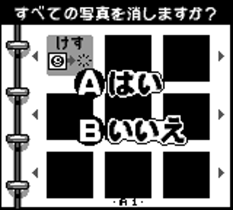 |
| Same screen, background layer reconstructed from ROM with real thumbnails from a JP save (Yes/No sprites omitted) | 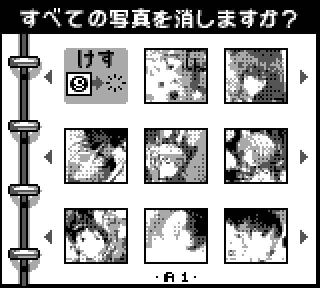 |

*Capture note:* the two emulator shots come from PyBoy with the cartridge header patched to MBC5 and
the camera self-test call at `$2EA1` and the sensor busy-wait loops NOP-ed out in the **emulation copy
only** (the ROM in the repo is untouched), because PyBoy has no Pocket-Camera mapper. Album UI logic is
unaffected; photo thumbnails/viewer images come out black. The third image is built offline by
`tools/render_state10.py` from the ROM tiles + a real save.

`$d561` already holds the photo count (30 in the test save) at the main menu, before any other mode
is visited, and the screen is the *erase* picker, not the view picker.

**How the game is organised (new, needed to read the above).** `$d5ce` is the *mode*, `$d5cf` the
*state inside the mode*. Modes are dispatched from a table of 3-byte entries (entry lo, entry hi,
ROM bank) at `$2F3F` (used by `Call_000_2f39`). Bank $004 hosts modes `$01`, `$09`, `$0A`, `$0F`,
`$10`, `$11`, so "bank $004" is not one screen. The relevant ones:

| mode | bank:entry | what it is |
|---|---|---|
| `$0A` | 4:`$7488` | "どの写真を見ますか？" — view picker (message index `$d5d6=1`, icon `$d5d7=2` = みる) |
| `$09` | 4:`$683f` | sibling picker, same family |
| **`$0F`** | 4:`$4649` (= `Bank004_State*` table) | **"どの写真を消しますか？" erase picker** (`$d5d6=2`, `$d5d7=0` = けす) and its photo viewer/animation states |

(The full 34-entry mode table is in §2.3.)

**Code path.** In mode `$0F` the browse loop is local state 3 (state 13 is its twin, state 2 is the
variant after a page change). Both contain the same test (`Bank004_State02` ~`$4859`,
`Bank004_State13` ~`$490e`):

```
    ldh a,[$ffa1]       ; buttons HELD this frame
    cp  $4c             ; must be EXACTLY Select(bit2)+Start(bit3)+Up(bit6), nothing else held
    jr  nz, not_combo
    ldh a,[$ffa2]       ; buttons NEWLY pressed this frame
    and $4c             ; at least one of the three must be new (edge, not level)
    jr  z, not_combo
    ld  a,[$d561]       ; photo count
    and a
    ret z               ; no photos -> nothing to erase -> ignore
    ld  a,$03 : call Call_000_2a7c    ; sound $03
    ld  a,$0a : ld [$d5cf],a          ; local state 10 = Bank004_State10 ($4d1b)
```

It is evaluated only after A, B and the D-pad handlers have declined the frame, so pressing A/B or any
other direction at the same time prevents it. `Bank004_State10` ($4d1b) then:

1. redraws the thumbnails of the current page (`Call_004_440b`, 8 per page, from SRAM slot+`$0E00`);
2. loads bank `$19:$7560` (0x280 bytes, 40 tiles) to `$8800` — **the Japanese message strip
   「すべての写真を消しますか？」** (render: `captures/erase_all_confirm_reconstructed_bg.png`) — and
   bank `$19:$77e0` (0x600 bytes) to `$8080`, the big **A はい / B いいえ** sprite lettering
   (`Call_004_4df9` jitters these two sprites, OAM templates `$B4/$B5`, by ±1 px every other frame);
3. waits: **B** → sound `$04`, restore the normal strip (`$0E:$4500`) and tiles (`$13:$5880`), back to
   state 2; **A** → `$dbcd=1`, `Call_004_5104` plays a sound (`$05`) and an 8-step effect over the 8
   thumbnails, then loops
   `while [$d561] != 0 { far-call bank2:$44FB(photo 0) ; Call_004_50e5 }`.
   `bank2:$44FB` marks one entry of the state vector `$FF`, rewrites it to SRAM and re-compacts
   (`$4466`, which also recounts `$d561`), so the loop terminates when the album is empty.

**Verified in the emulator** (save with 30 photos, mode forced to `$0F`, state 0): pressing
Select+Start+Up moves `$d5cf` from 3 to 10 and shows the confirmation; **A** takes `$d561` from 30 to 0
and the 30-byte state vector at `$d563` to all `$FF` in about 2 s; **B** leaves `$d561=30` and the
vector unchanged.

**Why it "does nothing" on a real camera.** (1) The check exists only in mode `$0F`'s browse states,
so it is dead at boot, on the main menu, in the camera, and in the view picker. (2) `$ffa1` must equal
exactly `$4c`. (3) With 0 photos (`$d561==0`) it silently returns. 

**Not verified:** the exact button sequence that takes a real console into mode `$0F`. Statically,
`d5ce=$0F` is written only at `$6D28` (mode `$09`) and `$7AC8` (mode `$0A`), both right after an
**A = yes** answer to a sliding Yes/No dialog and always entering at local state 5 (the single-photo
viewer), with `$d5d8` = the photo index (`$d5ed`/`$d5ee`) carried over. The emulator run along that path
was inconclusive (the viewer renders black without the camera mapper). Which album menu item shows
「どの写真を消しますか？」 on a real camera would anchor the route (?); the combo itself is fully accounted for.

---

## 9. Masked pixel lines (123–128)

**What the code shows (C).** The auto-exposure metering never samples below **y=103** (§5, §10): it stops
short of 123, so the metering does not touch the region of the masked lines.

**What the code cannot show.** That the masked rows read back a constant saturation voltage is a property
of the M64282FP silicon, not something the firmware does: the firmware stores whatever the sensor returns
at those addresses (?). AntonioND's documentation only says *"the actual sensor image is 128×126 or so"*
and defines a `GBCAM_SENSOR_EXTRA_LINES=8` margin in the emulator sample code, which is a software margin
for the edge-enhancement convolution (neighbour pixels past the visible 112 rows), not necessarily the same
thing as physically masked reference pixels. The header of MAME's `camera.cpp` calls the sensor "128*123
pixel" and its model has 123 sensor lines (`SENSOR_HEIGHT`; §18.12): a second statement of the 123-line
figure, not a measurement, and MAME never writes lines 123-127, so it does not say what the sensor puts
there (?).

**What the software path does (C).** The raw 4096-byte (128×128) buffer format is preserved through to the
saved photos: the ROM-baked Album B pictures are full 128×128 dumps, and the same `$1000`-byte copy size is
used when the live `$A000` capture buffer is moved around in bank $006. Nothing crops or discards rows
123-127; whatever the sensor returns there is stored like any other pixel data, and the album and print
screens only show 112 of the 128 rows. A datasheet pointer or probing data would be needed to say more
(whether the game does anything conditional on that region): see §12.

---

## 10. Auto-exposure: what part of the image, and the full algorithm

**There are two genuinely different sampling mechanisms** in this code, easy to conflate — I did,
last round. Clearing that up:

### A. The pixel test of the gain probe and the offset searches — 12 pixels in the first tile row, NOT the main metering

`Cam_PixelTestHelper` (`0A:4C30`, called from the gain probe and from the offset search `Cam_ORegister_SAR_Search`) reads **four bytes** of the capture buffer at a fixed address (`[DE]`, `[DE+2]`, `[DE+4]`, `[DE+6]` with `DE = $A002` — tile 0, rows 1-4, plane 0 — or `$A082` in the factory routine) and counts the set bits in **columns 1-3 (bits 6-4)** of each byte: **12 pixels** (the test of bit 3 is jumped over at `0A:4C51`). It returns 1 when the count reaches 9 (8 in one pass of the threshold scan). The captures that feed it use a flat matrix, so it is a one-bit comparator read-out of the sensor, not photometry; these pixels lie in the first tile row of the frame buffer, the 8 lines above the 112-line photo (§18.3).

### B. The continuous fine-adjustment loop — the real metering: 168 sparse tile-row reads, centre-weighted

`Cam_PopcountSampleLoop` (`0A:4FBD`), called from `Cam_MainDispatch` (the routine that runs once per live-preview frame) with `DE = $A320` and `BC = 0`, is **not a dense scan of a window**: it makes **168 reads of one tile row each** (2 bytes: plane 0, then plane 1, of an 8-pixel row of a tile; the helper `0A:5091` adds `popcount(plane 0) + 2 × popcount(plane 1)` through the 256-entry popcount table at `$7300`, i.e. the sum of the 2-bit pixel values of the 8 pixels; the larger the sum, the darker the picture). The reads step by 22 or 6 bytes, about one read per tile column and per iteration, the row inside the tile advancing by 3 each time. **Loop 1** is 10 iterations × 12 reads = 120 reads inside the box x 16-119, y 24-103; its running sum is then **doubled** (`sla c ; rl b`, `0A:5036`); **loop 2** is 6 iterations × 8 reads = 48 reads inside the central box x 32-95, y 40-87, added once. So Σ = 2·S₁ + S₂ is a sparse, **centre-weighted** sample (maximum Σ = 2 × 120 × 24 + 48 × 24 = 6,912). The iteration step `+$4F` (`0A:502A`) is `$103` bytes, so every second iteration of loop 1 starts on an **odd address**: 60 of the 120 reads take plane 1 of a row as "plane 0" and plane 0 of the next row as "plane 1" (whether that is intended is not known, ?).

The reads are sparse, not a dense 96×80 crop; the bounding box of the reads (x 16-119, y 24-103) is not an area that is measured. The geometry is read from the ROM bytes by `tcrf_check/tools/sensor_meter_geom.py`. **C in BGB:** the frame buffer of RAM bank 0 left by a live-view run gives Σ = 2 × 1,758 + 895 = 4,411 = `$113B`, exactly the last sum the ROM computed in that run (`assets/sensor/meter_check.txt`), and `L = floor(Σ / D59A)` holds on 236 of 236 dispatches of it.

### The full algorithm, in readable pseudocode

In the spirit of the prototype's `AKARUSA`/`CNTR2`/`CNTR3` naming — here is the retail routine with
meaningful names, **as established in the sensor-register pass (§18.6)** and checked on a real camera's bus recording
(207 of 207 live steps) and in BGB (2,377 of 2,377 dispatches; bank $0A):

```
# ---- once per live-preview frame, after a capture completes (Cam_MainDispatch, A = $D59A) ----
def Cam_MainDispatch(setpoint):                      # setpoint = D59A, default 84 (the BRIGHTNESS key)
    select_SRAM_bank(0)                              # the frame buffer, not general SRAM
    sigma = 2 * S1 + S2                              # Cam_PopcountSampleLoop 0A:4FBD: 120 + 48 sparse tile-row reads (§B);
                                                     # one read = popcount(plane 0) + 2 * popcount(plane 1) of an 8-pixel row
    level = 0                                        # quotient by repeated subtraction, capped at 159
    while sigma >= setpoint and level < 159:
        sigma -= setpoint; level += 1                # (the remainder is dropped)
    s = ShiftTable[level]                            # 160 bytes at 0A:7B00
    e = D596:D597                                    # sensor registers C1:C0; exposure = e * 16 us
    if level >= 36: e = min(e + (e >> s), 0xFFFF)    # large sum = dark picture -> longer exposure
    else:           e = e - (e >> s)
    # s = 16 (level 35, 36, 37): e >> 16 = 0, no change

    # ---- the band state machine: only the current band's two thresholds are tested ----
    band 0 (reg1 $20,  H-edge):        e >= $0030 -> band 1, e = $0048;      e < $0010 -> e = $0010
    band 1 (reg1 $E0-$E3, 2-D edge):   e >= $1200 -> band 2, e = $0D80;      e < $0031 -> band 0, e = $001F
    band 2 (reg1 $E4/$E5):             e >= $6000 -> band 3, e = $3500;      e < $0800 -> band 1, e = $0B00
    band 3 (reg1 $E8):                 e >= $C000 -> band 4, e = $8500;      e < $2800 -> band 2, e = $4500
    band 4 (reg1 $0A,  positive):      (saturates at $FFFF);                 e < $6000 -> band 3, e = $8C00
    # on a switch: reg1 = band id, reg7 = D5C1+n, reg0 = D5C6+n | $80 (the five boot results), dither matrix rebuilt
    write A002/A003 = e                              # the five registers go out with the next capture start
```

**The correction table** (`0A:7B00`, **160** bytes, not 256): the shifts run 2, 3, 3, 3, 4, … up to 9 at L = 34, are **16 (= no
correction) for L = 35, 36, 37**, are 9 at L = 38 and fall to 5-6 around L = 44-49, 4-5 for L = 50-79 and 3 from L = 80 on. A
shift `s` is a correction of 2^-s of the exposure per frame: 25 % at the extreme (`s` = 2, L = 0, a very bright picture), 12.5 %
for L ≥ 80 (a very dark one), and a **dead band of three levels around the setpoint** with tiny steps (`s` = 9, 0.2 %) just
outside it. **I:** a proportional controller with a dead band, shaped not to hunt. (`tcrf_check/assets/sensor/live_exposure_bands.png` shows the bands and the exposure of a real
live recording.)

The loop samples 168 tile rows of the frame every frame (centre-weighted, §B), divides the pixel sum by the BRIGHTNESS setpoint `$D59A`, corrects the
16-bit exposure by 2^-s of itself and hands over between **five sensor bands** (reg 1 / reg 7 / reg 0 sets, in datasheet terms in
§18.6) when the exposure leaves the band's range. The loop does not compare the measurement with a target taken from the
SRAM calibration vector: the vector does not enter the loop; it only decides, at boot, which offset O each band uses (§6, §18.4).

---

## 11. SRAM structure: evidence from the 33 real saves

The authoritative, human-readable map is §3. This section is the **evidence** behind it: what was checked on
which of the 33 saves in `saves/` (12 from factory-fresh cameras, 21 from used ones), what the numbers are, and what
they cannot show. §11.9 adds 14 cameras dumped together with their own ROM. **Caution on provenance:** the owner's cameras went through injections of synthetic saves, battery replacements and save swaps, so the labels 'fresh' and 'used' describe the state of the SRAM, not a proven history. Everything here is reproducible with `tools/sram_analyze.py`
(`python3 -I tools/sram_analyze.py all saves`; sub-commands `validity`, `classify`, `calib`, `settings`, `f34`).

### 11.1 Protected blocks: checksums and echoes

Rule (`bank2:$432F`): `lo = Σ bytes + $4E`, `hi = XOR bytes ^ $54`, over the data including `Magic`.

| Block | Copies tested | Result |
|---|---|---|
| Settings `$1000` / echo `$10D9` | 33 saves × 2 | **66/66 valid, always byte-identical** |
| Vector `$11B2` / echo `$11D7` | 33 × 2 | **66/66 valid, always identical** |
| Camera-owner block `$2FB8` / echo `$2FD1` | 33 × 2 | 64/66 valid, identical; both bad in `2023-06-01` only |
| Photo tags `F00` / echo `F5C` | 990 slots × 2 | 957 slots: both valid and identical; **3 slots both valid but different** (`2021-05-19_6` slots 5-7: primary `1A`-filled, echo all-zero — a priority test, §3.8); 30 slots both bad (`2023-06-01`); **0 slots with exactly one bad copy** |

Consequence: the "primary wins" rule of §3.6 is *visible* in the data (the 3 slots), but **no save contains a block
with exactly one damaged copy, so the "copy the good one over the bad one" path is known from the code only**.

### 11.2 The never-written area: per-save evidence

"Never-written area" = the 2079 tail bytes of §3.4 (`FB8-FFF` of every slot minus the 81 bytes a retail ROM legitimately
writes). Result: **all 24 saves of untouched cameras (12 fresh + 12 clean used) have 2079/2079 bytes equal to `$AA`**;
the 9 atypical saves (two of them battery-loss saves, `00` fill) are listed with their deviations in §3.8.

| # | Save | Class | Non-`AA` in never-written area (of 2079) | `AA` bytes in Game Face area (of 3584) / flag `10D1` | `01FFC-FFF` | Seed `$02FFF` (position in cycle) | Photos listed / `F34` matches |
|---|---|---|---|---|---|---|---|
| 1 | `001` | fresh | 0 | 3584 / 0 | `aaaaaaaa` | `95` (1) | 0 / 0 |
| 2 | `002` | fresh | 0 | 3584 / 0 | `aaaaaaaa` | `95` (1) | 0 / 0 |
| 3 | `002_2` | fresh | 0 | 3584 / 0 | `aaaaaaaa` | `95` (1) | 0 / 0 |
| 4 | `003` | fresh | 0 | 3584 / 0 | `aaaaaaaa` | `95` (1) | 0 / 0 |
| 5 | `004` | fresh | 0 | 3584 / 0 | `aaaaaaaa` | `95` (1) | 0 / 0 |
| 6 | `005` | fresh | 0 | 3584 / 0 | `aaaaaaaa` | `95` (1) | 0 / 0 |
| 7 | `006` | fresh | 0 | 3584 / 0 | `aaaaaaaa` | `95` (1) | 0 / 0 |
| 8 | `007` | fresh | 0 | 3584 / 0 | `aaaaaaaa` | `95` (1) | 0 / 0 |
| 9 | `008` | fresh | 0 | 3584 / 0 | `aaaaaaaa` | `95` (1) | 0 / 0 |
| 10 | `008_2` | fresh | 0 | 3584 / 0 | `aaaaaaaa` | `95` (1) | 0 / 0 |
| 11 | `009` | fresh | 0 | 3584 / 0 | `aaaaaaaa` | `95` (1) | 0 / 0 |
| 12 | `010` | fresh | 0 | 3584 / 0 | `aaaaaaaa` | `95` (1) | 0 / 0 |
| 13 | `2005_GAMEBOYCAMERA` | **atypical** | 176 | 39 / 1 | `ffff0000` | `95` (1) | 2 / 2 |
| 14 | `2020-05-29 GAMEBOYCAMERA` | clean used | 0 | 72 / 1 | `00390039` | `7A` (6) | 30 / 29 |
| 15 | `2021-05-19_1_POCKETCAMERA` | clean used | 0 | 18 / 1 | `aaaaaaaa` | `17` (3) | 30 / 21 |
| 16 | `2021-05-19_2_POCKETCAMERA` | **battery loss** | 2079 | 0 / 0 | `00565653` | `6B` (2) | 29 / 27 |
| 17 | `2021-05-19_3_POCKETCAMERA` | clean used | 0 | 21 / 1 | `80442a40` | `6E` (4) | 2 / 2 |
| 18 | `2021-05-19_4_POCKETCAMERA` | clean used | 0 | 41 / 1 | `aaaaaaaa` | `FE` (off cycle) | 22 / 22 |
| 19 | `2021-05-19_5_POCKETCAMERA` | clean used | 0 | 72 / 1 | `00390039` | `6E` (4) | 0 / 0 |
| 20 | `2021-05-19_6_POCKETCAMERA` | **atypical** | 2075 | 4 / 0 | `f400d500` | `6B` (2) | 0 / 0 |
| 21 | `2021-06-29 GAMEBOYCAMERA` | clean used | 0 | 11 / 1 | `aaaaaaaa` | `7A` (6) | 18 / 15 |
| 22 | `2021-08-08 GAMEBOYCAMERA` | **atypical** | 176 | 39 / 1 | `ffff0000` | `6E` (4) | 30 / 30 |
| 23 | `2022-02-02 GAMEBOYCAMERA` | clean used | 0 | 15 / 1 | `aaaaaaaa` | `35` (7) | 18 / 18 |
| 24 | `2022-03-05 GAMEBOYCAMERA` | **atypical** | 57 | 61 / 1 | `aaaaaaaa` | `95` (1) | 30 / 0 |
| 25 | `2022-05-03 GAMEBOYCAMERA-0` | clean used | 0 | 1 / 1 | `aaaaaaaa` | `1D` (5) | 27 / 23 |
| 26 | `2022-05-12 GAMEBOYCAMERA` | clean used | 0 | 61 / 1 | `aaaaaaaa` | `35` (7) | 30 / 24 |
| 27 | `2022-08-20 Vinted GAMEBOYCAMERA` | **atypical** | 144 | 138 / 1 | `aaaaaaaa` | `6E` (4) | 0 / 0 |
| 28 | `2022-08-25 Easycash GAMEBOYCAMERA` | clean used | 0 | 51 / 1 | `aaaaaaaa` | `7A` (6) | 30 / 4 |
| 29 | `2023-06-01 GAMEBOYCAMERA-0` | **battery loss** | 2023 | 148 / 1 | `ffffff00` | `00` (blank chip, no boot since) | 0 / 0 |
| 30 | `2023-08-01 Game Boy Camera (USA,EU)` | clean used | 0 | 26 / 1 | `aaaaaaaa` | `95` (1) | 30 / 29 |
| 31 | `2023-09-04 Pocket Camera (JP Rev 1)` | clean used | 0 | 12 / 1 | `aaaaaaaa` | `95` (1) | 30 / 28 |
| 32 | `2024-06-01 GAMEBOYCAMERA` | **atypical** | 2079 | 0 / 0 | `b5daa55a` | `26` (off cycle) | 1 / 1 |
| 33 | `2024-08-28 Pocket Camera (JP Rev 1)` | **atypical** | 2075 | 47 / 1 | `38cd41d7` | `3E` (off cycle) | 10 / 10 |

Reading the columns: *Game Face* — 3584 `AA` bytes = never written (all fresh cameras); 1-72 = a real picture; flag `10D1` = 1 where the
camera stored one. *Photos listed / `F34` matches* — slots the vector lists, and how many of them have `F34-F35` equal to the
(sum, xor) of their photo (§11.5).

### 11.3 Calibration record (slot 3 `FF0-FFF`, slot 16 `FF2-FFF`)

`python3 -I tools/sram_analyze.py calib saves`: **26 saves have an intact record** (`1B 13`, 12-byte vector, checksum `(Σ+$0D, XOR+$23)`
valid, echo identical) — 22 distinct vectors, the duplicates being second dumps of one camera (`002`/`002_2`, `008`/`008_2`,
`2020-05-29`/`2021-05-19_5`, `2022-03-05`/`2022-05-12`). Not intact: the two shifted copies (`2005`, `2021-08-08`: valid at `FEA`, §3.8),
the two battery-loss saves (`2021-05-19_2`, `2023-06-01`: record all `00` / not a valid record), and three damaged files (`2021-05-19_6`, `2024-06-01`, `2024-08-28`).
The vector bytes lie in `$65…$80`. `Cam_CommitVectorToSRAM` (`0a:$4F58`) writes exactly this layout (read from the disassembly:
12 bytes from `$D5B5`, then `Σ+$0D` and `XOR+$23`, first at `$AFF2` in RAM bank 2, then at `$BFF2` in RAM bank 8).

### 11.4 Settings block: which fields and bits are ever used

`python3 -I tools/sram_analyze.py settings saves`, over the 33 saves:

| Field | Values seen | Reading |
|---|---|---|
| `1061 & C0`, `1089 & C0` | `0` in 33/33 | never written (the pack code masks to 2+4 bits) |
| `10A1 & 70` (NOISE envelope bits 6-4) | `0` ×32, `$50` ×1 (`2021-05-19_6`) | field exists; normally 0 |
| `1062 & 70` (SOUND I envelope bits 6-4) | `0` ×25, `$20`, `$30`, `$50` ×3, `$60` ×2, `$70` | used |
| `10B7-10B8` | `0000` ×21, `2B4B` ×7, `A800` ×2, `44A8` ×2, `0040` ×1 | used (NR43 width flag per step, §3.2) |
| `10CD-10CF` | `000000` ×33 | dead bytes |
| `102F` | `00` ×31, `FF` ×2 | animation loop flag |
| `1060` | `00` ×30, `01` ×2, `05` ×1 | animation border |
| `10BA` | `00` ×16 (12 fresh + 4 used), `01` ×17 | "sound preset saved" |
| `10D1` | `00` ×15, `01` ×18 | Game Face present (all 12 clean used cameras: 1; all 12 fresh: 0) |
| `105F` / `10B9` / `10D0` | `$03…$40` / `$32…$F0` / `$0E…$7F` | speed / tempo / print intensity |

Rebuilding the default block from the ROM (`bank2:$4183`: `FE`×47, `00`, `00`×47, `09`, `00`, the 90-byte table at `$41F3`, 21 zeros, `40`, `00`, `Magic`, checksum) gives **exactly** the settings block and echo of all 12 fresh cameras (217 bytes each).

### 11.5 Photo tags: `F12-F14`, `F30-F32`, `F33`, `F34-F35`

`python3 -I tools/sram_analyze.py f34 saves` (population: slots listed by the vector, tag valid): **369 slots in 17 saves**.

| Check | Result |
|---|---|
| `F34-F35` = (Σ, XOR) of the 3584 photo bytes | **285 / 369 match (77 %)**; 32 slots hold `0000` (30 of them = the gb-photo save `2022-03-05`); 52 hold a different non-zero value (25 of them in `2022-08-25 Easycash`) |
| `F12-F14` ≠ 0 | 4 slots, all in `2021-05-19_6` (slots 5-8), always `+0/+1/+1` — the code rule of `$462F` for a female owner (§3.3) |
| `F30-F32` ≠ 0 | 3 slots, same save (the `1A` fill) |
| `F33` = 1 (album copy) | 6 slots, all in `2022-02-02` |

(The two battery-loss saves are in these counts only through `2021-05-19_2`: 29 slots listed, 27 match.) The mismatching `F34` values fit in-camera editing (the editor's save-back `$47C4` rewrites image + thumbnail but not `F34-F35`);
this is plausible, **not proven** for those saves.

### 11.6 Boot seed byte (`$02FFF`)

Predicted by re-implementing `bank0:$091A-$09D3` (`tools/sram_analyze.py: seed_orbit`): `AA → 95 → 6B → 17 → 6E → 1D → 7A → 35 → AA`.
Observed over the 33 saves: `95` ×16 (all 12 fresh cameras + `2005`, `2022-03-05`, `2023-08-01`, `2023-09-04`), `7A` ×3, `6E` ×4, `6B` ×2, `35` ×2,
`17` ×1, `1D` ×1 — **29/33 on the cycle** — and four off it: `FE` (`2021-05-19_4`), `26` and `3E` (two damaged files), `00` (the battery-loss save `2023-06-01`: blank-chip value, the camera never booted after the wipe); the battery-loss save `2021-05-19_2` sits on the cycle (`6B` = 2 boots after the battery change: `00` → `95` → `6B`).
A fresh camera that was powered on once is exactly at `95`, as predicted from `AA`.

### 11.7 CoroCoro tag and the odd `01FFC-01FFF` values

`01FFC-01FFF` = `AAAAAAAA` in 23 saves (12 fresh + 11 used); `00565653` (CoroCoro-looking tag) in the battery-loss save `2021-05-19_2` only; `00390039` in `2020-05-29` and `2021-05-19_5` (one
camera); `80442A40` in `2021-05-19_3`; `FFFF0000` in `2005`/`2021-08-08`; `F400D500`, `FFFFFF00`, `B5DAA55A`, `38CD41D7` in four damaged files.
The only code that touches this range is the bank-8 tolerant check `$72E0` (≥ 2 of 3 bytes of `01FFD-01FFF` equal `56 56 53` ⇒ rewrite the exact
signature). It never creates the tag, so a camera without it stays `AA`.

### 11.8 What the saves cannot tell

- The repair of a block with one bad copy (no such block in the files).
- What wrote the shifted calibration layout of `2005`/`2021-08-08` (not a ROM revision, §11.9).
- Which user action reaches `bank2:$462F` in normal use (only four slots of one experimental save show its effect).
- The origin of the `00 39` and `80 44 2A 40` patterns.

### 11.9 The 14 cameras dumped with their own ROM (October 2026)

The owner supplied, for each of 14 cartridges, a ROM dump (`.sgb`) and an SRAM dump (`.sav`): 11 international units (`CE…`) and 3 Japanese units (`PC…`). Some have a dead battery. `python3 -I tools/sram_analyze.py classify|calib|validity <dir>` was run on the 14 SRAM files; the ROMs were identified by md5 and header. `tools/cameras_summary.py` produces `cameras/cameras_summary.csv` (one line per camera: ROM md5, class, seed, owner ID, record), `tools/emu_calib_check.py` the emulator check of point 2.

**Provenance (from the owner).** These cameras have been through many experiments: injections of synthetic saves, battery replacements, save swaps. The SRAM of a cartridge is therefore **not necessarily what its own ROM wrote**, and the owner cannot say what was done to which unit. What the ROM does (code-traced; point 2 emulator-confirmed) is unaffected. Where a pattern *comes from* (factory, injection, swap, battery) is, for every unit below, a hypothesis at best, and the rest of this section is worded accordingly.

**ROMs.** All 11 `CE…` cartridges carry the same ROM, md5 `42d2f65e2549be9d1d126a6828b5d1c1` (title `GAMEBOYCAMERA`, mask-ROM version `$014C` = 0, header checksum `$9D`), byte-identical to the USA/EU ROM used in this README. All 3 `PC…` cartridges carry the JP Rev A (md5 `fdcfe686cf4df461e870b6e53b2b5a8b`, version 1). A ROM downloaded from the internet, `Pocket Camera (J) (V1.1) [S].gb`, is byte-identical to that Rev A (V1.1 is another name for header version 1); so are the two JP ROM files uploaded earlier. Across the 14 cartridges and the 3 downloaded or uploaded copies there is **one international and one Japanese ROM**. That does not prove that no other revision exists, only that none of the 14 units has it.

| Camera | State of the SRAM | Boots since the last reset (seed) | Owner ID | Photos listed | `FF0-FF1` | Calibration record (vector, first bytes) |
|---|---|---|---|---|---|---|
| `CE10000843` | **dead battery**: all blocks invalid, 0 valid tags, 2078 of 2079 never-written bytes non-`AA`, photo area at 7.1 bit/byte (random) | `00` (no inference: the whole chip is random) | - | - | `EA EA` | invalid |
| `CE10866859` | **partly lost**: settings, vector, owner and 30 tags valid, photos with image-like entropy, but the never-written area is non-`AA` (2075 of 2079, biased towards `FF`/`00`/one-bit values) | `35` (7) | `00912730` (point 6) | 30 | `F6 08` | invalid (garbage) |
| `CE10550742` | atypical, **the 2005 camera** (§3.8): shifted record, 176 non-`AA` tail bytes | `7A` (6) | `00912730` | 0 | `7C 7B` (the record is at `FEA`) | `7E 7D 7D 7D 7C 7B 7B 7D…` at `FEC`, valid by the rule, **not read by the ROM** |
| `CE10251329` | used, clean tails | `6E` (4) | `13356735` | 4 | `1B 13` | `00 FF 00 FF…` (14 bytes, same in both copies, checksum invalid) |
| `CE10229233` | used, clean tails | `35` (7) | `33122681` | 27 | `1B 13` | `7C 7B 7E 7C…` valid |
| `CE10238211` | used, clean tails | `95` (1) | `10711523` | 30 | `1B 13` | `7D 7E 7C 7D…` valid |
| `CE10785322` | used, clean tails | `7A` (6) | `46882401` | 20 | `1B 13` | `7C 7E 7D 7E…` valid |
| `PC10696894` | used, clean tails | `1D` (5) | `01436645` | 30 | `1B 13` | `7C 7C 7E 80…` valid |
| `CE10001819` | never-written area untouched, default settings (`99 99…`) | `35` (7) | `77013356` | 9 | `AA AA` | `7D 7E 7D 7D…` valid |
| `CE10063189` | same | `6B` (2) | `77013356` | 0 | `AA AA` | `7E 7E 7E 7D…` valid |
| `CE10517662`, `CE10811537` | same | `17` (3) | `77013356` | 0 | `AA AA` | `7E 7D 7E 7E 7D 7C 7D 7D 7C 7B 78 60` valid, identical in both |
| `PC10584071` | same | `1D` (5) | `77013356` | 2 | `AA AA` | the same vector as the two above |
| `PC10201702` | same | `AA` (0, never booted) | `77013356` | 1 | `AA AA` | `71 72 72 72…` valid |

"Boots" is the position on the boot-seed cycle (§3.3) since the factory state, modulo 8. "Photos listed" counts the used entries of the state vector.

**What these cameras show**

1. **The 2005 camera is `CE10550742`.** Same 12-byte vector, same owner block (`BOICHOT`, ID `00912730`), same 6 stray bytes in the tails; the three files `2005_…`, `2021-08-08` and the 2026 dump are one camera, dumped three times. Its own ROM is the standard international ROM, so the shifted calibration record of §3.8 is not a ROM-revision effect. Given the history above, the simplest origin of the shifted record and of the stray bytes is an injection made with a file or tool that used another layout, but this cannot be verified. Between 2021 and 2026 the photo area of every slot changed and the state vector became empty (0 photos), yet the 6 tail bytes of 29 of the 30 slots and the record's position are unchanged: the retail ROM never touches them.
2. **The retail ROM ignores a shifted record (emulator check).** PyBoy, USA/EU ROM with the header patched to MBC5, the two sensor-wait loops (`jr nz,-4` at file offsets `$19F73` and `$25FE0`) replaced by `nop`s, SRAM reads enabled at the check; the 14 SRAM files are not modified. `Cam_Calib_ValidityCheck` (bank 10 `$45C9`): with `CE10229233` (normal record) it returns 0 and `$D5B5-$D5C0` = `7C 7B 7E 7C 7B 7C 7D 7C 7A 79 75 6A` (its own vector); with `CE10550742` it returns `$FF`, the validity flag `$FF8A` stays 0, and `$D5B5-$D5C0` = `7E 7F 7F 7F 7E 7D 7E 7E 7D 7E 7D 6A`, the fixed default of §6. This confirms the reading of the code (record only at `$AFF2` / `$BFF2`). Emulator limits: PyBoy has no Pocket Camera mapper (no sensor, no camera registers); the check itself reads SRAM only, so it does not depend on them. A run in BGB (real mapper) has not been done.
3. **`1B 13` is not universal.** Present in the 12 factory-fresh files of the first set and in 5 of the 14 cameras (`CE10251329`, `CE10229233`, `CE10238211`, `CE10785322`, `PC10696894`); absent (`AA AA`) in 6 units of the newest batch (never-written area untouched), which all have a valid vector, default settings (`99 99…`, never saved) and the same default owner ID `77013356`; 3 of them (`CE10517662`, `CE10811537`, `PC10584071`, two international and one Japanese) carry the **identical** vector `7E 7D 7E 7E 7D 7C 7D 7D 7C 7B 78 60`. A vector measured on each unit would not coincide across three units: either a batch value written by the factory or one synthetic save injected into three cartridges; with this history it cannot be told. The retail ROM never reads `FF0-FF1`, so these cameras work; only the hidden factory test (§8) compares against them.
4. **Dead batteries come in two kinds.** `CE10000843` lost everything: random content in every area (7.1 bit/byte in the photo area), no valid block, no valid tag. `CE10866859` is different: settings, vector, owner and the 30 tags are valid, the vector lists 30 photos and the photo area has image-like entropy (4.0 bit/byte), only the area the camera never writes is no longer `AA` (2075 of 2079 bytes, biased towards `FF`, `00` and bytes with one bit different). A total loss followed by the camera re-creating what it checks (§3.6, as in `2021-05-19_2`) would look similar, but then the vector would list no photo and the photo area would be noise; so the checked blocks were not re-created. Cause **inconclusive**; with injections and save swaps in the history, a foreign or synthetic save written into this cartridge is the simplest reading (valid blocks, non-`AA` never-written area, an owner ID identical to that of `CE10550742`), but it is not verifiable. A random, non-`00` fill is a second signature of a lost battery (inferred from `CE10000843` alone), besides the `00` fill of §3.8.
5. **`CE10251329`** holds a record `1B 13` + `00 FF` × 7 in the primary copy and `AA AA` + `00 FF` × 7 in the echo (both outside the checksum rule). Patterns of `00`/`55`/`FF` look like a memory-test pattern, as in the factory-fresh exchange buffers (`55 00 FF 00 D5 00…`) and in the `AA 55 FF FF 00…` rows of `2023-06-01`. The camera therefore uses the default vector. Origin unknown (a synthetic save is possible).
6. **Owner IDs are not unique.** `01436645` is the ID of four different cameras (`001`, `004`, the camera of `2020-05-29` / `2021-05-19_5`, and `PC10696894` / `2023-09-04`), `34724160` of two (`002`, `007`), `00912730` of two (`CE10550742`, `CE10866859`), and `77013356` is the default of the six new units (never registered by an owner). With save swaps and injections in the history this is expected (a save carries its ID with it), so **nothing can be concluded about the ID generator** (`$51D0`, §3.5) from it.
7. **Matches with the older files.** `CE10229233` = `2022-05-03` (29 of 30 slots identical), `CE10238211` = `2022-08-25 Easycash`, `PC10696894` = `2023-09-04 … (Rev 1)`; the other new cameras have no older file.

---

## 12. Open questions

Only what is still open; what was answered is in the sections named in the contents. Evidence tags as elsewhere.

**SRAM** (§3.8, §11.9)
- The origin of the 2005 layout (shifted calibration record and 6 stray bytes per slot in the camera `CE10550742`), of the `00 39` and `80 44 2A 40` patterns and of the single-bit flips in the photo area of 14 slots is not established. The 2005 layout is not a ROM revision (the camera holds the standard USA/EU ROM and the retail code ignores the shifted record). The owner's cameras went through injections of synthetic saves, battery replacements and save swaps and no record says what was done to which unit: every provenance statement about these cartridges (`1B 13` present or absent, identical vectors, repeated owner IDs, the `CE10866859` case) is **I**; only the ROM-behaviour findings are firm.
- NOISE editor: which control feeds `$D9AD` (`10A1` bits 6-4, value 5 seen once) and what the per-step LFSR-width flag of `10B7-10B8` is called on screen (its hardware effect, NR43 bit 3, is settled).
- `F34-F35`: 52 non-zero mismatches among 369 used slots (25 in one save); no code that compares the value was found; `bank0:$16F4` formats it as 4 nibbles for display routine `$2A7C` (A = `$10`); which screen shows them is not confirmed.
- Who writes `1B 13` in a real camera (the Hello Kitty ROM does, at the end of its SRAM-initialisation routine; the retail ROMs never do), and why the factory test needs two tolerances (27 and 19) for the `AFFC` / `AFFD` pair.

**WRAM / HRAM** (the complete lists are in §2.12)
- The visible effect of the SHOOT variants (`$D7E3` values 3-`$15`, the option cross `$D7E9-$D7EC`, the option screens `$D5E3-$D5EB`): dispatch, data flow and names are known (§16.2); the picture every effect slot writes is measured in BGB (§16.28); what is open is the match of the lens numbers 1-7 and the montage layouts with their on-screen icons.
- The message texts behind `$DBCF`; the visible effect of the five-byte vectors `$DA44-$DA48`.
- Why STAT handler 1 flips the tile-data bit at line 84 on nearly every screen (which picture is split there).
- The meaning of the individual sound ids; whether the printer checksum-retry path that advances `$DC1F:20` by `$0280` is a ROM bug.

**Disassembly** (§1.2)
- The type and extent of each asset in the data banks: the index / pointer tables inside the reader routines (`04:58DE`, `04:5A9D`, `08:5400`, `08:5055`, `02:4CFF`, `06:5CFF`) and the 56,947 non-padding bytes that no run of §13 read (§13.5-§13.7).
- The policy for the 45 dead-code roots (assemble as code tagged `unreferenced`, or leave as `db`): the owner decides, recommendation in §13.6.
- A character table for the strings other than the name and comment fields (`disasm/charset_jp.csv`, §16.27).

**Sensor and calibration** (§18.9)
- What exactly the 12-byte calibration vector represents (a per-mode black-level reference, §18.5, I) and in which conditions the factory step is done.
- Bit 1 of the `$03` written to `$A000` (P/M selector or status bit; a bus test would settle it); why the first test capture of the gain probe uses the matrix byte `$D5`; which SHOOT variants freeze the auto-exposure (`$D7E3 >= $13`); what the extra `print` sheet of the owner's workbooks recorded; the printing menus (no extra captures seen in BGB, the printer helper was not attached); the SRAM of the recorded unit, to compare with the vector implied by its threshold scans (§18.5).
- The masked pixel lines (§9): a datasheet pointer or probing data is needed to settle the content of lines 123-127 (MAME's header says 128 x 123 pixels, §18.12: it supports the 123-line figure, not the content of those lines).

**Other**
- §8: the menu route into mode `$0F` on a real console, and who computes `$D561` at boot.
- TCRF items not located or not examined (`tcrf_check/TCRF_CHECKLIST.md`): B14 (the D.J. tile like め), B18 (the RUN! star; one candidate tile at `1B:618A`), C06, C12, C16.
- The open points of the BGB comparison (§16.10, §16.11 "what this walk does not prove", §17).

---

## 13. Emulator coverage run: what executes, what never does, and what reads the data banks

This section closes the points that §1.2 listed as "needs the emulator": a scripted tour of every mode (D3), a ROM-read log for the 14 unreferenced data banks (D1), a check of the tracer for gaps, and a runtime verdict on the 45 dead-code roots (D2).
Evidence tags as elsewhere: **F** = fact observed in a run or read from a ROM byte; **I** = inference; anything inconclusive is listed in §13.7 and not smoothed over.

**Scope of the numbers.** §13.2-§13.7 report the merge of the nine fuzz, replay, sweep and damaged-save passes of §13.2 (`coverage/results/report_v6/`, rebuilt by `coverage/final_merge.sh`). The final merge adds the unlocking and link runs (§15.1; `coverage/v8/report_v8/`): it executes 57,582 (95.3 %) of the 60,449 traced instructions, 50,008 (82.7 %) from joypad and SRAM only, 7,574 only in forced runs, and leaves 2,867 never run; it is the one drawn on the reachability map and used from §15 on.

**Result in one paragraph (passes 1-9).** Of the 60,449 traced instructions, **55,935 (92.5 %) were executed**; **47,862 (79.2 %) were reached by joypad input and an SRAM image alone** (no RAM was written from outside); the other 8,073 only after a run forced a RAM variable or a mode.
**No instruction was ever executed outside the static trace** (0 tracer gaps, 0 mis-aligned entries), so the trace is complete for everything the camera did in this run. **None of the 45 dead-code roots ran organically** (one, `00:0751`, 3 instructions, ran in a forced run; §13.3).
The 4,514 instructions (8,773 bytes, 7.5 % of the code) that never ran are explained in §13.4: almost all of them sit behind a named hardware condition (link cable, Super Game Boy, printer states the stand-in printer never produces) or behind a dispatch-table slot no input reached.
All 64 ROM banks were selected at least once, and all 14 banks that no code references statically are read (§13.5).

### 13.1 The emulator: a purpose-built core, and what it does not model

Neither PyBoy nor BGB was used for the bulk of the work: a search over hundreds of millions of frames with cheap snapshot-and-branch needs a core that does the bookkeeping itself (about 8,000 frames per second per worker, roughly 135 times real time).
So the run uses a small native SM83 core written for this purpose (`coverage/src/gbcov.c`, 462 lines of C, driven from Python through `ctypes`). It records, per ROM byte, **executed as opcode / executed as operand / read as data** (and by which call site and mode), every write to the bank-select registers, and every call site; it can snapshot and restore the complete machine state, which makes the search deterministic and resumable.
What it implements: the SM83 instruction set, interrupts, `halt`, the timers, LCD timing (LY / STAT / VBlank / LYC, without any rendering), the joypad, the serial port with a simple printer on the far end, and the Pocket Camera mapper (ROM bank, RAM bank, camera-register bank, the capture-start bit and a capture-complete countdown). A **synthetic sensor image** lets "shoot" and the exposure loop run; the **minimal Game Boy Printer** answers the handshake, accepts the data and reports a clean status, so the print modes run.
What it does **not** model: any picture output, sound, a link-cable partner (two cores can be wired together, §14), Super Game Boy commands, and cycle-exact behaviour. It was **not** compared cycle by cycle with BGB or with hardware (**limit**, §13.7).

Validation that the core behaves like the console where it matters for this analysis: (1) booting each of the 14 real saves and the two synthetic battery-loss saves (all `00`, all `FF`) for 240 frames leaves in WRAM `$D5B5-$D5C0` exactly the 12-byte calibration vector that the rule of §6 predicts from the SRAM image (primary record / echo / default vector): **16 of 16 cases agree** (`tools/validate_calib.py`); (2) the real saves boot to the main menu (`$D5CE = $00`); (3) **0 executed opcodes fall outside the static trace**, which a faulty core would almost certainly produce (wild jumps) and which the guard described below also checks.

### 13.2 Method: organic versus forced, and how branches were flipped

**Organic coverage** is the strict one: the run started from a real save (or one of the synthetic ones) and only joypad presses were applied afterwards. SRAM images used: the 14 real cameras (`saves/`), the all-`00` and all-`FF` images (battery loss), damaged copies of the real saves (flipped bytes inside the protected blocks, the calibration record, the tag block and its echo; 3,400 variants) and nine saves whose photo slots carry the "hotspot" bytes `F36-F53` (a viewer mode, `$0C`, that only shows when they are present).
**Forced coverage** is any run in which a RAM variable was written from outside, or the mode byte `$D5CE` was set directly. Forced coverage proves that the code is **decodable and executes without a crash from that state**, not that the state can be reached with the buttons. It is reported separately everywhere.

Instead of recording what the screen shows, the search follows **the conditions that keep the program in a state** (the owner's suggestion): the core logs, for every compare and bit test, which RAM byte was read and what it was compared with; the fuzzer then pokes that byte with the value that flips the branch and continues (a "compare-log" search, as in fuzzers). Before each forced run the snapshot is checked by a **wild guard**: a run that starts executing at an address that is not an instruction start of the trace is discarded, so the forced set cannot contain an opcode outside the trace by construction.
One contamination was found and removed: early sweeps also poked the stack (`$DE00-$DFFF`), which corrupts return addresses and produced spurious "coverage" of unrelated code (for example the dead root `00:069F`). The stack and the HRAM DMA stub are now excluded from pokes, the affected sweeps were repeated, and the contaminated outputs were left out of the final merge. Forced-only code is further classified by `forced_legit.py`: **credible** if static control flow reaches it from organic code or it is entered at a table / root entry, **suspect** otherwise (§13.3).

Passes (each row is the coverage of that pass alone, including the replay of the corpus it started from; "organic" is not available for the first pass, which predates the split):

| pass | what it did | instr. executed | of which organic |
|---|---|---:|---:|
| 1 | random key sequences from the main menu, two workers, 18.5 M frames | 41,797 | - |
| 2 | + compare-log pokes, input pool, read-set mutation (two workers, 45 M frames; the row is worker a) | 49,192 | 42,884 |
| 3 | longer run of the same fuzzer (worker a: 52.8 M frames, 13,293 corpus entries) | 51,023 | 43,019 |
| 4 | final fuzz generation, stack excluded (worker a: 64.9 M frames, 18,785 entries) | 52,718 | 43,563 |
| 5 | **settle runs**: replay of the corpus with long idle / tap waits (some states only change after thousands of frames) | 52,665 | 44,054 |
| 6 | **sweeps**: in 488 selected states, up to 500 of the variables the state reads, each set to up to 13 chosen values | 53,298 | 43,201 |
| 6b | **SHOOT-variable sweep** (forced, mode `$14`: `$D7EB` = 0-2, `$D7E3` = 0-32, `$D7E4` = 0-3), stand-alone | 11,502 | 0 |
| 7 | **long boot runs**: 192 power-on runs of up to 9,000 frames with held-key combinations (the hidden factory test needs about 3,900 frames, then spins on its OK / NG tile) | 3,998 | 3,998 |
| 8 | **damaged saves**: boots with 3,400 corrupted SRAM images (repair paths of §3) | 39,533 | 39,533 |
| 9 | **hotspot saves** (19,902 iterations, 9.8 M frames) | 48,155 | 17,362 |
| | **merged** (union of all passes) | **55,935** | **47,862** |

Totals over the passes that count iterations and frames (1-4, 8, 9): 435,746 iterations and 197,716,188 frames (about 38 days of console time at 59.7 frames per second), 35,705 s of CPU time; the settle, sweep, long-run and replay passes are not included in that count. Pass folders (coverage, logs, stats) are in `coverage/results/passes/`, the replayable corpora in `coverage/results/corpus/`.

### 13.3 Results

**Per bank** (instructions of the static trace; "forced-state only" = executed only after a poke or forced mode; "never" = in no run):

| bank | traced instr. | executed | % | organic | forced-state only | never |
|---|---:|---:|---:|---:|---:|---:|
| 00 | 6800 | 6016 | 88.5 | 5324 (78.3%) | 692 | 784 |
| 02 | 2467 | 2352 | 95.3 | 2037 (82.6%) | 315 | 115 |
| 03 | 7324 | 6760 | 92.3 | 6551 (89.4%) | 209 | 564 |
| 04 | 6615 | 6063 | 91.7 | 5938 (89.8%) | 125 | 552 |
| 05 | 7233 | 6498 | 89.8 | 3628 (50.2%) | 2870 | 735 |
| 06 | 6466 | 6355 | 98.3 | 6297 (97.4%) | 58 | 111 |
| 07 | 6509 | 6032 | 92.7 | 4716 (72.5%) | 1316 | 477 |
| 08 | 2758 | 2656 | 96.3 | 2639 (95.7%) | 17 | 102 |
| 09 | 5367 | 4756 | 88.6 | 4592 (85.6%) | 164 | 611 |
| 0A | 6778 | 6493 | 95.8 | 4363 (64.4%) | 2130 | 285 |
| 1F | 2132 | 1954 | 91.7 | 1777 (83.3%) | 177 | 178 |
| **all** | 60449 | 55935 | 92.5 | 47862 (79.2%) | 8073 | 4514 |

- **Tracer gaps: none.** 0 executed opcodes outside the 60,449 traced instruction starts, 0 that fall inside a traced instruction (F). The only code executed outside the ROM is the OAM-DMA stub copied to HRAM `$FF80-$FF89` (the 10 bytes at `00:03F0`, which are data in ROM; they never "execute" at their ROM address, which is why that live root shows as not executed).
- **Roots** (the 134 hand-resolved roots of `tools/extra_roots.json`): 89 live roots, **73 executed (32 organically)**, 16 not executed: the OAM-DMA stub image above, and 15 entries of the bank `$0A` effect table `$541A`. Eleven of them (indices 57, 59-61, 63, 89, 91-95) point into runs of bare `ret` bytes (`0A:61AB-61B1`, `0A:685F-6865`): no-op slots, i.e. effect numbers with nothing behind them (F: the bytes are `C9`). Four (indices 45, 51, 53, 83 at `0A:5E40`, `6037`, `60B1`, `6704`) are real effect code that no index sequence selected. **45 dead-code roots: 0 executed organically.** One of them, `00:0751` (3 instructions), executed in a forced run; it is one of the 6 suspect runs below, i.e. entered by an edge that is not in the static control flow, so I treat it as a poke artefact, **not** as evidence of use (I).
- **Forced-only code: 8,073 instructions; 8,021 are credible, 52 suspect.** Credible = reachable along static control flow from organic code, or entered at a dispatch-table / root entry; suspect = entered by an edge that is not in the static control flow (a poke made the program land in the middle of a routine, or return to a corrupted address). The six suspect runs (instruction start, last instruction, count, contains a dead root):

| first | last | instr. | dead root |
|---|---|---:|---|
| 00:06CA | 00:06F4 | 38 |  |
| 00:0751 | 00:0755 | 3 | yes |
| 00:0771 | 00:0772 | 2 |  |
| 09:6BDB | 09:6BE0 | 3 |  |
| 0A:5900 | 0A:590B | 5 |  |
| 0A:5AB7 | 0A:5AB7 | 1 |  |

- **Bank selection.** Every ROM bank `$00-$3F` was selected at least once (1,621 distinct (writer address, new bank) pairs, 296 of them in organic runs); the selecting code is a handful of helpers: `00:0333` (the bulk graphics copy, which accounts for most of the traffic), `00:2F2D`, `00:0AD7`, `00:020D`, `02:4CFF`, `06:5CFF`, `08:5400`, `04:58DE`, `04:5A9D` and a few per-mode readers. The per-bank table with the first reading mode and the main call sites is `coverage/results/report_v6/data_bank_map.md`.
- **State machines.** The 34 mode tables hold 374 state slots; **364 were entered, 10 never**: bank 04 state 10 (130 instructions, `04:4D1B`), bank 06 states 18 and 19, bank 07 states 9, 15, 17, bank 09 states 9, 11, 12, 13 (state 11 is the 525-instruction component at `09:6441`). Bank 07 states 9 and 17 are the only callers of `bank2:$462F` (the `F12-F14` and `10C3` / `10C4` counters); **no single-camera run of this section reached them, forced or not**: the link-cable photo exchange of two emulated cameras does (§14).
- **Byte classes of the whole ROM** (`rom_map_summary.md`): organically executed code 93,480 B; code executed only in forced runs 15,374 B; code never executed 8,773 B; inline jump tables 1,256 B; bytes read as data 813,687 B (642,342 B in organic runs); **bytes neither executed nor read: 116,006 B (11.1 % of the ROM)**, of which 59,059 B are runs of 16 or more `00`/`FF` bytes (padding, F) and **56,947 B are content that no run touched** (mostly in data banks `3B` 9,587 B, `0B` 5,564 B, `33` 5,476 B, `3C` 5,116 B, `2B` 4,457 B, `17`, `2A`, `10`, `19`; see §13.7).

### 13.4 Code that never ran, and why

Every never-executed instruction was grouped into connected components and classified by what keeps it out (`gating_branches.py`; `unexec_components.csv` has all 305 components):

| class | components | instructions | bytes | of which forced-executed |
|---|---:|---:|---:|---:|
| GATED | 196 | 1620 | 3235 | 0 |
| TABLE | 62 | 2340 | 4547 | 0 |
| DEAD | 43 | 527 | 942 | 0 |
| RAMCODE | 1 | 6 | 10 | 0 |
| ORPHAN | 3 | 21 | 39 | 0 |

(Total 4,514 instructions, 8,773 bytes.) **GATED**: entered only through a conditional branch or `ret` whose condition never came true; **TABLE**: entered only from a dispatch-table slot (state table, effect table, `jp hl` table) that was never selected; **DEAD**: reachable only from a dead-code root; **RAMCODE**: the OAM-DMA stub image; **ORPHAN**: no entry found.
The 22 largest components hold 2,858 of the 4,514 instructions (the 40 largest hold 3,373):

| first address | class | instrs | entered by (executed gating branch / dispatch-table entry) |
|---|---|---:|---|
| 09:6441 | TABLE | 525 | 09:5FE7[11];09:5FE7[12] |
| 05:5EC0 | TABLE | 262 | 05:5A67[23];05:5A67[24];05:5A67[25];05:5A67[26] |
| 04:5E4C | GATED | 255 | 04:5E4B(ft) |
| 03:657F | TABLE | 252 | 03:655D[1];03:655D[6];03:655D[7] |
| 00:2B3A | GATED | 219 | 00:2AF1;00:2AF8 |
| 07:45FD | TABLE | 179 | 07:4004[17];07:4004[9] |
| 04:4D1B | TABLE | 143 | 04:464D[10] |
| 00:1D45 | GATED | 130 | 00:1DA0(ft) |
| 02:462F | TABLE | 107 | call:1;far:1;flow:7 |
| 08:46A3 | GATED | 87 | 08:45F5 |
| 05:6670 | TABLE | 73 | 05:475F[7] |
| 05:6A82 | TABLE | 71 | 05:4806[1] |
| 0A:5853 | TABLE | 70 | 0A:541A[13] effect table |
| 00:0781 | DEAD | 69 | flow:8;root:1 |
| 03:65B3 | TABLE | 67 | 03:655D[2] |
| 05:7149 | TABLE | 60 | 05:48C4[2] |
| 03:6983 | TABLE | 56 | 03:655D[10];03:655D[11];03:655D[12];03:655D[13] |
| 03:6901 | TABLE | 52 | 03:655D[8] |
| 05:71C3 | TABLE | 51 | 05:48C4[3] |
| 04:7C9D | DEAD | 49 | call:1;flow:7;root:1 |
| 00:1A7B | GATED | 42 | 00:1A79(ft) |
| 0A:5E40 | TABLE | 39 | 0A:541A[45] effect table |

The gates that keep the most code out, with the variable they test (names from the WRAM map of §2; "(no memory read just before)" = the flag is in a register, I could not name it):

| branch | instruction | gated target | instrs behind | variable it tests |
|---|---|---|---:|---|
| 04:5E4B | `ret nz` | 04:5E4C | 255 | (no memory read just before) |
| 00:2AF1 | `jp nz,$2bc6` | 00:2BC6 | 160 | $DC44 lnk_connected |
| 00:1DA0 | `ret z` | 00:1DA1 | 130 | $FFC3 sgb_present |
| 08:45F5 | `jp nz,$46a3` | 08:46A3 | 87 | $D806 `print_extra_flag` (bit 0) |
| 00:2AF8 | `jr nz,$2b3a` | 00:2B3A | 86 | $DC51 lnk_stage |
| 00:1A79 | `jr z,$1adc` | 00:1A7B | 42 | $DC27 prn_status |
| 07:6744 | `jr nc,$6759` | 07:6759 | 35 | $D865 `shoot_boss_hits` |
| 07:46CC | `jr z,$46fb` | 07:46CE | 24 | $DC59 lnk_cmd_rx |
| 09:63F7 | `ret c` | 09:63F8 | 24 | $D047 ([7] collision mask 1+7) |
| 06:48AE | `jr nz,$48cb` | 06:48CB | 23 | (no memory read just before) |
| 04:6115 | `jr nz,$6129` | 04:6129 | 19 | $D800 `extras_launch_flag` (return-to-mode-4 flag) |
| 0A:427A | `jr c,$42ad` | 0A:427C | 19 | (no memory read just before) |
| 00:33F2 | `jr nz,$3404` | 00:3404 | 18 | $DBC5 print_last_page |
| 00:2E1C | `ret z` | 00:2E1D | 17 | $DC43 lnk_turn |
| 07:46FD | `ret z` | 07:46FE | 17 | (no memory read just before) |
| 00:05D5 | `jr z,$05e0` | 00:05E0 | 16 | (no memory read just before) |
| 09:5CBA | `jr nc,$5cd8` | 09:5CBC | 16 | (no memory read just before) |
| 05:517B | `jr z,$519c` | 05:517D | 14 | $FF26 NR52 |
| 07:625D | `ret c` | 07:625E | 14 | $D502 (sprite_anim_frame[15]+2) |
| 00:1E87 | `ret z` | 00:1E88 | 13 | $FFC3 sgb_present |
| 04:485D | `jr nz,$4877` | 04:485F | 13 | $FFA1 keys_held |
| 04:4918 | `ret nz` | 04:4919 | 13 | $FFA1 keys_held |
| 07:584F | `ret z` | 07:5850 | 13 | $FFA1 keys_held |
| 0A:470B | `jr nz,$4724` | 0A:470D | 13 | (no memory read just before) |

What this says, grouped by cause (I where marked):
1. **Link cable** (mode `$0E` and the serial helpers): `00:2AF1`/`00:2AF8` (`$DC44` link connected, `$DC51` stage) gate 00:2B3A and its 219 instructions, `07:46CC` (`$DC59` command received) and `00:2E1C` (`$DC43` turn) gate more. The single-camera core has no partner, so none of this runs in these passes; two cores wired together run it (§14, final merge). This and the SGB item are limits of the tool, not properties of the ROM.
2. **Super Game Boy**: `00:1DA0` and `00:1E87` test `$FFC3` (sgb present) and gate 130 + 13 instructions (the SGB packet code). The core has no SGB, so the ROM's own detection finds none.
3. **Printer states beyond the stand-in**: `00:1A79` (`$DC27` printer status), `00:33F2` (`$DBC5` last page), `08:45F5` (`$D806` extra flag, 87 instructions): the stand-in printer always returns a clean status, so branches that test other status values or later pages (I: that is what these three variables carry) never ran. The extended-printer states are not exercised (**limit**).
4. **SHOOT**: `07:6744` (`$D865` boss hits): the branch taken once enough boss hits are counted (35 instructions; I: the boss-defeated path) needs a long play-through; plausibly reachable by input, not found by the search.
5. **Dispatch slots nobody selected**: `09:6441` (525 instructions behind states 11 and 12 of bank 9), `05:5EC0` (262, states 23-26 of the `05:5A67` table), `03:657F` (252, slots 1, 6, 7 of the effect-handler table `03:655D` used by the hotspot viewer, mode `$0C`), `07:45FD`, `04:4D1B`, and 24 entries of the `0A:541A` effect table whose handler contains never-executed code (indices 13, 19, 21, 25, 27-31, 45, 51, 53, 57, 59-61, 63, 83, 89, 91-95; the whole-handler case is `0A:5853` = index 13 and the like). For the hotspot effect table the handlers were executed in forced runs (they are in the forced-only count), never from a save with hotspot bytes by buttons alone, so **"which on-screen effect is it" is not answered** (**limit**).
6. **`04:5E4C`** (255 instructions, a stamp-tool routine behind a `ret nz` at `04:5E4B`): the condition is a register, the variable was not identified; **inconclusive** (§13.7).
7. **Dead code**: 43 components, 527 instructions (942 bytes), all behind the dead-code roots. Library stubs and twin routines, as predicted in §1.2.

**Later status.** The final merge leaves 5,268 B of this code never run; later runs executed 4,076 B of them (the SGB sender of item 2, the printer-only code of item 3 for `08:46A3` and the retry code `00:1A7B`, the slots of item 5 for `05:5EC0`, `03:657F` and the end of the race `09:6441`, the stamp routine of item 6; §16.14, §16.16, §16.18, §16.19, §16.21); the rest is sorted by cause in §16.15 and §16.21.

### 13.5 The 14 data banks that no code references

All 14 are read. They are reached through computed bank numbers and pointer tables that static tracing could not follow; the log gives, per bank, the bytes read, the mode and state that first read them, and the call sites (level 0 = the routine that executed the copy; `00:0333` is the generic bulk copy and says nothing about the asset, so the next call site up is the informative one). Content column = what the bytes look like when rendered as 2bpp tiles (`d1sheets/`); **inferred (I)**, not read from a table.

| bank | bytes read (organic) | read first by (mode:state, bytes) | through call sites (level 0) | content seen in the rendered tile sheet (inferred, **I**) |
|---|---:|---|---|---|
| `2B` | 1,234 (0) | $14:00 SHOOT (12 B); $14:01 SHOOT (10 B) |  | sprite-like tile art at the start (first 960 B read); rest unread / noise (see footnote c) |
| `2D` | 15,572 (15,424) | $11:03 stamp tool (14,849 B); $11:02 stamp tool (65 B) | 04:58DE (11264); 04:5A9D (3394); 00:0333 (256) | stamp icons / characters (sprite-like 8x8 tiles) |
| `2E` | 16,384 (13,920) | $11:03 stamp tool (9,760 B); $0B:17 ? (6,624 B) | 04:58DE (7222); 00:0333 (6200); 04:5A9D (2400) | hand-drawn kana / kanji glyph sheets |
| `30` | 16,384 (6,976) | $11:03 stamp tool (5,374 B); $14:01 SHOOT (37 B); $14:00 SHOOT (34 B) | 04:58DE (4800); 04:5A9D (576) | kana glyph sheets and tile sets |
| `31` | 15,574 (13,056) | $1C:0D print one photo (13,056 B) | 00:0333 (7932); 08:5400 (5124) | scene artwork / tile sets (a logo is legible) |
| `32` | 11,398 (11,392) | $1C:0D print one photo (11,392 B); $14:00 SHOOT (2 B); $14:01 SHOOT (2 B) | 00:0333 (6512); 08:5400 (4880) | scene artwork / tile sets |
| `33` | 6,935 (2,432) | $1C:0D print one photo (2,432 B); $14:00 SHOOT (11 B); $14:01 SHOOT (2 B) | 00:0333 (1594); 08:5400 (838); 05:41C5 (1) | tile sets with logos and small text strips |
| `34` | 15,940 (15,048) | $12:21 slide-show editor (5,016 B); $0F:05 album copy/erase viewer (3,344 B); $09:09 album photo-option menu (3,344 B) | 08:5055 (4767); 00:0333 (3944); 08:50E2 (2412) | UI / frame (border) tiles and small text strips |
| `35` | 15,194 (15,048) | $1C:0A print one photo (5,016 B); $0A:02 photo-option menu (fixed photo) (3,344 B); $12:21 slide-show editor (3,344 B) | 00:0333 (5430); 08:509D (4938); 08:5055 (3093) | frame (border) tiles and pattern tiles |
| `37` | 16,097 (4,792) | $09:01 album photo-option menu (7,536 B); $09:00 album photo-option menu (3,768 B); $1C:02 print one photo (3,768 B) | 02:4CFF (9729); 00:0333 (5289); 06:5CFF (800) | full-size pictures (stock pictures, 128x112) |
| `3A` | 16,168 (7,840) | $1D:03 print engine (7,168 B); $09:01 album photo-option menu (4,228 B); $18:01 4-photo list (900 B) | 00:31B4 (7010); 00:0333 (3293); 02:4CFF (1093) | full-size pictures |
| `3B` | 6,797 (224) | $00:00 main menu (6,463 B); $18:01 4-photo list (224 B); $14:00 SHOOT (11 B) | 06:5CFF (200); 06:5D15 (8); 06:5D2B (8) | full-size pictures (mostly unread) |
| `3C` | 9,048 (4,248) | $12:01 slide-show editor (7,168 B); $18:02 4-photo list (224 B); $12:02 slide-show editor (224 B) | 00:0333 (7120); 03:5BF4 (328); 03:5C60 (320) | full-size pictures |
| `3D` | 16,211 (3,808) | $00:00 main menu (4,851 B); $12:01 slide-show editor (3,584 B); $18:01 4-photo list (584 B) | 00:0333 (3428); 06:5CFF (600); 03:5BF4 (188) | full-size pictures |

Footnotes. (a) "bytes read (organic)": bytes of the bank read at least once as data; in parentheses, read in a run with no forced state. (b) Banks `2D 2E 30` (stamps, kana) are read by the stamp tool (mode `$11`) through `04:58DE` / `04:5A9D`; banks `31-33` are read while printing a photo (mode `$1C`) through `00:0333` and `08:5400`; banks `34 35` are the frame (border) graphics of the album, photo-option and slide-show screens; `37 3A-3D` hold full-size 128x112 pictures read by the album and photo-option menus, the slide-show editor, the print engine (`3A`, mode `$1D`) and the main menu (`3B`, `3D`). (c) Bank `2B` is read for 1,234 bytes **only in forced runs of mode `$14` (SHOOT)**: one 960-byte range `4000-43BF` (60 tiles' worth) plus about 270 scattered bytes. The sheet shows sprite-like tile art at the start of the bank and noise further on; the rest of the bank (15,150 bytes) is untouched. Which SHOOT variant uses it is not established (I: SHOOT sprite or effect graphics). (d) The mode:state `$0B:17` listed for bank `2E` (6,624 B) comes from a forced mode and is not evidence of a real screen. The per-asset extents (967 read ranges with gap <= 16 bytes) are in `coverage/results/report_v6/data_extents.csv`; they are exact for what was read and say nothing about bytes that were not read.

### 13.6 Consequences for the disassembly (D1-D4)

- **D1 (data banks): partly resolved.** The bank selected by each reader, the reader modes and the byte ranges read are known for all 52 data banks (736,678 of their 851,968 bytes were read as data; 115,290 were not). What is *not* resolved is the **type and extent of each asset inside a bank**: the log shows ranges that were copied, not the index tables that select them. A rebuilt source can now `INCBIN` each bank in labelled sections along the read extents; naming the assets needs the pointer / index tables of the reader routines (next target: the callers `04:58DE`, `04:5A9D`, `08:5400`, `08:5055`, `02:4CFF`, `06:5CFF`).
- **D2 (dead roots): evidence in, decision open (owner).** None of the 45 ran organically; one ran in a forced run through a non-CFG edge (artefact). Recommendation: assemble them as code with an `unreferenced` tag (their bytes are identical either way; the tag keeps them out of the live-code statistics), and keep the 527-instruction DEAD components under the same tag.
- **D3 (coverage run): done**, with the limits of §13.7. Tracer complete on everything reached (0 gaps).
- **D4 (character table): untouched.** The run does not produce text. (The kana sheets of banks `2D 2E 30` are the natural source; extracting them is a separate step. The name / comment table came later from bank `$2A`, §16.27.)
- **Boot labels** (checked against the code): `0A:6A41` is the tail of the outer loop of the block reduction `FxShared_ReduceBody_G2` (`FxShared_ReduceBody_G2_OuterLoopTail`: `ldh a,[$ff8a] ; dec a ; ret z …`), not a hidden-combination test. The test is at `0A:6A52` (`ldh a,[$ffa1] ; cp $fd` = all keys but B held, jump to the factory test; `cp $ff` = all keys held, jump to `0A:6B73`), `Cam_BootSelfTest_Entry`. `0A:7D04` and `0A:7D10` are the far stubs `Cam_FarStub_ValidityCheck` and `Cam_FarStub_LiveInit` of `Cam_Calib_ValidityCheck` and `Cam_LiveInit` (they are not pings), and `0A:6B73` is `Cam_FirstBoot_StorePleaseWait` (the STORE PLEASE WAIT first-boot calibration); `Cam_ExposureBandSelect` (`0A:4859`) is the gain probe, not an exposure-band selector (name kept: it is used throughout this README). And symbol-based statistics are misleading wherever one label precedes a large unlabelled region: `Cam_PopcountSampleLoop_inner` (`0A:5091`) "contains" 4,581 instructions of effect code, `Bank005_State12` 6,283.

### 13.7 Caveats and inconclusive points

1. **Core fidelity.** Not compared cycle-exactly with BGB or hardware. Timing-dependent code (STAT / LY loops, serial, sensor timing, DMA timing) was exercised only as far as the approximations allow. Every covered path should be confirmed in BGB before it is quoted as a hardware fact. For hypotheses that matter, the BGB check is cheap: load the same save, press the same keys (the corpus entries are replayable key sequences).
2. **Forced is not reachable.** The 8,073 forced-only instructions show the code runs from a plausible state; they do not show that the buttons reach it. 52 instructions are suspect (6 runs, table above).
3. **Never executed is not dead.** 4,514 instructions never ran, almost all behind a named gate (§13.4). Only the 43 DEAD components are unreferenced by construction.
4. **Not modelled:** link partner, SGB, printer faults, real sensor noise, real lighting (a fixed synthetic image), real time-of-day / RTC-like state (none exists on the camera). Anything those gate stays open.
5. **`04:5E4C`** (255 instructions, stamp tool, bank 4): the gating variable is not identified.
6. **Bank 07 states 9 and 17** (callers of `bank2:$462F`; the link runs of §14 enter them) and the other seven states never entered by a run of this section: no input sequence or poke entered them. Unknown whether they are reachable on a real camera.
7. **56,947 bytes of non-padding content were never read in passes 1-9** (banks `3B`, `0B`, `33`, `3C`, `2B`, …; 10,020 B in the final merge, largest in banks `0B`, `2A`, `33`, `14`, `32`, §15.1). They may be pictures that only appear in modes or conditions not exercised (the 128x112 stock pictures of `3B`-`3D` are read only in part), or genuinely unused assets. The log cannot tell which.
8. **"Read" means the CPU copied or read the byte**, not that it was displayed. A bulk copy of 2 KB into VRAM marks 2 KB as read.
9. Hotspot effect handlers (`03:655D`, `0A:541A` slots): run only in forced states; their on-screen meaning is in §16.8.

### 13.8 Files and how to reproduce

In the package, folder `coverage/` (see its `README.md`):
- `src/` the C core (`gbcov.c`), its Python wrapper and `build.sh`; `tools/` the 19 driver and analysis scripts (fuzzer, sweeps, settle / long / damaged-save runs, hotspot-save generator, merge, report, ROM-byte-class map, data-bank map, gating-branch analysis, state graph, forced-coverage classifier, disassembler with execution marks `gbdis.py BB:AAAA [n]`); `final_merge.sh` rebuilds every report from the run states.
- `results/report_v6/` (passes 1-9) and `v8/report_v8/` (final merge): `coverage_report.md` (the tables of §13.3), `roots_status.csv`, `rom_map.csv` / `rom_map_summary.md`, `data_bank_map.md` / `.csv`, `data_extents.csv`, `bank_callsites.csv`, `bank_select.csv`, `gating_branches*.csv`, `unexec_components*.csv`, `gating_summary*.md`, `state_graph.md`, `forced_legit.md`, `forced_suspects.csv`, `unexecuted_traced_runs.csv`, `merged_cov.npz`.
- `results/` also holds the corpus (replayable key sequences) and the logs of every pass; `saves/` the 14 real saves; `d1sheets/` the rendered tile sheets of the data banks.
- Re-run: `build.sh` (needs a C compiler; the ROM is not in the repository, md5 `fdcfe686cf4df461e870b6e53b2b5a8b`), then `tools/coverage_run.py` (fuzz), the pass scripts, `./final_merge.sh MERGED REPORT results/passes/*`. All runs are deterministic from (ROM, save, key sequence).
- **Checked:** rebuilding the merge from the shipped pass folders reproduces the executed, organic and data-read bits of the merged coverage bit for bit (55,935 / 47,862 instructions, 909,137 data-read bytes) and every table of §13.3-§13.4. Only the "first reader" tags and the per-site bank-select counts (section 6 of `coverage_report.md`) depend on the merge order and on how often replays were counted. `tools/validate_calib.py` reproduces the 16 / 16 calibration check (§13.1).

---

## 14. Game Link Cable photo exchange: protocol and SRAM effects (sniffed with two cores)

*Status of this section.* The byte values and state machines come from the ROM code (`00:2AE9-2E7A`, `07:4000-51B6`, `02:462F`, `07:4A17`, `07:4ADA`); every claim was then **run** on two instances of the emulator core joined by a modelled cable (§13.1; the link-capable core is `coverage/src/gbcov8.c`, the small host script that clocks the two units is not kept) and compared with the SRAM of both units before and after. Five scenarios were logged byte by byte (`link_protocol/sniff_logs/*.csv`, one row per byte exchange); the unplug and simultaneous-press cases (14.7) were observed but not logged. A BGB-to-BGB exchange (README §16.6, both ROMs) gives the same SRAM result; BGB was not made to log the bytes and the real hardware was not tried, so the *timing* figures below are still the emulator's (marked "emulator"), and the *byte values and the order* follow from the ROM. Labels: **code** = read in the ROM, **observed** = seen in the two-core runs, **inferred** = reasoning only.

### 14.1 What the exchange does (summary)

* The Pocket Camera moves **one photo per session** between two cameras. The photo **leaves the sender's album** (the vector entry becomes `FF`; the pixels stay in the slot until overwritten) and **enters the receiver's album as a new photo** with the sender's own tag (owner ID, name, comments, image checksum) plus three reception counters (`F12-F14`). **observed**, five sender/receiver pairs, a receiver-initiated session, and a 3-hop chain.
* One unit is the **initiator** (the player who presses A on the link screen, mode `$0E`, state 1). Its own Left/Right choice (`$D5F5`: Left = *send*, Right = *receive*) decides the roles of **both** units. The other unit (the **responder**) just waits armed; its own Left/Right choice is ignored and overwritten (`07:418A` copies the protocol role `$DC52` into `$D5F5`). **observed**: with the responder pressing Left, nothing or Right, the result is identical.
* The initiator is also the only unit that sends **commands**; the responder only answers. The unit that **sends the photo always confirms with A** (the confirmation dialog of state 5 for an initiator-sender, state 14 for a responder-sender); B in that dialog refuses (the requester returns to its browse screen).
* On the wire every byte is exchanged **full duplex**, and the two units **alternate as clock master for each byte**. A whole photo is 4,103 exchanges (4,096 data + 7 protocol exchanges); a thumbnail page is 2,055. About 5.9 s and 2.9 s (emulator).

### 14.2 Physical layer and timing (code, observed)

* Standard DMG serial port. Master = `SC=$81` (internal 8,192 Hz clock, one byte = 4,096 CPU cycles = 0.98 ms); slave = `SC=$80` (external clock), armed in advance.
* **Strict alternation.** After each byte the serial IRQ (`00:2AE9`) re-arms `SC=$80` and flips `$DC43`. The unit whose `$DC43` is then 1 starts the timer (`TAC=$06`, 65,536 Hz, `TIMA=$EE`: 18 ticks = 275 µs); the timer IRQ (`00:2D50`) stops it and writes `SC=$81`, which makes this unit the master of the next byte. The other unit stays armed as slave. Hence in the logs the master column goes A, B, A, B, … (exceptions: after a half-size page, and at the start of a request, see 14.4).
* Because a shift register holds the byte just received, a byte that the IRQ does not reload is **echoed** back on the next exchange (seen in the dummy first data exchange, which carries the last SYNC bytes).
* Cost measured on the emulator: 5,981 cycles per exchange (1.43 ms, ~700 bytes/s) including IRQ latency and the 275 µs timer delay. **emulator**.
* The serial vector `$0058` jumps through the table at `$0385` indexed by `FFC6` (1 = camera link `00:2AE9`, 0 = printer driver `00:0F16`). Link set-up `00:2D5F` (called by `07:4119` on first entry of the link screen) sets `SB=$12`, `SC=$80`, clears `$DC43-$DC5E`, sets both buffer pointers to `$C000`, `TIMA=TMA=$EE`, `TAC=2` (stopped) and `IE |= $0C` (serial + timer). Link tear-down `00:2DD8` (B button on the link screen) or `00:2CEF`.

### 14.3 Handshake and roles (code, observed)

Exchange numbers are those of the log `flow1` (sender = initiator) and `flow2` (receiver = initiator); `M` = clock master of that byte.

| # | Phase | M | Bytes (initiator → responder, responder → initiator) | Meaning |
|---:|---|---|---|---|
| 0 | HELLO | initiator | `$29` , `$12` | The initiator (A pressed, `07:414D` → `00:2DED`) sets `DC54 := own count \| $40 if own album full`, sends `$29` with `SC=$81`. The idle responder always has `SB=$12`, `SC=$80`. On `$12` the initiator sets `DC45=1`, `DC51=1`; on `$29` the responder accepts if `DC45 = 0`. Any other byte (`$FF`: nobody listening) makes a unit re-arm as responder (`SB=$12`, `DC45=0`): **no error, no time-out**, the link screen simply stays at state 1, press A again. `$55` is accepted like `$12` (sets `DC5D`) but no code sends it (BGB with a partner patched to answer `$55`: the exchange ends as with `$12`, §16.19). |
| 1 | INFO | responder | `DC54` of each side | **Info byte**: bit 7 = "I want to receive" (set on the initiator only: `07:4146` ORs `D5F5≠0` into `DC55` when A is pressed), bit 6 = own album full (`D561 ≥ 30`), bits 0-5 = number of photos (`D561`). Observed: `$1B` (27 photos) and `$00`; `$80` (receive, 0 photos). |
| (idle) | | | *no traffic* | After INFO both units are *connected* (`DC44=1`) and stay silent until the initiator's player chooses something. No time-out while the players choose (observed waiting 32 s). Initiator screen: state 3 (pick a photo to send / browse the peer's thumbnails); responder: state 10 then 11 (wait for a command). |
| 2 | PRELUDE | initiator | `$00 , $00` (ignored) | Started by `00:2E0E` / `00:2E41` (they write `SC=$81` at once, no timer). Also repeated at the start of **every** later request. |
| 3 | COMMAND | responder | initiator's `DC56` , responder's `DC56` (`$00`) | **Command byte**, see 14.5. The responder stores it in `DC59`; both set the byte count (`DC47 = $10` for a photo, `$08` for a thumbnail page) and the argument `DC5A = byte & $3F`. `$EF` = cancel (14.7). |
| 4… | SYNC | alternating | `DC5B` of each side (`$00` not ready, `$01` ready, `$EF` cancel) | Ready loop: each unit keeps sending its `DC5B` until it has seen a non-zero byte from the peer (or has itself sent a non-zero one: latch `DC5C`). The unit that must prepare something (the sender: load the photo, show the dialog and wait for A) keeps `DC5B=0` meanwhile; with a responder-sender this loop ran for 1,100+ exchanges while the player looked at the confirmation (observed). |
| next | DATA (dummy) | | echoes | First exchange of the bulk phase: the index is `$FFFF`, so **nothing is stored**, and the buffer byte 0 is loaded into `SB`. |
| then | DATA | alternating | `[$C000+k]` of each side | **4,096 exchanges** (photo) or **2,048** (thumbnail page). In exchange *k* each unit stores the received byte at its own `$C000+k` and loads `$C000+k+1` (`00:2C88-2CAB`; `DC4C:DC4D` = k, big-endian). Both buffers travel; **only the sender's is meaningful**, the receiver's buffer content (leftover graphics) goes back to the sender and is discarded. |
| end | | | | When `DC4C` reaches `DC47`: photo (`$10`) → tear-down `00:2CEF` (`DC44=DC45=…=0`, `SB=SC=0`, `IE` serial/timer off, `DC4E=1` "ended"); thumbnail page (`$08`) → `00:2CC7`: back to the PRELUDE stage (`DC51=1`, `DC4F=1` "half done") so that the initiator can issue the next command on the same connection. |

**Role decision** (code `00:2B3A-2BA4`, observed, all eight combinations of Left/Right × album states were run). `rx` is the peer's info byte.

| Unit | Rule |
|---|---|
| initiator | receiver if its own `DC55` bit 7 is set (it pressed Right), otherwise sender |
| responder | **receiver if the peer's info byte has bit 7 clear, sender if set** (own choice ignored) |

Refusals right after INFO (both units run the test, so each shows a message): receiver with `album full` (`DC54` bit 6) → `DC50=1`; sender whose peer has `album full` → `DC50=2`; receiver whose peer has **no photo** (`count=0`) → `DC50=3`; sender with an **empty album** → `DC50=4`. Bank 7 maps `DC50` through the table `07:4186` = `09 09 0A 0B` into the message index `$DBCF` and goes to state 18/19 (error screen). Observed pairs: (sender, full receiver) → sender `2`, receiver `1`; (empty sender, receiver) → sender `4`, receiver `3`. Only **two** exchanges (HELLO, INFO) cross the cable in these cases.

### 14.4 Mode `$0E` (bank 7 `7:4000`), states seen on each side (observed)

| Flow | Initiator | Responder |
|---|---|---|
| initiator **sends** | 1 → 3 (pick own photo) → 4 → 5 (confirm A / B) → 6 → 8 (bulk) → **9** (done) → 0 | 1 → 10 → 11 (wait for command) → 16 (bulk) → **17** (done) → 0 |
| initiator **receives** | 1 → 3 (**browse** the peer's thumbnails; stays here while paging) → 4 → 7 (wait) → 8 (bulk) → **9** → 0 | 1 → 10 → 11 ⇄ 12 (serve one thumbnail page, repeated) → 13 → 14 (confirm dialog, A/B) → 15 → 16 (bulk) → **17** → 0 |
| error | 18 → 19 (message `$DBCF`; the abort cases of 14.3 were seen ending in 19, the time-out in 18) | idem |

States 9 and 17 are the same code (`07:45FD`, `07:48A1`): `call 07:4ADA` (**transferred counter +1, both roles**), then `$D5F5 ≠ 0` (this unit received): `07:4A17` (received counters) and `02:462F` (store the photo as a new one); `$D5F5 = 0` (this unit sent): delete the sent photo (`02:452A`, `02:44FB`). This answers the open question of §3.3: **the only callers of `02:462F` are the two "transfer finished" states of the link-cable exchange**.

**Screens of mode `$0E` (BGB, C; `tcrf_check/tools/exchange_screens_check.py`, `tcrf_check/assets/unidentified/mode0E_exchange_screens_vs_unref.png`, 2026-10-13).** BGB's VRAM at the end of real linked exchanges (sender on `link_protocol/saves/flow1_A_sender_before.sav`, receiver on `flow1_B_receiver_before.sav`, `bgb_link.py`; states 8 / 16 at 100-450 frames after the confirm) equals the ROM bytes that the setup states copy, exactly (1.000): state 0 (`07:402E`, the choice screen あげる / もらう): tiles `19:4000` / `4800` / `5000` to `$9000` / `$8800` / `$8000`, map `23:7780` with 160-byte strips `23:77A0` / `79C0` / `7A60` over `$9820`; states 6 and 10 (`07:44F4`, `07:4645`: the stand-by screen of the bulk states 8 and 16): tiles `15:6C00` (`$9000`, 0x800), `15:7400` (`$8800`, 0x700), `15:7C00` (`$8000`, the sprites, 0x400), map `24:5180` (`$9800`), second map `24:53C0` (`$9C00`; `22:6340` on the international ROM); states 9 / 17 (the result screens `Link_ShowScreenA` `07:4AF9`, "あげました", for the sender and `Link_ShowScreenB` `07:4B5E`, "もらいました", for the receiver): tiles `1C:5E60` / `1C:6660` / `1C:6D50`, maps `26:5340` / `26:6540`. The Japanese stand-by screen draws 任天堂 and a scrolling つうしん with 32 sprites (tiles 0-34 and 36-48); the international one shows Peach and Wario (checklist C09) with a scrolling "transferring". The alternate set `14:4000` / `23:5CC0` of §16.24 (3) is loaded by none of these screens. A run on `flow1_A` / `flow1_B` takes about 55 s of wall time per pair; the exchange itself is over about 500-600 frames after the confirm.

**An unused second version of the stand-by screen (not in the TCRF checklist, I).** `14:4000-502F` (259 tiles) and the tile map `23:5CC0-5F03` draw a version of the stand-by screen that **no code loads** and that is **byte-identical in the Japanese and international ROMs**: what looks like the same print (by eye) in a closer crop, over the same band "アイデアがいっぱい", with the large 任天堂 made of background tiles instead of sprites and without the scrolling つうしん label; the picture is 16 tiles wide (20 in the shipped screen) and its tile list is de-duplicated and descending (§16.24 (3) has the map layout, the loader search and the reader of the stray pointer). The checklist row C09 covers the shipped screens only; which version is older is not known. A second unused screen, a one-page main menu with the seven items on one page, is documented in §16.25.1.

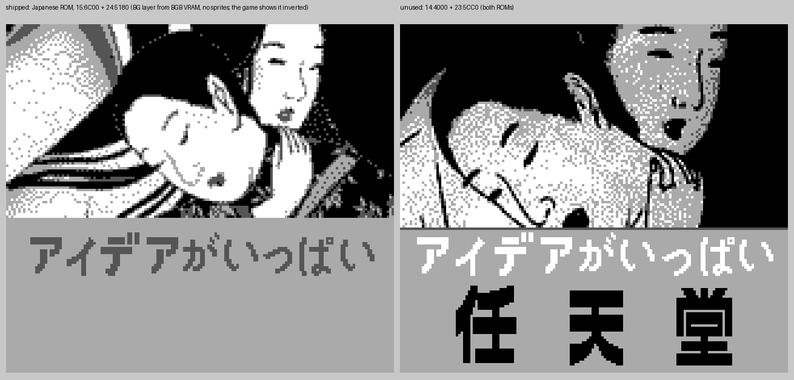

*Same palette for both: the shipped screen's background layer rebuilt from BGB's VRAM (`15:6C00` / `15:7400` + map `24:5180`, no sprites) and the unused `14:4000` + `23:5CC0`. Tools: `tcrf_check/tools/exchange_screens_check.py` (BGB VRAM check and both figures), `tcrf_check/tools/map_23_5CC0_screen.py`.*

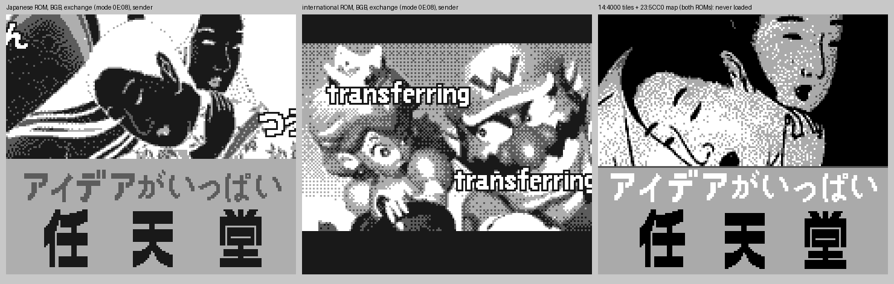

*Left and middle: real BGB captures of a photo exchange (sender, state 8). Right: the unused set drawn straight from ROM bytes in four plain greys (its own palette is unknown; the game shows the shipped art inverted).*

### 14.5 Command byte, thumbnails and the buffer (code, observed)

| Byte | Sent by | Meaning |
|---|---|---|
| `$40 \| n` | initiator | Transfer **photo number n** (album position `n`, 0-29) = `07:4579` (initiator-sender: own photo `D5D8`) or `07:517C` (initiator-receiver: peer photo chosen in the browse screen). Observed: `$40` (photo 0), `$4B` (photo 11). |
| `$80 \| x` | initiator-receiver | Send a **thumbnail page**: the responder uses **bits 0-1 only** as the page number (page *p* = photos 8p … 8p+7, so at most 4 pages) and loads 8 thumbnails of 256 bytes = `$0800` bytes into `$C000-$C7FF` (`02:50CD`). The argument `DC5A = A >> 3` of `07:5169` also carries bits 3-4 of the caller's value, which the responder ignores: observed `$80` (page 0 at entry), `$99` (page 1), `$9A` (page 2), `$9B` (page 3), `$92` (page 2 again when the cursor wraps backwards). The page is a **look-ahead** for the cursor's direction. Verified byte for byte: the received buffer equals the sender's thumbnails `E00-EFF` of album positions 0-7. |
| `$EF` | either | Cancel (14.7). |

**Photo buffer** (4,096 bytes, `$C000-$CFFF` on both sides): `0000-0DFF` photo (3,584 B), `0E00-0EFF` thumbnail, `0F00-0F5B` tag, `0F5C-0FB7` tag echo = **the first `$FB8` bytes of the slot, unchanged** (loaded by `02:4C80`, `07:43F2`, `07:4766`); `0FB8-0FFE` = `00`; **`0FFF` = the sender's owner byte `$DA56`** (gender + blood type, `07:4409`, `07:477D`). Verified: after a transfer the receiver's `$C000-$CFB7` equals the sender's slot `000-FB7` and `$CFFF` equals the sender's `$DA56`.

### 14.6 SRAM effects, and the signature of an exchanged photo (observed, code)

Compared with a run of the same scenario without cable, only these bytes differ (settings/vector checksums and echoes aside):

| Where | Sender | Receiver |
|---|---|---|
| State vector `11B2-11CF` (+ echo `11D7-11F4`) | entry of the sent album position → **`FF`** (no compaction of the other entries); Magic/checksum `11D5-11D6` recomputed | first `FF` entry → **photo number** (`00` for slot 1), checksum recomputed |
| Slots | **none** (pixels, thumbnail and tag stay in the slot; it is only no longer listed) | first free slot gets the whole `$FB8` image, thumbnail and **both tag copies** |
| Counter `10BF-10C0` (photos **transferred**, BCD) | +1 | +1 (**both roles** count: the unlock test "transferred ≥ 15" counts sent plus received) |
| Counters `10C3` / `10C4` (received from a male / female owner) | unchanged | **+1 on `10C3` if the *sender's* owner byte has bit 0, on `10C4` if bit 1** (`07:4A17` reads `$CFFF`, which the transfer overwrote with the **sender's** `$DA56`). Observed: male sender → female receiver bumps `10C3` (not `10C4`). Cap `$99` (a save whose counters are all `99` does not change). |
| Settings block `10D7-10D8`, echo `11B0-11B1` | recomputed (counter changed) | recomputed |

**Tag of the received photo** (`F00-F5B`, copy `F5C-FB7`), compared with the sender's tag of the same photo: **only these bytes differ**: `F12`, `F13`, `F14` and the two checksum bytes `F5A-F5B` / `FB6-FB7`. Everything else is copied: owner **ID** `F00-F03`, **name** `F04-F0C`, gender/blood `F0D`, birth date `F0E-F11`, comments `F15-F2F`, copy flag `F33`, **image checksum `F34-F35` (stays valid: it matches the pixels)**. The hot-spot block `F36-F53` is **cleared** by `02:462F` (verified only on tags that had none; the clearing is in the code, `02:468B`), and `Magic` and both checksums are rewritten.

**The signature, therefore:**

1. **`F14 ≥ 1`**: the number of cable transfers the photo has been through (cap 99). A photo shot on this camera has `F12-F14 = 00 00 00`.
2. **`F12` = number of those hops whose *receiver's* owner was male** (`$DA56` bit 0 of the *receiving* camera, `02:4664`), **`F13`** = female receivers (bit 1). A receiver with an unset gender adds nothing to `F12/F13` but still `F14`.
3. The owner ID `F00-F03` (and name) is that of the **camera that shot the photo**, so it differs from the receiving camera's own owner block. On a camera that shot and then passed the photo on, the ID of the shooter is kept.
4. The three counters **travel with the tag** and keep accumulating on every further hop. Observed chain (male sender → camera with unset gender → female camera → male camera): `(F12,F13,F14)` = `0,0,1` → `0,1,2` → `1,1,3`.
5. The thumbnail carries **no** badge (the copy badge is only drawn for `F33 = 01`, album copy).
6. At camera level, `10BF` and `10C3/10C4` move as in the table above.

Not exchanged, therefore never in a received tag: the receiver's own owner ID, the hot-spot data (cleared).

### 14.7 Cancel, refusal, time-outs, unplugging (observed)

* **Receiver presses B while browsing**: the initiator sends `$EF` as command (in the log: a COMMAND exchange with `$EF`); both units tear the link down (`DC4E=1`) and return to the main menu (mode 6).
* **Sender presses B in the confirmation dialog**: it puts `$EF` in `DC5B`; the SYNC exchange carries `$EF`, `00:2BFD` jumps to the "half done" path (`00:2CC7`), no data are transferred, and the requester **returns to its browse screen** with the link still up (log `flow5`: the next command is the thumbnail request `$80` again).
* **Cable pulled during a transfer**: nothing is detected on the wire. Bank 7 counts a 16-bit frame counter `DA0B:DA0C` down once per frame (loaded with `$0200` = 512 frames when the bulk phase is set up, `$00B4` = 180 frames after a command has been issued or received) and when it reaches zero it shows the error screen with message `$0C` (state 18). **It is a deadline, not a per-byte watchdog**: it is not re-armed by progress. Observed: pulled during the bulk phase, the error came exactly when the remaining count had run out (469 frames after the unplug, the counter held `$01D5`). A photo needs about 350 frames (margin ~160); a thumbnail page needs about 175 frames against the 180-frame budget (**emulator timing**; a margin of 5 frames, so a slower real cable cycle would show this error; **inferred**, not tried on hardware).
* **Both players press A**: if one press precedes the other by 1-3 frames (tested) the first unit is the initiator and the session proceeds normally. If both are processed in the *same* frame (the harness's coincidence case) the first hello succeeds on one unit while the other has just started its own hello: the pair is left inconsistent (one unit waiting in stage 1, `DC51=1`, whose `00:2DED` and `00:2DD8` then refuse to act; observed once, not analysed further; the real probability of two hands pressing within the same 16 ms is not modelled).
* **Nobody listening**: the hello reads `$FF` (no partner or cable unplugged) and the unit re-arms as responder (`SB=$12`, `SC=$80`): no message, no time-out (observed).

### 14.8 SRAM of the two cameras after the first example (reproduce)

`link_protocol/saves/flow1_*` and `flow2_*`: before/after images written by the emulator for the sender-initiates and the receiver-initiates scenarios (**emulator-generated, not real cameras**; each also carries the ~3.5 KB of normal boot-time changes, so diff them against the *unlinked* run or look only at the regions of 14.6). The log format is described in `link_protocol/README.md`.

### 14.9 What is still open (kept as questions, not guessed)

* **Hardware / BGB confirmation** of the byte timing and of the alternation: a BGB-to-BGB exchange was run on both ROMs (§16.6, row 7) and gives the same SRAM result as the emulator (sender entry set to `FF`, receiver slot filled, `F14` 0 → 1, checksums and `F70` changed). BGB was not made to log the bytes, so the byte *timing* is still the emulator's; real hardware was not tried.
* Meaning of **bits 3-4 of the thumbnail command** (`$18` vs `$10`) and of the unused count bit 5 (the maximum count is 30, so it is never set).
* Whether the **`$55`** hello variant, the `DC5D` flag and the `$0800` page for "photos 24-31" in a 27-photo album show anything on screen (the `$55` hello ends the exchange exactly like `$12`, §16.19; the last page's unused 5 thumbnails are whatever the album loader leaves; not examined).

## 15. TCRF and unlock cross-check: what the unlocking saves reach, the documented-content checklist, code that "never ran"

*Why this section exists.* The owner asked (a) to confirm findings in BGB where possible and (b) to re-run with an unlocking save so that no code is called garbage that is really the credits, the CoroCoro content or a TCRF-documented asset, and (c) to retrieve every known asset. (b) and (c) are done with the emulator of §13, using joypad input and an SRAM image only unless a line says "poke". (a) was **not possible when this section was written** (BGB was not available then) and was done afterwards: the findings marked "BGB-confirmed" below were reproduced in BGB (§16.6); everything else in §15 is core-only.
Evidence tags as before: **C** code or data traced, or seen on an emulator screenshot of the ROM; **I** inferred; **?** inconclusive or not located (never guessed). The item-by-item table is `tcrf_check/TCRF_CHECKLIST.md` (`.csv` next to it); this section gives the findings behind it.

### 15.1 Method

* **Unlocking saves** (`make_unlock_saves.py`): the 14 real cameras' SRAM with the unlock counters of the settings block (`10BB-10D0`, shadow `$DA96-$DAAB`, §2 / §3.2) raised, and with the CoroCoro tag `56 56 53` at `$1FFD-$1FFF` (bank 0 `$BFFD-$BFFF`) in a second family. Fuzz runs from those saves: `unlock_runs/f1_organic` (joypad only).
* **Coverage v8** = v7 plus the unlocking runs and the link runs: of the 60,449 traced instructions, **57,582 (95.3 %) executed**, **50,008 (82.7 %) from joypad and SRAM only**, 7,574 only in forced runs, **2,867 never**. Never-read non-padding data bytes: 10,020 (largest blocks: `0B:42C6-4897` 1,490 B, `32:4180-44FF` 896 B, `14:4170-43E3` 628 B, `0B:48A8-4A45` 414 B, `14:4000-415F` 352 B, `26:4500-465A` 347 B, `2A:78F6-7A24` 303 B, `33:61F0-630F` 288 B). These figures do **not** include the two confirmation runs of §15.4 and §15.5.
* **VRAM tile census** (which tiles ever reach VRAM) is used only to *find candidates* for unused graphics. It cannot prove "unused", and two screens render wrongly in my core (§15.8), so it can be biased.

### 15.2 Unlock-gated content: what the gates are (C)

| Content | Gate | Where |
|---|---|---|
| **Real credits** (CLIP THIS, One Love, staff-roll text, ending picture "Don't butter me up! Be happy!!"); **BGB-confirmed** (§16.6): stored `99 99` reaches `08:17`, stored `93 77` (22:06) does not | stored `[$DAA7:$DAA6] >= $7799` | `09:4CFC-4D0B`: `ld a,[$daa7] ; cp $77 ; jr c,… ; jp nz,$4d86 ; ld a,[$daa6] ; cp $99 ; jp z,$4d86`. Below the gate only the dancers run (states `$17`, `$18`). Reached from mode `$08` state `$12` (`09:4CF2`); the credits states are `$12-$18` (`09:4CF2`, `4DE2`, `4EA4`, `4FD5`, `50D0`, `50E0`, `518C`). |
| (same, what the number is) | `$DAA6-$DAA7` is **stored as the nine's complement** of the displayed Run!Run!Run! result (§2, row `best_run`), so a stored `$7799` is a displayed **22:00**, and a fresh save (stored `0000`) shows **99:99**. The gate therefore means "displayed result at or below 22:00" (I: it is a time; the code only compares). | |
| **CoroCoro content** | tag `56 56 53` at `$1FFD-$1FFF`; **2 of 3 bytes are enough** and the routine rewrites all three | `08:72E0-731B` (constant at `08:7319`); success sets `$D582 = 1`, `$D562 = $1E`, shows the second copyright screen (`21:6BC0`, `$600` B, `08:72B7-72DF`). **BGB-confirmed (§16.6).** **In the international ROM the flag is set whether or not the tag matches (§16.5), and nothing CoroCoro is behind it: the owner says the real international camera has no CoroCoro content, and BGB shows Mario art in those slots (§16.12).** `$D582` is read by `08:52E0` (wild-frame pages 6 → 8) and bank 4 (stamp category 3 skipped without it, `04:59AB-59D0`). |
| **Pokémon stamps 11-20** | gradual, not all-at-once | `04:5827-5832`: `$D642 = min($DAA5, 5) + 4` (pages of the stamp grid); `$DAA5` = hundreds byte of the Ball record (SRAM `10CA`). Each 100 points opens one more page (2 stamps), up to 500: TCRF's end points (10 free, 20 at 500) are right. |
| **D.J. / Ball / Run!Run!Run!** | the first wave of Space Fever II (mode `$07`) shows a menu; the choice is tested by `$D503 / $D502 / $D504 == $0A` | `07:5AFA` (modes `$1F` / `$20` / `$21`). Reached organically. |
| **Album B pictures B17-B24, B25-B30** (Japanese ROM) | counters in `$DA96-$DAAB` (B17-B24, photo numbers `$2E-$35`; **8** conditions at `02:4D05`), CoroCoro flag (B25-B30, `$36-$3B`; with the tag Album B has a fourth page B4, without it B1-B3 only) | `$D5D8 >= $1E` marks a stock picture. The **international** ROM tests **14** conditions at `02:4D0D` (the guide's B-17…B-30) and does not depend on the tag (§16.5). The stock pictures' own names and comments: §16.27. |

### 15.3 The checklist (54 items), summary

33 items are located or traced (C), 5 are inferred (I) and 16 keep an open point (?), counting every TCRF section: unlock-gated content (16 rows), the "unused" sections (18 rows) and the Japanese side of "Regional Differences" (20 rows). The checklist gives for each item the ROM location, the coverage computed from the merged run (touched / organic), the finding, the tag and the file names of the retrieved assets.

**Located (I), unused graphics:** the "G" letter and the hand gestures of the album tiles (`13:5810`, `13:5C00-5F9F`); the unused B film roll and the unused Japanese text of the print bank (`18:5A50`, digits `18:5C70`, text `18:5F90`); the JP-only unknown main-menu tile = a circled X, three identical copies at `15:4480 / 4500 / 4580`; the "cannot combine the same picture" graphic (`0D:4000-425F`, 36 tiles never shown); the kanji 前 and 後 (`1C:54A0-55FF`, next to an OK tile); circled-B candidates in the photo-option bank (`0C:7A20`, `0C:7A60`). The `tcrf_check/assets/unused/located_items.png` sheet shows them.
**Not located (?):** the kanji 中 and 持; the two unused main-menu tiles (ball, rectangle); the unused icon and tile of the photo-option bank; the D.J. め tile; the printer wave pattern. ("Unused Graphic Bank 11", a hand flipping a newspaper, is `11:5800-693F`, B16, I; bank `$0B` is **not** it: it is Super Game Boy data (4 bpp border tiles and packets; its never-read tail is border data that the core does not request without a full SGB handshake), and "11" is the hexadecimal bank `$11`.) **Located (C):** the "poorly drawn X after the Magic menu graphics" (B12, TCRF: international release only) is in the international ROM at `0D:5200-5CFF` (16 x 11 tiles, 34 non-empty, one-pixel strokes), pixel-identical to the TCRF image the owner pasted (0 differing pixels), right after the Magic-menu strips and before the "no blank frames" strip at `0D:5D00`; the Japanese ROM has no copy (`tcrf_check/assets/unused/intl_unused_X_0D_5200.png`, `TCRF_CHECKLIST.md` B12). The "SPORADIC VACUUM" lettering (View screen) **is located**: BGB draws it in the lower band of the Japanese VIEW menu and the data are the 36 tiles at `13:54C0-56FF` (§16.11); the core garbles that band.
**Also unresolved:** the 0.9 s of song `0x45` and the prelude beeps of `0x31` were not checked by ear (the song data are fully read); TCRF's "Album B hot-spot shows only the exit menu" (`$D5D8 >= $1E` tests exist, the exit-only menu itself was not re-traced); "B during a song keeps the music playing" (JP only) was not examined.

### 15.4 Reclassified: the hold-A branch of the stamp tool is not dead code (C)

`04:5E4C-5FE1` (254 instructions, the largest "gated, never run" block of §13.4) runs in the placement state of the stamp tool (mode `$11`, state 4) when **A is held**: `$D641` is loaded with `$B4` (180) after each stamp or palette close (`04:5A15`, `04:5FE7`), `04:5E3B` decrements it every frame while A is held (`FFA1` bit 0), and at 0 it reloads `$64` (100) and falls into `04:5E4C`. **Confirmed with joypad input only** (`tools/stamp_hold_a.py`, `stamp_hold_a2.py`; and again in BGB on both ROMs, §16.6 row 5): the routine first executed 180 frames after the press and then every 100 frames; the four stamp work buffers (`$C000`, `$C1E0`, `$C3C0`, `$C5A0`) change at each firing and are **identical to their original content after two firings**, so the operation is an **involution**, not a 90-degree rotation (a rotation would need four firings). **The owner reports that holding A in stamp mode reverses the stamp** (a mirror image): that fits the period of 2 and the routine's bit-reversal of every stamp byte (`rl [hl]` / `rr a` chains with the cell order swapped), so it is a **left-right mirror (C for the routine and the period, user observation for the name of the effect)**. A pixel test of the screenshots (83 pixels differ inside the stamp's box) did not discriminate by itself (BGB reproduces the flip at the level of the work buffers, not of the axis), because the stamp is drawn semi-transparently over the photo, so the mirror axis is not verified in pixels. Screens and buffers: `tcrf_check/assets/stamp_hold/`. The [GameFAQs cheats page](https://gamefaqs.gamespot.com/gameboy/564359-game-boy-camera/cheats) lists the same behaviour (its entry on reversing stamps: hold A with a stamp selected; §16.18).

### 15.5 Reclassified: the hot-spot effect handlers (C) and the "S = wave" claim (C in BGB, §16.8)

The effect dispatcher `03:6543-655A` reads the effect number of the triggered hot spot from `$D657 + n`, adds 1, and jumps through the 17-entry table at `03:655D`: index 0 (effect `FF`, none) = `03:6625`; effects 0-7 = `03:6642, 66AF, 66DC, 67D5, 6801, 6838, 68A4, 6901` (eight different handlers: the eight icons of the normal game); **effects 8-15 all = `03:6983`**. The trigger is the hit test `03:72CD` (pointer cell `$D667/$D668` equal to an enabled hot spot's X/Y cell), reached from state 4 of mode `$0C` (`03:6435`) when A is pressed; the hit path (`03:6450-645D`) ran **only in forced runs** of v8, so the eight original handlers (about 250 instructions in §13.4 as "table targets") counted as never executed organically. **Confirmed in the emulator** (`tools/hotspot_effects.py`): with hot spot 0 armed under the pointer (a WRAM poke of the mirror `$D643-$D65C`, then a real A press) every effect 0-7 ran its own handler and effect 8 ran `03:6983`. Code-level facts about `03:6983`: it is one SCY raster loop (`$FF42` written per scanline between LY `$0F` and `$7F`, eight passes) followed by the reload of the photo into VRAM; it **never tests the effect number**, so the TCRF statement that only the "S" icon produces a wave and the other seven a page flip could not be read from the code. **It is true on the screen** (BGB, both ROMs, §16.8): the effect of a hot spot is the transition to the photo named by its JUMP field; value 7 (the S-shaped icon) is a wave and values 8-15 all play the same page flip. The Game Genie `??FD-199-F76` (JP) patches `03:6D18 ld d,$07` to `$0F` (checked on the ROM byte), which is what lets the editor reach the eight extra icons.

### 15.6 Asset inventory (all retrieved from the ROM or from the emulator, `tcrf_check/assets/`)

| Set | Files | Notes |
|---|---|---|
| Album B pictures B01-B30 + thumbnails | `albumB/` (`albumB_all.png`) | `0xDA000 + i × 0x1000`; B17 Judge, B19 Tamanoripu, B22-B24 Pokémon, B25-B30 CoroCoro |
| Wild frames 01-08 | `wild_frames/` | `0xC4000 + i × 0x1800`, 384 tiles, **20 tiles wide** |
| Frames No.01-18 | `frames/` | chooser of mode `$09` state 9 |
| Stamps | `stamps/` (17 category sheets, palette captures), `stamps_rom/` (20 Pokémon at `2C:6000 + n × $190`; 10 CoroCoro at `2B:4000 + n × $1E0`) | CoroCoro stamps are in bank `2B` |
| Static screens | `screens/` (68 composed screens, `INDEX.csv`, 3 contact sheets) | from the copy-call catalogue of §4 |
| Hot-spot effect icons | `hotspot/` (15 icons, one per picker value 0-14: ROM `1C:5760 + 64 × value`, 2 × 2 tiles of 16 B; value 15 has no icon) | the same bytes in the international ROM; sheet with the OFF icon: `us_jp_compare/hotspot_16_effect_icons.png` |
| Japanese / international side by side (BGB) | `us_jp_compare/` (8 sheets, `effects_jp_vs_us_pixel_equality.json`) | SHOW menu, hot-spot editor and picker, effects 0-15 with a JUMP target, the 20 Pokémon stamps (names from the owner), the stamp chooser pages (§16.8, §16.9) |
| Funtography flowcharts walked in BGB | `guide_walk/` (5 chart sheets, `guide_nodes_verdict.json`, `guide_walk_results.json`) | §16.11 |
| Unused graphics located | `unused/located_items.png` | §15.3 |
| Screenshots (credits, CoroCoro screen, wild frames, album, SGB border, stamps) | `shots/` | |
| Per-mode screens (core renderings) | `tcrf_check/work/atlas_modes/` (contact sheets `sheet_00.png`-`sheet_10.png`, `meta.json`) | `MM_SS` = mode, state |
| Confirmation runs | `stamp_hold/`, `hotspot_effects/` | §15.4, §15.5 |

### 15.7 Screens matched to the main-menu items (I, new names)

The lower page of the main menu has four items; the table at `07:7804 + item` sends them to modes `$04, $06, $03, $05` (items 3, 4, 5, 6). The labels shown next to the cursor in the atlas screenshots (`00:04-00:07`) are, in order, **らくがき, つうしん, とくしゅ, へんしゅう**, and the four target modes show screens that fit those labels: `$04` carries the caption スタンプ (tool pick of the doodle menu), `$06` is the "ACCESS" screen with プリント / こうかん (print / exchange) bubbles, `$03` offers ピクトリップ and ごうせい (hot-spot and compose), `$05` offers アルバム and アニメーション. Four-for-four consistency was good evidence for the mapping; the cursor-order assumption is now **confirmed (C)** by the international screens (DOODLE, LINK, SPECIAL, EDIT) and by the guide's *Studio Menu* (§16.2). Mode `$02` (two choices みる / どみーる, over an animated background) is the VIEW menu: ALBUM / SHOW (§16.2).

### 15.8 Caveats and what is still open

* **BGB.** When this section was written BGB was not available; it was used afterwards (§16.6) for the credits gate, the CoroCoro tag, the Pokémon pages, the hold-A flip (both ROMs), the hot-spot effects, the link exchange and the gender bits, all by demo replay and state comparison. **Not done:** BGB's debugger breakpoints (`BGB_TEST_SHEET.md` keeps the list) and its printer core.
* My core renders two things wrongly although the ROM data are clean: the second stamp slot of category 2 (VRAM `$8510`) and the bottom band of the View screen (BGB draws both correctly: **use BGB for any screenshot or asset comparison**, as the owner asked). The VRAM census may therefore miss or invent a few candidates.
* The two confirmation runs poke the hot-spot mirror in WRAM (the key press is real); the hold-A run is joypad only.
* Open: the items marked ? in §15.3.

## 16. Menu names, the international ROM, and BGB cross-validation

*Why this section exists.* The owner attached the Funtography guide (the US manual) and BGB and asked: when there is no idea what a menu is, enter the same joypad sequence on the international ROM and show the menu if it is not in the guide; he had earlier asked to confirm findings in BGB. This section gives both results. Evidence tags: **C** = code traced, or seen on a screenshot, or reproduced in BGB; **I** = inferred; **?** = not established (never guessed). "Guide" = the Funtography guide; page numbers are the *printed* ones of its table of contents (Arcade 34, Music 36, Link 42, Special 44, Doodle 47, Edit 48). The first lines of this README still apply: none of this has been validated by a human.

### 16.1 The Japanese and the international ROM are two different builds (C)

Byte comparison, bank by bank (16,384 bytes each), Japanese Rev A against the international ROM used here (md5 `42d2f65e2549be9d1d126a6828b5d1c1`):

| Banks | Bytes that differ |
|---|---|
| `$00`-`$09` (all the menu and mode code) | 12,696 · 8,874 · 11,329 · 14,932 · 10,792 · 14,883 · 12,487 · 14,067 · 9,113 · 11,778 |
| `$0A` (sensor driver, §10) | **61** |
| `$22` | 138 |
| `$35` | 0 (the only identical bank) |
| all 64 banks | 466,317 of 1,048,576 |

So the menu logic of banks `$003`-`$009` is **not** structurally identical: only the sensor / exposure bank is nearly the same. What the two builds share is the **numbering of the modes and the flow of the states**. Replaying the 206 joypad-only paths of the Japanese corpus (one target (mode, state) each; my core reaches the target 156 times on the Japanese ROM): on the international ROM the same inputs reach the same (mode, state) **128 times** (92 with the inputs unchanged, 36 after the single rule of §16.3) and the same mode 162 times; a native exploration of the international ROM reaches 140 of its 187 targets; **150** distinct (mode, state) signatures were reached on both ROMs (161 on the Japanese ROM, 166 on the international ROM counting both international runs). What each path reached is in `tcrf_check/assets/atlas2/{JP,INTL,INTL2}/result.json`, the Japanese / international pairs of the same inputs are the contact sheet `tcrf_check/assets/intl_compare/sheet_same_inputs.png`. Tool: `tcrf_check/tools/atlas_replay.py` (`MIRROR=1 GBCAM_ROM=...`), `tcrf_check/tools/atlas_sheet.py`, `tcrf_check/tools/intl_replay.py`.

### 16.2 Names of the 34 modes (screen text, Japanese / international / guide)

Read from the screens (C for what is printed on them; the guide column says where the guide uses the same word). Items in **bold** are what the guide or the international screen calls the thing; the Japanese texts are copied as I read them from the screenshots (CJK in screenshots is the part most likely to contain a misreading).

| Mode | Japanese screen | International screen | Guide |
|---|---|---|---|
| `$00` | main menu: みる (VIEW, left), とる (SHOOT, right), あそぶ (PLAY, below); lower page (Select): らくがき, つうしん, とくしゅ, へんしゅう. State 0 also carries the power-on prompt "セーブデータを全て消しますか? はい···A いいえ···B" | **SHOOT** (left), **VIEW** (right), **PLAY** (below) — **mirrored** (§16.3); lower page shows **DOODLE** and **SPECIAL**; prompt "erase all saved data? YES···A NO···B" | "Shoot/View/Play Menu"; Select = the "Studio Menu" (Link, Special, Doodle, Edit) |
| `$01` | とる / アイテム / まほう / チェック / にげる, caption 女王さまがあらわれた! (an RPG battle window). In the core: とる → `$15` → `$14`; アイテム → states 6-7 of the same mode (then `$15`); まほう → `$16`; チェック → `$09`; にげる → states 9-A of the same mode | **SHOOT / ITEMS / MAGIC / CHECK / RUN**, captions "Welcome to my parlor!" / "Let's play!" | Game Face sidebar: "the Shoot Menu … is modeled after RPG menus"; "Check mode serves essentially the same function as Album" (code: CHECK → `$09`, the album viewer); "Run is a joke command that has no practical use" (code: stays in mode `$01`) |
| `$02` | みる / どみーる (the label どみーる is on the right button, which opens SHOW: SLIDE SHOW / ANIMATION / HOT-SPOT; the owner: "a good approximation for HOT-SPOT", I) | **ALBUM / SHOW** | View: Album, Show |
| `$03` | ピクトリップ / ごうせい (picture of a stone lantern and a doll, caption "Happy?") | **HOT-SPOT / COMPOSE** (Mario in a kart) | Special (44): Hot Spot, Compose |
| `$04` | caption スタンプ | caption **[STAMP]** | Doodle (47): Stamp, Paint |
| `$05` | アルバム / アニメーション (dog photo with two speech bubbles) | **ALBUM / ANIMATION** | Edit (48): Album (Copy, Delete), Animation (Frame, Speed, Loop, Sort, Pack, Test, Clear) |
| `$06` | **ACCESS**: プリント / こうかん | **LINK**: PRINT / TRANSFER | Link (42): Print, Option, Transfer |
| `$07` | Space Fever II (the logo "SPACE FEVER II"); first-wave menu: **?** / **D.J.** / **BALL** with targets 30 / 10 / 5 | same | Arcade (34): Space Fever II, Ball, Run! Run! Run!; Music (36): DJ |
| `$08` | user screens: RECORD (撮影 / 消した写真 / 交換 / もらった写真 ♂♀ / プリント), HI-SCORE, NAME & SEX, BIRTH DATE, credits | **RECORD** (SHOTS / DELETED / TRANSFERS / RECEIVED ♂♀ / PRINTS), **HI-SCORE** (SPACE FEVER II / BALL / RUN! RUN! RUN!), credits ("CLIP THIS", "HELLO! … THANK YOU FOR USING THE GAME BOY CAMERA. PLEASE TAKE GOOD CARE OF IT. THE STAFF") | Start = "User Screen": Record, Hi-Score, Credits, Name & Sex, Birth Date, User Name, User ID |
| `$09` | single-photo viewer of the album (film-strip border, photo number) | same | Album (28-): Paint, Color, Speed, Stamp, Frame, Comment, Delete, Print |
| `$0A` | photo grid どの写真を見ますか? with the みる icon | **view which photo?** with the **VIEW** icon | View → Album |
| `$0B` | スライドショー / アニメーション / ピクトリップ (a monkey) | **SLIDE SHOW / ANIMATION / HOT-SPOT** | Show: Slide Show, Hot-Spot, Animation |
| `$0C` | photo grid with the ピクトリップ icon, then the photo (pointer hand) | **view which photo?** with **HOT-SPOT** | View → Show → Hot-Spot ("the Hot-Spots will no longer be visible") |
| `$0D` | スライドショー 1号, A おすざんす B やめるざんす; options ランダム再生 (ON/OFF) | **SLIDE SHOW #1**, A **ROLL IT**, B **CUT**; option **SHUFFLE** ON/OFF | Show: "ROLL IT" and "SHUFFLE" appear on the guide's menu map; Up/Down changes the speed |
| `$0E` | あげる / もらう (caption 待望のレディースコーナー); after the exchange あげました / もらいました and よろしい | **SEND / RECEIVE** (caption "PRESS A TO BEGIN"); after the exchange **sent / received** and **GOOD** | Link → Transfer: "one must highlight Send while the other picks Receive … both cameras will display 'good'" |
| `$0F` | どの写真を消しますか? (けす icon); confirm 消しますか?? はい / いいえ | **delete which photo?**, **DELETE??** YES / NO | Album → Delete; Edit → Album → Delete |
| `$10` | ペイント (photo grid with the らくがき icon) | **PAINT** (grid caption **DOODLE**) | Doodle: Paint (Speed: Fast ··· Slow) |
| `$11` | スタンプ; confirm セーブしますか? はい / いいえ | **STAMP**; **SAVE?** YES / NO | Doodle: Stamp |
| `$12` | animation tools bar: ループ, コマおとし (popup title), two more entries I could not read, オールクリア | **LOOP / SORT / PACK / TEST / CLEAR** ("TOOLS"), popup SORT: CANCEL / Normal / Shuffle | Edit → Animation: Loop, Sort, Pack, Test, Clear (the guide does not mention a "Normal / Shuffle" choice of SORT) |
| `$13` | アニメーション (A ボタンではじまるよ) | **ANIMATION** "press A to begin. use ↕ to select music." | Edit → Animation |
| `$14` | live view "のこり30"; option cross はんてん / パレット / (ベタぬり) / シャッター音; きろく / やめる | "30 left"; **flip / palette / dither / shutter**; **SAVE / CANCEL**; "no blank frames." | Shoot: Brightness, Contrast, Flip, Dither, Palette, Shutter |
| `$15` | セルフタイマー (…秒) / かんかく · さつえいまいすう | **Self-timer** / **Interval · Exposures** | Items (18): Self-timer, Time-lapse |
| `$16` | とーるくん: とくしゅレンズ / モンタージュ / パノラマでポイ / ゲームモデル | **SHUTTERBUG**: **TRICK LENSES / MONTAGE / PANORAMA / GAME FACE** | Magic: Trick Lenses, Montage, Panorama, Game Face (Shoot, Play, Doodle) |
| `$17` | 4ぶんかつ / フュージョン (つくる) | **SPLIT / FUSION** (BEGIN) | Special → Compose: Split, Fusion |
| `$18` | パノラマプリント (A プリント / B やめる) | **PANORAMA** (A PRINT / B CANCEL, "scroll ↕ to select") | Panorama Print |
| `$19` | title / copyright scenes: "© 1995 Creatures / © 1995 GAME FREAK", then, **only with the CoroCoro tag**, a second screen naming two authors and 小学館 (こしたてつひろ, 樫本学ヴ; the second name is read from the 8 × 8 glyphs, §16.12), then the title | "© 1995 Creatures / © 1995 GAME FREAK", then the title (no second screen, §16.5) | — |
| `$1A` | 写真をえらんで下さい (ピクトリップ icon) | **select photo.** (**HOT-SPOT**) | Special → Hot-Spot (Album A only) |
| `$1B` | GAME BOY Printer: プリント / オプション | **PRINT / OPTION** | Link → Print, Option |
| `$1C` | どの写真をプリントしますか? | **print which photo?** | Link → Print |
| `$1D` | データ転送中 (TV with dancing figures) | **transferring…** | — |
| `$1E` | OPTION: かんかく / ごうけい | **OPTION**: **FEED MARGIN / TOTAL PRINT** | Link → Option |
| `$1F` | **TRIPY-H** (page tabs SOUND I / SOUND II / NOISE; title screen 「TO COOL YOU DOWN, STIR YOU UP, AND DRIVE YOU CRAZY.」 with COOL DATA: SAMPLE / NEW / SAVE DATA); reached in the replay of §17.6 from the `D.J.` target of mode `$07` | | Music (36): DJ |
| `$20` | BGM 2, 顔ボル, ゲーム A スタート B でる | **BALL**, GAME A START B EXIT, "FACE 12?" | Arcade: Ball ("the juggling game") |
| `$21` | RUN! RUN! RUN! (speech bubbles with instructions) | **RUN! RUN! RUN!** ("▲ to jump") | Arcade: Run! Run! Run! |

What this settles: what the main-menu items 3-6 and mode `$0B` are and which game each of the modes `$07`, `$1F`, `$20`, `$21` is are answered by the screens; the names of the **mode `$16` pages and the SHOOT variants** are answered as far as the screen text goes (TRICK LENSES, MONTAGE, PANORAMA, GAME FACE: Chapter "Magic"), the visible effect of each variant is measured in §16.28. Not answered by the guide: the "Normal / Shuffle" popup of SORT, the printer OPTION screen's FEED MARGIN / TOTAL PRINT meanings, the Japanese captions (女王さまがあらわれた!, 待望のレディースコーナー), and **どみーる**, which the pair above identifies with **SHOW** (the literal reading of the word is still open).

### 16.3 The main menu is mirrored in the international ROM (C)

Japanese: みる (VIEW) at the upper left, とる (SHOOT) at the upper right, あそぶ (PLAY) below; international: **SHOOT upper left, VIEW upper right, PLAY below**. The default cursor is SHOOT in both, so the single rule needed to replay a Japanese path on the international ROM is: **swap Left and Right while mode `$00` is in states 0-2**. After the swap the same keys lead to the same modes: A on items 0-6 goes to modes `$01 $02 $07 $04 $06 $03 $05` (`07:7804 + item`, both ROMs). Probe: `tcrf_check/assets/intl_compare/probe_jp/`, `probe_intl/`, `sheet_mainmenu_probe.png`; tool `tcrf_check/tools/mainmenu_probe.py`.

### 16.4 What the guide says that the code could check (C unless marked)

* **Hold A in the stamp tool**: the guide says "hold the A Button (for **about two seconds**)" to flip the stamp. The code needs **180 frames** (about **3.0 s**) before the first mirror and then 100 frames per further flip (§15.4); BGB agrees (§16.6). The guide's "two seconds" is an approximation or a different build; the name of the effect (reversal / mirror image) is the owner's, the code does the bit-reversal and the period 2. The [GameFAQs cheats page](https://gamefaqs.gamespot.com/gameboy/564359-game-boy-camera/cheats) says only "hold A while a stamp is selected".
* **Credits**: the guide says "finish the game in less than 22 seconds" (and, elsewhere, "a 22-second finish or better"). Code: stored `[$DAA7:$DAA6] >= $7799`, displayed **22:00 or lower** (§15.2): "or better" is the right reading. The guide's Record example shows "RUN! RUN! RUN! 15:99" and its Album B list asks for "17 seconds" / "16 seconds": the Run!Run!Run! record **is a time in seconds:hundredths** (C by the guide). The [GameFAQs cheats page](https://gamefaqs.gamespot.com/gameboy/564359-game-boy-camera/cheats) agrees: 22 seconds or less, and a displayed 22:00 exactly qualifies (§16.18).
* **Run!Run!Run! needs 2,000 points in Space Fever II** (guide, "Run! Run! Run!" under the hidden features). The code (`07:59F9-5A0E`) tests the best Space Fever II score (BCD, `DAA3-DAA0`): if `DAA3 = DAA2 = 0` and `DAA1 < $20` (below 2,000) the third target of the first-wave menu is shifted by `$40`: same figure (was "probable unlock, I", now C by the guide). The [GameFAQs cheats page](https://gamefaqs.gamespot.com/gameboy/564359-game-boy-camera/cheats) gives the same figure (2,000 or more points in Space Fever II); §16.18 plays Space Fever II past 2,000 and runs the gate with the real score.
* **Pokémon stamps / Ball 500** (TCRF) are not in the guide (the guide has no Pokémon stamps, see §16.5).
* **Transfer**: the guide says the photo "will disappear from the sender's album and reappear in the receiver's album", that both cameras display "good", and that the transferred photo shows the **name and gender of the sender in Comment mode**: exactly the SRAM effect of §14.6 (sender entry set to `FF`, receiver slot filled, owner ID, name and gender kept in the copied tag) and the end screens of §16.6. The [GameFAQs cheats page](https://gamefaqs.gamespot.com/gameboy/564359-game-boy-camera/cheats) asks for 5 transferred pictures for B19 (and, in a separate B3 line, for 15): the code needs 15 (§16.18).
* **Hot-spot**: "five hot spots per photo", effects are "transitional fade or wipe visuals (Effect)" plus Sound and Jump; "you won't be able to plant a trigger in Album B". All consistent with the block `$D643-$D660` (five flags, X, Y, sound, effect, jump) and with the tests `$D5D8 >= $1E` (stock picture).
* **Tools of the animation editor**: five tools (Loop, Sort, Pack, Test, Clear) = the five entries of the tools bar of mode `$12`.

### 16.5 Differences between the builds that the guide revealed (C)

1. **Album B unlock test.** Japanese `02:4D05` tests **8** conditions (`d` register: shoot 60, print 30, transfer 15, Ball 700, Ball 1000, Space Fever II 3000, 5000, Run!Run!Run! 17 s, §3.2). The international routine `02:4D0D-4DA0` tests **14**, exactly the guide's list for **B-17…B-30**, in the guide's order: bit 0..7 of `e` = shoot 60 (`DA96/97`), **delete 60** (`DA98/99`), transfer 15 (`DA9A/9B`), **receive 5 from males** (`DA9E >= 5`), **receive 5 from females** (`DA9F >= 5`), print 30 (`DA9C/9D`), Space Fever II 3000, 5000; bit 0..5 of `d` = Space Fever II **7000**, Ball **500**, 700, 1000, Run!Run!Run! 17 s (`DAA7 >= $82`), **16 s** (`DAA7 >= $83`). So the counters `10C3/10C4` (received from male / female senders, §14.6) are **used by the international ROM** to unlock B-20 / B-21 (the guide: "Photos B19, B20, and B21 will appear in Album B only after you've used the Link function"); the Japanese ROM does not test them. With saves whose counters are 99, the Japanese ROM shows Album B as pages B1-B3 and, **only with the CoroCoro tag**, a fourth page B4 with the CoroCoro pictures; the international ROM shows B1-B4 with or without the tag (`tcrf_check/assets/intl_compare/albumB/`; tool `tcrf_check/tools/albumb_pages.py`). The [GameFAQs cheats page](https://gamefaqs.gamespot.com/gameboy/564359-game-boy-camera/cheats) lists the same 14 conditions with the numbers B17-B30 and in the same order (apart from B19: 5 on the page, 15 in both ROMs); every threshold was run at the exact value in §16.18.
2. **The CoroCoro flag is always set in the international ROM.** Both ROMs contain the tag routine (`08:72E0` Japanese, `08:730E` international, constant `56 56 53`, "2 of 3 bytes" rule, rewrite of the tag). In the Japanese ROM the caller sets `$D582 := 1`, `$D562 := $1E` only when the tag matched. In the Japanese ROM the call at `08:72B2` (`call $72E0`) is followed by `jr nc` that skips the loads when the tag does not match. In the international ROM state 0 of mode `$19` calls the routine at `08:730E` (the call is at `08:72FC`) **and then loads `$D582 := 1`, `$D562 := $1E` unconditionally** (`08:72FF-7308`; the carry returned by the routine is not tested). Observed: in my core (table `tcrf_check/assets/intl_compare/boot_flags.txt`: `_ff`, `_zero`, a real save without tag and a save with the tag) **and in BGB** (`tcrf_check/assets/bgb/results/corocoro_tag_intl.txt`: the six tag values of §16.6 row 3 on the international ROM, all give `$D582 = 1`, `$D562 = $1E`, and a tag that does not match is left untouched) the international ROM leaves the boot with `$D582 = 1`, `$D562 = $1E`, the Japanese ROM only with the tag (`$D582 = 0`, `$D562 = $18` otherwise). Consequence: the content that the flag gates in `04:595B`/`5972` (stamp category 3) and `08:532A` (wild-frame pages 6 → 8) is available without a tag in the international ROM, and the image counts of Album B differ (`$D562` = 24 → 30 pictures in the Japanese ROM). What the international slots show, answered in §16.12: the flag gates **one** extra wild-frame page (7 pages instead of 6, `ld c,7` at `08:532A`; the Japanese `ld c,8` is at `08:52E0`) and the stamp category 3, and neither is CoroCoro art: wild frame 07 is Mario Kart 64, category 3 is Mario and Luigi stamps (BGB, C). The owner's answer for the real camera: it contains no CoroCoro content (I, the owner's report; the camera's ROM is byte-identical to this international ROM, §11.9).
3. **Second copyright screen** (mode `$19`): the Japanese ROM shows it only with the tag; the international boot never shows it (observed in the core over 1,000 frames, with and without tag): only the flag of point 2 is set.

### 16.6 BGB cross-validation (BGB 1.5.x under Wine, headless; demo files)

Method: BGB runs a **demo** (`-demoplay`: one joypad byte per frame, A=1 B=2 Select=4 Start=8 Right=$10 Left=$20 Up=$40 Down=$80), then dumps a **state file** (`-stateonexit`, WRAM/VRAM/SRAM chunks) and the **last screen** (`-screenonexit`); my tool `tcrf_check/tools/bgb_run.py` builds the demo, runs BGB and parses the state (mode `$D5CE` is at offset `$15CE` of the WRAM chunk). BGB needs **3 more boot frames** than my core for the same path (core free time 400 = BGB 403): with that shift the replay agrees. All the results below are in `tcrf_check/assets/bgb/results/*.txt` (screens and demos next to them; the 200 MB of BGB state files are not kept). Two instances can be linked on one computer with `-listen` / `-connect`, and they then run with **identical timing**.

| # | Check (README section) | Result in BGB | Tag |
|---|---|---|---|
| 1 | **Sweep**: the 206 joypad-only paths of the Japanese corpus replayed in BGB and compared with my core's end state (`tcrf_check/tools/bgb_compare.py`, `bgb_sig.py`) | 166 paths comparable (40 need the printer and were skipped): **135 exact**, 13 same mode but another state, **18 different** (targets `0B:00-01`, `0C:01/03`, `0D:00-04/06-08`, `13:01/02/07`, `14:05`, `1E:01/03`, the slide-show, hot-spot, animation-player and print-option paths: BGB ends in the album grid `0A:0x`, in `0F:06/07`, `01:01`, `01:04` or `14:02` instead). Without the 3-frame shift: 124 / 14 / 28 | C (agreement), ? (the 18) |
| 2 | **Credits gate** (§15.2): path to the credits (`08:17`) on the unlocking save CE10229233 and on its ordinary twin | unlocking save (stored `DAA6/DAA7 = 99 99`, displayed 00:00): reaches `08:17` (dancing man + real credits); ordinary save (stored `93 77` = displayed **22:06**, six hundredths above the gate): stays at `08:01` | C |
| 3 | **CoroCoro tag** (§15.2): tag bytes at `$1FFD-$1FFF` in an ordinary save | `56 56 53`, `56 56 00`, `00 56 53` → `$D582 = 1`, `$D562 = $1E`, tag rewritten to `56 56 53`; `56 00 00`, `00 00 00`, `AA AA AA` → `$D582 = 0`, `$D562 = $18`, bytes untouched. On the **international** ROM all six give `$D582 = 1`, `$D562 = $1E` (`results/corocoro_tag_intl.txt`, §16.5) | C |
| 4 | **Pokémon pages** (`04:5827`): `$D642 = min($DAA5, 5) + 4` | with the Ball value set in SRAM (`10CA`, checksums recomputed): `00..06, 10` → `$D642 = 04 05 06 07 08 09 09 09`; on 25 saves: rule holds on 18, on 7 the path did not reach the stamp tool (not a failure of the rule) | C |
| 5 | **Hold A mirrors the stamp** (§15.4), both ROMs | stamp work buffers unchanged at 150 / 175 frames, **mirrored at 185 / 230 / 275**, original again at 285 / 330 / 385, mirrored again at 395: first flip between 176 and 185 frames, the second between 276 and 285, the third between 386 and 395 (period about 100 frames), on the Japanese **and** the international ROM (`$D641` = 180, then 100 after the first flip; `results/stamp_hold_jp.txt`, `stamp_hold_intl.txt`; also on the [GameFAQs cheats page](https://gamefaqs.gamespot.com/gameboy/564359-game-boy-camera/cheats)) | C |
| 6 | **Hot-spot effects** (§15.5): effect k = 0..15 on a photo with one armed hot spot | BGB and core are in the same state at +30 and +90 frames after the A press for all 16 effects (`0C:04` at +30 for effects 1, 2, 3, 5, 6, 7, `0C:03` for the shorter ones 0, 4, 8-15; `0C:03` at +90 for all); **98.7 % of the pixels equal** on average (32 screen comparisons: 16 effects × two delays, +30 and +90 frames after the A press, `results/hotspot_effects.txt`); effects 8-15 behave alike | C |
| 7 | **Link exchange** (§14), BGB to BGB, both ROMs | sender vector entry 0 → `FF`; receiver first free entry → photo number `00`; receiver slot compared with the sender's: `F14` 0 → 1, checksums `F5A-F5B` / `FB6-FB7` and the echo byte `F70` change, the rest of the tag equal (the owner block `FB8-FC9` of slot 1 differs because each of the two test saves keeps its own owner there); sender counter `10BF` +1; end screens: Japanese あげました / もらいました + よろしい, international sent / received + GOOD. Same bytes on both ROMs | C |
| 8 | **Gender key** `$DA56` (§16.7) | see below | C |

(The two `bgb_link` instances confirm the **result** of the exchange, the SRAM signature of §14.6; they do not log the byte timing: the sniffer of §14 stays the only record of it. The receiver of the test already had `10BF-10C0` and `10C3/10C4` at 99 (cap), so the male / female counter itself was not seen to move in BGB; on the sender `10BF-10C0` went from `00 00` to `01 00` in BGB on both ROMs, `results/link_counters.txt`.)

### 16.7 Gender key: `$DA56` bit 0 = male, bit 1 = female (C)

Owner registration (Start on the main menu, name keyboard, page button, gender page) with an unregistered save (`CE10517662`), cursor on the first symbol after "?" and on the second: BGB gives `$DA56 = 00` for "?" (no move), **`01`** for the first symbol (♂), **`02`** for the second (♀). The Japanese record screen shows "もらった写真 ♂ 00 ♀ 00" (received photos by sender gender), the guide's "Receive 5 Pics from Males / Females" (B-20 / B-21): so the counters `10C3` / `10C4` count senders with bit 0 / bit 1, and the reception counters `F12` / `F13` of a tag count receivers with bit 0 (male) / bit 1 (female). The bit assignment is C; the message texts behind `$DBCF` are still open (§12).

### 16.8 Hot-spot effects: what each one does on screen (C, BGB on both ROMs; I for the wording of the descriptions)

**The effect of a hot spot is the transition to the photo named in its JUMP field**; without a jump target there is nothing to transition to (the owner of the cameras explained it). Method (BGB, both ROMs): every used slot of the unlocking save carries hot spot 0 at (8, 7) with effect *k* (0-15) and jump target = raw slot index 1 (an edit of the tag bytes `F36-F53` of the slot, checksums recomputed, `tools/bgb_us_jp_capture.py effects`), the pointer sits on the hot spot (mode `0C:03`) and a real A press is given; screenshots at +3, +8, +14, +20, +28, +38, +50 and +70 video frames after the press (`tcrf_check/assets/us_jp_compare/hotspot_effects_played_with_jump_values_0-7_jp_vs_us.png`, `..._8-15_...`). The icon of each value is the 16 × 16 picture at `1C:5760 + 64 × value` (`hotspot_16_effect_icons.png`); the in-game picker offers OFF and values 0-6 only (§15.5).

| Value | Icon | Frames in `0C:04` (core) | What the screen does (BGB) |
|---|---|---|---|
| 0 | arrow over a checkerboard | 25 | the other photo comes in through a checkerboard of tiles (dissolve, about +14 to +28) |
| 1 | arrow pointing left | 78 | ragged stripe wipe from the side (I: right to left), not finished at +70 |
| 2 | crescent | 75 | fade through black (black at +50, the other photo coming at +70) |
| 3 | arrows up and down | 75 | the picture turns into a dark negative from +14 and is still negative at +70 (the end of the transition is beyond what I sampled) |
| 4 | sun | 27 | flash to white (+20 to +28), then the other photo |
| 5 | four arrows pointing at each other | 80 | the picture is cut into columns that shear and re-form |
| 6 | concentric squares | 33 | a rectangular window opens at the centre (+20 to +28) (I) |
| 7 | **S shape** | 51 | **wave**: rows displaced sinusoidally (+20 to +38) |
| 8-15 | eight further icons in the ROM (value 15 has none), never offered by the picker; reachable with the Game Genie of B05 or a save edit | 22 each | **the same quick page flip** for every value (all point to `03:6983`) |

So the TCRF statement is right on the screen: of the eight extra icons only the S shape (value 7) has its own effect, the other seven are one page flip. The Japanese and the international frames are the same picture apart from the caption strip (PICTRIP / HOT SPOT): 97.2 % of the pixels are equal in the frames where nothing moves (`effects_jp_vs_us_pixel_equality.json`); during the transitions the fraction falls (down to about 57-64 % at +70 for values 1 and 2), I did not analyse whether the timing of the effects differs between the builds (?). The guide's "transitional fade or wipe visuals" fits. The names of the sixteen icons are still open: I need them from the effect menu of the real camera (§12 item 20).

### 16.9 The twenty Pokémon stamps (names given by the owner of the cameras; `tcrf_check/assets/us_jp_compare/pokemon_stamps_20_jp_vs_us.png`)

Stamps 1-20 of category 2 (ROM `2C:6000 + n × $190`), named by the owner from left to right and top to bottom: **1 Charmander, 2 Bulbasaur, 3 Squirtle, 4 Rattata, 5 Nidoran female, 6 Clefairy, 7 Pikachu, 8 Cubone, 9 Poliwhirl, 10 Eevee, 11 Meowth, 12 Jigglypuff, 13 Dragonair, 14 Machop, 15 Horsea, 16 Psyduck, 17 Abra, 18 Oddish, 19 Diglett, 20 Mew** (my own identification of the 40 × 40 pixel sprites agreed for 19; stamp 5, the spotted one with wings that I could not decide, is the Nidoran female). The names are not in the ROM or in the guide. **The international ROM holds six of them, with the same 400 bytes: Japanese stamps 1, 2, 3, 7, 11 and 20 (Charmander, Bulbasaur, Squirtle, Pikachu, Meowth, Mew); the other fourteen are Japanese only** (BGB, same key presses on both ROMs: `pokemon_stamp_chooser_jp_vs_us_pages1-3.png`, all ten Japanese pages in `pokemon_stamp_chooser_jp_all_10_pages.png`).

### 16.10 What is still open

* The 18 sweep paths on which BGB and the core end in different modes (§16.6, row 1): timing or random-number dependent, not analysed.
* The byte timing of the link in BGB (§14.9): BGB was not made to log the bytes.

### 16.11 The five Funtography flowcharts walked key by key in BGB, on both ROMs (C)

The owner supplied the five flowcharts of the Funtography guide (USER, SHOOT, VIEW, PLAY, STUDIO) and asked whether every menu in them had been explored. Method: every node of the charts became a key path from the main menu (`tools/guide_nodes.py`, one line per node; tokens A B L R U D s S, `V` = the key that puts the main-menu cursor on VIEW: Left on the Japanese ROM, Right on the international one, §16.3; `D s` = Select with the cursor on PLAY, which opens the STUDIO page). Each path was replayed (a) in my core with real key presses (`guide_core_check.py`) and (b) in BGB on the **Japanese and the international ROM** with the same fixed waits (hold 4 frames, then 200 frames after A / B / Start / Select and 60 after a direction; unlocking save `unl_CE10238211`; `guide_bgb_walk.py`), and the game's (mode, state) was read from the BGB state file at the end. The Space Fever II routes (BALL, D.J.) shoot the first-wave targets with the key pulses of §17.6 (`guide_bgb_walk_specials.py`). Screenshots are BGB's, so the tiles are not scrambled as in my core.

**Result: 125 key paths on 2 ROMs = 250 BGB runs; every run ended on the screen of the node it was meant to reach, and every node of the five charts has such a path.** My core and BGB end in the same (mode, state) on all 110 menu paths of the international ROM and on 109 of 110 on the Japanese ROM (the exception, the SHOOT menu, is the same menu: `01:01` in the core, `01:04` in BGB); the 15 Space Fever II routes were checked by hand in the core (BALL `20:04`, D.J. title `1F:01`, confirm `1F:03`, performance screen `1F:05`, pages `1F:09-0B`). Japanese and international end in the same (mode, state) on 122 of 125 paths; the three that differ are real differences between the builds:

* **Blood type (`08:0A`) exists only in the Japanese edit chain** (name, sex, birth date, blood type): on the international ROM the same keys leave the editor after the date.
* **GAME FACE has a third item DOODLE only in the international ROM** (A → `04:01`, the DOODLE menu of STUDIO, then the stamp tool `11:04`); the Japanese page has two items (とる / あそぶ), so the same keys end in BALL (`20:04`) there.
* The **second credits page** is `08:17` in the Japanese ROM and `08:18` in the international one (the dancing man on both).

Other differences seen on the screens (C): the user ID on the card is `PC-10711523` (Japanese) / **`GC-10711523`** (international); the international edit keyboard is Latin (A-Z with accents, `FWD` / `BACK` / `abc`), the Japanese one kana; the D.J. title says 「TO COOL YOU DOWN, STIR YOU UP, AND DRIVE YOU CRAZY.」 with SAMPLE / NEW DATA / SAVE DATA in Japanese and "MAKE YOUR OWN BEATS AS THE DJ." with SAMPLE / NEW / SAVED in the international ROM (the guide's wording); RUN shows a face (にげてどうする) in Japanese and the "YOU ARE NOW CROSSING THE EQUATOR / JAMBO NINTENDO!" joke in the international ROM; the main menu is mirrored (§16.3) but every other path of the five charts is identical on both ROMs.

**"SPORADIC VACUUM" (TCRF C03) found.** The VIEW menu (`02:01`, node V00) of the **Japanese ROM draws "SPORADIC VACUUM" in the lower band; the international ROM shows a plain panel there**. The lettering is 36 tiles: VRAM tiles `$4C-$6F`, BG map rows 15-17, columns 3-16, loaded from **`13:54C0-56FF`** (read in every coverage run). The core garbles the band (§15.8), BGB draws it correctly. `tcrf_check/TCRF_CHECKLIST.md` C03 is C.

Table (one row per box of the charts; the node ids are the keys of `tcrf_check/assets/guide_walk/guide_nodes_verdict.json`, the screens of every node are in the contact sheets `tcrf_check/assets/guide_walk/guide_chart_{user,shoot,view,play,studio}.png`; the states are the (mode, state) BGB reported, `JP / international` when they differ):

| Chart | Guide node | Node ids | JP / international `mode:state` (BGB) | What the screen shows |
|---|---|---|---|---|
| USER | USER (Start): the four boxes RECORD / CREDITS / USER NAME / HI-SCORE | `U00` `U01` `U02` `U03` | `08:01` `08:01` `08:01` `08:01` | a map of four planets, Left / Right moves, A opens: Japanese captions OWNER NAME / REPORT / SCORE / STAFF ROLL (オーナーネーム / レポート / スコア / スタッフロール), international USER NAME / RECORD / HI-SCORE / CREDITS (exactly the guide's boxes) |
| USER | RECORD → SHOTS / DELETED / TRANSFERS / RECEIVED / PRINTS | `U20` | `08:0D` | five counters on the screen (撮影 / 消した写真 / 交換 / もらった写真 ♂♀ / プリント); `S R A` |
| USER | CREDITS | `U40` `U41` | `08:13` `08:17 / 08:18` | planet STAFF ROLL / CREDITS: "CLIP THIS." page, then the dancing man (JP `08:17`, international `08:18`) |
| USER | USER NAME → NAME & SEX | `U10` `U11` `U12` | `08:04` `08:07` `08:08` | card, name keyboard (Latin letters on the international ROM, kana on the Japanese one), sex page |
| USER | USER NAME → BIRTH DATE | `U13` `U14` | `08:09` `08:0A / 08:04` | digit page; the **blood-type page `08:0A` exists only on the Japanese ROM** (the international edit stops after the date: the same keys leave the editor) |
| USER | USER NAME → USER ID | `U10` | `08:04` | shown on the card: `PC-10711523` on the Japanese ROM, **`GC-10711523`** on the international ROM |
| USER | HI-SCORE → SPACE FEVER II / BALL / RUN! RUN! RUN! | `U30` | `08:10` | three records; `S R R A` |
| SHOOT | SHOOT menu (A on the main menu) | `H00` | `01:04` | とる / アイテム / まほう / チェック / にげる (JP, RPG window) = SHOOT / ITEMS / MAGIC / CHECK / RUN (international); the cursor is a column of three plus a column of two |
| SHOOT | SHOOT → BRIGHTNESS / CONTRAST | `H10` `H1U` `H1D` `H1L` `H1R` | `14:01` `14:01` `14:01` `14:01` `14:01` | Up/Down move the vertical BRIGHTNESS gauge, Left/Right the CONTRAST gauge at the bottom (the test pattern changes, BGB camera) |
| SHOOT | SHOOT → Select → FLIP / DITHER / PALETTE / SHUTTER | `H11` `H12` `H13` `H14` `H15` | `14:04` `14:05` `14:06` `14:07` `14:08` | Select opens the cross (`14:04`); Up = FLIP (はんてん), Left = DITHER (ベタぬり), Down = PALETTE (パレット), Right = SHUTTER sound (シャッター音) |
| SHOOT | (not in the chart) shutter: save / cancel | `H16` `H17` `H18` `H19` | `14:0B` `14:02` `14:01` `14:01` | with the album full the shutter answers "フィルムに空きが必要です" / "no blank frames."; after one photo is deleted it reaches `14:02` (save / cancel), A and B both return to the live view |
| SHOOT | ITEMS → SELF-TIMER / TIME-LAPSE | `H20` `H21` `H22` `H23` | `01:07` `01:07` `15:02` `15:06` | セルフタイマー / れんぞくどり; the time-lapse page reads かんかく / さつえいまいすう (Interval / Exposures); H20 and H21 are the same path: the message window of ITEMS (`01:06`, any key) hands over to the list (`01:07`) by itself after about 100 frames |
| SHOOT | MAGIC → TRICK LENSES | `H30` `H31` | `16:02` `16:03` | caption とーるくん (JP) / SHUTTERBUG (international) |
| SHOOT | MAGIC → MONTAGE | `H32` | `16:04` |  |
| SHOOT | MAGIC → PANORAMA (A → LENS / PRINT) | `H33` `H35` | `16:05` `14:01` | the page shows the two lines LENS and PRINT (とる / プリント), A starts the 1-2-3-4 capture view; the print screen (mode `$18`) was reached by the printer corpus and the atlas, not by this key path (partial) |
| SHOOT | MAGIC → GAME FACE (A → SHOOT / PLAY / DOODLE) | `H34` `H36` `H37` `H38` | `16:06` `14:00` `20:04` `20:04 / 04:01` | SHOOT = the four-face "reshoot these photos?" page (`14:00`), PLAY = BALL played with the face (`20:04`); **the third item DOODLE exists only on the international ROM** (A → `04:01`, the DOODLE menu of STUDIO); the Japanese page has two items (とる / あそぶ) |
| SHOOT | CHECK | `H40` | `09:01` |  |
| SHOOT | RUN | `H50` | `01:0A` | Japanese にげてどうする (a face); international: the "YOU ARE NOW CROSSING THE EQUATOR / JAMBO NINTENDO!" joke |
| VIEW | ALBUM → (A, choose photo, A) | `V00` `V10` `V11` `V12` | `02:01` `0A:01` `0A:03` `0A:04` | `02:01` → `0A:01` → `0A:03` → `0A:04`; the VIEW menu of the Japanese ROM carries the "SPORADIC VACUUM" lettering (§15.3, C03) |
| VIEW | ALBUM → PAINT (Start → PEN / COLOR / SPEED) | `V20` `V21` `V22` | `0A:05` `10:03` `10:04` | Left on the photo menu |
| VIEW | ALBUM → STAMP (Start → PIC / ABC / SYM) | `V30` `V31` | `11:04` `11:03` | Left, Down |
| VIEW | ALBUM → FRAME | `V40` `V41` | `0A:06` `0A:0B` | Right |
| VIEW | ALBUM → COMMENT | `V50` `V51` | `0A:0E` `0A:0E` | Right, Down; Start opens the comment keyboard |
| VIEW | ALBUM → DELETE | `V60` `V61` | `0A:08` `0F:06` | Down; "消しますか??" / "DELETE??" YES / NO |
| VIEW | ALBUM → PRINT (Select → EXPOSURE / FRAMES (NORMAL / WILD); Start → PRINT COMMENT) | `V70` `V71` `V72` `V73` `V74` `V75` | `0A:07` `1C:03` `1C:04` `1C:05` `1C:06` `1C:03` | Up; Select opens うすい/こい (EXPOSURE) and フレーム (FRAMES) with NORMAL / WILD; Start toggles the comment card without changing the screen (§17.4) |
| VIEW | SHOW → SLIDE SHOW (Select → BGM (CLASSIC / P. VOICE), SHUFFLE; ROLL IT (A); CUT (B)) | `V80` `V81` `V82` `V83` `V84` `V85` `V86` | `0B:01` `0D:01` `0D:02` `0D:03` `0D:04` `0D:07` `0D:01` | Select page, Up = BGM (♪CLASSIC / P.VOICE), Down = SHUFFLE (ON / OFF; Japanese ランダム再生); A = ROLL IT (おすざんす), B = CUT |
| VIEW | SHOW → ANIMATION | `V90` `V91` | `13:01` `13:07` |  |
| VIEW | SHOW → HOT-SPOT (choose photo) | `VA0` `VA1` | `0C:01` `0C:03` | `0C:01` → `0C:03`; the caption PICTRIP (JP) / HOT SPOT |
| PLAY | SPACE FEVER II | `P00` `P01` `P02` | `07:02` `07:02` `07:04` | first wave with ? / D.J. / BALL; Start = PAUSE |
| PLAY | shoot B spaceship → BALL | `P20` | `20:04` | Left held 12 frames, A pulsed from frame 6 (the route of §17.6 mirrored) |
| PLAY | shoot D → D.J. → SAMPLE / NEW / SAVED | `P30` `P31` `P32` `P33` `P34` `P35` `P36` `P37` `P38` | `1F:01` `1F:01` `1F:01` `1F:03` `1F:03` `1F:03` `1F:05` `1F:05` `1F:05` | COOL DATA title (`1F:01`): the three items are chosen with Left / Right, A = confirm (`1F:03`), A again = the performance screen (`1F:05`); the international title says "MAKE YOUR OWN BEATS AS THE DJ." and "SAMPLE / NEW / SAVED"; the Japanese one "TO COOL YOU DOWN, STIR YOU UP, AND DRIVE YOU CRAZY." and "SAMPLE / NEW DATA / SAVE DATA" |
| PLAY | D.J. → Select → SOUND I / SOUND II / NOISE | `P39` `P3A` `P3B` `P3C` `P3D` | `1F:09` `1F:09` `1F:09` `1F:0A` `1F:0B` | Select cycles `1F:09`, `1F:0A`, `1F:0B` |
| PLAY | shoot ? → RUN! RUN! RUN! | `P10` | `21:01` | A at once in the first wave |
| STUDIO | STUDIO page (Select on the main menu, whichever item the cursor is on) | `T00` | `00:04` | `00:04`; Up = LINK, Right = SPECIAL, Down = EDIT, A on the first = DOODLE. Select works with the cursor on SHOOT too (BGB, both ROMs: Start, Select with the cursor on SHOOT ends on `00:04`; code `07:72CE-72E9` tests Select in the SHOOT state exactly as in the VIEW and PLAY states) |
| STUDIO | DOODLE → PAINT (choose photo, Start → PEN / COLOR / SPEED) | `T10` `T11` `T12` `T13` | `04:01` `10:01` `10:03` `10:04` | `04:01` opens on STAMP, Down gives PAINT |
| STUDIO | DOODLE → STAMP (choose photo, Start → PIC / ABC / SYM) | `T14` `T15` `T16` | `11:01` `11:04` `11:03` |  |
| STUDIO | LINK → PRINT → PRINT / OPTION | `T20` `T21` `T22` `T23` `T24` `T25` | `06:01` `1B:01` `1C:01` `1C:03` `1E:01` `1E:02` | `06:01` (ACCESS / LINK) → `1B:01` → `1C:01`-`1C:03` / `1E:01`-`1E:02`; printing itself in §17 |
| STUDIO | LINK → TRANSFER (SEND / RECEIVE) | `T26` | `0E:01` | the page only (あげる / もらう, "PRESS A TO BEGIN"); the exchange with a partner is §14.6 / §16.6 |
| STUDIO | SPECIAL → HOT-SPOT (choose photo → SOUND / EFFECT / JUMP) | `T30` `T31` `T32` `T33` `T34` `T35` `T36` | `03:01` `1A:01` `1A:03` `1A:04` `1A:05` `1A:06` `1A:07` | `1A:01`, `1A:03` (photo), `1A:04` (slot), `1A:05` SOUND, `1A:06` EFFECT, `1A:07` JUMP |
| STUDIO | SPECIAL → COMPOSE (SPLIT / FUSION) | `T40` `T41` `T42` | `17:01` `17:02` `17:02` | 4ぶんかつ / フュージョン, "SPLIT / FUSION" with BEGIN; the composition itself is not walked (partial) |
| STUDIO | EDIT → ALBUM (DELETE / COPY, choose photo) | `T50` `T51` `T52` | `05:01` `0F:03` `0F:0D` | `0F:03` delete grid, A on the function icon switches to the copy grid `0F:0D` |
| STUDIO | EDIT → ANIMATION (Select → LOOP / SORT / PACK / TEST / CLEAR) | `T53` `T54` `T55` | `12:01` `12:01` `12:08` | `12:01` editor, Select = the tools bar `12:08` (ループ / コマおとし / … / オールクリア); what each tool does is not walked (partial; popups of mode `$12` are in the atlas) |

**The FunkyLizard map (the owner attached it on 2026-10-14 with a blog link).** A fan-made map of the same five sections (USER green, SHOOT magenta, VIEW blue, PLAY red, STUDIO yellow, titled "Menu of Gamboy Camera"); every box of it is a node of the table above (RECORD with its five counters, CREDITS, HI-SCORE, USER NAME with name / sex / birth date / user ID, SHOOT with ITEM / MAGIC / CHECK / RUN, the SHOW and ALBUM branches, the four PLAY targets with D.J. SELECT x1 / x2 / x3 = SOUND I / SOUND II / NOISE (`P39` / `P3C` / `P3D`), the STUDIO page), so it adds no menu. Two things differ and were checked: (1) its box "Shoot - Press Select - Shots / Deleted / Transfers / Received / Prints" is **not reproduced**: Select with the cursor on SHOOT opens the STUDIO page (`00:04`, JP and international, BGB screenshot), and Select inside the SHOOT window shows no counters; the five counters are the USER > RECORD screen (`08:0D`, row `U20`), so I read that box as the RECORD list drawn under the wrong node (I); (2) one branch under ALBUM has no label on the map (six lines leave ALBUM, five are named): the walk has DELETE (`V60`) there (I, the map does not say). Its note "beat Space Fever II with over 2,000 points to get the ? spaceship" is the rule already traced at `07:59F9-5A0E` (§16.4). The blog post that came with it (jofamo.com, "Secrets of the Pocket Camera", an archive.org copy) could not be fetched in this session (the fetch tool refuses the site): its content is **not compared**.

**What this walk does not prove.** It proves that every screen of the charts exists and that the guide's key route reaches it on both builds; it does not walk what happens *behind* some leaves: the panorama capture and its print screen (mode `$18`: reached by the printer corpus and the atlas, not by this path), the result of COMPOSE (SPLIT / FUSION), what each animation tool (LOOP / SORT / PACK / TEST / CLEAR) does, the SAVE / CANCEL dialog of the shutter beyond the two keys (it needs a free frame: one photo is deleted first, nodes H17-H19), the TRANSFER exchange with a partner (§14.6, §16.6) and the printing itself (§17). With the cursor on SHOOT, Select does nothing in the core (the STUDIO page opens from the VIEW and PLAY cursors; BGB: PLAY cursor, node T00). Chart sheets and screenshots: `tcrf_check/assets/guide_walk/`; tools: `guide_nodes.py`, `guide_core_check.py`, `guide_bgb_walk.py`, `guide_bgb_walk_specials.py`, `make_guide_sheets.py`, with `walk.py`, `explore.py`, `shots.py` and `nav_bfs.py` (the exploration helpers that found the paths) in `tcrf_check/tools/`. The side-by-side sheets of §16.8 and §16.9 come from `bgb_us_jp_job.py`, `bgb_us_jp_capture.py`, `make_us_jp_sheets.py`.

### 16.12 CoroCoro content on the international build: the owner's answer and a BGB check (C for the ROM and BGB, I for the real camera)

**The owner's answers (Sunday 2026-10-11).** (1) "Real international camera do not contain the CoroCoro content at all. It must be replaced by padding." (2) "The name of the 16 hot spot icons does not matter." (3) "Effect timing don't care." Recorded as: (1) **I**, the owner's report about the real camera; the owner's international camera runs the same ROM as the one analysed here (md5 `42d2f65e…`, §11.9). (2) and (3) closed, not wanted. The open items of §12 (item 20) and §16.10 are updated accordingly.

**What I checked against the international ROM, to see whether "replaced by padding" is the whole story** (BGB, `tools/bgb_corocoro_intl.py`, 48 runs, screenshots and states in `tcrf_check/assets/corocoro_intl/`; each screen reached by joypad input only, with the unlocking save carrying the tag `56 56 53` and the same save with the three tag bytes set to `AA`):

| screen | Japanese ROM, tag | Japanese ROM, no tag | international ROM (tag or not: 12 of 12 screens pixel-identical) |
|---|---|---|---|
| wild-frame pages (VIEW > PRINT > Select, Down > frames > wild, mode `1C:0D`; Right changes page) | **8 pages**: 01 Mario, 02 / 05 / 06 Pokémon, 03 Pocket Camera, 04 Yoshi, **07 CoroCoro "おっぱ…"**, **08 Let's & Go!! MAX** | 6 pages (01-06) | **7 pages**: 01 Mario, 02 Super Mario World, 03 Game Boy Camera, 04 Yoshi, 05 Zelda (Link's Awakening), 06 Wario characters (my reading of the art), **07 Mario Kart 64**; no frame 08 |
| stamp categories (11:03, category column, Down) | category 3 = **CoroCoro stamps**, 4 = hiragana | category index jumps from 2 to 4 (hiragana): category 3 is skipped (`04:59AB-59D0`) | category 3 = **Mario and Luigi** stamps (first page; the other pages were not walked), 4 = ABC |

* **The code agrees with the screens.** The page count of the wild-frame screen is `ld c,6` then `ld c,8` if `$D582` = 1 in the Japanese ROM (`08:52E0`) and `ld c,6` then `ld c,7` in the international ROM (`08:532A`): the flag, always set there (§16.5), gates exactly one page, the seventh (Mario Kart 64). So a real international camera shows seven wild frames and a third stamp category, **none of them CoroCoro**, which is what the owner reports (a camera without CoroCoro content).
* **The Japanese CoroCoro data is not in the international ROM.** Cutting the Japanese CoroCoro areas into 64-byte chunks that are not padding and searching the whole international ROM: stamps `2B:4000-52BF` 0 of 281 chunks found; wild frames 07-08 `33:5000-7FFF` 1 of 559; Album B pictures B25-B30 `3C:6000-7FFF` 0 of 434 and `3D:4000-7FFF` 1 of 792 (each of the two hits is a single 64-byte chunk, so no picture was copied).
* **The same addresses are not padding in the international ROM**, so "replaced by padding" is not literally what the ROM image holds: at `33:5000` (wild slot 07, ROM `0CD000`) it has the Mario Kart 64 frame, at `2B:4000` the Mario and Luigi stamps, and in the next wild slot (`0CE800`, not reachable with 7 pages) a second Super Mario World frame that differs from the frame of page 02 in 18 bytes of 6144. The raw tiles are in `assets/corocoro_intl/intl_rom_wild_slots_7_8_9_and_jp_8_raw_tiles.png` (static ROM dump, not a screenshot). For the behaviour of the camera it makes no difference: nothing CoroCoro can be reached.
* **One CoroCoro remnant is left in the international ROM, as dead data.** `21:6BC0-71BF` (`$600` bytes, the tiles of the second copyright screen) is **byte-identical in the two ROMs**: it holds the two lines "© こしたてつひろ・小学館" and "© 樫本学ヴ・小学館" (`assets/corocoro_intl/second_copyright_tiles_in_intl_rom_21_6BC0.png`; the second name is read from the 8 × 8 glyphs, I). The only code that loads it is the Japanese `08:72C1` (`ld a,$21` / `ld hl,$6BC0`, then the copy at `08:72B7-72DF`); the byte pattern `3E 21 21 C0 6B` occurs nowhere in the international ROM, so the screen is never drawn there (C for the byte search, I for "no other way of addressing it"). This agrees with §16.5 point 3 (observed in the core over 1,000 frames: the international boot never shows the second screen); the data are an unused leftover.
* **Not walked:** the other pages of the international stamp category 3 and the Album B pages beyond what §16.5 already shows.

### 16.13 What the never-read data is: the owner's readings of the reachability map, checked (C for the wild-frame strips and the SGB border, I for the rest)

**The owner's readings (Sunday 2026-10-11), recorded as I until checked:** (1) banks `$31`, `$32`, `$33` are pure assets, the red areas are the lateral borders of the wild frames just above, and the cause is a quirk of my printer emulator code; (2) banks `$28` and `$2A` are pure assets of the Japanese alphabet, with the same function for the unknown tiles as for the known assets around them; (3) the unknown areas of banks `$10`, `$14`, `$17`, `$19`, `$1A`, `$1C`, `$1E` are assets too; (4) the untouched parts of banks `$25`, `$26`, `$27` are probably tilemaps; (5) bank `$0B` is Super Game Boy data.

**Result: all five hold** (with two nuances: `$2A` also holds Latin letters, and the second half of `$28` is the credits ending picture, which is read). The 10,020 non-padding bytes of *data* that the v8 run never read are now labelled, 10,017 of them in `assets/asset_map_jp.csv` (95 ranges, written by `tcrf_check/tools/asset_map_build.py`); the 3 left are inside the code bank `$1F`. On the map they were orange; since 2026-10-13 the wild-frame strips (1), the data sent to the Super Game Boy (5) and the small-kana stamps of `$2A` (§16.24) are **green**, 1,143 B lie in spans that §16.24 found really unused and are **yellow**, and 2,372 B stay orange; the **red that remained was 5,271 B** (5,268 B of code that never ran, §13, + those 3 B; §16.14 takes 3,276 B of the code out of it, which leaves 1,995 B). "Identified" means: *what the bytes are*, not *that the game can show them*. Evidence is **I** (rendering, structure, community sheets) except for the wild-frame strips and the SGB border data (**C**, BGB).

| region (never-read, non-padding bytes) | bytes | what it is | tag |
|---|---|---|---|
| wild-frame sheets: `31:6CD6-6CFF`, `32:4180-44FF`, `33:61F0-64FF`, `33:7980-7CBB` (the strips of frames 05 and 06, `32:7180-74FF` and `33:4980-4CFF`, are all `$FF` and counted as padding; frames 01 and 04 are read in forced runs) | 2,089 | the **lateral border strips** of the 8 wild frames (below) | **C** (6 frames), I (2) |
| `2A` (56 runs) | 1,959 | tiles of the small kana / ASCII font: voiced and semi-voiced katakana, Latin letters | I |
| `25`, `26`, `27` | 1,280 | rows of 32-column BG tilemaps (below) | I |
| `14:4000-4553` | 1,117 | the banner part of a banner + dithered picture block | I |
| `0B` | 3,002 | Super Game Boy data: border tiles (4bpp), border tilemap, palettes, DATA_SND packets (below) | **C** (the border), I (unused tiles, DATA_SND code) |
| `28:51B8-53C9` | 330 | white-on-black Japanese text glyphs (kana strings) | I |
| `10`, `17`, `19`, `1A`, `1C`, `1E` | 171 | single bytes and short runs inside tile blocks that are read organically on both sides | I |
| `27:4AA0-4CAF` | 69 | a small tile set read in part only by forced runs | I |

**(1) Wild frames: a coverage gap, confirmed on 6 of 8 frames (C).** A wild frame is a 20 × 30-tile print (160 × 240 px): the photo sits at columns 2-17, rows 6-19 (16 × 14 tiles) and the frame is drawn around it. Its ROM sheet (`0C4000 + k × $1800`, 384 tiles; k = 0..7 = frames 01-08) holds the frame tiles of the top (sheet tiles 0-99, printed rows 1-5) and the bottom (tiles 100-279, rows 20-28) in raster order (rows 0 and 29 repeat one tile), then in sheet tiles 280-335 the **lateral strips** (4 tiles wide × 14 rows: sheet tile `280 + 4 × (row − 6) + {0, 1, 2, 3}` is printed at column `{0, 1, 18, 19}` of that row; read off the printout of frame 07, idx 6) and in tiles 336-383 a block of 48 blank tiles (`$00`, 768 B, in every sheet). Those 104 tiles (`$1180-$17FF` of each sheet, 1,664 B) are what the map shows red for 6 of the 8 frames. Test, with the printer helper in BGB (`tools/bgb_print_wild.py`, the whole page chooser path `1C:0D` → `1C:03` → `1D:0A`, 3 printer pages per print):
1. The printout of frame idx 2 (03, "Pocket Camera") reproduces **378 of its 600 tiles byte for byte** from the sheet (no flips; the other 222 are the photo) and every one of the 104 tiles of the red strip. Alone that does not prove the printer *reads* them, because most lateral tiles repeat the lattice of the banner (only 5 of the 104 have no twin elsewhere in the sheet; for frame idx 4 it is 56 of 56).
2. **Blanking test:** in a copy of the ROM the 104 tiles (`$1180-$17FF`) of one sheet were overwritten with one fill byte (`$FF`, or `$00` where the strip was `$FF`) and the same print was made. Result: **exactly the 56 lateral tiles change** (columns 0, 1, 18, 19 × rows 6-19) and nothing else, for the frames **02, 03, 05, 06, 07** (56 of 56); frame **08** changes 33 tiles, the other 23 lateral tiles were already `$FF`. Frames 01 and 04 were not blanked (their strips are read in forced runs, class `r`). Printer pages of the six blanked runs side by side: `tcrf_check/assets/never_read/wild_lateral_blanking_6_frames.png`, numbers: `wild_lateral_check.txt`, tool `tcrf_check/tools/wild_border_check.py`.
3. So the red strip is **used by the print path** (mode `1D:0A`), not unused data. **Why the core runs did not read it:** the runs read the strips of frames 01 and 04 only (idx 0 and 3, class `r`, reader `00:0468`, forced states). Whether the other six were simply never printed in the core runs, or the core's printer code is at fault (the owner's reading), was **not determined** (?). The community sheet "Frames (JPN)" contains tiles of this region (cluster `33:5720-6500`, 897 B of it never read by the run), a third witness that they are real tiles.

**(2) `$2A` and `$28`: glyph banks (I).** `2A:4000-7FFF` is a glyph set: kana and ASCII glyph tiles in a small font (`tcrf_check/assets/never_read/bank2A_glyphs_*.png`, the never-read tiles tinted red). The red ones are, by eye, rows of voiced and semi-voiced katakana (ガ ギ グ ゲ ゴ … パ ピ プ ペ ポ forms, `bank2A_unread_katakana_7060-7440.png`) and of Latin letters (`bank2A_unread_latin_75D1-7A24.png`); individual glyphs were not listed. The sheet "Stamps (JPN)" (ripped by rabidrodent) matches 2,379 windows of `2A:5FFA-7886`, and 2,045 of the 2,663 untouched bytes of `$2A` (padding included) lie in windows that match it; the sheet brackets its small-font block (kana, ASCII) with the question "**Unused?**". Reading: this font block is real data whose tiles are not all drawn by the paths that were run; the sheet's question mark is the ripper's, not a finding. **Update (§16.24, 2026-10-13):** `2A:6000-7E9F` is stamp categories 4 and 5 (small kana, 245 items x `$20` B, label `StampCat04_05_SmallKana_Gfx`, C) and the 1,610 never-read non-padding bytes of it are on screen in the stamp-menu walks (green on the map); the 349 B of `2A:5160-5E97`, below the stamp range, are not on screen in any replay and stay orange (I). `28:4000-5FFF` is white-on-black Japanese text (`bank28_text_glyphs_4000-5FFF.png`, the red part is more kana text); the second half of `$28` is the credits ending picture ("Don't butter me up! Be happy!!"), which is read.

**(3) The small holes (I).** In `$10` (20 B), `$17` (15 B), `$19` (16 B), `$1A` (31 B), `$1C` (78 B), `$1E` (11 B) the never-read bytes are 1-byte to 31-byte runs (a 64-byte run at `1C:5160-519F` is small icon tiles) that sit between organic reads by the generic copier `00:17E8` on both sides: bytes of tile blocks of which only some tiles are loaded. The only larger area is bank `$14`: `14:4000-502F` (259 tiles) is **the tile set of an unused alternate version of the image-exchange screen (mode `$0E`), and its tile map is `23:5CC0-5F03`** (580 B, `Map_23_5CC0_Mode0E_ExchangeAlt_Unref`; the owner named the screen: **the SEND / RECEIVE screen during an image exchange**; the tile list of the catalog is de-duplicated, the map gives the layout). The map is **18 rows x 32 columns (576 B) + 4 trailing `$16` bytes**; its ids index the 259 tiles at `14:4000` directly (id = (address - `14:4000`) / 16; every neighbouring tile pair seams, checked on the picture); columns 0-19 are the visible 20 x 18 screen, columns 20-27 are `$0F` (grey) and 28-31 `$16` (white). Drawn with those tiles (`tcrf_check/assets/unidentified/23_5CC0_map_screen.png`, tool `tcrf_check/tools/map_23_5CC0_screen.py`; a direct draw of ROM bytes in four greys, not a console capture) it is a dithered picture (a face close-up and a second face at the upper right; checklist C09 calls the shipped art an ukiyo-e) over a grey band that reads "アイデアがいっぱい" in white katakana and "任天堂" in large black kanji (glyphs read by eye). **The tile ids descend in raster order of first appearance**: `$F4` (tile 244 at `14:4F40`, a solid black tile, the first tile of the picture) is followed by `$F3`, `$F2`, ... for every tile seen for the first time, while repeats reuse their id (`$F4` x 65, `$0F` x 145, `$16` x 72, `$ED` x 47, and `$10`, `$17`, `$38`, `$40` a few times); 245 distinct ids = tiles 0-244, all used. That is why the area looked like reversed strips of different widths (6 x 16 for the picture, 10 and 17 for the text): wherever a tile repeats, the stream skips a cell. In the 32 cells that my stepped reading of the picture's top had left empty, 25 are tile 244 and 7 are tiles that were already stored (`$F3` and `$F2` at row 0 columns 9-10, `$E6` and `$E5` at row 2 columns 1-2, `$DC`, `$DB` and `$DA` at row 3 columns 0, 1 and 4). Not used by this map: tiles 245-258 (`14:4F50-502F`, 14 outlined kanji tiles in forward order, a heading row; ids 256-258 cannot be reached by an 8-bit id), whose own map, if any, is not found. `14:5030-57FF` is zero padding.

**Which screen it belongs to, and what the game really loads (BGB, C; §14.4, `tcrf_check/tools/exchange_screens_check.py`, `tcrf_check/assets/unidentified/mode0E_exchange_screens_vs_unref.png`).** The exchange screen needs a real exchange (two BGB instances linked, a sender with photos). The display tracker's 36 "on screen" tiles of `23:5CC0` in forced runs had their reader sites in `Mode0E_LinkTransfer` (`07:4209`, `07:421E`, `07:422D`, `07:4135`: the link code) and pointed at this mode; I had set them aside as value matches (the span is mostly runs of `$0F`, `$16`, `$F4`), and the BGB VRAM below agrees that the shipped screen does not load this map. In BGB the Japanese exchange screen (states 8 / 16, 100-450 frames after the confirm) has the same design: a dithered ukiyo-e picture (checklist C09), the band "アイデアがいっぱい" and the three large kanji 任天堂 (drawn as 18 sprites at y = 124 / 140, tiles 0-34), plus a scrolling label "つうしん" (sprites, tiles 36-48), but **its VRAM equals bank `$15` and `$24` exactly** (tiles `15:6C00` / `15:7400` / `15:7C00`, map `24:5180`, second map `24:53C0`, all 1.000, copied by `Mode0E_State06_ExchangeSetup` `07:44F4` and `State0A_ExchangeSetupB` `07:4645`) and shares almost nothing with `14:4000` (0.17 / 0.07) or `23:5CC0` (0.00); in that map the picture is 20 columns wide, its tile list is de-duplicated too but ascending (ids `$00`-`$AE` in raster order of first appearance, repeats reusing `$0B` / `$0F`) and the katakana sit on rows 11-12. The international ROM shows a picture of Wario with a scrolling "transferring" from the same addresses (`15:6C00`, `24:5180`, second map `22:6340`; all 1.000). So the `14:4000` / `23:5CC0` screen is **a second rendering of the same screen** (what looks like the same print, by eye, in a closer crop and with a different dither, picture 16 columns wide, the big kanji in the background instead of sprites, no scrolling label), **byte-identical in the Japanese and international ROMs** (`14:4000-502F`, `14:5030-57FF` and `23:5CC0-5F03` compared) and **loaded by neither**: no `ld hl,$5CC0` with bank `$23`, no `ld hl,$4000/$4800/$5000` with bank `$14` and no `{C0 5C 23}` / `{00 40 14}` pointer exists in either ROM (the byte hits of `C0 5C` are two bank-`$0C` loads, `03:56A8` and `03:5D47`, and coincidences inside graphics, map and data banks; I: a pointer built another way would not be found). Older or newer than the shipped art is not known. The only code that read the tile set is the thumbnail reducer through the nibble expander `00:289C` (table at `00:36F0`), and it starts at `14:4554`, **not on a tile boundary** (`4554 mod 16 = 4`, while the tile grid sits on `$xxx0`): the three bytes `54 45 54` at `02:527B` (inside the OAM pointer table at `02:5272`, read as entry 33 of the 30-entry `AlbumB_SlotTbl`, i.e. a photo number `$3F` reaching `Photo_GetSramAddress_Far`) decode to address `$4554`, bank `$54` = `$14` on the 6-bit mapper. So the read is a stray pointer (consistent with the start offset, not traced to the caller), and the display tracker follows these bytes to the screen for up to 21,196 frames (19,610 in organic runs) **only as a reduced thumbnail built by that reducer**, never as tiles (I).


*Left: shipped, Japanese ROM, `15:6C00` + `24:5180` (BG layer from BGB's VRAM, no sprites; the game shows it inverted). Right: unused, `14:4000` + `23:5CC0` (both ROMs). Same plain palette for both; the unused version's own palette is unknown.*

**(4) `$25`, `$26`, `$27`: BG tilemaps (I).** The untouched ranges are 32-byte rows in the format of the maps copied to `$9800` (`assets/catalog_jp.csv`): fill tiles (`$FE`, `$FF`, `$FD`) and the 16-wide photo ramp (`00-0F`, `10-1F`, … 14 rows, wrapping at `$80`) with icons at the sides, e.g. `25:4B80`: `ffffffff 000102030405060708090a0b0c0d0e0f ffffffffff fefe…`. `25:4A80-4DBF` sits between the maps copied from `25:47C0` and `25:4DC0`; `27:4772-486F` is a run of blank `$FD` rows right before the map copied from `27:4870`; the first two rows (tile ramp `00-27`, 20 wide) of the maps at `25:5080` and `25:5320` are not read while their other rows are; `26:4500-487F` has no neighbour in the catalog. No copy site that loads these rows was found; the tile set they index was not identified, so they were not rendered as pictures. `27:4AA0-4CAF` is a small 2bpp tile set.

**(5) `$0B`: Super Game Boy data (C: the border is rebuilt from it and equals BGB's).** Bank `$0B` holds what the SGB sequence `00:1D38-1EA0` sends when the multi-player probe (`00:1CF5-1D43`) finds a Super Game Boy (`$FFC3`). The sequence uses two helpers: `00:1C93` sends one 16-byte packet at `0B:hl`; `00:1D45` copies the **`$1000` bytes that follow the packet** (`hl + $10`) to `$8800`, shows them as 256 tiles on the BG map and sends the packet, so the SGB reads the 4 KB off the screen. `tcrf_check/tools/sgb_border_check.py` scans the sender for `ld a,$0B / ld hl,ADDR / call` and decodes the packets (command = header >> 3); the international ROM has the same calls at other `00:` addresses (`00:1DEC-1F94`, helpers `1D95` / `1E47`) and **the same bank-`$0B` addresses**:

| sender calls (JP) | packet at `0B:` | command | 4 KB data window |
|---|---|---|---|
| `00:1CEA`, `1D2B`, `1D38` | `4010`, `4000` | MLT_REQ (2 players, 1 player), the multi-player probe | none |
| `00:1DAA-1E0C` | `69E6 … 6A56` (8 packets) | DATA_SND: 11 bytes each to SNES `$085D` down to `$0810` (88 contiguous bytes) | none |
| `00:1E1A` | `40A6` | PAL_TRN | `40B6-50B5` (17 palettes of 8 bytes, ids 0-16; the one PAL_SET selects is id 16 at `4136`) |
| `00:1E28` | `4030` | ATTR_TRN | `4040-503F` (zeros, then `40 40 40 90 90 90 E4 E4 E4`; not used by this sequence) |
| `00:1E36` | `4020` | PAL_SET: ids `$0010` × 4, `$80` | none |
| `00:1E44` / `1E52` | `4156` / `5166` | CHR_TRN tiles 0-127 / 128-255 | `4166-5165` / `5176-6175` |
| `00:1E60` | `6176` | PCT_TRN | `6186-7185`: map `6186-6985` (32 × 32 words), palettes 4-7 at `6986-6A05` |
| `00:1E71` / `1E92` | `6A66` / `6A76` | MASK_EN freeze / cancel | none |

The windows **overlap** (the PAL_TRN window contains the CHR_TRN packet and the first tiles; the PCT_TRN window contains the DATA_SND packets, which sit where palette 7 would be). The sender runs only when the SGB is detected, which the core never sees (§13.4); of the 4,064 bytes the border needs (tiles and map), 3,126 are class U (never read) and 938 class r (read only in forced runs). `assets/asset_map_jp.csv` (110 rows) identifies the same 10,017 bytes.

**Test (C).** (a) BGB with `SystemMode=2` and a visible window under Xvfb (`tcrf_check/tools/bgb_sgb_capture.sh`; the `-screenonexit` screenshot is only the 160 × 144 LCD and never shows the border): in the captures at 20 s of wall-clock time and later the border is drawn (blue left panel, gold right panel, a light frame around the game window, the "Pocket Camera" logo bottom right); at 6 s and 12 s BGB still shows the transfer screens. (b) `sgb_border_check.py` rebuilds the 256 × 224 border from the ROM bytes (Pan Docs "SGB Border": 4bpp tiles, 32 × 28 visible map cells, palettes 4-5 as BGR555) and compares it with the BGB capture outside the 160 × 144 window: **34,304 of 34,304 pixels identical**, for the Japanese ROM (71 of the 256 tiles used: 2,272 tile bytes + 1,792 map bytes; the 360 cells of the game window, rows 5-22 × columns 6-25, are tile 0 / attribute 0) and for the international ROM (102 tiles used, the "GAME BOY camera" logo): `tcrf_check/assets/never_read/sgb_border_jp_rom_vs_bgb.png`, `sgb_border_intl_rom_vs_bgb.png` (left: rebuilt from the ROM, game window black; right: BGB). (c) The community sheet "Super Game Boy Borders" (`Spriter_ressources_check/`) contains both pictures and is **pixel-identical to the two rebuilt borders** (offsets (1,1) = international, (1,226) = Japanese; the tile search of the next paragraph reported no match for it only because that search is 2bpp). (d) The game window in BGB shows exactly the 4 colours of PAL_TRN palette 16 (`4136-413D`: `FF7F B55A 6B35 6310`) that the PAL_SET at `4020` selects. Not checked: the DATA_SND payload (88 bytes that look like 65816 code, e.g. `4C 20 08` = JMP `$0820`; it was not run, I), the unused 185 tiles, map rows 28-31 (below the 224 lines the SGB shows) and PAL_TRN palettes 0-15 (I).

**What the community sprite sheets add (I).** The owner added 17 sheets from The Spriters Resource to the repository (`Spriter_ressources_check/`; "Album B Photos (1)" is byte-identical to "Album B Photos"). `tcrf_check/tools/sheet_tile_match.py` looks up every 8 × 8 window of a sheet (4 flips, 2 shade orders) in the ROM and keeps windows with at least 12 non-zero pixels, two shades and at most 4 ROM locations; `sheet_map_table.py` clusters the hits: **`assets/spriter_sheet_map_jp.csv`** (217 ranges, with bytes read / never read and the catalog copy site). Strongest matches (windows):

| sheet | ROM range (windows) |
|---|---|
| Animation Title | `17:6800-7A4A` (418) |
| Link Menu | `12:4000-4440`, `12:4490-4686` |
| Shoot Menu | `1C:4670-4E38` (151), `1D:72A0-7630`, `21:5FD0-6520` |
| View Menu | `13:4004-48B0` (177), `13:4CE0-5700` (312) |
| Space Fever II | `20:7FFC-21:4860` (182), `21:49FC-4CC0` (157) |
| Error Faces | `1E:414A-5C00` (582) |
| Heads | `0E:6410-747A` (4 ranges) |
| Dancing Man | `22:44FE-49D0`, `22:4A60-4DD0`, `27:4100-4464` |
| Doodle Rips | `14:76B0-7A00`, `14:7A80-7E30` |
| Album B photos | `38:5FF4-7F00`, `39:73A0-7CD0`, `3A:4000-7F00`, `3B:5000-6F00` |
| Frames (JPN / USA) | `31:485C` … `35:7A38` (wild and normal frames; `33:5720-6500` covers the side strip of frame 07) |
| Stamps (JPN / USA) | `2A`, `2B`-`30`, `1B:4700-4A5E` (the small font, the stamps) |
| Super Game Boy Borders | no tile match (the tile search is 2bpp), but the two pictures equal the borders rebuilt from `0B` pixel for pixel (point (5), C); Title Screen: only weak clusters |

The matches do not name anything the code does not already say; they tell which sheet a ROM range is. Windows of dithered photos match weakly (many photos share dither patterns), so only clusters of 30 or more windows are kept.

**Not done / open.** (a) Blanking was not run for wild frames 01 and 04 (their strips are read in forced runs). (b) Whether the 48 blank tiles of each sheet are used by anything (the on-screen frame, a print mode) was not checked; no print path changed when they were blanked. (c) The tilemaps of `25`-`27` were not rendered with a tile set; no copy site for them was found. (d) The glyph banks were not transcribed glyph by glyph; whether the unread kana forms are reachable by a stamp page nobody walked, or truly unused (the sheet says "Unused?"), is open (?). (e) The SGB DATA_SND payload was not disassembled or run (the border itself is C).

### 16.14 Code the v8 run never executed: what later runs already executed (green on the map), and what is left

"Never executed" in the v8 merge is not "unreachable": later runs (twenty-two witnesses, the table below) executed part of it. Each was turned into bytes with `tcrf_check/tools/blocks.py` (a BGB block-head hit means the whole straight-line block ran) or from the core's executed-byte array, and intersected with the 5,268 B of class N of `coverage/v8/report_v8/rom_map.csv` by `tcrf_check/tools/witness_map.py` (output: `assets/witness_jp.csv`, 138 ranges; a byte is credited to the first witness of the table). Evidence **C** for all of them. "Joypad only" below means the keys of the real console from a save file, with no RAM poke; the hot-spot test and the last two rows (§16.21) are the rows that poke RAM or patch a save; the very last row is a table overrun, not a designed path.

| witness | bytes of class N | what ran | source |
|---|---:|---|---|
| BGB, `SystemMode=2` (Super Game Boy) | 346 | the whole SGB sender `00:1D38-1EA3` (50 block heads, 144 instructions; §17.7, §16.13 (5)) | `tcrf_check/assets/bgb_retrace/trace_report.json` (`sgb_only_heads`) |
| BGB, music-editor corpus | 37 | `05:517D-519B`, `05:5249-524E`: the branch on NR52 bit 0 / NR12 that my core cannot take (it does not emulate the sound registers; §17.7) | same file (`contradictions`) |
| my core, hot-spot test | 808 | the hot-spot effect code reached through the table `03:655D` (the handlers of effect values 0-8 and the code before them): `03:657F-6624`, `6642-669E`, `66AF-66DB`, `67D5-695C`, `697D-69E6`, `69EF-69F4`. `tcrf_check/tools/hotspot_effects.py` arms hot spot 0 of the displayed photo by a WRAM poke of the mirror `$D643-$D65C` and presses A for each effect value 0-15 (the effects run on screen in BGB too, §16.8, but that run was not traced) | `tcrf_check/assets/hotspot_effects/exec_ranges.csv` (bytes executed beyond the replay, 1,307 B in 16 ranges) |
| BGB + Game Boy Printer helper (prints of §17.3-17.6, the still-unwitnessed block heads logged) | 753 | **comment card** (the Start option of the print menu): `08:46A3-477E` (220 B, gated by `$D806` bit 0). **D.J. score print** (TRIPY-H): 533 B, of which `05:5EC0-6028` (361 B) are the print-sheet slots 23-26 of the table `05:5A67`, which the code skips unless the wave pattern `$D985` is 2 (user wave), and the rest are helpers around them (`05:524F`, `5979`, `599A`, `5A15`, `5B51`, `5BDD-5C08`, `5CFE-5D14`, `5E0F`, `603D-607F`, `609B`). A several-photo print hit none of the listed heads | `tcrf_check/assets/bgb_retrace/printer_heads_n/` (`nh_card`, `nh_dj`, `nh_multi`: heads hit, BGB log, printer log) |
| BGB + printer helper with a **status byte injected** (§16.16; 13 runs of the card print and the D.J. score print) | 60 | the resend routine of the printer engine, `00:1A7B-1A86` and `00:1AA8-1AD1` (54 B; `00:1ACB-1AD1`, the bit-4 branch, ran with status `12`), and three 2-byte pieces of the D.J. print: `05:59FE` (status `FF` on a DATA reply), `05:5A31` (bit 4 on INIT), `05:5A47` (`FF` on an INQUIRY poll) | `tcrf_check/assets/bgb_retrace/printer_status_heads/` (heads hit, BGB log, printer log, screenshot per run; `bgb_vs_core.csv`) |
| my core, hold A in the stamp placement state (joypad only) | 407 | `04:5E46-5E47`, `04:5E4C-5FE0`: the mirror (bit-reversal) routine behind `ret nz` at `04:5E4B`, i.e. the hold-A branch of §15.4 (180 frames of A, then every 100); the behaviour itself was already seen in BGB on both ROMs (§16.6 row 5), this row only credits the bytes | `tcrf_check/assets/stamp_hold/exec_ranges.csv` (`stamp_hold_a.py`) |
| my core, every key at every field of the three music-editor pages (joypad only) | 346 | SOUND I field 7 `05:6670-670D` (158 B), NOISE field 3 `05:71C3-722B` (103 B) and the branches of the other field handlers (`05:653D-6553`, `661C-6628`, `7158-718F`; 85 B) | `tcrf_check/assets/dj_fields/exec_ranges.csv` (`dj_fields.py`) |
| my core, key search toward the MAGIC option screen (joypad only) | 27 | `06:48CB-48E5`, the hidden third choice of the Game Face page (§16.15) | `tcrf_check/assets/reach_bfs/magic_menu/` (`reach_bfs.py`) |
| my core, RUN! RUN! RUN! played to the end with A pressed at different rates, with jumps and through four races (joypad only); 8 variants replayed in BGB | 326 | the place and result code of mode `$21` in bank 9 (297 B in eleven ranges: `09:6409-640D`, `6414-6418`, `64ED-64F1`, `652D-653F`, `6547-6559`, `665E-6699`, `66A5-66BA`, `6BD4-6BDA`, `6C59-6C6A`, `6C99-6CE0`, `7008-7048`; the three place branches, the winner's flag, the celebration, the confetti) and 29 B of the sound engine, `1F:4EBC-4ED8` (start and tick handler of noise request `$11`, which the flag at the top posts on mailbox 3; §16.17) | `tcrf_check/assets/run_race/` (`run_race.py`, `bgb_run_race.py`; places and states in `run_race.log`, `race_runs.csv`, `bgb/`) |
| my core, a status byte injected at every packet of both prints (§16.16; 1,185 + 2,445 variants) | 0 | nothing that the BGB row above does not already credit: the core ran the same resend code and the same three pieces (and nothing else of class N) | `tcrf_check/assets/printer_status/{card,dj}/exec_ranges.csv` (`printer_status.py`) |
| my core, the D.J. performance screen: sound effects SE 4, SE 8 and SE 9 (26 presses) played with A (joypad only); BGB hits the same block heads | 38 | the end-of-table branches of the sound engine: `1F:4940-4953` (SE 4, echo), `1F:49E3-49F2` (SE 8, restart) and `1F:4A42-4A43` (SE 9, the 25th press restarts the 24-note table; §16.18) | `tcrf_check/assets/dj_se/` (`dj_se.py`, `bgb_dj_se.py`, `bgb/`) |
| my core, Space Fever II played with the joypad only to 7,113 points (11 boss kills, three boss variants, the death dialog; not replayable in BGB, random wave offsets) | 92 | the boss-destruction code: `07:6232-624A`, `6276`, `6767-678A`, `67BE-67CB`, `693A-6941` and its copy `00:16AE-16B5` (§16.18) | `tcrf_check/assets/sf2/` (`sf2_play.py`) |
| my core, the cheats of the GameFAQs page tried with the keys only (28 scenarios; BGB reaches the same states) | 36 | both copies of the erase-all-photos shortcut (Select + Start + Up): `04:491E-492F` (state `0F:03`) and `04:4865-4876` (state `0F:02`; §16.18) | `tcrf_check/assets/cheat_checks/` (`cheat_checks.py`) |
| BGB ↔ BGB link runs with both owners ♂ and both ♀, and a partner that answers `$55` (§16.19; 3 runs) | 24 | `02:466D-4671` (male receiver), `07:4A2D-4A33` and `07:4A3A-4A40` (BCD counters `10C3` / `10C4` below the cap), `00:2B20-2B24` (hello `$55`) | `tcrf_check/assets/easy_wins/link_variants/` (`bgb_link_variants.py`) |
| BGB boot with both calibration copies `$AA` (§16.19) | 23 | the loops and the exit of the calibration loader, `0A:470D-4719`, `471A-471D`, `471E-4723` | `tcrf_check/assets/easy_wins/boot_aa/` |
| my core, breadth-first search over every D.J. state with 34 keys: the eight keys and 26 two-key chords (joypad only) | 74 | nine bank-5 handlers: `05:496D-4979`, `497E-4988` (A held with Left / Right), `64F1`, `69A9`, `6AF8`, `70A9`, `7131`, `71AB`, `7214` (§16.19) | `tcrf_check/assets/easy_wins/dj_pages/` (`dj_pages.py`) |
| my core, a save whose 30 slots have F33 = 1, corpus path 595 to the pen-tool exit and save (joypad only, §16.19) | 5 | `02:47FE-4802`: the copy badge drawn on the thumbnail of the editor save-back | `tcrf_check/assets/easy_wins/editor_copy_flag/` (`editor_copy_flag.py`) |
| my core, a Game Face stored in the SRAM (edited in the core at the MAGIC menu): the hidden third choice of the Game Face page, the Game Face editor and its save-back (joypad only, §16.19) | 32 | `06:48E6-48FB` (the 22 B behind the `$D581` test) and `07:6A58-6A61` (the editor save-back with `$D800` ≠ 0, which calls the Game Face writer `02:4C37`) | `tcrf_check/assets/easy_wins/gameface_edit/` (`gameface_edit.py`) |
| BGB and my core, a used save (`unl_PC10696894`), the two-photo COMPOSE layout: A held with Up / Down in the photo pickers (§16.19) | 20 | `06:523B-5243`, `06:5276-527E` (the preview redraw after the photo of picture 1 / 2 changed) and `06:5769-576A` (wrap above the last photo) | `tcrf_check/assets/easy_wins/compose/` (`bgb_compose.py`, `compose_picker.py`) |
| BGB and my core, the unlocking save `unl_CE10238211` patched before the boot with a list and start / end markers in its timing array: the slide-show player and the preview of the editor (§16.19) | 64 | `03:6155-615F`, `03:4D4B-4D55` (start marker on the first entry), `03:6264-627A` (end marker: replay the range or leave it), `03:629A-62AA` (start marker after a finished range) and the two `xor a` of the repeat-all wrap, `03:628B`, `03:4E21` | `tcrf_check/assets/easy_wins/slideshow_markers/` (`slideshow_markers.py`, `bgb_slideshow.py`) |
| my core, **WRAM / SRAM pokes** like a save or a game state could hold them: an armed hot spot, an out-of-range menu cursor or effect index, a counter at its wrap, the printer size tables, a patched save, a place counter, key chords with A held on the D.J. pages (§16.21; 34 runs: the 31 experiments of `tcrf_check/tools/force_open.py` and three modes of `dj_pages.py`, one process each) | 421 | `00:16D7`, `1A87-1AA7`; `02:43EC`; `03:41E8`, `4B17`, `552F`, `555A`, `6533`, `6625`, `79AE`; `04:4E3B`, `4FB8`, `52E4`, `5D63`, `75C5`; `05:` nine D.J. pieces (`49C2`, `4B1D`, `5445-5466`, `5769`, `60E0`, `686A`, `6ACC`, `6AE1`, `6E7E`, `7397`); `06:64ED`, `7417`; `08:482C`; `09:5CAF`, `63FE`, `6435`, `66BB`, `7273`; `0A:5853`, `5E40`, `61AE`, `61AF` | `tcrf_check/assets/easy_wins/force/<experiment>/` (`exec_ranges.csv` per experiment) |
| my core, a state number (every mode), a mode number (from the main menu) and a hot-spot effect number poked **past the end of their word tables** (§16.21): the handler fetched is whatever word follows the table | 137 | fragments of `00:05EA-05F0`, `06F6`, `0788-07BD`, `10C0-10CF`, `1AFE-1B2C`, `1C2F-1C3B`, `1CD2`, `253E-2552`, `2969`, `07:503E`: pieces of code entered at an arbitrary address, **not a designed path** (a byte is credited here only when no designed experiment above ran it) | `tcrf_check/assets/easy_wins/force/state_sweep/`, `hotspot_sweep/` |
| **total** | **4,076** (77.4 %) | | |

The first printer re-trace (§17.1-17.6, `printer_heads`) hit **no** class-N byte: it only logged heads my core had already executed. The runs of the printer row above repeat the card, the several-photo print and the D.J. score print with the 622 block heads that were still unwitnessed at that time logged (`n_heads_listed.json`; 16 heads hit by the card, 0 by the several-photo print, 108 by the D.J. print). The hot-spot witness is my core with a RAM state set by a poke, not BGB and not a real save with hot spots; the BGB evidence for the same effects is the screenshot of §16.8. The seven joypad-only core rows prove that the code runs in my core (it has no APU and draws the VIEW band wrongly: §17.7, §15.8); the stamp mirror was also seen in BGB, the RUN! row was replayed in BGB (§16.17: all 326 B lie inside block heads BGB logged), the D.J. sound-effect row too (the same block heads in BGB), the erase-all row reaches the same states with the same keys in BGB (heads not logged), and the Space Fever II row cannot be replayed in BGB (§16.18); the COMPOSE and slide-show rows were also run in BGB, with logging markers on their block heads (§16.19).

**What is left (§16.21): 1,192 B of class N (0.1 % of the ROM) + 3 B of data in `$1F`.** 1,191 B of code are **purple** on the map (proven dead: UNREFERENCED = no reference to the entry anywhere in the ROM, UNREACHABLE = a branch that no value of any WRAM / SRAM byte selects; evidence I) and **1 B is red**: `00:1137`, the clamp of the D.J. envelope (a timing problem, §16.21). The 121 components hold 1,197 B of traced instructions, **five of which the overrun row above executed** (`00:0788`, `00:1AFE-1AFF`, `07:503E-503F`, all UNREFERENCED), so the exact tally, recomputed 2026-10-14 from `rom_map.csv`, `witness_jp.csv` and `reach_ranges_jp.csv`, is:

| | bytes | components |
|---|---|---|
| class N (never run) in the v8 run | 5,268 | |
| executed by the later runs (`witness_jp.csv`) | 4,076 | |
| **never executed after all runs** | **1,192** (0.11 % of the ROM) | 121 |
| of which UNREFERENCED, purple (825 listed − 5 executed) | **820** | 48 |
| of which UNREACHABLE, purple | **371** | 72 |
| of which EDGE, red (`00:1137`) | **1** | 1 |

So the purple layer is 820 + 371 = 1,191 B (plus 1 B red), listed as 825 + 371 + 1 = 1,197 B in the component list (OPEN 0, PRINTER 0; `assets/reach_components_jp.csv`, one row per component; `assets/reach_ranges_jp.csv`, its byte runs, which the map draws). The data findings of §16.25 (banks `$23-$27`) do not change this count: they concern data, not code. The only code they touch is two dead components already in the list, the 15-byte loaders `Unused_LoadTilemap24_7120` (`04:6403`) and `Unused_LoadTilemap25_4B00` (`04:6412`), which nothing calls (the maps they would copy are yellow / orange). Not counted here: code that ran only in forced or poked runs (class F, 14,182 B, executed), and 3 B of data in `$1F` that no run read. None of the 1,192 B touches the MAC-GBD register window (§18.11).

**Not done.** Nothing that a joypad, a save or a RAM poke could still reach is known to be open. What is not proven is in §16.15 ("what is not proven") and §16.21 (the desperate cases): the "cannot run" verdicts are inferences from the code (I), the credits of the last two rows are forced states, not played ones, and `00:1137` could not be timed.

### 16.15 Sorting the code that is still never run: what keeps each piece out (C for the runs, I for every "cannot run" verdict)

The plan the owner approved had three steps: (1) record the runs already made (§16.14); (2) a static reachability analysis of what is left, to sort it into *reachable* and *unreachable*; (3) targeted runs where the analysis says an input or a state could reach it. Step 2 is `tcrf_check/tools/reach_analysis.py`; the runs of step 3 are the last rows of §16.14 and §16.16 (the printer status bits).

**Static analysis (I).** The tool rebuilds the executed-byte arrays from `rom_map.csv` (classes C and F) plus the witnessed bytes, runs the component analysis of `coverage/tools/gating_branches.py` on them (connected never-run traced instructions, the gating branch, the variable it tests), then applies these checks to each component:
* **Dead roots** (DEAD components: code with no caller in the trace). The ROM is scanned for any `call` / `jp` / `jr` / `ld rr,nn` whose operand is the root's address (in the same bank, in bank 0, or with a `ld a,bank` just before), and for any 16-bit word equal to it that sits in a pointer-like table of the code banks (two more words within 4 bytes that point into `$4000-$7FFF`; bank 1 is left out, it holds sprite-composition lists). Nothing found = **UNREFERENCED**.
* **The effect table `0A:541A`** (96 entries, 24 of whose slots hold never-run code). Its only caller is `06:781A` → `0A:7CFE` (the far-call pattern occurs once in the ROM). The index is read from the 88-byte table `06:60DB` (4 × SHOOT variant `$D7E3` ≤ `$15` + phase `$D7E4` ≤ 3) and OR-ed with `$00`, `$20` or `$40` from `$D7EB`: 63 index values can occur. A slot whose index cannot occur = **UNREACHABLE**. The parallel table `06:73AF` (slots chosen by the same 88 values, without the OR) is checked the same way.
* **Printer**: the gating variable is a printer-engine variable (`prn_*`, `$DC0D`, `$DC27`, `$DC3B`): the code needs a printer status the BGB helper did not return = **PRINTER**. After the status runs of §16.16 no component has this verdict any more: the pieces that ran left the list, the three that did not got a hand-written UNREACHABLE.
* **Edge**: a component of one instruction / one byte behind a carry or zero test of a pointer or loop update (`jr nc,$xxxx+1`-like) = **EDGE**.
* The hand-written verdicts of `assets/reach_manual_jp.csv` (first address, verdict, evidence, note) override the automatic ones.

**Result (as of §16.21): 121 components, 1,197 B** (full list: `assets/reach_components_jp.csv`; `python3 tcrf_check/tools/reach_analysis.py OUT_DIR pocketcamera_jp.gb` rebuilds it, a summary and the byte runs `reach_ranges.csv`):

| verdict | components | bytes | meaning | evidence |
|---|---:|---:|---|---|
| UNREFERENCED | 48 | 825 | dead roots: nothing in the ROM refers to them (43 / 742 B found by the scan, five more by hand: the dead copies `00:0781` and `00:069F`, the helper `00:0751`, `00:1AEB`) | I |
| UNREACHABLE | 72 | 371 | effect-table slots whose index the only caller never produces (20 / 218 B, plus two slots of `06:73AF`, 2 / 16 B), then 50 hand verdicts (137 B): the printer-engine pieces `00:1B2D`, `1B36`, the two slide-show loop ends, the 2-byte tail and the ROM-source branches of the copy helpers `00:0586`, `00:080C`, `00:2583`, the table-end branches `07:5291`, `07:5473`, `08:4095`, the wave-channel flush `1F:5234` / `522A` and **35 one-byte carry steps proven by arithmetic** (§16.21) | I |
| EDGE | 1 | 1 | `00:1137`, the D.J. envelope clamp (§16.21) | ? |
| OPEN | 0 | 0 | | |
| PRINTER | 0 | 0 | needed a printer status other than "clean": all five components ran or were reclassified in §16.16 | I |
| **total** | **121** | **1,197** | | |

**What the targeted runs found (C, my core, joypad only, no RAM poke).**
* **Music editor** (`dj_fields.py`, 346 B). From the Space Fever II ship (corpus entry 197, route in `tcrf_check/assets/bgb_retrace/dj_route.json`) the pages SOUND I (`1F:09`), SOUND II (`1F:0A`) and NOISE (`1F:0B`) were searched breadth-first over single taps of Right, Left, Up, Down, A and Select, the state being the page and the three field cursors (`$D8C8`, `$D8F3`, `$D8FA`), so every (page, field, key) combination was pressed once. The two field handlers no earlier run had entered are SOUND I field 7 (`05:6670`: Up, Up from the note grid, then Right × 7) and NOISE field 3 (`05:71C3`: Select, Select, Up, Up, Right × 3).
* **Hidden third choice of the Game Face page** (`reach_bfs.py`, 27 B). On the page `16:06` (MAGIC → GAME FACE; the Japanese page shows two items, the international one a third, DOODLE, §16.11) the cursor `$D5EB` stops at 1, but while **Select** is held `06:487A-4887` lets it go to 2, and A on it runs `06:48CB`: a far call into bank 2 (`02:506A`) and a test of `$D581` (Game Face stored, SRAM `$B0D1`). Key path from the MAGIC menu `16:01` (corpus entry 2186): Right (`16:05`), B (`16:02`), Down, A (`16:06`), Down (cursor 1), **Select+Down** (cursor 2), A (`06:48CB` runs, the mode stays `16:06`). With the unlocking save `$D581` is 0, so the 22 B after the test (`06:48E6`) did not run: they need a save with a Game Face. With a Game Face stored in the SRAM the 22 B ran (§16.19): `06:48E6` opens the Studio tools on the face and the editor saves it back through `02:4C37`.
* **RUN! RUN! RUN!** (`run_race.py`, `bgb_run_race.py`, 326 B, now in §16.17). All three places and all six podium orders were reached with keys only (my core and BGB); the three place branches (`09:652D`, `6414`) and the hoisting of the winner's flag ran, and with it the sound handler `1F:4EBC` (noise request `$11`). The race counter `$D04F` is what makes the chick win (4th race of a session).
* **Printer in BGB**: the comment card and the D.J. score print executed 753 B (§16.14). The user-wave sheet (`05:5EC0-6028`) needs `$D985` = 2, a wave drawn in the editor.
* **Printer status bits** (§16.16, BGB and core, 60 B): the same two prints with an error status byte injected at every packet. The resend code `00:1A7B` / `00:1ACB` and the three pieces `05:59FE`, `05:5A31`, `05:5A47` ran; `00:1A87` (33 B, left over from the old `00:1A7B` component), `00:1B25` and `00:1B36` cannot be selected by any status (below).
* **Hold A in the stamp tool** (407 B): the routine is the one of §15.4.

**Findings by verdict (I).** The counts are those of the table above; the pieces themselves, with the evidence of each verdict, are listed in §16.21.
* **UNREFERENCED** (48 components, 825 B; the largest are listed in §16.21). The scan excludes a direct reference; **a computed jump or a table of another shape is not excluded**.
* **UNREACHABLE** (72 components, 371 B): slots of the effect table `0A:541A` whose index the only caller never produces (the 96-entry table has more slots than the game ever asks for; the SHOOT variants and phases fill 63 of them) and hand verdicts. Three printer-engine pieces (48 B, hand verdicts in `assets/reach_manual_jp.csv`): `00:1B25` (11 B) and `00:1B36` (4 B) belong to the INQUIRY routine `00:1B1E`, whose only caller is `00:0F4B` inside the idle poll `00:0F2D`; that poll returns unless `$DC0D` = 1 and `$DC3B` = 0, which are exactly the two conditions that would lead to those two pieces; `00:1A87` (33 B) is the branch of the resend routine taken when `$DC0B` is not 0, and no instruction of the ROM writes `$DC0B` (it is read at `00:1A1B` and `00:1A7E` only; the boot code clears WRAM at `00:0181`). I, not C: a write through a pointer built from another address is not excluded. Three pieces of the RUN! state machine (12 B) are in the same case: `09:6435` (6 B, state `09` of the table `09:5FE7`, and `08` / `0A` are never selected either), `09:66BB` (1 B, state `0D`, a lone `ret`) and `09:63FE` (5 B, the branch for runner 0 without a place, which the end-of-race test excludes); hand verdicts in `assets/reach_manual_jp.csv`, evidence in §16.17. Two end-of-list tests of the slide show (10 B) are I as well: `03:4E50` (editor preview) and `03:62BA` (player) sit behind a `dec b ; jr nz` whose B is cleared by `ld b,$00` before every `dec` (the end of the list is caught by `cp $2f`; §16.19).
* **PRINTER** (0 components left). The five components were `00:1A7B-1ACA` (80 B, status `$DC27` bit 0 / 1 → resend), `00:1ACB-1AD1` (7 B, bit 4), `00:1B25`, `00:1B36` and `05:5A47`; §16.16 ran the resend code (all of it but the 33 B of `00:1A87`), the bit-4 branch and `05:5A47`, and shows that the two others cannot be reached (above).
* **EDGE** (1 component, 1 B: `00:1137`, §16.21). The other one-byte pieces behind a carry or zero test of a pointer or loop update are red on the map only because the map credits executed bytes: they ran when the data crossed a 256-byte boundary (§16.18, §16.19) or are the 35 carry bytes proven unreachable by arithmetic (§16.21).

**Key searches that found nothing** (`reach_bfs.py`, from every distinct (mode, state) of the corpus entries (2,864 in all) whose mode is in the list; each tap = key held 4 frames then 30 frames released; keys Right, Left, Up, Down, A, B, Select, Start, Select+Down, Select+Up, Start+A; state key = (mode, state, `$D5D0-$D5FF`); targets = first addresses of OPEN components of the bank, mostly the larger ones; logs in `tcrf_check/assets/reach_bfs/not_reached/`):

| bank | modes | targets | states | result |
|---|---|---:|---:|---|
| 3 | `04 05 06 0B 0C 12 13 1A` | 12 (`03:6264`, `629A`, `6533`, `4D4B`, `6155`, `4E50`, `62BA`, `79AE`, `4B17`, `552F`, `555A`, `6625`) | 2,896 | none reached (`6264`, `629A`, `4D4B`, `6155` ran in §16.19 with a save that holds slide-show markers, which no key sequence can make; `4E50` and `62BA` cannot run) |
| 4 | `01 09 0A 0F 10 11` | 6 (`04:4865`, `491E`, `5D63`, `75C5`, `4FB8`, `52E4`) | 2,672 | none (`04:4865` and `491E` are the Select + Start + Up shortcut of §8: the key set had no three-key chord; they ran in §16.18) |
| 5 | `1F 20` | 19 (`05:5445`, `5456`, `69A9`, `6AF8`, `496D`, ...) | 3 | none; only mode `20` has corpus entries, the D.J. pages are covered by `dj_fields.py` (§16.19 then searched every D.J. state with 34 keys and ran 9 of the 22 bank-5 targets) |
| 7 | `00 02 03 07 0D 0E` | 7 (`07:6232`, `6A58`, `4A2D`, `4A3A`, `5291`, `5473`, `6767`) | 559 | none (`07:6232` and `6767` are Space Fever II boss code and ran when the game was played, §16.18; no corpus entry had destroyed a boss, which is why the key search never entered them; `07:4A2D` and `4A3A` ran in §16.19 with a link partner) |
| 8, 9 | `19 1B 1C 1E 08 21` | 9 (`08:482C`, `4095`, `09:6C59`, `6C99`, `6BD4`, `5CAF`, `64ED`, `652D`, `6547`) | 2,782 | none (`09:6C59`, `6C99`, `6BD4`, `64ED`, `6547` were reached by the race instead, and `09:652D` too, but only from the 4th race: the state key of the search does not contain the race counter `$D04F`, §16.17) |

No class-N byte was executed by these searches (checked against `assets/witness_jp.csv`). The searches of banks 3, 4 and 8-9 stopped expanding at the cap of 2,500 states, so they are **not exhaustive even for key sequences**; the search of bank 5 had no start state in mode `1F` (§16.19 searched from `1F:05` with 34 keys and ran 9 of its targets).

**What is not proven.**
* Every "cannot run" verdict (UNREFERENCED, UNREACHABLE, EDGE) is **I**: a computed `jp hl`, a table of a shape the scan does not recognise, a far call that loads its bank differently from the searched pattern, or a RAM state a save can hold and the code never writes would each defeat it. The 371 + 825 B are "no reference found" and "no value selects it", not "cannot exist".
* The key searches are blind to conditions outside the joypad (a printer status, which §16.16 then ran, a link partner, a save content, the random numbers of a mini-game); they also stop at their cap. §16.19 then ran a link partner, a blank calibration vector, a save with F33 = 1, a stored Game Face and markers in the slide-show list.
* The key searches did not play the games (Space Fever II and BALL were played in §16.18). The printer status runs (§16.16) covered the card and the D.J. print only; the several-photo print (mode `$1E`) and the single-photo print were not run with an error status.
* Of the first twenty witnesses of §16.14 (the two of §16.21 are my core too, pokes and an overrun), nine are my core with no BGB confirmation of the bytes (the hot-spot one pokes RAM; the Game Face one writes the SRAM in the core before the first key; the stamp, music-editor, MAGIC-menu, Space Fever II, erase-all and D.J.-pages, editor-badge ones use the joypad only, and the Space Fever II one cannot be replayed in BGB), two are BGB only (link counters, blank calibration), two ran in BGB and in my core (the COMPOSE pickers, the slide-show markers), the RUN! and D.J. sound-effect ones were replayed in BGB (§16.17, §16.18) and one more (printer status, core) added nothing to its BGB twin.

**Reproduce** (working root with the ROM, the core and the corpus, see the Appendix; the outputs described above are committed):
`python3 tcrf_check/tools/witness_map.py assets/witness_jp.csv --rom pocketcamera_jp.gb` · `python3 tcrf_check/tools/reach_analysis.py OUT pocketcamera_jp.gb` · `python3 tcrf_check/tools/rom_reach_map.py jp_rom_reachability_map.png --rom pocketcamera_jp.gb` · `python3 tcrf_check/tools/dj_fields.py OUT` · `python3 tcrf_check/tools/reach_bfs.py OUT 16 06:48CB --keys Right,Left,Up,Down,A,B,Select,Start,Select+Down` · `python3 tcrf_check/tools/run_race.py OUT` · `python3 tcrf_check/tools/bgb_run_race.py OUT/bgb OUT/race_paths.json` (§16.17) · `python3 tcrf_check/tools/printer_status.py OUT --grid` (§16.16) · BGB: `bgb_print_run.py unlock_runs/f1_organic/corpus.jsonl 289 pocketcamera_jp.gb OUT --ins "13:Right:4:40,Right:4:40,Right:4:40,Right:4:40,Right:4:40" --seq "Start:4:40,A:4:100" --tail 4000 --heads tcrf_check/assets/bgb_retrace/printer_heads_n/n_heads_listed.json` (card) and `bgb_dj_print.py OUT --print --tail 3000 --br LIST` (D.J.) · §16.19: `bgb_link_variants.py`, `dj_pages.py`, `editor_copy_flag.py` (reproduction commands there).

### 16.16 Printer status bits: what the Camera does when the printer answers with an error (C for the runs, I for the explanations and the bit names)

The helper of §17.1 answers only the status bytes of the real traces (`00`, `08`, `06`, `04`), so the Camera's reaction to any other status byte had never been seen; that was the PRINTER verdict of §16.15 (5 components, 104 B). This section answers with each of the eight status bits and with some combinations, at every packet of two prints (the comment card of §17.4 and the D.J. score print of §17.6), and records the end state, the number of packets and the code that ran. The status byte is the second reply byte of every packet; the Camera keeps the last one in `$DC27`. The names of the bits are not needed: the Camera only tests them (bit 1 behaves as "busy" in the wait loop below, I). The usual names from the printer documentation (bit 0 checksum error, bit 4 packet error, ...) are from memory and were **not** checked in this project (I).

**Method.**
* *BGB* (C): `PRN_ERR=CMD:N:HEX[,CMD:N:HEX...]` for `tools/bgb_printer.py` replaces the reply of the N-th packet of CMD (`init`, `print`, `data`, `inq`) by the status byte HEX (`PRN_ERR=inq:12:80`); a DATA packet answered with bit 0 or bit 4 set is not added to the page. Runs with `bgb_print_run.py` (card) and `bgb_dj_print.py` (D.J.), the block heads of the printer engine logged (`--heads`, `--br`), `BGB_HF=-headless` (§17.1).
* *My core* (C): `coverage/src/gbcov.c` has a printer stand-in with the replies of the real traces (`gb_printer_model(1)`; it reproduces the BGB baselines exactly: card 69 packets, 2 pages, end `1C:03`; D.J. 153 packets, 5 pages, end `1F:09`) and an injection (`gb_printer_inject(cmd, n, status, count)`, `gb_printer_inject_clear`, `gb_printer_log`). `tools/printer_status.py` restores a snapshot taken just before the print key, runs 4,100 frames (D.J. 3,000) and records the end `mode:state`, the packets and the class-N code executed. `--grid` = every packet of the baseline × 15 status bytes (the eight single bits and `03 11 12 13 0A F0 FF`), plus `01 02 10 12 F0 FF` for 2, 3, 5, 8 and 25 packets in a row at five places: 1,185 variants for the card, 2,445 for the D.J. print (`tcrf_check/assets/printer_status/{card,dj}/status_runs.csv`; the baseline path and replies in `baseline.txt`). `--errors` = every status at INIT 1, PRINT 1, DATA 1 and 10, INQUIRY 1, 12 and 23, with `$DBCF` in the csv (`error_numbers.csv`).
* The core was the explorer and BGB the check: **13 BGB runs** of single injections (`tcrf_check/assets/bgb_retrace/printer_status_heads/bgb_vs_core.csv`) all end in the same `mode:state` and with the same number of packets as the core's variant.

**The error screens (BGB, C).** The Camera shows 「プリントエラー #0N」 (mode `$1D` state `$0A`):


Top left #01 (status bit 7: `INQUIRY 12 → 80`), top right #02 (bit 4: `DATA 1 → 10`), bottom left #03 (bit 5: `INQUIRY 12 → 20`), bottom right #04 (bit 6: `INQUIRY 12 → 40`). The number is chosen at `00:340F`: `$DC27` = `FF` → #02; else bit 7 → `$DBCF` = 0 (#01), bit 6 → 3 (#04), bit 5 → 2 (#03), none of them (bit 4 alone) → 1 (#02); then the engine is stopped (`00:1914`) and the state goes to `$09` (clean-up, `00:348D`) and `$0A` (screen, `00:34A5`). `$DBCF` is the number minus 1 (C, code read and seen on the screens; `error_numbers.csv` has it for every variant).

**What each status does in the card print** (my core, one packet changed at a time; "no change" = same end `1C:03` and 69 packets; the INQUIRY columns are the polls before PRINT plus the first four after it, and the later polls after PRINT; the whole list is `status_runs.csv`):

| status (bits) | INIT | DATA | PRINT | INQUIRY: before PRINT, first 4 polls after | INQUIRY: later polls after PRINT |
|---|---|---|---|---|---|
| `01` (0) | no change | sent again (+1 packet, +2 in 3 of 20; `00:1A7B` in 18 of 20) | one more packet, ends normally | no change | wait ends early (bit 1 clear), print ends normally |
| `02` (1), `03`, `0A` | no change | as `01` | +20 packets, ends normally | no change | no change |
| `04`, `08` (2, 3) | no change | no change | no change | no change | wait ends early, as `01` |
| `10` (4) | error #02 | error #02 | error #02 | before PRINT: error #02; first 4 polls after: **stuck** in `1D:06` | error #02 |
| `11` (4, 0) | no change | error #02 | error #02 | as `10` | error #02 |
| `12`, `13` (4, 1 [, 0]) | no change | `00:1ACB` runs, the print goes on (+0 or +1 packet) | +20 packets, ends normally | no change | error #02 |
| `20` (5), `40` (6), `80` (7) | no change | no change | no change | no change | error #03, #04, #01 |
| `F0` (4-7) | no change (+1 packet) | **stuck** in `1D:04` | error #01 | before PRINT: **stuck** in `1D:04`; first 4 polls after: **stuck** in `1D:06` | error #01 |
| `FF` (all bits; also the byte a Game Boy reads when nothing is connected, I) | error #02 | error #02 | error #02 | before PRINT: error #02; first 4 polls after: **stuck** in `1D:06` | error #02 |

The same status for 2, 3, 5, 8 and 25 packets in a row (`01 02 10 12 F0 FF` at DATA 1, 5, 10 and INQUIRY 1, 8) gave nothing new: `01` and `02` never lead to an error screen even 25 times in a row (the Camera resends a few times, then the print ends normally); `10` and `FF` end in #02 or in the `1D:06` stuck state, `F0` in the stuck states, `12` as a single packet.

Reading of the code (I for the reasons, C for what was seen):
* **Wait ends early / bits 5-7.** The wait for the end of the print is state `1D:07` (`00:33DC`). It loops while status bit 1 is set (`bit 1,b` / `ret nz` at `00:33EB`), so a poll answered without bit 1 (`01`, `04`, `08`) ends the wait. It is also the only place that tests bits 7-5 (`and $F0` → `00:340F` at `00:33E7`): a status with these bits that arrives earlier is overwritten by the next reply before anyone reads it, which is why `20 / 40 / 80` do nothing at INIT, DATA, PRINT and the first polls. The state starts after the fourth poll after PRINT in this run (the poll rate and the state changes make it four; I did not vary the timing).
* **Resend** (`00:1A51-1ADB`, reached when `00:196F` returns carry after status bit 0 or 1): bit 4 → `00:1ACB` first (clears `$DC3B`, sets `$DC3C`), else the packet is rebuilt and sent again at `00:1A7B-1AC8` unless the counter `$DC3E` is 1 (`00:1A77`). `00:1A7B` ran with `01`, `02`, `03`, `0A` on DATA (a PRINT packet answered `01` is also followed by one more packet, without passing there); `00:1ACB` with `12` and `13` on DATA. Why `11` shows an error while `12` does not was not traced (observed in the core and in BGB).
* **Stuck in `1D:06`** (C: the state stays after 30,000 frames in the core, after 4,000 in BGB; the core's PC sits in the frame wait `rst $08`, `$DC40` = 0, `$DC0D` = 0). Bit 4 in one of the first four polls after PRINT switches the engine off (`00:1990-1998` sets `$DC0D` = 0; `FF`: `00:19A7`). State `1D:06` (`00:3388-33D7`) then waits at `00:3391-3397` for `$DC40` = 1, a counter that only the idle poll `00:0F2D` advances (it returns when `$DC0D` is not 1 or `$DC27` is `FF`). Nothing ever advances it: the screen stays blank, there is no error screen and no more packet (screenshot below, left).
* **Stuck in `1D:04`** (C: state and packets as above, BGB and core). `F0` on a DATA reply or on an early INQUIRY: the engine is off and `00:19EB` returns the last status (`$DC27` = `F0`); that is also the value the routine returns for "not ready yet", and the DATA state `1D:04` (`00:32F2-3316`) treats `F0` as "wait": it only leaves on `FF` (error, `00:340F`) or on a press of B (`00:330C-3310` → `jp nz,$344C`, state `$08`). The screen shows データ転送中 (right). I did not press B (I).


**BGB confirmations** (`tcrf_check/assets/bgb_retrace/printer_status_heads/`, run name = file prefix; end state and packets equal the core's in all rows):

| run | injected | BGB end | packets | what the run shows |
|---|---|---|---:|---|
| `bc_d1_01` | card, DATA 1 → `01` | `1C:03` | 70 | `00:1A7B`, `1AA8`, `1AB0`, `1AC0` hit once: the resend |
| `bc_d1_12` | DATA 1 → `12` | `1C:03` | 69 | `00:1ACB` hit once |
| `bc_d1_10` | DATA 1 → `10` | `1D:0A` | 2 | error #02 |
| `bc_d1_11` | DATA 1 → `11` | `1D:0A` | 2 | error #02 |
| `bc_i12_12` | INQUIRY 12 → `12` | `1D:0A` | 24 | error #02 |
| `bc_i12_80` | INQUIRY 12 → `80` | `1D:0A` | 24 | error #01 |
| `bc_i12_20` | INQUIRY 12 → `20` | `1D:0A` | 24 | error #03 |
| `bc_i12_40` | INQUIRY 12 → `40` | `1D:0A` | 24 | error #04 |
| `bc_i5_10` | INQUIRY 5 → `10` | `1D:06` | 17 | stuck, blank screen |
| `bc_d1_F0` | DATA 1 → `F0` | `1D:04` | 2 | stuck, データ転送中 |
| `dj_data_FF` | D.J., DATA 1 → `FF` | `1F:09` | 2 | `05:59FE` |
| `dj_inq_FF` | D.J., INQUIRY 2 → `FF` | `1F:09` | 14 | `05:5A47` (and `05:5A21`, `5A39`) |
| `dj_init_10` | D.J., INIT 1 → `10` | `1F:09` | 1 | `05:5A31` (and `05:5A21`) |

**The D.J. score print** never shows an error screen: every variant ends in the editor page `1F:09`, the print is a blocking routine of that mode (`05:59E4-5A32`, wait loop `05:5A33-`). What changes is how far it gets. The four pieces that ran (core: `tcrf_check/assets/printer_status/dj/status_runs.csv`) are: the resend code of the engine (`00:1A7B` with `01`, `02`, `03`, `0A` on 39 of the 44 DATA packets), `00:1ACB` (`12`, `13` on DATA), and the three `scf` / `ret` error returns of the D.J. send routines, the "print failed" exits: `05:59FE` (the DATA routine `05:59E4`: `00:19EB` returned `FF`; `FF` on any of the 44 DATA replies or on an INQUIRY before PRINT), `05:5A31` (the PRINT routine `05:5A00`: `00:19B2` returned `FF`, because the engine was switched off by an earlier bit-4 status or by the PRINT reply itself; status `10` at INIT, DATA, PRINT or an early INQUIRY, `11` at DATA, PRINT or an early INQUIRY, `F0` or `FF` on PRINT) and `05:5A47` (the wait loop `05:5A39`, `$DC27` = `FF`: `FF` on a poll after PRINT, 95 of 99). The same `F0` rule as in the card print holds: `F0` on a DATA reply or an early INQUIRY leaves the routine in its retry loop (`05:59E6` / `05:5A28`: `rst $08`, `jr`) with no further packet; in the core the PC stays in the frame wait `rst $08` of that loop (C, core only, sampled over 300 frames after 3,000). Bits 5-7 (`20`, `40`, `80`) do nothing but shorten the wait.

**Never-run code executed** (§16.14: 60 B in BGB, 0 more in the core): `00:1A7B-1A86`, `00:1AA8-1AD1`, `05:59FE`, `05:5A31`, `05:5A47`. Not executed and not selectable by any status: `00:1B25`, `00:1B36`, `00:1A87` (UNREACHABLE, I, §16.15).

**What is not proven.**
* The bit names, and whether a real printer can answer `11`, `F0` or `FF` in the middle of a print: not checked (I). The Camera's reaction is the Camera's code run in BGB / my core against a helper that returns whatever it is told to; a real printer was not used. The helper's timing is also not the real one (20 busy polls instead of about 140, §17.1), which matters for the "first four polls" boundary.
* Only the card print and the D.J. print were run. The single-photo print (mode `$1C`, no card), the several-photo print (`$1E`) and a print of the card with other options were not run with an error status; their code is shared (the engine in `00:1900-1D00`) but the state handlers around it are not.
* The status was changed one packet at a time (and for runs of up to 25 packets at five places); a status that changes from one packet to the next in a pattern was not tried.
* The two stuck states were seen as a state that does not change and packets that stop (card, 4,000 frames in BGB, 30,000 in the core); B was not pressed; the PC check is core only.
* The explanation of `11` vs `12` is missing. The "first four polls" are a property of this run's timing.
* My core has no APU, draws the VIEW band wrongly (§17.7) and is not a real console: the 13 BGB runs agree with it on every injected case, the other 2,400 variants are core only.

**Reproduce** (working root as in §16.15): `PRN_ERR=inq:12:80 BGB_HF=-headless python3 tcrf_check/tools/bgb_print_run.py unlock_runs/f1_organic/corpus.jsonl 289 pocketcamera_jp.gb OUT --ins "13:Right:4:40,Right:4:40,Right:4:40,Right:4:40,Right:4:40" --seq "Start:4:40,A:4:100" --tail 4000 --heads tcrf_check/assets/bgb_retrace/printer_status_heads/engine_heads.json` (card; the 153 block heads of the printer engine, `00:1900-1D00`, and of the D.J. status routines, `05:59F1-5A60`) · `PRN_ERR=data:1:FF BGB_HF=-headless python3 tcrf_check/tools/bgb_dj_print.py OUT --print --tail 3000 --br 05:59FE,05:5A47` (D.J.) · core: `GBCAM_CORE=<dir with gbcov.py and libgbcov.so> GBCAM_REPO=<repository> python3 -I tcrf_check/tools/printer_status.py OUT --grid` (card) and `... --scenario dj --frames 3000 --grid` · `--errors` instead of `--grid` for the error numbers · `python3 tcrf_check/tools/witness_map.py assets/witness_jp.csv --rom pocketcamera_jp.gb` · `python3 tcrf_check/tools/reach_analysis.py OUT pocketcamera_jp.gb` · `python3 tcrf_check/tools/rom_reach_map.py jp_rom_reachability_map.png --rom pocketcamera_jp.gb`.

### 16.17 RUN! RUN! RUN!: the rules, the three podium places, the result screen and the sounds it asks for (C: bank 9 read, the race played in my core with the joypad only and replayed in BGB; I where marked)

The owner's suspicion was that the last never-run bytes are conditions of the mini-games (a score reached, a place on the podium) that ask for a sound. For RUN! RUN! RUN! (mode `$21`, bank 9, §16.2) this was tested by playing the race to the end in my core with the joypad only (`tcrf_check/tools/run_race.py`, 27 variants), then replaying the key paths of 8 of them in the real BGB (`bgb_run_race.py`, block heads of the class-N code of banks `$09` and `$1F` logged). **No RAM poke anywhere.** The audio was not recorded (not asked for, not done): only the requests are traced. Start state: corpus entry 649 (the unlocking save + 9 key groups from the boot menu: Space Fever II first wave, shoot the RUN! ship, character pick, start) = state `21:06`, the race loop of race 1.

**Result in one line.** All three places (1st, 2nd, 3rd) and all six orders of the three runners were reached with keys only, in my core and in BGB (8 of 8 BGB runs end with the places of the core). The witness row of §16.14 for this race is now 326 B of the class-N code (it was 289 B; this section adds `09:652D`, `6414` and `667B`, 37 B): `09:6409-640D`, `6414-6418`, `64ED-64F1`, `652D-653F`, `6547-6559`, `665E-6699`, `66A5-66BA`, `6BD4-6BDA`, `6C59-6C6A`, `6C99-6CE0`, `7008-7048` and the sound handler `1F:4EBC-4ED8`. All 326 B lie inside block heads that BGB logged in the 8 replayed runs (C). What is left of bank 9 is listed at the end.

**Rules (C, read in bank 9 and checked on the runs)**

* **States** (`$D5CF`, table `09:5FE7`): `00` init `09:6005`, `01` character pick `60A8` (Left / Right change `$D9F8` and request sound `$01`; A confirms, request `$03`; B goes back to the main menu, request `$04`), `02` `614A`, `03` `61EF` (calls `09:66D2`, which clears `$D000-$D047`), `04` countdown `6204` (ends with `$D04F++`, `09:6245`), `05` `62C1`, `06` race loop `634F` (Start leaves for `0E`), `07` `63A3`, `08` / `09` / `0A` `642F` / `6435` / `643B`, `0B` result setup `6441`, `0C` result screen `6642` (B or Start leaves for `0E`), `0D` `66BB` (a lone `ret`), `0E` `66BC` (to state 0). Bank 9 stores only 0, 3, 6, `$0B` and `$0E` to `$D5CF` and uses `inc [hl]` on it only in states 0-6 and `0B`, so states `08`, `09`, `0A`, `0D` are never selected (I: a store from another bank is not excluded).
* **Keys** (`$FFA2` = keys newly pressed this frame: a held key counts once).
  * **A** = one running step. Each press adds to a speed counter `$D003` (table `09:678A`) that decays by 1 per frame; the speed level `$D002` is read from the table `09:68BF` at `$D003` and is 0-6 px/frame (level 6 needs A every 2nd frame, which is the maximum rate). A held key does nothing.
  * **Up** = jump (`09:67C5`, request `$35`): about 30 frames in the air, during which A is ignored and the counter frozen.
  * **B** is not the jump key: it only does something in the air (`09:6830`, raises `$D007`; the "B jumps" of the owner's note is not what the code does).
  * 12 hurdles at x = `$180, $380, $580, $680, $880, $940, $B40, $C40, $D00, $F00, $1000, $1200` (table `09:6F9B`). A runner on the ground with 0 < x − hurdle ≤ 24 (`09:69EF`) stumbles: request `$04` on the noise mailbox, the hurdle falls, `$D044` = 5 and the speed collapses for about 5 frames. Jumping when the next hurdle is at most 30 px ahead avoids all twelve: the player is placed at frame 897 instead of 939 (A every 2nd frame; frames counted from the first frame of state `06`).
* **The two other runners are not driven by keys.** Runner 1 (the chick) follows the table `09:69AB`, steady 3 px/frame, or `09:69B7`, steady 5 px/frame, when `$D04F & 3` = 0. Runner 2 (the mole) follows `09:69DF`, steady 4 px/frame, or `09:69E3`, steady 5 px/frame, once `$D050` = 1 (set at `09:6B4E` when the player leads by at least `$A0`; cleared at the start of each race, `09:623E`). Start x: player 0, chick 248, mole 424. A runner that reaches x ≥ `$1400` gets the next place (`++$D047`), stored in `$D00D` / `$D016` / `$D01F` for runner 0 (player) / 1 (chick) / 2 (mole). The race ends (state `0B`) when runner 0 is beyond `$1580` and `$D047` ≥ 2; a runner without a place gets 3 then (`09:63FE`, `6409`, `6414`).
* **Race counter `$D04F`.** Incremented once per race at the end of the countdown (`09:6245`), cleared nowhere in bank 9. Races 4, 8, 12... counted from power-on have `$D04F & 3` = 0, and then the chick runs at 5 px/frame instead of 3 and finishes before the mole (frame 1,004 against 1,172 for the mole of a slow race). In my runs race 1 sees the value 1 and race 4 the value 4 (the first race of the session; races 1-3 were played with A every 2nd frame and Start on the result screen). Whether the counter survives leaving the mode, a reset or the other mini-games, which also use `$D000+`, was **not tested** (?).

**The three places and the six orders** (C, my core; BGB replays one variant of each order and ends with the same places):

| podium (1st / 2nd / 3rd) | race | keys | places runner 0 / 1 / 2 | frame at which each is placed | BGB |
|---|---|---|---|---|---|
| player / mole / chick | 1 | A every 2nd, 3rd, 4th or 6th frame; with or without Up before the hurdles | 1 / 3 / 2 | A every 2nd: player 939 (897 with jumps), mole 1,016, chick placed by `09:6409` at 1,028 | yes (A every 2nd + Up before each hurdle) |
| mole / player / chick | 1 | A every 8th or 12th frame | 2 / 3 / 1 | mole 1,172, player 1,219 (every 12th: 1,490), chick 1,312 (placed by `09:6409`) | yes (every 8th) |
| mole / chick / player | 1 | A every 16th or 30th frame | 3 / 2 / 1 | mole 1,172, chick 1,622, player 1,884 (every 30th: 3,137) | yes (every 16th) |
| player / chick / mole | 4 | A every 2nd or 3rd frame | 1 / 2 / 3 | player 939 (958), chick 1,004, mole 1,027 (1,031) | yes (A every 2nd + Up before each hurdle) |
| chick / player / mole | 4 | A every 4th or 6th frame | 2 / 1 / 3 | chick 1,004, player 1,029 (1,107), mole 1,056 (1,122) | yes (every 6th) |
| chick / mole / player | 4 | A every 8th, 12th or 16th frame | 3 / 1 / 2 | chick 1,004, mole 1,201, player 1,219 (1,490, 1,884) | yes (every 16th) |

Rates tried: every 2nd, 3rd, 4th, 6th, 8th, 12th, 16th and 30th frame (race 4: all but the 30th). The thresholds therefore lie between every 6th and 8th frame (player beats the mole in race 1: about 10 presses a second; the mole speeds up to 5 px/frame when the player leads by `$A0`, `$D050` = 1 in the four fast variants) and between every 12th and 16th (player beats the chick in race 1); the rates in between were not run. No key, or A held, or A every 16th frame with Up every 32nd (the jump freezes the counter) never ends the race (3,000 or 6,000 frames, state `21:06`). `tcrf_check/assets/run_race/podiums_bgb.png` shows the six BGB podium screens:

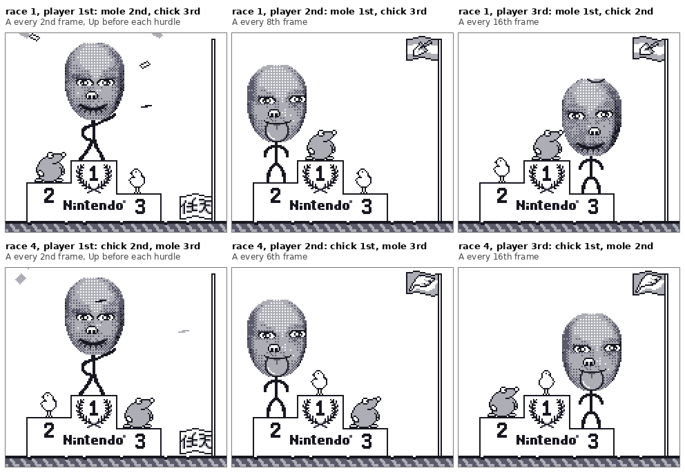

The race of the chick needs the counter: **runner 1 first requires the 4th race** (or a multiple) of a session (C for the runs; I that nothing else changes the steady 3 px/frame of the chick); with a counter that is not a multiple of 4 the only orders are the first three rows. **Runner 2 unplaced when the race ends** (`09:6414`, 5 B, gets place 3) happened when the race ended before the mole had crossed `$1400`: race 4 with the jumps before each hurdle (core and BGB: player placed at 897, chick at 1,004, the race ends at 1,004 and the mole gets 3), and in the core also the same run with 40 frames without a key at the start (C). **Runner 0 without a place** (`09:63FE`) cannot happen: the race ends only when runner 0 is beyond `$1580` and its place is given at `$1400` every frame before the end test (I).

**Result screen** (C for the screens and the sound requests, BGB; I for the names)

* `09:6567`, `65A2`, `65D3` place the three characters from the tables `09:6596` (player, by `$D00D`), `09:65CA` (chick, by `$D016`), `09:65FB` (mole, by `$D01F`). The flag pole on the right carries a flag whose height is `$D048` (`$74` = at the foot, 2 = at the top; I, from the screenshots and the code; `09:6504` sets `$74`).
* **Runner 1 first** (`09:652D`, 19 B): the flag graphics `19:7310` (`$1B0` B, to `$8A40`) are loaded and `$D048` = 2, the flag starts at the top. **Runner 2 first** (`09:6547`): the same with `19:7160`. Both ran only without the player at the top: 652D from the 4th race (the key search of §16.15 did not find it: its state key does not contain `$D04F`), 6547 in race 1 with A every 8th frame or slower.
* **Player first** (`09:64ED` calls the confetti `09:7014`): the flag stays at the foot, and **A presses hoist it**: `09:6A40` counts the presses in `$D04A` / `$D049`, `09:6BB1` computes `$D048 = min($74, $D048 + 5 or 6) − $D049` (I). One tap lifts it by a few pixels and it falls back (request `$41` when it leaves the foot, `09:6691`, and `$40` when it lands again, `09:667E`, the 13 B at `09:667B` that no earlier run reached); A every 2nd frame for 1,500 frames takes it to the top: request `$11` on the noise mailbox (`09:6BD7`), a crown on the player's head, the chick waves (`09:6CA1`: request `$30` at the start of the celebration and `$16` at its end, pose table `09:6CE1`). The [GameFAQs cheats page](https://gamefaqs.gamespot.com/gameboy/564359-game-boy-camera/cheats) describes it the same way (tap A repeatedly after winning to hoist the flag). `tcrf_check/assets/run_race/flag_hoist_bgb.png` shows the three states in BGB (no key, one tap, A every 2nd frame):

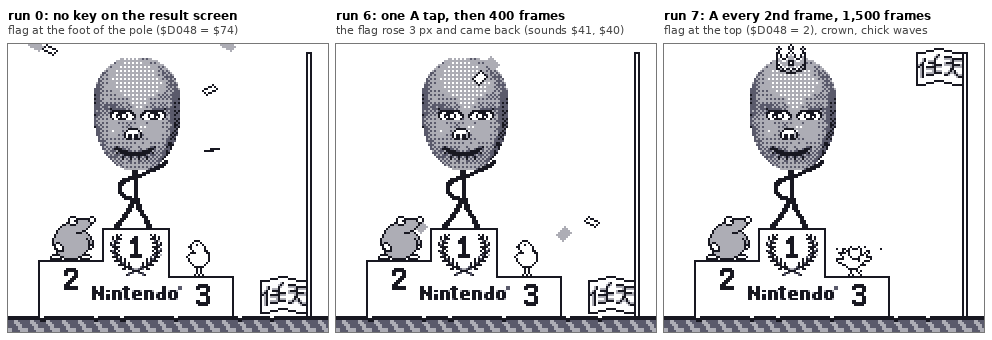

* `09:713E` counts a BCD time (`$D027-$D029`, `+$000167` per frame) until the player is placed, and `09:725E` compares it with the record `$DAA6/7` (stored as the nine's complement of the displayed digits, §16.4, §15.2) and writes it if it is better: the unlocking save already holds the best possible record, so no run here updated it (`09:7274-728F` is not class N: an earlier run executed it).

**Sound requests of the mode** (C for the IDs and call sites, read in bank 9; "seen" = the value was seen in the mailbox in my core; the mailboxes are those of §2.9: `00:2A7C` → `$DD60` channel-1 SFX, `2A88` → `$DD68` song / jingle request, `2A84` → `$DD78` noise SFX):

| request | mailbox | call site | when | seen |
|---|---|---|---|---|
| `$3C` | `$DD68` | `09:6099` | state 0 | |
| `$01` / `$03` / `$04` | `$DD60` | `09:6133` / `6100` / `6109` | character pick: Left or Right / A / B | |
| `$43` | `$DD68` | `09:61E3` | state 3 | |
| `$3D` | `$DD68` | `09:6236` | end of the countdown (state 4) | |
| `$3E` | `$DD68` | `09:6346` | start of the race loop (end of state 5) | |
| `$35` | `$DD60` | `09:67D5` | jump | |
| `$04` | `$DD78` | `09:6A27` | stumble over a hurdle | yes (12 times) |
| `$3F` | `$DD68` | `09:639A` | the player is placed (after the record compare `09:725E`) | yes |
| `$40` | `$DD68` | `09:64D2`, `09:667E` | result setup; the flag lands | yes |
| `$41` | `$DD68` | `09:6691` | the flag leaves the foot | yes |
| `$11` | `$DD78` | `09:6BD7` | the flag reaches the top | yes |
| `$30` / `$16` | `$DD60` | `09:6CB3` / `6CBE` | celebration start / end | yes |

The noise mailbox accepts 1..18 (§2.9: init table `1F:431A`, 18 words, step table `1F:433E`). Request `$11` = 17 is index 16: `1F:431A[16]` = `$4EBC` and `1F:433E[16]` = `$4EC4` (read from the ROM, C). So the 29 B `1F:4EBC-4ED8` are the start handler (`ld a,$0C; ld hl,$4EB8; jp $520A`) and the seven-step tick (counter `$DD7C`, then `jp $4F5B`) of noise effect 17, and **the RUN! flag at the top is what runs them** (C: BGB logged the heads `1F:4EBC`, `4EC4`, `4EC7`, `4EC9` and `4ED3` only in the run that hoists the flag; that this is a "sound effect" in the audible sense was not checked, I). The other requests of the table all ran handlers that earlier runs had already executed.

**What is left of bank 9** (67 B, §16.15): `09:721D` (34 B, UNREFERENCED, a second copy of the character-graphics loader `09:7206` that stores to `$9700` and `$8800`), `09:6D00` (18 B, UNREFERENCED, a 16-bit subtraction helper without caller), `09:6435` (6 B, state `09`), `09:63FE` (5 B, above), `09:5CAF` (2 B, OPEN: inside the code of mode `$08`, the user screens, not of RUN!), `09:66BB` (1 B, state `0D`), `09:7273` (1 B, EDGE). Everything that depends on a place, the race counter, the flag or the result screen of RUN! ran.

**Not done.** The sound was not recorded or heard. Space Fever II and BALL were examined afterwards (§16.18: played to 7,113 and 1,100 points). The sound-engine handlers `1F:4940` (20 B), `49E3` (16 B) and `4A42` (2 B), listed here as OPEN, are the end-of-table branches of the D.J. sound effects SE 4, SE 8 and SE 9 (§16.18, C); `1F:5234` (8 B) and `522A` (2 B) are still not tied to a request (?). Whether `$D04F` is cleared by anything outside bank 9 was not searched. The characters of `$D9F8` only change the graphics (`09:7240`, I); the three characters were not played one by one.

**Reproduce** (working root of §16.15): `python3 tcrf_check/tools/run_race.py OUT` (writes `exec_ranges.csv`, `exec_by_variant.csv`, `race_runs.csv` and `race_paths.json`), `python3 tcrf_check/tools/bgb_run_race.py OUT/bgb OUT/race_paths.json` (replay in BGB; `bgb_race_runs.csv` and the heads hit per run); committed: `tcrf_check/assets/run_race/` (`race_runs.csv`: places and frames per variant; `bgb/bgb_race_runs.csv`: the BGB end states and heads).

### 16.18 The GameFAQs cheats page against the code: every line tried, Space Fever II and BALL played to their Album B scores (C for the runs, I where marked)

The owner asked to confirm or try every cheat of [the GameFAQs cheats page of the Game Boy Camera](https://gamefaqs.gamespot.com/gameboy/564359-game-boy-camera/cheats) (read on 2026-10-12) while going on with Space Fever II and BALL ("they probably unlock other areas of the code"), and to cite the page wherever a finding matches. The page has an "Unlockables" list of 17 lines (the real credits, the RUN! RUN! RUN! game, the pictures B3 and B17-B30) and nine "secrets" (title speed, VIEW speed, D.J. scratch, erase-all, stamp mirror, music print, the RUN! flag, slide-show options, the D.J. song "London Bridge"). It describes the international camera; this README's main target is the Japanese ROM, so every line was run on the Japanese ROM and, where the unlock code differs or the line is about the international pictures, on the international ROM too. **No RAM poke** except where a row says so.

**Method.**
* *Key scenarios* (`cheat_checks.py`, 28 scenarios): a corpus entry (a joypad-only path from a boot) or a boot with a key combination held, then keys, then a few WRAM / SRAM bytes read, in my core and in BGB. BGB's WRAM is read after the demo has released the keys, so the variable of a held key is back at its idle value; for those lines the branch of the cheat was logged with a BGB breakpoint (`DebugMsgFile`, as in §17.7) and its hit count compared with the control run.
* *Album B gates* (`albumb_thresholds.py`): for each of the 8 (Japanese) / 14 (international) conditions a save is built from an unlocking save with the 18 counter bytes SRAM `$10BB-$10CC` zeroed and **one** counter written just below and exactly at the threshold (settings-block checksum and echo recomputed, so the game accepts the save). Two checks per save: the ROM's unlock routine (Japanese `02:4D05`, international `02:4D01`, §16.5) called for every picture index (the program counter is set to it, a `jr $-2` is the return address, the Z flag says locked / unlocked: this is the only forced step), and the album pages walked with Right and compared with the zero-counter pages. Routine and pages agree for every threshold (8 of 8 Japanese conditions, 14 of 14 international ones, and the 5-transfer check).
* *Played scores*: `sf2_play.py` and `ball_play.py` play the two games with the joypad only (below); `play_effects.py` copies the SRAM bytes they left into the zero-counter save and feeds that to the same routines and to the RUN! route. `run_record.py` plays the RUN! race with different A rates and feeds the record the game wrote to the same gates.
* The audio was not recorded or heard (the owner's instruction): sound lines are code and mailbox values only.

**The "Unlockables" lines** (all numbers: the code reads `>=`)

| page line | what the code does | result |
|---|---|---|
| "Real" credits: finish RUN! RUN! RUN! in 22 seconds or less | The credits path takes the real states `08:13-08:15` only if the record `[$DAA7:$DAA6]` is at least `$7799`, i.e. displayed 22:00 or lower (`09:4CFC`, §15.2, §16.4); otherwise only `08:12`, `08:17`, `08:18` are visited. **JP, run_record.py** | The record written by real races: A every 8th frame = 20:85 (2nd place), record `$7914` → real credits; A every 9th frame = 22:11, `$7788` → only `08:12`, `08:17`, `08:18`. By hand: `$7799` (22:00) → the real states, `$7798` (22:01) → not. **C**. The record is the player's own time at any finishing place (2nd place with 20:85 counts). International credits gate not rerun here |
| "Run! Run! Run!" secret game: 2,000+ points in Space Fever II | The best score `[$DAA3-$DAA0]` (`07:59F9-5A0E`): below 2,000 the third target of the first-wave menu is shifted by `$40` (§16.4). **JP** | The corpus route that shoots the third target (entry 649) ends in `21:06` (the race loop) with a best of 2000 and with my played 7113, and stays in Space Fever II (`07:02`) with 0000 and with 1999. **C**. The score that counts is the live best in WRAM; it reaches the save only when the death dialog is left with B (below) |
| Photos B17-B30, B3 (14 conditions) | Table below | all thresholds confirmed at the exact value, none at one less; the page's B19 and B3 lines disagree with each other and with the code (below) |

**The pictures** (the page numbers are the international ones; counters `$DA96-$DAA7` = SRAM `$10BB-$10CC`, BCD)

| page | condition on the page | international ROM (`02:4D01`) | Japanese ROM (`02:4D05`) |
|---|---|---|---|
| B17 | take 60 pictures | B17 at `DA96/97` = 60 | B17 at 60 |
| B18 | delete 60 pictures | B18 at `DA98/99` = 60 | no such condition |
| B19 | "transfer 5 pictures" (the page's B3 line says 15) | B19 at `DA9A/9B` = **15**; 5 unlocks nothing | B19 at 15; 5 unlocks nothing |
| B20 / B21 | receive 5 pictures from 5 males / 5 females | B20 at `DA9E` >= 5, B21 at `DA9F` >= 5 | no such condition |
| B22 | print 30 pictures | B22 at `DA9C/9D` = 30 | B18 at 30 |
| B23 / B24 / B25 | Space Fever II 3,000 / 5,000 / 7,000 | B23 / B24 / B25 at `DAA0-A3` >= 3000 / 5000 / 7000 | B22 / B23 at 3000 / 5000, no 7000 |
| B26 / B27 / B28 | Ball 500 / 700 / 1,000 | B26 / B27 / B28 at `DAA4/A5` >= 500 / 700 / 1000 | B20 / B21 at 700 / 1000, no 500 |
| B29 / B30 | RUN! RUN! RUN! in 17 / 16 seconds | B29 at `DAA7` >= `$82`, B30 at >= `$83` | B24 at >= `$82`, no 16 s |

*Match* (C): all 14 conditions of the international routine are the 14 lines of the page, in the page's order and with the page's numbers, apart from the points below. This is the independent confirmation of the list of §16.5 (item 1), which was taken from the Funtography guide. The Japanese ROM keeps 8 of them under other numbers (B17-B24; the pictures are the ones of §16.5). Output: `tcrf_check/assets/albumb_thresholds/` (`albumb_thresholds_{JP,INTL}.csv`, `albumb_routine_*.csv`, the zero-counter pages as PNG).

*Where the page and the code differ* (C unless marked):
* **B19: 5 or 15?** Both ROMs unlock B19 at 15 transferred pictures; 5 gives nothing (checked by calling the routine with `DA9A` = 5). The page's own "B3: transfer 15" line is the same condition under another number: no picture B3 is gated by any counter, so the "B3" is probably a typo for B19 (I).
* **"5 males" / "5 females".** The counters count *pictures received from a camera whose owner byte has bit 0 / bit 1 set*, at `07:4A17-4A41` (`DA9E` +1 if bit 0 of the sender's `$CFFF`, `DA9F` +1 if bit 1, cap `$99`, §14.6, §16.7). Five pictures from one male owner are enough; the code never compares senders.
* **"17 / 16 seconds"** means the displayed time is *below 18:00* / *below 17:00* (17:99 and 16:99 qualify): the record is stored as the nine's complement of the time in seconds and hundredths (`$8200` = 17:99, `$8300` = 16:99, §16.4). The lowest record that unlocks B29 / B24 is `$8200` (17:99), `$81FF` does not; real races: 17:68 (`$8231`) unlocks, 18:37 (`$8162`) does not.
* The page lists no Japanese numbering; it also does not say that the Space Fever II / Ball / RUN! pictures are read from the *best* score (WRAM `$DAA0-$DAA7`, copied from the save), not from the last game.

**Space Fever II played** (`sf2_play.py`; mode `$07`, bank 7 from `$54ED`; start: corpus entry 197 with a `_ff` save = the shooter at the start of its first wave, nothing shot; joypad only. The bot is mine, not the ROM's: it aims at the lowest ship, fires when the three shot slots are free and dodges bullets; when the ship dies the core goes back to an earlier snapshot and perturbs the next frames with random moves until it survives)
* A 31,161-frame key log (8 min 42 s of game time, `tcrf_check/assets/sf2/sf2_keys.json`; 51 roll-backs of the search to earlier snapshots, the final log replays from the start in my core and reaches the same end): 1,000 reached at frame 5,608, **2,000 at 8,195**, 3,000 at 14,474, 5,000 at 23,655, **7,000 at 31,161 (7,113 then)**; the boss (wave state `$D863` 8 → 9 → 10, hits `$D865` = 50) was destroyed **11 times**, the round `$D88E` counted 0 → 7 (its cap) and the boss variant `$D88F` went 0 → 1 → 2 → 0 three times over (wraps at frames 8,521, 16,246 and 23,981); the ship was destroyed at frame 32,002 (dialog `07:03`). `sf2_timeline.csv` lists every event.
* The best score `[$DAA3-$DAA0]` follows the score during play; the **save RAM keeps 00000000 at the dialog and receives `13 71 00 00` (7,113, SRAM `$10C5-$10C8`) only when the dialog is left with B** (to `00:03`). With that save: Album B Japanese **B22 B23**, international **B23 B24 B25**, and the route to the RUN! race of the previous row (`play_effects_{JP,INTL}.txt`).
* **92 bytes of never-run code ran** (`witness_map.py`, row `sf2`): `07:6232-624A` (25 B) the end of the boss-destruction animation (frame `$D502` = 5; `$D867` counts 50 frames, then `$D502 := $0C` and the request `$38` on the channel-1 mailbox `$DD60`); `07:6276` (1 B) the wrap of `$D88F` from 3 to 0; `07:6767-678A` and `07:67BE-67CB` (36 + 14 B) the rest of the boss-destroyed handler behind the call `07:691E`: the next boss's graphics are loaded (`05:7F69`, VRAM `$8C00`), `$D502 := 5`, `$D867 := 0`, and the bonus loop (50 points × `07:6792[$D88F]` = 4, 8 or 16: 200, 400 or 800 points, WRAM map); `07:693A-6941` and its copy `00:16AE-16B5` (8 + 8 B) the test of the variant selector `07:6932` / `00:16A6` for variant 2, run with `$D581` bit 0 = 0 (no Game Face stored, as in my save): the third boss then takes entry 3 of the table `07:694C` (= 1) instead of entry 2 (= 6) of the graphics-group list `05:7F69`; what groups 1 and 6 are was not looked at, and the case with a stored Game Face was not played. **Consequence:** the three masks `$D000/$D040/$D080` built by `00:1668` are the hit maps of the three bosses (`07:66E9`, the shot-vs-boss test, runs in wave state 9 only, and the boss fights were played): the question left open in §2 and §12 (which game uses them) is answered (C).
* The same key log **does not replay in BGB**: the wave offsets come from the random-number table (a subtractive generator seeded from SRAM `$02FFF`) and BGB's differ from my core's; the BGB run ended at score 0 with none of the five probes hit (`tcrf_check/assets/sf2/bgb_sf2.json`). So the 92 bytes are credited on the core alone.

**BALL played** (`ball_play.py`; mode `$20`, bank 5 from `$74CC`; start: corpus entry 1976, game state `20:04`; joypad only)
* The game: the face stands at one of three places `$D9D7` = 0 / 1 / 2 (Left / B and Right / A move it one place); three balls fly between the places; a ball caught at the right phase scores 1 (`$D9E6/7`, BCD); a ball that falls ends the game (state 6). The ROM contains an **autopilot** for it: the demo state 5 (`05:7859`) calls `05:7DCC-7E88`, which clears `$FFA2` and writes a Right (`$10`) or Left (`$20`) press from the phases of the balls. `ball_play.py` is a port of that routine pressing the same keys in the real game state 4; the demo itself, entered by a poke of `$D5CF`, ran for 115,000 frames without a miss and reached 2,045 points (forced, **C** for the number, not part of the witness).
* A 67,680-frame key log (18 min 53 s): 100 at frame 10,318, 300 at 26,461, **500 at 37,944, 700 at 47,887, 1,000 at 62,778**, 1,100 at the end; then the ball was let fall (state `20:06`) and the best `$DAA4/5` became 1100, written to SRAM `$10C9-$10CA` (`00 11`) at the end of the game. Album B: Japanese **B20 B21**, international **B26 B27 B28**. The game is deterministic: **BGB replays the same key log to the same score** (1100, state `20:04`, `ball/bgb_ball.json`).
* **No byte of never-run code ran** in BALL (`ball/exec_ranges.csv`: 0 bytes of class N): what is left in bank 5 near the game is the two dead copies `05:7F1C` and `05:7F33` (23 B each, UNREFERENCED in §16.15).

**Is there an end? The score caps and the loops of the two games** (the owner's question of 2026-10-13; `tcrf_check/tools/ball_cap.py`, `tcrf_check/assets/score_caps/`; C in my core unless marked).
* **Both scores saturate, they never wrap.** Both games add with the generic BCD routine `00:0F9C` (A = amount, HL = number, B = bytes: `add [hl]` / `daa` byte by byte; if the carry leaves the last byte, the B bytes are filled with `$99`). BALL adds 1 to `$D9E6/7` with B = 2 (`05:7D4D`); Space Fever II adds to `$D868-$D86B` with B = 4 (`07:67BE`, `07:67CC`, 9 call sites). The routine was called directly in the core (program counter set to `00:0F9C`, interrupts off, 16 cases, `add_cases.csv`): 9998 + 1 = 9999, 9995 + 9 = 9999, **9999 + 1 = 9999** (carry out, no wrap), 0999 + 1 = 1000; 4 bytes: 00009999 + 1 = 00010000, 99999995 + 9 = 99999999, **99999999 + 1 = 99999999**. So the largest possible scores are **9999 (BALL)** and **99,999,999 (Space Fever II)**; nothing compares a score with a final value. The B = 4 case was called with HL = `$D868` while the core was in BALL: the Space Fever II call sites were read (`ld hl,$d868` / `ld b,$04`), not played to the limit.
* **BALL has no ending.** With the score poked to 9990 (`$D9E6/7` = `90 99`) the ROM's own autopilot (the port of `05:7DCC-7E88`, §16.18 above) caught the nine balls to 9999 in 384 frames (about 43 frames per point), the score stayed at 9999 for the 3,000 frames I let it run and the game stayed in state `20:04` (`ball_cap_timeline.csv`). Only a missed ball ends the game (state 6). The pace is set by the table `05:7B6D` (`ball_speed_jp.csv`): one word per score step, the ball moves one step each time the 16-bit accumulator `$D9E3/4` overflows; the first word (score below 5) is `$0C30` = 21 frames per step, then the index is 10 × the hundreds digit + the tens digit (words `$0E38` = 18.0 frames per step at 5-9 up to `$3555` = 4.8 frames per step at 390-399), and **from 400 on the index is 40 + the tens digit**, so the speed is a saw-tooth that repeats every 100 points (7.8 frames per step at xx00, 4.8 from xx50 to xx99) and never goes beyond 4.8 frames per step. A flawless run to 9999 would take about 2 to 2.5 hours (I: 50 frames per point between 500 and 1,000 in the played log, 43 at 9990-9999; the autopilot alone ran 115,000 frames to 2,045 points without a miss, §16.18 above).
* **Space Fever II is an endless loop of three waves and a boss.** The wave state `$D863` (jump table `07:59A9`): 0-1 the opening wave with the target menu, 2-7 three waves, 8-9 the boss. When the boss is destroyed (`07:625E-627A`) `$D863 := 10`, the round `$D88E` is incremented up to **7** (`cp $07` / `jr z`) and the boss variant `$D88F` goes 0 → 1 → 2 → 0; states 10 and 11 (`07:62D5-6379`) end, on every path, with `$D863 := 2`: the first of the three waves starts again and **the target menu is never shown again**. The played run (`sf2_timeline.csv`) shows it: 11 boss kills, each followed by a new boss set-up; round 7 is reached at the 7th kill (frame 18,955) and then stays, the variants keep cycling. The round is the only difficulty knob: it indexes tables of 8 bytes that set the enemy path speed `$D844/5` (waves 1-3: `07:5B82`, `5D6B`, `5F55` = `80 90 A0 B0 C0 E0 F0 FF`; boss wave: `07:6130` = `50 60 70 80 90 A0 B0 C0`), so after the 8th boss the game is as hard as it will ever be. In the played run the game ended only when the ship was destroyed (dialog `07:03`); no counter of rounds, lives or time was found that stops it. The bot made 12.4 points per second in round 7 (2,104 points between frames 18,955 and 29,063), which puts 99,999,999 at about 93 days of nonstop play (I, extrapolated from my bot's pace).

**Record and counter increments.** `counter_scan.py` replays every untainted corpus entry (2,255) from a save whose 18 counter bytes were zeroed and reads them at the end: 59 entries end with a non-zero counter, all of them the shoot counter `DA96` (3 entries, up to 2), the delete counter `DA98` (30, up to 2) or the Space Fever II best (26); **no joypad-and-save path of the corpus changes the transfer, print, receive, Ball or RUN! counters** (the first three need a printer or a link partner, §14.6; Ball and RUN! need the end of a game, which my played runs reach). `assets/counters/counter_scan.csv`.

**The "secrets"** (core = my core, joypad only; BGB = the real BGB with the same keys)

| page line (contributor) | what the code does | result | tag |
|---|---|---|---|
| Title screen: Up = Mario dances faster, Down = slower (Pyro_Vesten) | Title state `08:7445-745A`: the step routine `08:7483` runs the animation script (`$D500` frame, `$D510` tick). `$FFA1` bit 6 (Up): `$D510 := $FF` and the step routine is called again at once; bit 7 (Down): an extra `rst $08` (a wait for VBlank) before the return, so a pass takes two frames | BGB: the Up branch `08:744E` is hit 9 times with Up and never without, the Down branch `08:7459` 12 times with Down and never without; core: `$D510` = `$FF` after Up. The speed itself was not timed | C (branches) / I (speed) |
| View menu: hold Up / Down = the face-in-face animation faster / slower (Pyro_Vesten) | `07:5304-5317`: `$D679` := 3 (Up), 7 (none), `$0F` (Down); the background frame advances when `$FFC8 & $D679` = 0 (every 4 / 8 / 16 frames; WRAM map) | core: `$D679` = 3 / 7 / 15; BGB: `07:530D` hit 40 times with Up (0 without), `07:5315` 70 times with Down against 30 without | C |
| D.J. mode: hold A instead of tapping = the character keeps scratching, silently, until release (Pyro_Vesten) | `05:5477-549E`: on the **new** press (`$FFA2` bit 0) the SE is requested (`$DD60`) and the scratch state `$D897` := 6 with timer `$D8A6` := `$1C`; in the state `05:508C-50CF`, `05:5093-509D` tests `$FFA1` bit 0: with A held the stepping branch `05:50AD` is taken, on release `05:509F` sets the timer to `$20` and the state ends (`05:50B9`) | core: after 100 frames of A held `$D897` = 6, timer 30 (below `$20`); after a 4-frame tap `$D897` = 0, timer `$20`. BGB: the stepping branch `05:50AD` is hit 234 times in the held run against 146 in the tapped run, the end branches `05:509F` / `05:50B9` as often in both (6 and 36), i.e. the scratch did not end during the hold. "Silently": a held key makes no new request (`$FFA2` is the newly-pressed byte), the audio itself was not heard | C (silence: C for the code, not heard) |
| D.J. mode: SE 9 and A pressed repeatedly = the hidden song "London Bridge" (nensondubois) | Performance screen `1F:05`, control 4 = the level `$D8B7` 0..8 = SE 1..9 (**this corrects the WRAM map, which said `$D8B7` has no reader**: `05:547D` reads it). A posts `[05:554D + 2*$D8B7]` = `$2C` + SE − 1 on the mailbox `$DD60` (SE 9 = `$34`). The handler `1F:4A44` plays one note of a 24-note table (`1F:4A2A`, six pitch records at `1F:4A02`) per request, counter `$DD08`, and restarts at the 25th request (`1F:4A42`). The 24 table values are, as steps of the six records: 5 6 5 4 3 4 5 · 2 3 4 · 3 4 5 · 5 6 5 4 3 4 5 · 2 5 · 3 1 | core: `$DD08` goes 1, 2 … 24, then 1, 2 over 26 presses (`dj_se.csv`); the melody is the first two lines of "London Bridge Is Falling Down" if the larger record byte is the higher pitch (**I**: not heard). SE 4 and SE 8 left to play ran the end-of-table branches `1F:4940-4953` (SE 4: replays the table with the volume − `$30`, an echo, until it reaches 0) and `1F:49E3-49F2` (SE 8: restarts the table with the high frequency bits + 1). BGB hits the same block heads for SE 4, SE 8 and SE 9 × 26 (`dj_se/bgb/`) | C (code, mailbox, branches); I (tune) |
| Erase all memory: Start + Select at power-on = prompt, A yes / B no (D_Schneider, nensondubois) | Boot code `09:5FAC-5FDA` (§3.5) | Prompt reached in core and BGB (state `00:00`, waiting); B: normal boot, SRAM identical to the no-key control in each emulator; A: photo slot 0 first 8 bytes `d5a9200057760000` → zeros in both | C |
| …"to delete all photos hold Select, Start and Up" in the delete setting, A confirms, B cancels | The shortcut of §8: in the erase picker (mode `$0F`) `$FFA1` = `$4C` exactly with one of the three keys new, photo count `$D561` ≠ 0 → sound `$03`, state `$0A`. **Both copies of the test now ran to the end**: `04:490E-492F` (state `0F:03`; its last 18 B `491E-492F` were the never-run part) and `04:4859-4876` (state `0F:02`, entered after a B at the confirmation; last 18 B `4865-4876`) | core and BGB: the chord (12 frames) → `0F:0A`; B → back, count 30; **chord again from `0F:02` → `0F:0A`** (second copy); A → count 0 and the variant byte `$DBCD` = 1; Select + Start without Up → nothing. The page places the shortcut in the delete setting of the "Animation Album", a name I cannot match: the shortcut is in the erase picker of the photo album (§8), the animation editor's own delete was not tried | C |
| Stamps: hold A with a stamp selected = it goes the other way (howellgames) | §15.4: `$D641` = 180 frames, then 100 per flip; a mirror (bit reversal), period 2; BGB on both ROMs (§16.6 row 5) | no new run; the guide says "about two seconds", the code 3.0 s (§16.4) | C |
| Printing music: on the Sound 1 screen hold Start and A (Baseman) | §17.6: SOUND I page `1F:09`, Start held, then A starts `05:5959`; five pages printed in BGB with the printer helper | no new run | C |
| RUN! RUN! RUN!: after winning, tap A as fast as possible to raise the flag (Pyro_Vesten) | §16.17: player first → each A press hoists the flag (`09:6A40`, `09:6BB1`); A every 2nd frame for 1,500 frames takes it to the top and posts noise request `$11` | no new run (BGB screenshots `run_race/flag_hoist_bgb.png`) | C |
| Slide show: Select shows the BGM and Shuffle options; Up = BGM, Down = shuffle, Select again exits (slimjim25c) | Mode `$0D` state 1 → 2 on Select; Up → state 3 (BGM, `$D7D2`), Down → state 4 (shuffle, `$D7D3`); Left / Right + A set the option; Select again leaves | core and BGB identical in all 9 scenarios: Select → `0D:02`; Select, Select → `0D:01`; Select, Up → `0D:03`; Select, Down → `0D:04`; Up, Right, A → `$D7D2` 0 → 1 (`$D674` = 1); Down, Left, A → `$D7D3` 1 → 0; Up, Left, A and Down, Right, A leave the defaults; B returns to `0D:02`. What BGM and shuffle do in the show was not checked | C (menu), ? (effect) |

**What this added to the never-run map (§16.14):** 38 B (`dj_se`: the three sound-engine handlers of §16.17's "Not done"), 92 B (`sf2`) and 36 B (`cheat_checks`: the two erase-all tests), 166 B in all; BALL added none. Of the OPEN components of §16.15, `07:6232`, `07:6767`, `00:16AE`, `07:693A`, `04:491E`, `04:4865`, `1F:4940`, `1F:49E3` and `1F:4A42` are gone (one EDGE verdict, `07:6276`, was a real wrap and is witnessed too).

**Not done.** The audio (not asked for); the real-camera counters `DA9A-DA9F` (transfer, print, receive) by real transfers and prints (the thresholds were tested by writing the counters into the save and by the routine call; the increments by code and, for transfers and receives, by the two-core run of §14.6); the international credits gate and the international 16 s race; the third Space Fever II boss with a stored Game Face (`$D581` = 1); the effect of the slide-show BGM and shuffle options; the page's "Animation Album" wording for the delete screen. Space Fever II cannot be replayed in BGB (random wave offsets); every other row has a BGB twin or a code argument as stated.

**Reproduce** (working root of §16.15): `tools/cheat_checks.py core OUT && tools/cheat_checks.py bgb OUT` · `albumb_thresholds.py JP OUT`, `MIRROR=1 GBCAM_ROM=intl.gb albumb_thresholds.py INTL OUT` · `run_record.py OUT` · `sf2_play.py search OUT`, `replay OUT`, `bgb OUT` · `ball_play.py play OUT`, `replay OUT`, `bgb OUT` · `play_effects.py JP|INTL OUT/sf2_after.sav OUT/ball_after.sav OUT.txt` · `dj_se.py OUT`, `bgb_dj_se.py` · `counter_scan.py unlock_runs/f1_organic/corpus.jsonl OUT`; committed outputs in `tcrf_check/assets/{cheat_checks,albumb_thresholds,run_record,sf2,ball,play_effects,counters,dj_se}/`.

### 16.19 Easy wins on the never-run code: link counters, the `$55` hello, a blank calibration, the D.J. pages, the editor copy badge, the Game Face editor, the COMPOSE pickers, the slide-show repeat markers (C for the runs, I for what is left)

The owner asked which untouched code could be reached easily (a printer emulator plus BGB was the example). Seven runs came out of it. They credit **242 B** of class N (`assets/witness_jp.csv`, seven new witnesses), which leaves **1,750 B in 157 components** (was 1,992 B in 183; the tables of §16.14 and §16.15 are updated).

| piece (class N) | bytes | what it is | run | witness |
|---|---:|---|---|---|
| `02:466D-4671` | 5 | reception counters of the receiver, **male** branch (`F12` +1, §16.7) | BGB ↔ BGB link, both owners ♂ | `link_variants` |
| `07:4A2D-4A33` | 7 | the sender is male: `+1` on the BCD counter `10C3` (cap 99) | same | `link_variants` |
| `07:4A3A-4A40` | 7 | the sender is female: `+1` on `10C4` | both owners ♀ | `link_variants` |
| `00:2B20-2B24` | 5 | the hello byte `$55` accepted (sets `$DC5D`) | the partner runs a copy of the ROM that answers `$55` | `link_variants` |
| `0A:470D-4723` | 23 | the loop tails and the exit of the calibration loader (blank vector) | BGB boot, both calibration copies `$AA` | `boot_aa` |
| bank 5, 9 components | 74 | D.J. page handlers (list below) | my core, key search, joypad only | `dj_pages` |
| `02:47FE-4802` | 5 | the copy badge drawn on the thumbnail by the editor save-back (`$CF33` ≠ 0) | my core, save with F33 = 1, pen-tool exit | `editor_copy_flag` |
| `06:48E6-48FB`, `07:6A58-6A61` | 22 + 10 | the hidden Game Face item and the editor save-back that writes the Game Face (`$D581` ≠ 0, `$D800` ≠ 0) | my core, a Game Face in the SRAM, Select+Down then A, pen tool | `gameface_edit` |
| `06:523B-5243`, `06:5276-527E`, `06:5769-576A` | 9 + 9 + 2 | the COMPOSE photo pickers: preview redraw after the photo of picture 1 / 2 changed, wrap above the last photo | BGB and my core, used save, A held + Up | `compose_picker` |
| `03:6155-615F`, `03:4D4B-4D55`, `03:6264-627A`, `03:629A-62AA`, `03:628B`, `03:4E21` | 11 + 11 + 23 + 17 + 1 + 1 | the slide-show repeat ranges: start marker on the first entry (player, editor preview), end marker (replay the range or leave it), start marker after a finished range, wrap to the first entry | BGB and my core, used save with markers in the timing array | `slideshow_markers` |

**Link: owner byte, counters and the `$55` hello (C, `tcrf_check/tools/bgb_link_variants.py`).** Two BGB instances, `-listen` / `-connect` on 127.0.0.1, the unmodified Japanese ROM on both, the sender on `link_protocol/saves/flow1_A_sender_before.sav` (27 photos, owner ♂) and the receiver on `flow1_B_receiver_before.sav` (empty album, both BCD counters `10C3` / `10C4` at their cap 99: this is why every earlier link run skipped the increments). The tool sets the owner byte (`$2FC5` and its copy `$2FD1`, checksums recomputed) of both units and clears the receiver's counters `10BB-10CC`; it hits the markers listed in its header and reads the SRAM at the end. One photo was sent in each run:

| run | owners | receiver tag of the new photo `F12 F13 F14` | receiver `10C3` / `10C4` | code that ran |
|---|---|---|---|---|
| V1 | ♂ → ♂ | `01 00 01` | `01` / `00` | `02:466D`, `4671`; `07:4A2D`, `4A31` |
| V2 | ♀ → ♀ | `00 01 01` | `00` / `01` | `02:4678`, `467C`; `07:4A3A`, `4A3E` (the two `02:` pieces were already run before) |
| V3 | ♂ → ♂, hello `$55` | `01 00 01` | `01` / `00` | V1 plus `00:2AFA`, `2B20`, `2B25` |

`F14` (all receivers) is +1 in both runs, `F12` for bit 0 (male) and `F13` for bit 1 (female) of `$DA56`, the `10C3` / `10C4` increments are the peer's gender (§16.7). The routine of `02:4660` ran twice per photo (once per tag copy, I). V3: the partner is a copy of the ROM with **one byte changed**, file offset `0x2D65` (`$12` → `$55`, the operand of `ld a,$12 ; ldh [$ff01],a` at `00:2D64`, which arms the idle unit's `SB`); the real ROM, as initiator, reads `$55` in reply to its `$29`, takes `00:2B20` (which sets `$DC5D`) and **falls into `00:2B25`: the exchange then ends exactly as in V1** (same counters, same tag, same final state `0E:00`). So a received `$55` is a `$12` with a flag that nothing uses: `$DC5D` is written at `00:2B22`, `00:2D14`, `00:2DAC` and never read (absolute-operand scan of all banks, I); no shipped code sends `$55` (§14.3). This settles the `$55` byte for the receiving side; what a sender of `$55` would be is unknown. `tcrf_check/assets/easy_wins/link_variants/` has the markers, heads and `run_link_variants.sh`; the patched ROM is not stored (it is a ROM).

**A blank calibration (C, BGB, `tcrf_check/assets/easy_wins/boot_aa/`).** `Cam_Calib_Loader` (`0A:46FD-4723`, §6, §18) compares the 12 bytes `$AFF2-$AFFD` (SRAM bank 2) and then `$BFF2-$BFFD` (bank 8) with `$AA` and returns `$FF` only if both copies are entirely `$AA` (blank); any other byte jumps to `Cam_Calib_BootMeasureSeq` (`0A:4724`). Every save used so far has a vector, so the loop tails and the exit never ran. The unlocking save with both copies set to `$AA`, booted in BGB: both loops run 12 iterations (`0A:470D`, `471E` hit 12 times each, `4710` and `4721` once), the loader returns `$FF` and the boot runs the full calibration (`FullCalibration`, `FactoryMeasure1`, `FactoryMeasure2` and `CommitVector` once each, 12 threshold convergence steps, 537 pixel tests), as §18 describes for a first boot. 23 B: `0A:470D-4719`, `471A-471D` (not marked, but `0A:471E` is reachable only by falling through it: implied), `471E-4723`. `0A:470D` (23 B) needs no input, only a save with a blank vector.

**D.J. pages (C, my core, joypad only; `tcrf_check/tools/dj_pages.py`, `tcrf_check/assets/easy_wins/dj_pages/`).** The bank-5 search of §16.15 had **3 states** (mode `1F` has no corpus entry) and `dj_fields.py` tapped only six keys. The new search starts at the performance screen `1F:05` (the route of `dj_route.json`) and presses **34 keys**: the eight keys and the 26 two-key chords (all pairs except Left+Right and Up+Down), breadth first, a state being (mode, state, `$D8C5`, `$D8C8`, `$D8CC`, `$D8F3`, `$D8F6`, `$D8FA`, `$D8FD`, `$D985`), without leaving the editor (B leaves it, Start prints). Targets: the 22 OPEN / EDGE components of bank 5. Pass 1 (fine key, cap 4,000 states, depth 7): 5 components ran. Pass 2 (coarse key = (mode, state, `$D8C8`, `$D8F3`, `$D8FA`, `$D985`), cap 8,000 states, depth 14; 1F:05 1,940 · 1F:06 1,707 · 1F:09 1,495 · 1F:0A 1,463 · 1F:0B 1,391 states): 9 ran, 74 B:

| component | bytes | key path from `1F:05` (a `+` is a chord held together) |
|---|---:|---|
| `05:496D` | 13 | Select, Up, **Left+A** (A held with Left: the decrement branch of the shared field editor, `$FFA3` bit 5, stores 6 in `$D92E`) |
| `05:497E` | 11 | Select, Up, **Right+A** (the increment branch, bit 4, stores 7) |
| `05:69A9` | 16 | Select, Select, Up, Up, Right+A (a `keys_held` test) |
| `05:6AF8` | 16 | same path (a `frame_counter` test) |
| `05:70A9` | 10 | Select ×3, Up, Up, Up+A (NOISE envelope) |
| `05:64F1` | 2 | Select, Up, Up, Right ×3, Up+A (SOUND I envelope) |
| `05:7131`, `05:71AB`, `05:7214` | 2 each | Select ×3, Up, Up, Right, Down+A / Right ×2, Up+A / Right ×3, Up+A (NOISE envelope / gate) |

All nine need **a direction held together with A** (the key searches of §16.15 had no such chord). The 13 components of bank 5 that did not run (`05:5445` 17 B, `5456` 17, `49C2` 11, `6AE1` 10, `4B1D` 7, `686A` 5, `6E7E` 5, `60E0` 4, `7397` 4, `5769` 2, `5310`, `5319`, `6ACC` 1 each) stay OPEN: both passes hit their cap, so they are not exhaustive. The key paths replay in the core only (not in BGB; evidence C for the core).

**The copy badge of the editor save-back (C in my core, not replayed in BGB; `tcrf_check/tools/editor_copy_flag.py`, `tcrf_check/assets/easy_wins/editor_copy_flag/`).** `02:47C4`, called from `07:6A4E`, writes an edited photo and its thumbnail back to the album. It draws the copy badge on the thumbnail (`02:47F8-4800`: `ld a,[$CF33] ; and a ; jr z ; ld d,$CE ; call $29F9`) only when `$CF33` is non-zero. `$CF33` is byte `$33` of the work buffer `$C000-$CFB7`, which holds the RAM image of the album slot being edited (§2.4): it is the copy flag F33 of the edited photo. F33 is 0 in every slot of every save of the corpus (the album Copy, `02:45A1`, mode `$0F`, sets it), so no earlier run took the branch. An attempt through the game (key searches from the album, the pen tool and the stamp tool after a Copy) did not reach it, and I did not find out why, so whether a real Copy yields a slot that the editor treats as F33 = 1 is **not shown (?)**. I therefore edited the **save file**, not the RAM: F33 = 1 in both tag copies of all 30 slots of the unlocking save (block checksums recomputed), then replayed the recorded corpus path of entry 595 (27 recorded steps, joypad only). In the exit state 9 of the pen tool (`10:09`), the step **Right held 12 frames** (entry 591, first action) runs `07:6A4E` and then **`02:47FE-4802`** with `$CF33` = 1 (`f33_save/`). Control: the same path on the unmodified save runs `07:6A4E` but not `02:47FE` (`control_f33_0/`). 5 B. The tool tests after every recorded action, because the core's executed-byte array is cumulative (a test made only after the replay would credit the first key tapped). What the badge looks like on the thumbnail was not looked at.

**The Game Face editor: the hidden third choice of the Game Face page (C in my core, not replayed in BGB; `tcrf_check/tools/gameface_edit.py`, `tcrf_check/assets/easy_wins/gameface_edit/`).** On the page `16:06` the hidden item 2 (Select held while the cursor goes down, §16.15) calls `02:506A`, which copies SRAM `$B0D1` to `$D581` and, when it is set, the Game Face image `$B1FC-$BFFB` to `$C000`. With `$D581` = 0 the code plays sound `$0B` and returns (`06:48DC-48E5`); with a Game Face stored it runs the 22 B at **`06:48E6`**: `call $0D6D`, `call $03AD` (screen set-up, not followed), `$D800 := 1`, then mode 4, state 0. §16.15 stopped there because the unlocking save has no Game Face. The corpus path to the page starts from the blank save `_ff`, which the game formats at boot (a file patched before the boot would be formatted again), so the SRAM was written **in the core once the game sat at the MAGIC menu, before the first key**: flag `$10D1` and its echo `$11AA` = 1, the 3,584 B of photo slot 1 of a real unlocking save copied to `$11FC-$1FFB`, both settings checksums recomputed (checked valid with `sram_analyze.status`). That is what a save looks like after the game has stored a Game Face (§3.2), and the game reads `$B0D1` and the image afresh at the A press. **Result:** A on item 2 goes to **mode 4, state 1, `$D800` = 1, with the image in `$C000`**: the same state `04:01` as the STUDIO / DOODLE flow of §16.11 (STAMP / PAINT choice), now working on the face. A breadth-first search from there with 34 keys (the eight keys and 26 chords) found Left+A (pen tool `10:03`), A+B (exit state `10:09`), Right, A, Right, which runs **`07:6A58-6A61`** (10 B): the editor's save-back with `$D800` ≠ 0 calls `02:4C37` (the Game Face writer) instead of `02:47C4` (the photo writer, §16.19 above). After that key the game's own writer has left both settings blocks valid, the flag at 1 in both copies and the SRAM image identical to the work buffer `$C000-$CDFF`, and different from the patched image (the pen had drawn). So the hidden item **edits the Game Face with the Studio tools**; that it is the DOODLE item that the international page shows as a third entry is a guess (I: the item of the international ROM was not run). Control: the same keys on the blank save run `06:48CB`, leave `$D581` = 0 and the page stays `16:06`, and `06:48E6` does not run (`control_no_face/`). 32 B: `06:48E6-48FB` and `07:6A58-6A61`. **Not done:** what the face looks like on the screen; the games that read `$D581` (modes 0, 5, 6, 7), among them the third Space Fever II boss, which takes the other entry of the table `07:694C` with a Game Face (§16.18), were not played with one.

**The COMPOSE photo pickers (C in BGB and in my core; `tcrf_check/tools/bgb_compose.py`, `compose_picker.py`, `tcrf_check/assets/easy_wins/compose/`).** The two-photo layout of the COMPOSE screen (mode `$17`, `$D600` = 1, the フュージョン / FUSION tab, §16.11) shows picture 1 and picture 2 (`$D7F7`, `$D7F8`). In state `17:0A`, A opens the picker of the selected picture (`17:0B` / `17:0C`, `06:5750`): Up = +1 (wrap to 0 after the last photo: `06:5769`), Down = −1 (wrap to the last one: `06:5779`); the count is `$1E + [$D562]`, 60 positions on the save used. **The photo only changes while A stays held:** the picker returns at `06:524D-5251` while `$FFA1` bit 0 is set, and the state goes back to `17:0A` as soon as A is released. The key searches of §16.15 pressed A as a tap, so every one left the picker at once; the pieces `06:523B` and `06:5276` (the "photo changed, redraw the preview" arms) and `06:5769` never ran. The run, on the used save `unl_PC10696894` (30 photos), corpus entry 610 (`17:0A`): hold A, then A+Up (`06:523B`), A+Down, A+Down (wrap), A+Up (wrap above the last), release, Right, hold A, A+Up (`06:5276`). **BGB** (logging markers, `bgb/debugmsg.txt`): `06:523B` 4 times, `06:5276` once, `06:5769` once, `06:5779` once, the picker `06:5750` 106 times; end state `17:0A` with `$D7F7` = 0 and `$D7F8` = 1. The screenshots show the changed thumbnails and the fused preview (`bgb_compose_picker1_changed.png`: picture 1 selected; `bgb_compose_end_picture2_changed.png`: picture 2 selected). The core gives the same hits; the control (A tap, then each single key) hits none (`core_tap_control/`). 20 B: `06:523B-5243`, `06:5276-527E`, `06:5769-576A`. A head marker credits only the block up to the next call, so the bytes after the two calls are credited from the core run. Same pattern as the D.J. handlers: **a direction pressed while A is held**, which taps and single keys cannot produce. **Not done:** the result of the composition (the つくる step), which §16.11 listed as not walked; the four-photo layout's pickers ran before.

**The slide-show repeat markers (C in BGB and in my core; `tcrf_check/tools/slideshow_markers.py`, `bgb_slideshow.py`, `tcrf_check/assets/easy_wins/slideshow_markers/`).** The show of VIEW → SHOW → ANIMATION (mode `$13`) plays the list `$D681` (SRAM `$1000-$102E`: photo number, `$FE` empty, `$FF` end), and the editor of STUDIO → EDIT → ANIMATION (mode `$12`) can mark **ranges** that are played several times: the timing array `$D6B2` (SRAM `$1030-$105E`, one byte per entry) holds 0 (none), `$80 + t` on the first entry of a range, `t` inside it and `$40 + t` on the last one (`t` = number of plays, 1-50), and `$D6B0` (SRAM `$102F`) is the repeat-all flag. The same logic is in the player (`03:623D`, state 4) and in the preview of the editor (`03:4DDA`, state `$12`), each with its own start-up copy (`03:6155`, `03:4D4B`). At the start the first filled entry is looked up; if its marker has bit 7, the loop start `$D727` := its index, the play counter `$D728` := 1 and the flag `$D729` := 0, otherwise `$D729` := 1. After every tick the marker of the entry just shown is tested for bit 6 (`03:6264`: `t` ≠ `$D728` → `$D728` + 1 and the next entry is `$D727`; `t` = `$D728` → bit 0 of `$D729` set, "range finished", and the next entry follows), then the marker of the next entry for bit 7 (`03:629A`: if bit 0 of `$D729` is set, clear it, `$D727` := this entry, `$D728` := 1). Past the last entry, `$D6B0` ≠ 0 sends the show back to entry 0 (`xor a`, `03:628B` / `03:4E21`), otherwise `$D72A` := 1 ends it. The unlocking saves hold an empty list and no marker (none of the 63 save files at hand has a marker in a valid settings block), no corpus run played a marked list in the player, and in the editor preview the end-marker test `03:4DFA` had run in v8 (so ranges can be made there) but no run had a start marker on the first entry when a preview began. The six pieces `03:6264`, `629A`, `4D4B`, `6155`, `4E50`, `62BA` (72 B) therefore stayed OPEN, and the key searches of §16.15 (which tapped keys and never wrote the save) could not reach them.

**The run.** The save is the unlocking save `unl_CE10238211` (valid, 30 photos) **patched before the boot** (a save with a valid settings block is not formatted, unlike the blank `_ff` of the Game Face run): list = photos 0-5 then `$FF`, timing `$82 $02 $42 $81 $41` (entries 0-2 as a range played twice, entries 3-4 as a range played once), both settings checksums recomputed. **Core** (joypad only after the boot): the corpus path of entry 995 (main menu → SHOW → ANIMATION, `13:01`) and A starts the show; the displayed index `$D51A` goes **0 1 2 0 1 2 3 4 5** and the show ends with `$D72A` = 1 (control without markers: 0 1 2 3 4 5), and `03:6155`, `03:6264`, `03:629A` run. With the repeat-all flag `$102F` = `$FF` the sequence repeats forever (`03:628B`). The preview of the editor (path of entry 2379: Select menu, item 3, A; state `12:12`) runs `03:4D4B` at its start and, with the flag, `03:4E21` at the wrap (the control does not). **BGB** with the guide-walk timing (A at the title, then Left, A, Right, A, Down, A, A for the player; Down, Select, Down, A, Down, A, A, Select, Right ×3, A for the preview; logging markers on the block heads, `bgb/debugmsg_*.txt`): the player hits `03:6155` once, `03:6264` 31 times, `03:629A` 31 times (the head is also reached when the loop jumps back to a start entry, where the flag is clear) and `03:628B` 10 times; the preview hits `03:4D4B` once and `03:4E21` 6 times; the control save (same list, no marker, `bgb_control/`) hits none of the six, and the screenshots show the photos with the frame (`bgb/slideshow_player_end.png`, `slideshow_preview_end.png`). (The corpus lineage of entry 995, used in the core, diverges in BGB already at its third action, `00:02` instead of `00:03`, and ends in `0A:03`; hence the guide-walk timing, which both emulators follow.) 64 B are credited: `03:6155-615F` (11), `03:6264-627A` (23), `03:629A-62AA` (17), `03:4D4B-4D55` (11) and the two `xor a` of the repeat-all wrap (EDGE, 1 + 1); BGB credits the blocks up to the next call or jump, the core run credits the rest (witness `slideshow_markers`).

**`03:4E50` and `03:62BA` (10 B) cannot run (I).** Both are `ld hl,$d72a ; inc [hl] ; ret` behind `dec b ; jr nz` at the end of the scan for the next filled entry (`03:4E4D`, `03:62B7`). B is cleared by `ld b,$00` (`03:4DF0`, `4E26`; `03:625A`, `6290`) before every `dec b`, so the `jr nz` is always taken (the `ld b,$2f` before the loop is dead) and the end of the list is caught by `cp $2f` (`03:4E12`, `03:627C`) instead. They did not run in the core or in BGB with a six-entry list (41 empty entries to skip), with and without the repeat-all flag; hand verdicts UNREACHABLE in `assets/reach_manual_jp.csv`. **Not shown:** a range of one entry (`$C0 + t`), `t` above 2, a range that ends on the last entry, and what the editor itself writes for a range: I wrote the marker bytes into the save, and the format `$80 + t` / `t` / `$40 + t` is the reading of the editor code of §1.2 (the player reads it as described, C).

**What is left (§16.15 updated):** OPEN 37 components / 327 B (was 62 / 555 B), INPUT none (was 22 B), UNREACHABLE 35 / 464 B (was 33 / 454 B: the two slide-show loop ends), EDGE 42 (was 44), the rest unchanged. **Not done:** the other 13 bank-5 components, the third Space Fever II boss with a stored Game Face, the `$D7C1` border items (`04:75C5`, `08:482C`), and the audio of every tune (not asked for).

**Reproduce** (working root of §16.15): `bash tcrf_check/assets/easy_wins/link_variants/run_link_variants.sh` · `python3 tcrf_check/assets/easy_wins/boot_aa/boot_aa_run.py` · `python3 tcrf_check/tools/dj_pages.py OUT` and `... OUT2 --cap 8000 --coarse` (with `REACH_CSV` = the components file of commit `991fc4e`, which is where the 22 targets came from) · `python3 -I tcrf_check/tools/editor_copy_flag.py OUT --f33 --starts 10:07` (and without `--f33` for the control) · `python3 -I tcrf_check/tools/gameface_edit.py OUT --chords --depth 10 --cap 4000` (and `--no-face` for the control) · `BGB_HF=-headless python3 tcrf_check/tools/bgb_compose.py unlock_runs/f1_organic/corpus.jsonl 610 pocketcamera_jp.gb OUT` (add `--shot` for the screenshot) and `python3 -I tcrf_check/tools/compose_picker.py OUT` (`--tap` for the control) · `python3 -I tcrf_check/tools/slideshow_markers.py OUT --preview` (`--no-markers` for the control, `--loop` for the repeat-all flag, `--out-sav FILE` writes the patched save) and `BGB_HF=-headless python3 tcrf_check/tools/bgb_slideshow.py pocketcamera_jp.gb FILE OUT` (`--preview` for the editor) · `python3 tcrf_check/tools/witness_map.py assets/witness_jp.csv --rom pocketcamera_jp.gb` · `python3 tcrf_check/tools/reach_analysis.py OUT pocketcamera_jp.gb`.


### 16.20 Totaka's Song? The "no blank frames" screen and the factory-test NG jingle (C for the code and BGB; the resemblance to the real song is the wiki's claim, not checked by me)

The owner asked whether Totaka's Song is in the ROM (https://nintendo.fandom.com/wiki/Totaka%27s_Song: "you have to fill the camera slots until no blank frames are left"). **Yes, as far as the page describes it: sound `$29` of the sound driver is the tune it describes, and the ROM asks for it in two places.** As my fetch of the page reads it, it lists the Game Boy Camera under "unconfirmed games" with the tune on the *NO BLANK FRAMES* error screen: "the first 6 notes of Totaka's Song, then the first 5 notes repeated in a higher key", with note lengths "somewhat different", and remarks that Kazumi Totaka is not in the credits (so the resemblance may be accidental). It gives no note list and no tempo; I could not read the YouTube video the owner linked afterwards (HTTP 429), and I cannot listen to audio, so the pitches below are **not compared with the real song**.

**Where the tune is asked for (C).**
* **The shared result / error screen `09:7290`** (the screen of the shutter on a full album, mode `14:0B`; JP「フィルムに空きが必要です。」, international "no blank frames.", message id `$DBCF` = `$0D`, written at `06:726F`). Its first state picks a number A, shows the picture `A` of the table `09:7332` (3-byte entries: pointer, bank; the tiles go to `$9000`, `$8800` and `$8000`) and asks for the tune `A` of the table `09:733E` (`$28 $29 $30 $2A`, each followed by `02` = channel 2 = the music mailbox `$DD68`, through the table routine `00:2A4B`): `09:72B0` calls `09:7346` for A, `09:7322` posts the tune. The intl build has the same code and tables (`09:73A7` for the tunes, `09:73AF` for the picker).
* **The picker `09:7346`**: if `$DBCF = $0E`, A = 3; otherwise A = the high byte of (R × 3), R = the next byte of the 55-byte subtractive table (`00:08F9`, §2.5; values 0-254), i.e. `A = floor(3R / 256)` ∈ {0, 1, 2}: R 0-85 → 0 (86 values), 86-170 → 1 (85), 171-254 → 2 (84), about a third each if R is uniform. **A = 3 never comes from the picker.**

| A | tune | picture (tiles) | chosen when |
|---:|---|---|---|
| 0 | `$28` | `1E:4E00` | R ≤ 85 |
| 1 | **`$29`** | `1E:6A00` | 86 ≤ R ≤ 170 |
| 2 | `$30` | `1E:4000` | R ≥ 171 |
| 3 | `$2A` | `1D:4F00` | only `$DBCF = $0E` (written once, `04:71BB`; its text strip is blank; if a random byte is below `$4C` the id becomes `$04`, "にげてどうする", the text README §16.11 gives for the SHOOT-menu item RUN: traced, not run) |

So the face and the tune are **random on every message of this screen**, not only "no blank frames": the table of 15 texts (`09:739E`; `tcrf_check/assets/easy_wins/totaka/result_screen_messages_jp_ids_00_0D.png`) holds the four print errors `#01-#04`, 「にげてどうする」, 「なにもはいってない」, 「アニメつくってね」, 「まだおしえたらん」, 「おろかもの」, the album-full, nothing-to-receive, nothing-to-send and communication-error texts, and 「フィルムに空きが必要です。」 (id `$0D`); the others were not run. **BGB, same key path on both ROMs** (corpus entry to `14:0B`, unlocking save; `bgb_result_screen.py`, `$DD68` watchpoint): the Japanese run asked for **`$29`** (`SND68 29` at clock `0405EC72`, written from `00:2A63`, A = 1; the picture is the face with spiral cheeks: `tcrf_check/assets/easy_wins/totaka/result_screen_jp_no_blank_frames.png`), the international run for `$28` (A = 0, a face with a star on the forehead: `result_screen_intl_no_blank_frames.png`, same folder). Two samples of a random choice: they show that the choice differs between runs, not its odds. To hear `$29` one has to hit the screen until A = 1: each shutter press on the full album re-enters the state and draws again (I, not tried many times).

**The tune (`tcrf_check/tools/song_decode.py`, C for the data, I for "sounds like").** Song `$29` is id 41 of the song table (`1F:57C6` Japanese, `1F:57D1` international; id = index + 1; header at `1F:5B6D` / `1F:5B78`): transposition +2, three tracks, durations `[2, 4, 8, 16, 32, 64, 12, 24, 48, ...]` driver ticks. Each track plays a short three-note intro (track 1 G E C♯, track 2 G♯ F D, track 3 rests, 12 ticks each) and then loops the **same figure in unison, in octaves 2, 3 and 4** (tracks 1-3, instruments `(147,0,128)`, `(179,0,128)`, `(34,65,33)`):

`C♯ (rest) C♯ D♯ F D♯ C♯ | rest rest | D (rest) D E F♯ E | rest rest`, lengths 16 16 16 16 32 32 64 · 64 64 · 16 16 16 16 32 32 · 32 32

that is **six notes, then the first five of them again one semitone higher with the same rhythm**: the structure the wiki describes. (Note names are the nearest equal-tempered note of the Game Boy frequency after the transposition; the first-six-notes figure is for the reader to compare with the real song.) The other three: `$28` is a slow two-voice drone (a short descending flourish F♯ D♯ C / G E C♯, then `G♯2` and `D♯2 → F2` held 80 ticks), `$30` a two-voice tune around F (a flourish F♯ F E, then A♯ A♯ G♯ F G♯ F on track 2 under the melody D5 C5 G♯4 F4 D5 D5 C5 of track 3), `$2A` a four-voice tune (D6 A♯5 F5 ... on track 1): none has the six + five shape (`tcrf_check/assets/easy_wins/totaka/songs_*_28_29_30_2A.txt`).

**The second place: the hidden factory test (C, BGB; §8 already says NG plays `$29`).** `0A:6B23-6B54`: `$FF91 == 0` → "OK", tune `$16` (`0A:6B36`); otherwise "NG", tune **`$29`** (`0A:6B4E`: `ld a,$29 ; call $2A88`), then an endless `jr $-2`. In BGB, booting with the combo `$FD`, the test ends **NG** (`$FF91` = `$FF`; 12 threshold convergence steps and 537 pixel tests before) and spins at `0A:6B54` (1.5 million marker hits before I stopped it; `bgb_factory_test.py`, `tcrf_check/assets/easy_wins/totaka/factory_test_bgb_markers.txt`). BGB's sensor is a constant, not a model, so this says that the NG branch runs, not that a camera fails the test.

**Not checked.** The pitches against the real Totaka's Song (no note list on the page, the video not readable); the audio; how often each face really comes up (R of the real RNG, the timing of the shutter press); the texts and tunes of the print-error and link-error ids on this screen (code only); whether the Japanese and international builds differ in the six-plus-five figure (the decoded notes of `$29` are identical, the 11-byte header differs only by position).


### 16.21 Forcing the last never-run code with WRAM / SRAM pokes, and the pieces that cannot be run (C for the runs, I for every "cannot run" verdict)

The owner asked to try to reach every red piece that was left (§16.14: 1,753 B, 157 components) "by manipulating WRAM or SRAM if necessary", with reasonable efforts: what cannot be reached "is unreachable and must be tagged as such", the desperate cases go to the README, and the map is updated. **Result:** 34 runs (31 experiments of `force_open.py` and three modes of `dj_pages.py`) ran 421 more bytes of designed code (witness `force_open`, §16.14) and a state / mode / effect number poked past the end of its table ran 137 more (witness `state_overrun`: code entered at an arbitrary address, **not a designed path**); of the 1,192 bytes of class N that were left, 1,191 now carry a hand or scanned verdict UNREFERENCED / UNREACHABLE (evidence I; **purple** on the map) and 1 B (`00:1137`) stays red. Nothing is OPEN any more.

**Method (`tcrf_check/tools/force_open.py EXPERIMENT OUTDIR`; one process per experiment because the core's executed-byte array is cumulative).** The experiment replays the cheapest corpus path to a state (§13), then pokes WRAM (`g.poke`) or the SRAM (`g.sram()`, or a save patched **before** the boot with the settings checksums fixed), presses real keys like a player, and looks at the executed-byte array for its targets. No register, no program counter and no ROM byte is ever touched, so a piece that runs here is entered by the game's own code with a RAM state that a save, a counter or a cursor could hold (or, for `state_overrun`, an index past a table). Two limits of the core's interface shaped the work: a poke lands between two frames, and a frame ends right after the VBlank handler, so a variable that the main loop recomputes every frame cannot be forced (`dj_envelope`, below); and a value that is only known in the frame where it is used (a race time) needs the **two-pass trick** of `run_record_equal`: snapshot before every frame, and in the frame where the event happens restore, poke the value computed from the first pass, run the frame again. Credits: `force_open` = a value that a save or a game state can hold, or an out-of-range cursor that makes a ROM table byte equal a designed value (effect indexes 13 / 15 / 60 / 61, the `$FF` end of a menu table); `state_overrun` = the number of a state, a mode or a hot-spot effect poked to 0-255, so that the word table is read past its end (the bytes are credited only when no designed experiment ran them).

**What ran (C, my core; the gate, and the poke that opens it).**

| experiment (`force/<name>/`) | bytes | target | gate and recipe |
|---|---:|---|---|
| `hotspot_ff`, `hotspot_jump` | 45 | `03:6625-6641` (slot 0 of the hot-spot jump table `03:655D`), `03:6533-6542` | hot spot 0 of the displayed photo armed through the mirror `$D643-$D65C`: effect `$FF` (slot 0 copies `$C000` / `$C800` to VRAM), then a jump target `$D65C` = 2 (draws the target photo) |
| `show_menu_ff` | 5 | `03:79AE` | SHOW menu `0B:01`: the chosen item `$D5EF` := 41, so that the 3-entry table `03:79E0` is read at a ROM byte `$FF`; then A |
| `editor_count_digits`, `editor_d6e2_wrap`, `editor_picker_wrap` | 13 | `03:4B17`, `03:41E8`, `03:552F`, `03:555A` | slide-show editor: repeat count `$D519` ≥ 10 with `$D71C + $D71D` = 30; `$D6E2` := 99 then A held + Down (wraps 100 → 0); A held + Left below photo 0 and the album-B chooser below its first stock picture (joypad only) |
| `erase_browse`, `stamp_cancel_d640`, `copy_ten`, `scatter_x_off`, `erase_all_list` | 50 | `04:75C5`, `04:5D63`, `04:4FB8`, `04:52E4`, `04:4E3B` | `$D67E` := 1 with `$D5ED` := 1 (photo 1 has another border than photo 0); `$D640` := 3 while the stamp save dialog is open, then B; ten copies on a save with ten free slots (joypad only: the copy counter splits in tens and units); the 16 particle X positions `$DACC-$DADB` := `$B0`; erase-all with a save patched to hold a six-entry slide-show list (the stored saves hold none) |
| `print_stock_border` | 9 | `08:482C` | print mode `$1C`, layout state, `$D5F3` := 30 (a stock picture, whose border answer is the default `$12`) just before B redraws the preview |
| `owner_blocks_bad` | 3 | `02:43EC` | boot with a valid save whose two copies of the owner block at `$AFB8` / `$AFD1` both fail their checksum (magic intact): the loader formats the save |
| `name_dakuten_blank` | 2 | `09:5CAF` | owner NAME keyboard: A on the dakuten key with the name still blank |
| `effect_cursor`, `effect_cursor_ret` | 160 | `0A:5853`, `5E40` (`652E`, `5900`, `5EBF`, `65A5` ran too), `61AE`, `61AF`, `06:7417` | SHOOT: the variant cursor `$D7E3` / `$D7E4` and the page `$D7EB` poked out of their menu range so that `4 * D7E3 + D7E4` indexes a ROM byte past the 88-byte table `06:60DB` that equals 13, 15, 60 or 61 (e.g. k = 140, 111, 167, 151); the slot 13 / 15 / 60 / 61 handlers of `0A:541A` then run |
| `shoot_burst_clamp` | 1 | `06:64ED` | live view with the burst variant: photo count `$D561` := 0 (and the burst slots `$D563-$D580` := `$FF`) makes the next count equal the cap `$D7E8` |
| `sf2_gameface` | 4 | `00:16D7` | Space Fever II replayed from the key log of §16.18; when the wave state `$D863` reaches 6-8: `$D88F` := 2 (third boss) and `$D581` := 1 (a Game Face stored): the boss set-up asks for graphics group 6 whose pointers are in WRAM and takes the `bit 7,h` branch of the loader |
| `printer_dc0b`, `printer_dc0b_retry` | 33 | `00:1A87-1AA7` (and `1A24`, `1A5B`, `1AD2`, `1ADC`) | comment-card print with the compression switch `$DC0B` := 1 (nothing in the ROM writes it) and the size / flag tables `$DBEC` / `$DBFE` filled, the printer answering a DATA packet with an error status: the retry path reads `$DC0B` again |
| `run_states`, `run_record_equal` | 13 | `09:63FE`, `09:6435`, `09:66BB`, `09:7273` | RUN!: on the first frame of state 7 the runner positions poked past the finish with the place counter `$D047` := `$FF` (runner 0 gets place 0 and the race-end test finds it unplaced); `$D5CF` := 9 and `$0D` (states no code selects); the best time `$DAA6` / `$DAA7` := the time just run (two-pass trick) |
| `dj_cursor`, `dj_hold`, `dj_latch`, `dj_noise_hold`, `dj_grid_hold`, `dj_numbers` (`dj_pages.py --cursor / --hold / --latch`) | 83 | `05:49C2`, `4B1D`, `5445-5466`, `5769`, `60E0`, `686A`, `6ACC`, `6AE1`, `6E7E`, `7397` | the D.J. key search of §16.19 again with the state key extended by the performance-screen cursor `$D8B3` and level `$D8B7` (`--cursor`), with a direction pressed while A (or B) is **already held** (`--hold`) and with A kept held between presses (`--latch`; the wave grid `05:6A82` is edited only while A stays held); a stepper value above its minimum; `$D8B4-B6` := 50 (the index `3 * value + $6B` carries into the high byte); `$D9D1` := 7 in the D.J. score print (hundreds digit 0) |

**What did not run (tried, negative).**
* `sound_ports`, `sound_mailboxes` (`1F:5234`, `1F:522A`, the channel-3 flush of the sound set-up `1F:520A` and its default exit): every sound number 1-255 into each of the four request ports of the main menu (150 frames each), then every id 1-`$48` into the seven mailboxes `$DD60`, `$DD61`, `$DD68`, `$DD70`, `$DD71`, `$DD78`, `$DD79` (4 frames each, 504 trials). `1F:522C`, `523C`, `5259` and the wave code `4F72` ran, the two targets never: the wave-channel handlers write NR30-34 themselves and do not call `520A`.
* `dj_envelope` (`00:1137`): `$D8CF` := `$FF` poked while the SOUND I page plays; the envelope is `$D941 - $D8CF`, clamped to 0 by `xor a` when negative. Both bytes are rewritten inside the frame by the editor, after the poke and before the read; no poke between frames survives (negative).
* `list_overrun_18` (`06:5D3B`): the four-slot picker of mode `$18` with its bound `$D562` := 99, every slot value 0-`$80` cycled with Down; the draw ran (`06:5D0F`), the carry of the source pointer did not (the table bytes read past the table never end in `$10-$17`; computed for every value, below).
* `printer_dc0b` alone did not reach `00:1A87` (the first pass had no error status); the retry variant did.

**Verdicts of the pieces that did not run (hand-written rows of `assets/reach_manual_jp.csv` and the automatic checks of `reach_analysis.py`, evidence I; the note of each row says why).**
* **Copy-helper branches that no caller selects.** The 2-byte tail of the four-bytes-per-pass VRAM copy, `00:05E0` and `05F1`, is entered only when the count is 2 mod 4, and every call site of `00:0586` passes a multiple of 4. The ROM-source branches of the VRAM chunk copy `00:080C` (`00:0810`, `0861`) and of the 4 × 4 tile loader `00:2583` (`00:258F`, `2611`) need a source below `$8000` / `$A000`, and every caller passes WRAM, VRAM or SRAM. Table-end branches `07:5291`, `07:5473`, `08:4095`: the cursors `$D5EC`, `$D5FE`, `$D5FA` index tables of 1-byte codes and the branch needs a `$FF` that none of the 256 bytes after the table start holds, so no cursor value, even out of range, selects it.
* **Printer engine.** `00:1B2D`, `00:1B36` (and the head `00:1B25`): the idle poll `00:0F2D` returns unless `$DC0D` = 1 and calls `00:1B1E` only with `$DC3B` = 0, which are exactly the two conditions that lead to these pieces; poking the variables before the call changes nothing, because the caller tests them first.
* **Slide show**: `03:4E50`, `03:62BA` (the register `B` is zeroed before every `dec b`).
* **Effect-table slots** whose index the only caller never produces (`0A:6037`, `60B1`, `6704`, `59E9`, `5A01`, the one-byte slots 25-31, 57, 59, 63, 89-95, and slots 19 / 21 of `06:73AF`): the index comes from the 88-byte table `06:60DB` or, with the out-of-range cursor of the table above, from the ROM bytes after it; enumerating the cursor over 0-255 produces 13, 15, 60 and 61 (run above) and never the others.
* **Dead functions** (UNREFERENCED, 48 components, 825 B): no `call`, `jp`, `jr`, `ld rr,nn` with a matching bank or word of a pointer-like table reaches the entry, so no state or SRAM value can call it. The largest are `04:7C9D` (90 B), `07:4A4D` (65), `00:07BE` (46, what is left of the dead deferred-copy routine `00:0781` after the overrun below ran its first 55 B), `1F:53B9` (46), `00:069F` (43), `07:4BC3` (39), `09:721D` (34), `07:4BEA` (30). Five of the 48 were OPEN until now and got their verdict by hand: `00:0758` (the dead helper `00:0751`), `00:07AD` and `00:07BE` (`00:0781`), `00:06F8` (the tail of `00:069F`) and `00:1B07` (`00:1AEB`).
* **The 35 carry bytes** (`inc d`, `inc h`, `dec d` behind a `jr nc` / `jr nz` of a 16-bit pointer update): proven by arithmetic over the loop, the pointer and the counts being immediates, so the low byte never wraps. Examples: the SRAM photo-block copies `02:487F`, `48E7`, `493B`, `4998` (E goes `$00 → $5C → $B8`, two passes), `02:4C2A` (`$00 → $19 → $32`), the thumbnail copies `03:5C13` and `08:4D0B` (E ends at `$60`), the tile-map writers `06:4BA3-4D60` (`$C7 − 5 × $20` never borrows), the strip copy `06:5715`, `572C`, `5743` (all 15 call sites load `ld de,$93/94/95/96 00`, so E = 0 + `$D0` + `$10` + `$10`), the list updaters `05:5310`, `5319`, `07:7918`, `7921`, `0A:4036` (C = A ≤ `$9F`). The six `06:7529`, `758A`, `7645`, `76B2`, `7776`, `77E3` were also run in a small SM83 simulator (`tcrf_check/tools/sm83sim.py`, `sim_blit.py`) over the blit stubs `06:73F7-7477` with the mask bytes `$DA40-$DA5F` set to `$FF`, `$55`, `$01`, `$A5` and to periodic masks: the gates run, the bytes never. `06:5D3B` needs the source low byte in `$10-$17`; the source is `$0E00 + BC` with BC from `02:517B`, whose table `02:5218` has 30 entries with low byte `$00`, and values ≥ `$3C` read past it (computed for every value up to `$7F`: low bytes `$08`, `$33`, `$34`, `$36-$39` or ≥ `$40`; values with bit 7 set are not drawn).

**The desperate cases.** What a WRAM / SRAM poke, a key or a patched save cannot make run, and what is only inferred:
1. **`00:1137`, 1 B, red on the map, evidence ?** (`ld a,[$d941] ; sub c ; jr nc ; xor a`, the clamp of the D.J. SOUND I envelope when `$D941 < $D8CF`). It is certainly selectable by data; the two bytes are rewritten inside the frame by the editor, and the interface of the core cannot place a poke inside a frame. A poke of a different shape (a patched sound table) was not tried.
2. **`1F:5234`, `1F:522A` (10 B).** The channel-3 flush and its default exit of the sound set-up: 504 mailbox trials and 255 × 4 port trials never reached them; the wave handlers never call the routine that falls into them. The verdict is I and rests on the same trials: a request that I did not try (an id above `$48` into a mailbox, a second request while one plays) is not excluded.
3. **`00:1B2D`, `00:1B36` (7 B), the printer-engine idle poll.** Only a serial interrupt that changes `$DC0D` or `$DC3B` between the test in `00:0F2D` and the entry `00:1B1E` could reach them, with no packet in flight; the core cannot place that interrupt. (The head `00:1B25-1B2C` was executed by the state overrun below, which is not the designed entry.)
4. **Dead functions and tails (UNREFERENCED, 825 B).** No poke can create a call. A computed jump through a table of an unusual shape, or a pointer built arithmetically, would defeat the scan (I); the largest ones are listed above.
5. **Branches that no value selects (UNREACHABLE, 371 B).** Every verdict rests on a reading of the code: a call-site immediate, a table, a register that is zeroed. A far call that loads its bank differently from the searched pattern, or a write from another bank that the scans missed, would defeat them (I).
6. **The 137 B of `state_overrun`.** Green on the map, but only because an out-of-range number made the game fetch a handler from the words after a table; they are fragments of code that the game was not built to enter (`00:0788-07BD` lies inside the dead copy routine `00:0781`, `00:1AFE-1B2C` inside the dead `00:1AEB` and the idle INQUIRY routine `00:1B1E`). They prove that the bytes are code, not that the game runs them.
7. **What the credits do not show**: every experiment of this section is my core (no APU, VIEW band drawn wrongly: §15.8, §17.7); none was replayed in BGB.

**Reproduce** (working root as in §16.15; the outputs are committed under `tcrf_check/assets/easy_wins/force/`):
`python3 -I tcrf_check/tools/force_open.py --list` · `python3 -I tcrf_check/tools/force_open.py NAME OUTDIR` (`SF2_KEYS=$PWD/tcrf_check/assets/sf2/sf2_keys.json` for `sf2_gameface`; `GBCAM_CORE=<working root>/pcore` (the core with the printer stand-in) for `printer_dc0b`, `printer_dc0b_retry` and `dj_numbers`; `S18=1` or `2` for `list_overrun_18`) · `python3 -I tcrf_check/tools/dj_pages.py OUT unlock_runs/dj_route.json --cursor` (or `--hold`, `--latch`; `REACH_CSV` = the components file before §16.19 for the targets) · `python3 tcrf_check/tools/witness_map.py assets/witness_jp.csv --rom pocketcamera_jp.gb` · `python3 tcrf_check/tools/reach_analysis.py OUT pocketcamera_jp.gb` (writes `reach_components.csv`, `reach_ranges.csv`, `reach_summary.md`; copy the first two to `assets/reach_components_jp.csv` and `assets/reach_ranges_jp.csv`) · `python3 tcrf_check/tools/rom_reach_map.py jp_rom_reachability_map.png --rom pocketcamera_jp.gb`.

### 16.22 The real credits end to end, the SHOOT-parlor RUN, the Space Fever II and stamp sounds (C for the code and the runs; the sounds are mailbox logs, nobody listened; every screenshot is BGB's)

*Why this section exists.* The owner asked (2026-10-13) to run the unlocking save to the end of the real credits, to push the parlor's RUN command until every picture had been seen, to explore the sounds of Space Fever II and of the stamp tool, and pointed out that **my core's screen renderer drops tiles** (the game shows more than 256 background tiles at once with a V-Blank trick that `render2.py` ignores; BGB draws it): every picture below is a BGB screenshot (`tcrf_check/assets/credits_parlor/`), the core is used for the runs and the sound logs only. The runs are `credits_real.py` (core), `bgb_jobs.py` / `bgbgrab.py` (BGB, 1.3 s per run), `run_parlor.py`, `sf2_sound.py`, `stamps_sound.py` (`tcrf_check/tools/`; `GBCAM_ROOT` = the working root of §16.15).

**The real credits (mode `$08`, states `$12`-`$18`; unlocking save `unl_CE10229233`, record stored `99 99`).** Frames counted from the entry (`08:12`), core and BGB agree:

| frames | state | on screen | music (`$DD68`) |
|---|---|---|---|
| 0 | `08:12` `Mode08_State12_CreditsEntry` | record `[$DAA7:$DAA6] >= $7799`: `Mode08_CreditsReal` (else the short credits below) | |
| +9 .. +443 | `08:13` page A | "CLIP THIS." (a smiling face drawn with scribbled eyes on a magazine banner) | `$03` |
| +443 .. +964 | `08:14` page B | "Dub up to the Future / One Love" with 8 jittering sprites (`Credits_DrawJitterSprites`); `$C005` counts to `$43` | `$03` (stops at +964) |
| +996 .. +12,682 | `08:15` staff roll | scrolling text + a dancing figure (13 frames of 12 ticks, a 156-frame cycle); 11,686 frames = **3 min 15 s** | `$02` |
| +12,682 .. | `08:16` | the ending plate: a fork and a half-eaten plate on a chequered border, "Don't butter me up!" / "Be happy !!" ; waits for A (I pressed it after 900 frames) | `$02` still running |
| +13,585 .. | `08:18` -> `08:00` -> `08:01` | back to the planet map | `$34` |

* **B on any of the pages `08:13`-`08:16` is `Mode08_CreditsAbort`, which falls into the code of the *short* credits** (`09:4D0E`): the dancing man, state `08:17`, music `$11`. A record below `$7799` gets the same screen. The corpus path of §15.2 / §16.6 that "reached `08:17` on the unlocking save" pressed B on page B (`[32,6,2]` then `[2,1,160]`), so it had entered the short credits by the abort, not the real ones; the gate itself (`$7799`) is unchanged. The real credits were only run to their end in this section (13,585 frames).
* **The tables the sym was missing.** `09:509C` is **13 records of `{lo, hi, bank, duration}`** (not 3 bytes + a 13-byte table): the dancer's frames `25:4480, 24:4000, 22:5240, 22:4000, 17:7B00, 25:4000, 26:4000, 22:56A0, 22:6F40, 23:4000, 22:4DE0, 22:5B00, 23:6C80`, `$500` bytes each, 12 ticks each, copied alternately to `$8000` / `$8500` by `Mode08_State15_CreditsScroll` (6,500 bytes that the first sym pass had cut into "unreferenced" pieces, 27 of which were on the owner's worklist page; he recognised them by eye as parts of the credits dancer and was right on all of them; some frames overlap in ROM: `22:5240` starts `$A0` bytes before the end of `22:4DE0`'s frame, `22:56A0` and `22:5B00` likewise). `09:5145` is **4 records** (`22:4500`, `22:4970`, `27:4000`, `22:4970`; `$470` bytes, 8 ticks each) and `09:517D` **5 records** of `{lo, hi, bank}` (maps `26:5E80`, `25:6860`, `26:7500`, `26:7740`, `26:7980`, `$240` bytes) for the short credits' dancing man; the owner's correction: **the dancer is Kentaro Nishimura** (the staff roll lists にしむら けんたろう twice: under CORDINATOR, spelled so in the game, and as the third SOUND COMPOSER after たなか ひろかず and はまの みなこ), not Miyamoto (a classic error on the web); the staff roll's dancing girl is **not identified**. Labels: `Credits_ScrollFrameTbl`, `Gfx_xx_xxxx_CreditsGirlFrameNN`, `Credits_NishimuraDanceFrameTbl`, `Gfx_xx_xxxx_CreditsNishimuraDanceFrameNN`, `Map_xx_xxxx_CreditsNishimuraDanceMapN`. The ending plate is `28:7000` / `28:7800` (`$800` each, to `$9000` / `$8800`) with the map `26:4C80` (`$240`).
* **The credits text is a table, not strings.** `29:4000`, 234 records of 32 bytes (`Credits_ScrollRowTbl`; a 5-byte header, then 27 tile numbers, `$FE` / `$FF` = blank; the kana rows come in pairs of tile `n` / `n+1`): drawn with the glyph sets `20:4000` (128 tiles at `$9000`), `20:4800` (96 tiles at `$8A00`) and `13:7800` (32 tiles at `$8800`, the Latin header letters loaded by `Mode08_CreditsReal`), it reads from HELLO!! ("あそんでくれてありがとう / これからも ぽけっとかめら / だいじにつかってね / すたっふより"), THANK EVERYONE / INVOLVE IN / THIS WORK (the game's spelling) (にんてんどう ...), POCKET CAMERA STAFF (DIRECTOR, HARDWARE DESIGN, ASSISTANT DIRECTOR, COORDINATOR, MAIN PROGRAMMER, GRAPHIC DESIGNER, ADDITIONAL PROGRAMMER, SOUND COMPOSER, ADDITIONAL STAFF, PHOTO MODEL, HARDWARE STAFF, ART WORK, SPECIAL THANKS) to PRODUCER, EXECUTIVE PRODUCER, PRESENTED BY NINTENDO (`credits_script_sheet.png`). **Cross-check with the Totaka claim the owner pasted (a search summary quoting the Fandom page, 2026-10-13 14:29):** it says the composers are mainly Hirokazu Tanaka, Minako Hamano and Kentaro Nishimura and that Kazumi Totaka is not credited. The staff roll has exactly that SOUND COMPOSER trio (`たなか ひろかず`, `はまの みなこ`, `にしむら けんたろう`; Tanaka is also DIRECTOR), and I find no Totaka among the names of `credits_script_sheet.png` (checked by eye on the sheet, not by a string search; kana-only names, so a different spelling of the same person would escape me). The tune itself is §16.20 (sound `$29`, six notes then the first five one semitone higher): nothing new was decoded from the pasted text.

**The SHOOT parlor RUN (mode `$01`, states `$09`-`$0B`, "にげる").** `Mode01_State09_RunInit` draws `Rng_Next`: below `$4C` (30 %) `$DBCF` = `$04`, else `$0E`. The shared result / error screen `09:7290` then picks the picture (`ResultScreen_ChoosePicture`): `$0E` forces **picture 3**, any other id picks one of **pictures 0-2** uniformly (`Rng_Next * 3`); the tune comes from the list `09:733E` (`{28,2}{29,2}{30,2}{2A,2}`, one per picture); the message strip comes from `09:739E[$DBCF]` (`$04` = "にげてどうする", `$08` = "おろかもの", `$0E` = the equator plate). `Mode01_State0B_RunEnd`: with `$0E` back to the parlor; with `$04` a second draw below `$4C` sets `$08` and shows the result screen again (another random picture), else back to the parlor. So **seven results exist** and all seven were seen in my core (400 RUNs: 280 x `$0E`/pic 3, `$04` x 57 / 22 / 41 for pictures 0 / 1 / 2, `$08` x 17 / 2 / 7); in BGB (488 jobs with different waits, because the game's RNG depends on timing; 66 of them reached a result screen: `$04` x 6 / 4 / 5 and `$08` x 12 / 0 / 7 for pictures 0 / 1 / 2, equator plate x 32; `tcrf_check/assets/credits_parlor/parlor_run_results.csv`): six of the seven results, the missing one being `$08` with picture 1 (tune `$29`, 2 times in the 400 core runs, never in BGB: see the table).

| picture (ROM) | what it is | tune | message | seen in BGB |
|---|---|---|---|---|
| 0: `1E:4E00` | a man with horns of hair and a drawn moustache | `$28` (the owner's "Who are you running from 1") | `$04` / `$08` | both |
| 1: `1E:6A00` | a bald man with spirals drawn on his face | `$29` = **Totaka's Song** | `$04` / `$08` | `$04` (the `$08` one: core only) |
| 2: `1E:4000` | a woman with ribbons and spirals on her face | `$30` ("Who are you running from 2") | `$04` / `$08` | both |
| 3: `1D:4F00` | "YOU ARE NOW CROSSING THE EQUATOR", map of Africa, "JAMBO NINTENDO!" | `$2A` (the owner's "Jambo Nintendo !") | `$0E` | yes |

The parlor itself: page A (intro music `$06`, 75 % of the visits) shows a **prince** ("王子さまがあらわれた!"), page B (music `$07`, 25 %) the **queen** (女王さまが...), both with the planet name "Jupiter" at the right; the cursor of the page is remembered, so a script must walk to the top left before going Right, Down, A. The pictures sit in `$E00`-byte blocks (`$800` + `$100` + `$500` bytes to `$9000` / `$8800` / `$8000`); the table `09:7332` now types them as `Gfx_xx_xxxx_ResultPicN_*`.

**Space Fever II sounds** (`sf2_sound.py` replays the 31,161-frame key log of §16.18 and goes on until the ship dies; `tcrf_check/assets/credits_parlor/sf2_sounds.csv`; "request" = a value seen in the mailbox, the channel's running id is also logged). Heard by the engine: music `$31` (start, `Mode07_State01_Start`), `$42` (boss, `SpaceFever_Boss_Init`), `$32` (boss destroyed), channel-1 effects `$25` (wave 0 start), `$27` (shot), `$0C` (enemy killed, 127 requests), `$0D`, `$0E` (hit), `$26` (boss hit; it posts noise `$03` itself), `$38` (boss destroyed, 12 times), `$3C` (stop music, at the end), channel 3 `$03` (boss hit, 497), channel 4 `$07` (the shots, 831), `$08` (ship destroyed), `$02` (chained by `$3C`). **Not requested anywhere in the Space Fever II code and not heard:** channel-1 effect `$24` (its handler sits between `$25` start and `$26` boss hit in the table, which fits the owner hearing it as a Space Fever II sound; I) and song `$1F` (the owner: "from Space Fever", likely; my inventory of the sound requests of the whole ROM finds none for it, only its entry in the song table). Effect `$0F` (`SpaceFever_Wave0_ReapKilled`) was not triggered by this log.

**Stamp tool sounds** (`stamps_sound.py`, random key sequences with snapshot rollback, three seeds, 15,000 key steps, about 250,000 frames; `stamp_sounds.csv` lists the states and keys of each id): music `$24` (the stamp tune, set up in `11:02`), `$0F` (the photo picker tune, `11:01`), `$0A` (requested by `Mode04_State00_Init` after B leaves the tool for the album); channel 1 `$01` (the most frequent: Left / Right / Up in `11:01` and `11:03`), `$02` (Up / Down in `11:01` and `11:03`), `$03` (Left / Up in `11:03`), `$04` (B in `11:01`), `$12` (A in `11:03` / `11:07`) and `$13` (B, Start, Left in `11:04` / `11:07`), which I read as opening and closing the stamp palette (I: no screenshot taken of the transitions), `$3A` (A in the photo picker `11:01`); channel 4 `$01` (`Stamp_Commit`, 1,709 requests). The hold-A mirror (§15.4, 200-frame holds were included) asks for no sound.

**What changed in the sym.** The owner's answers (`disasm/owner_answers_jp.csv`, 42 answers) resolve all 32 asset items of the worklist page by the tables above. His by-ear answers on songs are in the notes of the song headers: `Song1F_Hdr` (from Space Fever II, likely), `Song28_Hdr` ("Who are you running from 1 / error message", sure), `Song19_Hdr` (the header shared by ids `$19` and `$2A`; `$2A` is "Jambo Nintendo !", sure), `Song2D_Hdr` (Ball BGM, sure), `Song30_Hdr` ("Who are you running from 2 / error message", sure) and `Song48_ErrorIncomplete_Hdr` (likely); the credits songs are `Song02_CreditsB_*` and `Song03_CreditsReal_*` (fixed by the code). Effects: `Sfx1_Init_28_Shutter`, `Sfx1_Init_14_HotSpot` / `15`, `Sfx1_Init_24_SpaceFeverII` (?).

**Not done.** Nobody listened: every "tune" above is an id and a mailbox log (the 162 rendered clips of the worklist page are the engine's output in an emulator, not a recording). The BGB capture of `$08` with picture 1; the staff-roll frames were photographed once per frame, not compared pixel by pixel with the VRAM copies; the dancing girl is not identified; no stamp page was re-photographed (the 17 category sheets of §16.8 stand); Space Fever II was replayed from my own key log, so waves the log never reached (effect `$0F`) stay unheard.

### 16.23 Frame ranges checked against gb-camera-frames; the open assets on one sheet (C for the layout, the sheet is a view)

*Why.* The owner saw that some of the open spans of `open_gfx_03` (banks `$32`, `$33`) were wild-frame pieces and pointed to https://github.com/cristofercruz/gb-camera-frames (`gbc-fr.py`, which patches the Camera ROMs including Pocket Camera GBD-PCAJ-1). Its constants, read from the source (shallow clone): **standard frames** from flat `0xD0000` (bank `$34`), `0x600` bytes of tiles + `0x88` bytes of map = `0x688` per frame, frame `n < 9` at `0xD0000 + 0x688 n`, `n >= 9` at `0xD4000 + 0x688 (n - 9)`; **wild frames** `0xC4000 + 0x1800 k` (k = 0..7, 384 tiles each, a flat offset, so a sheet may cross a bank boundary); the tile positions it keeps are 100 + 180 top / bottom tiles plus 56 lateral tiles for a wild frame (the same strips as §16.13). It gives no bank numbers.

| wild frame | k | ROM range | note |
|---|---|---|---|
| 01 | 0 | `31:4000-57FF` | |
| 02 | 1 | `31:5800-6FFF` | |
| 03 | 2 | `31:7000-7FFF` + `32:4000-47FF` | crosses banks 31 / 32: tiles 0-255 in 31, tiles 256-279 `32:4000-417F`, strips (280-335) `32:4180-44FF`, blank tail (336-383) `32:4500-47FF` |
| 04 | 3 | `32:4800-5FFF` | |
| 05 | 4 | `32:6000-77FF` | strips all `$FF` |
| 06 | 5 | `32:7800-7FFF` + `33:4000-4FFF` | crosses banks 32 / 33: tiles 0-127 in 32, tiles 128-279 `33:4000-497F`, strips `33:4980-4CFF` (all `$FF`), blank tail `33:4D00-4FFF` |
| 07 | 6 | `33:5000-67FF` | CoroCoro (page 7 with the tag) |
| 08 | 7 | `33:6800-7FFF` | CoroCoro (page 8 with the tag) |

All eight starts equal the sym's `WildFrameN_Tiles`, and the 18 standard frames equal `BorderNN_Tiles` / `BorderNN_Map` (`34:4000 + 0x688 n`, `35:4000 + 0x688 (n - 9)`; checked name by name). The two continuations in banks `$32` and `$33` are `WildFrame2_TilesPart2` / `_LateralStrips` / `_TilesTail` and `WildFrame5_TilesPart2` / `_LateralStrips` / `_TilesTail` (C: the layout is the repository's formula, and the blanking test of §16.13 changed exactly the lateral tiles of frames 03 and 06); the 12 blank bytes at `33:4FF4` are the tail of frame 06. Blocks of `$00` / `$FF` that carry a label are typed as data, not padding.

**The open assets on one sheet:** `tcrf_check/assets/unidentified/open_assets.png` (`tcrf_check/tools/unidentified_sheets.py`; when written: 137 graphic spans and tile maps as 2bpp straight from the ROM, 182 small unread data blocks, 341 rows; **the list that §16.24 and §16.25 work from, after the exact relabel of the stamp banks in §16.24 and the identification of six spans in §16.25: 154 rows, 24,249 B = 80 graphic spans and tile maps (59 `Gfx`, 17 `Sheet`, 4 `Map`; 24 are `_Unref`, no consumer) and 74 small unread data blocks** (161 rows, 30,877 B after §16.24); the TCRF ids in the captions only say which checklist section covers the range) and `open_assets.csv` (all 154 rows, with the byte pattern; `display_report.py` reads it). The sheet is a snapshot of 2026-10-13: the picture was drawn from 155 rows (the data block `25:77F4`, 12 B of `$FF`, is padding and was dropped from the csv afterwards) and most of its spans have been settled since; the current list of doubtful names is `disasm/sym_unconclusive_jp.csv` (§1.1.1). Most of the drop from 341 rows is the exact relabel of the stamp banks `$2A-$30` (about 170 rows, TCRF A05 / A09 / A10 ranges, §16.24) and the `11:5800` split; what remains are menu and glyph strips of banks `$0C-$26`.

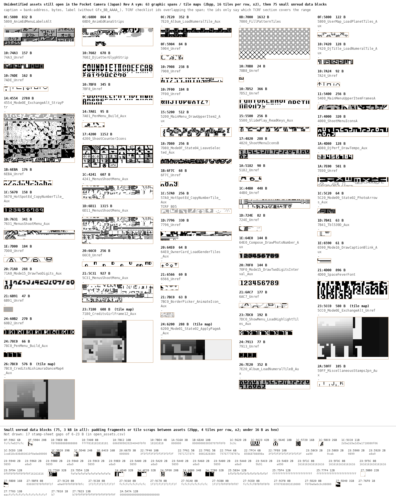

*The open assets of §16.24 and §16.25 (`open_assets.png`, drawn from 155 rows; `open_assets.csv` has 154 rows). Orange on the bank pictures of `disasm/sym_unconclusive_banks/` marks the same spans; the really unused ones among them are in §16.24.*

### 16.24 Which assets are really unused: display tracking, the TCRF images against the ROM, the stamp ranges, the sounds nobody asked for (C for the replays and the pixel matches, I for every "unused" verdict; nothing was heard)

*Why.* The owner asked for the unknown assets on one picture, then for the stamp menus (CoroCoro or not) and the D.J. / Trippy-H menus to be explored, then for the REALLY unused assets on one PNG, for the sounds too, and for the TCRF images of `Unused_graphics_according_to_TCRF.zip` to be labelled (tiles may be flipped). **Nine of the 19 TCRF PNGs are 2x enlargements** (all pixels in 2 x 2 blocks): they are reduced before matching.

Five open assets of the SHOOT menu are displayed on the BGB screens (C).

*Method (core `tcrf_check/tools/gbcov_display.c`, wrapper `gbcov_display.py`, replays `display_replay.py`, `display_stamps.py`).* The coverage core of §16.13 carries a **taint of the ROM source offset for every RAM byte** (a ring of 8 tainted reads matched by value; `00` / `FF` carry none) and, for each visible scan line at cycle 160 (so the V-Blank trick of §15.8 is followed), evaluates BG, window and OBJ and counts the tiles and map cells that reach the screen, per ROM byte. A byte is **on screen** when it is fetched in at least **15 frames**: a screen being loaded flashes tiles for 1-3 frames, and the first pass without this rule flagged nearly everything as shown. A run is **organic** when no state was poked in its lineage. Corpora replayed depth-first with snapshots: v3 18,739 nodes (307 mode / state signatures), unlock-fuzz 2,864, state-18 3,227, worker-15 hot-spots 6,752, worker-3c 5,446, D.J. 342 (154 signatures) = 37,370 nodes, plus walks through all 17 stamp categories with and without the CoroCoro tag. Limits: tiles composed by software (blits, text composition) and hot-spot pattern fills are invisible to it, and a tile whose 16 bytes occur twice in the ROM is credited to either copy.

*Verdicts* (`tcrf_check/assets/unidentified/really_unused.csv`, one row per span; picture `really_unused.png`; builder `display_report.py`; the union of the replays is `assets/display_run/display_union.npz`):

| tier | spans | bytes | meaning |
|---|---|---|---|
| **no loader in either ROM** (hand-listed, `unused_manual.csv`) | 5 | 10,164 | `14:4000-4553`, `14:4554-502F`, `23:5CC0-5F03`: the unused alternate stand-by screen of the image exchange (§14.4, §16.24 (3)), 4,724 B; `17:5500-67FF` + `25:7820-7A5F`: the unused one-page main menu (§16.25.1), 5,440 B; the tracker had put them in two other tiers (below) |
| TCRF label (`Unused_TCRF_*`) | 14 | 6,784 | spans that match a TCRF image (table below); display evidence per span in the CSV |
| never on screen, never read organically | 13 (11 graphics, 2 tile maps) | 4,934 | no replay showed them, only forced runs read them (was 21 spans, 6,907 B before the second L3 pass: the eight spans of the printer text font `10:7600-7FFF` left the list, they are glyphs that only a Game Boy Printer prints, see below; was 24 spans, 7,623 B before §16.25: `25:7820` moved to the first tier, `24:6360` and `25:7160` are head rows of used maps, §16.25.3) |
| on screen only when state is forced | 4 | 2,048 | the frames 5-8 of the ten-frame camera ball head animation (called main menu icon strip A before the owner's note of 2026-10-14), `16:7380`, `7580`, `7780`, `7980` (512 B each): only Tbl2 / Tbl3 of the page transition A list them and those two tables have no caller in either ROM (L3 pass), hand-listed in `unused_manual.csv` because the strip was not an open asset) |
| leftovers (`Data`, never shown, never read organically) | 42 | 436 | padding or tile slack |
| head rows of used maps (hand-listed) | 2 | 128 | `24:6360`, `25:7160`: rows 0-1 of mode-`$16` option pages that the loader skips (§16.25.3); not unused assets, not painted yellow |
| read in play, never shown | 43 | 448 | small tables and tails (28 `other` + 15 graphic slots of the glyph fonts, labelled since the L3 pass) |
| withdrawn, used (`unused_manual.csv`, tier `used (withdrawn)`) | 9 | 2,246 | `10:74A3` (157 B, numeral table) and the eight glyph spans of the printer text font `10:7600-7FFF` (2,089 B), see "The really never used assets" |
| on screen in normal play | 46 | 13,965 | listed as open, but used (was 41 spans, 13,848 B before the glyph-font relabelling of the L3 pass, 42 spans, 16,628 B before that: `14:4554-502F` moved to the first tier, its 21,196 "on screen" frames are the thumbnail reducer reading it through a stray pointer, not tiles) |

*Twenty-seven spans are tiered by hand* (nine of the first pass, then 9 + 4 + 5 at the second L3 pass: the withdrawn font spans, the four strip frames and five row tails that stay `scrap` although the L3 pass gave them map labels) (`tcrf_check/assets/unidentified/unused_manual.csv`, read by `display_report.py`; I for the verdict, C for the BGB check behind it). Five of them (tier "no loader") are two unused screens, the alternate stand-by screen of the image exchange (§14.4, §16.24 (3)) and the one-page main menu (§16.25.1): a code search and BGB say that no code of either ROM loads them, but the tracker had filed their bytes under other tiers; two more (`25:75E0`, `26:7080`, tier "never shown") are tile maps that no copy site reaches (§16.25.2) and two (`24:6360`, `25:7160`, tier "head rows") are skipped rows of used maps (§16.25.3). For the stand-by screen: `14:4554-502F` (2,780 B) as "on screen in normal play" (21,196 frames) because the thumbnail reducer `00:289C` reads it through a stray pointer and the tracker follows those bytes into the thumbnail, `23:5CC0-5F03` (580 B) as "on screen only when state is forced" (36 tiles, 264 frames: value matches), and `14:4000-4553` (1,364 B) was not an open asset in the sym at all, so it had never been checked. The tracker's own numbers stay in the CSV columns. The other tiers are the tracker's verdict, unchanged.

**The really unused assets, updated list** (`tcrf_check/assets/unidentified/really_unused.md`, written by `display_report.py` with the CSV; the tiers "no loader", "never on screen" and "forced runs only", plus the 12 TCRF-labelled spans that were never on screen in a run without state pokes; the other two TCRF spans, `13:5CA0` and `1A:7C90`, are on screen in normal play). These are the yellow bytes of the map at the top of this README: 21,422 B there, 23,802 B here, the difference being 2,380 B of runs of 16+ `00` / `FF` that the map keeps as padding. The table below is `really_unused.md`. **I: "never on screen" means that the replays of the core never showed it; nothing was seen or heard on a real camera, and a tile composed by software would not have been seen.**

| span | bytes | label | tier | what the replays saw |
|---|---|---|---|---|
| `0D:7000` | 1632 | `Gfx_0D_7000_FillPatternTiles` | never shown | never on screen; read only in forced runs |
| `0D:7660` | 384 | `Unused_TCRF_KanjiMiddleBeforeAfterHave_Gfx` | TCRF label | never on screen; read only in forced runs |
| `10:7A80` | 32 | `Unused_TCRF_SoundPrintModulationIcon_TopRow_Gfx` | TCRF label | never on screen; read only in forced runs |
| `10:7B80` | 32 | `Unused_TCRF_SoundPrintModulationIcon_BottomRow_Gfx` | TCRF label | never on screen; read only in forced runs |
| `11:5800` | 4416 | `Unused_TCRF_HandNewspaperFrames_Gfx` | TCRF label | never on screen; read only in forced runs |
| `14:4000` | 1364 | `Gfx_14_4000_Mode0E_ExchangeAlt_Tiles` | no loader (hand-listed) | no loader in either ROM (code search + BGB); tracker: 0 of 79 tiles on screen, 0 frames; tile set (tiles 0-84) of the unused alternate stand-by screen of the image exchange: no loader in either ROM (code search + BGB, README 14.4 / 16.24 (3)); not an open asset in the sym, so the tracker never listed it |
| `14:4554` | 2780 | `Gfx_14_4554_Mode0E_ExchangeAlt_StrayPtr` | no loader (hand-listed) | no loader in either ROM (code search + BGB); tracker: 173 of 173 tiles on screen, 21196 frames; tiles 85-258 of the same screen; the tracker's 'on screen' is the thumbnail reducer 00:289C reading it through a stray pointer (14:4554, not a tile boundary), never these tiles as tiles |
| `15:4480` | 16 | `Unused_TCRF_JapaneseMenuTile_CircledX_Gfx` | TCRF label | forced runs: 1 of 1 tiles stable, max 546 frames; organic runs: never on screen |
| `15:4500` | 16 | `Unused_TCRF_JapaneseMenuTile_CircledX_Copy2_Gfx` | TCRF label | forced runs: 1 of 1 tiles stable, max 1786 frames; organic runs: never on screen |
| `15:4580` | 16 | `Unused_TCRF_JapaneseMenuTile_CircledX_Copy3_Gfx` | TCRF label | forced runs: 1 of 1 tiles stable, max 1588 frames; organic runs: never on screen |
| `15:5200` | 512 | `Gfx_15_5200_MainMenu_DrawUpperItem2_Aux` | never shown | never on screen; read only in forced runs |
| `15:5500` | 256 | `Gfx_15_5500_SlidePlay_ReadKeys_Aux` | never shown | never on screen; read only in forced runs |
| `16:7380` | 512 | `Gfx_16_7380_MainMenu_BallHeadAnim_F5_Unref` | forced runs only | on screen only in forced runs (666 frames); frame 5 of 10 of the camera ball head animation (16:6980-7D7F; the head in the centre of the main menu, which plays when Up / Down is pressed on SHOOT / VIEW / PLAY, owner 2026-10-14): listed only by Tbl3 of the page transition A; Tbl2 / Tbl3 (07:7C33 / 07:7C3F) have no caller in the JP or the international ROM, and BGB reads frames 0-4 only for Up / Down / Left / Right on both main-menu pages (C); the second set of frames, 10-11 of 32 tiles differ from frames 0-4 (lower rows) |
| `16:7580` | 512 | `Gfx_16_7580_MainMenu_BallHeadAnim_F6_Unref` | forced runs only | on screen only in forced runs (666 frames); frame 6 of 10 of the camera ball head animation: Tbl2 step 1 / Tbl3 step 3, no caller of Tbl2 / Tbl3 (C); never read in BGB |
| `16:7780` | 512 | `Gfx_16_7780_MainMenu_BallHeadAnim_F7_Unref` | forced runs only | on screen only in forced runs (666 frames); frame 7 of 10 of the camera ball head animation: Tbl2 step 2 / Tbl3 step 2, no caller of Tbl2 / Tbl3 (C); never read in BGB |
| `16:7980` | 512 | `Gfx_16_7980_MainMenu_BallHeadAnim_F8_Unref` | forced runs only | on screen only in forced runs (666 frames); frame 8 of 10 of the camera ball head animation: Tbl2 step 3 / Tbl3 step 1, no caller of Tbl2 / Tbl3 (C); never read in BGB |
| `17:5500` | 4864 | `Gfx_17_5500_Unused_MainMenuTiles` | no loader (hand-listed) | no loader in either ROM (code search + BGB); tracker: 194 of 262 tiles on screen, 664 frames; tile block (304 tiles; the map uses ids 0-233) of the unused one-page main menu: BGB draws it with the map 25:7820 (README 16.25); byte-identical in the international ROM; no copy site and no table entry reaches it (copy_sites_jp.csv); the tracker saw it only in forced runs |
| `18:5A50` | 96 | `Unused_TCRF_MarginPrint_BFilmRoll_Gfx` | TCRF label | never stably on screen (6 flash tiles) |
| `18:5F90` | 192 | `Unused_TCRF_MarginPrint_OutlinedText_Gfx` | TCRF label | never stably on screen (7 flash tiles) |
| `18:7D80` | 256 | `Gfx_18_7D80_Mode0F_State04_LeaveSelected_Aux` | never shown | never on screen; read only in forced runs |
| `1A:5182` | 90 | `Gfx_1A_5182_Unref` | never shown | never on screen; read only in forced runs |
| `1A:7D80` | 96 | `Unused_TCRF_PhotoOption_BCancel_Gfx` | TCRF label | never on screen; read only in forced runs |
| `1A:7E00` | 501 | `Gfx_1A_7E00_Unref` | never shown | never on screen; read only in forced runs |
| `1C:5920` | 512 | `Unused_TCRF_HotSpotEffectIcons_Extra_Gfx` | TCRF label | forced runs: 20 of 32 tiles stable, max 3192 frames; organic runs: at most 8 frames (transitional) |
| `1C:5C20` | 64 | `Gfx_1C_5C20_Mode09_State02_PhotoArrows_Aux` | never shown | never on screen; read only in forced runs |
| `1D:7B41` | 63 | `Gfx_1D_7B41_Tbl539D_Aux` | never shown | never on screen; read only in forced runs |
| `1E:6620` | 848 | `Unused_TCRF_CannotCombineSamePicture_Gfx` | TCRF label | never on screen; read only in forced runs |
| `1E:7D00` | 184 | `Gfx_1E_7D00_Unref` | never shown | never on screen; read only in forced runs |
| `21:6AC7` | 177 | `Gfx_21_6AC7_Unref` | never shown | never on screen; read only in forced runs |
| `21:6B91` | 47 | `Gfx_21_6B91_Unref` | never shown | never on screen; read only in forced runs |
| `23:5CC0` | 580 | `Map_23_5CC0_Mode0E_ExchangeAlt_Unref` | no loader (hand-listed) | no loader in either ROM (code search + BGB); tracker: 36 of 36 tiles on screen, 264 frames; the tile map of the same screen (18 x 32 + 4 bytes); the tracker's 36 forced-run tiles are value matches, BGB shows that the exchange screen loads 15:6C00 + 24:5180 instead |
| `25:75E0` | 576 | `Map_25_75E0_Unused_PhotoScreen` | never shown | never on screen; read only in forced runs; tile map (18 rows of 32) of an unused photo screen: rows 0-1 and 16-17 are $E0 across the 20 visible columns, rows 2-15 are $E0 $E0, the straight 16-wide photo ramp $00-$DF and $E0 $E0 (the layout of the used hot-spot viewer map 3F:7D00, which loads the tiles 3F:7700 as ids E0-FE and has the frame $E2); no copy site reaches it; the photo tiles are dynamic, drawn here with the viewer's frame tiles (I) and hatched photo cells (README 16.25.2) |
| `25:7820` | 576 | `Map_25_7820_Unused_MainMenu` | no loader (hand-listed) | no loader in either ROM (code search + BGB); tracker: 0 of 36 tiles on screen, 0 frames; the tile map of the unused one-page main menu (18 rows of 32, the picture is in columns 0-19, the 12 hidden columns are $29): BGB draws a flow-chart menu with tsushin / mi-ru / toru / miru / asobu / rakugaki / henshuu and BASIC / VIEW / EDIT MODE, STATUS; identical in the international ROM (25:75E0) |
| `26:7080` | 576 | `Map_26_7080_Unused_Picture` | never shown | never on screen; read only in forced runs; full-screen picture map (18 rows of 32, picture in columns 0-19, $A5 filler in 20-31; 245 distinct ids: 4-column side strip, 16-column picture and two small blocks DB-F5); no copy site reaches it and no tile block of either ROM fits it (tile_seam_search.py against a shuffled-map control: whole map 0.69 and ids 00-7F 0.52, true blocks of two known maps 0.33-0.37), and no shipped map has its pattern of repeated tiles, so what it shows is not known (README 16.25.2) |
| | **23,802** | **34 spans** | | |


*The sheet of the REALLY unused assets (`really_unused.png`, `display_report.py`): first the four unused tile maps, each beside the tile set it uses (`23:5CC0` drawn through `14:4000-502F`, `25:7820` through `17:5500-67FF`, from the BGB captures `23_5CC0_map_screen.png` and `25_7820_map_screen.png`; `25:75E0` beside the frame tiles of the hot-spot viewer `3F:7700-78EF` (ids `E0` and up), composed from the ROM tiles with the photo cells hatched, not a BGB capture; `26:7080` has no tile set: empty box; the pairing is the `tileset` column of `unused_manual.csv`), then the TCRF-documented spans, the other spans never on screen, those shown only in forced runs, the 42 scraps and the 15 sounds no organic run requested. 2bpp tiles straight from the ROM, 16 per row, x2; a tile list that is de-duplicated (like `14:4000`) reads as strips.*

*The TCRF images against the ROM* (`tcrf_check/tools/tcrf_exact_match.py`: reduces 2x pictures, tries every monotone palette fold, the three flips, every byte offset, and clusters per-tile hits; ROM tile sheets are 16 tiles wide, rows 0x100 bytes apart, so a crop of a sheet is not contiguous):

| TCRF image | ROM | match | status |
|---|---|---|---|
| Cannot combine the same picture | `1E:6600-697F` | 56 of 56 tiles, 8 wide | exact (B09) |
| Kanji 中 前 後 持 | `0D:7660-76DF` + `0D:7760-77DF` | 16 of 16, shaded palette | exact (B10) |
| Photo option B CANCEL | `1A:7D80-7DDF` | 6 of 6, 0 of 384 pixels differ | exact (B11) |
| SOUND print modulation icon | `10:7A80`, `7A90`, `7B80`, `7B90` | 4 of 4 (2 x 2 tiles, rows 0x100 apart) | exact (B15); printed by `DjPrintRow_S2WaveTitle` (`05:5E78`) in the title row of the SOUND II wave sheet when `$D985` = 1 (C, code; printer only) |
| Photo option icon | `1A:7C90` / `7CA0` | 2 identical tiles, **on screen in normal play** | candidate (?) |
| Album hand gestures | sheet `13:5A00-5FFF` | 23 of 32 non-blank tiles (a crop); part is on screen | partial (B06, B13) |
| Magic bank tile / tiles | `0D:7000-765F`, `0D:7870-7AB0` | a dither tile at many offsets; 20 of 20 tiles occur but not in the picture's layout | candidates |
| Hot-spot effect icons | `1C:5920-5B1F` (8 x 64 B) | span only | B05 |
| Margin print B film roll, font | `18:5A50`, `18:5F90` | 4 of 24 and 5 of 40 tiles | span (B07) |
| Japanese menu tile (circled X) | `15:4480` / `4500` / `4580` | the picture is 14 x 14, the tile 8 x 8 | candidate (B08) |
| R!R!R! star | `1B:618A` | one tile at an odd address | candidate (B18) |
| Unused X | international ROM `0D:5200-5CFF` | not in this ROM | B12 |
| Unused Graphic Bank 11, a hand flipping a newspaper | `11:5800-693F` | nine 40 x 40 sprite frames arranged by OAM list `$BA`; every non-blank cell of the picture is an exact tile of the span, 5 frames pixel-equal | located (I, B16) |
| bank tile, D.J. music tile, menu tile, photo option tile | - | no match | not located (B14) |

The sym carries 14 `Unused_TCRF_*` labels (I = pixel match with doubts, C = exact; `?` = candidate): `0D:7660` kanji strip (I), `10:7A80` / `10:7B80` SOUND icon rows (C), `11:5800` hand flipping a newspaper (I), `13:5CA0` hand gestures (?), `15:4480` / `4500` / `4580` circled X (I), `18:5A50` film roll (I), `18:5F90` outlined text (I), `1A:7C90` photo option icon (?), `1A:7D80` B CANCEL (C), `1C:5920` eight extra hot-spot icons (I), `1E:6620` cannot combine (C). The checklist rows B05-B11, B13, B15, B16, B18 carry the new evidence.

**The hand flipping a newspaper (B16) is `11:5800-693F`** (owner, 2026-10-13: "11:5700 is exactly the TCRF image with the tiles reorganised"; it is, with the first 256 bytes taken off, see below). The asset holds nine frames of 25 tiles in 512-byte slots, slot `j` at `11:5800 + $200 * j` (the last one is cut at `11:693F`, 320 bytes). The arrangement is **not a tile map but an existing OAM sprite list**: `OamList_B01_4000_BA` (`01:5504`, id `$BA` of the bank-01 table at `01:4000`; of the lists of the two OAM pointer tables, banks 01 and 02, it is the only one with 25 sprites using the tiles `$50-$68`): 5 x 5 sprites (Y = 0, 8, 16, 24, 32; X = 248, 0, 8, 16, 24), attr `$10`, stored from the bottom-right sprite to the top-left one, so that tile `T` of frame `j` is the ROM tile at `11:5800 + $200 * j + 16 * (T - $50)`. Cell search in the owner's picture (reduced 2x, every 8 x 8 cell looked up among the tiles of the span): every non-blank cell of the nine frames is an exact tile of this span (none unmatched), nothing comes from another asset. Rendered from the ROM (`tcrf_check/tools/oam_frames_11_5800.py`, `tcrf_check/assets/unidentified/11_5800_frames_list_BA.png`): frames 0, 1, 3, 7 and 8 equal the picture pixel for pixel (1,210 / 1,328 / 605 / 1,335 / 1,116 pixels), frames 5 and 6 differ by 3 and 2 pixels where they overlap their neighbour, frame 2 matches 827 of 851 pixels but the picture shows a **sixth tile row above it** (the list has five), frame 4 is clipped by the right edge of the picture, matches in its top two tile rows (16 pixel rows), has a stray pixel column below them and lacks its bottom tile row in the picture. The picture is therefore a hand-made or hand-edited assembly of the same tiles, not a straight capture of list `$BA`. The first checker result for B16 (161 of 496 tiles, README above) was for the picture taken from the PDF and is superseded. What is not known: no call that draws list `$BA` and no loader of the slots was found (the slots are read in forced runs only; no `ld a,$BA` is followed by a `call Oam_AddMeta_B01_4000`, `00:24AF`), so the frames count as unused as TCRF says; the first 256 bytes `11:5700-57FF` (16 tiles, organic, on screen) are the second half of the 512-byte main-menu frame that `MainMenu_DrawUpperItem1` loads from `11:5600`, whose label now covers 512 bytes.

*The stamp banks, relabelled exactly* (from the code tables and the coverage, all gaps are zero padding): `2C:4000` category 0 faces, `2D:4000` 1 icons, `2C:6000` 2 Pokémon, `2B:4000` 3 CoroCoro, `2A:6000` 4 / 5 small kana, `2E:4000` 6 / 7 hiragana, `30:4000` 8 / 9 katakana, `2F:7000` 10 / 11 digits, `30:6000` 12 / 13 Latin, `2E:5800` 14 / 15 kanji, `2F:5800` 16 symbols; the 1bpp masks are at `2D:7000`, `2F:4000`, `2E:7000`, `2B:5800`, `30:7000`. 16 range labels (`StampCatNN_*_Gfx`, `StampCatNN_Mask`) replace 279 per-glyph guesses. Consequence for the map at the top: the stamp pictures are not unknown data any more, and the 1,610 bytes of `2A:6000-7E9F` that the v8 run never read are green (the stamp-menu walks show them on screen); no other stamp bank has a never-read non-padding byte (all gaps are zero padding).

*Sounds* (`sound_inventory.csv`, 162 ids with caller, picker list and handler; `really_unused_sounds.csv`). A sound counts as requested when a replay wrote its id to a request mailbox (`$DD60` effects 1, `$DD68` songs, `$DD70` effects 3, `$DD78` effects 4) in an organic run: **147 of 162 were, 15 were not** (a first count said 17: songs `32` and `sfx1 26` were listed in tier D because the menu and stamp replays never play Space Fever II; the key-log replay of `sf2_sound.py`, an organic corpus without pokes, requests `32` 12 times from frame 3128 and `sfx1 26` 12 times from frame 2799, `credits_parlor/sf2_sounds.csv`, and `display_report.py` now reads that file). A = no caller, no list, never requested: song `48`, effects `sfx1 24`, `sfx3 04`, `sfx3 07`. B = in a picker list but never chosen: song `47`, `sfx1 2F`, `sfx3 0A`. C = same data as a used id: song `08`, `sfx1 2B`, `3D`, `3E`. D = has a static caller but only forced runs reached it: songs `27`, `44`, `sfx4 05`, `11`. D is not proof of dead code.

*What this does not show.* **Nobody listened**: the sound results are mailbox logs. The core is not a console and the exploration, though large, is not exhaustive: "never on screen" is strong evidence, not proof. **Answers (2026-10-13, 53 rows in `disasm/owner_answers_jp.csv`: 13 TCRF cards, 27 asset cards, 13 sounds):** of the 13 TCRF cards, 12 were marked "right" by eye (cannot combine, kanji strip, B CANCEL, SOUND icon, the 8 hot-spot icons, margin-print film roll and font, circled X at `15:4480-4580`, the Magic-bank tile and tiles, the photo-option icon `1A:7C90`, the R!R!R! star `1B:618A`) and one, the album hand gestures, "partly" (my matcher finds 23 of 32 non-blank tiles, and part of the sheet is on screen in normal play); **27 asset cards** were answered: 14 "graphic" (`10:74A3`, `10:78B8`, `10:7F00`, `15:5200`, `15:5500`, `17:5500`, `18:7D80`, `1A:5182`, `1A:7E00`, `1C:5C20`, `1D:7B41` with the note "looks like an enemy in Space Fever", `1E:7D00`, `21:6AC7`, `21:6B91`), 3 "map" (`23:5CC0`, `25:7614`, `25:7814`; the last two maps start at `25:75E0` and `25:7820`, §16.25) and 10 "unsure" (small unread blocks `10:78E8`, `10:7A08`, `10:7BC2`, `10:7BE4`, `1A:5160`, `1C:5620`, `1C:5623`, `1C:564E`, `1C:5720`, `1C:5BC0`). No notes were left. "Right" is an eye check of the ROM bytes against the TCRF picture: it does not change the display-tracking evidence (the photo-option icon is still on screen in normal play). **Sounds heard by the owner (13 answers, by ear, from engine clips):** `used` for music 08 ("printer waiting jingle during multiple print selection"), 27 ("jingle during the waiting time while the Game Boy Printer is busy printing"), 32 ("Space Fever main theme during gameplay"), 44 ("credits, short"), sfx1 24 ("Space Fever probably", tier A: no caller was found, so "no caller" is not proof of unused), 26 ("boss death in Space Fever"), 3D and 3E ("death in Ball or Space Fever") and sfx4 05 ("player death in Space Fever ?"); `unused` for music 47 ("classical music theme (Mozart ?)", tier B: only in the slide-show list); `known` for music 48 (error message, incomplete); `unsure` for sfx1 2F and sfx3 04. They fit the callers for 08 and 27 and disagree with two names built from callers: song 32 is `Song32_SpaceFeverBossEnd` (caller `SpaceFever_Boss_EndA`) and sfx4 05 is `EraseAnim` (caller `EraseAnim_Run`); both names are kept with the owner's answer in the label note until someone settles them (?). **Song 32.** Its only static caller is `SpaceFever_Boss_EndA` (`07:62D5`, state 10, "boss gone; back to wave state 2"); a request made as the game returns to the waves can as well restart the gameplay music, so the name taken from the place of the call is doubtful (?). The Space Fever II key-log replay (§16.18, `sf2_sound.py`) requests it 12 times from frame 3128 (after the boss music `$42` at frame 2049; `$31` runs 138 frames at the start), and `sfx1 26` 12 times from frame 2799, so both count among the sounds that organic runs requested (the count of sounds that no organic run requested is 15; `display_report.py` reads `sf2_sounds.csv`). What plays during waves 1-3 of that replay, and whether the owner's "main theme" is `$31` continued or the same melody as `$32`, was not checked (I). The 14 "graphic" and 3 "map" spans are typed `C` in the sym (type confirmed by the owner, the answer is in the label note; the doubt list still carries them, with "type confirmed by the owner; role and consumer not found", because the role is unknown and the really-unused picture is built from that list). The 10 "unsure" blocks are unchanged.

**Tables that point at the open assets (negative; `tcrf_check/tools/table_scan.py`, result in `tcrf_check/assets/unidentified/table_scan.txt`).** Question (owner): is there an untagged table whose entries are the starts of the 161 open spans (30,877 B)? Domain: the 33,590 B of `data` bytes of banks 00-28 that carry no asset label and are not inside an open span. Forms searched: words (low, high) read in order, words followed by a bank byte, and split low / high arrays (high bytes at distance ±1024 from the low bytes, stride 1) or interleaved records of stride 2-8, a word counting when it equals the exact start of an open span, the cluster being at least 3 hits in the same bank within 40 bytes with at least 85 % of its entries in `$40xx-$7Fxx`. Null model: every span start moved to a random address of the same bank with the same alignment (largest power of two dividing the start, at most `$100`), 40 trials. **Result:** nothing consistent in one bank for the in-order word and bank-byte forms; for the split and strided forms the real data gives 1,147 clusters of at least 3 hits against 908 for the null (range 495-1,201), and 9 clusters of at least 8 hits against a null mean of 61 (the null reaches 393 when a shifted start lands on a value that many words repeat, such as `$4000`); the twelve strongest real clusters all sit inside labelled tables (`WildFrame_PageSrcTbl`: 20 identical words `$4000`, `Stamp_PaletteCursorTbl`, `AnimEd_DrawHandSprite_Tbl5466`, `OamPtrTbl_B02_5272`, `AlbumB_SlotTbl`) or a zero fill. **Evenly spaced series:** 16 runs of at least 4 span starts with a constant gap, against 0.18 for the null, but all of them are the 2, 8 and 10 byte leftovers at the end of fixed-size tile slots (bank 23 `58C0-5AE0`, 18 spans of 2 B at `$20` steps; bank 27 `5BF8-5D20`, 8 B at `$40`; bank 2A `5430-54F0`, 10 B at `$40`), i.e. the layout of the sheets around them and not an index. **Bank switching:** every bank that holds an open span is selected in the organic runs (`bank_select.csv`, v8), so the question "which banks are never switched in" does not separate anything, and a selected bank says nothing about which address is read; the callsite-to-span mapping was therefore not built. **What this cannot exclude:** a table in bytes typed as code, a pointer to the inside of a span (not its start), a base + index × stride lookup whose base the scan does not see, a table in banks 29 and above (not scanned; bank 2A holds 7 open spans), and a table whose entries were never in this form. Evidence I (absence of a match, not a proof).

### 16.25 Banks $23-$27: what the yellow tile maps and the orange blocks are (C for the BGB captures and the loader code, I for every "unused" verdict)

*Why.* The owner (2026-10-13): "same for banks 23 to 27, yellow data are tilemaps. Orange data to double check too", after the same question had found the unused stand-by screen of the image exchange in banks `$14` / `$23` (§14.4, §16.24 (3)). For each span: which screen is it, which tile set draws it, and does anything load it.

**Result in one line: the biggest yellow pair is a second, unused main menu (map `25:7820`, tiles `17:5500`, BGB draws it, §16.25.1); four of the "unused" maps were the first two rows of the option pages of mode `$16`, which their loader skips (§16.25.3); the orange blocks are filler, a map loaded only by dead code, and two maps and a tile set that nothing loads (table below); and the unused menu is only a picture: driven by the shipped menu code it takes the shipped inputs but nothing in it reacts to the picture (§16.25.4).**

*Method.* **(a) Loader search.** Every call of the banked copy helpers (`Mem_CopyFromBank`, `Vram_CopyFromBank`, `Vram_CopyFromBankAuto`, `Vram_CopyFromBank_4` / `_8`) in the disassembly, with source, destination and length when they are immediates (`tcrf_check/tools/copy_sites.py`, result `assets/copy_sites_jp.csv`): 941 sites, 791 with the three constants known (290 of them were not in `catalog_jp.csv`), 150 with a register-computed argument. The far-pointer tables are those of §16.24 (`04:539D`, `06:4B67`). **(b) Tile-set search.** A picture map lists each tile id once, in the order of a de-duplicated tile list (§16.24 (3)), so the right tile block makes the picture continuous across tile seams: `tcrf_check/tools/tile_seam_search.py ROM BANK:ADDR` scores every aligned block of the ROM by the pixel difference across the seams of the drawn picture (a filter keeps only blocks in which all the tiles the map uses are distinct). Controls: the credits picture map `26:72C0` finds `19:5260` (0.42 per pixel) and `25:7820` finds `17:5500` (0.43). A flat or smooth picture scores low against any block, so the tool also scores the same seams with the ids of the neighbours shuffled and ranks the blocks by the ratio of the two costs: for ids `00-7F` of the two controls the true block has a ratio of 0.33-0.37 and the next block 0.46 or more, a flat region about 1; the upper halves are a weak test (the true block is not ranked first for `26:72C0` ids `80-FF` and `25:7820` ids `80-E9`: wrong blocks reach 0.40 and 0.49). `--ids LO-HI,…` gives each id range a block of its own (a tile set loaded in two pieces, or ids that belong to another list) and `--1bpp` reads the ROM as 8-byte tiles. **(c) Look-alike search.** `tcrf_check/tools/map_pattern_match.py ROM BANK:ADDR` compares the pattern of repeated ids of a map (which neighbouring cells hold the same id) with every window of the ROM, whatever the numbering (Jaccard index, 1.00 = the same pattern), so a renumbered copy of a shipped map would show. **(d) BGB capture.** A copy of the ROM is patched in the bank-0 padding to boot into a routine at `$3600` that copies chosen ROM blocks into VRAM and freezes (`tcrf_check/tools/bgb_show_unused.py ROM OUT.png --copy BANK:SRC:DST:LEN[,…] [--scx N]`); the screenshot is BGB's (not my core's, §15.8), with the palette `$E4` because the one the game would use is not known.

*The spans of banks `$23-$27`* (every row of `assets/asset_map_jp.csv` and `really_unused.csv` in these banks that is yellow or orange on the map; where a colour is followed by a byte count, that count is what is really orange, the rest of the span being read by forced runs (class `r`) or padding):

| span | bytes | colour | what it is | evidence |
|---|---|---|---|---|
| `23:5CC0-5F03` | 580 | yellow | tile map of the unused alternate stand-by screen of the image exchange, drawn with `14:4000-502F`; the shipped screen loads `15:6C00` + `24:5180` instead (§14.4, §16.24 (3)) | C (BGB), I (unused) |
| `25:7820-7A5F` | 576 | yellow | **tile map of the unused one-page main menu**, drawn with `17:5500-67FF` (§16.25.1) | C (BGB), I (unused) |
| `17:5500-67FF` | 4,864 | yellow | **tile block of that menu** (304 tiles, the map uses ids 0-233) | C (BGB), I (unused) |
| `25:75E0-781F` | 576 | yellow | photo-screen map (18 rows of 32) with the layout of the used hot-spot viewer map `3F:7D00`: the straight 14-row photo ramp `$00-$DF` in a frame of `$E0` (the viewer's frame tiles `3F:7700-78EF` are the ids `E0-FE`); the photo tiles are dynamic; no copy site reaches it (§16.25.2) | C (look-alike), I (unused) |
| `26:7080-72BF` | 576 | yellow | full-screen picture map (18 rows of 32; picture in columns 0-19, `$A5` filler in 20-31): 245 distinct ids, a 4-column side strip (`00-23`), a 16-column picture (`24-DA`) and two small blocks (`DB-F5`), the construction of the unused menu; no copy site reaches it, no tile block of either ROM fits it and no shipped map has its pattern, so **what it shows is not known** (§16.25.2) | I, tile set `?` |
| `24:6360-639F`, `25:7160-719F` | 64 + 64 | light blue (were yellow) | rows 0-1 of the option pages 2 and 0 of mode `$16` (§16.25.3): used maps, not unused assets; read by forced runs | C (loader code) |
| `25:5080-50BF`, `25:5320-535F` | 64 + 64 | orange (34 B + 26 B) | rows 0-1 of the option pages 1 and 3: never loaded | C (loader code), never read |
| `25:4A80-4AFF` | 128 | orange (94 B) | four blank rows (`$FE`) between the map copied from `25:47C0` and `25:4B00`: filler | I |
| `25:4B00-4DBF` | 704 | orange (431 B) | 22-row map (16 x 14 photo ramp `00-8F` / `00-4F`, icon blocks `A0-DF`, two icon rows below), whose only loader is `Unused_LoadTilemap25_4B00` (`04:6412`: `ld a,$25 / ld hl,$4B00 / ld de,$9800 / ld bc,$02C0 / call Vram_CopyFromBank`), which no code calls (UNREFERENCED, §16.15) | C (code), I (dead) |
| `26:4500-487F` | 896 | orange (539 B) | 18-row map with the same 16 x 14 ramp, icon columns (`A0-A7`, `B8-E5`, `F2-FC`, `90-9B`) and icon blocks in rows 14-17, then `$FF`; no copy site and no table entry reaches it; the icon tiles it uses were not identified | I, tile set `?` |
| `27:4772-486F` | 254 | orange (156 B) | blank rows (`$FD`) between the map copied from `27:44B2` and the one copied from `27:4870`: filler | I |
| `27:4AB0-4CAF` | 512 | orange (69 B) | small 2bpp tile set (round shapes, then `$FF` / `$00` filler) that follows the last row of the map copied from `27:4870` (its start moved from `4AA0`: the last 16 bytes of that map were counted in it); no consumer found | I |

Of the 2,372 orange bytes of the map, 1,349 are in these banks (34 + 26 + 94 + 431 + 539 + 156 + 69). The two twin loaders `Unused_LoadTilemap24_7120` (`04:6403`) and `Unused_LoadTilemap25_4B00` (`04:6412`) are both dead code that would copy a whole `$02C0`-byte screen map to `$9800`; no shipped screen goes through them.

#### 16.25.1 The unused one-page main menu: map `25:7820`, tiles `17:5500` (C for the picture, I for "unused")

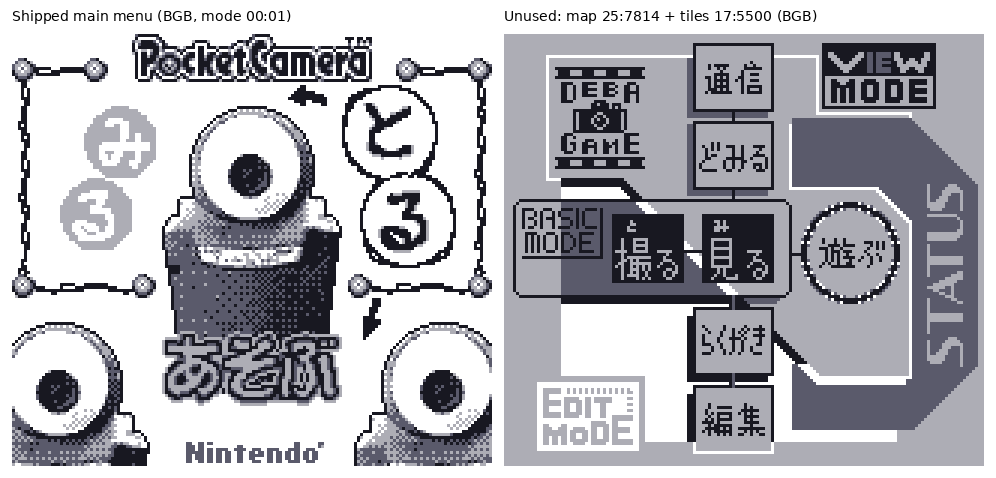

*Left: the shipped Japanese main menu (BGB, mode `00:01`). Right: the unused map `25:7820` copied to `$9800` with the tiles `17:5500` copied to `$8000` (BGB, patched-ROM capture, no scroll). The grey palette is the same on both sides (the BGB frame's greens swapped for greys); `25_7820_map_screen.png` is the same screen at full size.*

* **The map** `25:7820-7A5F` is 18 rows of 32 tile ids (576 B, a standard map: 20 visible columns, then 12 hidden ones). The picture is in columns 0-19 and the hidden columns hold the blank tile `$29`, so it shows without scrolling when the map is copied to `$9800`. It has the construction of a de-duplicated picture map (§16.24 (3)): the 16-column picture (columns 0-15) numbers its tiles `E9` down to `2C` in raster order of first use, and the 4-column strip at the right (columns 16-19, the STATUS band) numbers its own tiles `2B` down to `00`; 233 distinct ids in all (`00-E9`, one of them, `AA`, used once at row 10). The bank holds a chain of maps `0x240` bytes apart: `25:73A0` (loaded by mode `$16`), `25:75E0` (§16.25.2), this one and `25:7A60` (loaded by `09:5F8E`); the `$FF` bytes in front of the map are the hidden columns of the previous one.
* **The tiles** `17:5500-67FF` are 304 tiles (4,864 B); the map uses ids 0-233 (`$00-$E9`); tiles 234-303 are fragments of lines, arcs and strokes, in grey and black pairs, that the map does not use (by eye; §16.25.4). The tile block and the map are **byte-identical in the international ROM** (the map is at `25:75E0` there).
* **What BGB draws** (by eye): a flow chart in the style of the shipped screens, with **all the choices on one page**: boxes `通信`, `どみる`, `撮る`, `見る`, `遊ぶ`, `らくがき`, `編集`, the plates BASIC MODE, VIEW MODE and EDIT MODE, a camera pictogram with film strip and the word GAME below it, and a STATUS band along the right edge. The shipped menu has the same seven items on two pages, three on the upper page and four on the lower one, between which it slides (`MainMenu_DrawUpperItem0-2`, `MainMenu_DrawLowerItem3-6`, `MainMenu_TransitionToLowerPage` / `…UpperPage`), so this is a **different, unused design of the main menu with the seven items on one page**; which of the two is older is not known. Whether it is functional is tested in §16.25.4: it is not; it is a picture.
* **No loader (I):** no copy site of `copy_sites_jp.csv` has either block as its source, none of the far-pointer tables (`04:539D`, `06:4B67`) names them, and the ranges are never on screen in a run without state pokes (§16.24; the tracker credits 194 of the 262 tiles of `17:5500` as on screen in forced runs, for 664 frames, and none of the 36 tiles of the map `25:7820`; I: value matches with tiles of other screens, not traced). The forced-run reads that coloured them light blue before (`r` in `rom_map.csv`) were not traced to an instruction.
* **Palette:** the BGB capture uses BGP `$E4`; the palette the game would have used is not known.
* This is **not a TCRF item** (it is not in `tcrf_check/TCRF_CHECKLIST.{md,csv}`); like the alternate stand-by screen of §14.4 it is a find of this repository, tagged I until a second pair of eyes or a ROM with a loader shows otherwise.

#### 16.25.2 The two other yellow maps: `25:75E0` has a used look-alike, `26:7080` has none (I)

**`25:75E0-781F`** (576 B; `25:73A0` in the international ROM). Rows 0-1 and 16-17 are `$E0` across the 20 visible columns, rows 2-15 hold `$E0 $E0`, the straight 16-wide photo ramp `$00-$DF` and `$E0 $E0`, and the 12 hidden columns are `$FF`. This is the layout of a used map, the hot-spot viewer's `3F:7D00` (mode `$0C`): `Mode0C_State02_Setup` (`03:633F`) copies it to `$9800` and the 31 tiles `3F:7700-78EF` (`$1F0` B) to `$8E00`, i.e. the ids `E0-FE`, while the photo tiles `00-DF` are the dynamic photo tiles. The ramp cells are identical (C); the viewer's frame is `E2`, its header `E0` / `E1` and its footer `E3-FB`, where the unused map has `$E0` everywhere. These two are the only maps of the Japanese ROM with a straight 14-row ramp `00-DF` (the other photo screens split it, `00-8F` + `00-4F`, and `06:49BB-49D7` loads the photo in three pieces). Drawn with the viewer's tiles the unused map is a photo inside a striped band on four sides (I: the band is the viewer's tile `E0`; the sheet draws it from the ROM tiles with the photo cells hatched, it is not a BGB capture). No copy site and no table entry reaches it (I), and the photo is drawn with dynamic tiles, so there is nothing more to show.

**`26:7080-72BF`** (576 B; `26:6E40` in the international ROM). A full-screen picture map: picture in columns 0-19, `$A5` in the hidden columns, 245 distinct ids numbered in descending raster order of first use (a de-duplicated picture, §16.24 (3)): a 4-column strip on the right (`00-23`), the 16-column picture (`24-DA`) and two small blocks inside the picture that are numbered after it (`DB-E6`, 4 × 3 cells, and `E7-F5`, 5 × 3 cells). It sits between the maps of two used screens, `26:6E40` (mode `$16`, `Mode16_State08_StartShoot`) and `26:72C0` (credits page A). **No tile set in either ROM and no look-alike among the shipped maps (I):**

* *Seam search* (method (b); the controls above): the whole map (ids `00-F5`) scores 0.80 per pixel, ratio 0.69 (best block `14:4040`; a true set costs about 0.42 per pixel); ids `00-7F` alone 0.52 (`19:4760`), against 0.33-0.37 for the controls; ids `80-F5` alone 0.57 (`1B:74C0`, a weak test); ids `00-DA` alone 0.65; read as 1bpp tiles 0.81. The international ROM gives the same (whole 0.69, halves 0.52 and 0.57). The extra ids `DB-F5` alone (27 tiles, 39 seams) score as low as 0.27-0.30 (`1A:7E40`, inside the never-shown span `1A:7E00`; `34:41A0`), but that sample is too small to mean anything and, drawn in place, those tiles are line fragments that do not join into a picture (by eye). The decisive negatives are the whole map and the lower half, for which the controls do recover their blocks.
* *Pattern of repeated ids* (method (c)): the best window of the Japanese ROM has a Jaccard index of 0.41 (a flat fill at `23:44C0`), the best of the international ROM 0.37, so no shipped map, the credits picture `26:72C0` and the unused menu `25:7820` included, is a renumbered copy of it.

What it shows stays open (?): its tile set is either not in this build or not stored as a plain 2bpp block that follows the numbering.

#### 16.25.3 Four of the "unused" maps were head rows of the mode `$16` option pages (C for the loader, I for the rest)

`Mode16_BuildOptionList` (`06:4B39`) reads the four-entry table `06:4B67` of `{lo, hi, bank}` and copies **`$200` bytes (16 rows) to `$9840`, row 2** of the background map: entry 0 `25:71A0`, entry 1 `25:50C0`, entry 2 `24:63A0`, entry 3 `25:5360`; the builders `Mode16_BuildList2` / `4` / `6` then read further pieces and 3-4 row tails (`25:51E7` + `25:52C0`, `24:6507` + `24:65A0`, `25:5507` + `25:5560`) into the rows below, and `Mode16_BuildList0` is a bare `ret`. In front of each page the ROM carries two more rows (`24:6360`, `25:7160`, `25:5080`, `25:5320`: the tile ramp `00-27` with an `$FF` fill) that the loader never copies: they are the head rows of the full 18-row map that the page was cut from. So they are not unused screens; they are two skipped rows of used maps. `25:71A0` is table entry 0 and is read. `24:6360` and `25:7160` are read in forced runs and are light blue on the map; `25:5080` and `25:5320` are not read at all (orange, 34 B and 26 B after the `$FF` fill is counted as padding). The option pages of mode `$16` are now `Map_25_71A0_Mode16_OptionPage0`, `Map_25_50C0_Mode16_OptionPage1`, `Map_24_63A0_Mode16_OptionPage2`, `Map_25_5360_Mode16_OptionPage3`, typed as 32-wide maps.

#### 16.25.4 Is the unused menu functional, does it take inputs? An experiment with the shipped code (C for what BGB shows; nothing about how the menu was meant to work)

*The owner's question (2026-10-14):* can one navigate through it, does it take inputs? **Short answer: no. It is a picture. In the ROM as shipped nothing loads it, so it can never be on screen, and a picture has no input handling of its own; the one way to see it react to buttons is to put it under the shipped menu code, and then the code answers to its own logic, not to the picture.**

*Experiment* (`tcrf_check/tools/bgb_unused_menu_try.py`, BGB, Japanese ROM, a real camera's save, A pressed to leave the Mario greeting, then one key, capture 90-150 frames later). A copy of the ROM is patched in two places: the `call Pal_AllWhite` of `Mode00_State00_Init` (`07:723A`) becomes a call to a hook at `$3600` (bank-0 padding) that copies the tiles `17:5500` (ids 0-127 to `$9000`, 128-255 to `$8800`: the game's LCDC has bit 4 = 0, so background tile ids are signed from `$9000`) and the map `25:7820` to `$9800`, then jumps on to `Pal_AllWhite`. All the rest, the state machine, the sprites, the animations, the sounds, is the shipped code.

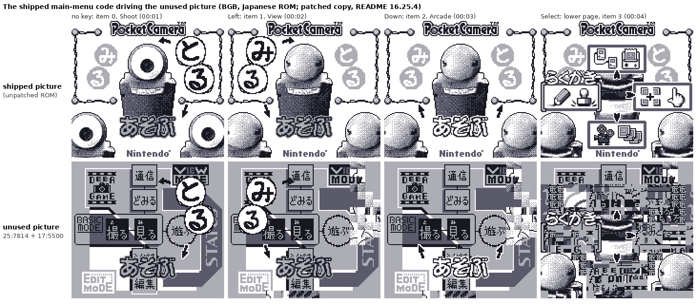

| key pressed in the main menu | mode:state read from BGB (patched = unpatched ROM) | what the shipped logic did | what the unused picture shows |
|---|---|---|---|
| none | `00:01` | item 0 (Shoot) selected | the circled `とる` sprite and its arrows are at the shipped place, over the box `通信` and the `遊ぶ` circle; the sprite `あそぶ` sits over `撮る` / `見る` |
| Left | `00:02` | item 1 (View) | the `みる` sprite moves to the left, over `BASIC MODE`; the camera-head animation writes tiles into the picture (garbage on the right edge) |
| Down | `00:03` | item 2 (Arcade) | the arrows move; same garbage |
| Right, Up | `00:01` | nothing (no neighbour on that side of item 0) | unchanged |
| Select | `00:04` | lower page, item 3 | the shipped lower page loads its own map and tiles over the picture (`27:5F30` to `$9860`, the code at `07:78A7`): the picture is overwritten |
| A | `01:01` | launches the SHOOT parlor (mode `$01`) | - |
| Start | `08:01` | launches mode `$08`, the owner registration / statistics screens (§2.3) | - |
| B | `19:03` | back to the title scenes (mode `$19`) | - |

*What this shows (C):*
* **The inputs are the shipped menu's, and they are unchanged** (all eight keys gave the same mode and state on the patched and the unpatched ROM). The picture has no part in them: the highlights are **sprites at fixed, shipped coordinates** that land on arbitrary boxes of the unused picture, and the picture changes only where the shipped code writes tiles into it.
* **The map shows one state only, but its tile block holds more**: each of the seven boxes appears once in the map, and the 70 tiles the map does not use (ids 234-303) are fragments of lines, arcs and strokes that come in **pairs, a grey and a black version of the same shape** (by eye). No code of either ROM writes them into the map (I); the picture is drawn with BGP `$E4`, the game's own, and no other palette was tried.
* The picture has the **same seven names as the shipped menu** (`通信`, `どみる`, `撮る`, `見る`, `遊ぶ`, `らくがき`, `編集`, in kanji where the shipped menu has hiragana) and a **STATUS** band; the Start key of the shipped menu goes to the statistics screen of mode `$08`, which is the nearest shipped counterpart of "STATUS" (I). The three plates BASIC MODE (`撮る`, `見る`), VIEW MODE and EDIT MODE (`らくがき`, `編集`) group the items by kind, which the shipped two-page menu does not do. Whether a cursor ever moved over these boxes in some build cannot be decided from this ROM (?): there is no loader and no input code for it, no cursor coordinates were found, and the same picture is in the international ROM, so it is unused in both builds.
* **What the experiment cannot show:** how a menu built for this picture would have behaved. For that one would need an earlier ROM, or a table of cursor coordinates that match the boxes; none was found (the coordinate search was not done beyond the shipped `MainMenu_SlideA_Tbl*` tables, which belong to the shipped layout).

#### 16.25.5 What is still open

* **Tile sets:** `26:7080` (none found, and no look-alike among the shipped maps, §16.25.2) and the icons of `26:4500` / `25:4B00` (the rank of the candidate blocks on the icon cells was inconclusive).
* **Who reads what:** the instructions behind the forced-run reads (class `r`) of `25:75E0`, `25:7820`, `26:7080`, `17:5500`, `24:6360` and `25:7160` were not traced; the copy-site list says no static call reaches them, so a generic copier with a computed source (the bulk copy `00:0333` or a table walk with a state poked past its end) is the likely reader.
* **The screen of `25:75E0`**: the hot-spot viewer layout with an `$E0` frame (I); what would have loaded it, and with which tiles, is not known.
* **The palette, the age and the purpose of the unused menu** (§16.25.1, §16.25.4: it is a picture without loader or input code).
* **Bank-by-bank sweep:** only banks `$23-$27` were reviewed this way; the same loader search and seam search can be run for any other bank with `tcrf_check/tools/copy_sites.py` and `tile_seam_search.py`.

**Files.** `assets/asset_map_jp.csv` (110 rows): the four head rows, the dead-code map `25:4B00`, the maps `26:4500` / `25:4A80` / `27:4772` and the tile set `27:4AB0` are described as above (all evidence I); `unused_manual.csv` now lists nine hand-tiered spans (the three of §16.24, `17:5500` and `25:7820` with tier "no loader", `25:75E0` and `26:7080` "never shown", and the two head rows with tier "head rows", which the map does not paint yellow); `display_report.py` reads that tier column and the live sym labels. Sym labels (C unless marked): `Gfx_17_5500_Unused_MainMenuTiles`, `Map_25_7820_Unused_MainMenu`, `Map_25_75E0_Unused_PhotoScreen` (I), `Map_26_7080_Unused_Picture` (I), the four `…_Mode16_OptionPageN_HeadRows` and `…_Mode16_OptionPageN` maps, `Map_25_4A80_BlankRows` (I), `Map_26_4500_Unused_IconFrame` (I), `Map_27_4772_BlankRows` (I). The yellow layer is 21,422 B in 34 spans (the two head rows are not in it) and the open-assets sheet has 154 rows.

### 16.26 The purple code forced by a program-counter jump and by a flipped branch, then replayed in BGB: tile sets, maps and sounds (C for the runs, I for what each piece was for)

*Why.* The owner (2026-10-14): "Can you try focused computer jump to force these codes? Use you tool to go fast and BGB then to confirm and record tileset and sounds?". §16.21 stopped at what a WRAM / SRAM poke and a key can reach and tagged the rest dead (UNREFERENCED: no reference to the entry anywhere in the ROM, 48 components, 825 B; UNREACHABLE: a branch no value selects, 73 rows, 372 B). A dead piece can still be **run on purpose**: set the program counter on its first byte (UNREFERENCED) or make one conditional branch go the other way (UNREACHABLE), and see what it writes. **Result in one line: all 121 components (48 dead functions, 73 unreachable rows, 1,197 B) were entered by force: 730 of the 825 B of the dead functions in the generic sweep (the rest needs an argument, column `bytes_run` of the CSV) and all 372 B of the unreachable rows; in BGB 8 of the dead functions and 23 of 24 flipped gates were confirmed; nothing new turned up on screen: the dead loaders write tile sets and maps that are already known (a hex font, ten 8 x 16 digits, two tiles, and the two twin map loaders), the dead sound code is nine sound presets that the D.J. editor asks for and nobody plays (now recorded), and the "unreachable" effect-table slots are 10-row and 4-row versions of the live copy handlers.**

*Method, core (fast, `tcrf_check/tools/gbcov_display.c` + `.py`: a forcing interface was added; `dead_jump.py`, `dead_flip.py`, `dead_effects.py`, `dead_targeted.py`).* The base states are the cheapest corpus path to each of the 30 game modes that have a safe idle point (all but modes `$08`, `$14`, `$17`, `$1F`, where the main thread is not parked in `Rst10_WaitFlagSet`); a state is the moment the main thread executes `halt` at `00:0013`. **Jump:** the program counter is set on the first byte of the component with the idle point as the return address (bank register `$FF9B` and the real bank switched), one of 10 register presets (registers as they are at the idle point, all zero, or one joypad bit set in every joypad byte `$FFA1-$FFA3`, `$FFA7-$FFA9`), 300 runs per component, 96 frames each, the writes logged until the return and the end state compared byte by byte with an unforced control run of the same base (WRAM, VRAM with the ROM offset each byte came from, OAM, SRAM, sound mailboxes `$DD60` / `$DD68` / `$DD70` / `$DD78`, mode and state). **Flip:** the branch (`jr cc`, `jp cc`, `call cc`, `ret cc` whose target, or fall-through, is the component) is found in the listing and the core decides the other way at that ROM offset (`gb_force_flip`); 13 key sequences (idle, each key, A + direction) from every base = 390 trials per component, so the game's own code walks into the piece with the state it has. **Direct calls:** the sound routines need their arguments (`$D92E`, the channel pointer `DE`), so they are called with them; the effect table is called through its dispatcher with every handler number.

*Method, BGB (`bgb_dead_hook.py`, `dead_cases.py`, `dead_sheets.py`).* A copy of the ROM carries a small hook assembled into free bytes of bank 0 at `$3600`, called instead of `call Joy_ClearSticky` in `Main_Loop` (`00:2F33`, `CD 82 0A` becomes `CD 00 36`). The hook waits a given number of frames in the base mode and state with no key held, then pokes the joypad bytes and WRAM bytes of the case, loads the registers of the core's idle point, calls the component through a bank switch, and writes the mailboxes. The demo (the corpus path of the base, then the call, then the tail) is replayed in BGB with logging breakpoints on the entry of the piece (`ENTRY`, `%TOTALCLKS%`), write watchpoints on `NR10-NR14` and the sound mailboxes, a screenshot, and VRAM / OAM / WRAM dumps; the control run is the same ROM and demo with no call. A flipped gate is the opcode of the branch patched in the ROM (`20 <-> 28`, `30 <-> 38`, `C2 <-> CA`, `D2 <-> DA`, `C4 <-> CC`, `D4 <-> DC`, `C0 <-> C8`, `D0 <-> D8`) and a replayed key sequence, no hook. Sounds: BGB writes a 44.1 kHz WAV; the music is stopped first (`$DD68 = $FF`), the sound is requested 60 frames later and the clip is the last burst of the WAV (BGB's WAV time is not a constant offset from emulated time: it varied by about a second between runs, so the clips are found by content). **Limits.** BGB refuses VRAM writes in PPU mode 3 (a plain copy into VRAM with the LCD on lands about 160 of 256 bytes; the rest of a tile set is rendered from the ROM span and marked); 13 of the 30 modes were not reached in the replays (the replay or its timing differs from the core's, or the mode does not go through `Main_Loop`); the core has no APU (sounds are BGB only).

**What the 48 dead functions do (`assets/force_unref_jp.csv`: component, label, what it is, runs, returns, bytes run, effects in the core, BGB, evidence).** 38 ran completely in the sweep, 10 partly (the rest sits behind an argument: `00:10AC` needs `$D92E`, `04:7C9D` has key-dependent paths); 39 returned in every run, 7 in some, 2 never (`00:07BE`, the body of the dead deferred-copy routine, and the far-call stub `0A:7CEC`). The nine that did not always return (`00:069F`, `06F8`, `0758`, `0781`, `07AD`, `07BE`, `0A:7CE6`, `0A:7CEC`, `1F:5743`) were entered with registers they never get or as tails without their prologue (a tail pops a frame that was never pushed), so their runs go on at whatever the stack holds: their effects in the CSV are not designed paths and are not listed. The pieces that matter:

| component | what the forced run shows | BGB |
|---|---|---|
| `04:6412`, `04:6403` (twin map loaders) | copy a whole `$02C0`-byte map to `$9800`: `25:4B00`, `24:7120` | VRAM `$9800` = ROM `25:4B00` **704 / 704** bytes (the control run 548); `24:7120`: 704 / 704, **the control run already shows exactly that map** (mode `$10` draws it), so the loader would change nothing on screen |
| `07:4BC3` | the 16-glyph hex font `24:57E0` (256 B) to `$8EF0`, then a hex number to the map (a link-checksum display) | 161 of 256 bytes land (mode 3 lock), the number is on the screenshot; the full font is rendered from the ROM span |
| `07:4A4D` | a two-digit counter: 8 x 16 glyphs, `17:4800 + 32 x digit`, to `$8700` / `$8720` | 32 / 32 bytes of the first glyph pair |
| `07:503D` | alternate entry of a live loader: tiles `13:5800` and `13:5830` (the glyphs "A" and "1") to `$8EC0` / `$8ED0` | 16 / 16 + 16 / 16 |
| `04:7C9D` | the old photo stepper of the photo grid (mode `$0A`) with wrap-around: Right and Left each request sfx1 id 1 | the same request in BGB |
| `00:10AC` | the dead UI sound player: `$D92E` = 1-8 loads one of eight presets into channel 1 (table `00:10D0`); the D.J. editor writes `$D92E` (81 writes, §2), this reader is never called | all eight, register values equal the core's, clips below |
| `1F:46DD` | an unused sfx1 starter that nothing selects: through `Snd_Sfx_Start` it loads `NR10-NR14` = `00 00 D1 C1 87` | reached through the real sound engine by pointing the sfx1 init-table entry of id 1 at it: the same register values, clip below |
| `05:622D`, `05:7F1C`, `05:7F33`, `09:721D` | a third / fourth VRAM placement (`$9100`, `$9480`; `$9700` + `$8800`) of the 56-tile (`$0380`-byte) D.J. performer, Ball and RUN! character sets that the live loaders put at `$8D80` / `$9480`: the same graphics, a destination that no code uses | core only (the source is chosen by a game variable, so the span differs per mode) |
| the rest | `reti`, `ret`, `inc b`, IE bit 0 clear / set, delay loops, VRAM-safe AND / read helpers, serial-stop and printer helpers (`00:190B`, `190F`, `19A2`, `1AEB`), OAM meta-tile prologues (`00:24F1`, `2523`, `253C`), the RUN! 16-bit subtract (`09:6D00`), SHOOT timer stepping (`06:71CC`), a state setter (`07:41C8`), the checksum sum (`07:4BEA`), the sound-engine pieces `1F:4A61`, `4FBC`, `524B`, `53B9`, `53E7`, `5743`, `7FF3` | core only |

**Tile sets and maps (`tcrf_check/assets/forced/`).** `tiles_24_57E0_font.png`: the hex font `0-F` (16 tiles), the ROM span, what BGB held after the call and the control; `tiles_17_4800_digits.png`: ten 8 x 16 digit glyphs (tile 2d over tile 2d + 1) and what BGB held; `tiles_13_5800.png`: the two tiles; `maps_dead_loaders_mode16.png`: the two dead map loaders in BGB, control | forced. **The map `25:4B00` has no tile set among the shipped ones:** its loader was run in BGB over the tile set of 17 modes (`map25_4B00_survey.png`: modes `$03-$07`, `$09`, `$0A`, `$0E`, `$0F`, `$10`, `$11`, `$16`, `$18`, `$1A`, `$1C`, `$1E`, `$21`); in none do the icon cells `A0-DF` draw a picture (the sheet shows whatever tiles each mode keeps at those indices; the 16 x 14 photo ramp at `$00-$8F` is the photo area of the screen). That agrees with §16.25.5 (tile set `?`, I). The 13 modes not shown (`$00-$02`, `$0B-$0D`, `$12`, `$13`, `$15`, `$19`, `$1B`, `$1D`, `$20`) were not reached by the replay.

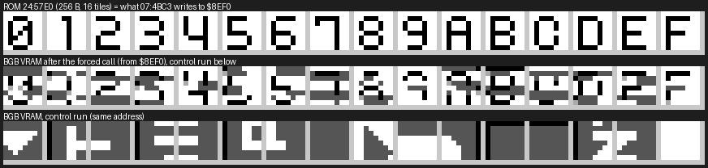

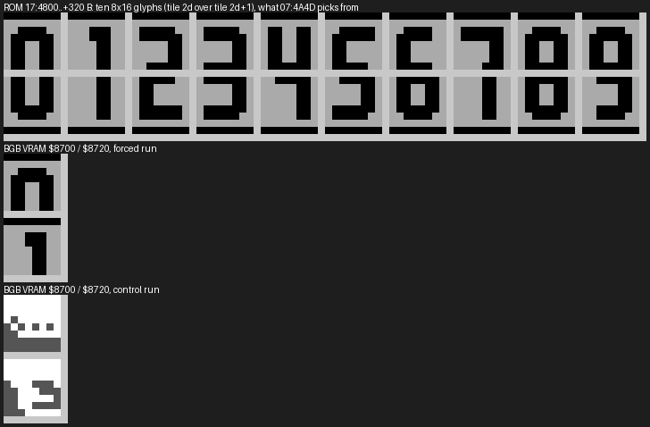

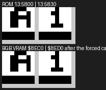

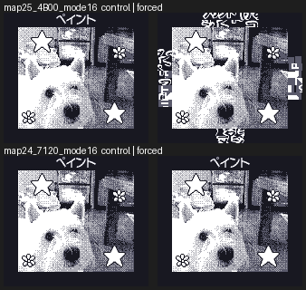

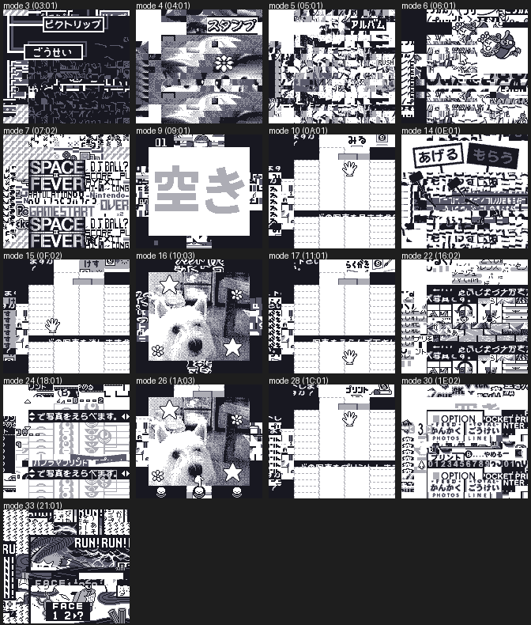

**Sounds (`tcrf_check/assets/forced/*.mp3`, mono, 8-130 ms bursts padded by 60 ms before and 250 ms after).** The eight presets of `00:10AC` (`sfx_ui_effect_1..8.mp3`; the core and BGB agree register by register) and the unused sfx1 starter next to the real sfx1 id 1 (`sfx1_unused_46DD.mp3`, `sfx1_id1_real.mp3`):

| preset (editor writes) | `NR10` sweep | `NR11` duty, length | `NR12` envelope | `NR13` `NR14` | start tone | BGB peak, length |
|---|---|---|---|---|---:|---|
| 1 (55 sites) | `17` up, shift 7 | `78` 25 %, 8/256 s | `F1` vol 15, decay 1 | `00 C7` | 512 Hz | 565 Hz, 39 ms |
| 2 (1 site) | `17` | `7D` 25 %, 3/256 s | `F1` | `40 C7` | 683 Hz | 660 Hz, 20 ms |
| 3 (1 site) | `1F` down | `7D` | `F1` | `40 C7` | 683 Hz | 660 Hz, 20 ms |
| 4 (7 sites) | `77` up, time 7 | `60` 25 %, 32/256 s | `F3` | `80 C7` | 1,024 Hz | 1,156 Hz, 132 ms |
| 5 (6 sites) | `7F` down, time 7 | `60` | `8B` vol 8, decay 3 | `80 C7` | 1,024 Hz | 919 Hz, 132 ms |
| 6 (2 sites) | `17` | `7E` 25 %, 2/256 s | `F0` constant | `C0 C7` | 2,048 Hz | 2,017 Hz, 14 ms |
| 7 (2 sites) | `1F` | `7E` | `F0` | `C0 C7` | 2,048 Hz | 2,017 Hz, 14 ms |
| 8 (6 sites) | `17` | `7E` | `F1` | `00 C7` | 512 Hz | 545 Hz, 15 ms |
| `1F:46DD` | `00` | `00` 12.5 %, no length | `D1` vol 13, decay 1 | `C1 87` | 2,080 Hz | 2,081 Hz, 0.20 s (13 / 64 s of decay) |
| real sfx1 id 1 | | | | | | 852 Hz, 0.03 s |

Clips: [1](tcrf_check/assets/forced/sfx_ui_effect_1.mp3), [2](tcrf_check/assets/forced/sfx_ui_effect_2.mp3), [3](tcrf_check/assets/forced/sfx_ui_effect_3.mp3), [4](tcrf_check/assets/forced/sfx_ui_effect_4.mp3), [5](tcrf_check/assets/forced/sfx_ui_effect_5.mp3), [6](tcrf_check/assets/forced/sfx_ui_effect_6.mp3), [7](tcrf_check/assets/forced/sfx_ui_effect_7.mp3), [8](tcrf_check/assets/forced/sfx_ui_effect_8.mp3), [unused `1F:46DD`](tcrf_check/assets/forced/sfx1_unused_46DD.mp3), [real sfx1 id 1](tcrf_check/assets/forced/sfx1_id1_real.mp3).

(Tone = 131072 / (2048 - x), x = `NR13` + 256 x (`NR14` & 7); the measured peak is the FFT maximum of the clip, shifted by the sweep and the 25 % duty harmonics.) Presets 2/3, 6/7 differ only in the sweep direction and sound alike at this length. The eight presets are the sounds that the D.J. editor (bank 5) asks for through `$D92E`: 1 at 55 places (the cursor, §2), 4 and 5 (select), 8 (value change), 6 and 7 on the decrement / increment branches of the field editors (A held with Up / Left stores 6, at `05:4938` / `4973`; with Down / Right stores 7, at `05:4949` / `4984`), 2 and 3 once each (`05:490E`, `05:48FD`); the only reader, `00:10AC`, is never called, so the editor requests them and the game never plays them (the editor's audible sounds go through the other mailboxes). Nothing points sfx1 at `1F:46DD`. **Nobody listened**: the clips are what BGB's APU produced; what the nine sounds were meant to be is not known beyond the editor's requests (I).

**The effect-table slots (22 TABLE components, `0A:541A` and `06:73AF`).** The index of the camera effect (`4 x $D7E3 + $D7E4`, `| $20` / `| $40` by `$D7EB`) is read from the 88-byte table `06:60DB`, whose values are 0-12, 14, 16-18, 20, 22-24, so handler numbers `$0D`, `$0F`, `$13`, `$15` and `$19-$1F` (and the `$20` / `$40` copies) are never produced (§16.21 reached `$0D`, `$0F`, `$3C`, `$3D` with an out-of-range cursor). `Cam_DispatchEffect` (`0A:5406`) was called with every number `$00-$5F` over the same pattern in SRAM `$A000-$BFFF` and the WRAM it wrote compared (`dead_effects.py`): **`$13`, `$33`, `$53` copy / mirror the first 10 tile rows (2,560 B) and `$15`, `$35` the first 4 rows (1,024 B), byte for byte the first rows of the live `$00` (`Fx00_Copy`, 14 rows), `$20` and `$40`**; the 15 one-byte slots (`$19`, `$1B-$1F`, `$39`, `$3B`, `$3F`, `$59`, `$5B-$5F`) are a lone `ret`. The second consumer, the 8-byte slots 19 and 21 of `06:73AF` (`06:7457`, `7467`), is the XOR pass over 10 and 4 rows from `$C000` (key `$DA44-45` nonzero), the same bytes as slot 0 over 14 rows. **BGB** (`effect_*`, WRAM marked with `$5A` at rows 0, 3, 4, 9, 10 and 13 before the call): `$13` / `$33` / `$53` leave the markers of rows 10 and 13, `$15` / `$35` those of rows 4, 9, 10, 13, `$19` changes nothing; the bytes written equal those of `$00` / `$20` / `$40` (2,560 / 2,560 and 1,024 / 1,024); the XOR slots 13 / 15 change 2,560 and 1,024 bytes against 3,584 for slot 0, equal on the common rows. So these entries are shorter copies (an image of 80 or 32 pixel rows instead of 112): the table never selects them.

**The 73 unreachable rows (`assets/force_flip_jp.csv`).** 24 gates were reached by flipping (each executed in 1 to 13 of the 390 trials; **23 of the 24 were confirmed in BGB, `00:1B36` was not reached there**), 27 had a gate that none of the 390 trials executed, and were jumped into directly (idle and zero registers in each of the 30 modes: 60 runs, all bytes ran), 22 are the effect-table slots above. Three flips keep a menu on screen instead of leaving it: `07:5291` (mode `$02`, みる / どみーる, whose A should go to the photo grid `$0A`), `07:5473` (mode `$03` instead of `$1A`) and `08:4095` (mode `$1B` instead of `$1C`) are the table-end branches of the cursor handlers (§16.21: they need a `$FF` code in the cursor's table); taken, the menu restarts its own state 1 (BGB, control above, forced below), no new screen. The others change a few bytes: the 1-byte carry increments (`inc d`) of the pointer loops of §16.21 shift one copy by 256 bytes (`0A:4036`: 1,466 WRAM bytes differ), the 2-byte tails of the VRAM copies (`00:05E0`, count 2 mod 4) copy two bytes, the wave-channel flush `1F:5234` writes one WRAM byte. `00:1137`, the D.J. envelope clamp, ran in the jump sweep (30 distinct outcomes); the flip never reached its gate.

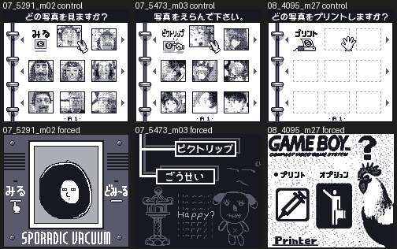

**What this does not change.** The map keeps its purple layer: every run here needed a patched program counter or a patched branch, which no input can do, so the bytes stay *never executed by the game* and the verdicts stay I (§16.21); the runs are recorded in the two CSVs, not as map witnesses. A jump into the middle of a routine is a view of what the bytes do, not of what the game would have done: the tails (`00:06F8`, `0758`, `0781`, ...) pop a caller's frame and go astray.

**What changed in the repository.** `assets/force_unref_jp.csv` (48 rows), `assets/force_flip_jp.csv` (73 rows), `tcrf_check/assets/forced/` (3 tile sheets, the map survey and loader pictures, the flip contact sheet, 10 MP3 clips, `bgb_cases_jp.csv` with the 84 BGB cases); tools `dead_jump.py` (`CACHE_DIR OUT.json`), `dead_flip.py`, `dead_effects.py`, `dead_targeted.py`, `dead_cases.py`, `bgb_dead_hook.py`, `dead_sheets.py`, `dead_report.py`; the core got `gb_jump`, `gb_set_stop`, `gb_stop_hit`, `gb_force_flip` / `_clear` / `_hits`, register get / set, the write log and `gb_step`. `TCRF_CHECKLIST` is unchanged: none of its rows is about dead code (the wiki does not list it).

**Reproduce** (`GBCOV_LIB` = the compiled core with the forcing interface, `GBCAM_ROOT` = the directory with `unlock_runs/f1_organic/corpus.jsonl`): `dead_jump.py CACHE OUT.json` (first run builds the base states in `CACHE`), `dead_flip.py CACHE flip.json`, `dead_effects.py CACHE effects.json`, `dead_targeted.py CACHE targeted.json`; `dead_cases.py CACHE cases.json [--survey | --flips flip.json | --effects]`, `bgb_dead_hook.py cases.json OUTDIR [--wav] [--only A,B] [--worker K/N]` (BGB under wine, `BGB_DIR`), `dead_sheets.py` and `dead_report.py DEAD_DIR BGB_DIR assets tcrf_check/assets/forced`.

### 16.27 The jofamo.com article "Secrets of the Pocket Camera" against the repository: the names and comments of Album B read from the ROM, BGM 04, the P.VOICE (C for the runs, the bytes and the code; I for every reading of kana; what the article takes from the guide book, the manual, nintendo.co.jp and Tanaka's tweets cannot be checked here)

On 2026-10-14 the owner attached a PDF copy (Wayback Machine of 2025-09-27, 48 pages) of Jonathan Traynor's blog post ("Something new?"). Every claim was compared with this README, and whatever the ROM can settle was run in the real BGB (`bgb_albumb_comments.py`, `bgb_jofamo_checks.py`). In short: **one real gap is closed** (the names and comments of the stock pictures, which needed a character table the repository did not have), **one cross-reference and one theory are confirmed** (BGM 04 belongs to the international RUN! RUN! RUN! title; the P.VOICE is the photo checksum), **the article disagrees with the code in four places** (B24, the Pokémon stamp rate, "more than" for thresholds that unlock at the exact value, the "repeat" on TEMPO) and in a few translations of the kana; the rest was already here.

**1. New in the repository**

| # | finding | evidence |
|---|---|---|
| 1 | **Character table of the Japanese name and comment fields**, codes `$01-$F5` (`disasm/charset_jp.csv`, 245 rows). The glyph of code c is the 8 × 16 pair of 2bpp tiles at bank `$2A:4000 + (c-1) × 32` (`Glyph_LoadFromCharCode`, `09:4802`); `$00` is a blank cell, `$87` a blank glyph. `$01-$32` hiragana `、。` `〜` `♥`; `$33-$4F` voiced and small hiragana; `$50-$55` `・` and small `ぁぃぅぇぉ`; `$56-$87` katakana, `!`, `?`, `ヴ`; `$88-$AA` voiced / small katakana and `ー`; `$AB-$C8` `A-Z _ ' , .`; `$C9-$E2` `a-z`; `$E3-$E5` three small icons (a phone and two faces, by eye); `$E6` `-`; `$E7-$F5` `0-9 / : ~ " @` | rule **C**: the 21 BGB comment screens equal the bank-`$2A` glyphs pixel for pixel (21 × 3,456 pixels, 0 differ, shades 255/174/92/25) and the sentences read as sentences. The reading of each glyph is **I** (by eye, `assets/albumB_comments/charset_jp_atlas.png`); the `evidence` column says C for the 122 codes that occur in a comment and I for the other 122 (only in names, or in no stock text) |
| 2 | **The 21 names and comments of B01-B21** (table below, `assets/albumB_comments/albumB_comments_jp.csv`). Each stock slot (`0DA000 + i × $1000`) has a 9-cell name at `F04-F0C` and a 27-cell comment at `F15-F2F`, 3 lines of 9 (§3). B22-B30 (Pokémon, CoroCoro) have neither: B17-B21 have a comment and B22-B24 do not, as the article says | the bytes: **C**. COPY (EDIT > ALBUM, B01-B21 into the A album) copies the photo, the name and the comment (21 of 21 A-album slots equal the ROM slot in all three), and the Comment screen of VIEW > ALBUM (`0A:0E`) draws the comment at (72 + 8 × column, 48 + 16 × line): `comment_screens_bgb/`, `albumB_comment_screens_bgb_montage.png`. The name is drawn on the same card, bottom right, in a wider bold font that I did not match pixel by pixel: the name codes are **I** (they decode to the names the article gives too). The English glosses are my own reading: **I** |
| 3 | **A stock picture cannot be commented before it is copied.** VIEW > ALBUM on B01 and on B09: `A A` shows the picture in the "アルバムB" frame (`0A:03`, `$D5D8` = 30 / 38); the keys that open the Comment screen on an A-album picture (`R D A`) do nothing | **C**, BGB (`jofamo_albumb_view.csv`, `albumB_view_only_bgb.png`) |
| 4 | **BGM 04 is song `$13`** (the 4th entry of the animation list `03:61FD`; the hot-spot picker's music list `03:7655` has it at the same place) **and only the international ROM plays it outside the pickers: its RUN! RUN! RUN! title requests `$13`, the Japanese title `$3C`.** The two lists agree in 27 of 32 entries (they differ at entries 1, 7, 16, 31 and 32: `22/10`, `41/16`, `43/1F`, `10/3F`, `25/2B`). The song data of `$13` is the same music in both ROMs, `$0B` bytes further on in the international one (only 83 of its first 768 bytes differ, at what look like pointer positions: I) | **C**: the music mailbox `$DD68` logged in BGB on both ROMs at the RUN title (`jofamo_bgm_run_title.csv`: `$FF $01 $05 $31`, then `$13` / `$3C` at 27.6 s); the tables and the song bytes **C**. Whether the pickers print the entries as 1-32 is **?** (the article calls the 4th entry "BGM 04"; I did not read the numbers off the screen) |
| 5 | **The P.VOICE is the checksum of the photo**, so the article's theory is right. Slide show > Select > Up > Right > A picks it (`$D7D2` = 1, music off); each slide then splits `F34` and `F35` (sum and xor of the 3,584 photo bytes, §3) into four nibbles in `$DD03-$DD06` and requests sfx1 `$10` (`Snd_PlayTagDigits`, `00:16F4`). The same happens when a freshly shot photo is saved. All 30 stock slots of both ROMs carry `F34/F35` equal to the sum / xor of their own photo bytes, so every stock picture has its own voice; **B01 (all `$00`) and B02 (all `$FF`) both give `0000`**, the same voice | **C**: BGB logged the nibbles and the sfx1 request; 21 of 21 slides equal `F34/F35` (`jofamo_pvoice_digits.csv`); the photo shot and saved gave `2 F 0 9` = stored `2F 09` = recomputed `2F 09` (`jofamo_shoot_save_digits.csv`). Nobody listened; that the four nibbles are four notes of the sfx1 `$10` handler (`1F:4745-474D`) is **I** |
| 6 | **International ROM: the 30 stock slots have no name and no comment** (`F04-F0C` and `F15-F2F` are zero in all 30, same slot layout at `0DA000`): the article's "all the developer comments have been removed" is right | **C** (ROM bytes) |
| 7 | **The D.J. hint of B14 ("further right than SE, further left than TEMPO") is in the code** (`05:5411-5466`, cursor `$D8B3`): on SE (cursor 4) Right + Up / Down raises / lowers the pitch shift `$D8C5` by 1 per input step, limited to −12…+11, and it decays to 0 when Right is released (`05:53FA-5408`); on TEMPO (cursor 0) Left held sets the step increment `$D8C4` to `$FF`, so the tracks play backwards while it is held; a *new* Right press on SE without Up / Down zeroes the three step counters `$D8CC`, `$D8F6`, `$D8FD` (`05:5434-5444`) | **C** from the code (read, **not run in BGB**); that zero means "restart the tune" is **I** |

**The 21 texts** (the ROM's own kana, line breaks of the screen as `/`; gloss and name translation are mine, **I**; `albumB_comments_jp.csv` has the codes):

| pic | name | comment | my reading |
|---|---|---|---|
| B01 | フリップくん | スタンプをおすとき / にAボタンをおしっ / ぱなしにしてみよう | When you put a stamp, try keeping the A button held down. (name: Flip-kun) |
| B02 | ミスターブラック | BALLをがんばっ / たひとはポケモンス / タンプが・・・ | Those who do their best at BALL get a Pokemon stamp... (name: Mister Black) |
| B03 | よこがき のりこ | S.FEVER2で / 2000てんをだせ / ば・・・・・・ | If you get 2000 points in S.FEVER2... (name: Yokogaki Noriko ("horizontal writing")) |
| B04 | たてがき しょうじ | メモにつかってね | Use it for memos. (name: Tategaki Shoji ("vertical writing")) |
| B05 | ガッコウスキー | あしたのよういは / きょうのうちに | Get tomorrow's preparations done today. (name: Gakkosuki (gakko = school)) |
| B06 | コメント プリボー | プリントするとき / スタートボタンを / おしておけば | When printing, if you press the Start button (beforehand)... (name: Comment Puribo) |
| B07 | プリンタ5800 | プリントシールは / はがきにはっても / いいよね | Print stickers can be stuck on postcards too, cant they. (name: Printer 5800) |
| B08 | スタッフいちどう | RUNRUNRUN / 22びょういないを / めざせ!! | RUNRUNRUN: aim for within 22 seconds!! (name: Staff, everyone) |
| B09 | DJ PAPA1 | EDITモードの / SOUND1のがめ / んで・・・・つづく | On the SOUND1 screen of EDIT mode... to be continued (name: DJ PAPA1) |
| B10 | DJ PAPA2 | STARTボタンを / おしながらAボタン / をおすと・・つづく | If you press the A button while holding the Start button... to be continued (name: DJ PAPA2) |
| B11 | DJ PAPA3 | がくふデータをプリ / ントできる。ねぇき / こえた? | You can print the score data. Hey, did you hear that? (name: DJ PAPA3) |
| B12 | スライド ジョー | じょうげキーで / スピードチェンジだ | Change the speed with the up/down keys. (name: Slide Joe) |
| B13 | のむら ふじこ | ぼくポケタ!なかよ / くしてね♥いっぱい / しゃしんをとってね | I'm Poketa! Let's be friends (heart). Take lots of pictures. (name: Nomura Fujiko) |
| B14 | DJテクニシャン | SEよりさらにみぎ / TEMPOよりさら / にひだりだワン | Further right than SE, further left than TEMPO, woof. (name: DJ Technician) |
| B15 | ゲームモデル | えっ・・らくがき? / あそぶのしたにひみ / つが・・・ | Huh... a doodle? Under 'play' there is a secret... (name: Game Model) |
| B16 | けんたろう | ちいさくなるあなた / のすがたみえなく / なるまでてをふるの | I keep waving until your shrinking figure can no longer be seen. (name: Kentaro) |
| B17 | たたいちゃ だめよ | うでやあしをけして / アニメをつくって / みよう! | Erase the arms and legs (frame by frame) and try to make an animation! (name: Don't hit (me)) |
| B18 | がんそマリオ | こいびととあそぶと / きなかよくきょうり / ょくしあうのもいい | Playing with your sweetheart, working together well is nice too. (name: Original Mario) |
| B19 | ほそかわ たけひこ | ワリオシリーズも / よろしく。 / タマノリパパ | Please look after the Wario series as well. (signed) Tamanori Papa (name: Hosokawa Takehiko) |
| B20 | エレクトロライオン | エレクトロニクスが / うんだユニークあふ / れるターゲット | Unique, overflowing targets born from electronics. (name: Electro Lion) |
| B21 | SPガン980えん | あんぜんでかがくて / きなフィーリングが / たのしめます | You can enjoy a safe, scientific feeling. (name: SP Gun 980 yen) |

**2. Already in the repository, and the article agrees**

| article | where it was | tag |
|---|---|---|
| B01: hold A while placing a stamp and the stamp is flipped | the "secrets" table above (§16.18, `$D641`; BGB on both ROMs, §16.6): B01's own text is that hint | C |
| B03, B08: 2,000 points in Space Fever II open RUN! RUN! RUN!; finishing it in 22 seconds opens the real credits (before that, a looping dancer) | §16.18 "Unlockables" rows and §16.22: the credits test is `>= $7799` = displayed **22:00 or lower**, so exactly 22:00 qualifies | C |
| B06: Start before confirming a print adds the comment card | §17.4 (the Start option = the 「Camera コメント」 card) | C |
| B09-B11: D.J. EDIT, SOUND I page, Start held + A prints the music sheet | §16.18 "secrets" table, §17.6 (five pages printed in BGB) | C |
| B12, title and VIEW menu: Up / Down change the animation speed; also in the slide show | §16.18 rows 1-2, re-run here on both ROMs (`jofamo_speed.csv`: title `$D510` = `$FF` while Up is held; VIEW `$D679` = 3 / 7 / `$0F` for Up / none / Down); the slide-show interval is `SlidePlay_ReadKeys` (`07:717F`) | C |
| Slide show: Select offers BGM or P.VOICE | §16.18 table (Select → `0D:02`, Up → `0D:03`); `$D7D2` in §2 had the mechanism (0 = song `$21`, 1 = music off and the picture code spoken); item 5 adds that the digits are the checksum. | C |
| 16 stock pictures from the start, 8 more behind counters: 60 photos, 30 prints, 15 sent, BALL 700 and 1000, Space Fever II 3000 and 5000 | §3.2, §16.5, §16.18, `albumb_thresholds_JP.csv` (BGB at the exact value and one below) | C |
| B17 Judge, B19 Tamanoripu, B22-B24 Pokémon | the Album B picture table (§15.6, `assets/albumB/`) | C / I |
| SPORADIC VACUUM on the VIEW menu, absent from the international ROM | §16.11 (TCRF C03) | C |

**3. Where the article and the ROM or the code differ**

| article | ROM / code | tag |
|---|---|---|
| B24: more than 3,000 in Space Fever II (the same line as B22) | B24 is the **RUN! RUN! RUN!** picture: stored record `>= $8200`, displayed 17:99 or better (`albumb_thresholds_JP.csv`: `$81FF` no, `$8200` yes); B22 / B23 are the two Space Fever II ones (3,000 / 5,000). The article's B24 line looks like a copy of B22's | C |
| thresholds written "more than 60 / 30 / 700 / 1000 / 3000 / 5000" | each unlocks at the exact value (`>=`) and not at one below (BGB) | C |
| B02: "every 100 points a new Pokémon stamp", 20 to collect | ten are free; each 100 Ball points opens a page of **two**, up to 500 = all 20 (`04:5827`, `$D642` = 4 5 6 7 8 9 9 for `$DAA5` = 0…6, §16.6 row 4) | C |
| B14, TEMPO: "press LEFT again and the track repeats" | the code has no repeat on a Left press: Left held on TEMPO plays backwards at once; the restart is on the other end, a new Right press on SE (item 7) | C (code read, not run) |
| B17: "stretch arms and legs" | the kana read `うでやあしをけして` = erase the arms and legs (frame by frame); "stretch" would be のばして | I |
| B05: "tomorrow's mood today" | `あしたのよういは きょうのうちに` = tomorrow's preparation, today (用意, not mood) | I |
| B06 "Private Comment", B12 "SLIDE SHOW" (the signature lines) | the name fields read `コメント プリボー` and `スライド ジョー` (Slide Joe) | I |
| B15: "a secret beneath the playground" | `あそぶのした` = below "play" (あそぶ = to play); which menu entry that is, the ROM does not say | I |
| B18: "Isn't it, Mario?" | the signature is `がんそマリオ` ("Original Mario"); the sentence is about cooperating when playing with your sweetheart (こいびと) | I |

**4. Not checkable here (?)** The box and its stand, Tanaka's tweets and his answers about BGM 04 (that it is a MOTHER 1 relative) and the music of "Livin' in your town" (a comparison by ear: nobody listened), the lyrics and the guide book, the identity of the dancer and the dish in the ending (the guide book), who the signatures are (Noriko, Shoji, Fujiko, Kentarō, Hosokawa Takehiko), "Sporadic Vacuum" being Tanaka's label, which Pokémon sprites come from which version (B22, B23), the remark that the D.J. keeps one song, and whether the Wario / Game & Watch comments say anything beyond what the kana say.

**What changed in the repository.** `disasm/charset_jp.csv`; `tcrf_check/assets/albumB_comments/` (`albumB_comments_jp.csv`, `bgb_albumb_comments.csv`, `albumB_comment_screens_bgb_montage.png`, `charset_jp_atlas.png`); `tcrf_check/assets/jofamo_article/` (the five CSVs of the BGB checks and `albumB_view_only_bgb.png`); tools `charset_jp.py`, `albumb_comments.py`, `bgb_albumb_comments.py`, `bgb_jofamo_checks.py`; `sym_names_jp.csv`: `Snd_PlayTagDigits` I → C and the notes of `Mode0D_State03_OptionA`, `Mode13_State01_MusicSelect`, `Song13_Hdr`, `SlidePlay_ShowNext`; TCRF checklist A08 (the same sentence in `.md`, `.csv` and `tcrf_checklist.py`; the tag stays C and no TCRF flag moves). **Reproduce:** `charset_jp.py ROM --csv disasm/charset_jp.csv --atlas OUT.png`; `albumb_comments.py ROM OUT.csv [--check SCREENSDIR]`; `bgb_albumb_comments.py OUTDIR` (two copy runs and 21 Comment screens in BGB, about six minutes, ends with the pixel check); `bgb_jofamo_checks.py OUTDIR OUTDIR/copy/stage2.sram [bgm pvoice shoot speed bview]`.

### 16.28 The 96 effect slots of bank `$0A` and the 14 hot-spot helpers of bank `$03`, named by what they do (C for the BGB runs and the code, I for the menu words)

The jump table `0A:541A` (`Cam_EffectJumpTbl`, 96 slots, called through `Cam_DispatchEffect` `0A:5406` with the slot in A) holds the image effects of the SHOOT modes: each routine reads the 128 x 112 photo (16 x 14 tiles, 2 bpp, 3,584 bytes) at SRAM bank 0 `$A100` and writes the work buffer `$C000`. Its labels used to give the first source and destination pointers of each routine (`Fx26_Copy_A140toC0F0`, tag I). All 96 slots were run in BGB on test photos, the picture each one writes was measured, and the routines are now named after the effect (`Fx26_StretchH2x_OnFlipH`); `tcrf_check/assets/effect_slots/effect_slots_bgb.csv` has one row per slot and `effect_slots_sheet.png` the contact sheet.

**Method (C).** BGB cannot set the program counter, so the ROM is patched (the patch is the experiment, not a feature of the game): the `call Joy_ClearSticky` of the main loop (`00:2F33`) calls a stub in the bank-0 padding (`00:3600`). After a delay the stub copies a test photo P into SRAM bank 0 `$A100` (the game clears that bank at boot, so P travels in the save, bank 1 `$B000`), puts an old work buffer Q into WRAM `$C000-$CDFF`, fills `$CE00-$CFFF` with `$5A`, selects ROM bank `$0A`, calls `Cam_DispatchEffect` and stops; the state BGB dumps on exit (`-stateonexit`: WRAM, HRAM, SRAM) is the state right after the routine. Ten runs per slot: P = random 2-bit pixels (every output pixel has exactly one possible source), a readable picture (the sheet), and eight pictures in which each pixel carries two bits of its own x or y coordinate (four per axis), which decode **the source coordinates of every output pixel**. In every 8 x 8 tile these fit exactly `sx = floor(a x + b)`, `sy = floor(d y + e)` with a, d in {1, -1, 2, -2, 1/2, -1/2}, and the random run must equal the photo at the decoded coordinates. 75 of the 96 slots write the buffer; the other 21 (`$19-$1F`, `$39-$3F`, `$59-$5F`) are a lone `ret`. For 73 of the 75 the output is exactly the photo's grey levels at the decoded coordinates (no look-up, no blend); the two others are the next paragraph. No slot writes SRAM, none writes WRAM outside `$C000-$CDFF`, the only HRAM bytes that change are loop counters in `$FF8B-$FF8D`. The same result (identical CSV) came from a run that fired the stub 120 instead of 200 main-loop passes after boot, so it does not depend on the game state. `python3 tcrf_check/tools/bgb_effect_slots.py OUT --all --workers 2` repeats it (BGB under Wine, RGBDS, numpy, Pillow; about 970 runs, 16 minutes; the raw runs are cached).

**The 32 base effects (slots `$00-$1F`).** Lens = `$D7E3 - 2`: the nine TRICK LENSES write `$D7E3 = $03 + $D5E5` (`06:44D9`), the seven MONTAGE layouts `$0C + $D5E7`, the PANORAMA toggle `$13` / `$14`, the Game Face `$15`; the column below is the SHOOT variant and phase (`$D7E4`) that the 88-byte table `06:60DB` maps to the slot (C).

| slot | label | what the slot writes (x, y = output pixel) | produced by (`$D7E3`, phases) |
|---|---|---|---|
| `00` | `Fx00_Copy` | the photo, `sx = x`, `sy = y` | `$00-$02` (shot, self-timer, interval) and `$13`, `$14` (panorama), every phase; the first photo of each montage layout |
| `01` | `Fx01_MirrorRtoL` | left half = right half of the photo mirrored (`sx = -x + 127`), right half = photo | `$03` (lens 1), all |
| `02` | `Fx02_MirrorLtoR` | right half = left half mirrored | `$04` (lens 2) |
| `03` | `Fx03_MirrorBtoT` | top half = bottom half flipped (`sy = -y + 111`) | `$05` (lens 3) |
| `04` | `Fx04_MirrorTtoB` | bottom half = top half flipped | `$06` (lens 4) |
| `05` | `Fx05_StretchV2x` | the band of rows 24-79 stretched to double height (`sy = (y + 48) // 2`) | `$07` (lens 5) |
| `06` | `Fx06_StretchH2x` | the columns 32-95 stretched to double width (`sx = (x + 64) // 2`) | `$08` (lens 6) |
| `07` | `Fx07_Zoom2x` | the centre (x 32-95, y 24-79) magnified x2 | `$09` (lens 7) |
| `08` | `Fx08_Reduce2xTile2x2` | the photo at half size (every second pixel and row: `sx = 2x`, `sy = 2y`) four times, one per quadrant | `$0A` (lens 8) |
| `09-0C` | `Fx09_Reduce2xQuadTL` ... `Fx0C_Reduce2xQuadBR` | the same half-size picture into one quadrant (56 of 224 tiles), the rest of the buffer untouched; the four stubs load DE and share `FxShared_ReduceBody_G0` | `$0B` (lens 9) and `$15` (Game Face), phases 0-3 |
| `0D` | `Fx0D_CopyLeftHalf` | the left half only (112 tiles) | never |
| `0E` | `Fx0E_CopyRightHalf` | the right half only | `$0C`, phases 1, 3 |
| `0F` | `Fx0F_CopyTopHalf` | the top half only | never |
| `10` | `Fx10_CopyBottomHalf` | the bottom half only | `$0D` phases 1, 3; `$0F` phase 2 |
| `11` | `Fx11_CopyQuads_TR_BL` | top-right and bottom-left quadrants | `$0E` phases 1, 3 |
| `12` | `Fx12_CopyQuads_TR_BL_BR` | all but the top-left quadrant | `$0F` phase 1 |
| `13` | `Fx13_CopyTop10Rows` | tile rows 0-9 (160 tiles) | never |
| `14` | `Fx14_CopyBottom4Rows` | tile rows 10-13 (64 tiles) | `$10` phases 1, 3; `$11` phase 2 |
| `15` | `Fx15_CopyTop4Rows` | tile rows 0-3 | never |
| `16` | `Fx16_CopyBottom10Rows` | tile rows 4-13 | `$11` phase 1 |
| `17` | `Fx17_CopyWindow` | the window of tiles 3-12 x 3-10 (80 tiles) | `$12` phases 1, 3 |
| `18` | `Fx18_CopyQuadBR` | the bottom-right quadrant | `$0F` phase 3 |
| `19-1F` | `Fx19_Nop` ... `Fx1F_Nop` | nothing (lone `ret`) | never |

The partial copies are the layouts of the MONTAGE (I for the word, C for the table): every phase writes only the part of the buffer its photo belongs to and leaves the rest to the earlier photos. `$0F` is the four-photo mosaic (phase 0 everything, phase 1 all but the top-left quadrant, phase 2 the bottom half, phase 3 the bottom-right quadrant: top-left = photo 1, top-right = 2, bottom-left = 3, bottom-right = 4); `$0C` left | right, `$0D` top | bottom, `$0E` the diagonal, `$10` ten rows and four rows, `$11` three bands (4, 6 and 4 tile rows), `$12` a window in the middle. Phases 2 and 3 repeat phases 0 and 1 in the two-photo layouts. Four of the partial copies are never selected (`0D`, `0F`, `13`, `15`): they are the left / top counterparts of four that are (`0E`, `10`, `16`, `14`).

**The options (the Up key of the option cross, `$D7EB`).** The slots `$20-$38` and `$40-$58` are the 25 writing base effects with the photo flipped left-right (`$20`) or upside down (`$40`); `Fx20_FlipH` and `Fx40_FlipV` are the plain flips of the whole photo. Measured on every pixel: **38 of the 50 slots are the base slot applied to the flipped photo** (`_OnFlipH`, `_OnFlipV` in the label; four are aliases: slot `$21` jumps to the routine of `$02`, `$22` to `$01`, `$43` to `$04`, `$44` to `$03`, because flipping the photo and mirroring one half is mirroring the other half, so the 96 slots hold 92 routines). **12 flip the finished picture instead** (`_FlipH`, `_FlipV`): `$28`, `$45`, `$47`, `$48` flip the whole picture of the base slot, and the eight single-quadrant reductions `$29-$2C`, `$49-$4C` flip it inside their quadrant (`sx = -2x + 126` / `-2x + 254`, `sy = -2y + 110` / `-2y + 222`). The reason is visible in the rules: the stretch of `$05` and the zoom of `$07` read the band of rows 24-79, which is not centred on the picture (rows 0-111), so a flipped photo would shift the band by eight rows; the half-size reduction keeps the first column and the first row of each pair, so a flipped photo would keep the second one. The other stretch and zoom slots (`$25`, `$26`, `$27`, `$46`) are exact and stay `_OnFlip`: the flip leaves the band where it was, because the band is centred on the flipped axis (columns 32-95). The caller column of the CSV (`v8+o1.p0123`) gives variant, option and phases for each slot.

**One wrong byte of a look-up table (C).** In the mirrored double-width slots `$26` and `$27` each source plane byte goes through two 256-byte tables (`0A:7700`: the high nibble, bits reversed, every bit doubled; `0A:7800`: the same for the low nibble). Entry `$4D` of the first table is `$C0` where the pattern gives `$0C` (the byte was already noted in `Cam_ZoomX2Mirror_HiTbl`). In BGB, 36 pixels of the random picture (slot `$26`) and 24 (slot `$27`) out of 14,336 differ from the sampling rule, always at x mod 16 = 8, 9, 12, 13, and a model of nothing but that table byte (a plane byte `$4D` moves its plane bit from source pixel 1 to source pixel 3 of the left four pixels) reproduces every one of them (0 left). On a photograph it shows only where a plane byte of the central 64 columns equals `$4D`, in lens 6 and lens 7 with the left-right option.

**Labels.** `FxNN_<effect>` with NN the lowest slot that uses the routine; `_OnFlipH` / `_OnFlipV` = the effect of slot NN - `$20` / - `$40` applied to the flipped photo; `_FlipH` / `_FlipV` = the finished picture flipped; `Nop` = lone `ret`; `FxShared_ReduceBody_G0` / `G1` / `G2` (`0A:6866`, `6906`, `69AA`) are the bodies the stubs of `09-0C`, `29-2C`, `49-4C` share (tag I -> C). 71 routine labels were renamed, tag I -> C; the old pointer names are in the notes (`was ...`) and in `disasm/renamed_jp.csv`.

**The 14 hot-spot helpers of bank `$03` (C, code read).** The helper routines and tables the hot-spot effects of §16.8 call, named from their code: `HotSpotFx_00_Checkerboard_CellTbl` (`03:669F`, not tile graphics: the 16 tile-index offsets of the checkerboard cells), `HotSpotFx_MirrorColumnsDE` (`6872`, D and E `^= $0F`), `HotSpotFx_MoveColumn14` / `HotSpotFx_CopyColumn14` (`687B`, `6892`: 14 tiles of a column inside VRAM / from the work buffer), the four spiral steps `HotSpotFx_SpiralStepLeft` / `Right` / `Up` / `Down` (`68C3`, `68CF`, `68DB`, `68EA`: tile index = row x 16 + column, so the steps are -1, +1, -`$10`, +`$10`; **the old names of the left / up / down steps pointed the wrong way**; the spiral of `HotSpotFx_06_CentreWindow` runs left, up, right, down out of tile `$79`), `HotSpotFx_Delay`, `Delay2`, `Delay3` (`68F9`, `697D`, `69EF`), `HotSpotFx_WaveTbl` (`695D`, the SCY offsets of the wave) and `HotSpotFx_PageFlipRamp` (`69A3`, the raster ramp of the page flip). `03:69E7` is eight zero bytes that nothing reads (`Unused_HotSpotFx_PageFlipTbl`: the ramp loads HL with the address and never uses it).

**Limits.** The stub calls the routine with a test photo; it is not the real shot flow (`Shoot_SetupCapture`, `06:781A`), which feeds the processed sensor frame to the same code, and no real shot saved through a lens was compared. The 33 slots the game never selects (21 lone `ret`, 12 copies) run only because the stub forces them. The lens numbers 1-7 follow from `$D7E3 - 2`, with the numbering of the owner's reading for lenses 8 and 9 (§18.12) (I for the numbers, the slots are C); the on-screen icons of lenses 1-7 and of the MONTAGE layouts were not compared. What the effects do to the dither and the exposure of the live view (§18) is unchanged.

## 17. Printing in BGB (printer helper), the print features, and the BGB coverage re-trace

Evidence tags as before: **C** = reproduced in BGB (or code-traced and reproduced in my core), **I** = inferred, **?** = not established. Everything in 17.1-17.6 was produced with BGB 1.5.x under Wine, headless, with the **Game Boy Printer helper** of 17.1 attached through BGB's link; the printed pages are the helper's output (`tcrf_check/assets/bgb_printer/`).

### 17.1 A printer for BGB: `tools/bgb_printer.py` (C)

BGB has no printer that can be switched on from the command line; the printer is a **link partner**: BGB is started with `-connect 127.0.0.1:PORT` and a program on that port speaks the BGB link protocol (TCP, 8-byte packets `b1 b2 b3 b4 i1` with `i1` little-endian: 1 version, 101 joypad, 104 sync1 = master byte, 105 sync2 = slave reply, 106 sync3 = timestamp sync, 108 status, 109 want-disconnect). `bgb_printer.py` is such a partner (library class `PrinterServer`, TCP, one thread) plus the usual printer state machine (magic `88 33`, command, compression flag, 16-bit length, data, 16-bit checksum, replies `81` and status). What the helper has to do to keep BGB running (found by **sniffing a BGB-to-BGB link**: `tools/bgb_link_sniff.py` is a TCP relay between a listening and a connecting BGB that logs every packet): answer BGB's version packet with *status 4* (support reconnect), the undocumented **packet 158** (`i1` = 19060) and *status 5* (running); answer every sync1 with a sync2 (`b3 = $80`) carrying the printer reply; **echo every sync3** (BGB sends one every 2048 cycles, so about 2,000 per emulated second, and waits for the echo). A linked BGB runs at about 50-60 frames per second; the same lineage without the helper takes a few seconds (C, wall-clock).

Reply model: copied from the **real printer traces** supplied with the project (Arduino captures of the Camera printing, `Game_Boy_Camera*.txt`): INIT → `00`; first DATA `00`, DATA after DATA `08`; INQUIRY `00` (clears the flag); **PRINT → `08`**; then INQUIRY `06` while "printing", `04` twice, then `00`. The helper answers 20 busy polls instead of the real printer's ≈140 (`PRN_POLLS`). Two lessons (C): a PRINT reply of `06` made the Camera send PRINT again and again (completion routine `00:196F`, §2 `$DC3B`; seen in my core and in BGB), the real `08` does not; and a **killed run leaves X servers and BGB processes behind that make the next linked run stall right after the handshake** (only version + one status packet ever arrive): kill them (`pkill -x Xvfb`, then the `bgb.exe` Wine processes) before starting again. (In the session of §16.16 the stall also came from the BGB option `-hf`: a linked run with `-hf` stalled at the handshake with no stale process, and `-headless` fixed it; `bgb_run.py` takes the option from the environment variable `BGB_HF`, default `-hf`.) Since §16.16 the helper can answer any status byte: `PRN_ERR=CMD:N:HEX[,...]` (below).

Pages are collected tile by tile (2 tile rows = `$280` bytes per DATA packet, 20 tiles per row) and written as PNG when PRINT arrives, with the palette byte of PRINT (`$E4` in every capture here); every packet is logged (`printer_log.json`: command, length, checksum check, reply, PRINT parameters).

`tools/bgb_print_run.py CORPUS ENTRY ROM OUTDIR [--sav NAME] [--cut N] [--ins N:KEYS:h:w,…] [--seq KEYS:h:w,…] [--tail FRAMES] [--port N]` replays a corpus lineage in BGB with the helper attached and appends / inserts keys (`--ins 13:Right:4:40` = after the first 13 actions of the lineage; `--cut` truncates it); `tools/print_explore.py` and `tools/album_nav.py` are the core-side explorers that find the keys first (all keys from a state, and the cursor path in the album grid).

### 17.2 Where the print screens are and how a photo number reaches its slot (C)

* Album (mode `$0A`): grid `0A:01` ("どの写真を見ますか?", 3 × 3 cells with the first one a label; the cursor value is `$D5D8`, Right at the end of a page turns the page), photo view `0A:03`, menu `0A:04`, then `0A:07` → **`1C:03`**. Second way in: the main menu's link / print entry (`00:05` → A → `06:01` 「プリント / こうかん」, A → **`1B`** 「GAME BOY Printer: プリント / オプション」, §16.2). On `1B:01` **A** (first item プリント) opens `1C:01` 「どの写真をプリントしますか?」, **Right then A** (second item **オプション**) opens **`1E:01`**, the several-photos screen of 17.5 (BGB, `bgb_print_run.py … --cut 14 --seq Right:8:40,A:8:200` ends in `1E:01`, `A:8:200` alone in `1C:01`; from `1C:01` to `1C:03` was not walked). The route through the album's own photo menu (`0A:04` → `0A:07` → `1C:03`) is the one used for 17.3-17.4.
* **The album works on photo numbers, not slots.** `$D5F3` = photo number − 1 on screen ("R-NN" on the printed card is `$D5F3` + 1, 17.4). `bank 2:$444D` searches the 30-byte vector copied from SRAM `$11B2` to `$D563` (§3) for that number and returns **its position = the physical slot − 1**; `bank 2:$4E5F` then copies the 54 tag bytes `F00-F35` of that slot to `$DA5B-$DA90`. In the test save `unl_CE10238211` the vector is `00 01 02 03 17 16 04 18 05 06 07 0B 0C 08 19 1A 09 0A 0D 0E 0F 1B 10 11 12 13 1C 14 15 1D`: photo number 23 (cursor `$17`) is the tag of **slot 5**, photo number 17 is **slot 24**, photo number 5 is slot 9. (Editing slot 24 changes nothing on the card when the card shows photo number 23 = slot 5: the album-order vector explains it.)

### 17.3 Single-photo print: mode `$1C` (C)

Screen `1C:03` (`screens_single_print_1C.png`): the photo in its frame with **「A プリント / B やめる」** (A print / B quit).

| Key at `1C:03` | Result | Tag |
|---|---|---|
| **A** | `1D:04` (「データ転送中」 = "transferring data", TV with a progress bar) → the job (below) | C (BGB with printer) |
| **B** | back to the photo view `0A:03` | C (core) |
| **Start** | toggles `$D806` bit 0 and shows a **speech-bubble marker** (sprite `$CA`) on the screen: the **comment card option** (17.4) | C (marker in my core; the card printed in BGB) |
| **Select** | `1C:04`; then **Up** `1C:05` = density slider 「うすい / こい」 (light / dark; Left / Right change `$DAAB` by ±4 around the default `$40`), **Down** `1C:06` = 「フレーム」 with the two buttons 「セレクト」 and 「オマケ」 (cursor `$D674`; A → `1C:09`, a light preview of the frame choice) | C for screens and variables in my core; the effect on the PRINT parameters is code reading (`$DAAB` → exposure byte, **I**) and was not run in BGB |

The job in BGB (`pc_289_start/printer_log.json`): `INIT`, 9 DATA packets of `$280` bytes (18 tile rows = 144 px) plus the empty DATA packet, `PRINT [1 sheet, margins $10, palette $E4, exposure $40]`, INQUIRY polls. One page of 160 × 144 pixels: the photo **inside the frame stored with the photo** (`F54`: the Greek-key border for photo 0, the flower / cat border for photo 1, the 「Pocket Camera / 1998 Nintendo / GAME BOY pocket / Pocket Printer」 border for photos 17 and 23). The margin byte `$10` = 1 line feed before the picture, none after (§2: `D802`).

### 17.4 The comment card (Start option): a second page "Camera コメント" (C)

With **Start** pressed before A the job is **two PRINT commands** (`8:45E0` runs pass 1, then `8:46A3` the second job when `$D806` bit 0 is set, §2 `D806`): page 1 as above with margins `$10`, then page 2 with margins **`$13`** (1 line before, 3 after: the card follows the photo almost directly). Page 2 is **not** a photo: `8:46A3` loads graphics from bank `$1B`, calls nine layout routines of bank 9 (`9:45B0 … 9:4775`) which draw a card from the tag buffer, reads the page back from VRAM into `$C000-$CEFF` and sends it (`$DB6D` = 4 for this page). That is the "picture plus the picture comment section" print.

The card (`single_photo_and_card_pages.png`, `card_tagtest_vs_original.png`). To tie every element to its tag byte I printed the card of photo number 17 (slot 24) of `unl_CE10238211` **twice**: with the save as it is, and with the tag of slot 24 rewritten to distinct values (ID `23 45 67 89`, name cells `56…5E`, gender/blood `05`, birth `20 30 40 50`, counters `12 34 56`, comment cells `56…70`, checksum `F5A-F5B` recomputed and the echo `F5C-FB7` copied; the edited save is `print_features/unl_CE10238211_tagtest.sav`):

| Element of the card | Source | What was printed | Tag |
|---|---|---|---|
| Big badge 「?-NN」 (a large letter, the number in white on black) | `$D5F3` + 1 (`$DA95`) | 01, 06, 18, 24 for photo numbers 0, 5, 17, 23 | C |
| Thumbnail (32 × 32) | `E00-EFF` of the slot | the photo, reduced | C |
| **Birthdate**, two rows of four italic digits | `F0E-F11`, one digit per nibble (digit + 1) | `2A 99 29 17` → **1988 / 1806**; `20 30 40 50` → **1020 / 3040**; `00 00 00 00` → **????/????** (the printed digit is the nibble − 1; a zero nibble inside a non-empty field prints 0, an all-zero field prints "?") | C |
| Letter under the digits | `F0D` bits 2-4 (blood type) | `05` → **A**; `00` / `02` → "?" (B, O, AB: by the README row, not printed here: **I**) | C for A and "?" |
| Symbol at the bottom right | `F0D` bits 0-1 | `00` → large **?**, `01` → **♂**, `02` → **♀**; `05` → ♂ | C |
| Name, bottom line | `F04-F0C` (9 cells, `00` = blank) | `61 78 56 73 73 73` → シモアホホホ; `56…5E` → アイウエオカキクケ | C |
| **Comment**, three lines of nine cells in the white area | `F15-F2F` (27 cells) | `64 63 00 5E 62 65 67 5E 62 5A 86` → 「ソセ」, 「ケスタツケスオヴ」 (the second line starts at cell 9; `86` = ウ with the voiced mark); `56…70` → アイウエオカキクケ / コサシスセソタチツ / テトナニヌネノハヒ | C |
| 「B·G」 and four digits | `F12`, `F13` as two 2-digit numbers | `12 34` → **1234**, `00 00` → 0000 | C |
| Box at the top right | `F14` | `56` → **56**; `00` → two black cells | C |
| Barcode, eye logo, title 「Camera コメント」 | fixed graphics | identical on all four cards | C |
| Owner ID `F00-F03` | — | **not printed** (`12345678` appears nowhere on the edited card) | C |

(The character codes this gives: `$56 … $70` = ア イ ウ エ オ カ キ ク ケ コ サ シ ス セ ソ タ チ ツ テ ト ナ ニ ヌ ネ ノ ハ ヒ; `$61` シ, `$63` セ, `$64` ソ, `$73` ホ, `$78` モ, `$86` ヴ. The tag fields `F0D-F2F` of §3.3 are C for the printed form.)

### 17.5 Printing several photos: mode `$1E` (C)

The **オプション** item of the print menu `$1B` opens screen 「OPTION」 (`screens_multi_print_1E.png`): 「FEED かんかく」 with a number of lines (`$D807`, Left / Right, default 3, values 1-5 seen, `1E:01`), the film strip with a pointer on 30 frames (`1E:02`: **A** marks or unmarks the photo under the pointer (bit set in `$D808-$D80F`, bit 7 of `$D808` = photo 0), Left / Right move the pointer `$D810`; the counter 「ごうけい n PHOTOS」 and the 「FILM NO. nn」 label follow), the button 「プリント」 (**Down** from the strip, `1E:03`), 「B…やめる」. **A** on the button starts the job (`1D:04`).

BGB with the helper, photos 0, 1, 2 marked (`pc_927_multi3`): **three PRINT commands, one page of 160 × 144 each**, each with the border stored with its photo (Greek key, flower / cat, Pocket-Printer frame): margins **`$13`, `$03`, `$03`**, i.e. the first photo gets 1 line before and the feed after, the next ones only the feed (3 lines = `$D807`), the last one the feed too (the code of `8:4B32` forces 3 on the last photo, §2 `D802`). No card and no index sheet are printed in this mode. (Only this one selection was run in BGB; marking further photos, unmarking, and the other feed values were checked in my core only, not on paper.)

### 17.6 The TRIPY-H music score print (C)

The editor of the hidden D.J. mini-game (**TRIPY-H** on the screen, mode `$1F`, `05:4000` table, `tcrf_check/assets/bgb_printer/dj_score/music_mode_states_core.png`: 「TO COOL YOU DOWN, STIR YOU UP, AND DRIVE YOU CRAZY.」 title screen with 「COOL DATA」 SAMPLE / NEW / SAVE DATA, then the SOUND I / SOUND II / NOISE pages) prints the score. Route without any RAM poke: Space Fever II (mode `$07`) with the first wave, Right held at least 24 frames and A pulsed from frame 6 shoots the D.J. ship (`07:5AFA`: `$D502` / `$D503` / `$D504` reaching `$0A` selects mode `$20` / `$1F` / `$21`; `$D503` is the D.J. target), then Select → `1F:09` (SOUND I page); **Start held, then A** starts `05:5959`. In BGB with the helper this printed **five pages** (margins `$30` for the first page, `$00`, `$00`, `$00`, `$03` for the last one, PRINT palette `$E4`; four pages of 160 × 144 and a last one of 160 × 48 px): the score as bands of 160 × 16 px (`$D8C6` counts 0..`$27`; 39 bands = 624 px came out: 4 × 144 + 48). `tools/bgb_dj_print.py`, `dj_route.py`, `dj_print_probe.py`, `dj_screens.py`; pages and log in `assets/bgb_printer/dj_score/`. The printout of the SOUND II and NOISE pages was not run. The [GameFAQs cheats page](https://gamefaqs.gamespot.com/gameboy/564359-game-boy-camera/cheats) (its music-printing entry: Sound 1 screen, hold Start and A) describes the same route (§16.18).

### 17.7 Coverage re-trace in BGB: how much of what my core saw does BGB reproduce?

**Method (C).** Phase 1, `tools/bgb_trace_core.py`: every entry of a replayable corpus (root save + joypad actions, §13) is replayed depth-first in my core and the **basic-block heads** (`tools/blocks.py`: 15,673 heads covering the 60,449 traced instructions; a head is a jump / call target or the instruction after a branch) it executes for the first time are recorded, so each head has **one witness entry** (a corpus entry with a RAM poke or flagged `tainted` is *forced* and skipped, with its descendants). `tools/bgb_trace_plan.py` keeps one witness per head over the nine corpora (the organic corpus `f1_organic` and the eight fuzz corpora of `coverage/results/corpus/`, which replay to about the same coverage as when they were recorded); `tools/dj_corpus.py` adds a tenth corpus aimed at the music editor (below). Phase 2, `tools/bgb_trace_run.py`: the witness lineage is replayed in BGB as a demo, in plain **Game Boy mode** (`-setting SystemMode=0`, 3 boot frames more than my core, §16.6) with one **logging breakpoint** per witness head (`-br ADDR///ADDR`: BGB writes the address to its debug-message file and goes on), a second set on the 814-877 heads that no core run executed, thinning of hot heads (`..N`), resumable JSONL results, two workers. A head counts as **confirmed** when BGB logs it.

**Result (1,078 witness lineages replayed in BGB):**

| Category (basic-block heads of the static trace; instructions in brackets) | Heads | Instructions | Share of the core union (heads / instructions) |
|---|---:|---:|---:|
| Executed by my core (union of all corpora and runs, §13, plus the D.J. corpus of 17.7) | 14859 | 57812 | 100 % |
| **Confirmed in BGB**: the head was hit when BGB replayed its witness lineage (joypad input only, DMG mode) | **12054** | **46399** | **81.1 % / 80.3 %** |
| Replayable witness, **not reproduced** in BGB (the lineage ends elsewhere or the block is not reached) | 625 | 2490 | 4.2 % / 4.3 % |
| No joypad-only witness at all, the heads are only seen in lineages that need the **printer** (run separately in 17.1-17.6, not coverage-traced) | 308 | 1468 | 2.1 % / 2.5 % |
| Witness only in lineages that **cannot be replayed with the joypad alone** (forced RAM pokes, two-core link exchange, long runs) | 1872 | 7455 | 12.6 % / 12.9 % |

Per bank (heads / instructions): confirmed in BGB, not reproduced, printer-only, not replayable, and the heads that no core run executed ("never"):

| Bank | All heads | Executed by core | Confirmed | Not reproduced | Printer-only | Not replayable | Never executed (core) |
|---|---:|---:|---:|---:|---:|---:|---:|
| `00` | 1421 / 6800 | 1278 / 6306 | 892 / 4756 | 8 / 41 | 188 / 725 | 190 / 784 | 143 / 494 |
| `02` | 612 / 2467 | 603 / 2456 | 521 / 2157 | 10 / 13 | 0 / 0 | 72 / 286 | 9 / 11 |
| `03` | 2161 / 7324 | 1989 / 6788 | 1933 / 6558 | 1 / 1 | 0 / 0 | 55 / 229 | 172 / 536 |
| `04` | 1879 / 6615 | 1790 / 6256 | 1499 / 5278 | 179 / 680 | 1 / 7 | 111 / 291 | 89 / 359 |
| `05` | 2215 / 7233 | 2070 / 6864 | 1834 / 6077 | 17 / 53 | 0 / 0 | 219 / 734 | 145 / 369 |
| `06` | 1729 / 6466 | 1690 / 6391 | 1635 / 6025 | 6 / 18 | 32 / 305 | 17 / 43 | 39 / 75 |
| `07` | 1866 / 6509 | 1827 / 6372 | 1192 / 4279 | 39 / 142 | 45 / 177 | 551 / 1774 | 39 / 137 |
| `08` | 741 / 2758 | 722 / 2663 | 706 / 2635 | 2 / 4 | 0 / 0 | 14 / 24 | 19 / 95 |
| `09` | 1520 / 5367 | 1457 / 5177 | 951 / 3358 | 310 / 1188 | 0 / 0 | 196 / 631 | 63 / 190 |
| `0A` | 901 / 6778 | 831 / 6512 | 356 / 3443 | 39 / 321 | 42 / 254 | 394 / 2494 | 70 / 266 |
| `1F` | 628 / 2132 | 602 / 2027 | 535 / 1833 | 14 / 29 | 0 / 0 | 53 / 165 | 26 / 105 |

Reading the table: **81.1 % of the heads (80.3 % of the instructions) that my core executed were hit again by BGB**, each on a lineage made of joypad input only. Bank `05` (the music editor TRIPY-H and the D.J. menu) went from 312 of 2,009 heads confirmed with the first nine corpora to **1,834 of 2,070** after the music-editor corpus (`dj_corpus.py`: the Space Fever II route of 17.6 as root, then 31,500 random macros of 1-3 key presses with Start+A / Select+A / B+A combinations in the core, 342 entries kept, each because it executed a head not yet confirmed or reached a new (mode, state); 195 of them are the witnesses of heads that no other corpus had). That corpus also executed **63 of the 877 heads that no earlier core run had executed**, so the core's union is now **14,859 heads / 57,812 instructions (94.8 % / 95.6 % of the traced code)** and 814 heads (2,637 instructions) were never executed by my core.

* **Contradictions (a head my core never executed but BGB did, DMG mode):** none in the 883 lineages of the first nine corpora. In the music-editor corpus there are **six**: `05:517D, 5183, 518A, 5190, 519B, 5249`. They are the branch `ldh a,[$FF26] / bit 0,a / jr z` of `05:5177`, `05:5243` followed by `ldh a,[$FF12] / and $F0`: **NR52 bit 0 (sound channel 1 is on) and the initial volume of NR12** choose between two cursor tables of the editor (`$D8A3`, `05:51B5` / `05:51BF`, `wram_hram.md` row `$FF12`). My core does not emulate the sound registers, NR52 bit 0 never reads 1, the branch never ran there; BGB's APU reports channel 1 as on while the game's sound driver plays it. So this is a **limit of my core that BGB closes** (C: code and BGB hit).
* **Super Game Boy.** BGB's default `SystemMode` is "automatic", which switches to a Super Game Boy for this ROM and runs **50 more heads (144 instructions)**, all in `00:1D38-1EA0`: the SGB command-packet sender and the border / mask transfers (`$FFC3` `sgb_present`, `$FFC4` `sgb_mask_active`, bank `0B` data, §2). The never-executed list of my core (DMG path) contains them; with `SystemMode=2` BGB executes them already during the boot (`never_probe_e0_sys2.json`); the probe of 97 further end states in SGB mode found no other head. This is why every number above was measured in DMG mode. The border it draws is rebuilt from bank `0B` and compared with BGB in §16.13 (5).
* **Not reproduced: 625 heads (4.2 %), concentrated in banks `09` (310 heads, 1,188 instructions), `04` (179) and `07` (39).** Not analysed one by one. The one divergence that was localised (`tools/bgb_divergence.py`, which replays every prefix of a lineage in both and prints the first (mode, state) that differs): on the print-menu route of 17.2 (entry 927 of `f1_organic` on the save `CE10238211`), the key press `B` (2 frames) 40 frames after `A` is ignored by my core and accepted by BGB, because the screen load `1B:00 → 1B:01` lasts **44 frames in my core and 40-41 in BGB** (BGB accepts a B tap that comes 40-41 frames after the A press and not one at 39-40 frames, my core only from 44 frames; `bgb_print_run.py --noprinter --cut 13 --seq A:1:W,B:8:80`, W = 30 … 60). That is one transition (C); that other transitions are also 3-4 frames shorter in BGB, and that this explains the other missing heads, is **I**, not tested. Lineages built on tight wait times are the fragile ones.
* **Not replayable with the joypad alone: 1,872 heads (12.6 %).** Their only witnesses are forced runs (RAM pokes), the two-core link exchange or long unattended runs: bank `07` 551 heads (mostly the link-cable exchange `07:4000-51B6`, **I**: BGB did run the exchange in §16.6 row 7 but without a head trace), bank `0A` 394 heads / 2,494 instructions (the sensor driver bank; which condition keeps their witnesses off the joypad-only lineages was not analysed, **?**), bank `05` 219, bank `09` 196, bank `00` 190, and 55-111 each in banks `02`-`04`, `1F`.
* **Printer-only: 308 heads (2.1 %)** have no witness without a printer (a head that has a joypad witness which BGB did not reproduce stays in the "not reproduced" row, even if a printer lineage also executes it: six heads of bank `06`, `06:605A 6373 6376 63A7 63AA 724E`). Three BGB runs with the printer helper attached (a single photo with the comment card, three photos, the TRIPY-H score) with logging breakpoints on these heads (`bgb_print_run.py --heads`, `bgb_dj_print.py --br`) hit **147 of them (545 instructions)**; **161 (923 instructions) were not hit**: banks `07` (45 heads), `0A` (42), `00` (41), `06` (32), `04` (1). Why is not established (**?**): they may need printer status values the helper never returns (error, no paper, busy for longer), or other entries to the print flows than these three jobs. With the printer runs BGB has re-hit **12,201 heads (82.1 %) and 46,944 instructions (81.2 %)** of the core union (`printer_only_result.json`).

The coverage claims of §13 therefore stand with these refinements: what my core executed is, to 81 % by heads, independently reproduced by BGB; BGB found nothing that contradicts the "never executed" list except the six APU-gated heads, and the SGB packet sender; the remaining 19 % of the core union is not refuted, it is **untested in BGB** (a categories list, not a claim of error).

### 17.8 The page layouts of the print job: the scripts at `08:552E-723D` and the progress packets at `08:54DE` (C)

The printer is fed band by band (one band = 2 tile rows × 20 tiles = 40 tiles = 640 bytes, 9 bands = the 144 lines of a screen). What goes into a band is not built by a screen routine: it is described by a **layout script** in bank `$08`, a list of two-byte descriptors {byte 0, flags}, one per tile.

* **How it is read (C).** `00:3118` (print state 3) takes the word `Mode1D_LayoutScriptPtrs[$DB6D]` (`00:32E8`: `552E 57FE 5CAE 656E 6F6E`), adds the byte offset `$DBC0` (+$50 per band) and copies 40 descriptors from bank 8 to `$DB70` (`00:3214`); `00:3161` then renders them into the band buffer `$CF00` and `00:32F2` sends it. For each descriptor: flags bits 0-1 choose an entry of the source table `$DB4D` ({lo, hi, bank}: the photo in SRAM, the info page at `$C000`, or one of the three 2 KiB chunks of a wild-frame page, §16.13), byte 0 × 16 is the offset of the 8 × 8 tile in that source (an absent photo, bank `$FF`, gives a blank tile); bit 6 = blank tile; bit 4 = the tile is turned by 90° clockwise (`00:3249`, the 8 × 8 bit matrix is transposed: out(x,y) = in(y,7-x), simulated); bit 5 = double indirection (byte 0 is a plain byte offset, the byte found there in source k is the tile number and the graphics come from source k of the second table `$DB5D`; layout 0 uses it for its border); bit 7 = last band of the printer page (`$DBC6`); bit 3 = last page of the job (`$DBC5`, bottom margin).
* **The five scripts (C for the bytes and the flags; the page pictures are I, no script was rendered with real sources).** Each photo page uses every photo tile `$00-$DF` exactly once, each frame tile exactly once, and the page lengths agree with the per-page progress words of `Mode1D_ProgressTbl` (`00:30F9`: step × bands = 819, 819, 819, 816, 819).

| `$DB6D` | script | size | printer pages × bands | content |
|---|---|---|---|---|
| 0 | `Print_Layout0_Plain` `08:552E` | 720 B | 1 × 9 | 20 × 18 tiles: 16 × 14 photo tiles in rows 2-15, the 136 border tiles (flags `$21`, indirect) around them |
| 1 | `Print_Layout1_Framed` `08:57FE` | 1,200 B | 3 × (3, 7, 5) | the framed print of 30 tile rows: page 1 = a blank row and 100 tiles of chunk 1; page 2 = the photo between 56 tiles of chunk 3; page 3 = 28 tiles of chunk 1, 128 of chunk 2, 24 of chunk 3 and a blank row (336 distinct frame tiles = the wild-frame page) |
| 2 | `Print_Layout2_FourPhotos` `08:5CAE` | 2,240 B | 4 × 7 | one photo per printer page (sources 0-3), 2 blank tiles each side |
| 3 | `Print_Layout3_FourPhotosRotated` `08:656E` | 2,560 B | 4 × 8 | one photo per page (flags `$10` + k), every tile rotated and the tile order transposed: 14 columns × 16 rows between blank tiles |
| 4 | `Print_Layout4_InfoPage` `08:6F6E` | 720 B | 1 × 9 | the info page built at `$C000` (source 0, tiles `$00-$BB`, white tiles `$C0` / `$C1`) |

`$DB6D` is 0 for the plain print (`08:462D`), 1 for the framed one (`08:467A`), 4 for the info page (`08:475F`) and `($D5EA xor 1) + 2` for the 4-photo job (`06:5B22`); which of layouts 2 and 3 is the sideways one is I. `08:54DE-552D` (80 B) are the 16 progress-bar packets: VRAM-queue streams {`$9A`, `$22 + k`, `$01`, tile, `$00`} (`$A9` for k = 0, `$AA` for k = 1-14, `$AB` for k = 15) pushed by `Mode1D_AdvanceProgress` (`00:3515`) with `BC = $54DE + 5 × min(acc_hi >> 3, 15)`. The whole 7,520-byte span `08:54DE-723D` is printer data (the progress packets and the five scripts, reached through `Mode1D_AdvanceProgress` and the pointer table `00:32E8`); every byte of it is decoded above, none of it is screen tile data or an SRAM test pattern.

### 17.9 Tools of this section and what is still open

* `tools/bgb_printer.py` (printer helper), `bgb_print_run.py`, `bgb_dj_print.py`, `dj_route.py`, `dj_print_probe.py`, `dj_screens.py`, `print_explore.py`, `album_nav.py`, `bgb_link_sniff.py` (17.1-17.6); `printer_status.py` (status injection in my core, §16.16); `blocks.py`, `bgb_trace_core.py`, `bgb_trace_plan.py`, `bgb_trace_run.py`, `bgb_trace_report.py` (writes `trace_report.json`, `confirmed_heads.json`, kept in `tcrf_check/assets/bgb_retrace/`), `bgb_never_probe.py`, `bgb_divergence.py`, `dj_corpus.py` (17.7). They expect the working-directory layout of the earlier tools (`saves/`, `saves_unl/`, `merged_v8/cov.npz`, `package/…`, `BGB_DIR` pointing to a BGB directory); the results (`trace_report.json`, `confirmed_heads.json`, `printer_only_result.json`, the per-run JSONL files in `results/`, the music-editor corpus `dj_corpus.jsonl`, the printer runs' head hits in `printer_heads/`, which `bgb_trace_report.py` reads as `bgbtrace/ph_*/heads_hit.json`, and the printer logs) are in `tcrf_check/assets/bgb_retrace/` and `tcrf_check/assets/bgb_printer/`.
* Open: the 625 heads not reproduced (a second witness lineage per head, with longer waits, was not built); the 1,872 heads that need forced states or the link; the SGB probe was run on 97 of 171 end states; printing from the SOUND II and NOISE pages of the editor, the effect of the density and frame options of `1C:05` / `1C:06` on the PRINT packet, and the feed values 0 and 6+ of `$1E` were not printed; the spelling of the 16 hot-spot effect icons, the 20 Pokémon stamps and the literal meaning of どみーる remain the questions listed in 16.10; blood types B, O and AB on the comment card were not printed (only A and "?").

## 18. The sensor registers: what the ROM sends, and what the camera does at boot, in calibration and in normal use

> **Where this comes from.** (1) Three register-load recordings made by the owner with a bus analyser hooked on the M64282FP wires of a real camera: `Search_for_sensor_at_boot.xlsx` ("at boot"), `Calibration_procedure.xlsx` ("during sensor calibration"), `Exposure_strategy_regular_camera_volts.xlsx` ("normal use"); the first two also carry an identical extra sheet `print` (859 more register loads, see 18.9). One row = one capture = the eight sensor registers as the sensor received them. The workbooks are the owner's data and are not in git; their decoded rows are `tcrf_check/assets/sensor/{boot,calibration,live}_rows.csv`. (2) The Mitsubishi M64282FP datasheet (ver. 1.1E, §11), read against the recordings (18.8). (3) The Japanese ROM: bank `$0A` (sensor driver) and the two capture starts in bank 6. (4) BGB, which emulates the MAC-GBD with a **fake sensor** (a made-up picture that does not behave like a sensor: at fixed registers and matrix the pixel sum drifts from frame to frame, e.g. 3,168, 3,087, 2,967, 2,823 at the same exposure and band, and with gain index 3 the sum rose from 3,478 to 4,311 while the exposure grew from `$066F` to `$0954`, where a real sensor gives a smaller sum for a longer exposure): the code path, the order of the registers and every constant can be compared with the real bus; the pixel-dependent decisions (which gain wins, where the search stops, how long a scan lasts) cannot, and they differ. Tags as everywhere: **C** = traced in the ROM and reproduced (bus recording and/or BGB), **I** = inferred, **?** = not established. Tools and data: 18.10.

### 18.1 The three phases in a few lines

* **Boot (C).** `Cam_BootSelfTest_Entry` (`0A:6A52`) reads the held keys, then calls two far stubs: `0A:7D04` (= `Cam_Calib_ValidityCheck`, §6: SRAM calibration vector → WRAM, no sensor traffic, then `Cam_Calib_Loader` → `Cam_Calib_BootMeasureSeq`) and `0A:7D10` (= `Cam_LiveInit`). On the bus this is **58 register loads**: one *gain probe* (9 captures), five *offset searches* (8 captures each: the five modes the live view will use), and a second gain probe (9). Nothing is taken from the image except 12 pixels per capture.
* **Calibration (C), first start of a camera whose SRAM vector is blank (twelve `$AA` in both copies).** `STORE PLEASE WAIT` appears and `Cam_FullCalibration` (`0A:4947`) runs: 12 offset/bias searches at 12 gain/mode points with long exposures (`Cam_FactoryMeasure1`, 96 captures), then 12 *threshold scans* at one short exposure (`Cam_FactoryMeasure2` + `Cam_ThresholdConverge`, 76 captures on the real unit) whose 12 results are the 12 bytes of the calibration vector, written with their two checksums to the two SRAM copies (`Cam_CommitVectorToSRAM`); the camera then stays on that screen (an endless `jr` at `0A:6BDB`) until the power is cycled. The hidden factory test (hold everything except B at power-on) runs **the same two measurement routines but does not store anything**: it compares two of the 12 results with the stored ones (18.5).
* **Normal use (C).** `Cam_LiveInit` loads the first live registers (2-D edge enhancement at 50 %, gain index 4 or 5, exposure `$1000` = 65.5 ms, offset found at boot). After that, each live frame: the CPU sums the 2-bit pixel values of a sparse, centre-weighted sample of the frame (168 tile-row reads, §10-B), divides by the BRIGHTNESS setpoint (`$D59A`, default 84) to get a level 0-159, and nudges the 16-bit exposure by `e >> s` up or down (`s` from a 160-byte table). When the exposure leaves its range the camera changes **band** (a coherent set of N, VH, G, V, O): five bands from 14 dB H-edge at 0.26 ms to 32 dB positive image at 1.05 s. 207 of 207 register loads of the real live recording and 2,377 of 2,377 live steps in BGB (11 scenarios) obey this rule.

The user-visible menus change none of the sensor registers directly: BRIGHTNESS moves the setpoint `$D59A`, CONTRAST selects the dither-table row `$D59B`, the option cross selects the dither variant `$D59C` (18.7).

### 18.2 What the ROM writes, and the datasheet names

The ROM never talks to the sensor directly. It writes the **MAC-GBD** registers at `$A000-$A035` (RAM bank `$10`), and the MAC-GBD sends the eight sensor registers itself. Of the eight, the ROM supplies five; **P, M and X (sensor registers 4-6) are sent by the MAC-GBD, not written by the ROM**; they have the same value on every row of the three recordings (58 + 172 + 208 rows): `P = $01, M = $00, X = $01` (the datasheet's typical "1-D filtering kernel" row, §11.6.10). The ROM does influence P and M through bits 2-1 of `$A000`, which it sets to 01 at every capture start (see "`$A000` bits" below). Column "owner's column" is the heading in the left columns of the workbooks.

| ROM address | sensor register (bus address) | datasheet symbols | owner's column(s) | WRAM shadow | ROM usage |
|---|---|---|---|---|---|
| `$A001` | reg 1 (`001`) | `N VH1 VH0 G4-G0` | Edge Exclusive / Edge Operation / Analog output gain | `$D595` | band id: `$20 \| G` (H-edge), `$E0 \| G` (2-D edge), `$0A` (positive); G = gain index |
| `$A002` | reg 2 (`010`) | `C17-C10` ("C1") | Exposure Time A | `$D596` | exposure, high byte |
| `$A003` | reg 3 (`011`) | `C07-C00` ("C0") | Exposure Time B | `$D597` | exposure, low byte |
| `$A004` | reg 7 (`111`) | `E3-E0 I V2-V0` | Edge Enhancement Ratio / Invert / Output node bias voltage | `$D598` | E (0 or 2), I = 0, V = Vref index |
| `$A005` | reg 0 (`000`) | `Z1 Z0 O5-O0` | Zero Point Calibration / Output Ref Voltage | `$D599` | `$80 \| O` = Z = 10 (calibration for a positive signal) and offset O; `O` alone (Z = 00) in the last capture of each gain trial of the gain probe |
| not written | reg 4, 5, 6 | `P7-0`, `M7-0`, `X7-0` | (not in the left columns) | - | `01 / 00 / 01` on every row: sent by the MAC-GBD; P and M follow bits 2-1 of `$A000` (= 01, set by the ROM), X = 01 in all 21 rows of both datasheet tables (§11.6.10, §11.6.11), so a fixed value; P = X = 01 on all 438 recorded rows. The M64283FP datasheet (another sensor) says that only X0 = 1, X1 = X2 = X3 = 0 is effective (§18.8) (I) |
| `$A000` | (MAC-GBD control) | - | - | `$D594` (= 2) | start: `$D594 \| 1` = `$03` written, then **bit 0** (busy) is polled until it clears (the capture is done); bit 1 = 1 is never tested; bits 2-1 select P and M (below) |
| `$A006-$A035` | (MAC-GBD matrix, not on the sensor bus) | - | - | `$D583-$D586` anchors | 16 cells × 3 thresholds: the 2-bit quantiser of the pixels |

Bus order of the eight registers in the workbooks: `001, 010, 011, 100, 101, 110, 111, 000`. The README's older "REGn" names (§2, §6, §10) are **cartridge indices** (`$A00n`), not sensor register numbers: REG1 = `$A001` = sensor reg 1, REG2/REG3 = `$A002/$A003` = C1/C0, REG4 = `$A004` = sensor reg **7**, REG5 = `$A005` = sensor reg **0**. 
**`$A000` bits (C for what the ROM does, I for what the hardware does).** The ROM writes `$D594 | 1` = `$03` at every capture start (`$D594` = `$02` is stored once, `0A:4745` and `0A:4864`; **4,374 of 4,374** writes of `$A000` in the 14 BGB logs are `$03`) and polls **bit 0** (`bit 0,a` / `bit 0,[hl]` at all 12 poll sites, `assets/sensor/register_sites.csv`): bit 0 = the capture is running (busy), cleared by the MAC-GBD when the sensor data have been read out. **Bit 1 is never tested by the ROM.** In BGB the value read back is `$03` while busy and `$02` afterwards (409,590 + 111 reads in one boot): only bit 0 changes, bit 1 stays as written. Pan Docs (Game Boy Camera, `A000`) says bits 2-1 are readable and writable and "affect the value written to registers 4, 5 and 6"; its emulator code maps `(A000 >> 1) & 3` = 01 to `P = 01, M = 00`, which is what every recorded row shows (it does not describe X). The three cases are the three simple rows of the datasheet table §11.6.11: bits 2-1 = 00 → *Neg.* P = 00, M = 01; 01 → *Posi.* P = 01, M = 00; 1x → *V (PM)* P = 01, M = 02; X = 01 in all of them, so X looks hard-wired and only P and M are selected; the M64283FP datasheet states that X is fixed this way (§18.8) (I). So the data are consistent with bit 1 being a **configuration bit set by the ROM** (a P/M selector), not a status flag. **The owner's reading** (2026-10-12: bit 1 tells whether the sensor is sending data or busy, and is written by the MAC-GBD) fits bit **0** and what the ROM polls; it is not supported for bit 1 by the ROM, but the ROM cannot exclude that the real MAC-GBD also changes bit 1, because it never reads it. A bus test that would settle it: write `$A000` with bits 2-1 = 00, 10, 11 (for example `$01`, `$05`, `$07`) and look at registers 4 and 5 on the analyser (Pan Docs predicts P/M = 00/01, then 01/02 for both). Every static write site of the Japanese ROM is listed in `assets/sensor/register_sites.csv` (164 sites: 39 `$A001`, 17 `$A002`, 17 `$A003`, 41 `$A004`, 27 `$A005`, 11 `$A000` writes and 12 busy-bit reads: 9 in bank `$0A`, and `06:5F82`, `06:5FEB`, `09:5F54` through `ld hl,$A000 ; bit 0,[hl]`; the only `$A000` writes outside bank `$0A` are the two capture starts `06:5F7C` and `06:5FAB`; the wait at `09:5F4B` selects RAM bank `$10` and polls bit 0, no direct caller found by byte pattern, ?).

**Conversions** (datasheet §11.6, checked against the recordings; all `Z = 10`, `I = 0`, `P/M/X = 01/00/01` on every row):

| field | rule | ROM values seen |
|---|---|---|
| exposure | `(C1·256 + C0) × 16 µs` (C1 step 4.096 ms, C0 step 16 µs) | `$0010` = 0.256 ms (boot, calibration, band 0 floor); `$0030` = 0.768 ms; `$1000` = 65.5 ms (first live value); `$FFFF` = 1,048.6 ms |
| O (offset) | 6-bit sign-magnitude, 32 mV per step: `$20` = 0 V, `$3F` = +0.99 V; `$00` = 0 V, `$1F` = −0.99 V | `$3F` / `$1F` (search ends), `$20` (search start), `$22`-`$29` (live) |
| V (Vref) | `V × 0.5 V` (0.0 … 3.5 V) | 5 (2.5 V) in the gain probe, 3 (1.5 V) in everything else on the real unit |
| G | 14.0 dB (G = 0), 15.5, 17.0, 18.5, 20.0 (G = 4), 21.5 (G = 5), 23.0, 24.5, 26.0 (G = 8), 29.0, 32.0 (G = `$0A`); +6 dB with G4 | G = 0-3 (index chosen at boot), 4 or 5, 8, `$0A`; G4 never set |
| E | α = 50 % (E = 0), 75, 100 % (E = 2), 125, 200, 300, 400, 500 %; E3 = 1 would be edge *extraction* | E = 0 in live view, E = 2 in some boot/calibration points; E3 never set |
| N, VH | N = 1 forces P and M to the vertical kernel and ignores them; VH = 01 horizontal, 10 vertical, 11 2-D edge mode | band 0: N = 0, VH = 01; bands 1-3: N = 1, VH = 11; band 4 and the gain probe: N = 0, VH = 00 |

### 18.3 The primitives (C)

**One capture.** The ROM writes the five registers, optionally refills the 48-byte matrix (`$A006-$A035`) with one flat value, writes `$03` to `$A000` and polls bit 0. The MAC-GBD then sends the 8 × 8 bits to the sensor (bus recordings: one row per capture).

**The pixel test `Cam_PixelTestHelper` (`0A:4C30`).** Looks at 12 pixels of the capture just taken, in the first tile row of the 128 × 128 frame (RAM bank 0 `$A000-$AFFF`; the 112-line photo is `$A100-$AEFF`, so these are among the 8 lines above it that the photo does not use; BGB confirms the frame location): the four bytes at `[DE], [DE+2], [DE+4], [DE+6]` with `DE = $A002` (tile 0, rows 1-4, plane 0), columns 1, 2, 3 (bits 6, 5, 4) of each byte; `DE = $A082` (tile 8) in `Cam_FactoryMeasure1`. It counts the set bits and returns **A = 1 when the count ≥ H** (H = 9 in the searches, 8 in the second scan of `Cam_ThresholdConverge`) else 0. Two details: it is **12 pixels, not 4 × 4** (the test of bit 3 is jumped over at `0A:4C51`, so only bits 6-4 count), and the pixel data it reads are the **MAC-GBD's 2-bit result for the flat matrix** (all cells equal), so the test asks "does this pixel's analog value sit below the flat threshold": a one-bit comparator read-out of the sensor signal.

**Offset/bias search `Cam_ORegister_SAR_Search` (`0A:4B6A`).** Finds, for the current N, VH, G, E, C, V and matrix, the offset O at which the pixel test flips (successive approximation, plus a coarse Vref step if O alone cannot reach):
1. `reg0 = $BF` (Z = 10, O = **+1 V**); capture; pixel test. **Pass** (≥ 9 pixels still below the threshold even with the maximum lift): V += 1 (reg 7 low bits, up to 7) and repeat, then go to 3. **Fail:** go to 2.
2. `reg0 = $9F` (O = **−1 V**); capture; test. **Fail** (still above the threshold with the lowest offset): V −= 1 (down to 1) and repeat. **Pass:** go to 3.
3. Six captures that follow the two tables at `0A:7BA0` ("Above", used when the test passed) and `0A:7BE0` ("Below"): start at `reg0 = $A0` (O = 0), next `reg0` = `Above[reg0 & $3F]` after a pass, `Below[reg0 & $3F]` after a fail; the table lookup after the sixth capture is the result. They are a sign-magnitude binary search: steps of 16, 8, 4, 2, 1 LSB (0.51 V … 32 mV) around zero. The result is written to reg 0 and `$D599`; `V` stays in `$D598 & 7`.

So each search is 8 captures when V does not move (`$BF, $9F, $A0, $B0/$90, …`). **On the real unit V never moved** (reg 7 is constant inside every search of all three recordings), so what is visible on the bus is the offset search only. **Check (C):** every table-driven step of the real recordings is one of `Above[O]` / `Below[O]`: **35 / 35** at boot, **60 / 60** in calibration; BGB 55 / 55 (boot), 60 / 60 (blank record: calibration), 60 / 60 (hidden factory test), 55 / 55 (boot with `$FF` keys) (`sensor_sar_check.py`; `assets/sensor/sar_check_real.txt`). The pass/fail decisions themselves are not on the bus, so the result of a search is only known to be one of two table entries (see the boot / live cross-check in 18.5).

**Threshold scan `Cam_ThresholdConverge` (`0A:4E44`).** Registers fixed; the flat matrix value `t` runs from `$80`: if the test (H = 9) fails at `$80`, `t` goes up one per capture until it passes, then down until the test with H = 8 fails; if it passes at `$80`, `t` goes down until the H = 9 test fails, then further down until the H = 8 test fails. The result `(t₁ + t₂) / 2` is the flat threshold between the 8th and 9th of the 12 pixels (the "8.5th order statistic" of the 12 analog values). The bus shows it as **N identical register rows** (the matrix is not on the sensor bus). **Check (C):** in BGB, for a result below `$80`, `N = $81 − result` to within 1 on 11 of 11 runs (`sensor_tc_check.py --bgb`).

### 18.4 Phase 1: boot (C), on the real unit and in BGB

Sequence on the bus (real recording, 58 rows, `assets/sensor/boot_rows.csv`; P/M/X = 01/00/01, C = `$0010` on every row):

| rows | ROM routine | reg 1 | reg 7 | what it is in datasheet terms |
|---|---|---|---|---|
| 0-8 | `Cam_ExposureBandSelect` (`0A:4859`), gain index G = 0 | `$00` (N = 0, VH = 00, G = 0) | `$05` (E = 0, I = 0, **V = 5 = 2.5 V**) | positive image, no edge operation, 14 dB, 0.256 ms. Eight search captures (`$BF $9F $A0 $B0 $A8 $A4 $A2 $A3`), then a ninth with **Z = 00** and the found O (`$23`) and a flat matrix `$80`: the pixel test (H = 9) decides whether this gain is usable. It passed at the first gain here. |
| 9-16 | `Cam_Calib_BootMeasureSeq` (`0A:4724`), search 1 | `$20` (N = 0, **VH = 01**, G = D588 = 0) | `$03` (E = 0, V = 3) | **H-edge enhancement 50 %** (band 0 mode), matrix = reference byte `$D5CB` |
| 17-24 | search 2 | `$20` | `$23` (**E = 2 = 100 %**) | H-edge enhancement 100 %, matrix `$D5CC` |
| 25-32 | search 3 | `$24` (G = D589 = 4) | `$23` | H-edge 100 %, G = 4 (20 dB), matrix `$D5CD` |
| 33-40 | search 4 | `$28` (G = 8, 26 dB) | `$23` | H-edge 100 %, G = 8, matrix `$D5BF` |
| 41-48 | search 5 | `$0A` (N = 0, VH = 00, **G = 10, 32 dB**) | `$03` | positive image, no edge operation, matrix `$D5C0` |
| 49-57 | `Cam_LiveInit` → `Cam_ExposureBandSelect` again | `$00` | `$05` | same 9 captures as rows 0-8 |

What each step does:
* The **gain probe** tries G = 0, 1, 2 (`$D587`) and keeps the first for which the test passes at Z = 00 with the O just found; if none passes G = 3 is kept (`$D588` = winner). It then sets `$D589` = 4 when the winner is 0 or 1 and 5 when it is 2 or 3 (the gain index of the second band), and copies three bytes of the calibration vector into `$D5CB-$D5CD` (table in §6). **I:** it compensates the unit-to-unit spread of the sensor's dark level/gain by choosing among the four lowest gain steps (14.0, 15.5, 17.0, 18.5 dB). The real unit passed at G = 0 (both probes), so its group is `reg1 = $00`; BGB's fake picture never passes, so BGB walks G = 0, 1, 2 (with Vref moving, see the quirk below) and ends on G = 3 (`$D588` = 3, `$D589` = 5): its later groups are `$23, $23, $25, $28, $0A` instead of `$20, $20, $24, $28, $0A`. Same constants, different decisions.
* The **five searches** are run with the matrix filled with one of the five reference bytes of the calibration vector (the *threshold at which a black frame flips* for that mode, see 18.5) so each search finds the **offset O that puts the black level at the stored reference** for that mode. Their results are kept in `$D5C1-$D5C5` (V = `$D598 & 7`) and `$D5C6-$D5CA` (O = `$D599 & $7F`), one pair per live **band**: search 1 → band 0, 2 → band 1, 3 → band 2, 4 → band 3, 5 → band 4 (the band-switch code reads exactly these pairs: `0A:4155/415E`, `40D7/40E0`, `4254/425D`, `4199/41A2`, `4222/422B`). Searches 2-4 use the **H-edge mode with E = 2** although bands 1-3 will run in 2-D edge mode with E = 0: **I:** the search exposure (0.256 ms) is below the datasheet's 0.768 ms minimum for vertical / 2-D edge modes (§11.6.6), so the nearest allowed mode is used as a proxy.
* `Cam_LiveInit` (`0A:50AA`) runs the gain probe once more, then loads the first live registers (18.6).
* **What can happen at boot (all traced; "B" = also run in BGB):** keys held `$FD` (all but B) → the hidden factory test (`0A:6A7B`: `Cam_FactoryTest` `0A:455A` via the stub `0A:7CE0`; it measures and compares, 18.5; B: 537 captures, no SRAM write); both SRAM copies = twelve `$AA` → `Cam_Calib_Loader` returns `$FF` → `0A:6B73` = `STORE PLEASE WAIT` and the full calibration with commit (18.5; B: 537 captures); anything else (valid record, one valid copy repaired from the other, an invalid record replaced by the default vector `7E 7F 7F 7F 7E 7D 7E 7E 7D 7E 7D 6A` in WRAM only) → the boot measurement above (B: 111 captures; an SRAM of `$FF` bytes gives the same 111: **only the all-`$AA` pattern triggers calibration, not every invalid record**). The path `cp $FF` at `0A:6A59` (also `0A:6B73`) is not reachable with BGB's demo input `$FF`: the ROM reads `$FFA1 = 0` at `0A:6A54` for that input (and `$FD` / `$FB` are read correctly), so it was not forced from the keys (?).
* **A ROM quirk, reproduced in BGB:** `Cam_ExposureBandSelect` writes `$05` to `$A004` but not to its shadow `$D598`, so if the `$BF` test *passes* (BGB's fake picture does) the V step of the search starts from the stale shadow: reg 7 goes `$05 → $01 → $02 …`; and when the stale V is 7 the `+1` carries into bit 3 = **I (inverted output)**: BGB's third trial runs with reg 7 = `$08 … $0F`. The real unit never passed at `$BF`, so its reg 7 stays `$05` in both gain probes.

**Check (C): boot offsets → live offsets.** The five live bands of the real live recording use O = `$A2`, `$A3`, `$A5`, `$A9`, `$A5` (Z = 10, 0.064 / 0.096 / 0.160 / 0.288 / 0.160 V): each is one of the two candidates (`Above` / `Below` of the last captured O) of the matching boot search of the real boot recording (`{A3,A2}`, `{A3,A2}`, `{A5,A4}`, `{A9,A8}`, `{A5,A4}`): **5 / 5** (two different sessions of the same unit).

### 18.5 Phase 2: calibration (C), what the factory routine measures

`Cam_FullCalibration` (`0A:4947`) = `Cam_FactoryMeasure1` (pointer `DE = $A082`), then `Cam_FactoryMeasure2` (`DE = $A002`), then `Cam_CommitVectorToSRAM`. Real recording: 172 rows (`assets/sensor/calibration_rows.csv`).

**Part 1: 12 offset searches at the 12 operating points (rows 0-95, 8 captures each, flat matrix `$80`).** C is the typical exposure of the band the point belongs to; V and O of every point are kept in `$D59D-$D5A8` (V) and `$D5A9-$D5B4` (O):

| points | reg 1 | reg 7 | C | datasheet mode |
|---|---|---|---|---|
| 1-4 | `$20 $21 $22 $23` (G = 0-3) | `$03` | `$0030` = 0.768 ms | H-edge enhancement 50 %, 14.0 / 15.5 / 17.0 / 18.5 dB |
| 5-8 | `$E0 $E1 $E2 $E3` | `$03` | `$0900` = 36.9 ms | 2-D edge enhancement 50 %, same gains |
| 9-10 | `$E4 $E5` (G = 4, 5) | `$03` | `$2000` = 131 ms | 2-D edge enhancement, 20.0 / 21.5 dB |
| 11 | `$E8` (G = 8) | `$03` | `$3200` = 205 ms | 2-D edge enhancement, 26.0 dB |
| 12 | `$0A` (G = 10) | `$03` | `$8000` = 524 ms | positive image, no edge, 32.0 dB |

`$0030` = 0.768 ms is exactly the datasheet's minimum exposure for the vertical edge / 2-D modes; the long exposures (131-524 ms) show that part 1 is made in the dark or under a fixed light, not in a lit room (**I**; the conditions of the factory step are unknown).

**Part 2: 12 threshold scans at one short exposure (rows 96-171 on the real unit).** All 12 with `C = $0010`, V and O from part 1 (`reg 0 = $80 | O`, reg 7 = V, or `V | $20` = E = 2 for the second group); matrix scanned by `Cam_ThresholdConverge`:

| scan (= vector byte) | reg 1 | reg 7 | mode |
|---|---|---|---|
| 1-4 (bytes 0-3 `$D5B5-$D5B8`) | `$20 $21 $22 $23` | V | H-edge, E = 0, G = 0-3 |
| 5-11 (bytes 4-10 `$D5B9-$D5BF`) | `$20 $21 $22 $23 $24 $25 $28` | V `\| $20` | H-edge, **E = 2**, G = 0, 1, 2, 3, 4, 5, 8 (V, O taken from points 5-11 = the 2-D modes) |
| 12 (byte 11 `$D5C0`) | `$0A` | V | positive, G = 10 |

This is the **slot map of the 12-byte vector** (§6): slot 0-3 = H-edge E = 0, slots 4-10 = H-edge E = 2, slot 11 = positive G = 10; the boot picks slot `g`, slot `4 + g` and slot 8 or 9 (`$D5CB-$D5CD`) for its first three searches and slots 10 and 11 (`$D5BF`, `$D5C0`) for searches 4 and 5. The two checksums (`Σ + $0D`, `XOR + $23`) and the two SRAM copies are §6.

**I:** a vector byte is the flat comparator threshold at which 8.5 of 12 pixels flip when the sensor is run in that exact mode (G, VH, E) at the offset found in part 1 with the short exposure `$0010`: **a reference level per mode**. The boot searches then use, for each of their five modes, the byte measured at the factory in the *same* mode (slot `g` for search 1, `4 + g` for 2, 8 or 9 for 3, 10 for 4, 11 for 5: each boot search's reg 1 / reg 7 / C equals its slot's scan) and re-find the offset O at which the pixel test flips at that reference. So the offset follows the sensor's drift (temperature, supply, ageing) while the reference stays the factory one: the camera re-trims its offsets at every cold boot (18.4) but its reference level changes only if the SRAM vector is rewritten.

**Check (C/I): the recorded unit's vector.** Each scan lasts about `$81 − byte` captures (18.3), so the run lengths of the real recording, `3 4 4 3 | 4 5 4 6 5 6 9 | 23`, imply the bytes `7E 7D 7D 7E | 7D 7C 7D 7B 7C 7B 78 | 6A` (±1 each) — the same pattern as the vectors in the real saves (§11.3, e.g. `7D 7E 7C 7D 7D 7C 7D 7C 7A 7A 78 6A`). If the SRAM of that camera is still available, bytes `$AFF2-$AFFD` (bank 2) should be within ±1 of these (a prediction, not a result). `assets/sensor/` has no copy of that SRAM.

**The hidden factory test (`Cam_FactoryTest`, `0A:455A`; C, BGB: 537 captures).** It calls `Cam_FactoryMeasure1` and `Cam_FactoryMeasure2` exactly as above (so the bus traffic of a factory test and of a first-boot calibration is the same 172-row pattern) but **does not call `Cam_CommitVectorToSRAM`**. It then compares only the last two scans, slot 10 (`$D5BF`, G = 8) and slot 11 (`$D5C0`, G = 10), with the stored `$AFFC` and `$AFFD`: the absolute differences must not exceed `$AFF0` (= `$1B`, 27) and `$AFF1` (= `$13`, 19) respectively (§3.3); `$FF91 = 0` → "OK" (sound `$16`), else "NG" (sound `$29`), then an endless loop (`0A:6B54`). The screen shows the four stored bytes before the test and the re-measured ones, the sign (`$24` / `$25`) and the differences after it. So production testing re-measures the two highest-gain reference levels of a camera against its own stored vector: a drift check, not a re-calibration. The recording of the calibration cannot say which entry was used (the same 96 + 76 register loads); the commit writes SRAM, not the sensor.

**BGB:** with a blank record (`boot_aa`): 537 captures = 100 (part 1: 96 plus 4 extra captures where V moves because the fake picture is out of range) + 437 (part 2); `STORE PLEASE WAIT`, the 12 `Cam_FactoryMeasure1` searches, the 12 scans and `Cam_CommitVectorToSRAM` all run in the order and with the constants of the real recording (C `$0030 $0900 $2000 $3200 $8000` then `$0010`; reg 1 `$20-$23`, `$E0-$E5 $E8`, `$0A`; reg 7 `$03` and, in part 2, `V \| $20`, with the V of BGB's moved searches). `Cam_CommitVectorToSRAM` (`0A:4F58`) copies the 12 bytes with `Σ + $0D` and `XOR + $23` to `$AFF2` (bank 2) and `$BFF2` (bank 8) (checked in the BGB state file, §6). The scans of BGB last 3 to 118 captures and the same cost law holds there (18.3).

### 18.6 Phase 3: normal use (C)

**Start (`Cam_LiveInit`, `0A:50AA`).** After the gain probe: `reg 1 = D589 | $E0` (`$E4`: N = 1, VH = 11, G = 4; or `$E5`), `C = $1000` (65.5 ms), `reg 7 = $D5C3` (E = 0, I = 0, V from boot search 3), `reg 0 = $D5C8 | $80`; setpoint `$D59A = $54` (84), contrast `$D59B = 8`, dither variant `$D59C = 1`; the dither matrix is built (18.7). The same defaults are written again every time the SHOOT live view is entered (`06:5F65-5F6C`), so BRIGHTNESS and CONTRAST do not survive leaving the live view.

**The frame loop (bank 6, `06:5FAB-6019`).** Start a capture (`$A000 \| 1`, `06:5FAB`); while the sensor works, run the per-frame code of the SHOOT variant (`06:738F`) and copy the WRAM tile buffer to VRAM; wait for the busy bit (`06:5FE8`); handle the keys (`06:6133` BRIGHTNESS, `06:615E` CONTRAST, then `6254`, `6296`, `6317`); then run the auto-exposure step `Cam_MainDispatch` (`0A:4000`, via the stub `0A:7CF8`, A = `$D59A`) on the frame just captured; its registers are used by the next start (`06:600F-6019`). The step is skipped (exposure frozen) when `$D7E3 ≥ $13`, `$D7E3 ≠ $15` and `$D7ED ≠ 0` (`06:5FFE-600D`; which variants those are is not established, ?). Once per frame:

```
Σ    = 2·S1 + S2, S = sum of popcount(plane 0) + 2·popcount(plane 1) over 120 (S1) and 48 (S2) tile-row reads   # Cam_PopcountSampleLoop 0A:4FBD, §10-B; Σ ≤ 6,912
L    = floor(Σ / D59A), at most 159                                                    # L >= 36 lengthens the exposure, so a large Σ means a dark picture
s    = ShiftTable[L]                                                                   # 160 bytes at 0A:7B00 (§10)
e'   = e + (e >> s) if L >= 36 (too dark: lengthen),  e - (e >> s) if L < 36, saturating at $FFFF; s = 16 means no change (L = 35, 36, 37)
```

* The setpoint is `L = 36`: with the default `D59A = 84` the loop is at rest when Σ is between 2,940 and 3,191. **BRIGHTNESS** is `D59A` itself (Up: −12 down to 12, Down: +12 up to 192); a smaller divisor means a larger L for the same picture, so Up makes the loop settle at a longer exposure (BGB: `D59A` 12 … 192 seen, every step of every dispatch reproduced by the formula).
* **The correction table** (§10): the shifts run 2, 3, 3, 3, 4, … up to 9 at L = 34, then **16 (= no correction) for L = 35, 36, 37**, then 9 at L = 38, falling to 5-6 around L = 44-49, 4-5 for L = 50-79 and 3 from L = 80 on. The largest steps are therefore 25 % per frame (`e >> 2`, L = 0: a very bright picture) and 12.5 % (`e >> 3`, L ≥ 80: a very dark picture).
* The calibration vector does not enter the loop at all (`L` is not compared with "target popcount values", `Cam_MainDispatch` does not count "dark pixels"); the only inputs are the sampled tile rows, `D59A`, the 16-bit exposure and the band.

**Bands.** The band is `(N, VH, G)` of reg 1: band 0 = (0, 01, 0), band 1 = (1, 11, G < 4), band 2 = (1, 11, 4 or 5), band 3 = (1, 11, 8), band 4 = (0, 00, 10). After the exposure update, only the thresholds of the current band are tested (all constants are in `sensor_exposure_check.py`); the band's V and O come from `$D5C1-$D5CA`, and on a switch the dither matrix is rebuilt:

| band | reg 1 | mode (datasheet) | exposure range seen on the real unit | leaves upward when | leaves downward when |
|---|---|---|---|---|---|
| 0 | `$20` | H-edge enh. 50 %, 14.0 dB | `$0010` (floor) … `$002C` = 0.26-0.70 ms | `e ≥ $30` (0.768 ms) → band 1 at `$0048` (1.15 ms) | `e < $10` is floored to `$10` |
| 1 | `$E0`-`$E3` | 2-D edge enh. 50 %, 14-18.5 dB | `$0048`-`$1014` = 1.15-65.9 ms | `e ≥ $1200` (73.7 ms) → band 2 at `$0D80` (55.3 ms) | `e < $31` → band 0 at `$1F` (0.50 ms) |
| 2 | `$E4`/`$E5` | 2-D edge enh. 50 %, 20/21.5 dB | `$0D80`-`$58D0` = 55-364 ms | `e ≥ $6000` (393 ms) → band 3 at `$3500` (217 ms) | `e < $0800` (32.8 ms) → band 1 at `$0B00` (45.1 ms) |
| 3 | `$E8` | 2-D edge enh. 50 %, 26.0 dB | `$3500`-`$AC17` = 217-705 ms | `e ≥ $C000` (786 ms) → band 4 at `$8500` (545 ms) | `e < $2800` (163.8 ms) → band 2 at `$4500` (282.6 ms) |
| 4 | `$0A` | positive image, no edge op., 32.0 dB | `$8500`-`$FFFF` = 545-1,049 ms | saturates at `$FFFF` | `e < $6000` → band 3 at `$8C00` (573 ms) |

Reading the table with the datasheet: (a) **the band 0 / band 1 boundary is the datasheet's 0.768 ms limit**: the vertical / 2-D edge modes need an exposure *greater than* 0.768 ms, and the camera enters band 1 at `e ≥ $30` (0.768 ms) with a first value of `$48`, and leaves it for the H-edge mode below `$31`; (b) each upward switch is a +6 dB gain step (G = 0→4, 4→8, 8→10: 14 → 20 → 26 → 32 dB) with the exposure reloaded to 55-75 % of the value that triggered it (`$1200→$0D80` 0.75, `$6000→$3500` 0.55, `$C000→$8500` 0.69), i.e. the product exposure × gain (±6 dB = ×2 or ×½) rises by 10-50 % at an upward switch and falls by 14-31 % at a downward one (`$0B00 / $0800` = 1.4, `$4500 / $2800` = 1.7, `$8C00 / $6000` = 1.5 for ½ the gain): **I:** a hysteresis, so the loop cannot flip straight back; (c) band 4 drops the edge operation (positive image, N = 0, VH = 00) and tops out at the datasheet's maximum, 1,044.5 ms + 4.08 ms. In the real data the datasheet's plain **positive image (VH = 00) is only used in band 4 and in the gain probe**: bands 0-3 all apply edge *enhancement* at the lowest ratio (E = 0, 50 %), band 0 in the horizontal mode, bands 1-3 in the 2-D mode.

**Check (C): 207 of 207 steps.** `sensor_exposure_check.py` replays the rule on the real live recording: every one of the 207 frame-to-frame steps is `e ± (e >> s)` for a shift in the table (or a band switch with the exact reload above); the four switches 0→1, 1→2, 2→3, 3→4 occur once each (`assets/sensor/exposure_check_real.txt`, `live_exposure_bands.png`). The same holds for the `print` sheet (859 of 859, with 12 switches in both directions). The level `L` is not on the bus, so for an ordinary step the check says "some `L` produces it"; the exact reload values and thresholds are what a band switch tests. **In BGB** `sensor_bgb_law.py` replays Level, ShiftLoaded and ExposureNew of the ROM: `shift == table[L]` and `e'` equals the formula on **2,377 of 2,377** dispatches of 11 scenarios (`live` 236, `live_bc` 388, `live_dark` 270, `live_bright` 678, `live_opt` 21, `shutter` 21, `shutter_save` 180, `trick_go` 136, `montage_go` 156, `gameface_go` 135, `panorama_a` 156; L runs from 0 to 152: 1,423 dispatches shorten the exposure (L ≤ 34), 397 leave it unchanged (L = 35-37) and 557 lengthen it).

### 18.7 What the menus and the other modes do to the sensor (C)

* **BRIGHTNESS** (Up/Down, `06:6133`) → `D59A`; **CONTRAST** (Left/Right, `06:615E`) → `D59B` (1-16, default 8), which rebuilds the dither matrix (`Cam_BuildDitherMatrix`, `0A:42BA`; rows of 4 anchor bytes at `0A:7C20`, or `0A:7C60` only while `D587 = D589`, i.e. in band 2): row 1 = `80 8F D0 E6`, row 8 (the default) = `89 92 A2 D2`, row 16 = `92 92 92 92`: the ramp step `(b − a)` shrinks from `$0F` to 0 as CONTRAST rises, so **I:** row 1 is the softest picture (thresholds spread over `$80`-`$E6`) and row 16 a single flat threshold (a pure two-level picture); all rows of the three tables are in `assets/sensor/dither_tables.csv`. **No sensor register is written by either key** (BGB: `live_bc`, 500 captures, `D59A` 36…144 and `D59B` 5…12 with every register row still of the five band types; the matrix is on the MAC-GBD).
* **Dither variant `D59C`** (0, 1, 2): 0 = the same three thresholds in all 16 cells (`0A:440C`), 1 = a 16-level ramp in 4x4 Bayer order (`0A:4427`), 2 = four levels in 2x2 blocks of cells (`0A:4307`; both decoded in 18.12). It is set to 1 (2 for SHOOT variants with `$D7E3` = `$0A`, `$0B`, `$15`) when the live view is entered (`06:5E3E-5E47`) and by the option cross (`06:6753`, from `$D674`). **On screen (C, BGB, `assets/sensor/dither_variants/option_cross_betanuri_menu_up_down.png`):** it is the first option of the option cross (Left key), labelled ベタぬり in the Japanese ROM, with an OFF / ON selector; Down = ON = `0` (flat fill), Up = OFF = `1`, or `2` in the variants `$D7E3` = `$0A`, `$0B`, `$15` (`06:6776-678E`), so those three variants offer flat or ramp B and never ramp A. `$D59C` is read only by `Cam_BuildDitherMatrix` (`0A:42F9`), which builds the picture's matrix; its 6 calls in bank `$0A` sit in `Cam_LiveInit`, the bank-6 far stub and four request entries of `Cam_MainDispatch`, none in the boot or calibration routines, which use their own flat fills (18.3) (C, static). Images of the three variants: 18.12.
* **The other SHOOT features** (self-timer, time-lapse, trick lenses, magic montage, panorama, game face, shutter and save): every static register write site is in bank `$0A` and the two capture starts are the same two; in BGB the live view, trick lenses, montage, game face, panorama (A) and the shutter-and-save path (`shutter_save`, 293 captures) produce only the band registers above (same capture site `06:5FAB`); the shutter does not switch to a different mode, a photo is a live frame. The self-timer and time-lapse runs stopped on their countdown screens within the wait (111 captures = boot only), so for those two the only evidence is the static site list.
* **Printing.** The two printing paths I could drive in BGB from a capture mode (panorama → PRINT, `panorama_print`) stopped on their print screen with no capture beyond the boot (111); the printer helper (§17) was not attached in these runs. So the print menus add no sensor traffic that I could see (?, not conclusive). The workbooks' extra sheet `print` is a second *live-view* recording of another unit (18.9).

### 18.8 Reading the datasheet against the recordings

The datasheet (ver. 1.1E, "preliminary") is a poor translation; these are the points where the recordings and the ROM settle what it leaves unclear or contradicts:

| datasheet | what the data say |
|---|---|
| C0 and C1: "the sum of the value of C0 register and that of C1 register determines the actual exposure time" | the *times* add: `C1 × 4.096 ms + C0 × 16 µs`, i.e. `(C1·256 + C0) × 16 µs`; C1 is the high byte (reg 2), C0 the low byte (reg 3). The ROM's 16-bit exposure `$D596:$D597` is big-endian C1:C0 (live recording, 207/207) |
| "set C0 and C1 to 00: optical black" | the ROM **never** sets C = 0: the floor is `$0010` (0.256 ms), also used for the gain probes and every threshold scan; the datasheet's offset-level mode is not used |
| "exposure time should be greater than 0.768 msec" (vertical edge modes) | `$30` (0.768 ms) is the exact band 0 / band 1 switch (18.6): the camera uses H-edge below it |
| N: "if set, P and M are exclusively set to a specific vertical edge mode… In the case of H, P is 02 and M is 05" | the text mixes H and V; the typical-mode table of §11.6.10 gives *V Enh.* as N = 1, VH = 10 with P/M = 01/00, while §11.6.11 gives *V Enh.* as N = 0 (!), VH = 10 with P/M = 02/05. The ROM uses N = 1 with VH = 11 (2-D) for bands 1-3 and N = 0 with VH = 01 (H) for band 0; P/M are `01/00` on every row (`$A000` bits 2-1 = 01), so with N = 1 they are ignored by the sensor, with N = 0 they are the plain pass-through |
| Z: "calibrates the zero value by setting the dark level output signal to Vref"; the table lists 10 = positive, 01 = negative | the ROM uses only Z = 10 (every search and every live row) and, for the two test captures of the gain probe, Z = 00 |
| O: sign bit O5 "H for plus"; `$20` = 0 V, `$3F` = +1 V; `$00` = 0 V, `$1F` = −1 V | both `$20` and `$00` are zero; the ROM's searches start at `$20`, walk through the positive side first and into the negative side (`$90 …`) through the tables |
| V (Vref 0.0-3.5 V) and G (14-38 dB) | G table is laid out with the 6 dB (G4) column in a second column: G = 0 is 14.0 dB, G = `$0A` 32.0 dB, G = `$0A` + G4 38.0 dB; the ROM never sets G4. V = 5 (2.5 V) is used only for the gain probe, V = 3 (1.5 V) everywhere on the real unit |
| E: E3 = 1 edge *extraction*, 0 *enhancement* | E3 is never set: the ROM uses enhancement (50 % live, 100 % in the proxies) |
| "Typical register settings": P/M/X = 01/00/01 | those are the values on every recorded row (P = X = 01 on all 438). **P = X holds in the §11.6.10 table (all 14 rows) but not in §11.6.11** (P = 00, 01 or 02, X always 01: 5 of its 7 rows have P ≠ X), and the datasheet never describes X beyond "8 bits × 3, 1-D filtering kernel": X = 01 in all 21 rows of both tables, so it is a constant, not a copy of P. P and M follow bits 2-1 of `$A000` (= 01, set by the ROM, §18.2). **Cross-check with the M64283FP datasheet (owner's pointer, 2026-10-12; a different, later Mitsubishi sensor, so I, not C):** its register map (§12.3) puts P, M, X in the **low nibbles (4 bits each)** of registers 4, 5, 6 (reg 4 = `SH AZ CL - P3-P0`, reg 5 = `PX PY MV4 OB M3-M0`, reg 6 = `MV3-MV0 X3-X0`), and §12.4.2 says: *"for the X register, only one mode, X0 = 1 and X1 = X2 = X3 = 0, is effective"*; Figures 3-5 draw X0-X3 = 1 0 0 0 in all five examples, and the 19 rows of its examples table (§13) all have reg 6 = `01` (`assets/sensor/m64283fp_examples.csv`, `tools/sensor_m64283_table.py`) with P = 1, M = 0 in the low nibbles (edges are made with N/VH/E in regs 1 and 7). So X is never anything but `01` there, which fits all 438 recorded rows and all 21 M64282FP table rows. Those upper-nibble fields (`SH AZ CL PX PY MV OB`) and its registers 8-9 (`ST`, `END`) **exist only on the M64283FP, not on the M64282FP (owner, 2026-10-12; none of these names appears in the M64282FP datasheet text, which has 8 registers and lists reg 4-6 as `P7-P0`, `M7-M0`, `X7-X0`)**. So on the M64282FP the upper bits of regs 4-6 carry nothing known, and all values seen (datasheet tables and recordings) fit in the low 4 bits (max `05`). The datasheet's "8 bits × 3" is only the register width |

### 18.9 What was not established, and what the extra sheet is

* **Not on the bus, therefore not checked on the real unit:** the pixel-test result of each capture, the matrix, the level `L`, and V when it moves (it did not).
* **Bit 1 of `$A000`** (18.2: a P/M selector set by the ROM according to Pan Docs and the data, a status bit written by the MAC-GBD according to the owner: open, a bus test is proposed in 18.2), the **purpose of `$D5` in the matrix of the first search of the gain probe** (the second capture uses `$80`), and why the search order is Above/Below around **zero** rather than around the previous result: ?
* **The metering loop's sampling** (§10-B): sparse, centre-weighted (the sum of the first 120 reads is doubled) and, in every second iteration of its first loop, starting at an odd address (plane 1 read as plane 0). Read from the ROM and reproduced in BGB (C); whether the odd start is intended, and why the picture is metered this way, is not known (?).
* **Interpretations tagged I:** the gain probe as a unit-spread compensation, the vector as a black-level reference, the proxy modes of the boot searches, the dark/fixed-light condition of the factory step, `E = 2` as the proxy ratio.
* **The `print` sheet** of two of the workbooks (identical in both): 859 register loads of N, VH, E, Z, I, C (ms), O, V, G (no raw bits), band 1 → 0 / 1 → 2 and back, O = `$29` / `$29` / `$2B` for bands 1, 0, 2 (different from the live recording's `$A3`, `$A2`, `$A5`, so another unit or another session). It obeys the live-view rule 859 / 859, so it is another live-view recording; I cannot tell from the data which action produced it (the "printing menus" were tried in BGB, 18.7, without any camera traffic).
* **BGB limits:** its fake picture is not a sensor model (above), so BGB's live view only visits bands 1, 2 and 3 (reg 1 = `$E3`, `$E5`, `$E8`: the switches 1 ↔ 2 and 2 ↔ 3 are run by the ROM there), never band 0 or 4 and no 0 ↔ 1 or 3 ↔ 4 switch (those are validated on the two real recordings only), and its V / gain decisions differ from the real unit's (18.4).
* **Not done:** the effect of the option cross choices on the matrix beyond what 18.7 states; a run of the printer helper with a capture; the SRAM of the recorded unit.

### 18.10 Tools and data of this section

* `tcrf_check/tools/sensor_decode.py` (decodes the workbooks, writes `assets/sensor/{boot,calibration,live}_rows.csv`: raw registers and datasheet fields), `sensor_sar_check.py` (35/35, 60/60), `sensor_exposure_check.py` (207/207, 859/859), `sensor_tc_check.py` (threshold-scan cost, implied vector), `sensor_sites.py` (writes `assets/sensor/register_sites.csv`, 164 sites), `sensor_a000_reads.py` (every read and write of `$A000` in a BGB boot: `assets/sensor/a000_reads_boot.txt`), `sensor_plots.py` (the two figures), `sensor_bgb_log.py` (BGB with write watchpoints on `$A000-$A005` and breakpoint markers on the routines: `-wp 'A00n//w/…'`, `-br 'addr///MK name …'`, `-setting DebugMsgFile=1`; BGB writes a debug file that is kept in a private BGB folder), `sensor_scenarios.py` (24 boots / live view / SHOOT-variant scenarios), `sensor_bgb_law.py ROM EVENTS.csv…` (the exposure law on BGB's own dispatches: 2,377 of 2,377; and `L = floor(Σ / D59A)`: 236 of 236 where the sum was logged), `sensor_meter_geom.py ROM [FRAME.bin [EVENTS.csv]]` (the exact read addresses of the metering loop `0A:4FBD` taken from the ROM bytes, and its sum for a frame buffer). `sensor_window_scan.py DISASM_DIR rom_map.csv [ROM_JP ROM_US]` (18.11: every operand in `$A000-$A0FF`, the sites not run organically, the RAM-bank selects, the shadow accesses, and the Japanese / international comparison of bank `$0A`). `bgb_dither_variants.py OUTDIR` (18.12: BGB screenshots of the three dither variants, one patched byte), `bgb_lens9_quadrants.py OUTDIR` (18.12: Trick Lens 8 and 9 in BGB, the four quadrants), `sensor_matrix_order.py ROM [--csv assets/sensor/dither_matrix_order.csv] [--example A B C D] [--reference patterns.mjs]` (18.12: the order in which the three writers of `Cam_BuildDitherMatrix` fill the 16 cells x 3 bytes, the level of each cell, and the rebuild of the 4 x 16 reference patterns of dither-pattern-gen from the ROM tables).
* `tcrf_check/assets/sensor/`: `*_rows.csv`, `register_sites.csv`, `sar_check_real.txt`, `exposure_check_real.txt`, `live_exposure_bands.png`, `sar_traces.png`, `dither_tables.csv`, `dither_matrix_order.csv`, `dither_variants/` (BGB screenshots of the three variants and of the option screen), `m64283fp_examples.{csv,txt}`, `meter_check.txt` (the metering sum recomputed from BGB's frame buffer = the ROM's own sum), and `bgb/` (`live_frame_bank0.bin` = RAM bank 0 `$A000-$AFFF` at the end of the `live` run, `NAME_captures.csv` for the 24 scenarios, `NAME_events.csv` for the 14 that were logged with breakpoint markers: boot, boot_ff, boot_aa, live, live_bc, live_dark, live_bright, live_opt, shutter, shutter_save, trick_go, montage_go, gameface_go, panorama_a).

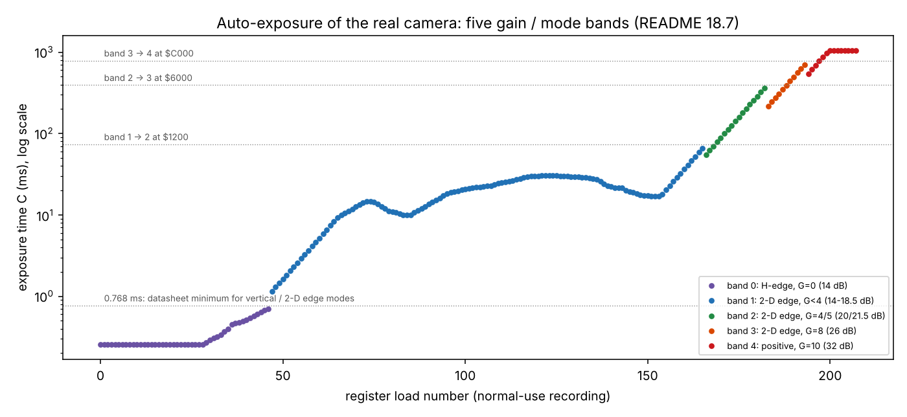

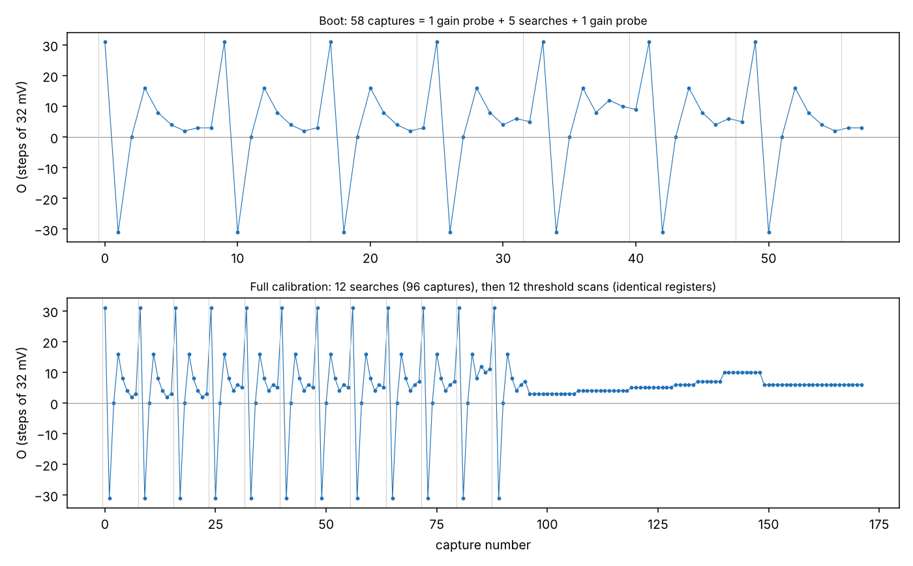

### 18.11 Is there any trace of more MAC-GBD registers, or of code for an M64283FP? (scan: C; "none" only means none found by these scans)

Question of the owner (2026-10-14): does the ROM, in used or unused code, use more of the MAC-GBD / sensor registers than §18.2 lists, for instance a variant written for the M64283FP (its extra fields `SH AZ CL PX PY MV OB` and registers 8-9 `ST`, `END`, §18.8)? **Answer: no trace in the Japanese ROM, and none in the sensor-driver bank of the international ROM.** `tcrf_check/tools/sensor_window_scan.py` (usage in its header; run on the mgbdis listing and the byte-class map of the v8 coverage run) gives:

| check | result |
|---|---|
| Every instruction operand in `$A000-$A0FF`, whole ROM | **283 instructions, 54 distinct addresses, all in `$A000-$A035`; none in `$A036-$A0FF`** (the matrix `$A006-$A035` included). By bank: `$0A` 271 (the driver); bank 6: 5; bank 2: 6; bank 9: 1. Outside the driver, the sites that run with RAM bank `$10` selected touch only `$A000` (start / busy poll: `06:5F7C`, `5F7F`, `5FAB`, `5FE8`, `09:5F51`); the other seven (the six of bank 2 and `06:5E83`) are the base of a photo SRAM block, not registers (I: the registers exist only with bank `$10`) |
| Operands above `$A0FF` | 123 sites, 29 addresses: photo / album SRAM (RAM banks 0-8), not looked at one by one (I) |
| Which of the 283 are not run in organic runs | three, all in `Cam_ThresholdConverge`: `0A:4EA9` (`ld hl,$A006`), `4EBE` (`ld [$A000],a`), `4EC1` (`ld a,[$A000]`), class F (run only in the forced runs of §16.19-16.21). **None is in class N**, so none of the 1,192 B of never-run code (§16.21) touches the window |
| RAM-bank selects (`ld a,imm` before `ld [$4000],a`) | immediates 0, 1, 2, 8 and `$10` (15 times: banks 6, 9, `$0A`); no other value from `$10` up. A bank number built in a register is not seen by this scan |
| WRAM shadows `$D594-$D599` of the five registers | outside organically run code only one access, `0A:4EB9` (`ld a,[$D594]`, class F, in the same routine) |
| Field values | G4, E3, Z = 01 and I = 1 are never produced (§18.2, §18.8: G4 and E3 never set, Z only 10 and 00, I = 0 on every recorded row) |
| Registers of a bigger sensor | the MAC-GBD window has an address for sensor registers 0-3 and 7 (`$A001-$A005`), the control byte `$A000` and the matrix; P, M and X (registers 4-6) are made by the MAC-GBD itself (§18.2). **No instruction operand refers to anything else**, so the ROM has no way to write registers 8-9 (`ST`, `END`) or the upper-nibble fields of 4-6 (`SH AZ CL PX PY MV OB`); a ROM for the M64283FP would need the MAC-GBD to expose them (I) |
| International ROM, bank `$0A` | the same 271 register-window operands at the same addresses with the same values. **61 bytes of the 16,384 differ, all in `$6A67-$7D15`, all operand bytes of `call` (41) or `jp` (20)** (re-linked targets); the register code (`$40C5-$50E2`) is byte-identical |

**What this does not exclude.** (1) A computed address: a pointer that starts in the window and walks past `$A035` is not searched (the matrix loops are read in §18.3 and write 48 bytes from `$A006`). (2) A table of register values that no instruction refers to by an operand in the window: the scans look at operands, not at data. (3) Only two builds were compared (Japanese Rev A, international); no other revision is in the repository. (4) The M64283FP is a different, later sensor read only from the owner's datasheet pointer (§18.8): that no code in this ROM targets it is evidence about this ROM, not about the datasheet.

### 18.12 Two outside implementations against this section: MAME `camera.cpp` and dither-pattern-gen (2026-10-18)

Both are software models, not hardware evidence: a statement that rests on them alone is **I**. (1) MAME, `src/devices/bus/gameboy/camera.cpp` (BSD-3-Clause, header "Vas Crabb"; a copy attached by the owner, revision not stated): the cartridge (MAC-GBD window, 16 RAM banks of 8 KB) and a simplified M64282FP. (2) [`HerrZatacke/dither-pattern-gen`](https://github.com/HerrZatacke/dither-pattern-gen) (MIT, read at `master` b153952, 2023-02-10): explains the camera's dither patterns and generates new ones; its `reference/patterns.mjs` holds four sets of 16 patterns (high light / low light, dither / no dither). The README of that repository does not say where the reference sets come from (?); it credits github.com/hatchman with the idea of sorting the values.

**Already here (not new).** The register map `$A000-$A005` and its fields; the matrix `$A006-$A035` as 16 cells of 3 thresholds; P and M chosen by bits 2-1 of `$A000` (MAME: 00 -> P/M 00/01, 01 -> 01/00, 10 and 11 -> 01/02, which is the prediction of 18.2; its `$A000` read returns those two bits back with the busy bit, the selector reading of 18.2, no hardware evidence); exposure in 16 us units; edge ratios 50 / 75 / 100 / 125 / 200 / 300 / 400 / 500 %; O = +/- value/31 V (18.2 says 32 mV per step: same within rounding); V x 0.5 V.

**The dither matrix (the useful part).**

| point | result | tag |
|---|---|---|
| Rebuild of the reference sets | the 4 x 16 reference patterns (1,024 cells of 3 bytes) are exactly what the ROM code computes from the anchor tables: set 1 "High Light" = table `0A:7C20` and set 2 "Low Light" = `0A:7C60` through the ramp of `$D59C = 1`, sets 3 and 4 ("No Dither") = the first value of each sequence in all 16 cells (`$D59C = 0`); **0 of 1,024 cells differ**, on both ROMs (`sensor_matrix_order.py --reference`) | C |
| Order and formula | `$D59C = 1`: 16 levels in 4x4 Bayer order, level of cell n (rows of four) `0 12 3 15 / 8 4 11 7 / 2 14 1 13 / 10 6 9 5`; byte k = `a_k + floor(r (a_k+1 - a_k) / 16)`; dither-pattern-gen's `orderPatternDither` is the same matrix and its `generateValueRange` the same formula (its README: "linear distribution of the 16 values") | C (ROM bytes), the same in the outside source |
| Variant `$D59C = 2` | **in neither outside source**: four levels in 2x2 blocks (top-left 0, bottom-right 1, bottom-left 2, top-right 3), `a_k + floor(g (a_k+1 - a_k) / 4)`. Its use: the dither of the SHOOT live view and shot in the variants `$D7E3 = $0A, $0B` (the last two of the nine TRICK LENSES, `$03 + $D5E5`) and `$15` (GAME FACE), where it replaces ramp A: the option ベタぬり ON = flat, OFF = this ramp (18.7). Not a calibration or exposure mode, and reachable by the player. Why these three modes get it: they reduce the picture to half size and ramp A would then lose its dither (below). Rendering of the three variants in BGB: image below | C (write order, selector, rendering), I (reason) |
| Cell geometry | MAME (`m_threshold[y & 3][x & 3]`) and the filter of dither-pattern-gen (`pattern[y][x]`, x = column) both give cell n = 4 (y & 3) + (x & 3) and the same polarity: black if pixel < t0, dark grey if < t1, light grey if < t2, else white. The ROM only writes 48 bytes, so this is not a ROM fact; with it the level matrix above is the textbook Bayer matrix turned over its diagonal | I (two implementations agree) |
| Names | "high light" for `7C20` and "low light" for `7C60` are the community's; §7 finds `7C60` used only while `D587 = D589` (band 2). I did not check what scene brightness each table suits (?). The third table `0A:7CA0` is listed by dither-pattern-gen as unused too | I |

**The three variants in BGB** (`tcrf_check/tools/bgb_dither_variants.py`; BGB's fake sensor picture, 18.9, so this shows how the matrix is applied, not a real scene; the plain shot with the immediate of `ld a,$01` at `06:5E3F` patched to 0, 1 and 2, nothing else changed). Left to right: flat (`$D59C = 0`, the option ON), 4x4 Bayer ramp (1, the normal setting), 2x2 blocks (2):

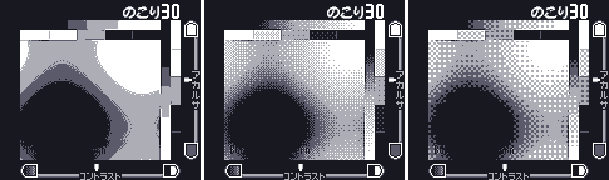

The option screen itself (Left key on the SHOOT option cross: the menu, then Up = OFF, then Down = ON): `assets/sensor/dither_variants/option_cross_betanuri_menu_up_down.png`.

**Why ramp B: Trick Lens 8, Trick Lens 9 and the Game Face divide the picture into four quadrants of half size (owner's reading, 2026-10-18; confirmed in the code and in BGB).**

* **The effect ids.** The 88-byte table `06:60DB` (4 bytes per `$D7E3`, one per phase `$D7E4`) gives `$0A` (lens 8) = `08 08 08 08` and `$0B` (lens 9) and `$15` (Game Face) = `09 0A 0B 0C`. The byte, with `$20` / `$40` added by `$D7EB` (the Up key of the option cross, はんてん), is the slot of the effect table `0A:541A` (`Cam_DispatchEffect`): slot 08 = `Fx08_Reduce2xTile2x2` (`0A:573C`), slots 09-0C = `Fx09_Reduce2xQuadTL ... Fx0C_Reduce2xQuadBR` (`0A:583B-584D`), which load DE and run `FxShared_ReduceBody_G0` (`0A:6866`). The destinations are the top-left, top-right, bottom-left and bottom-right quadrants of the 128 x 112 buffer `$C000` (16 tiles of 16 bytes per tile row, `$100` per tile row; the same four regions are the ones `Shoot_FxRegion01-04` (`06:73F7-740F`) XOR for the colour effect of the Down key, I). (C)
* **The reduction is a 50 % decimation, not an average.** The body reads the sensor frame at `$A100`; each output byte is built from one source byte of tile X and one of tile X+1 (pointer +`$10`), each passed through the 256-byte table `0A:7900`, which keeps the **left pixel of each pair** (checked: 256 of 256 entries; `0A:7A00`, used by the `$20` slots, holds the same nibbles bit-reversed: 256 of 256); the pointer then advances 4 bytes per output row, so **rows 0, 2, 4, 6** of a tile are read and 1, 3, 5, 7 skipped; two source tile rows give one output tile row; the output is 8 x 7 tiles = **64 x 56 pixels**. (C)
* **Lens 8** (`Fx08`) writes every output byte four times, at +`$00`, +`$80`, +`$780` and +`$700` of the destination: the same half-size picture in all four quadrants (BGB: image below, icon "0 0 / 0 0" at the top left). **Lens 9** and the Game Face (`$15`, same table bytes) write one quadrant per phase: in the live view of `$0B`, `$0F` and `$15` the A button below the last phase only plays the shutter sound and adds 1 to `$D7E4`, B subtracts 1 (`06:71E4-7205`, maximum 3), and the A press at phase 3 takes the shot (`Shoot_ShutterVariant0`; for `$15` the Game Face save `02:4C37`); each live frame is reduced into the quadrant of the current phase and the other quadrants keep the frame they had, so four shots build a 2 x 2 mosaic in one 128 x 112 picture (BGB: icon "1 2 / 3 4"). (C)
* **Why ramp B (I).** The decimation only sees the cells (0|2, 0|2) of the matrix (even pixel, even row, tile-aligned). In ramp A these are the levels 0, 3, 2, 1, the four lowest of 16, so the thresholds of a byte are squeezed into 3/16 of its span (row 8, byte t1: `92 95 94 93`) and the reduced picture is nearly flat; in ramp B the same four cells are the four blocks (0, 3, 2, 1 of 4: `92 9E 9A 96`), a proper 2 x 2 ordered dither on the half-size picture (`sensor_matrix_order.py --example 89 92 A2 D2`). The argument does not depend on which of the two cell geometries is the real one (the sampled set is symmetric). BGB agrees: with ramp A forced on the mosaic the picture is posterised like the flat one (the last three images below: ramp B, ramp A, flat).

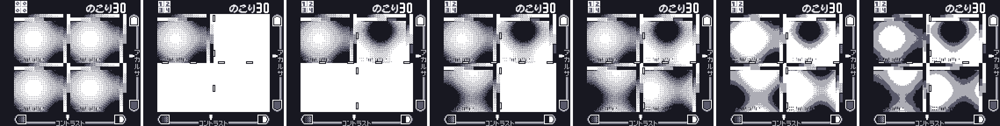

Left to right: lens 8; lens 9 after 0, 1, 2 and 3 steps (ramp B); lens 9 at step 3 with ramp A and with the flat fill (`tcrf_check/tools/bgb_lens9_quadrants.py`: the plain shot is patched to start with `$D7E3 = $0A` / `$0B`, and for ramp A / flat the `$D59C` default is patched; BGB's fake sensor picture changes from frame to frame, so the four quadrants show different frames). Not done: a real shot saved from lens 9 and the Game Face mask in BGB. The effect ids `$29-$2C` / `$49-$4C` (each reduction mirrored inside its quadrant) and the whole effect table were run in BGB later (§16.28); the labels `Fx08-Fx0C` and `FxShared_ReduceBody_G0` are `C` since then.

**Possible naming slip (?).** The option cross has Left = ベタぬり (`$D7EA`, `Mode14_State05_OptionDither`), Right = シャッター音 (`$D7EC`, State06), Up = はんてん (`$D7EB`: adds `$20` / `$40` to the effect id) and Down = パレット (`$D7E9`: six XOR vectors); the state names `Mode14_State07_OptionPalette` (Up key) and `Mode14_State08_OptionFlipEffect` (Down key) look swapped against the on-screen labels; not renamed.

**Where MAME differs from this section or has no counterpart.**

* **Gain.** MAME: `14 + 1.5 G[3:0] + 6 G4` dB, so G = 9 is 27.5 and G = `$0A` is 29.0 dB; the datasheet table of 18.8 has 3 dB steps above G = 8 (29.0, 32.0). MAME uses the formula in its log text only. The ROM goes up to `$0A`. The datasheet value stays (I; I did not re-read the datasheet for this).
* **Registers 4 and 5 only when N = 0.** MAME adds 2 x 256 cycles and updates P/M only `if (!m_n[0])` (its comment says "not clear", the code tests "clear"). In the recordings **one row = the eight registers as the sensor received them** (introduction of §18) and the 203 rows with N = 1 (56 calibration, 147 live) carry P/M/X = 01/00/01 like the others: if the workbooks are raw (the CSV cannot tell if a cell was filled down), the real MAC-GBD sends registers 4-6 also with N = 1 and MAME's model is a simplification (I). A test: the length of the sensor-bus frame, or of the busy bit, for N = 0 against N = 1 with the same exposure; the rows have no timestamps.
* **Capture time.** MAME: `31,166 + 5 x 256 (+ 2 x 256 if N = 0) + 16 C` units of four 4.194304 MHz clocks (about 0.95 us), for example 32,702 for C = `$0010` and N = 1. The constant has no stated source and cannot be checked here (no timestamps) (?).
* **Frame location.** MAME writes the result at RAM page 0 offset `$100` (`$A100`), `(128 x 123) / 8` tile-row pairs = 3,936 bytes, which is 352 bytes more than the 3,584-byte photo area `$A100-$AEFF`, and never writes `$A000-$A0FF`. The ROM's pixel test reads `$A002` and `$A082` (18.3, C), and on the real unit the offset searches answer to it (the O sequences differ from gain to gain, `sar_check_real.txt`), so the real MAC-GBD also fills the first tile row (I). MAME's offset is a simplification; where sensor line 0 lands in the 128-line frame of the real unit is not known (?).
* **123 lines.** MAME's header "128*123 pixel" and `SENSOR_HEIGHT = 123`: a second statement of the figure of §9, no measurement of lines 123-127.
* **Not in this section, and not testable with the recordings:** MAME makes RAM unreadable (reads `$00`) and unwritable while a capture runs (the ROM polls bit 0 before it touches RAM at the 12 poll sites of 18.2; nothing contradicts it); registers answer to A6-A0 only; write-only registers read `$00` (the ROM reads only `$A000`); its TODOs say it does not know what the filters do at the image edge (it clamps the coordinates), whether a capture can be cancelled, or how the levels move during the sweep at start.

**Verdict.** Nothing in either source contradicts a C statement of this section. The open points of 18.9 (bit 1 of `$A000`, the content of lines 123-127) are not settled, because both are models. Two things are new for the repository: the decoded cell order of the three dither writers (confirmed by the 1,024-cell rebuild) and the 2x2-block variant `$D59C = 2`, which the outside sources do not know.

## Appendix: tools

- `tools/ram_census.py` — full WRAM/HRAM access census from an mgbdis disassembly
- `tools/asset_catalog.py` — enumerates every banked graphics/tilemap copy call site
- `tools/render_tiles.py`, `tools/render_album.py` — render raw 2bpp ROM data to PNG for visual matching
- `tools/sram_analyze.py` — SRAM analysis used for §3 and §11: `validity`, `classify` (fresh / clean / atypical, never-written-area check, boot-seed cycle), `calib`, `settings`, `f34`, `all`; also holds the checksum helpers and a re-implementation of the boot-seed generator (`seed_orbit`)
- `tools/rom_trace.py` — recursive-descent tracer (proven code vs everything else); `--roots tools/extra_roots.json` adds the 134 hand-resolved roots (§1.2); `tools/rom_trace_labels.sym` is its symbol input (the 183 first-pass labels)
- `tools/rom_coverage.py` — per-bank coverage (proven code / inline tables / referenced data / padding / unreferenced) from a trace; `disasm/coverage_jp_v3.csv` is its output
- `tools/wram_db.py` — builds the WRAM/HRAM access table (`wram/wram_access.csv`) and per-address summary (`wram/wram_summary.csv`) from a trace
- `tools/cameras_summary.py` — one CSV line per camera from a folder of `NAME.sav` + `NAME.sgb` pairs (§11.9); `cameras/cameras_summary.csv` is its output for the 14 cameras
- `tools/emu_calib_check.py` — PyBoy check of the calibration-record validity test with a given ROM and save (§11.9, point 2)
- `tools/wram_readme.py` — renders the per-region CSV files of `wram/` as the condensed tables of §2
- `tcrf_check/tools/rom_reach_map.py` — the reachability map at the top of this README: the whole ROM as 2bpp tiles, blue = reached by the v8 coverage run, red = never executed nor read, green also covers data used according to later runs (the wild-frame strips and the SGB data of evidence C in `assets/asset_map_jp.csv`, the `StampCat*_Gfx` pictures shown by the display walks), orange = never read but identified (`assets/asset_map_jp.csv`), yellow = really unused (`tcrf_check/assets/unidentified/really_unused.csv`, §16.24; `--unused none` draws the map without it); `python3 rom_reach_map.py OUT.png --rom pocketcamera_jp.gb`; the byte classes come from `tcrf_check/tools/rom_reach_classes.py`, shared with `tcrf_check/tools/rom_layout_map.py` — the second map (what each byte is: code by function, tile sets, tile maps, sprite layouts, sound, tables, uncertain, padding, with the unreached tiles outlined; `python3 rom_layout_map.py OUT.png --rom pocketcamera_jp.gb --csv assets/layout_by_bank_jp.csv`; the kind of the `Src_*` / `Data_*` blocks is read from `assets/layout_kind_overrides_jp.csv` (one evidence row per block); rules in its docstring and in the section below the first map)
- Never-run code (§16.14, §16.15): `tcrf_check/tools/witness_map.py` (writes `assets/witness_jp.csv` from the later runs), `reach_analysis.py` (writes `assets/reach_components_jp.csv`: one verdict per never-run component; hand verdicts in `assets/reach_manual_jp.csv`), `dj_fields.py` (every key at every field of the music-editor pages), `reach_bfs.py` (goal-directed key search), `run_race.py` (RUN! RUN! RUN! played to the end), `bgb_run_race.py` (its key paths replayed in BGB), `rom_reach_map.py` (the map; purple = proven dead, from `assets/reach_ranges_jp.csv`), `force_open.py` (§16.21: WRAM / SRAM pokes in the core, 31 experiments, plus three modes of `dj_pages.py`; outputs in `tcrf_check/assets/easy_wins/force/`), `sm83sim.py` + `sim_blit.py` (a minimal SM83 interpreter used to check the blit carry bytes)
- Easy wins (§16.19, §16.20): `tcrf_check/tools/bgb_link_variants.py` (two BGB instances linked, owner male / female, `$55` partner; markers and heads), `dj_pages.py` (every D.J. state with eight keys and 26 chords), `editor_copy_flag.py` (the copy-badge branch of the editor save-back, `--f33`), `gameface_edit.py` (a Game Face stored in the SRAM: the hidden Game Face item, the Game Face editor and its save-back), `bgb_compose.py` + `compose_picker.py` (the COMPOSE photo pickers: A held with Up / Down, in BGB and in the core), `slideshow_markers.py` + `bgb_slideshow.py` (the slide-show repeat markers: a save with start / end markers in its timing array, the player and the editor preview, in the core and in BGB), `song_decode.py` (sound-driver songs as note names), `bgb_result_screen.py` (the "no blank frames" screen and its music-mailbox writes in BGB), `bgb_factory_test.py` (the hidden factory test in BGB); outputs in `tcrf_check/assets/easy_wins/`
- The GameFAQs cheats page and the two games (§16.18): `tcrf_check/tools/cheat_checks.py` (28 key scenarios, core and BGB), `albumb_thresholds.py` (every Album B threshold, both ROMs), `run_record.py` (RUN! race record → the three gates), `sf2_play.py` and `ball_play.py` (Space Fever II and BALL played with the joypad only; `ball_play.py` ports the ROM's own autopilot), `ball_cap.py` (the score-add routine called at its limits, BALL played on from 9990, the BALL speed table: the two games have no end, §16.18), `play_effects.py` (what the played scores unlock), `dj_se.py` and `bgb_dj_se.py` (D.J. sound effects SE 1-9), `counter_scan.py` (which corpus paths change the Album B counters)
- Printer status bits (§16.16): `tcrf_check/tools/printer_status.py` (the card and D.J. prints in my core with a status byte injected at every packet: `--grid`, `--sweep`, `--errors`, `--only CMD:N:HEX`), the injection API of `coverage/src/gbcov.c` / `gbcov.py` (`gb_printer_model`, `gb_printer_inject`, `gb_printer_inject_clear`, `gb_printer_log`), `PRN_ERR` in `tcrf_check/tools/bgb_printer.py` (the same injection in BGB) and `BGB_HF` in `bgb_run.py` (`-headless` for linked runs); results in `tcrf_check/assets/printer_status/` and `tcrf_check/assets/bgb_retrace/printer_status_heads/`
- Never-read data (§16.13): `tcrf_check/tools/asset_map_build.py` (writes `assets/asset_map_jp.csv`), `render_marked_tiles.py` (contact sheet of a ROM range, never-read bytes tinted red, 2bpp or 1bpp), `bgb_print_wild.py` (prints one photo with a chosen wild frame in BGB with the printer helper; `--rom` takes a modified ROM), `wild_border_check.py` (printout vs sheet, and the blanking comparison), `sheet_tile_match.py` + `sheet_map_table.py` (community sprite sheets vs the ROM, `assets/spriter_sheet_map_jp.csv`), `witness_map.py` (class-N bytes that a later run executed: `assets/witness_jp.csv`, the green of the map), `sgb_border_check.py` (decodes the SGB packets of either ROM, rebuilds the border, compares it with a BGB capture or the community sheet) and `bgb_sgb_capture.sh` (BGB in SGB mode under Xvfb, whole-window screenshot)
- The sensor registers (§18): `tcrf_check/tools/sensor_decode.py` (bus-analyser workbooks → `assets/sensor/*_rows.csv`), `sensor_sar_check.py`, `sensor_exposure_check.py`, `sensor_tc_check.py`, `sensor_sites.py` (every static write site of `$A000-$A005`), `sensor_m64283_table.py` (the examples table of the M64283FP datasheet, cross-check of X; writes `assets/sensor/m64283fp_examples.{csv,txt}`), `sensor_window_scan.py` (18.11: nothing beyond the five registers and the matrix is addressed anywhere in the ROM), `sensor_matrix_order.py` (18.12: the cell order of the three dither writers), `sensor_plots.py`, `sensor_bgb_log.py` + `sensor_scenarios.py` (BGB with write watchpoints and breakpoint markers; 24 scenarios, `assets/sensor/bgb/`), `sensor_bgb_law.py` (the exposure law on BGB's dispatches), `sensor_meter_geom.py` (the metering loop's read addresses and sum)
- `wram/` — full per-region WRAM/HRAM write-ups (`wram_<region>.md`, evidence with `bank:addr` citations) and rows (`wram_<region>.csv`), the access tables and the traces
- `coverage/` — emulator coverage run (§13): the native SM83 core `src/gbcov.c` + `gbcov.py`, 19 driver / analysis tools in `tools/` (fuzzer `coverage_run.py`, `sweep_auto.py`, `sweep_vars.py`, `settle_runs.py`, `long_runs.py`, `damaged_saves.py`, `make_hotspot_saves.py`, `replay_corpus.py`, `merge_states.py`, `coverage_report.py`, `rom_map.py`, `d1_map.py`, `gating_branches.py`, `state_graph.py`, `forced_legit.py`, `unexec_by_symbol.py`, `validate_calib.py`, `newcov.py`, `gbdis.py`), `final_merge.sh`, `results/` (merged coverage, report tables, corpus, logs), `saves/`, `d1sheets/`
- `tools/tcrf_checklist.py COV.npz OUT.md OUT.csv` — builds the TCRF documented-content checklist with coverage computed from a merged `cov.npz` (§15.3); since 2026-10-13 it parses again and reproduces `tcrf_check/TCRF_CHECKLIST.csv` / `.md` exactly (before, 19 of the 54 rows had been edited in the outputs only, the B12 and C20 lines had unescaped apostrophes, and the owner's review notes sat in the wrong column of the `.md`)
- `tools/stamp_atlas.py`, `stamp_sheets.py`, `stamps_from_rom.py`, `frame_atlas.py`, `extract_albumB.py`, `screen_assets.py`, `glyph_pairs.py`, `tile_view.py`, `bank_sheet.py`, `path_shots.py` — asset retrieval (§15.6)
- `tools/stamp_hold_a.py`, `stamp_hold_a2.py` — hold-A branch of the stamp tool (§15.4); `tools/hotspot_effects.py` — the 16 hot-spot effects with an armed hot spot (§15.5)
- BGB (§16.6; BGB itself is not in the repository, `BGB_DIR` points to it): `bgb_run.py` (demo + state-file runner, library and CLI), `bgb_sig.py` (replay of a corpus path), `bgb_compare.py`, `bgb_retry.py` (the 206-path sweep and its summary), `bgb_stamp_hold.py`, `bgb_credits_gate.py`, `bgb_corocoro.py`, `bgb_pokemon_gate.py`, `bgb_pokemon_ball.py`, `bgb_hotspot_effects.py`, `bgb_link.py` + `bgb_link_check.py` (two linked instances), `bgb_gender.py`, `bgb_corocoro_intl.py` (wild-frame pages and stamp categories on both ROMs, §16.12)
- International ROM and names (§16.1-16.5, 16.8): `intl_replay.py`, `atlas_replay.py` (`MIRROR=1`), `atlas_sheet.py`, `mainmenu_probe.py`, `parlor_targets.py` (what each SHOOT-parlor choice opens), `albumb_pages.py` (Album B page walk), `boot_flags.py` (`$D582` / `$D562` after boot), `hotspot_common.py`, `hotspot_filmstrip.py`, `hotspot_visibility.py`
- Printing and the BGB re-trace (§17): `bgb_printer.py` (printer helper for BGB), `bgb_print_run.py`, `bgb_dj_print.py`, `dj_route.py`, `dj_print_probe.py`, `dj_screens.py`, `print_explore.py`, `album_nav.py`, `bgb_link_sniff.py`; `blocks.py`, `bgb_trace_core.py`, `bgb_trace_plan.py`, `bgb_trace_run.py`, `bgb_trace_report.py`, `bgb_never_probe.py`, `bgb_divergence.py`, `dj_corpus.py`; results in `tcrf_check/assets/bgb_retrace/`, printed pages in `tcrf_check/assets/bgb_printer/`
- The real credits, the SHOOT-parlor RUN and the sounds (§16.22): `tcrf_check/tools/credits_real.py` (the unlocking save to the end of the real credits, per-frame mode / state / sound log), `run_parlor.py` (RUN over and over, the seven results), `sf2_sound.py` (Space Fever II sound requests), `stamps_sound.py` (stamp-tool sound requests), `bgbgrab.py` / `bgb_jobs.py` (BGB replay of a corpus entry + appended keys, screenshot and VRAM / OAM / WRAM from the state file; `GBCAM_ROOT`, `BGB_DIR`), `provenance.py` (which ROM spans hold the tiles found in a VRAM dump); results in `tcrf_check/assets/credits_parlor/` (`parlor_run_results.csv`, `sf2_sounds.csv`, `stamp_sounds.csv`, the BGB contact sheets) and the owner's 42 worklist answers in `disasm/owner_answers_jp.csv`
- The purple code forced by a PC jump or a flipped branch, confirmed in BGB (§16.26): `tcrf_check/tools/gbcov_display.c` / `.py` (the forcing interface: `gb_jump`, `gb_set_stop`, `gb_force_flip`, register get / set, write log), `dead_jump.py` (`CACHE_DIR OUT.json`: the 48 dead functions), `dead_flip.py` (the 73 unreachable rows by flipped gate), `dead_effects.py` (every camera-effect handler number and the `06:73AF` XOR slots), `dead_targeted.py` (the sound routines with their arguments), `dead_cases.py` + `bgb_dead_hook.py` (the BGB cases: a hook in free bank-0 bytes called from `Main_Loop`, or a patched branch; logs, VRAM / WRAM dumps, WAV), `dead_sheets.py` (tile sheets, survey and flip contact sheets, MP3 clips), `dead_report.py` (`assets/force_unref_jp.csv`, `assets/force_flip_jp.csv`, `tcrf_check/assets/forced/bgb_cases_jp.csv`); pictures and clips in `tcrf_check/assets/forced/`.
- The jofamo.com article (§16.27): `tcrf_check/tools/charset_jp.py` (`ROM --csv disasm/charset_jp.csv --atlas OUT.png`), `albumb_comments.py` (`ROM OUT.csv [--check DIR]`), `bgb_albumb_comments.py OUTDIR` (copy B01-B21, the 21 Comment screens, the pixel check), `bgb_jofamo_checks.py OUTDIR ALBUM.sram [bgm pvoice shoot speed bview]`.
- Display tracking and the REALLY unused assets (§16.24): `tcrf_check/tools/gbcov_display.c` (core with the ROM-to-screen taint; `gcc -O2 -shared -fPIC -o libgbcov_display.so gbcov_display.c`), `gbcov_display.py`, `display_core.py`, `display_replay.py` (`CORPUS OUT.npz`), `display_stamps.py` (walks the stamp menus), `display_report.py` (verdicts, `really_unused.csv`, `really_unused.md`, `really_unused_sounds.csv`, `really_unused.png`; the hand-listed spans and the tile set of each unused map are read from `unused_manual.csv`), `tcrf_exact_match.py` (TCRF picture to ROM, scale-aware), `review_page.py` + `review_page.tpl.html` (the review page); data in `tcrf_check/assets/display_run/` and `tcrf_check/assets/unidentified/`.
- Banks `$23-$27` and the unused one-page main menu (§16.25): `tcrf_check/tools/copy_sites.py DISASM_DIR OUT.csv` (every call of the banked copy helpers with its constant source, destination and length; result `assets/copy_sites_jp.csv`), `tile_seam_search.py ROM BANK:ADDR [first_col [cols [rows [width]]]] [--ids LO-HI,…] [--1bpp]` (which tile block makes a de-duplicated picture map continuous across tile seams; `--ids` gives each id range a block of its own and a shuffled-map control, `--1bpp` reads 8-byte tiles), `map_pattern_match.py ROM BANK:ADDR [first_col [cols [rows]]]` (does any window of the ROM repeat the pattern of repeated ids of a map: is it a renumbered copy of another map), `bgb_show_unused.py ROM OUT.png --copy BANK:SRC:DST:LEN[,…] [--lcdc 91] [--scx N] [--scy N] [--bgp E4]` (patched-ROM boot into a copy routine at `$3600`, BGB screenshot; `BGB_DIR` points to BGB), `bgb_unused_menu_try.py [--plain] ROM SAVE OUTDIR name=KEYS:hold:wait[,…]` (the shipped main-menu code driving the unused menu picture, §16.25.4), `rom_reach_map.py` (prints how many bytes yellow takes from each colour) and `display_report.py` (reads the tier column of `unused_manual.csv` and the live sym labels).
- Read checks on the real BGB (L3 pass, 2026-10-14): `tcrf_check/tools/bgb_wp_probe.py CORPUS ENTRY WATCHPOINTS OUTPREFIX` replays one corpus entry in BGB (wine, headless) with *logging watchpoints* (`-wp BB:AAAA-BB:AAAA//r/NAME`: one line per hit in `debugmsg.txt`, the emulation goes on) and prints the hit counts, with a control watchpoint on bytes that certainly are read; `tcrf_check/tools/bgb_link_wp.py` does the same for two linked BGB instances (link-cable receiver watchpoints). Used for `02:46E6` and `04:4D09` (never executed, never read).
- Owner questions of the L3 pass (2026-10-14): `tcrf_check/tools/owner_page.py OUT.html` (template `owner_page.tpl.html`) builds the one page of what only ears or eyes can settle: 56 sound ids (the 95 SFX-tag rows merged per id, plus the two Space Fever II handlers of id 24), the 22 SHOOT effect variants (`06:60DB` -> `0A:541A`), 10 modes with generic state names, and five pictures (`0D:7000`, `0C:5800`, `14:4550`, the TCRF candidates `13:5A00` and `1A:7C80`). Answers are saved per item (confidence + note) and go to `disasm/owner_answers_jp.csv`; an answer moves the name from I to C. **Sound clips** (`tcrf_check/tools/sound_clips.py CHANNEL OUTDIR [ID...]`, results in `tcrf_check/assets/sound_clips/`, 90 MP3 of 32 kbit/s mono, 438 kB, `sound_clips_jp.csv`): BGB cannot post a sound request, so the ROM is patched in memory (the call to `Joy_ClearSticky` at `00:2F33` goes to a hook in the free bank-0 bytes at `$3600`, as in §16.26) and the hook writes the next id of a table to ONE request mailbox (`$DD60` / `$DD70` / `$DD78`) every N main-loop passes; its first pass asks `$FF` (reset) in the music mailbox `$DD68`, otherwise the main-menu music plays over everything. BGB records the audio (`WavFileOut=1`, 44.1 kHz) and logs the mailbox and NRx4 writes with `%TOTALCLKS%` (2,097,152 per second, 35,112 per frame). The WAV is lined up with the clock **by content** (the NRx4 triggers against the loud bins over a grid of offsets: -0.47 s here, not a constant of BGB), then each clip starts 10 ms before the first trigger after its request; the audible onset is within -6 to +9 ms of the first trigger for 85 of the 90 requests, which is the check that clip k is the sound of id k; the other five (`sfx1 25 26 27 33 34`, the ids that follow a still-sounding long effect) show loud bins 35-72 ms earlier, the tail of the previous effect, which the 10 ms lead keeps out of the clip. Gotchas: the hook counts main-loop passes (the main menu takes about 1.77 frames per pass, so the demo must be about 1.9 times longer than N x ids), the pass counter is one byte (N <= 255), and a window shorter than the sound cuts it (the ids `sfx1 24 25 26 32 33` are still sounding after 6 s: 6 s excerpts, flagged in the csv; `14 2F 30` come from the long run). These are BGB's APU output: nobody listened, and BGB is not a real Game Boy. The owner page plays them (`owner_page.py` embeds the MP3 as base64 and decodes them with WebAudio).
- Open assets: `tcrf_check/tools/unidentified_sheets.py` renders every asset row that was open in `disasm/sym_unconclusive_jp.csv` when the sheet was written as one sheet `tcrf_check/assets/unidentified/open_assets.png` (154 rows, 24,249 B after §16.25; 161 rows, 30,877 B after the §16.24 relabel and the `11:5800` split; 341 rows, 73,278 B in §16.23); all rows with their byte pattern and overlapping TCRF ids are in `open_assets.csv`
- `disasm/code_gaps.md` — full report behind §1.2 (resolved indirect sites, verdict on the unreferenced regions)
- `HOWTO_NEW_ROM.md` — playbook for disassembling the next ROM (levels L0-L6, stage order, tool list, pitfalls, what was not done here), written from this project; condensed as a skill in `skills/gb-rom-disassembly/SKILL.md`
- `pocketcamera_jp.sym` — the complete symbol file (every byte typed and every routine / asset named, §1.1.1), generated by `tools/sym_build.py` from `disasm/sym_names_jp.csv` and `disasm/sym_types_jp.csv`; `tools/sym_fix.py` (readability pass over the mgbdis output), `tools/make_doubts.py` and `tools/bank_pics.py` (the doubt list `disasm/sym_unconclusive_jp.md` / `.csv` and its bank pictures); `tools/check_repo_consistency.py --rom ROM [--roundtrip]` (every number the docs quote against the file it comes from, every generated file against a fresh run, the quoted `§` numbers and asset labels, the md5 round trip: run it before every commit)
- `disasm/ram_names_jp.csv` — the RAM names (`addr,size,name,scope,tag,desc`; 788 rows, §2.13) and `disasm/ram_exclude_jp.csv` (the pointer loads of the access table that are plain numbers); `tools/ram_names.py` generates `disasm/ram_jp.inc` (`DEF wMode EQU $d5ce`, `INCLUDE`d by the regenerated `game.asm`) and `pocketcamera_jp_ram.sym` (the same names for BGB / no$gba); `tools/sym_fix.py --ram` applies them
- `disasm/renamed_jp.csv` — every label change of the L3 pass of 2026-10-14 (`bank,addr,old_name,new_name,old_conf,new_conf,reason`; 470 rows: renames, evidence upgrades, removed labels, new labels).

### Mode table (`$2F3F`)

The 34-entry mode table (`$00-$21`) with the role of every mode is in §2.3.

Extra tool added with the Select+Start+Up work: `tools/render_state10.py ROM SAV OUT.png [scale]`
(composes the erase-all confirmation background from ROM tiles and a real save's thumbnails).
Emulator test scripts (PyBoy, MBC5 stand-in, patched copy only) are described in §8.
