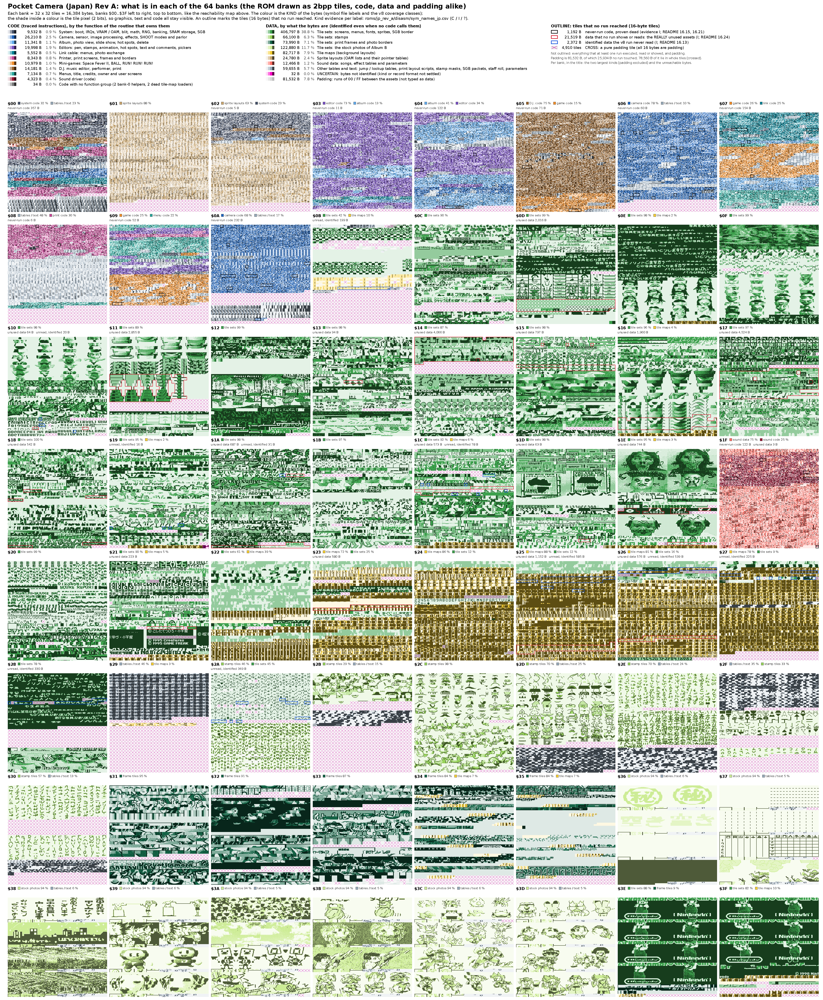
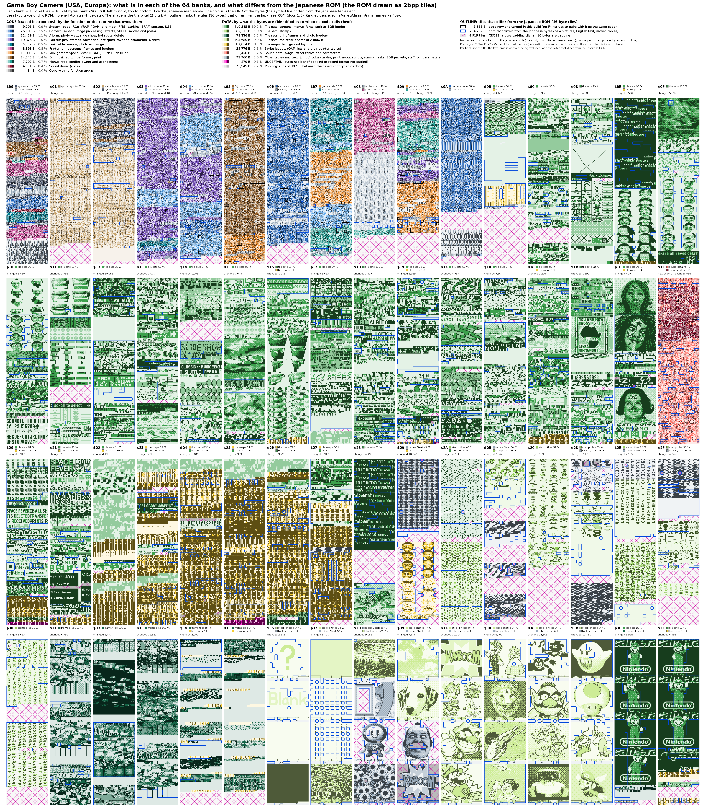

# Game-Boy-Camera-disassembly

Disassembly of the Game Boy Camera / Pocket Camera ROMs. The Japanese Rev A ROM is disassembled first; the international, Gold, Hello Kitty and prototype ROMs follow with the same tools. Work in progress, stay tuned.

The work is produced by AI (Claude), from reading the code and running it in emulators (BGB and the project's own core), with the owner's checks and answers; findings tagged **C** were confirmed in code, in BGB or by the owner, **I** are inferred, **?** are open.





## ROMs

| ROM | MD5 | Folder | Status |
|---|---|---|---|
| Pocket Camera (Japan) (Rev A) (SGB Enhanced) | `fdcfe686cf4df461e870b6e53b2b5a8b` | [`roms/jp_rev_a/`](roms/jp_rev_a/) | L0-L5 done |
| Game Boy Camera (USA, Europe) (SGB Enhanced) | `42d2f65e2549be9d1d126a6828b5d1c1` | [`roms/us_eu/`](roms/us_eu/) | ported from JP: L0-L1, L2 static, L3 partial, L4, L5 (`make TREE=us_eu check`; docs §1.5) |
| Game Boy Camera Gold (USA) (SGB Enhanced) | `b2999cfb6dacb439f501a71f30f91762` | [`roms/gold/`](roms/gold/) | not started |
| Pocket Camera (Hello Kitty) (prototype) | `0a323bddc4f0159cea76cf44ed0c1a3c` | [`roms/hello_kitty/`](roms/hello_kitty/) | not started |
| Pocket Camera Prototype (Japan) ("DEBAGAME") | `1d8097de3497db8b182bcd2a984b6063` | [`roms/prototype_debagame/`](roms/prototype_debagame/) | not started |

The ROMs are not in the repository (the owner's source pack is `source/Source_material/Source_material.zip`).

## Contents

| Path | What it is |
|---|---|
| [`roms/jp_rev_a/`](roms/jp_rev_a/) | the Japanese Rev A disassembly: the symbol file `pocketcamera_jp.sym` (every byte typed and named), the RAM symbols, `disasm/` (the name, type, constant and charset tables the listing is built from, the rename log, the owner's answers), `wram/` (WRAM / HRAM map and the static trace), `assets/` (asset catalog, layout and reach tables), the two ROM maps |
| [`docs/`](docs/) | the project notes, one file per section (memory maps, SRAM, boot, sensor, link cable, printing, coverage, TCRF, menus and the international ROM, open questions); [`docs/index.md`](docs/index.md) maps every `§N.M` to its file; [`docs/19_sensor_guide.md`](docs/19_sensor_guide.md) is a readable guide to the sensor: registers, offset search, calibration vector, auto-exposure |
| [`tools/`](tools/) | the pipeline: static tracer, symbol-file builder, listing post-processor (`sym_fix.py`: tables, RAM names, constants, charmap), RAM / constant / state / charmap generators, doubts list, consistency checker |
| [`tcrf_check/`](tcrf_check/) | the evidence: BGB harness and probes, TCRF checklist, sensor, printer and link tools, and their results (`tcrf_check/assets/`) |
| [`coverage/`](coverage/) | the project's own emulator core, fuzzer and coverage results |
| [`link_protocol/`](link_protocol/) | Game Link Cable captures between two emulated cameras |
| [`source/`](source/) | the owner's material: source pack, Spriters Resource sheets, TCRF pages and pictures, the cameras' SRAM summary |
| [`HOWTO_NEW_ROM.md`](HOWTO_NEW_ROM.md), [`skills/`](skills/) | the playbook (levels L0-L6) for the next ROM |
| [`CLAUDE.md`](CLAUDE.md) | working rules for the AI sessions |

## Building

The international ROM: `make TREE=us_eu check` builds `build/us_eu/gbcam_usa_eu.gb` from `roms/us_eu/src/` (md5 `42d2f65e2549be9d1d126a6828b5d1c1`; docs §1.5).

### Japanese Rev A

From the source tree (rgbds 1.0.4 in `PATH`, or `RGBDS=/path/to/rgbds/`):

```bash
make check                       # build/jp_rev_a/pocketcamera_jp.gb, md5 fdcfe686cf4df461e870b6e53b2b5a8b
```

`roms/jp_rev_a/src/` holds 64 bank files, 886 `INCBIN` files (668,189 bytes; 491 tile blocks as PNG), 4,910 label notes, 837 far pointers written as labels (13 left as numbers) (docs §1.4), and uses the macros of `macros.inc` (far copies and calls, far pointer rows, states, sound requests, screen on / off, `REPT`). Its ROM addresses are labels, so code and data can move: `tools/relocation_test.py` moved 29 banks, rebuilt and replayed 2,835 corpus entries with no difference but one read the original program makes past its font (docs §1.4). It is generated: `make source ROM=pocketcamera_jp.gb` rewrites it from the tables of `roms/jp_rev_a/disasm/` (and overwrites hand edits).

The listing the tree comes from, by hand. Tools: [mgbdis](https://github.com/mattcurrie/mgbdis) master (commit 95d951a) and rgbds 1.0.4. mgbdis reads `<rom basename>.sym` beside the ROM.

```bash
mkdir build && cp pocketcamera_jp.gb roms/jp_rev_a/pocketcamera_jp.sym build/
python3 mgbdis.py build/pocketcamera_jp.gb --output-dir build/disasm --print-hex
python3 tools/sym_fix.py build/disasm --tables --const --rom build/pocketcamera_jp.gb
cd build/disasm && make          # rgbasm -> rgblink -> rgbfix
md5sum game.gb                   # fdcfe686cf4df461e870b6e53b2b5a8b
```

`sym_fix.py --const` writes the RAM names, the hardware, mode, state and sound constants and the character map into the listing (docs §1.1, §2.13, §2.14). After editing a table of `roms/jp_rev_a/disasm/`, rebuild the symbol file with `python3 tools/sym_build.py ROM` and run `python3 tools/check_repo_consistency.py --rom ROM --roundtrip` (0 failures, four byte-exact rebuilds plus the source tree), then `make source ROM=ROM`.

## Disassembly status (Japanese Rev A)

| Level | State |
|---|---|
| L0 ROM identified, header, banks | done |
| L1 every byte typed (code, data, padding, text) | done |
| L2 code proven by a static trace and observed in emulators | done |
| L3 every routine and asset named | done: no `?` name, no doubtful row; the `I` names are all proven unused |
| L4 RAM names and constants in the source | done |
| L5 buildable, editable source tree (committed `.asm`, split assets) | done: `roms/jp_rev_a/src/`, `make check` |
| L6 understanding | partial |

Details and counts: [`docs/01_toolchain_and_status.md`](docs/01_toolchain_and_status.md) and [`roms/jp_rev_a/`](roms/jp_rev_a/). The overview of the findings (the ROM maps, what was settled): [`docs/00_overview.md`](docs/00_overview.md).

## Sources

Every public source the project used since the start, in one place. None of them was taken as an authority over the ROM: what a source says and the ROM cannot confirm is tagged **I** or **?** in the sections quoted below, never **C**. The addresses were supplied by the owner on 2026-10-20 (the repository had recorded only some of them); a source with no address is marked "URL not recorded" and no address is guessed.

| Source | What the project took from it | Where | How it reached the project |
|---|---|---|---|
| The Cutting Room Floor, page [Game Boy Camera](https://tcrf.net/Game_Boy_Camera), revision read: [1968673](https://tcrf.net/index.php?title=Game_Boy_Camera&oldid=1968673) | the list of unused and hidden content that became the TCRF checklist and the `Unused_TCRF_*` labels; the pictures compared with the ROM | §15, §16.24, §16.29 | printed copy of 2026-09-27 supplied by the owner, read by OCR (the figures and names were checked against the ROM before use) |
| The Cutting Room Floor, page [Game Boy Camera/Regional Differences](https://tcrf.net/Game_Boy_Camera/Regional_Differences), revision read: [1846909](https://tcrf.net/index.php?title=Game_Boy_Camera/Regional_Differences&oldid=1846909) | the documented differences between the Japanese and international builds (only the Japanese side of that page is counted in the checklist) | §15 | printed copy of 2026-09-27 supplied by the owner, read by OCR |
| Jonathan Traynor's blog post "Secrets of the Pocket Camera" (jofamo.com): [original address](https://www.jofamo.com/blog/secrets-of-the-pocket-camera) (the site is dead), read from the [Wayback Machine copy of 2025-09-27](https://web.archive.org/web/20250927101352/https://www.jofamo.com/blog/secrets-of-the-pocket-camera), 48 pages | the claims about the Album B stock pictures, BGM 04, the P.VOICE and the character table, each compared with the ROM and run in BGB; what the article takes from the guide book, the manual, nintendo.co.jp and Tanaka's tweets was not seen and is not used | §16.27 | PDF of the Wayback copy supplied by the owner on 2026-10-14 |
| [GameFAQs, Game Boy Camera cheats](https://gamefaqs.gamespot.com/gameboy/564359-game-boy-camera/cheats) (the game's [FAQ list](https://gamefaqs.gamespot.com/gameboy/564359-game-boy-camera/faqs) was also given by the owner; the README cites no individual FAQ) | the cheat and secret list, every line tried in BGB | §16.18 (also cited in §2, §15.4, §16.4, §16.6, §16.17, §17.6) | read on 2026-10-12 |
| [Nintendo Wiki (Fandom), Totaka's Song](https://nintendo.fandom.com/wiki/Totaka%27s_Song) | the description of the tune on the "no blank frames" screen | §16.20 | fetched during the Totaka's Song check |
| [cristofercruz/gb-camera-frames](https://github.com/cristofercruz/gb-camera-frames) (`gbc-fr.py`) | the frame and wild-frame layout constants (flat offsets, tile counts) checked against the ROM | §16.23 | shallow clone read for the constants |
| [HerrZatacke/dither-pattern-gen](https://github.com/HerrZatacke/dither-pattern-gen) (MIT; read at `master` b153952, 2023-02-10) | the dither-matrix cell order, compared with the ROM and with MAME (a software model: **I** at best) | §18.12 | read for §18.12 |
| MAME, `src/devices/bus/gameboy/camera.cpp` (BSD-3-Clause, header "Vas Crabb") | the MAC-GBD window and a simplified M64282FP model; its header gives the sensor as 128 x 123 pixels | §9, §18.12 | copy attached by the owner, revision not stated; URL not recorded |
| [Mitsubishi M64282FP datasheet](https://github.com/Raphael-Boichot/Mitsubishi-M64282FP-dashcam/blob/main/Docs%20and%20research/Bibliography/Mitsubishi%20Integrated%20Circuit%20M64282FP%20Image%20Sensor.pdf), ver. 1.1E (the bibliography of the owner's Mitsubishi-M64282FP-dashcam repository) | register names and bit meanings, read against the owner's bus recordings; the datasheet section numbers quoted in the README are the datasheet's own | §18 (18.2, 18.8) | document read for §18 |
| The Funtography guide: the Internet Archive item [Nintendo Game Boy Camera Funtography Guide](https://archive.org/details/nintendofuntographyguide) (1998, described there as a Nintendo Power guide; this README calls it "the US manual") | the menu names, the five flowcharts (USER, SHOOT, VIEW, PLAY, STUDIO), the build differences it reveals; printed page numbers are the guide's own | §16 (introduction, 16.4, 16.5, 16.11) | attached by the owner; address supplied on 2026-10-20 |
| [GameFAQs map "Game Boy Camera - Menu Guide"](https://gamefaqs.gamespot.com/gameboy/564359-game-boy-camera/map/63-menu-guide) by FunkyLizard (fan-made, same five sections; the picture itself is titled "Menu of Gamboy Camera") | the second reading of the menu tree, compared with the guide's charts | §16.11 | attached by the owner on 2026-10-14 with the blog link above |
| [The Spriters Resource, Game Boy Camera](https://www.spriters-resource.com/game_boy_gbc/gameboycamera/): 16 sheets (17 files kept in `source/Spriter_ressources_check/`, one a byte-identical duplicate) | names and layouts of graphics, matched tile by tile against the ROM (`sheet_tile_match.py`); the sheet names in the `Sheet_*` labels | §1.1.1, §16.13 | files supplied by the owner |
| Pan Docs: [Game Boy Camera](https://gbdev.io/pandocs/Gameboy_Camera.html) and the "SGB Border" page (address not recorded) | the `$A000` register (bits 1-2, the P/M bits of its sample code; the meaning of bit 1 stays open, §18) and the SGB border layout (4 bpp tiles, 32 x 28 map cells, palettes 4-5) | §16.13, §18 | consulted as reference |
| [mgbdis](https://github.com/mattcurrie/mgbdis) master (commit 95d951a, after the v3.0 tag) and rgbds v1.0.4 (`rgbasm`, `rgblink`, `rgbfix`; rgbds address not recorded) | the disassembler and the assembler of the byte-exact round trip | §1.1, §1.1.1, `HOWTO_NEW_ROM.md` | installed in the workspace; versions pinned in §1.1 |
| [BGB](https://bgb.bircd.org/) 1.5.x (run under Wine, headless) | the emulator behind every **C** tag marked "BGB": watchpoints, screenshots, the printer helper link | §16.6, §17 and the sections that cite it | attached by the owner |
| [Raphael-Boichot/Play-with-the-Game-Boy-Camera-Mitsubishi-M64282FP-sensor](https://github.com/Raphael-Boichot/Play-with-the-Game-Boy-Camera-Mitsubishi-M64282FP-sensor), folders `Research on real camera 2024` and `Research on real Camera` | the owner's bus-analyser recordings of two real cameras (boot, calibration, a calibration under strong light, normal use, the Hello Kitty and prototype ROMs, a zeroed vector) and the saves before and after a calibration | §18.4-18.6, §18.13 | supplied by the owner on 2026-10-26; decoded by `tcrf_check/tools/sensor_more_recordings.py` |
| [untoxa's gb-photo](https://github.com/untoxa/gb-photo) | only named, to identify the third-party save (`2022-03-05`) whose unused bytes hold its settings; not read as a source | §3.8 | identified from the save content |

Not public, so not listed above: the 33 real saves are the owner's own data (§3, §11); the bus-analyser workbooks are public, in the sensor repository above; the ROMs themselves are not listed (md5 values in §1.1).
