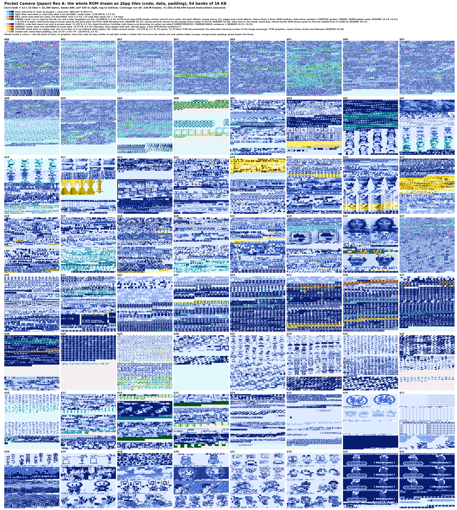

[README](../README.md) · [Section index](index.md)

## Current status

*What the map shows:* the whole Japanese ROM drawn as 2bpp tiles (64 banks of 32 × 32 tiles; code, data and padding alike). Blue = executed or read by the v8 coverage run (dark: joypad and save only, light: only after a forced RAM or mode state), **red = never executed nor read and not identified** (4 bytes: 1 B of code, `00:1137`, the clamp of the D.J. envelope, + 3 B of data in `$1F`), **purple = code that never ran and is proven dead** (1,191 B, 0.1 %: dead functions that nothing calls and branches that no value can select, UNREFERENCED / UNREACHABLE, evidence I; sorted in §16.15, the attempts to force every piece with WRAM / SRAM pokes and the list of the desperate cases are in §16.21; the same pieces forced by a program-counter jump and a flipped branch and replayed in BGB, with the tile sets, maps and sounds they produce, are in §16.26), **green = never run or read by the v8 run, but a later targeted run did** (12,868 B, 1.2 %: **4,076 B of code**, 0.4 %: the SGB sender, the printer-only code and the printer error-status handlers in BGB, the hot-spot effect handlers, the hold-A stamp mirror, music-editor fields, the Game Face hidden choice, the RUN! RUN! RUN! podium and flag code, the Space Fever II boss code, the D.J. sound effects 4, 8 and 9, the two erase-all-photos shortcuts, the APU-gated branch, the link receive counters and the `$55` hello, the blank-calibration loader, D.J. page handlers, the copy badge of the editor save-back, the hidden Game Face editor and its save-back, the COMPOSE photo pickers, the slide-show repeat markers, and the cases forced by a WRAM / SRAM poke in my core (an armed hot spot, out-of-range cursors and effect indexes, printer size tables, a place counter, D.J. chords with A held; 421 B) or by a state number poked past the end of its table (137 B, not a designed path); §16.14, §16.18, §16.19, §16.21, `roms/jp_rev_a/assets/witness_jp.csv`, C; **+ 8,792 B of data** that the v8 run never read and that later runs showed to be used: the **wild-frame lateral strips** (4,379 B, 0.4 %, of which 2,290 B are `$FF` runs that the padding rule would have hidden: the BGB blanking test changes exactly those tiles of the print, so the print path uses them, §16.13 (1), C on frames 02, 03, 05, 06, 07, 08), the **small-kana stamp pictures** `2A:6000-7E9F` (1,610 B: the stamp-menu walks of the display tracker put them on screen, median 264 frames, §16.24, C for the replays) and the **data sent to the Super Game Boy** (2,803 B: the border BGB shows in SGB mode equals the one rebuilt from them, §16.13 (5), C)), **orange = never read but identified as asset data** (2,372 B, 0.2 %, all evidence I: BG tilemaps 1,280 B, kana glyph and text tiles 679 B, SGB border tilemap blocks 199 B, tile-set gaps and tile data 214 B; §16.13, `roms/jp_rev_a/assets/asset_map_jp.csv`), **yellow = the really unused assets** (21,516 B, 2.0 %, 35 spans, 13 of them TCRF-documented; evidence I: the spans of `tcrf_check/assets/unidentified/really_unused.csv` that no replay ever put on screen in a run without state pokes, §16.24: **the unused alternate stand-by screen of the image exchange `14:4000-502F` + `23:5CC0`** (4,724 B, §14.4), **the unused one-page main menu `25:7820` + `17:5500`** (5,440 B, §16.25), the TCRF-documented graphics (the hand flipping a newspaper `11:5800`, the kanji strip `0D:7660`, B CANCEL, the SOUND icon, …), the never-shown strips and tile maps; yellow takes 1,143 B from orange, 3,655 B from blue and 16,718 B from light blue, because most of these spans are read by a generic copier or by forced runs; the list is in §16.24 and in the section below the map, and nobody saw or heard any of it on a real camera), muted red = untouched padding (25,934 B). Generated by `tcrf_check/tools/rom_reach_map.py` from `coverage/v8/report_v8/rom_map.csv`, `roms/jp_rev_a/assets/asset_map_jp.csv`, `roms/jp_rev_a/assets/witness_jp.csv`, `roms/jp_rev_a/assets/reach_ranges_jp.csv` and `tcrf_check/assets/unidentified/really_unused.csv` (§13, §15.1, §16.13, §16.14, §16.15, §16.16, §16.18, §16.21, §16.24). There is no equivalent run for the international ROM yet: its code is a different build (§16.1).

### What each byte is, bank by bank (the second map)

*What the map shows:* the same 64 banks drawn as 2bpp tiles as above, but the colour is **what the bytes are**, not whether a run reached them; the shade inside a colour is the tile pixel. **Code** (117,627 B, 11.2 %: every byte of the static trace) takes the colour of the function of the routine that owns it: system 9,532 B (boot, interrupts, VRAM / OAM, blit, math, RNG, bank switching, SRAM storage, the SGB sender), camera 26,210 B (sensor driver, image processing, effects, the SHOOT modes and the parlor), album 11,341 B, editors 19,998 B, link cable 5,552 B, printer 8,343 B, mini-games 10,979 B, D.J. 14,181 B, menus 7,134 B, sound driver 4,323 B, and 34 B in no group. **Data** is coloured by kind, **even when no code calls it**: tile sets 669,767 B (63.9 %: 406,797 B screens, menus, fonts, sprites and the SGB border; 66,100 B stamps; 73,990 B print frames and photo borders; 122,880 B the 30 stock photos of Album B), tile maps 82,717 B (7.9 %), sprite layouts 24,780 B, sound data 12,466 B, other tables and text 59,655 B (stamp masks, the staff roll, SGB packets, the print layout scripts, jump and lookup tables), **uncertain 32 B**, and padding 81,532 B (7.8 %). A **magenta cross** marks every pure padding tile, i.e. a 16-byte tile whose 16 bytes are all padding (4,910 tiles, 78,560 B of the padding; shorter runs are not marked). An **outline** marks the 16-byte tiles that no run reached, with the classes of the first map: black = code that never ran (1,192 B), red = unused data (21,519 B), blue = identified data the v8 run never read (2,372 B); of the padding, 25,934 B were never touched. Per-bank byte counts of every colour: `roms/jp_rev_a/assets/layout_by_bank_jp.csv`; generator `tcrf_check/tools/rom_layout_map.py` (shares `rom_reach_classes.py` with the first map).

*How a byte gets its colour:* code is a byte of the static trace (coverage classes `C`, `F`, `N` of `coverage/v8/report_v8/rom_map.csv`); its function group is the one of the label that owns it (nearest label at or before it in the bank, `roms/jp_rev_a/disasm/sym_names_jp.csv`; the `ModeNN_` labels follow the mode table of §16.2). Everything else takes its kind from the name of its label: `Gfx_` / `Sheet_` / `Kana_` / `TileGap_` = tile set, `StampCat*_Gfx`, `WildFrame*` / `Border*` tiles and `AlbumB*_Tiles` / `_Thumb` = the stamp, frame and stock-photo tile sets, `Map_` / `BgMap_` / `*_Map` = tile map, `Song` / `Sfx` / `Snd` = sound, `OamList` / `OamPtrTbl` = sprite layouts, the rest of a code bank = tables. A `?` on a label doubts the role of the bytes, not their kind, so a `?` graphic stays a tile set. The 50 blocks named after the far pointer that loads them (`Src_*`, `Data_*`) get their kind from one evidence row each in `roms/jp_rev_a/assets/layout_kind_overrides_jp.csv`. The kind is therefore as certain as the label or the row (C where a loader, a screenshot or a replay shows it, I where it is the reading of the bytes or of their neighbours, which is the case of most tile and map ranges that no code references). Padding is a run of 16+ `00` / `FF` that no typed range of `roms/jp_rev_a/disasm/sym_types_jp.csv` covers, plus the zero fill the symbol file names `Bank*_Padding` / `ZeroFill`; forced runs read part of it (the 3,654 B of zero fill at the ends of banks $00-$02, for instance), so it is more than the 25,934 B nobody touched.

*The uncertain colour (32 B, magenta fill, not to be confused with the cross):* only the 32 bytes after the 12-row map at `19:7FE0` (no loader reaches them). The 7,520 B at `08:54DE-723D` are tables (C): the print progress packets and the five layout scripts of the printer job (§17.8). The other spans that were uncertain are classified by evidence (11,994 B): no graphic span is tagged `?` any more (`13:5CA0` and `14:4554` are tile sets of doubtful role, tagged I; `1A:7C90` is C), and the 44 `Src_*` / `Data_*` blocks (11,994 B in banks $0C, $13, $17, $19, $1C, $1D, $20, $21, $23, $25, $26 and $27) are 7,648 B of tile maps (C: the copy routine shows the BG-map destination: the animated background of the View menu, the main-menu slide strips, the stamp-category tile maps, the equaliser) and 4,346 B of tile sets (C where the copy shows a tile destination, as for the stamp-category icons loaded by `Stamp_LoadCategoryIcons`; I where the bytes render as digit, panel or picker tiles). `roms/jp_rev_a/disasm/sym_unconclusive_jp.md` lists the doubtful names with the test that would settle each.

*How the banks are organised (shares of the 16 KB of each bank; the first map's classes give the reach):*

| banks | what they hold |
|---|---|
| `$00` | the fixed bank: system code 32 %, tables 23 %, print code 17 % (printer driver and the print job), camera code 8 % |
| `$01`-`$02` | sprite layouts (OAM lists and pointer tables): 88 % of `$01`, 63 % of `$02`; `$02` also holds the storage manager (system code 23 %) |
| `$03`-`$09` | the mode code: editors (`$03` 73 %), album, editors and the parlor (`$04`), D.J. and BALL (`$05` 75 % + 15 %), the shooting modes (`$06` 78 %), main menu, link, Space Fever II and slide show (`$07`), print screens and the print layout scripts (`$08`: 49 % tables, of which 7,520 B are the layout scripts and progress packets at `08:54DE`, 30 % print code, 17 % padding), RUN! RUN! RUN!, the comment editor and keyboard, the user screens and the credits (`$09`) |
| `$0A` | the camera: sensor driver and effects, 68 % code, 17 % tables |
| `$0B` | the Super Game Boy data: border tiles 42 %, border map 10 %, packets and palettes 4 %, padding 44 % |
| `$0C`-`$22` | tile sets, 61-100 % of each bank (`$22`: 61 % tile sets, 39 % tile maps), except `$1F` |
| `$1F` | sound: 75 % song, effect and parameter data, 25 % sound driver code |
| `$23`-`$27` | tile maps, 72-88 % of each bank, the rest tile sets (9-25 %) and padding |
| `$28`-`$2A` | `$28` tile sets 78 % (padding 22 %); `$29` the staff-roll tables 46 % and padding 52 %; `$2A` the character glyphs and stamp sheets (tile sets 45 %) and the small-kana stamps (46 %) |
| `$2B`-`$30` | the stamp categories: stamp tiles 29-98 % of each bank and their 1bpp masks (tables) |
| `$31`-`$35` | print frames (`$31`-`$33`, 87-95 % frame tiles) and photo borders (`$34`-`$35`, 84 % tiles, 7 % maps) |
| `$36`-`$3D` | the 30 stock photos of Album B, 94 % picture tiles and thumbnails per bank, 5-6 % footers and tables |
| `$3E`-`$3F` | tile sets (88 % and 82 %), border tiles 9 % in `$3E`, tile maps 10 % in `$3F` |

*What nothing reaches, by bank (the outlines; bytes):* the never-run code sits in banks `$00` and `$02`-`$0A` and in the sound driver of `$1F`; the unused data sits in the tile and map banks `$0D`-`$26` (plus 3 B of `$1F`); banks `$27`-`$3F` hold nothing that no run reached except padding and 904 B of identified data the v8 run never read. The last column is the largest span of the list of §16.24 in the bank, counted whole (part of a span can be padding or read, so it can exceed the outlined bytes of the bank).

| bank | never-run code | unused data | unread, identified | largest unused span (listed in §16.24) |
|---|---:|---:|---:|---|
| `$00` | 357 |  |  |  |
| `$02` | 5 |  |  |  |
| `$03` | 11 |  |  |  |
| `$04` | 122 |  |  |  |
| `$05` | 71 |  |  |  |
| `$06` | 60 |  |  |  |
| `$07` | 154 |  |  |  |
| `$08` | 6 |  |  |  |
| `$09` | 52 |  |  |  |
| `$0A` | 232 |  |  |  |
| `$0B` |  |  | 199 |  |
| `$0D` |  | 2,016 |  | 1,632 B `Gfx_0D_7000_FillPatternTiles` |
| `$10` |  | 64 | 20 | 32 B `Unused_TCRF_SoundPrintModulationIcon_TopRow_Gfx` |
| `$11` |  | 2,855 |  | 4,416 B `Unused_TCRF_HandNewspaperFrames_Gfx` |
| `$14` |  | 4,066 |  | 2,780 B `Gfx_14_4554_Mode0E_ExchangeAlt_StrayPtr` |
| `$15` |  | 797 |  | 512 B `Gfx_15_5200_MainMenu_DrawUpperItem2_Aux` |
| `$16` |  | 1,960 |  | 512 B `Gfx_16_7380_MainMenu_BallHeadAnim_F5_Unref` |
| `$17` |  | 4,524 |  | 4,864 B `Gfx_17_5500_Unused_MainMenuTiles` |
| `$18` |  | 542 |  | 256 B `Gfx_18_7D80_Mode0F_State04_LeaveSelected_Aux` |
| `$19` |  |  | 16 |  |
| `$1A` |  | 687 | 31 | 501 B `Gfx_1A_7E00_Unref` |
| `$1C` |  | 573 | 78 | 512 B `Unused_TCRF_HotSpotEffectIcons_Extra_Gfx` |
| `$1D` |  | 63 |  | 63 B `Gfx_1D_7B41_Tbl539D_Aux` |
| `$1E` |  | 744 |  | 848 B `Unused_TCRF_CannotCombineSamePicture_Gfx` |
| `$1F` | 122 | 3 |  |  |
| `$21` |  | 223 |  | 177 B `Gfx_21_6AC7_Unref` |
| `$23` |  | 580 |  | 580 B `Map_23_5CC0_Mode0E_ExchangeAlt_Unref` |
| `$25` |  | 1,152 | 585 | 576 B `Map_25_7820_Unused_MainMenu` |
| `$26` |  | 576 | 539 | 576 B `Map_26_7080_Unused_Picture` |
| `$27` |  |  | 225 |  |
| `$28` |  |  | 330 |  |
| `$2A` |  |  | 349 |  |
| **all** | **1,192** | **21,519** | **2,372** | |

### The really never used assets (the yellow of the map)

*The sheet* (`tcrf_check/assets/unidentified/really_unused.png`, built by `tcrf_check/tools/display_report.py`, regenerated 2026-10-14 after the L3 loader hunt; list in `really_unused.md` / `.csv`, sounds in `really_unused_sounds.csv`; method and every span in §16.24 and §16.25): a core that follows each ROM byte to the screen replayed 37,370 menu states and the stamp-menu walks; a graphic span counts as **never used** when none of its tiles was on screen (at least 15 frames) in a run without a state poke. The first block of the sheet shows each unused tile map right beside the tile set it is drawn with (`23:5CC0` with `14:4000-502F`, `25:7820` with `17:5500-67FF`, both drawn in BGB); the third, `25:75E0`, sits beside the frame tiles of the hot-spot viewer (`3F:7700-78EF`) with its photo cells hatched (a photo area is drawn with dynamic tiles, §16.25.2), and `26:7080`, for which no tile block of either ROM fits, shows an empty box. The verdict is **I**: nothing was seen or heard on a real camera, a tile composed by software would not have been seen, and "never on screen" is strong evidence, not proof.

**Today's count: 35 spans, 23,898 B** in 17 banks (31 graphic spans, 4 tile maps); 21,516 B of them are yellow on the map, the other 2,382 B are runs of 16+ `00` / `FF` that the map keeps as padding.

| tier (evidence I) | spans | bytes | what it is |
|---|---|---|---|
| no loader in either ROM (code search + BGB, `unused_manual.csv`) | 5 | 10,164 | the **unused alternate stand-by screen of the image exchange** (`14:4000-502F` + map `23:5CC0`, 4,724 B, §14.4) and the **unused one-page main menu** (map `25:7820` + tiles `17:5500`, 5,440 B, drawn in BGB, §16.25.1) |
| TCRF-documented graphics (`Unused_TCRF_*`, `tcrf_check/TCRF_CHECKLIST.md`) never on screen in an organic run | 13 | 6,752 | the hand flipping a newspaper `11:5800` (4,416 B), the kanji strip `0D:7660`, B CANCEL `1A:7D80`, the SOUND icon `10:7A80` / `10:7B80`, the circled X `15:4480` / `4500` / `4580`, the margin-print pieces `18:5A50` / `18:5F90`, the extra hot-spot icons `1C:5920`, the album hand gestures `13:5CA0` (96 B: loaded with the album sheet, never drawn in an organic run, §16.24), the "cannot combine" text `1E:6620` (the TCRF "photo option icon" `1A:7C90` is drawn on the Right page of the photo-option menu and is not in the list) |
| never on screen, never read organically | 13 | 4,934 | 11 graphic spans (`0D:7000`, `15:5200`, `15:5500`, `18:7D80`, `1A:5182`, `1A:7E00`, `1C:5C20`, `1D:7B41`, `1E:7D00`, `21:6AC7`, `21:6B91`) and 2 tile maps (`25:75E0`, `26:7080`); read only by forced runs, no loader found |
| on screen only in forced runs | 4 | 2,048 | the frames 5-8 of the ten-frame camera ball head animation (`16:7380`, `7580`, `7780`, `7980`; the owner named them on 2026-10-14: assets of the head animation of the main camera menu, played on Up / Down): the shipped code plays frames 0-4 only, the second set is listed only by Tbl2 / Tbl3 of the page transition A (`07:7C33` / `07:7C3F`), and those two tables have no caller in the Japanese or the international ROM; the second set is the same head with its collar redrawn for the back body of the lower page (the ids `$20-$2F` of the head block are also the first tiles of the body strip, §16.24) |
| **total** | **35** | **23,898** | |

*Sounds* (`really_unused_sounds.csv`, §16.24): 147 of the 162 sound ids were requested in an organic run, **15 were not**: 4 with no caller and no list (song `48`, `sfx1 24`, `sfx3 04`, `sfx3 07`), 3 in a picker list but never chosen (song `47`, `sfx1 2F`, `sfx3 0A`), 4 that share their data with a used id (song `08`, `sfx1 2B`, `3D`, `3E`) and 4 that have a static caller but were reached only by forced runs (songs `27`, `44`, `sfx4 05`, `11`; not proof of dead code). Nobody listened: the sound results are mailbox logs. Names: 159 of the 162 ids are named by role and context in `roms/jp_rev_a/disasm/sound_names_jp.csv` (§2.14); the owner's answers on these 15 (2026-10-18) are in §16.24.

*Spans that look unused but are used by code* (they are in `unused_manual.csv` with the tier `used (withdrawn)` and are not in the count above). `10:74A3-753F` (157 B) is the tail of the numeral table `10:7400` that `DjTitle_LoadNumeralTile` (`05:423A`) indexes by digit (`$7400` + digit x 32 in bank `$10`, C from the code); it holds the tiles of the digits 5-9, which no replay put on that screen: value-gated, not unused. The eight spans `10:7602`, `10:78B8`, `10:7908`, `10:7A24`, `10:7ADE`, `10:7BF8`, `10:7D52` and `10:7F00` (2,089 B) are glyphs of the **printer text font** `10:7600-7FFF`: slot k is 16 bytes at `$7600` + 16 k, copied by `Gfx_Copy16FromBank10` (`00:1615`), which the D.J. score print renderer (`05:60EE`, calls `05:610D` / `05:611B`) feeds with the character codes of the 20-code row tables `05:5ABB-5EBE`. The rows are printed only to a Game Boy Printer, so no replay can put them on a screen: they are never *displayed*, not unused. They are labelled `Gfx_10_*_DjPrintFont_Tiles*` (C for the loader, I that every glyph of the span occurs in a printed row). No other yellow span lies inside a loader range (checked against every copy site with a constant length, the Parlor page lists and the numeral tables; `18:5A50`, `18:5F90`, `1C:5920` and `1D:7B41` are copied to VRAM by used screens but never shown, as the list says). The four frames `16:7380-7B7F` (2,048 B) are frames 5-8 of the ten-frame camera ball head animation (the owner's name, 2026-10-14); only Tbl2 / Tbl3 of the page transition A list them and those tables have no caller.
