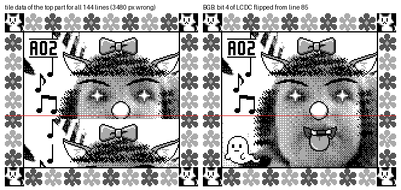

[README](../README.md) · [Section index](index.md)

## 2. WRAM / HRAM map (`$C000-$DFFF`, `$FE00-$FFFF`) — the consolidated, byte-level map

*Rebuilt from a recursive-descent trace of the ROM.*

### 2.0 Conventions, method and legend

* **Source of truth.** Every row comes from the instructions that a **recursive-descent tracer** (`tools/rom_trace.py`) proves reachable
  (56,799 instructions on proven paths, starting from the reset/interrupt vectors, the main loop `00:2E92`, the 34-entry mode table, every
  `rst $18` state table and the hand-labelled entries of the `.sym` file). `tools/wram_db.py` turns them into an access table: every `ld`/`ldh`
  that touches `$C000-$DFFF` or `$FE00-$FFFE` as **R**ead, **W**rite or **P**ointer load (`ld rr,ADDR`, i.e. the address is the base of an array or
  buffer). **1,135 distinct addresses** are touched (1,153 with the extended trace, see the re-check bullet below). A linear sweep of the ROM (what `mgbdis` prints) was *not* used as evidence: data decoded as
  code produces phantom addresses.
* **Blind spot, stated once.** Accesses made through a register pair that was loaded with the base address (`ld hl,ARRAY … inc [hl]`, `ld a,[hl+]`) show up only as a **P** row
  for the base. For arrays and buffers the extent, stride and role were therefore read from the code around the P rows and are written in the *Meaning* column.
  Targets of **data-driven callbacks** (bank 3 `$5F68`/`$5F91`, bank 7 `$792C`/`$7BF3`/`$7C62`/`$7CD1`, `call $FF80` = OAM-DMA routine in HRAM) are not followed by the tracer; the rows
  that depend on them say so.
* **Overlays.** Mode banks are overlays: only one mode is active at a time, and nothing clears `$D500-$D9FF` when a mode ends, so the same WRAM bytes
  have a different meaning in each mode (the *Banks* column lists every bank whose proven code touches the row). A row therefore describes **one use**; several
  rows may cover the same bytes (notably `$C000-$CFFF`).
* **Status** (same spirit as §3.0 for the SRAM): **C** = code-traced (writer and reader found, role evident from the code), **I** = inferred (consistent use, no instruction states the meaning),
  **U** = unused or dead (only written, only read, or touched only by unreachable code), **?** = inconclusive (the row says what is known and what is not). A name is never taken from a label.
* **Banks column.** Hex ROM banks (`00` = fixed bank, `0A` = bank `$0A`, `1F` = sound driver), `hw` = hardware register, `all` = used by every bank. Bank:address citations (`07:4A24`) are JP Rev A.
* **Re-check with the extended trace (§1.2).** The maps were written against the first trace. The extended trace (60,449 instructions: 134 hand-resolved roots, `tools/extra_roots.json`) adds **18 addresses and 520 live accesses**;
  all 18 addresses fall inside existing rows (`$C070 $C30E $C4F0 $C68E $C6FE $C770 $C7F0 $C90E $CA3E $CAF0 $CD0C $CD8E $CDFE $DA0D $DA0E $DA24 $DA29 $FF46`). The new live accesses are 479 in bank `0A`, 33 in bank 0 and 8 in bank 7.
  The bank-`0A` ones belong to the 96-entry jump table at `0A:541A` (image-effect routines of the SHOOT modes, reached from bank 6 through `06:781D → 0A:7CFE`, index byte from `06:60DB`, OR `$00/$20/$40` from `$D7EB`):
  they load start pointers into the photo area (`$C070 $C0F0 $C30E $C3C0 $C4F0 $C60E $C68E $C6FE $C770 $C7F0 $C90E $CA3E $CAF0 $CD0C $CD0E $CD8E $CDFE`) and use `$FF8A-$FF8D` as scratch (130+ accesses each), which agrees with the rows of those bytes.
  The bank-0 ones are the soft-reset path (`00:0210-028F`, already described in §2.2) and the bank-7 ones are the menu callbacks `07:7AF1-7B43` / `07:7BF4-7D30`, so the five rows `$DA1A $DA1F $DA24 $DA29 $DA2E` moved from I to C.
  `roms/jp_rev_a/wram/wram_access.csv` and `wram_summary.csv` are the extended-trace tables; the per-row counts quoted in the region files come from the first trace and are therefore low by those amounts.
* **Where the full evidence is.** The tables below condense each row to about 150 characters. The un-condensed rows (with `bank:pc` of every key instruction), the per-region write-ups and the raw access tables are in
  `roms/jp_rev_a/wram/` of the package: `wram_<region>.md` / `.csv` (7 regions), `wram_access.csv`, `wram_summary.csv`, `trace_jp.json`.

**Coverage of the accessed addresses** (mechanically checked on the extended table, 1,153 addresses: every address of `wram_summary.csv` lies inside at least one row; rows of a few bytes with a size cover arrays and buffers):

| Region | Section | Objects (rows) | C | I | U | ? |
|---|---|---:|---:|---:|---:|---:|
| `$C000-$D4FF` and the stack `$DE00-$DFFF` | §2.4 | 69 | 65 | 1 | 3 | 0 |
| `$D500-$D5FF` | §2.5 | 80 | 65 | 11 | 3 | 1 |
| `$D600-$D7FF` | §2.6 | 140 | 131 | 4 | 5 | 0 |
| `$D800-$D9FF` | §2.7 | 192 | 149 | 35 | 7 | 1 |
| `$DA00-$DBFF` | §2.8 | 102 | 92 | 2 | 4 | 4 |
| `$DC00-$DDFF` | §2.9 | 95 | 73 | 0 | 22 | 0 |
| HRAM `$FF80-$FFFE`, OAM `$FE00-$FE9F`, I/O registers `$FF00-$FF7F`, IE | §2.10 | 125 | 112 | 3 | 10 | 0 |
| **total** | | **803** | **687** | **56** | **54** | **6** |

### 2.1 Whole-WRAM overview

| Range | What lives there (details and evidence in the section named in the last column) | Banks | § |
|---|---|---|---|
| `$C000-$CFFF` | **4 KB overlay area.** Base use: slot work buffer (photo `C000-CDFF`, thumbnail `CE00-CEFF`, tag `CF00-CF5B`, echo `CF5C-CFB7`) = the 4096-byte **link exchange buffer** = VRAM staging; then tile / text / effect scratch for each mode | all | 2.4 |
| `$D000-$D0BF` | image-reduction accumulators, three 56-byte collision masks of bank 7, a BG-row buffer of bank 5, the race state of RUN! RUN! RUN! (bank 9) | 0, 5, 7, 9 | 2.4, 2.13 |
| `$D200-…` | print-animation packet | 8 | 2.4 |
| `$D300-$D3FF` | **VBlank VRAM write queue** (4-byte entries; indices `$D520` / `$D521`) | 0, 8 (via `ld h,$D3`) | 2.4, 2.5 |
| `$D400-$D49F` | **OAM shadow** (DMA source page `$D4`, write cursor `$FF9A`) | 0, 4 | 2.2, 2.4 |
| `$D500-$D51F` | sprite-animation pairs: frame byte `$D500+n`, tick byte `$D510+n` | 0, 3, 4, 6, 7, 8 | 2.5 |
| `$D520-$D529` | VRAM-queue indices, soft-reset enable `$D523`, palette fade targets `$D524-$D526`, RNG state `$D527-$D529` (**not** a sound sequencer) | all | 2.5 |
| `$D52A-$D560` | 55-byte subtractive RNG table, seeded at boot from SRAM `$02FFF` | 0 | 2.5, 2.11 |
| `$D561-$D582` | photo count, copy of the photo-state vector (`$D563-$D580`), CoroCoro and Game Face flags | 0, 2-9 | 2.5, 2.11 |
| `$D583-$D5CD` | camera / exposure / dither / calibration working set, calibration vector `$D5B5-$D5C0` | 0A, 6 | 2.5 |
| `$D5CE`, `$D5CF` | **mode and state** of the state machine; `$D5D0-$D5FF` = shared UI state, per-screen cursors, album photo index `$D5D8` | all (0, 3-9) | 2.3, 2.5 |
| `$D600-$D642` | bank 4 pen / stamp tools; bank 6 compose flag `$D600` | 4, 6 | 2.6 |
| `$D643-$D7C1` | hotspot block mirror, hotspot editor, slide-show list mirror, slide-show editor / player (bank 3), border number `$D7C1` | 2-8 | 2.6, 2.11 |
| `$D7C2-$D7FF` | bank 7 auto-play viewer; bank 6 SHOOT state (timer, variant, options, burst list) | 4, 6, 7 | 2.6 |
| `$D800-$D816` | print job state | 8, 0 | 2.7 |
| `$D818-$D88F` | mode `$07` game (and its game-selection menu) | 7 | 2.7 |
| `$D890-$D9D6` | **music editor / player** (mode `$1F`) | 0, 2, 5 | 2.7 |
| `$D9D7-$D9FF` | mode `$20` / `$21` mini-games, link-screen sprite animators | 5, 7, 9 | 2.7 |
| `$DA00-$DA48` | link screen, copy screen, main menu, pen / stamp edge detector, owner-registration keyboard, SHOOT effect vector | 4, 6, 7, 9 | 2.8 |
| `$DA49-$DA95` | owner block buffer, tag-head buffer, comment editor | 0, 2, 4, 7, 8, 9 | 2.8, 2.11 |
| `$DA96-$DAAB` | camera statistics and game records (shadow of SRAM `10BB-10D0`) | 0, 2, 4-9 | 2.8, 2.11 |
| `$DAAC-$DB4C` | delete-photo scatter effect | 4 | 2.8 |
| `$DB4D-$DBFE` | print engine tables and state, shared print / result flags, dead printer-link leftovers | 0, 3, 4, 6-9 | 2.8 |
| `$DC00-$DC42` | **GB Printer packet driver** | 0, 5 | 2.9 |
| `$DC43-$DC5E` | **link-cable protocol** (serial IRQ `00:2AE9`) | 0, 7 | 2.9 |
| `$DD00-$DD7F` | **sound-driver state** (bank `$1F`) | 0, 1F | 2.9 |
| `$DE00-$DFFE` | the stack (first push writes `$DFFE`); `$DFFF` is only the `ld sp` immediate | — | 2.2 |
| `$FF80-$FFFE`, `$FE00`, `$FF00-$FF7F` | HRAM variables, OAM, I/O registers | all | 2.10 |

### 2.2 Boot, stack, OAM DMA, soft reset

* **Cold-boot clear** (`00:0181-0187`): `ld hl,$C000 / ld bc,$1FFF / call $043F` (`$043F` = store 0, `inc hl`, `dec bc`, repeat until BC=0) clears `$C000-$DFFE`; **`$DFFF` is not cleared on the cold path**. HRAM `$FF80-$FFFD` is cleared at `00:01A0-01A6` (`bc=$007E`); `$FFFE` and `$FFFF` are not. OAM shadow is initialised by `00:0895` (all `$F0`), BG maps by `00:087F`/`00:088A`, `$D520-$D522` zeroed at `00:01B6-01BC` (queue indices, see section 2).
* **Soft reset** (`00:0210` -> `00:0224-0246`): entered from the VBlank handler at `00:0317` (`push $0210 ; reti`) when `[$D523] != 0`, the held-buttons byte `$FFA1 == $0F` and `$FFA2 & $0F != 0` (`00:02F3-0319`). Joypad byte layout from `00:0A0E-0A33`: high nibble = d-pad, low nibble = A (bit 0), B (bit 1), Select (bit 2), Start (bit 3), active-high, so the condition is "A+B+Select+Start held, no d-pad, and a new press in the low nibble". It clears **all** `$C000-$DFFF` (`bc=$2000`, `00:023D-0243`) but **does not clear HRAM** (only `$FFB0-$FFB2` are zeroed at `00:0214-0218`, the DMA routine is re-copied at `00:0249`, `$FFC5` is zeroed at `00:025F`).
* **Stack**: `ld sp,$FFFE` (`00:0150`, `00:0210`, `00:0224`) is used only while WRAM is being cleared (the return address of `call $043F` then lives in HRAM `$FFFC-$FFFD`); `ld sp,$DFFF` at `00:019D` (cold) and `00:0246` (soft). So the stack is at the **top of WRAM, first push writes `$DFFE/$DFFD`**. There is no other `ld sp,nn`, `ld sp,hl` or `add sp,n` in proven code; SP is only *read* (`ld hl,sp+n` at `00:08D2`, `00:256B`, `03:5C5B`, `06:5424`, `06:54A5`, `06:5526`, `06:55A7`, `06:5624`, `06:566B`) and `ld [nn],sp` does not occur.
* **OAM DMA**: `00:03E2` copies the 10 bytes at ROM `$03F0` (`3E D4 / E0 46 / 3E 28 / 3D / 20 FD / C9` = `ld a,$D4 ; ldh [$FF46],a ; ld a,$28 ; dec a ; jr nz ; ret`) to HRAM `$FF80-$FF89` (called at `00:01A9` cold, `00:0249` soft). The VBlank handler calls it first (`00:02A7 call $FF80`) and then, in this order, `00:0AB9` (VRAM queue), `00:07EC` (HRAM word-copy request), `00:0868` (HRAM zero-fill request), then writes the LCD registers from the HRAM shadows `$FFAB...`.
* **For the HRAM map (§2.10)**: `$FF9A` = byte cursor into the OAM shadow (page `$D4`); `$FF9B` = ROM-bank shadow (every `ld [$2000],a` is paired with `ldh [$FF9B],a`, e.g. `00:1720-1729`, `00:08BB`); `$FFC7` is incremented once per VBlank (`00:031C-0320`), carry into `$FFC8`, and `$FFC9` free-running (`00:0328-032B`); `$FFCB-$FFCF` + `$FFD0` = VRAM word-copy request executed in VBlank by `00:07EC` (HL source = `$FFCB:$FFCC`, DE dest = `$FFCD:$FFCE`, count `$FFCF`, flag `$FFD0` cleared after use); `$FFD1-$FFD3` + `$FFD4` = zero-fill request executed by `00:0868` (address `$FFD1:$FFD2`, count `$FFD3` words, flag `$FFD4`).

### 2.3 The state machine: `$D5CE` (mode), `$D5CF` (state), and the 34-entry mode table

Every screen is a *mode* (`$D5CE`) made of *states* (`$D5CF`). The main loop (`00:2E92-2F37`, entered by the far-jump helper `call $08BB` from `00:020D` / `00:02A0`) runs the self-test far call (bank `0A:$6A52`), sets mode `$19` state 0
(title/logo), clears `$D5E0-$D600`, sets `$D523 := 1` (soft reset enabled) and then loops: `call $2F39` (mode dispatch) / `call $08A4` (OAM tail clear) / `call $0A82` / `rst $08` (wait for VBlank).
`$2F39` reads the 3-byte entry (lo, hi, bank) at ROM `$2F3F + 3·mode`; each mode bank starts with `ld a,[$D5CF] ; rst $18 ; dw state0, state1 …` (`rst $18` = inline jump table indexed by A).
The table has **34 entries (`$00-$21`)**; entry `$22` would decode as bank `$F7`, so the table ends at `$21` (verified on the ROM bytes).

| Mode | Entry | What it is | St |
|---|---|---|---|
| `$00` | 7:`$71AF` | **Main menu**: upper page items 0-2, lower page items 3-6. A → mode `[07:7804 + item]` = `$01 $02 $07 $04 $06 $03 $05` for items 0..6 (`FF` refused); B → mode `$19` state 2; Start → mode `$08`. On screen: Japanese みる / とる / あそぶ, international VIEW / SHOOT / PLAY with the upper-left and upper-right items **mirrored** (§16.3); the lower page is the guide's *Studio Menu* (§16.2) | C |
| `$01` | 4:`$6F96` | **SHOOT parlor**, an RPG-battle window (states 0/2/4): **SHOOT / ITEMS / MAGIC / CHECK / RUN** (Japanese とる / アイテム / まほう / チェック / にげる). Replayed in the core: SHOOT → `$15` → `$14`; ITEMS → states 6-7 of this mode, then `$15`; MAGIC → `$16`; CHECK → `$09` (the guide: "Check mode serves essentially the same function as Album"); RUN → states 9-A of this mode (`04:7084`; the guide: "a joke command") (§16.2) | C |
| `$02` | 7:`$51AC` | **VIEW menu** over an animated background: **ALBUM / SHOW** (Japanese みる / どみーる, §16.2); next mode `$0A` or `$0B`, B → mode 0 | C |
| `$03` | 7:`$53BE` | Main-menu item 5 = **とくしゅ ("special")**: two choices ピクトリップ (the hot-spot function) and ごうせい (compose), over a picture of a stone lantern and a doll captioned "Happy?" (screenshot `03:01`, §15.7); international **SPECIAL: HOT-SPOT / COMPOSE** (guide, Special p.44, §16.2) | C |
| `$04`, `$05`, `$06` | 3:`$7AA8`, 3:`$7BFD`, 3:`$7695` | Main-menu items 3, 6, 4: cursor-choice screens of bank 3 (cursors `$D5F0` / `$D5F1` / `$D5F2`, Up/Down or Left/Right, sound `$02` on a move). Matched to the lower page of the main menu by their screenshots (§15.7) and by the international screens (§16.2): `$04` = **らくがき** / **DOODLE** (caption スタンプ / [STAMP]), `$05` = **へんしゅう** / **EDIT** (choice アルバム / アニメーション = ALBUM / ANIMATION), `$06` = **つうしん** / **LINK** (Japanese screen headed ACCESS, with プリント / こうかん = PRINT / TRANSFER) | C |
| `$07` | 7:`$54ED` | **Space Fever II** (its own logo on the screen, §16.2): vertical shoot-'em-up whose first wave is the menu **? / D.J. / BALL** that starts modes `$1F`, `$20`, `$21` (target-to-mode pairing by the names of the screens that open: I); the third target is shifted when the best score is below 2,000 (§16.4) | C (behaviour, name) / I (pairing) |
| `$08` | 9:`$4883` | Owner registration / statistics (on-screen keyboard `$DA33-$DA43`, statistics `$DA96-$DAAB`, comment editor `$DA91`). On screen: **RECORD** (SHOTS / DELETED / TRANSFERS / RECEIVED ♂♀ / PRINTS), **HI-SCORE**, NAME & SEX, BIRTH DATE, credits (the guide's "User Screen") | C |
| `$09` | 4:`$683F` | Album photo-option menu (single-photo viewer with film-strip border and photo number): photo-number slider (`$D67B-$D67E`); Left → pen (`$10`) / stamp (`$11`) tool, Right → far calls `8:4DF2` / `9:4281`, Up → mode `$1C` (print), Down → mode `$0F` (erase viewer) | C |
| `$0A` | 4:`$7488` | Same menu with the photo fixed (`$D5ED`); the photo grid is captioned **view which photo?** with the VIEW icon (Japanese どの写真を見ますか?) | C |
| `$0B` | 3:`$78E9` | **SHOW menu**, reached from mode `$02`: **SLIDE SHOW / ANIMATION / HOT-SPOT** (Japanese スライドショー / アニメーション / ピクトリップ; guide: Show) | C |
| `$0C` | 3:`$6310` | **Hotspot viewer**: tests the pointer against the five hotspots of a photo (grid caption HOT-SPOT, then the photo) | C |
| `$0D` | 7:`$6B03` | **Auto-play viewer**: hub with two wandering sprites, then a photo show (interval `$D7D4`, random or sequential, `$D5FC`); international **SLIDE SHOW #1 — A ROLL IT, B CUT**, option **SHUFFLE** ON/OFF (Japanese ランダム再生) | C |
| `$0E` | 7:`$4000` | **Link-cable exchange screen** (states 4/9/13/17 use the whole `$C000-$CFFF` as exchange buffer). On screen: **SEND / RECEIVE** (Japanese あげる / もらう); after the exchange sent / received + GOOD (あげました / もらいました + よろしい) | C |
| `$0F` | 4:`$4649` | Album **copy and erase viewer** (delete-photo scatter effect `$DAAC-$DB4C`; the "erase ALL photos?" confirm of §8 is in this mode); screens **delete which photo?** and **DELETE?? YES / NO** | C |
| `$10` | 4:`$604B` | **Pen tool** (8.8 fixed-point cursor with inertia, size / pattern / speed options); title **PAINT** (Japanese ペイント) | C |
| `$11` | 4:`$56F9` | **Stamp tool** (17 categories, category 3 only if the CoroCoro flag `$D582` = 1; A held 3 s, then every 100 frames, **mirrors (reverses) the stamp**, period 2 (§15.4); the guide says "about two seconds", §16.4); title STAMP, confirm SAVE? YES / NO | C |
| `$12` | 3:`$4000` | **Slide-show (animation) editor**, 35 states; tools bar **LOOP / SORT / PACK / TEST / CLEAR** (the SORT popup also offers Normal / Shuffle, which the guide does not mention) | C |
| `$13` | 3:`$5FA0` | Slide-show (animation) player, title **ANIMATION** ("press A to begin", Up/Down chooses the music) | C |
| `$14` | 6:`$5DE6` | SHOOT live view / shot (variant `$D7E3`); option cross **flip / palette / dither / shutter**, SAVE / CANCEL | C |
| `$15` | 6:`$4000` | Self-timer and interval parameter screens (**Self-timer**, **Interval / Exposures**; guide: Items, Self-timer, Time-lapse) | C |
| `$16` | 6:`$44D9` | **MAGIC menu** (Japanese header とーるくん, international SHUTTERBUG): **TRICK LENSES / MONTAGE / PANORAMA / GAME FACE** (4-item menu, 3 sub-screens; writes a selection code 3..`$15` to `$D7E3`, then mode `$14`); what each variant does to the picture is measured for every effect slot in BGB (§16.28; lenses 8 and 9 and the Game Face: 50 % reduction into the quadrants, §18.12); the on-screen icons of lenses 1-7 and of the montage layouts were not compared | C (flow, names, effects) / I (lens words) |
| `$17` | 6:`$4C9F` | Photo composition (4-photo / 2-photo layout, flag `$D600`); screen **SPLIT / FUSION** (Japanese 4ぶんかつ / フュージョン; guide: Special, Compose) | C |
| `$18` | 6:`$598E` | 4-photo list; screen **PANORAMA** print (A PRINT / B CANCEL) | C |
| `$19` | 8:`$723E` | **Title / logo scenes** (boot mode, entered by the main-loop prologue; B from the main menu returns here): "© 1995 Creatures / © 1995 GAME FREAK"; in the Japanese ROM with the CoroCoro tag a second copyright screen follows, in the international ROM never (§16.5) | C |
| `$1A` | 3:`$69F5` | **Hotspot editor** (five hotspots, block `$D643-$D660`); grid caption **select photo. HOT-SPOT** | C |
| `$1B` | 8:`$4000` | Print menu (state 2 = photo page); **PRINT / OPTION** (Japanese プリント / オプション) | C |
| `$1C` | 8:`$40F8` | Print one photo (14 states, option screen = state 3); grid caption **print which photo?** | C |
| `$1D` | 0:`$3015` | **Print engine**, a mode that lives in the fixed bank; entered by constant writes in `06:5A9F`, `08:464D`, `08:469A`, `08:4776`; screen **transferring…** (Japanese データ転送中) | C |
| `$1E` | 8:`$4887` | Print several photos (6 states, 60-bit selection bitmap `$D808`); not entered by a constant write; printer **OPTION: FEED MARGIN / TOTAL PRINT** (Japanese かんかく / ごうけい) | C |
| `$1F` | 5:`$4000` | **Music ("sound") editor and player** (SOUND I, SOUND II, NOISE pages); entered by `07:56CB`; its name **D.J.** is the label of a first-wave target of mode `$07` (guide, Music: DJ) | C |
| `$20` | 5:`$74CC` | **BALL** (Japanese 顔ボル; "FACE 12?"; guide, Arcade: Ball): three-object action mini-game with a two-row menu (entered by `06:48C2`, `07:56E9`) | C |
| `$21` | 9:`$5FE3` | **RUN! RUN! RUN!** (§16.2): mini-game with a character pick (`$D9F8`) and a score lock (entered by `07:5707`) | C (name) / I (rest) |

Bank 5 is therefore a **mode bank** (`$1F`, `$20`).

### 2.4 `$C000-$D4FF` and the stack `$DE00-$DFFF`: work buffers, link buffer, print packet, VRAM queue, OAM shadow

**How to read this region.**
* `$C000-$CFFF` (4096 bytes) is *one big overlay area*. Its base meaning is the **photo-slot work buffer**: a RAM image of the first `$FB8` bytes of one album slot (photo `$C000-$CDFF`, thumbnail `$CE00-$CEFF`, tag `$CF00-$CF5B`, tag echo `$CF5C-$CFB7`). The same 4096 bytes are the **link-cable exchange buffer** (RX and TX base = `$C000`, `$1000` bytes). In nearly every mode it is also the staging copy from which the picture is uploaded to VRAM (or into which it is read back from VRAM); once uploaded, the WRAM copy is free and several banks reuse parts of it as tile/graphics/text scratch (section 3).
* `$D000-$D0BF` is small scratch (image-reduction accumulators, bank-7 collision masks, a bank-5 BG-row buffer). `$D200` is the print-animation packet, `$D300` the VBlank VRAM write queue, `$D400-$D49F` the **OAM shadow** (DMA source page `$D4`). `$DE00-$DFFE` is the stack.
* There is no `$C000-$D4FF` byte that is *never* touched by proven code except those listed as **U**.

**Evidence note (what the access table misses).** `the access table` records only accesses through absolute operands. Accesses made through a base register whose *high byte is a constant* (`ld h,$D3`, `ld h,$D4`, `ld b,$D4`, `ld d,$CE`) do not appear. I scanned every proven `ld h/d/b,imm`: hits are `00:0A8F`, `00:0AC2` (-> `$D3`, VRAM queue), `00:08AB`, `00:24CE`, `00:255B`, `04:530A` (-> `$D4`, OAM shadow), `02:45C3`, `02:47FE` (-> `$CE`, thumbnail). `ld de,$C0C0` at `03:6642` and `04:504B` is a pair of byte constants (D=E=`$C0`, tile-number bases) and **not** an address (false positive).

**Per-overlay summary of `$C000-$CFFF` / `$D000-$D0BF` (which bank puts what there).**

**Bank 0 (fixed code, runs on behalf of any mode).** The image reducers `00:2583` (thumbnail), `00:2656` (64x56), `00:2734` (quadrant to 4x4-tile grid) and `00:27F4` use `$D000-$D011` as scratch (a result pair written by `00:289C` and eight 16-bit accumulators). The software sprite-to-BG blit `00:1EA4` keeps a 5-byte-record patch list at `$C800-` that `00:213D` applies to a tile buffer.

**Bank 3 (slide-show editor and player, hotspot editor / viewer, cursor-choice screens).** `$C000-$C37F` holds a 64x56-px reduced preview made by `00:2656` from the photo; `$C000-$CDFF` is also edited in place by flash/transition effects before upload. A delay counter `[$D72B]` paces the preview reduction.

**Bank 4 (album / VIEW).** Four icon buffers: two tile buffers of 30 tiles at `$C000` and `$C1E0`, the icon source graphics at `$C3C0` and the blit mask at `$C5A0`.

**Bank 5 (modes `$1F`/`$20`, looks like a sound or note-sheet screen, **I**).** `$C000-$C058` is a packed settings preset, `$C000-$C1FF` stages the tiles of a 4-row level display, `$C200-$C47F` is a 160x16-px band (curve plot or text line, `$0280` bytes = one printer band), `$C480-$C493` a 20-tile text/notes source line, and `$D000-$D013` a 20-tile BG-row buffer.

**Bank 6 (SHOOT and related modes, plus the shared reducers).** `$C000-$C0FF` is the output of `00:2734` (4x4-tile grid), `$C000-$C1BF` the output of `00:27F4`, `$C000-$C1FF` is the two-photo blend rows, `$C080-$C0FF` quadrant composite pieces; `$C330`, `$C400`, `$CA00` are 16-byte effect regions and `$C700-$C7FF` is tile row 7 of the photo.

**Bank 7 (menus, frames, stamps, link).** `$CE00-$CEFF` is a motion-path table of (x,y) byte pairs and `$D000/$D040/$D080` are three 56-byte collision masks selected by `[$D866]`; the link transfers in `Bank007_State04/09/13/17` use the whole `$C000-$CFFF` as exchange buffer (section 2).

**Bank 8 (print).** `$C000-$C031` is an animation script (frame, duration) list; `$C000-$CEFF` holds the print page read back from VRAM for the printer packet builder.

**Bank 9 (scroll engine, thumbnail upload, RUN! RUN! RUN!).** `$C018-$C3D7` is a tilemap row buffer for the scroller and `$C000-$C017` hold animation scalars; the album thumbnail upload `09:45B0-45E8` reads `$CE00` (section 2). Mode `$21` keeps its race state at `$D000-$D092` (named in §2.13).

**Bank 0A (sensor, calibration, Tricks).** Sensor data from SRAM `$A100/$A800` is transformed into `$C000-$CFFF` photo rows, including the vertical mirror effects written through the second cursor `BC=$C60E` / `$CD0E`; `$C700-$C7FF` receives tile row 7.

<b>Object table (69 rows; meaning condensed, full evidence in <code>wram/wram_lowwram.md</code>)</b>

| Address | Size | Name | Type / format | Banks | Meaning | St |
|---|---:|---|---|---|---|---|
| `$C000-$CFFF` | 4096 | Link-cable exchange buffer (RX and TX) | [$DC47] pages of 256 bytes, normally $10 = $1000 bytes | 00/07 | The serial interrupt handler 00:2AE9 stores each received byte at [$DC48:$DC49] + index and loads the next byte to send from [$DC4A:$DC4B] + index + … | C (buffer role) / ? ($0800 variant) |
| `$C000-$CEFF` | 3840 | [8] print page read back from VRAM | 240 tiles x 16 B (16 x 15 tiles): $C000-$C7FF = VRAM $9000-$97FF, $C800-$CEFF = VRAM $8800-$8EFF | 08 | After drawing the print layout with far calls to bank 9 (09:461E, 463F, 465F, 4687, 46C6, 4706, 474D, 4775, 45B0 = thumbnail upload) Bank008 … | C (read-back, pointer) / ? (consumer) |
| `$C000-$CDFF` | 3584 | Photo image (slot bytes 000-DFF) | 224 tiles x 16 B, 2bpp tile format; 16 tiles per row, 14 rows (tile row = $100 B) | shared | The 128x112-pixel picture being viewed / shot / edited / printed (or the Game Face). "Album layout" used by banks 2, 4, 6, 7, 8: $C000-$C7FF <-> VRAM … | C |
| `$C000-$CDFF` | 3584 | [3] photo effect/transition sequences on the VRAM copy | whole photo buffer, bank-3 layout | 03 | 03:66DC: reads VRAM $9000/$8800 back into $C000/$C800 ($0586, 03:66E1-66F5), then 4 passes of a bit-plane operation [hl+1] \|= [hl] / [hl] = … | C (copies) / I (effect names) |
| `$C000-$C37F` | 896 | [3] reduced preview image (64x56 px) | 8x7 tiles x 16 B | 03 | [$D72B] is a delay counter (03:5C2D-5C3D): when it equals 5, 03:5C40-5C64 reduces photo [$D717] (bit 7 -> +$1E special photos; pointer from 02:517B) … | C |
| `$C000-$C1FF` | 512 | [6] two-photo blend rows | 2 x $100 B: tile row of photo A at $C000, of photo B at $C100; result left in $C000 | 06 | For each of the 14 tile rows (06:578D, bc=$0E00): 06:57C3 copies row c ($100 B, call $0450) of photo [$D7F7] to $C000 and of [$D7F8] to $C100 (source … | C (copy/upload) / I (blend) |
| `$C000-$C1FF` | 512 | [5] tile staging for a 4-row level display | 4 blocks x $80 B (8 tiles), uploaded to VRAM $9000/$9100/$9200/$9300 | 05 | 05:6F92 (A = value, C = column 0..31) writes bar patterns at $C001 + ((c&$10)<<4) + ((c&$0C)<<4) … | C (copy/upload) / I (meaning) |
| `$C000-$C1DF` | 480 | [4] icon tile buffer 1 (30 tiles) | 30 x 16 B | 04 | Built from the graphics source $C3C0 by 04:5AAD: 16-byte groups copied to $C000 with +$10 gaps (04:5AC7-5AD6); uploaded to $8A00 (bc=$01E0) … | C |
| `$C000-$C1BF` | 448 | [6] 2:1 reduced image rows (output of 00:27F4) | 224 x 2 bytes (plane0,plane1) of one pixel row each, consumed in pairs | 06 | The output is copied byte pair by byte pair into VRAM with the safe writer $0744, skipping 2 bytes in between (every other pixel row): $9700 x64 … | C (copy pattern) / ? (reduction) |
| `$C000-$C0FF` | 256 | [6] 4x4-tile thumbnail grid (output of 00:2734) | 16 tiles x 16 B, row-major (4 tiles per row), 32x28 px: last tile row only 8 bytes per tile valid | 06 | Each routine reduces one 64x56-px quadrant (source = photo pointer from 02:517B for [$D7F9..$D7FC], plus offset 0, $600, $80, ... passed on the … | C |
| `$C000-$C058` | 89 | [5] packed settings preset (staging) | $59 = 89 bytes | 05/02 | 05:627A: a3 indexes the 3-byte (lo,hi,bank) pointer table at 05:62A3, $59 bytes are copied to $C000 (call $0450), then 02:4F27 is far-called with … | C |
| `$C000-$C031` | 50 | [8] animation script (frame, duration) list | pairs (frame number, duration), end marker $FF at $C030, $C031 = 0 | 08 | 08:74F1 copies 12 BG-map entries x 4 rows from VRAM $9814 and $9834 (rows 0,2 into the even bytes of $C000-$C02F, rows 1,3 into the odd bytes … | C |
| `$C000` | 1 | [9] anim phase / frame index | byte | 09 | Zeroed by the init of states 18-20 (09:4D22, 4D9A, 4E45, 4F06) … | C |
| `$C001` | 1 | [9] frame timer (divider) | byte | 09 | Counts frames: State19/20 inc; cp $08; wrap (events every 8th frame); State21 [$C001]+1 < table[$509F+4[C000]] else wrap (09:4FED-4FF5); State23 … | C |
| `$C002` | 1 | [9] sprite phase | byte 0..5 | 09 | State20 (09:4F9D-4FC8): after 16 frames ([$C003] wraps) advances 0..5 (cp $06) and selects a sprite template word from the table at 09:4FC9 (call … | C |
| `$C003` | 1 | [9] sub-divider / loop counter | byte | 09 | State20: inc; and $0F frame divider driving [$C002] (09:4F9D-4FA3). State23: slide loop counter, >= $0A triggers 09:5155 (09:512D-5138). | C |
| `$C004` | 1 | [9] script finished flag | byte | 09 | Set to 1 by the scroll engine sub-state 5 (09:40FB-40FD) when the script ends; State21 leaves the loop when it is non-zero (09:5049-504E). | C |
| `$C005` | 1 | [9] step counter / toggle | byte | 09 | State19 counts steps to $34 (09:4E1F-4E26), State20 to $43 (09:4EDE-4EE8) then switches screen; State21 toggles 0/1 (xor $01, 09:5007-5009) to choose … | C |
| `$C006-$C00D` | 8 | [9] four (dx,dy) jitter pairs | 4 x (dx,dy), signed -1..+1 | 09 | State20 (09:4EC8-4EE5): pair [C000] is refreshed with random(3)-1 twice (call $09D4, 09:4EDB); 09:4F6A-4F84 draws 8 sprites at table positions … | C |
| `$C00E` | 1 | [9] scroll-engine sub-state | byte 0..10 | 09 | Index of the 11-entry rst $18 table at 09:4004 (09:4000-4003): handlers 401A, 4026, 4053, 4084, 40A4, 40C5, 4106, 4137, 4157, 4179, 4105(ret) … | C (variable) / I (purpose) |
| `$C00F` | 1 | [9] scroll: ROM source row | byte | 09 | Row index (x32) into the bank-$29 source at $4000 (09:4031-403B); advanced by the row count returned in B by 00:1720 (09:4041-4045). | C |
| `$C010` | 1 | [9] scroll: buffer write row | byte | 09 | Destination row in the $C018 buffer ($C018+32n, 09:4026-4030); set to the count d at the end of the row-type scan (09:41B6) or 0 (09:414E, 4170). | C |
| `$C011` | 1 | [9] scroll: display row | byte | 09 | Row currently shown from the $C018 buffer ($C018+32n, 09:4056-405D), +1/+2 per step, cap $1E/$10 (09:40D3-40DD, 41B2). | C |
| `$C012` | 1 | [9] scroll: BG row cursor | byte | 09 | BG-map row counter, pre-decremented (09:4202-4203, 4237-4238); the VRAM row is $9800 + 32(([C012]-1)&$1F) (09:4206-420E); compared with [$C014] … | C |
| `$C013` | 1 | [9] scroll: record byte 0 (flag) | byte | 09 | From byte 0 of the 5-byte control record at $C018+32[C011]: non-zero -> sub-state 4/8 (loop), zero -> next (09:4073-4083, 4126-4136). | C |
| `$C014` | 1 | [9] scroll: stop row | byte | 09 | Record byte 2 (or $FC) = the value of [$C012] at which the scroll step ends (09:4232, 4270). | C |
| `$C015` | 1 | [9] scroll: record byte 3 (pause) | byte | 09 | Pause counter in sub-state 5: while joypad $FFA1 is 0 and [$C015] is non-zero it counts [$C011] to $1E then decrements itself (09:40C5-40E0). | C |
| `$C016` | 1 | [9] scroll: record byte 4 (type) | byte 0/1/2 | 09 | Exit selector: 0 -> keep scrolling, 1 -> next sub-state, 2 -> sub-state 9, else [$C004]=1 and sub-state 10 (09:40E5-4105). | C |
| `$C018-$C3D7` | 960 | [9] scroll: tilemap row buffer | rows of 32 bytes (BG-map tile numbers; first 5 bytes of a row also hold the control record) | 09 | At least 30 rows x 32 B ([C011] up to $1E): $C018-$C3D7; each 00:1720 call copies up to 18 rows (b stops at $12, 00:1763-1766) of the bank-$29 source … | C (layout) / ? (extent) |
| `$C080-$C0FF` | 128 | [6] quadrant composite pieces (top-right, etc.) | 8 tiles ($80 B) per tile row x 7 rows, row stride $100 | 06 | 06:5871 builds a 2x2 composite of 4 photos: [$D7F9] -> $C000, [$D7FB] -> $C080, [$D7FA] -> $C700, [$D7FC] -> $C780 (offsets passed in HL … | C |
| `$C1E0-$C3BF` | 480 | [4] icon tile buffer 2 (30 tiles) | 30 x 16 B | 04 | Second icon plane (inverted mask), uploaded to $8520 (bc=$01E0). | C |
| `$C200-$C47F` | 640 | [5] 160x16-px band: curve plot / text line | 20 x 2 tiles (2 tile rows of 20 tiles x 16 B = $280 bytes; row 0 $C200-$C33F, row 1 $C340-$C47F) | 05 | Cleared by 05:5FAE; ruler marks at $C210, $C250, $C291, $C2D0, $C310 (05:5FBC-5FD6, 16 bytes of $01 each, second tile row +$130); horizontal lines at … | C (buffer/format) / I (printer) |
| `$C330-$C33F` | 16 | [6]/[0A] effect region: tile (3,3) | entry address inside the photo | 06/0A | Entry of the block routine 06:76C0 (a=8) in the region-entry list 06:73EF-7477; the 0A twin (0A:5A19-5A1C) copies sensor-buffer data from SRAM $A430 … | C (entry) / I (effect) |
| `$C3C0-$C59F` | 480 | [4] icon source graphics (blit source) | 30 tiles x 16 B | 04 | Sprite graphics for the software blit 00:1EA4 (record bytes 2-4 = {$C0,$C3,$00} = source $C3C0, bank/WRAM 0) and for the icon builders. | C |
| `$C400-$C40F` | 16 | [6]/[0A] effect region: row 4 | entry address inside the photo | 06/0A | Entry 06:746F-7474 (a=$0A, jp $7480); 0A:5A0D-5A18 copies SRAM $A500 -> $C400, 10 tile rows (b=$0A, helper 0A:5100): tile rows 4-13. | C (entry) |
| `$C480-$C493` | 20 | [5] 20-tile text/notes source line | 20 tile codes: 9F x5, 4F, 9F x4, 4F, 9F x4, 4F, 9F x4 template, filled in place | 05 | The 20-byte template at 05:5C7E is copied to $C480 (05:5C0C-5C19), then 4 groups of 5 bytes are filled from 4 values (ld hl,$D9BD ...): value 0 -> … | C (format) / I (note names) |
| `$C5A0-$C68F` | 240 | [4] icon source mask (blit mask) | 15 tiles x 16 B (bc=$00F0 cleared at 04:5A38) | 04 | Mask for the blit (record bytes 5-7 = {$A0,$C5,$00} = $C5A0) and source of buffer 2. | C |
| `$C60E-$C60F` | 2 | [0A] second write cursor (mirror) | pointer in BC | 0A | 0A:5577-55B9: copies 7 tile rows of the SRAM sensor buffer ($A800...) to $C700 … | C (copy pattern) / ? (effect) |
| `$C700-$C7FF` | 256 | [6]/[0A] photo tile row 7 (halves $C700/$C780) | entry addresses inside the photo | 06/0A | Entry points (HL = $C700 or $C780, a=7 tile rows) of the region routines 06:758F/7480; 0A:590C copies SRAM $A800 -> $C700 (7 rows), 0A:5A70 copies … | C (entry) |
| `$C800-$CDA1` | 1442 | [0] software sprite-to-BG blit: patch list | entries of 5 bytes: addr_lo, addr_hi, and_mask, or_byte0, or_byte1; list ended by a zero address word | 00/04 | 00:1EA4 copies an 8-byte sprite record (width px, height px, source ptr/bank, mask ptr/bank) to $FFD5-$FFDC, then builds for every pixel row x tile … | C (format) / I (max size) |
| `$C802` | 1 | [0] blit patch list: first entry AND mask | byte | 00 | Third byte of entry 0 (see $C800). | C |
| `$C803` | 1 | [0] blit patch list: first entry OR bytes (cleared) | byte | 00 | Fourth/fifth byte of entry 0, zeroed by 00:209C before ORing. | C |
| `$CA00-$CA0F` | 16 | [6]/[0A] effect region: row 10 | entry address inside the photo | 06/0A | Entry 06:745F-7464 (a=4, jp $7480); 0A:59F5-5A00 copies SRAM $AB00 -> $CA00, 4 tile rows (10-13). | C (entry) |
| `$CD0E-$CD0F` | 2 | [0A] second write cursor (mirror) | pointer in BC | 0A | Same pattern as $C60E in 0A:55BA-55FC: SRAM $A100... is copied to $C000 … | C (copy pattern) / ? (effect) |
| `$CE00-$CEFF` | 256 | Thumbnail (slot bytes E00-EFF) | 4x4 tiles x 16 B, 2bpp; valid area 32x28 px, 1-px frame | 02/09 (07 reuse) | Cleared (02:471D-4723, 02:47DE-47E4), built from the photo by 00:2583 (02:472C, 02:47ED; HL -> 3-byte record {$00,$C0,$00} at 02:47B3 = source $C000 … | C |
| `$CE00-$CEFF` | 256 | [7] motion-path table (x,y pairs) | byte pairs: x at $CE00+2n, y at $CE01+2n, n = step | 07 | 07:6557 decodes a delta-coded list (run lengths with bit 7 = repeat, running sum in A) into every second byte of $CE00 (ld [de],a ; inc de ; inc de … | C (format) / ? (extent, screens) |
| `$CF00-$CF11` | 18 | Tag: owner copy F00-F11 | ID 4 + name 9 + gender/blood 1 + birth 4 | 02 | On a new shot 02:46F0 copies 18 bytes from the camera-owner buffer $DA49-$DA5A (02:4742-4747) into both tag copies (primary at $CF00, echo at $CF5C … | C |
| `$CF12-$CF14` | 3 | Tag: reception counters F12-F14 | 3 bytes, binary, cap 99 | 02 | 02:462F (store a received picture): +1 on F12 if [$DA56] bit 0, on F13 if bit 1, on F14 always (cap $63, 00:4668-4684), once for each tag copy (de=0 … | C |
| `$CF15-$CF32` | 30 | Tag: F15-F32 (comments + 3 zero bytes) | tile codes | 02 | Not accessed individually in proven code of this range; comments are written to SRAM directly (02:494B, per README) … | C |
| `$CF33` | 1 | Tag: copy flag F33 | byte 0/1 | 02 | Album Copy (02:45A1) sets [$CF33]=1 (02:45CA) and the echo [$CF8F] (02:45CD); the editor save-back 02:47C4 reads $CF33 and, if non-zero, re-stamps … | C |
| `$CF34-$CF35` | 2 | Tag: photo checksum F34-F35 | (sum8, xor8) | 02 | Stored from $DA8F/$DA90 (computed by 02:4005 over the photo bytes at shot time, called from 02:46FA) into both tag copies; not refreshed by the … | C |
| `$CF36-$CF53` | 30 | Tag: hotspot fields F36-F53 | 5 flags, 5 X, 5 Y, 5 sound, 5 effect, 5 jump | 02 | Zeroed in both copies when a received picture is stored (02:462F) and (as part of F12-F54) at a new shot … | C |
| `$CF55-$CF59` | 5 | Tag: Magic | 4D 61 67 69 63 | 02 | 5 bytes copied from ROM 02:4000; the 2 checksum bytes F5A-F5B are then computed over $5A bytes by 02:432F (bc=$005A, 02:46A7, 02:4774). | C |
| `$CF5C-$CFB7` | 92 | Tag echo F5C-FB7 | copy of F00-F5B incl. checksum | 02 | Second tag copy ($CF5C+x = $CF00+x + $5C). $CF8F = echo of F33. $CFB8 is the first byte not stored. | C |
| `$CF8F` | 1 | Tag echo: copy flag | byte | 02 | $CF5C+$33. | C |
| `$CFB8-$CFFE` | 71 | Beyond the slot image | - | - | $CFB8-$CFFE is neither loaded (bc=$0FB8, 02:4CA8) nor stored (bc=$0FB8, 02:46CA); only cleared with the rest (07:43E9-43EF, 07:475D-4763 … | U (as slot data) |
| `$CFFF` | 1 | Link buffer: gender/blood byte of the sender | byte (copy of $DA56) | 07 | Last byte of the $1000-byte exchange area … | C (writer/reader) / I (travels) |
| `$D000-$D037` | 56 | [7] collision mask 0 (silhouette of image A; Space Fever II boss, §16.18) | 56 bytes = 8 columns x 7 rows of 8x8-px cells; non-zero = cell contains pixels | 00/07 | 00:1668 runs 00:16C4 three times (de=$D000, $D040, $D080; photo pointer via 05:7F69, c=2,0,1, 00:1672-169F): for each of 56 cells (b=$38) the 16 … | C (format, reader, game: the Space Fever II boss, §16.18) |
| `$D000-$D013` | 20 | [5] BG-row buffer (20 tiles) | 20 tile numbers | 05 | 05:51C9 copies 20 bytes from bank $27 $5AB0 (call $0450), then, depending on [$D8B4/$D8B5/$D8B6] and the per-channel arrays [$D945+..], [$D98A+..] … | C (format) / I (meaning) |
| `$D000-$D001` | 2 | [0] image-reducer result pair | 2 bytes | 00 | 00:289C combines two source bytes (each nibble mapped through the 16-entry table at ROM $36F0, 00:289E-28BF) into two result bytes $D000, $D001; the … | C |
| `$D002-$D011` | 16 | [0] image-reducer accumulators | 8 x 2-byte (hi,lo) sums | 00 | 00:25B6-25D4: for each 4-source-byte group the pair at [hl] is zeroed (ld [hl+],a ; ld [hl],a) and then, four times (ld c,4), the high nibble of the … | C |
| `$D040-$D077` | 56 | [7] collision mask 1 | 56 bytes | 00/07 | Second mask ([$D866] = 1). | C |
| `$D080-$D0B7` | 56 | [7] collision mask 2 | 56 bytes | 00/07 | Third mask ([$D866] = 2). | C |
| `$D200-$D213` | 20 | Print-animation packet buffer | VRAM packet: H L ctl + 16 data bytes + 00 | 08 | $D200=$8F, $D201=$E0 (VRAM $8FE0), $D202=$10 (ctl: 16 plain bytes), $D203-$D212 = 16 tile bytes copied (call $0450, 08:4ECF) from bank $21 $7BB0 + … | C |
| `$D300-$D3FF` | 256 | VRAM write queue (ring buffer) | 64 entries x 4 bytes FF, ptr_lo, ptr_hi, bank; page $D3 | 00/08 | Write index $D520, read index $D521 (byte offsets inside page $D3, only L is incremented so they wrap at 256; zeroed at boot 00:01B6-01B9) … | C |
| `$D400-$D49F` | 160 | OAM shadow buffer | 40 x 4 bytes (Y, X, tile, attr) | shared | Source of the VBlank OAM DMA (page $D4, 00:03F0). 00:0895 fills all 160 bytes with $F0 (Y=240, off-screen) and zeroes the cursor $FF9A … | C |
| `$D4A0-$D4FF` | 96 | (after the OAM shadow) free | - | - | No proven access; the DMA reads only $D400-$D49F. A sprite list longer than 40 entries would spill into it unchecked (never DMA'd). | U |
| `$DE00-$DFFE` | 511 | Stack (top of WRAM) | stack, grows down (first push writes $DFFE,$DFFD) | hw | No absolute access in the table … | C (location) / ? (depth) |
| `$DFFF` | 1 | Initial SP value (top of stack) | - | hw | Only used as the immediate of ld sp,$DFFF; the byte itself is never addressed or pushed to (first push writes $DFFE,$DFFD); not cleared by the … | U (the byte itself) / C (SP value) |

### 2.5 `$D500-$D5FF`: animation pairs, VRAM queue indices, RNG, state vector, camera working set, mode / state, shared cursors

**`$D500-$D51F` sprite-animation pairs.** Slot n has a frame byte at `$D500+n` and a tick byte at `$D510+n`. A per-frame routine draws the sprite group of the current frame, increments the tick, and when the tick equals the duration stored with the frame in a ROM table it advances the frame and zeroes the tick (verified for the `$D50F/$D51F` pair at `04:7832-786E`; the other pairs use the same pattern, e.g. `03:649B`, `03:7117`, `03:7162`, `03:7774`, `07:55BA`, `07:620F`, `04:72E3`). `00:100B` clears the whole 32-byte area (callers `03:6371`, `07:558F`); other screens zero individual slots on entry. Which sprite each slot drives is only inferred (bank 3: cursor blink, sprite loops and two-actor scripts of the registration screens; bank 7: frame/stamp screens; bank 8: print animation, frame 0..4; bank 4: mode-1 cursor and the pointer-arrow `$D50F`). `$D509`, `$D50A`, `$D50E`, `$D516`, `$D51E` do not appear in the access table; `$D506` has no tick partner.

**`$D520-$D529` and the table.** Not a sound sequencer. The sound engine is bank `$1F` with its own state in `$DC00-$DC5E` and `$D9xx` (other regions). `$D520/$D521` are the write/read indices of the VBlank VRAM-transfer queue; the queue has only two writers (`08:4EE9`, `08:5290`), so most screens upload through direct copies (`$0450`, `$05F8`, `$0721`) instead. `$D524-$D526` are loaded with the constants of the next screen and faded in by `00:0D18`.

**Camera chain (bank 0A): how the 12-byte vector is used.** (1) Factory sweep `Cam_FactoryMeasure1` fills `$D59D-$D5B4` (12 REG4-bit results, 12 O-register results); `Cam_FactoryMeasure2` turns them into the 12-byte vector `$D5B5-$D5C0`, which `Cam_CommitVectorToSRAM` writes to SRAM (`$AFF2` bank 2 and `$BFF2` bank 8). (2) At normal start `Cam_Calib_ValidityCheck` loads the vector from SRAM, or the default `7E 7F 7F 7F 7E 7D 7E 7E 7D 7E 7D 6A`, into `$D5B5-$D5C0`. (3) Unless both SRAM copies are blank (`Cam_Calib_Loader`, §6), `Cam_Calib_BootMeasureSeq` (`0a:4724`) first calls `Cam_ExposureBandSelect` (`0a:4859`), which tries gains 0, 1, 2 (`$D587`), stores the winner in `$D588`, sets `$D589` (4 or 5) and copies three vector bytes into `$D5CB-$D5CD`; it then fills the sensor array `$A006-$A035` with each of five reference levels (`$D5CB`, `$D5CC`, `$D5CD`, `$D5BF`, `$D5C0`) in turn, runs the register search `0a:4B6A` and records REG4 & 7 in `$D5C1-$D5C5` and REG5 & $7F in `$D5C6-$D5CA`. (4) `Cam_MainDispatch` (auto-exposure step; A = `$D59A`) reads `$D5C1-$D5CA` and `$D587-$D589` per band, builds the dither matrix with `Cam_BuildDitherMatrix` (`$D583-$D586` from `0a:7C20`/`0a:7C60`) and updates `$D596/$D597` from the shift table `0a:7B00`.

**Photo-index family.** `$D5D8` is the album's current photo index (0..29, `$1E+n` stock pictures when `$D5DB` != 0). Bank-local copies: `$D5ED` (mode `$0A`), `$D5EE` (mode `$09` slider), `$D5F3` (print, bank 8), `$D5F6` (04 State05), `$D5F7`, `$D5F9` (via `$D671`), `$D5F8` (bank 3), `$D5FB` (bank 3), `$D5FC` (bank 7 random/slideshow). They are passed in `$FF9E` to bank-2 routines (`$5110` draw, `$4DD7`, `$4E31`, `$4C80`, `$4E5F`). Modes `$09` and `$0A` on 'A = yes' write `D5D8 := D5ED/D5EE`, `D5DF := 1`, `D5D6 := 2`, `D5D7 := 0`, `D5CE := $0F`, `D5CF := 5` (`04:6D28`, `04:7AC8`): this confirms the README §8 route into the erase viewer. `D5D6`/`D5D7` choose the prompt strip (`$8800`, 40 tiles) and the icon (`$8B00`, 16 tiles) of those pickers.

**`$D5D0` sub-states.** Seven dispatchers read it with `rst $18`: `04:4000` (3 sub-states `$400A` build/draw, `$40CF` browse, `$410D` confirm/exit), `07:4C08` (3), `07:699C` (4), `08:4DF2` (3), `08:5191` (3), `09:4281` (4), `09:7290` (3). Banks 3 and 6 only write 0 to it (`03:51F3`, `03:62F5`, `03:6329`, `03:6A24`, `03:6F9E`, `06:53F6`, `06:726A`).

**Bank 6 mode `$16` (option screens, `06:44D9`).** `D5E3` is the 4-item menu cursor; each item opens one of three sub-screens whose widgets are `D5E4/D5E5`, `D5E6/D5E7`, `D5E8/D5E9/D5EA`, plus a fourth screen with `D5EB`. All use two generic helpers: `06:4ABC` (vertical, HL = cursor byte, C = maximum) and `06:4ADA` (horizontal). The 'row' bytes `D5E4` and `D5E6` are called with maximum 0 so they never leave 0. On exit `06:4935` writes a selection code 3..`$15` to `D7E3` and sets mode `$14`. What the choices mean on the screen is not established (the strips are graphics in bank `$0D`).

**Bank 4 mode 1 (`04:6F96`).** `D5E0` and `D5E1` use the generic menu helper `04:720D` (DE = cursor byte, HL = table of (button mask, new index)); `04:7084` maps the chosen index to `(D5CE, D5CF)` = (`$15`,0), (`$01`,6), (`$16`,0), (`$09`,0), (`$01`,9). Selecting the `$09` entry goes through `04:7059`, which presets `D5EE := D561-1`.

**Cursor/choice bytes of other banks.** Bank 3: `D5EF` (mode `$0B`, the SHOW menu), `D5F0` (mode `$04`), `D5F1` (mode `$05`), `D5F2` (mode `$06`): Up/Down or Left/Right via `$FFA3`, bounded by compare constants, sound `$02` on a move (BGB, §2.13). Bank 7: `D5EC` (mode 2, left/right), `D5FE` (mode 7, up/down). Bank 8: `D5FA` (2-way), `D5FF` (6-8 pages). Bank 9: `D5FD` (4-way, mode `$08`).

**Settings block and WRAM.** The 217-byte settings block (SRAM bank 0 `$B000-$B0D8`, flat `$01000`) has **no flat WRAM image**. Bank 2 moves it field by field: `$B000-$B02F` <- `$D681-$D6B0`, `$B030-$B05E` <- `$D6B2-$D6E0` (47 bytes each, `02:4A19-4A3C`), `$B05F/$B060` <- `$D6E2/$D6E3`, `$B061...` <- sound editor shadows `$D93D...` (`02:4A7D-`), `$B0BB-$B0D0` <-> `$DA96-$DAAB` (22 bytes, `02:5043`), owner block `$AFB8...` -> `$DA49-$DA5A` (`02:5054`). The only byte of it in `$D500-$D5FF` is `$D581` (= `$B0D1`, Game Face present). The other pieces are in §2.6-§2.8 and §2.11.

<b>Object table (80 rows; meaning condensed, full evidence in <code>wram/wram_d500.md</code>)</b>

| Address | Size | Name | Type / format | Banks | Meaning | St |
|---|---:|---|---|---|---|---|
| `$D500-$D50E` | 15 | sprite_anim_frame[15] | u8[15]; slot n = $D500+n (slots 0-14) | 3,4,7,8 | Frame index of a table-driven sprite animation; the partner byte `$D510+n` is the tick counter (see overlay notes) … | C |
| `$D50F` | 1 | arrow_anim_frame | u8 0,1,2 (2 = finished) | 4,6,7,8 | Frame index of a 2-frame pointer-arrow flash: table `04:7873` = (sprite group, duration) pairs `($BC,$10) ($BD,$0B)`; at frame 2 the routine returns … | I |
| `$D510-$D51E` | 15 | sprite_anim_tick[15] | u8[15]; partner of $D500+n | 3,4,7,8 | Tick counter: incremented once per call, compared with the frame duration read from the animation table; on equality the frame byte advances and the … | C |
| `$D51F` | 1 | arrow_anim_tick | u8 | 4,6,7,8 | Tick partner of `$D50F` (compared with the duration byte of the current frame at 04:7857; written 0 on advance) [used by: same routines as `$D50F`] | I |
| `$D520` | 1 | vq_write_idx | u8 (low byte of $D300+x) | 0 (+8 callers) | Write index of the VBlank VRAM-transfer queue `$D300-$D3FF`: `$0A8A` stores a 4-byte record `[$FF marker, C = descriptor lo, B = descriptor hi, A = … | C |
| `$D521` | 1 | vq_read_idx | u8 (low byte of $D300+x) | 0 | Read index … | C |
| `$D522` | 1 | unused_d522 | u8 | 0 | Only ever written (0) at boot, never read, no pointer load [used by: boot zeroings 00:01BC, 00:025C only] | U |
| `$D523` | 1 | soft_reset_enable | u8 flag | 0 | If non-zero and the held buttons are exactly A+B+Select+Start (`$FFA1 == $0F`) with a newly pressed one (`$FFA2 & $0F`), the VBlank handler blanks … | C |
| `$D524-$D526` | 3 | palette_target[3] | BGP, OBP0, OBP1 (3 x u8) | 0,3-9,0A | Target palettes of the next screen … | C |
| `$D527` | 1 | rng_seed_tmp | u8 | 0 | Temporary of the boot seed generator (the 'mj' of Knuth's subtractive generator) [used by: 00:091A (writes 092C/094D, reads 0944)] | C |
| `$D528` | 1 | rng_modulus | u8 = $FF | 0 | Modulus M of the subtractive generator (255) [used by: boot 00:01F7, 00:0289 (write $FF); 00:091A, 00:09AD (read)] | C |
| `$D529` | 1 | rng_index | u8 0..54 | 0 | Read pointer into the table: `$08F9` returns table[d529], increments, and on reaching `$37` (55) calls `$09AD` and wraps to 0 [used by: 00:08F9] | C |
| `$D52A-$D560` | 55 | rng_table[55] | u8[55] ($D52A-$D560), values 0..254 | 0 | Knuth / Numerical-Recipes 'ran3' subtractive table … | C |
| `$D561` | 1 | photo_count | u8 0..30 | 2,3,4,6,7 | Number of used slots = entries != $FF in `$D563` … | C |
| `$D562` | 1 | stock_picture_count | u8 ($18 or $1E) | 8 (writer); 3,4,6 (readers) | Number of built-in 'stock' pictures that may be browsed after the user's photos: indices `$1E+n` are valid for n < d562 (04:41F6-4202); wrap size of … | C |
| `$D563-$D580` | 30 | photo_vector_ram[30] | u8[30], slot -> rank | 2 (+0:15ED, 3,4) | RAM copy of the SRAM state vector (flat `$011B2-$011CF`, bank 0 `$B1B2`, 30 bytes + Magic + checksum, echo at `$011D7`) renumbered to a dense 0..n-1 … | C |
| `$D581` | 1 | gameface_present | u8 0/1 | 2 (writer); 0,5,6,7 (readers) | Copy of settings byte SRAM `$B0D1` (flat `$010D1`, Game Face present flag; README §3.4), taken before the Game Face image is copied to `$C000` … | C |
| `$D582` | 1 | coro_flag | u8 0/1 | 8 (writer); 4,8 (readers) | 1 when at least 2 of the 3 bytes SRAM bank 0 `$BFFD-$BFFF` equal the ROM constant `56 56 53` (08:7319; the same routine then rewrites the 3 bytes … | C |
| `$D583-$D586` | 4 | dither_params[4] | u8[4] | 0A | 4-byte row copied from table `0a:7C20` (if B == d588, or B == 8, or default) or `0a:7C60` (if B == d589); row = register C - 1 (4 bytes per row; C = … | C |
| `$D587` | 1 | cam_gain_sel | u8 | 6,0A (8,0: consts) | Active REG1 gain selector: 0,1,2 during the coarse search (0a:485F, 48CE), forced to `$08` / `$0A` for the special band captures (0a:417F, 420A … | C |
| `$D588` | 1 | cam_gain_committed | u8 0..3 | 0A | Gain candidate that ended the coarse search (3 = fallback) [used by: writer 0a:48D9 (Cam_ExposureBandSelect); readers Cam_MainDispatch … | C |
| `$D589` | 1 | cam_gain_alt | u8 = 4 or 5 | 0A (+4,5 reads) | Gain index of live band 2: 4 when the gain-probe winner is 0 or 1, 5 when it is 2 or the fallback (`0a:48DF-4931`) … | C |
| `$D594` | 1 | cam_a000_shadow | u8 (only value ever stored: $02) | 0A,6 | Shadow of `$A000`, the MAC-GBD control byte: `$02` is stored once; at each capture start the ROM writes `$D594 \| 1` = `$03` and polls bit 0 until it clears … | C |
| `$D595` | 1 | cam_a001_shadow | u8 | 0A | Shadow of `$A001` = sensor register 1 (N, VH1-VH0, G4-G0): `$20 \| G` in band 0 (H-edge), `$E0 \| G` in bands 1-3 (2-D edge), `$0A` in band 4 (positive image) … | C |
| `$D596-$D597` | 2 | cam_exposure_shadow | u16 big-endian (d596 hi, d597 lo) | 0A,6 | Shadow of `$A002/$A003` = sensor registers 2 and 3 = exposure C1:C0, big-endian; time = value x 16 us (`$0010` = 0.256 ms floor, `$1000` = 65.5 ms at live … | C |
| `$D598` | 1 | cam_a004_shadow | u8 | 0A | Shadow of `$A004` = sensor register 7 (E3-E0, I, V2-V0): the ROM uses E = 0 or 2, I = 0; after an offset search `& 7` (V) is stored in `$D5C1+n` … | C |
| `$D599` | 1 | cam_a005_shadow | u8 | 0A | Shadow of `$A005` = sensor register 0 (Z1 Z0, O5-O0): the ROM sets bit 7 (Z = 10) except in the last capture of each gain trial of the gain probe (Z = 00) … | C |
| `$D59A` | 1 | cam_brightness_setpoint | u8 ($54 seen) | 6,0A | BRIGHTNESS setpoint, default `$54` (84), 12..192 in steps of 12 (key handler `06:6133`): the divisor of the metering loop `0a:4018-402B`; the pixel sum … | C |
| `$D59B` | 1 | cam_contrast_row | u8 (1-based row) | 6,0A | CONTRAST setting 1..16, default 8 (key handler `06:615E`): row index (register C) passed to Cam_BuildDitherMatrix; row = C-1 in the 4-byte table … | C |
| `$D59C` | 1 | cam_dither_mode | u8 | 6,0A | Dither variant: 0 = flat fill (jp `0a:440C`, the same three bytes in all 16 cells), 1 = ramp A (jp `0a:4427`; set when the live view is entered … | C |
| `$D59D-$D5B4` | 24 | cam_factory_vo[24] | u8[24] = $D59D-$D5B4 | 0A | Results of the 12 `Cam_FactoryMeasure1` offset searches: `$D59D-$D5A8` = V (sensor register 7 bits 2-0), `$D5A9-$D5B4` = O (register 0 & `$7F`), one pair per … | C |
| `$D5B5-$D5C0` | 12 | cam_calib_vector[12] | u8[12] | 0A | Working copy of the 12-byte calibration vector (SRAM flat `$04FF2-$04FFD` and `$11FF2-$11FFD`, README §3.8) = the 12 results of the factory threshold scans … | C |
| `$D5C1-$D5C5` | 5 | cam_boot_v[5] | u8[5] (values 0..7) | 0A | V = `$D598 & 7` (sensor register 7 bits 2-0) found by boot offset search n = 1..5, one entry per live band 0..4 (the searches use the matrix bytes D5CB, D5CC … | C |
| `$D5C6-$D5CA` | 5 | cam_boot_o[5] | u8[5] (values 0..$7F) | 0A | O = `$D599 & $7F` (the 6-bit offset of sensor register 0; the live registers use `$80 \| O`) found by the same 5 boot searches, one per live band 0..4 … | C |
| `$D5CB-$D5CD` | 3 | cam_boot_matrix_ref[3] | u8[3] | 0A | Flat matrix bytes of boot offset searches 1-3 (the black-level reference of that mode, I), copied from the vector by winning gain: `d5cb`/`d5cc`/`d5cd` <- … | C |
| `$D5CE` | 1 | mode | u8 $00-$21 | shared (3-9; 0) | Current mode (first mode after boot = `$19`, the CoroCoro-tag check, 00:2EA4-2EAD): index into the 34-entry table at `$2F3F` (3-byte entries … | C |
| `$D5CF` | 1 | state | u8 | shared (all mode banks) | State inside the mode; the dispatcher of every mode bank indexes an inline pointer table with it … | C |
| `$D5D0` | 1 | substate | u8 | 3,4,6,7,8,9 | Second-level state used by the multi-phase screens of banks 4, 7, 8, 9 (phase 0 = build screen and fade in, then browse, then confirm/exit) … | C |
| `$D5D1` | 1 | jitter_x | u8 (bit 0 used) | 4,6,7,8 | Random jitter bit: refreshed from the RNG `$08F9` on even frames (`$FFC8` bit 0 = 0), then `(d5d1 & 1)` is added to the X of the two sprite groups … | C |
| `$D5D2` | 1 | jitter_y | u8 (bit 0 used) | 4,6,7,8 | Same, for the Y coordinate (`$6B+j`, `$30+(j^1)`) [used by: same routines as D5D1] | C |
| `$D5D3` | 1 | blink_counter | u8 | 3,4,6,7,8 | Free-running frame counter; bit 4 toggles the four corner sprites `$A2-$A5` at (x,y) = ($50,$78) ($50,$18) ($18,$48) ($88,$48) (04:697D-699A; same … | C |
| `$D5D5` | 1 | page_is_stock | u8 0/1 | 4 | Set to 1 by the thumbnail-page draw routine `04:440B` when the first index of the page (A & $3F) is >= $1E (stock-picture page), else 0; bounds the … | C |
| `$D5D6` | 1 | msg_strip_sel | u8 $00-$0E | 3,4,7,8 (readers 4,7) | Selects the 40-tile (`$280`-byte) message strip loaded to VRAM `$8800` by `04:4474` from the 3-byte (ptr,bank) table at `04:4493` (bank `$0E`, last … | C |
| `$D5D7` | 1 | icon_sel | u8 $00-$06 | 3,4,7,8 (readers 4,7) | Selects the 16-tile (`$100`-byte) icon loaded to VRAM `$8B00` by `04:44BD` from the table at `04:44DC` (bank `$13`, one icon each; 2 = みる, 0 = けす per … | C |
| `$D5D8` | 1 | photo_index | u8 (0..29 own photos, $1E+n stock) | 3,4,7,8 | Index of the photo currently selected/shown in the album screens (cursor on the thumbnail grid and photo viewer); copied to `D5ED`, `D5F3` … | C |
| `$D5D9` | 1 | neighbor_or_page_target | u8 ($FF = none; bit 7 = page flip) | 4,7 | Two uses … | C |
| `$D5DA` | 1 | cursor_sprite_var | u8 ($00,$01,$0F,$10,$11) | 4,7 | Sprite-group id of the selection cursor = D5DA + `$0F` (`$24AF`), drawn at the thumbnail cell given by `D5D8 & 7` (table `04:41BD`, (x,y) in hex … | C |
| `$D5DB` | 1 | stock_nav_allowed | u8 0/1 | 3,4,8 | 1 when the current screen may navigate to stock pictures (`$1E+`): set by 04:74AC (mode $0A) and 08:411A; cleared by the other entries [used by … | C |
| `$D5DC` | 1 | scroll_wobble_phase | u8 0..15 | 4 | Phase of a 16-step table `04:417D` of (SCX, SCY) pairs written to shadows `$FFAE/$FFAD`, advanced every second frame (`$FFC8` bit 1): small screen … | C |
| `$D5DF` | 1 | ab_result | u8: 1 = A, 2 = B (0 = none) | 3,4,6,7,8,9 | Latch of the button that answered a confirm/choice state: newly pressed A -> 1, B -> 2 (A+B -> 1; a few writers store the constant directly: 04:4C6E … | C |
| `$D5E0` | 1 | mode1_cursor_a | u8 0..4 | 4 | (`$D5E0-$D600` are cleared once at start by 00:2EB0-2EB5, so every UI byte below starts at 0.) 5-position cursor of mode 1 (04:6F96): generic cursor … | C |
| `$D5E1` | 1 | mode1_cursor_b | u8 0..? | 4 | Cursor of another menu of mode 1 (same helper, sprite `$DF`) [used by: 04:714F (via 04:720D, table `04:7271`, positions `04:7182`)] | C |
| `$D5E3` | 1 | opt_menu_cursor | u8 0..3 | 6 | Vertical cursor (4 items) of the bank-6 option menu = mode $16 (06:44D9); `06:4659` gives the target state per item (a value >= $22 plays the 'not … | C |
| `$D5E4` | 1 | opt1_row | u8 (always 0) | 6 | Row cursor whose maximum is passed as 0 (`06:466B`), so it can never leave 0; the branches for a non-zero row are unreachable [used by: 06:4665-46B4 … | U |
| `$D5E5` | 1 | opt1_value | u8 0..8 | 6 | Horizontal value of option sub-screen 1 (9 choices); left/right changes it; selects the tile image at VRAM `$9300` from table `06:46EF`; becomes … | C |
| `$D5E6` | 1 | opt2_row | u8 (always 0) | 6 | Same as D5E4 for sub-screen 2 [used by: 06:470A-4750 (`ld c,0` at 06:4710)] | U |
| `$D5E7` | 1 | opt2_value | u8 0..6 | 6 | Horizontal value of sub-screen 2 (7 choices); tile image at `$9400` from `06:478F`; `D7E3 = $0C + d5e7` on exit [used by: 06:471B (C=6), 06:455F … | C |
| `$D5E8` | 1 | opt3_cursor | u8 0..1 | 6 | Row cursor (2 rows) of sub-screen 3; selects which of the toggles D5E9 / D5EA is edited (`ld hl,$D5E9; add hl,bc`) [used by: 06:47A7 (helper … | C |
| `$D5E9` | 1 | opt3_toggle_a | u8 0/1 | 6 | Toggle 0/1 shown with sprite `$35`/`$36` (06:4833); on exit `D7E3 = $13 + (d5e9 ^ 1)` [used by: 06:47B5 (via `06:4ADA`), 06:4833, 06:4858, 06:4961] | C |
| `$D5EA` | 1 | opt3_toggle_b | u8 0/1 | 6 | Second toggle, edited through the pointer arithmetic of D5E8 (hence no direct write in the access table); also read by later bank-6 states … | C |
| `$D5EB` | 1 | opt4_cursor | u8 0..2 | 6 | Vertical cursor of a further bank-6 option screen; 0 -> state 8 (06:48A6) [used by: 06:487A (C=1, or 2 while Select is held: `$FFA1` bit 2), 06:488A … | C |
| `$D5EC` | 1 | yesno_h | u8 0/1 | 7 | Horizontal 2-way choice (left = 0, right = 1) of mode 2 (07:51AC): table `07:52E5` = ($0A, $0B): confirm with A goes to mode `$0A` (4:7488) or `$0B` … | C |
| `$D5ED` | 1 | copy_photo_idx_a | u8 | 4 | Copy of D5D8 made at the init of mode $0A (04:7488); passed in `$FF9E` to the photo display `02:5110` and `02:4E31` … | C |
| `$D5EE` | 1 | photo_number_sel | u8 0..29 | 4 | 0-based photo number chosen with Left/Right in mode $09 (04:683F): `D67C = 2*D5EE` is the slider target, `D67D` steps toward it, `D5EE = D67D>>1` … | C |
| `$D5EF` | 1 | show_menu_cursor | u8 0..2 | 3 | Cursor of the SHOW menu (mode `$0B`: SLIDE SHOW / ANIMATION / HOT-SPOT, targets `$0D` / `$13` / `$0C`), 0..2: Up/Down via `$FFA3` move it with sound `$02` … | C |
| `$D5F0` | 1 | doodle_menu_cursor | u8 0..1 | 3 | Cursor of the DOODLE menu (mode `$04`: STAMP / PAINT, targets `$11` / `$10`), 0..1: Up/Right = dec, Down/Left = inc (`03:7BAB`); a move writes `$D7C0 = $20` … | C |
| `$D5F1` | 1 | edit_menu_cursor | u8 0..1 | 3 | Cursor of the EDIT menu (mode `$05`: ALBUM / ANIMATION, targets `$0F` / `$12`), 0..1; `03:7D17` maps it to the next mode (a value >= $22 = 'not available' … | C |
| `$D5F2` | 1 | link_menu_cursor | u8 | 3 | Cursor of the LINK menu (mode `$06`, headed ACCESS: PRINT / TRANSFER, targets `$1B` / `$0E`), 0..1, kept between visits: state 0 flips it with `xor 1` to load … | C |
| `$D5F3` | 1 | copy_photo_idx_b | u8 | 8 | Copy of D5D8 at the init of the bank-8 print screen (08:4149, 08:45E0, 08:47ED); passed in `$FF9E` to `02:4E31` [used by: write 08:4215, reads … | C |
| `$D5F5` | 1 | link_role_flag | u8: 0 = this unit sends, 1 = this unit receives | 7 | Two meanings in sequence (§14.3): before a link exists it is the **Left (0) / Right (1) choice** (`07:4272`), and on the initiator it becomes bit 7 of the info byte when A is pressed (`07:4141-414C`); once a link is up it is **overwritten with the protocol role `$DC52`** (`07:418A-418D`), so the responder's own choice never matters. It then selects the 'store as new photo' (1) or 'delete the sent photo' (0) branch of states 9 / 17 and the receive/send variants of states 4, 11, 13. Observed on two cores, all combinations. | C |
| `$D5F6` | 1 | copy_photo_idx_c | u8 | 4 | Copy of D5D8 in Bank004_State05; passed in `$FF9E` to far calls `02:5110`, `02:4DD7`, `02:4E31` [used by: 04:4B4B (copy of D5D8), reads 04:4B4B-4BBF] | C |
| `$D5F7` | 1 | copy_photo_idx_d | u8 | 4 | Copy of D5D8; stored into `D671` at 04:5D28 [used by: 04:57D6 (only if `D800 == 0`), read 04:5D28] | C |
| `$D5F8` | 1 | copy_photo_idx_e | u8 | 3 | Copy of D5D8 in bank 3 (03:6A19) [used by: 03:6AD9 (write), reads 03:6AEA, 03:6F97] | C |
| `$D5F9` | 1 | copy_photo_idx_f | u8 | 4 | Copy of D5D8; stored into `D671` at 04:63C9 [used by: 04:611A (only if `D800 == 0`), read 04:63C9] | C |
| `$D5FA` | 1 | yesno_h8 | u8 0/1 | 8 | 2-way horizontal choice cursor of bank 8: sprite `$F6` at (x,y) = ($08,$30) or ($39,$30) from table `08:40D8`, nudged +-2 pixels by Up/Down [used by … | C |
| `$D5FB` | 1 | photo_arg_b3 | u8 | 3 | Photo index kept across the bank-3 loader calls: passed in `$FF9E` to `02:4C80` / `02:4DD7` … | C |
| `$D5FC` | 1 | slideshow_idx | u8 | 7 | Photo index shown by the bank-7 slideshow-like routine: if `D7D3 == 0` a random value in [0, D561) from `00:09D4` (via `$08F9`), else `D5FC += D7D6` … | C |
| `$D5FD` | 1 | choice4_cursor | u8 0..3 | 9 | 4-way horizontal cursor of bank 9 (mode $08, 09:4883): sprite group `$6F/$6F/$6F/$71 + blink` at the positions of table `09:5293`; State02 uses … | C |
| `$D5FE` | 1 | yesno_v7 | u8 0/1 | 7 | 2-way vertical choice of mode 7 (07:54ED): `07:5495` = ($1A, $17) gives the next mode (mode `$1A` or `$17`); without A (`D5DF` bit 0 clear) returns … | C |
| `$D5FF` | 1 | page_index_8 | u8 0..5 (0..7 if D582 = 1) | 8 | Page number of a paged bank-8 screen: 6 pages, 8 when the CoroCoro flag `D582` is set (08:52E0-52E7); a 10-step transition slides to the new page … | C |

### 2.6 `$D600-$D7FF`: pen / stamp tools, hotspot and slide-show mirrors, SHOOT state

Only one *mode bank* is active at a time (`$D5CE` = mode, `$D5CF` = state, both dispatched with `rst $18` tables), and boot clears `$C000-$DFFE` once (00:0181-0187). Nothing clears `$D600-$D7FF` when a mode ends, so each mode initialises the bytes it uses in its first states and the range is reused as follows (banks 2, 3, 4, 5, 6, 7, 8 all touch it; banks 0, 9 and 0A do not write it):

| Sub-range | Bank / mode that uses it | Role |
|---|---|---|
| `$D600` | bank 6, mode `$17` | layout flag of the 4-photo / 2-photo composition screen |
| `$D602-$D614` | bank 4, modes `$10` (pen) and `$11` (stamp) | cursor position + velocity, pen option panel, stamp palette focus |
| `$D615-$D642` | bank 4, mode `$11` (stamp) | stamp category, per-category page / item memory, rotation timer |
| `$D643-$D660` | **shared, banks 2/3/4** | hotspot block of the current photo (mirror of SRAM slot bytes F36-F53) |
| `$D661-$D66C`, `$D66E-$D672` | bank 3 mode `$1A` (hotspot editor), bank 3 mode `$0C` (hotspot viewer), bank 7 save routine `07:699C` (with banks 3/4 as callers) | edit copies, cursors, pickers, save-dialog parameters |
| `$D66D` | banks 3, 4, 5 | shared "modified" flag (decides whether leaving an editor asks to save) |
| `$D673` | bank 3 mode `$12` | auto-fill option |
| `$D674-$D675` | banks 4, 6, 7, 8 | two choice cursors, a different meaning in each bank |
| `$D678-$D679` | bank 7 mode `$02` | animated-background frame / speed mask |
| `$D67A` | banks 4, 8 | "who launched this tool" code |
| `$D67B-$D67E` | bank 4 modes `$09` / `$0A` | photo-number slider |
| `$D680-$D6E3` | **shared, banks 2/3/4** | slide-show (animation) list mirror of SRAM 1000-1060 |
| `$D6E4-$D72D` | bank 3 mode `$12` | coroutine contexts, cursor and player state of the slide-show editor |
| `$D73D-$D7BC` | bank 3 mode `$12` | 16 spark sprites (position / velocity words) |
| `$D7BD-$D7C0` | bank 3 modes `$13` (`$D7BD`, `$D7BE`), `$05` (`$D7BF`), `$04` (`$D7C0`) | player pause / music, decoration-sprite X counter, blink hold |
| `$D7C1` | **shared, banks 2/3/4/8** | border (frame) number, mirror of SRAM slot byte F54 |
| `$D7C2-$D7D6` | bank 7 mode `$0D` | two wandering sprites; options and timer of the auto-play viewer |
| `$D7D7-$D7FF` | bank 6 modes `$14-$18` ( $D7D8-$D7DB: bank 4 mode `$01`) | SHOOT state: timer, options, burst list, compose screens |

**Buffers that mirror SRAM (all three are loaded / saved by bank 2).** (1) Hotspot block `$D643-$D660` = 30 bytes of the photo slot footer (slot bytes `F36-F53`): `02:4D88` (raw read, `HL=$AF36+slot`), `02:4DD7` (read + conversion of the 5 jump targets with `$15ED`), `02:4832` (raw write) and `02:488F` (write, conversion back with `$1600`); stock pictures (number >= `$1E`) come from the ROM table `02:5218`. (2) Slide-show data `$D680-$D6E3` = SRAM `1000-1060` (list 47 + loop flag, timing 47, speed, border), not per photo: `02:4EAE` / `02:4EE8` (load; the second converts the 47 entries slot -> photo number with `$15ED`), `02:49A8` / `02:4A07` (save, `$1600`). (3) Border `$D7C1` = slot byte `F54`: `02:4E31` (load, photo >= `$1E` -> default `$12`), `02:48F7` (save). Nothing else in this range is persistent. **Arrays indexed by album slot:** none live here (the per-slot tables are in `$D563+`, see §2.5); the only slot numbers in this range are *values* (list entries `$D681[]`, hotspot jump targets `$D65C[]`, `$D671`, `$D7EE/$D7F7/$D7F9` photo numbers). The two 20-byte arrays `$D615/$D629` are indexed by *stamp category*, not by photo.

**Bank 4, mode `$11` (04:56F9) = stamp tool.** State 2 (04:5733) initialises the cursor at (64,56) and loads the category graphics; the user moves a stamp cursor with the D-pad (04:5D92, about 1 px per frame), holding A for 3 s (180 frames), and then every 100 frames, runs a bit-reversal routine on the stamp bitmaps (04:5E4C-5FE1, timer `$D641`). **Confirmed in the emulator with joypad input only (§15.4):** the four work buffers change at each firing and are back to their original content after two firings, so the operation is an involution (a mirror-type flip), **not** a 90-degree rotation; a mirror of the stamp (the owner reports that holding A reverses it, §15.4); releasing A stamps it into the picture with the software blitter 00:1EA4 (04:5FE2; sets the dirty flag `$D66D`), Start or pushing against the picture edge for 10 frames opens the palette (state 3, 04:596D) in which Left/Right change page (`$D63E`), the D-pad moves in the stamp grid (`$D63F`) and moving onto the category column (`$D614`) lets Up/Down change category (`$D63D`, 17 categories; category 3 only if the CoroCoro flag `$D582` = 1). The last page and stamp of each category are remembered in `$D629[cat]` / `$D615[cat]` for the next visit (no other bank writes them, so they survive mode changes but not a reset). B leaves (state 5) or, when `$D66D` is set, goes through the bank-7 save dialog (states 6-8, `$D66E-$D671`).

**The stamp tables (bank 4; C from the code and the ROM bytes; `roms/jp_rev_a/disasm/sym_types_jp.csv`, decoded 2026-10-19).** All of them have 17 records, one per category (`$D63D`). `Stamp_PageGfxTbl` (`04:5337`, 6 B: sheet pointer lo / hi / bank, block size lo / hi, number of blocks) is stepped by `$D63E` blocks by `Stamp_LoadPageGfx` (`04:589E`), which copies the blocks to VRAM `$8A00`. `Stamp_CatIconSrcTbl1` and `Tbl2` (`04:539D`, `04:53D0`, 3 B) point to the two `$60`-byte halves of the category icons (VRAM `$8F00` and `$8F60`) and `Stamp_CatMapSrcTbl` (`04:5403`) to the `$120`-byte map of the palette (`$9C00`). `Stamp_IconSrcGfxTbl` (`04:5436`) and `Stamp_IconSrcMaskTbl` (`04:548B`), 5 B each (pointer, bank, bytes per stamp), are stepped by `$D63F` stamps by `Stamp_CopyStampTiles` (`04:5A73`) and fill the blitter's buffers `wIconSrcGfx` (`$C3C0`) and `wIconSrcMask` (`$C5A0`); the mask bank is `$00` / `$FF` (no mask) for categories 4-15. `04:58DE` and `04:5A9D` of the bank-read table (§13) are the bank-selecting copy calls of those two routines, not tables.

**Bank 4, mode `$10` (04:604B) = pen tool.** Same skeleton (init 04:6089, drawing state 3 = 04:618D, option panel states 4-6, exit states 7-10) but a floating pen with inertia: 8.8 fixed-point position `$D602-$D605` and velocity `$D606-$D609`, updated by 04:6454 at a rate chosen by the speed option `$D60B`; A held draws the brush (blit data selected by size `$D60C` and pattern `$D60D`) at the cursor and sets `$D66D`. The option panel has three rows (size 4 choices, pattern 4, speed 3) navigated with `$D610` (row), `$D611` (focus), `$D612` (item), `$D613` (row shown).

**Bank 4, modes `$09` / `$0A` / `$0F` / `$01`.** Mode `$09` (04:683F) is the photo-option menu of the album: a photo-number slider (`$D67B-$D67E`, `$D5EE`) and four directional sub-menus: Left (04:6AC0, choice `$D674`: 0 = pen mode `$10`, 1 = stamp mode `$11`), Right (04:6B72, choice `$D675`: far calls 08:4DF2 / 09:4281), Up (04:6BF5: mode `$1C`, print) and Down (04:6C94: mode `$0F`, erase viewer); mode `$0A` (04:7488) is the same with the photo fixed (`$D5ED`). Before jumping to a tool they set `$D67A` to 1 (mode `$09`) or 2 (mode `$0A`) so the tool knows where to return (04:4C0B, 04:5CF8, 04:6389, 08:45B5). Mode `$01` (04:6F96, main menu) has three pages (states 0/2/4); each loads graphics and a tile-map pointer `$D7D9-$D7DB` for 00:0DA0.

**Bank 3 (modes `$12`, `$13`, `$1A`, `$0C`, `$04`, `$05`).** Mode `$12` (03:4000, 35 states) is the *slide-show (animation) editor*, not an owner-registration screen: it edits the 47-entry list `$D681` with timing / loop markers `$D6B2` (cursor `$D717/$D718`, Select menu `$D719`, range editing `$D71B-$D71E`), runs three cooperative drawing contexts (`$D6E4-$D714`, switched by 03:5649), previews the entry under the cursor after a short delay (`$D72B`) and draws spark sprites (`$D72C-$D7BC`); mode `$13` (03:5FA0) plays the show (`$D725-$D72A`, `$D7BD`, `$D7BE`). Mode `$1A` (03:69F5) edits the five hotspots of a photo (`$D643` block, working copies `$D661-$D664`, pointer `$D665-$D668`, number picker `$D669/$D66A`, dialogs `$D66B/$D66C`), mode `$0C` (03:6310) is the viewer that tests the pointer position against the hotspots. Dirty flag `$D66D` and the save-dialog parameters `$D66E-$D671` are shared with banks 4/5/7. Modes `$04` (03:7AA8) and `$05` (03:7BFD) use only `$D7C0` (cursor blink hold) and `$D7BF` (decoration sprite X).

**Bank 6, modes `$14-$18` (SHOOT).** `$D7DC-$D7FF` (+ `$D600`) are the working set of the shooting modes: `$14` (06:5DE6, live view / shot), `$15` (06:4000, self-timer and interval parameter screens), `$16` (06:44D9, option screens), `$17` (06:4C9F, photo composition), `$18` (06:598E, 4-photo list). `$D7E3` is the shooting *variant* (0 plain, 1 self-timer, 2 interval, 3-`$0B`, `$0C-$12`, `$13/$14` = 4-shot sequences, `$15`), `$D7DC-$D7E2` the countdown (frames / seconds / minutes derived from `$FFC9` deltas), `$D7E9-$D7EC` the four options of the option cross (shared with `$D674` as working copy), `$D7ED/$D7EE` the burst list, `$D7F3-$D7FF` cursor animation and photo pickers of the compose / list screens.

**Bank 7 (mode `$02`, mode `$0D`, save routine).** Mode `$02` (07:51AC) is a two-choice screen with a background tile-map animation (`$D678/$D679`, choice in `$D5EC`, next mode `$0A` or `$0B`). Mode `$0D` (07:6B03) is an *auto-play viewer*: a hub screen with two randomly wandering animated sprites (`$D7C2-$D7D1`, stepped by 07:6C10 / 6CCB / 6CF9), two options chosen with the working cursors `$D674` / `$D675` and committed to `$D7D2` / `$D7D3`, then a photo show with interval `$D7D4` (`$D7D5` countdown, `$D7D6` direction) that picks the next photo at random or in sequence (`$D5FC`, 07:7138). The save routine 07:699C takes its parameters from `$D66E-$D671` (shared with banks 3 and 4).

**Bank 8 (print).** Mode `$1C` (08:40F8) uses `$D674` as a 0/1 option cursor (08:452C, 08:4489), `$D67A` as return code (08:4128 / 08:45B5) and `$D7C1` as the border being picked (08:4F45-4FA0 Left/Right, 08:4EF9 shows `$D7C1+1` as two digits, 08:5037 loads it; a value `$12` is replaced by 0 and `$DBCC` := 1 at 08:4231-423E and 08:4825-4832).

<b>Object table (140 rows; meaning condensed, full evidence in <code>wram/wram_d600.md</code>)</b>

| Address | Size | Name | Type / format | Banks | Meaning | St |
|---|---:|---|---|---|---|---|
| `$D600` | 1 | compose_layout | u8 0/1 | 06 | Mode $17 (06:4C9F, photo-composition screen): 0 = four-photo layout (2x2: photos $D7F9-$D7FC, tile builders 06:5414/5491/5512/5593, drawn at … | C |
| `$D602` | 1 | cursor_x_frac | u8 (fraction of d603) | 04 | Low byte (1/256 px) of the 16-bit X position of the pen / stamp cursor; $D603 is the integer part … | C |
| `$D603` | 1 | cursor_x | u8 px (init $40) | 04 | Integer X (pixels inside the 128x112 image) of the pen / stamp cursor; starts at $40 = mid image … | C |
| `$D604` | 1 | cursor_y_frac | u8 | 04 | Fraction byte of the cursor Y position (see $D602). | C |
| `$D605` | 1 | cursor_y | u8 px (init $38) | 04 | Integer Y of the pen / stamp cursor; starts at $38 = mid image. | C |
| `$D606-$D607` | 2 | cursor_vx | mode $11: u8 code; mode $10: s8.8 velocity | 04 | X velocity … | C |
| `$D608-$D609` | 2 | cursor_vy | same format as $D606 | 04 | Y velocity, same as $D606: $D608 byte code for mode $11 (Down held = $FD, Up held = $FE via the swap code at 04:5DB9-5DC6), signed word $D608/$D609 … | C |
| `$D60A` | 1 | pen_idle_timer | u8 0..3 | 04 | Mode $10 (pen): 3 while a direction key is held; counts down to 0 once the keys are released, then the four velocity bytes $D606-$D609 are cleared … | C |
| `$D60B` | 1 | pen_speed | u8 0..2 | 04 | Third option row of the pen panel … | C |
| `$D60C` | 1 | pen_size | u8 0..3 | 04 | First option row of the pen panel: brush size / shape, 4 choices … | C |
| `$D60D` | 1 | pen_pattern | u8 0..3 | 04 | Second option row: brush pattern (4 variants per size): the blit data pointer is table[04:6650 + 4*[$D60C] + [$D60D]] (04:6630-6644) … | C |
| `$D60E` | 1 | pen_ramp_index | u8 (const $38) | 04 | Index (x2) into the speed table 04:658C used by the pen update (04:646F-647D: c = friction, b = acceleration). Always $38 -> entry (c=$01, b=$0D) … | C |
| `$D60F` | 1 | pen_keys | u8 | 04 | Copy of the held-button byte $FFA1 taken at the start of a pen update; decoded in 04:6486-64F4 (bits 5/4 horizontal, 7/6 vertical). | C |
| `$D610` | 1 | pen_menu_row | u8 0..2 | 04 | Pen option panel (opened from the drawing state 3 = 04:618D with Start, or by pushing the cursor against the picture edge for 10 frames … | C |
| `$D611` | 1 | pen_menu_focus | u8 0/1 | 04 | Panel focus: 0 = cursor inside the item strip of the current row ($D612), 1 = cursor on the row selector ($D610). A is only accepted when 0. | C |
| `$D612` | 1 | pen_menu_item | u8 0..max | 04 | Highlighted item inside the current row (limit = table 04:6309 by row: 3, 3, 2) … | C |
| `$D613` | 1 | pen_menu_page | u8 0..2 | 04 | Which row (page) is currently expanded: written by the three page builders 04:6764 (size), 04:67AD (pattern), 04:67F7 (speed); selects the item count … | C |
| `$D614` | 1 | stamp_palette_focus | u8 0/1 | 04 | Mode $11 palette (state 3 = 04:596D): 0 = cursor in the stamp grid, 1 = cursor on the category column (set when the key table entry has code 3 at … | C |
| `$D615-$D628` | 20 | category_pos_A[20] | u8[20] | 04 | Per-category saved value, index = $D63D (category 0..16) … | C |
| `$D629-$D63C` | 20 | category_pos_B[20] | u8[20] | 04 | Same, second array; copied to/from $D63E (04:57bd, 04:59d7, 04:598c). | C |
| `$D63D` | 1 | category_index | u8 0..16 | 04 | Current category (17 categories: tables of 3-byte (lo,hi,bank) at 04:539d/53d0/5403 have 17 entries) … | C |
| `$D63E` | 1 | stamp_page | u8 0..max | 04 | Current page of stamps inside the category $D63D: 04:589E uploads the page graphics (base = table 04:5337 + $D63E * page size) to VRAM $8A00 / $8510 … | C |
| `$D63F` | 1 | stamp_item | u8 | 04 | Currently selected stamp inside the category (absolute index, not page-relative; the page-relative position is $D63F minus the page base from 04:5C36 … | C |
| `$D640` | 1 | stamp_return_state | u8 (always 4) | 04 | State to return to when the save dialog launched by B in the placement state (04:5CAC-5CBD) is cancelled: only written in state 4 so it always holds … | C |
| `$D641` | 1 | stamp_rotate_timer | u8 180 / 100 | 04 | Hold-A countdown of the placement state: $B4 = 180 frames after each stamp / palette close; while A is held it counts down and when it reaches 0 it … | C |
| `$D642` | 1 | stamp_page_limit_c2 | u8 4..9 | 04 | Highest page index of category 2 of the stamp palette: depends on the owner-profile byte $DAA5 (clamped to 5, plus 4) … | C |
| `$D643-$D660` | 30 | hotspot_block | 5 x 6 arrays | 02,03,04 | Mirror of SRAM slot bytes F36-F53 (30 bytes). d643[5] enabled flags, d648[5] X, d64d[5] Y, d652[5] sound, d657[5] effect, d65c[5] jump target (photo … | C |
| `$D661` | 1 | hs_edit_sound | u8 0..3F/FF | 03 | Hotspot editor (mode $1A) working copy of the selected hotspot sound (0..63, $FF = off); loaded by 03:6c0a, committed by 03:6ceb. | C |
| `$D662` | 1 | hs_edit_effect | u8 0..6/FF | 03 | Working copy of the selected hotspot visual effect (d657[i]). | C |
| `$D663` | 1 | hs_edit_jump | u8 | 03 | Working copy of the jump-target photo (d65c[i]); $FF = none. | C |
| `$D664` | 1 | hs_is_new | u8 0/1 | 03 | "hotspot just created" flag: decides which state follows the value dialogs (03:6cd6-6cde: 0 -> state 3, 1 -> state 4). | C |
| `$D665` | 1 | hs_selected | u8 0..4, FF | 03 | Index (0..4) of the hotspot under the cursor / being edited; $FF = none (03:6b2c, 03:71bc). | C |
| `$D666` | 1 | hs_cursor_mode | u8 0/1 | 03 | 0 = free pointer cursor on the photo grid (03:7117), 1 = cursor on the 5-slot hotspot list (03:7162/7225). | C |
| `$D667` | 1 | cursor_x | u8 0..14 (list: 0..4) | 03 | Pointer cell X (grid of 15 columns, cell = 8 px) used by hotspot editor (mode $1A) and hotspot viewer (mode $0C) … | C |
| `$D668` | 1 | cursor_y | u8 0..12 | 03 | Pointer cell Y (13 rows). Sprite Y = 8*y+$20. | C |
| `$D669` | 1 | picker_scroll_phase | u8 0..$12 step 2 | 03 | Phase of the scrolling number picker of the hotspot value dialogs: Up/Down starts a scroll, 03:75b0 steps it by 2 per frame and increments/decrements … | C |
| `$D66A` | 1 | picker_dir | u8 ($40/$80) | 03 | Latched direction (Up=$40, Down=$80) of the picker scroll in progress. | C |
| `$D66B` | 1 | picker_button_anim | u8 0/1/2 | 03 | Selects the OK-arrow sprite ($D2 idle/blink, $D3 pressed, $D2/$D3 alternating when 2) in the jump dialog. | C |
| `$D66C` | 1 | dialog_choice | u8 0/1 | 03 | Left/Right choice of the 2-option confirm dialogs of the hotspot editor (State10/State11); tile strip at $9C80 is swapped on change. | C |
| `$D66D` | 1 | dirty_flag | u8 0 / non-zero (bit0 set, or inc, or $B4) | 03,04,05 | "edited since load" flag shared by the editors of bank 3 (slide-show, hotspots) and read by banks 4/5; tested on leaving the editor to choose between … | C |
| `$D66E` | 1 | save_dialog_what | u8 bit0/bit1 | 03,04,07 | Parameter of the bank-7 save routine 07:699c: bit 0 = write the edited image + thumbnail ($47C4, or Game Face $4C37 when [$D800]!=0), bit 1 = write … | C |
| `$D66F` | 1 | save_dialog_scratch | u8 | 07 | Written 0 at dialog init, never read. | U |
| `$D670` | 1 | save_dialog_result | u8 0/FF | 03,04,07 | Result of the bank-7 save dialog: 0 = confirmed (saved), $FF = refused/cancelled; bank 3 then goes to state $0C (exit) or back to state 3 … | C |
| `$D671` | 1 | save_target_photo | u8 | 03,04,07 | Photo slot/number to which the bank-7 save routine writes. | C |
| `$D673` | 1 | autofill_mode | u8 0..2 | 03 | Slide-show editor auto-fill dialog (State29-31): 0 = cancel, 1 = fill list from cursor with 0,1,2.. up to [$D561] photos (03:5154), 2 = same then … | C |
| `$D674` | 1 | choice_cursor_a | u8 0/1 (bank 6: 0..5) | 04,06,07,08 | Working cursor of a two-or-more-way choice, re-used by four banks (each with its own meaning): bank 4 modes $09 / $0A, Left sub-menu (04:6AC0 / … | C |
| `$D675` | 1 | choice_cursor_b | u8 0/1 | 04,07 | Second choice cursor … | C |
| `$D678` | 1 | bg_anim_frame | u8 0..7 | 07 | Mode $02 (07:51AC): frame 0..7 of the animated background … | C |
| `$D679` | 1 | bg_anim_mask | u8 $07/$03/$0F | 07 | Speed of the mode-$02 background animation: the frame advances when ([$FFC8] AND mask) == 0: every 8 frames normally, every 4 with Up, every 16 with … | C |
| `$D67A` | 1 | caller_code | u8 0/1/2 | 04,08 | Return address code for the photo tools (modes $0F erase viewer, $10 pen, $11 stamp, $1C print): 0 = launched from the main menu path (exit returns … | C |
| `$D67B` | 1 | slider_timer | u8 (0..$B4) | 04 | Frame countdown of the photo-number slider: mode $09 reloads it with $40 after every move / arrival (the pointer sprite is drawn in its moving form … | C |
| `$D67C` | 1 | slider_target | u8 0..$3A (even) | 04 | Mode $09 (04:6911): target position of the photo-number slider = 2 x photo number (30 photos, $3C = wrap) … | C |
| `$D67D` | 1 | slider_pos | u8 0..$3A | 04 | Displayed slider position: moves one unit per frame toward $D67C (04:6E81-6E93); when it arrives D5EE := $D67D>>1 (04:6E9A-6E9C), $D67E := 1, $D67B … | C |
| `$D67E` | 1 | slider_redraw | u8 0/1 | 04 | Request to redraw the photo and the "x/30" counter after the slider settled (mode $09 state 1: 04:691A-6943 reloads the photo with 02:5110 and … | C |
| `$D680` | 1 | anim_list_guard | u8 | 02 | Byte below the 47-entry list: cleared to 0 when the list is loaded (`02:4EC1`, `02:4F00`). Its only reader is the decor strip `AnimEd_Ctx0_Decor` (`03:5691`), which reads 48 bytes downward from `$D6AF` (`03:56EB`), so `$D680` is its 48th cell: it holds 0 (below `$FE`) and is drawn like a used slot. BGB: 25 reads, all in mode `$12` (the animation editor), always 0. | C |
| `$D681-$D6AF` | 47 | anim_list[47] | u8[47] | 02,03,04 | Slide-show entry i = photo number (bit 7 = album B = stock pictures, value+$1E for bank-2 helpers 03:5bdc), $FE = empty, $FF = end … | C |
| `$D6B0` | 1 | anim_loop_flag | u8 0/FF | 02,03 | Slide-show "repeat" flag = SRAM 102F (0 / $FF). Copied raw by 02:4ee8 / 4a07 as 48th byte of the list. | C |
| `$D6B1` | 1 | anim_timing_guard_lo | u8 | 02,03 | Sentinel $FF in the byte before the timing array (not stored in SRAM); read through HL (bit 6) when moving the range end left (03:48f6). | C |
| `$D6B2-$D6E0` | 47 | anim_timing[47] | u8[47] | 02,03 | Per-entry timing marker: 0 = none; range start = $80+t, interior = t, end = $40+t (t = repeat 1..50): bit 7 start, bit 6 end, low 6 bits t … | C |
| `$D6E1` | 1 | anim_timing_guard_hi | u8 | 02 | Sentinel $FF after the timing array (bit 6 stops the scan loops 03:4b8d/4bd4); not stored in SRAM. | C |
| `$D6E2` | 1 | anim_speed | u8 0..99 | 02,03 | Slide-show speed: number of frames per entry compared with the player tick $D726. Default 9 after clear (03:5d86). | C |
| `$D6E3` | 1 | anim_border | u8 | 02,03 | Slide-show border number (SRAM 1060) … | C |
| `$D6E4` | 1 | coro_index | u8 0..2 | 03 | Index of the running cooperative context (0..2). | C |
| `$D6E5-$D714` | 48 | coro_context[3x16] | 3 x (5 words + pad) | 03 | Context switcher used by the slide-show editor to run 3 drawing/animation routines … | C |
| `$D6ED-$D6EE` | 2 | ctx0_ret | u16 (code ptr) | 03 | Saved return address of context 0 = start of the grid/list drawer ($5691) in editor mode, or $59F7 when 03:5900 re-initialises it. | C |
| `$D6EF-$D6F4` | 6 | ctx0_pad | - | 03 | Unused tail of context-0 slot ($D6EF-$D6F4); likewise $D6FF-$D704 and $D70F-$D714. | U |
| `$D6FD-$D6FE` | 2 | ctx1_ret | u16 (code ptr) | 03 | Context 1 start = title banner animation loop at $57BE (never returns). | C |
| `$D70D-$D70E` | 2 | ctx2_ret | u16 (code ptr) | 03 | Context 2 start = second animation loop at $5847. | C |
| `$D715` | 1 | spr_x_tmp | u8 | 03 | Scratch sprite X offset (register B) passed to the OAM metasprite adder 00:24AF (B added to X byte, C to Y byte, 00:24D5-24D9). | C |
| `$D716` | 1 | spr_y_tmp | u8 | 03 | Scratch sprite Y offset (register C of 00:24AF). | C |
| `$D717` | 1 | cur_entry_value | u8 | 03 | Value of the list entry under the cursor (= [$D681+cursor]): photo number, bit 7 = album B, $FE empty. | C |
| `$D718` | 1 | cur_entry_index | u8 0..2E (+bit 7) | 03 | Cursor position in the list (0..$2E, 47 entries, 16 columns, 3 rows; 03:5599-5613: Left/Right +-1, Up/Down +-$10, off-the-edge returns carry) … | C |
| `$D719` | 1 | editor_menu_option | u8 0..4 | 03 | Select-button menu of the slide-show editor (State07/08): option -> next state (timing 09, auto-fill 1D, tidy 10, play 11, clear all 1A). | C |
| `$D71B` | 1 | editor_range_mode | u8 0/1 | 03 | 0 = list editing, 1 = timing/loop-range editing. | C |
| `$D71C` | 1 | range_anchor | u8 | 03 | Index where the loop range was started (A press in State09, 03:4555). | C |
| `$D71D` | 1 | range_moving_end | u8 | 03 | Other end of the loop range being edited (moved with Left/Right). | C |
| `$D71E` | 1 | range_direction | u8 0/1/$FF | 03 | Side of the moving end $D71D relative to the anchor $D71C: 0 = end after the anchor, 1 = end before it, $FF = end == anchor (03:4955-4971: cp … | C |
| `$D71F-$D722` | 4 | range_cursor_xy | u8[4] | 03 | Two range-marker sprites: X at $D71F/$D720, Y at $D721/$D722 (b=[d71f+i], c=[d71f+i+2], 03:470e-4715) … | C |
| `$D723-$D724` | 2 | range_anim_done | u8[2] | 03 | Per-marker "animation finished" flags polled by State10 (03:45e9, 03:466f). | C |
| `$D725` | 1 | play_entry | u8 | 03 | Entry value currently shown by the slide-show player/preview (passed to bank-2 $5110 via $FF9E at 03:531e). | C |
| `$D726` | 1 | play_tick | u8 | 03 | Frame counter since the last entry change; compared with speed $D6E2 (03:4de3, 03:624d). | C |
| `$D727` | 1 | play_loop_start | u8 | 03 | Index of the first entry of the loop range being repeated. | C |
| `$D728` | 1 | play_loop_count | u8 | 03 | Repeat counter of the current range (compared with the low 6 bits of the end marker). | C |
| `$D729` | 1 | play_flags | u8 bit0 | 03 | bit 0 = range end reached (jump back to loop start on next entry); init 1 or 0 depending on whether entry 0 starts a range. | C |
| `$D72A` | 1 | play_done | u8 | 03 | Non-zero when the whole list has been played (then the player waits for B). | C |
| `$D72B` | 1 | preview_wait | u8 0..6, FF | 03 | Preview delay counter of the slide-show editor: reset to 0 whenever the cursor moves (03:5BC9); 03:5C2D increments it each frame; when it equals 5 … | C |
| `$D72C` | 1 | spark_ring_idx | u8 0..15 | 03 | Next slot of the 16-entry spark ring buffer (incremented and masked, 03:5e21-5e27). | C |
| `$D72D-$D73C` | 16 | spark_life[16] | u8[16] | 03 | Remaining frames of each spark sprite (tiles $7B/$7C at 03:5f0f/5f15, y offset table $5F1B). | C |
| `$D73D-$D75C` | 32 | spark_x[16] | s8.8 LE | 03 | Spark X position, 16 words little-endian 8.8 fixed point (integer part at $D73E+2i). | C |
| `$D75D-$D77C` | 32 | spark_y[16] | s8.8 LE | 03 | Spark Y position. | C |
| `$D77D-$D79C` | 32 | spark_vx[16] | s8.8 LE | 03 | Spark X velocity. | C |
| `$D79D-$D7BC` | 32 | spark_vy[16] | s8.8 LE | 03 | Spark Y velocity (end of range $D7BC). | C |
| `$D7BD` | 1 | player_pause | u8 0/FF | 03 | Slide-show player (mode $13) pause flag toggled by Start ($FFA8 bit 3). | C |
| `$D7BE` | 1 | player_music | u8 0..31 | 03 | Number of the sound/music of the slide show, edited with Select (wraps at 32) and played through 00:2A4B; not saved in SRAM (never written outside bank 3) … | C |
| `$D7BF` | 1 | sprite_x_counter | u8 free-running | 03 | Free-running X position of the bank-3 mode $05 (03:7BFD) decoration sprite: 03:7D9F (called from 03:7C7F and 03:7D05) increments it on every call and, when … | C |
| `$D7C0` | 1 | blink_hold | u8 0..$20 | 03 | Mode $04 (2-option screen, option in $D5F0): countdown after a cursor move; while non-zero the cursor sprite blinks (drawn only if $FFC8 bit 3). | C |
| `$D7C1` | 1 | border_number | u8 | 02,03,04,08 | Border (frame) number of the current photo / slide show; NOT a one-shot signal. Corrects README. | C |
| `$D7C2-$D7C3` | 2 | actor_frame[2] | u8[2] | 07 | Mode $0D hub screen (07:6BBB): index of the current frame of each of the two wandering sprites inside the animation table at 07:6C7B (pairs: sprite … | C |
| `$D7C4-$D7C5` | 2 | actor_tick[2] | u8[2] | 07 | Ticks spent in the current frame; compared with the duration byte of the table (07:6C3C-6C3E); reset to 0 when the frame changes. | C |
| `$D7C6-$D7C7` | 2 | actor_phase[2] | u8[2] | 07 | 8-bit phase accumulator: each frame it adds the actor speed $D7CE; a carry out (07:6C65-6C69) adds one tick to $D7C4 … | C |
| `$D7C8-$D7C9` | 2 | actor_cycle_flag[2] | u8[2] | 07 | Set (non-zero) for one update when an actor completes its animation loop; the random speed changer 07:6CCB runs only then … | C |
| `$D7CA-$D7CB` | 2 | actor_x[2] | u8 px (init $20,$70) | 07 | X position of the two sprites; each does a random walk of -1,0,0,+1 per frame (07:6CFC-6D1D) and is confined to $10..$30 (first actor) and $60..$80 … | C |
| `$D7CC-$D7CD` | 2 | actor_y[2] | u8 px (init $36,$36) | 07 | Y position of the two sprites; random walk as above, confined to $2E..$3D. | C |
| `$D7CE-$D7CF` | 2 | actor_speed[2] | u8 (init $55,$55) | 07 | Animation speed (added into the phase accumulator $D7C6); re-rolled to a random value >= $55 each time the speed timer expires. | C |
| `$D7D0-$D7D1` | 2 | actor_speed_timer[2] | u8 (init 5,5) | 07 | Counts animation loops (decremented only when $D7C8 is set) until the speed is re-rolled; reload value 2..9. | C |
| `$D7D2` | 1 | play_opt_a | u8 0/1 | 07 | Mode $0D (07:6B03, auto-play viewer): first option (screen opened with Up in state 2; Left/Right toggle $D674; A commits) … | C |
| `$D7D3` | 1 | play_opt_b | u8 0/1 | 07 | Second option (Down in state 2): 0 = next photo is a random one in [0,$D561) (RNG via 00:09D4 / $08F9) at every interval; 1 = sequential: $D5FC += … | C |
| `$D7D4` | 1 | play_interval | u8 1..$FA (init $3C) | 07 | Frames between two photos of the auto-play show (60 = 1 s at start); adjustable while playing: Up shorter, Down longer. | C |
| `$D7D5` | 1 | play_countdown | u8 | 07 | Frame countdown to the next photo; at 0 it is reloaded from $D7D4 and 07:7138 selects and shows the next photo. | C |
| `$D7D6` | 1 | play_direction | s8 $01 / $FF | 07 | Step of the sequential mode: +1 or -1 (Right / Left pressed during the show). | C |
| `$D7D7` | 1 | shoot_init_flag | u8 | 06 | Written 1 once per SHOOT entry, no proven reader anywhere. | U |
| `$D7D8` | 1 | menu_page_shadow | u8 0/1/2 | 04 | Write-only: the main menu (mode $01) has three pages loaded by states 0, 2 and 4 (04:6FB2, 04:708E, 04:7135); each stores its page number here and … | U |
| `$D7D9-$D7DB` | 3 | menu_map_ptr | 3 bytes (lo,hi,bank) | 04 | Far pointer of the background tile map of the current main-menu page (page 0: 24:60A0, page 1: 23:7040, page 2: 26:7BC0) … | C |
| `$D7DC` | 1 | timer_running | u8 0/1 | 06 | Countdown flag of the SHOOT timer: self-timer (variant $D7E3=1: A toggles it) and interval shooting (variant 2: set to 1 at the first shot) … | C |
| `$D7DD` | 1 | timer_last_vbl | u8 | 06 | Snapshot of the VBlank counter $FFC9 (incremented once per frame in the VBlank handler, 00:0328-032B) … | C |
| `$D7DE` | 1 | timer_frames | u8 0..59 | 06 | Low byte of the 3-byte countdown $D7DE-$D7E0: frames (1/60 s units, borrow at 60) … | C |
| `$D7DF` | 1 | timer_seconds | u8 0..59 | 06 | Middle byte of the countdown: seconds … | C |
| `$D7E0` | 1 | timer_minutes | u8 0..60 | 06 | High byte of the countdown: minutes; only used for the interval choices >= 25 (index 25..29 -> 5,10,15,30,60 min) … | C |
| `$D7E1` | 1 | timer_beep_acc | u8 0..14 | 06 | Frames accumulated since the last countdown beep; when it reaches 15 the code plays sound $0B (06:722E: ld a,$0B / call $2A7C) and clears it: a tick … | C |
| `$D7E2` | 1 | shots_left | u8 | 06 | Interval shooting (variant 2): number of pictures still to be taken. A press is ignored when it is 0 (06:60A2-60A6) … | C |
| `$D7E3` | 1 | shoot_variant | u8 0..$15 | 06 | Shooting variant chosen before mode $14 starts: 0 = plain shot (mode $15 state 0 sets it), 1 = self-timer (mode $15 state 4 on A), 2 = interval … | C |
| `$D7E4` | 1 | shoot_phase | u8 0..3 | 06 | Step within a multi-step variant: the maximum c comes from the variant (06:719E: 1 for variants $0C,$0D,$0E,$10,$12; 2 for $11; 3 for $0B,$0F,$15; no … | C |
| `$D7E6` | 1 | selftimer_delay | u8 1..25 | 06 | Self-timer delay in seconds (default 5) edited on the first mode-$15 screen (states 1-4), shown as 2 digits (06:43BC). | C |
| `$D7E7` | 1 | interval_index | u8 0..29 | 06 | Interval choice of interval shooting: index into the display table 06:4289 = 0..15 (seconds), 20,25,30,35,40,45,50,55,60 (seconds), then … | C |
| `$D7E8` | 1 | interval_shots | u8 0..30 | 06 | Number of pictures to take in interval shooting; default = number of free album slots; also the reload value of $D7E2. | C |
| `$D7E9` | 1 | shoot_effect_sel | u8 0..5 | 06 | Fourth option of the SHOOT option cross (Down key, state 8 = 06:69B4): selects one of 6 five-byte vectors at 06:6C74 that 06:6C54-6C72 copies to … | C |
| `$D7EA` | 1 | shoot_ramp_sel | u8 0..2 | 06 | First option of the SHOOT option cross (Left key, state 5 = 06:66F6; a 3-position selector, Up = 2 or 1, Down = 0, 06:6769-678E) … | C |
| `$D7EB` | 1 | shoot_capture_sel | u8 0..2 | 06 | Third option of the SHOOT option cross (Up key, state 7 = 06:68B2) … | C |
| `$D7EC` | 1 | shutter_sound | u8 0..4 | 06 | Second option of the option cross (Right key, state 6 = 06:67E2): shutter-sound choice … | C |
| `$D7ED` | 1 | burst_count | u8 0..3 | 06 | Number of pictures already taken in the current 4-shot sequence (variants $13/$14); wraps to 0 after the fourth, which ends the sequence (state 9) … | C |
| `$D7EE-$D7F1` | 4 | burst_photos[4] | u8[4] photo numbers, bit 7 = none | 06 | Array $D7EE-$D7F1 (only $D7EE and $D7F1 appear in the access table; the middle two are reached through HL) … | C |
| `$D7F3` | 1 | cursor_anim_frame | u8 | 06 | Mode $16 (option screens): frame counter of the pulsating cursor sprite: [$D7F3]&3 selects the sprite template from the table at 06:4A9B … | C |
| `$D7F4` | 1 | cursor_anim_tick | u8 | 06 | Tick counter of that animation: compared with the hold byte (9) of the current frame; reset to 0 on advance, incremented every call. | C |
| `$D7F5` | 1 | compose4_cursor | u8 0..3 (bit0 row, bit1 column) | 06 | Mode $17 four-photo layout (d600=0), state 2: which of the four quadrants is selected; A jumps to the picker state of that quadrant (table 06:4ED9 = … | C |
| `$D7F6` | 1 | compose2_cursor | u8 0/1 | 06 | Mode $17 two-photo layout (d600=1), state $0A: which of the two pictures is selected; A jumps to state $0B/$0C (table 06:51DB). | C |
| `$D7F7-$D7F8` | 2 | compose2_photos[2] | u8[2] | 06 | Photo numbers (0..$1D own, $1E+n stock) of the two pictures of the 2-up layout; edited with the picker 06:5750 (Up = +1, Down = -1, wrap at … | C |
| `$D7F9-$D7FC` | 4 | compose4_photos[4] | u8[4] | 06 | Photo numbers of the four quadrants of the 4-up layout (top-left, top-right, bottom-left, bottom-right = $D7F9,$D7FA,$D7FB,$D7FC as read by the … | C |
| `$D7FD` | 1 | sel_cursor_tick | u8 | 06 | Mode $18: tick counter of the 3-frame selection-cursor animation (sprites $54,$55,$56, 5 ticks each; table 06:5C3E / 06:5C84). | C |
| `$D7FE` | 1 | sel_cursor_frame | u8 0..2 | 06 | Mode $18: current frame of that animation (0..2; the table is terminated by $FF, then the frame restarts at 0). | C |
| `$D7FF` | 1 | sel_slot | u8 0..3 | 06 | Mode $18: which of the four photo slots of $D7EE is selected (cursor at (x,y) = (8*..)); Up/Down changes the photo number of that slot. | C |

### 2.7 `$D800-$D9FF`: print job, mode `$07` game, music editor / player, mini-games

The page is **not** one structure. It is a stack of unrelated overlays that happen to share the addresses:

| Range | What | Mode / bank |
|---|---|---|
| `$D800-$D816` | print job state (`$D801-$D814`), plus three unrelated bytes: `$D800` (launch flag), `$D815` (title scene), `$D816` (bank-3 sprite sweep) | bank 8 modes `$1B/$1C/$1D/$1E`, the margin consumer is in the fixed bank (`0:3339`) |
| `$D818-$D88F` | working set of **mode `$07`** (`7:54ED`): a vertical shoot-'em-up whose first wave is the menu that starts modes `$1F`, `$20`, `$21` | bank 7 |
| `$D890-$D9D6` | **the music ("sound") editor/player** (mode `$1F`) | bank 5 `$4000-$74CB`; playback engine in **bank 0 `$1017-$1560`** (called every frame from bank 5); RAM<->SRAM pack/unpack in **bank 2 `$4A6B` / `$4F2B`** |
| `$D9D7-$D9F7` | mode `$20` (`5:74CC`): a small three-object action game with its own two-row menu | bank 5 `$74CC-$7FFF` |
| `$D9F8-$D9F9` | character pick of mode `$21` (`9:5FE3`) | bank 9 |
| `$D9FA-$D9FF` | four sprite animators of mode `$0E` (`7:4000`, link-cable exchange screen) | bank 7 |

(The Game Boy Camera documentation names its games "Space Fever II", "Ball", "Run! Run! Run!" and the music editor "DJ"; matching them to modes `$07`, `$20`, `$21`, `$1F` is an inference from behaviour, not from text found in the ROM, and is tagged I wherever it appears. The code facts do not depend on it.)

The three 3-byte cursors of `$D890-$D9F8` are the *field cursors of the three channel pages* (SOUND I, SOUND II, NOISE) of the sound editor; `$D9D1` is the **tempo**, `$D9D2` the "sound saved" flag, `$D9D3/$D9D5/$D9D6` menu selections of the sound editor's start menu.

**The 217-byte settings block is NOT mirrored in WRAM as one block.** The sound part of the SRAM settings block (`$1061-$10BA`, 90 bytes) is *unpacked* into a byte-per-field layout at `$D93D-$D9D2`; the animation list (`$1000-$105E`) is at `$D681-$D6E3` (other region); a flat 22-byte image of `$10BB-$10D0` sits at `$DA96-$DAAB` (other region); the Game Face flag `$10D1` is `$D581`. The base of the sound image and the full field-by-field map are in section 3.1.

**SRAM settings block <-> WRAM (sound editor).**

The README §3.2 block is **217 bytes = 215 data bytes `$1000-$10D6` + 2 checksum bytes, echoed at +`$D9`**: the writer `2:4BB2-4BF1` saves two copies (`DE = 0` and `DE = $D9`, `B = 2`) and calls the checksum routine `2:432F` with `HL = $B000 + DE`, `BC = $00D7`. Bank 2 never moves it as one block: each part has its own WRAM image.

| SRAM offset (flat) | Size | WRAM image | Format in WRAM | Moved by |
|---|---|---|---|---|
| `$1000-$105E` | 47 | `$D681-$D6E3` (animation list, not this page) | see `wram_d600.md` | other region |
| `$1061` | 1 | `$D93D` duty (bits 5-4), `$D93E` length index (bits 3-0) | 1 byte per field | unpack `2:4F32`, pack `2:4A81` |
| `$1062` | 1 | `$D93F` U/D (bit 7), `$D940` period (bits 6-4), `$D941` volume (bits 3-0) | 1 byte per field | `2:4F38` / `2:4A87` |
| `$1063-$1064` | 2 | `$D942` depth, `$D943` speed (low 7 bits), `$D944` mode (bit 7 of `$1063` = bit 0, bit 7 of `$1064` = bit 1) | | `2:4F3E` / `2:4A8D` |
| `$1065-$1074` | 16 | `$D945-$D954` SOUND I notes | 1 byte per step | `2:4F44` / `2:4A93` |
| `$1075-$1078` | 4 | `$D955-$D964` SOUND I stereo codes | 2 bits per step, MSB first | `2:4F4A` / `2:4A99` |
| `$1079-$1088` | 16 | `$D965-$D984` user wave | 1 nibble per byte, high nibble first | `2:4F50` / `2:4A9F` |
| `$1089` | 1 | `$D985` wave pattern (bits 5-4), `$D986` length index (bits 3-0) | | `2:4F56` / `2:4AA5` |
| `$108A-$108B` | 2 | `$D987-$D989` SOUND II modulation depth, speed, mode | as `$1063-$1064` | `2:4F5C` / `2:4AAB` |
| `$108C-$109B` | 16 | `$D98A-$D999` SOUND II notes | | `2:4F62` / `2:4AB1` |
| `$109C-$109F` | 4 | `$D99A-$D9A9` SOUND II stereo codes | 2 bits per step | `2:4F68` / `2:4AB7` |
| `$10A0` | 1 | `$D9AA` (high nibble + 1), `$D9AB` (low nibble + 1) = loop lengths SOUND I / II | | `2:4F6E` / `2:4ABD` |
| `$10A1` | 1 | `$D9AC` U/D, `$D9AD` period, `$D9AE` volume (NOISE) | as `$1062` | `2:4F7E` / `2:4ACE` |
| `$10A2` | 1 | `$D9AF` gate (high nibble), `$D9B0` loop length (low nibble + 1) | | `2:4F84` / `2:4AD4` |
| `$10A3-$10B2` | 16 | `$D9B1-$D9C0` NOISE notes | | `2:4F93` / `2:4AE4` |
| `$10B3-$10B6` | 4 | `$D9C1-$D9D0` bits 1-0 = stereo code | 2 bits per step | `2:4F99` / pack `2:4AEA` |
| `$10B7-$10B8` | 2 | `$D9C1-$D9D0` bit 4 = width flag | 1 bit per step, MSB = step 1 | `2:5028` / `2:4AF0` |
| `$10B9` | 1 | `$D9D1` tempo | byte | `2:4FA6` / `2:4AF6` |
| `$10BA` | 1 | `$D9D2` "saved tune present" flag | byte | `2:4FAA` |
| `$10BB-$10D0` | 22 | `$DA96-$DAAB` (outside this page): flat 22-byte image saved by `2:4BB2`; contains the two best scores `$DAA0-$DAA3` (shooter, SRAM `$10C5-$10C8`) and `$DAA4-$DAA5` (mode `$20`, SRAM `$10C9-$10CA`) | flat | `2:4BC4-4BD1` |
| `$10D1` | 1 | `$D581` Game Face present flag (bank 2 `02:506A`) | byte | other region |

So `$1061-$10BA` (90 bytes) is unpacked into the 150 bytes `$D93D-$D9D2`. The base of the sound-settings image is `$D93D`; there is no WRAM address from which `$1000-$10D8` can be read as one block.

<b>Object table (192 rows; meaning condensed, full evidence in <code>wram/wram_d800.md</code>)</b>

| Address | Size | Name | Type / format | Banks | Meaning | St |
|---|---:|---|---|---|---|---|
| `$D800` | 1 | `extras_launch_flag` (return-to-mode-4 flag) | byte 0/1 | 3,4,6,7 | 0 = album flow entered normally; 1 = the mode-4 photo flow was entered from the bank-6 option screen (mode `$16`, `6:487A` option 2) … | C |
| `$D801` | 1 | `print_custom_margin` | byte 0/1 | 8,6,0 | Flag selecting the margin source of the print packet builder: 0 = default `$10,$03`, 1 = take both nibbles from `D802` … | C |
| `$D802` | 1 | `print_margin_byte` | byte (hi nibble = lines before, lo nibble = lines after) | 8,0 | GB Printer margin byte as defined by the printer protocol: `$10` = 1 line before / 0 after (used when `D806` bit 0 is set), `$13` = 1 / 3 for the … | C |
| `$D803` | 1 | `print_job_index` | byte 0..`$3B` | 8 | Index of the job being processed … | C |
| `$D804` | 1 | `print_first_photo_flag` | byte 0/1 | 8 | 1 while the first photo of a job has not been sent yet; selects the top margin `$10` in `D802` … | C |
| `$D805` | 1 | `print_idle_counter` | byte 0..`$FF` | 8 | Frames since the last cursor move, counted only while no key except A/Start is held (`FFA1 & $F6 == 0`, `8:4D16-4D1A`); saturates at `$FF` (`8:4D22`) … | C |
| `$D806` | 1 | `print_extra_flag` (bit 0) | byte, bit 0 used | 8,4 | Option toggled by Start on the single-photo print screen (speech-bubble marker); adds a second page = the 「Camera コメント」 card (§17.4) … | C |
| `$D807` | 1 | `print_margin_lines` | byte 0..9 | 8,0 | Bottom margin in lines chosen on page 1 of mode `$1E` (Left/Right, `$FFA3`, clamp 0..9 at `8:496A`); shown as a two-tile digit from `bank $20:$7180 + … | C |
| `$D808-$D80F` | 8 | `print_select_bitmap[8]` | bitfield, bit 7 of byte 0 = photo 0 | 8 | Selection bitmap of the multi-photo print: bit (`index & 7`) of byte (`index >> 3`) with mask table `8:4B48` = `80 40 20 10 08 04 02 01` … | C |
| `$D810` | 1 | `print_cursor` | byte 0..29 | 8 | Album slot under the cursor on the photo-selection page … | C |
| `$D811` | 1 | `print_cursor_blink` | byte 0..9 | 8 | Blink phase of the cursor sprite: sprite drawn while `< 6` (`8:4B6F`). Used by: `8:4B6C` (inc mod 10); R `8:4B63` | C |
| `$D812` | 1 | `print_marker_blink_a` | byte 0..`$3F` | 8 | Counter (mod `$40`) for the blinking marker sprite `$AE`, shown while `< $1E` (`8:4DAD-4DB5`). Used by: `8:4D6B`(=0), `8:4DAA`; R `8:4DA1` | C |
| `$D813` | 1 | `print_marker_blink_b` | byte 0..`$3F` | 8 | Same for the "selected photo" marker sprite `$B2`, only when the photo under the cursor is selected (`8:4DB9-4DD9`) … | C |
| `$D814` | 1 | `print_abort_flag` | byte 0/1 | 8,0 | Set to 1 by the print engine (`0:3015` state machine) when the job ends abnormally: `0:3440` after an error status from the printer (`DBCF` = error … | C |
| `$D815` | 1 | `title_scene_id` | byte (`$FF` = none) | 8 | Id of the title/logo scene whose graphics are currently loaded in mode `$19` (`8:723E`) … | C |
| `$D816-$D817` | 2 | `sweep_pos16` | u16 (lo, hi) | 3 | Position accumulator of the spark sprite of the LINK menu (`LinkMenu_DrawSpark`, `3:787A-7899`): adds 3 to the pair per frame and, when `(hi & 3) == 0` and `lo … | C |
| `$D818` | 1 | `shoot_rapid_flag` | byte | 7 | Selects the auto-fire branch `7:583A-5867` (A held, up to 8 shot slots, `FFC8 & 3 == 0`) … | U |
| `$D819` | 1 | `shoot_player_x` | byte 0..`$50` (even) | 7 | Player x (sprite x = value + `$48`); copied into the new shot (`D81F+slot`) and used for collisions with enemies (`7:662E`) and bullets (`7:6671`) … | C |
| `$D81A` | 1 | `shoot_fire_count` | byte | 7 | Incremented per shot: bit 0 clear = single shot in slot 0 (`7:5806-5818`), bit 0 set = double shot in slots 1 and 2 at x-4 and x+4 (`7:5819-5839`) … | C |
| `$D81B` | 1 | `shoot_double_hits` | byte 0..2 | 7 | Counts hits scored by the two bullets of one double shot; the second hit sets bit 7 of the enemy status `D84A+E` (`7:65F9-65FD`), which doubles that … | C |
| `$D81C` | 1 | `shoot_flash_timer` | byte 0..`$2D` | 7 | Frames left of the hit flash (sprite `$61` at `D81D+$48`, `D81E`); sound `$0E` when it reaches `$23` (`7:589A-58A2`) … | C |
| `$D81D-$D81E` | 2 | `shoot_flash_xy` | byte x2 (x offset, y) | 7 | Position of the hit flash (`D81D` x without the `$48` offset, `D81E` y) … | C |
| `$D81F-$D826` | 8 | `shoot_shot_x[8]` | byte x8 | 7 | X of each player shot slot (sprite x = value + `$48`); slots 0-2 are used (see `D818`) … | C |
| `$D827-$D82E` | 8 | `shoot_shot_y[8]` | byte x8 (`$FC..$FF` = free) | 7 | Y of each shot (starts at `$88`, moves up 4 px per frame, drawn as sprite `$5D`, `7:5868-588E`); a slot is free when `>= $FC` … | C |
| `$D82F-$D831` | 3 | `shoot_enemy_base_x[3]` | signed byte x3 | 7 | Per-enemy x offset added to the path point … | C |
| `$D832-$D834` | 3 | `shoot_enemy_base_y[3]` | signed byte x3 | 7 | Per-enemy y offset added to the path point (`7:63F5`,`7:6411`). Used by: W `7:59CF`,`7:5B39`,`7:5D22`,`7:5F00`,`7:61DA` (=0 or random) | C |
| `$D835-$D837` | 3 | `shoot_enemy_x[3]` | byte x3 | 7 | Screen x of the three enemies (sprite x = value + `$48`; `>= $B0` draws at `$60`, `7:6437`). Reset to `$60` with y `$E0` (off screen) by `7:5A4B` … | C |
| `$D838-$D83A` | 3 | `shoot_enemy_y[3]` | byte x3 (`$E0` = off screen) | 7 | Screen y of the three enemies. Used by: W `7:63FE`,`7:641A`,`7:5A58` (=`$E0`),`7:61E4` | C |
| `$D83B-$D840` | 6 | `shoot_path_pos[3]` | u16 x3 (lo = fraction, hi = path index) | 7 | Path progress of enemy E at `D83B+2E` / `D83C+2E`. Used by: W `7:63A3`,`7:63A7` (+= `2*D844+E`), `7:5A61` (=0), `7:627F-6282` (boss: lo 0, hi `$45`) | C |
| `$D841-$D843` | 3 | `shoot_path_end[3]` | byte x3 | 7 | Path index at which the pass of enemy E ends. Used by: W `7:59DB-59E1` (from `7:5A38`), `7:5B42`,`7:5B45`,`7:5D2B`,`7:5F0E`,`7:60D8`; R `7:63BC` | C |
| `$D844-$D846` | 3 | `shoot_path_speed[3]` | byte x3 | 7 | Path speed (x2/256 table steps per frame); the per-round table makes enemies faster as `D88E` grows … | C |
| `$D847-$D849` | 3 | `shoot_path_mirror[3]` | byte x3 (0 or `$FF`) | 7 | Bit 7 mirrors the path in x (`7:6400`) … | C |
| `$D84A-$D84C` | 3 | `shoot_enemy_state[3]` | byte x3 (bit 0 = hit, bit 7 = double-hit bonus) | 7 | 0 = alive; non-zero stops the path stepping (`7:63CF`) and starts the death animation (`D502+E := 6`, `7:5ADB`), the kill handlers (`7:5AC9` wave 0 … | C |
| `$D84D` | 1 | `shoot_bullet_rr` | byte (mod 8) | 7 | Round-robin slot for the next enemy bullet. Used by: inc `7:648A`,`7:64F7` | C |
| `$D84E-$D855` | 8 | `shoot_bullet_x[8]` | byte x8 | 7 | Enemy bullet x (drawn at `+ $48`) … | C |
| `$D856-$D85D` | 8 | `shoot_bullet_y[8]` | byte x8 (`>= $A0` = free) | 7 | Enemy bullet y; moves down 2 px per frame, drawn as sprite `$5D` (`7:6532-6556`) … | C |
| `$D85E` | 1 | `shoot_wave_pass` | byte | 7 | Counts completed passes of the current wave; the first completion sets `D862` (`7:5A8F-5A92`) … | C |
| `$D85F` | 1 | `shoot_finished_mask` | bitfield (bit E = enemy E finished) | 7 | Wave 0: `(D85F & 7) == 7` re-arms the three targets (`7:5AAF-5AB3`); other waves test their own bits … | C |
| `$D860` | 1 | `shoot_start_delay` | byte | 7 | Frames to wait before the enemies start moving along their paths … | C |
| `$D861` | 1 | `shoot_wave_enemies` | byte | 7 | Written at every wave init (3, 2, 2, 3, 1 at `7:5A22`, `5B73`, `5D5C`, `5F46`, `6114`) and never read: BGB saw its writes in mode `$07` and no read … | U |
| `$D862` | 1 | `shoot_wave_done` | byte (bit 0) | 7 | Bit 0 set = wave over: wave 0 sets `D863 := 2` (`7:5AB6-5AC5`) … | C |
| `$D863` | 1 | `shoot_wave_state` | byte 0..11 | 7 | Jump table `7:59A9` (12 entries): even = wave init (59C1, 5B38, 5D21, 5EFF, 60D1), odd = wave play (5A94, 5CB9, 5E5D, 604B, 620F boss); 10 `62D5` and … | C |
| `$D864` | 1 | `shoot_bullet_pair_toggle` | byte 0/1 | 7 | Alternates every call of `7:64DE`: one call fires a single bullet, the next a pair at x-16 and x+16. Used by: W `7:64E7`; R `7:64E1` | C |
| `$D865` | 1 | `shoot_boss_hits` | byte 0..`$32` | 7 | Hits on the boss; `< 50`: boss frame `D502 := 3`, sound `$03`; `>= 50`: boss destroyed (`D502 := 5`, sound `$26`, bonus of 50 points x `7:6792[D88F]` … | C |
| `$D866` | 1 | `shoot_boss_mask_idx` | byte | 7 | Mask page selector (sprite id - `$62`) for the boss collision test. Used by: W `7:6478`; R `7:671F` | C |
| `$D867` | 1 | `shoot_boss_timer` | byte 0..`$32` | 7 | Frames of the boss's final animation; at 50 `D502 := $0C` and sound `$38` (`7:6232-6246`). Used by: W `7:6248` (inc), `7:6774` (=0); R `7:6232` | C |
| `$D868-$D86B` | 4 | `shoot_score_bcd[4]` | u32 packed BCD, little endian | 7 | Current score (8 digits, saturates at 99,999,999 by `00:0F9C`, §16.18), shown at VRAM `$980A` by `7:6871` (the digit routine skips leading zeros) … | C |
| `$D86C` | 1 | `shoot_new_best_flag` | byte 0/1 | 7 | Set when the score beat the stored best (`DAA0-DAA3`, SRAM `$10C5-$10C8`). Used by: W `7:596D` (=0), `7:67BA` (=1) | C |
| `$D86D-$D876` | 10 | `shoot_star_type[10]` | byte x10 (0/1) | 7 | Star sprite variant: sprite `$5E + type`. Used by: W via `7:5909` (random & 1), `7:599A` (=0); R `7:58D6` | C |
| `$D877-$D880` | 10 | `shoot_star_x[10]` | byte x10 | 7 | Star x (sprite x = value + `$48`). Used by: W via `7:58F3` (random: `(rnd & $F) * 4 + $0C`), `7:598A` | C |
| `$D881-$D88A` | 10 | `shoot_star_y[10]` | byte x10 (`>= $D0` = respawn) | 7 | Star vertical counter: inc every other frame (`FFC8 \| slot` bit 0), sprite y = value - `$40`; at `$D0` the star respawns at the top with a new x … | C |
| `$D88B` | 1 | `shoot_choice` | byte 0/1 | 7 | Left/Right choice of the continue/quit dialogs (states 3 and 4); A with 0 = continue, A with 1 or B = leave (state 8, `7:5671-5688`, `7:569B-56C5`) … | C |
| `$D88C` | 1 | `shoot_choice_bob` | byte 0..`$0B` | 7 | Bobbing phase of the choice cursor sprite `$60` (x from tables `7:5747`/`7:5749`) … | C |
| `$D88D` | 1 | `shoot_player_died` | byte 0/1 | 7 | Set when the player explodes this round; if still 0 when the boss wave starts, the third graphics set is loaded and music `$42` starts … | C |
| `$D88E` | 1 | `shoot_round` | byte 0..7 | 7 | Round counter; indexes the enemy path-speed tables `7:5B82`, `7:5D6B`, `7:5F55` and the boss table `7:6130` (8 bytes each); stays at 7 for ever after the 7th boss (§16.18). Used by: W `7:5973` (=0), inc `7:626B` (cap 7); R `7:5B48`,`7:5D31`,`7:5F17`,`7:60DB`,`7:6263` | C |
| `$D88F` | 1 | `shoot_boss_variant` | byte 0..2 | 7,0 | Boss/graphics variant: picks the tile set through `7:6932` (table `7:694C` = `05 04 06 01`, index 2 becomes 3 when no Game Face, `D581` bit 0 = 0) … | C |
| `$D890` | 1 | `mode20_caller` | byte (mode number) | 5,6 | Return marker of mode `$20`: at exit (`5:793A`, `5:79CA`) the value `$16` sends the player back to mode `$16` state 1, any other value restarts mode … | C |
| `$D891` | 1 | cursor-sprite pop-in frame counter | byte 0..6 | 5 | animation frame of the highlighted field's cursor sprite Used by: 5:4D1F (inc, clamp 6; adds table 4D3B[x] to the sprite tile); cleared by every … | C |
| `$D892` | 1 | note-cursor blink counter | byte | 5 | counts up to the value in table 4B84+1, then D893++ Used by: 5:4B4F. BGB: mode `$1F`, 22 distinct values. Used by: 5:4B4F | C |
| `$D893` | 1 | note-cursor blink phase | byte (&3) | 5 | index into the 4-entry table at 5:4B84 (sprite tile, hold time) Used by: 5:4B4F. BGB: mode `$1F`, 256 distinct values. Used by: 5:4B4F | C |
| `$D894` | 1 | performer animation: frame group | byte | 5 | selects `5:4F15[x]` = +0/+$48/+$90 added to `$FFBA` Used by: 5:4E9D,4F04,4D42. BGB: mode `$1F`, values `$02` `$00` `$01`. Used by: 5:4E9D,4F04,4D42 | C |
| `$D895` | 1 | performer animation: beat phase (0..5) | byte | 5 | NOISE note value mod 6 Used by: 5:4E9D. BGB: mode `$1F`, values `$04` `$00` `$05` `$02` `$01`. Used by: 5:4E9D | C |
| `$D896` | 1 | performer animation: bounce counter | byte | 5 | Used by: 5:4E9D,4F04 | C |
| `$D897` | 1 | performer animation script id (0 = idle, 1..8) | byte | 5 | set by input events: tempo change 1, ch toggles 2/3/4, level 5, A 6, Start 7, B 8 Used by: W 5:5495,5591,55B9..,54CC,5522; dispatched by 5:4F18 | C |
| `$D898-$D89B` | 4 | performer sprite tiles: D898 target, D899 target2, D89A shown, D89B shown2 | byte x4 | 5 | `$DD` = none Used by: 5:5125,532A,4F18. BGB: mode `$1F`, values `$E1` `$EB` `$E0` `$F3` `$DF` `$E2` `$E9` `$EF` `$F1`. Used by: 5:5125,532A,4F18 | C |
| `$D89C` | 1 | frame counter for D898->D89A update (min 4 frames) | byte | 5 | Used by: 5:5125. BGB: mode `$1F`, 23 distinct values. | C |
| `$D89D` | 1 | pose (0..2) | byte | 5 | derived from tile D89A Used by: 5:4E4D,4E84,4E9D. BGB: mode `$1F`, values `$02` `$01` `$00`. Used by: 5:4E4D,4E84,4E9D | C |
| `$D89E` | 1 | beat accumulator (&7) | byte | 5 | adds D904 each tick Used by: 5:4E4D. BGB: mode `$1F`, values `$03` `$02` `$04` `$01` `$00` `$06` `$07` `$05`. Used by: 5:4E4D | C |
| `$D89F-$D8A2` | 4 | animator slots: frame timers | byte x4 | 5 | slot k: timer D89F+k, frame index D8A3+k, X D8A7+k, Y D8AB+k, done-flag D8AF+k Used by: 5:52FB/532A. BGB: mode `$1F`. Used by: 5:52FB/532A | C |
| `$D8A3-$D8A6` | 4 | animator slots: frame index | byte x4 | 5 | slots 0-1 = speaker blink (5177), slot 2 = control cursor (4DD6), slot 3 = performer (`$D8A6`, set by `5:5495..`) Used by: 5:52FB,5177. BGB: mode `$1F`. Used by: 5:52FB,5177 | C |
| `$D8A7-$D8AA` | 4 | animator slots: sprite X | byte x4 | 5 | Used by: 5:52FB. BGB: mode `$1F`. | C |
| `$D8AB-$D8AE` | 4 | animator slots: sprite Y | byte x4 | 5 | Used by: 5:52FB. BGB: mode `$1F`. | C |
| `$D8AF-$D8B2` | 4 | animator slots: finished flags (`$D8B2` = slot 3) | byte x4 | 5 | Used by: 5:532A (sets 1/0), 5:4F18 (reads D8B2) | C |
| `$D8B3` | 1 | performance-screen control cursor 0..4 | byte | 5 | 0 tempo, 1 SOUND I on/off, 2 SOUND II, 3 NOISE, 4 level (`D8B7`) Used by: 5:53EF (`5:5467` via 499B BC=$0004) | C |
| `$D8B4-$D8B6` | 3 | channel states SOUND I / SOUND II / NOISE | byte x3 (0 off, 1 on, 2 fading out, 3 fading in) | 5,0 | `$D8B4` SOUND I, `$D8B5` SOUND II, `$D8B6` NOISE Used by: 5:56AE (state machine), 5:5651 (Up/Down edits), 0:1017 (tests !=0 before writing … | C |
| `$D8B7` | 1 | performance-screen level 0..8 (control 4) = the sound effect "SE 1..9" | byte | 5 | drives a digit tile (5:580F), a slider sprite (5:52ED via D8BE) and animation 5, **and is the SE selector: `05:547D` reads it when A is newly pressed and posts `[05:554D + 2*D8B7]` (= `$2C` + SE - 1) on the channel-1 mailbox `$DD60`** (§16.18). Used by: 5:547D,5616,580F,4D42 | C |
| `$D8B8` | 1 | performer "speaking" icon flag | byte | 5 | selects sprite position of the icon `$D2` Used by: W 5:4F18 (=0), 5:5087/5488 (=1); R 5:52D5. BGB: mode `$1F`, values `$01` `$00`. Used by: W 5:4F18 (=0), 5:5087/5488 (=1); R 5:52D5 | C |
| `$D8B9` | 1 | NR51 mask (channel enables) | byte | 5,0 | bits 1/5 SOUND I, 2/6 SOUND II, 3/7 NOISE, 0/4 always set Used by: W 5:56AE,582E,5828 (=$11),4D55 (=$FF); R 0:10A5 (`NR51 = (D93C\|$11) & D8B9`) | C |
| `$D8BA-$D8BC` | 3 | per-channel indicator blink toggle | byte x3 | 5 | flips every call while the channel state is >=2; cleared while paused Used by: 5:574C via 578B/57B7/57E3 | C |
| `$D8BD` | 1 | tempo value at last button release | byte | 5 | Used by: 5:5581 (=D9D1), 5:52A0 (needle sprite) | C |
| `$D8BE` | 1 | level value at last button release | byte | 5 | Used by: 5:5637, 52ED | C |
| `$D8BF` | 1 | equaliser animation phase (&3) | byte | 5 | chooses the BG tiles built in `$D000-$D013` Used by: 5:51D7 (+= D904, &3) BGB: mode `$1F`, values `$00` `$02` `$01` `$03`. Used by: 5:51D7 (+= D904, &3) | C |
| `$D8C0` | 1 | paused flag (bit 0) | byte | 5 | 1 = stopped Used by: W 5:4D42 (=0), 54B8 (=1 on Start press), 5505 (=0); R 5:49FB (no tick while !=0), 5651, 57A0... | C |
| `$D8C1` | 1 | copy of D8C0 for the play/pause icon | byte | 5 | Used by: 5:50ED, 5288 | C |
| `$D8C2` | 1 | D8C0 saved at Start press | byte | 5 | Used by: 5:54B3, 54ED | C |
| `$D8C3` | 1 | Start hold counter | byte | 5 | short tap (<30 frames) while playing = rewind to step 0 Used by: 5:54AD (=0), 54E4 (inc), 54F6 (`cp $1E`) | C |
| `$D8C4` | 1 | playback step increment (+1; `$FF` = backwards while Left is held) | signed byte | 5 | Used by: W 5:4D50 (=1), 5:541F (=$FF); R 5:4A20: added to the three step counters each tick | C |
| `$D8C5` | 1 | pitch shift (semitones, -12..+11), decays to 0 | signed byte | 5,0 | added to the note index of SOUND I and SOUND II Used by: W 5:5408,5452,5463 (Right + Up/Down), decay when Right is not held; R 0:1161 and 0:121D … | C |
| `$D8C6` | 1 | print row counter (0..$27) | byte | 5 | score printing Used by: 5:5959 loop: R/W 5:5A53 (jump-table index into 5:5A67), 5:592D... | C |
| `$D8C7` | 1 | print band flags (bit 0 first band, bit 1 last band) | byte | 5 | Used by: 5:5963 (set 0), 5:599A (set 1), 5:5A06 -> margin byte `$DC09` = `$30` / `$03` | C |
| `$D8C8-$D8CA` | 3 | **SOUND I field cursor**: field / previous field (`$FF` = force redraw) / field to return to | 3 bytes | 5 | fields 0 duty, 1 U/D, 2 volume, 3 env period, 4 length, 5 mod depth, 6 mod speed, 7 mod mode, 8 loop length, 9 note grid, 10 note edit, 11 stereo … | C |
| `$D8CB` | 1 | (unused byte after the SOUND I cursor struct) | byte | 5 | Padding between the cursor struct `D8C8-D8CA` and the playback step `D8CC`. Used by: no access in the proven code (not in the access table) | U |
| `$D8CC` | 1 | SOUND I playback step (0..D9AA-1) | byte | 5,0 | (+= D8C4, wrap at D9AA), 5:4AB3 (=0) | C |
| `$D8CD` | 1 | SOUND I note-grid cursor (0..15) | byte | 5 | Used by: 5:67CA,6855,686F,6906 (`D945+D8CD`) | C |
| `$D8CE` | 1 | SOUND I stereo value being edited (0..2) | byte | 5 | Used by: 5:68D1,68EB (writes `D955[D8CD]`) | C |
| `$D8CF` | 1 | SOUND I volume attenuation (0 full .. 15 silent) | byte | 5,0 | fade in/out of the channel Used by: W 5:4D74 (=0), 5:56AE (fade); R 0:112D (`NR22 volume = D941 - D8CF`) | C |
| `$D8D0` | 1 | SOUND II wave-grid cursor (`$FF` = none, 0..31) | byte | 5 | Used by: 5:6A8B,6ABD (call 4960 BC=$FF1F) | C |
| `$D8D1-$D8F0` | 32 | wave staging buffer (32 nibbles, one per byte, volume-attenuated) | byte x32 (contains `$D8D9` = byte 8) | 5,0 | Used by: W 0:13C9 (from ROM wave `1:13F7/1417` or user wave `D965`, minus D8F9-1), 5:6AD1 (edits); R 0:1355 -> wave RAM `$FF30-$FF3F` (swap/or pairs) | C |
| `$D8F1` | 1 | wave-graph redraw phase (4..0) | byte | 5 | Used by: W 5:6F69,464B (=4); 5:6F6F (dec, redraws 8 columns per frame) | C |
| `$D8F2` | 1 | `wave_redraw_countdown` | byte 0..3 | 5 | When it reaches 0 the rebuilt wave graph is copied from `$C100/$C180` to VRAM `$9200/$9300` (`$80` bytes each, `5:7005-701E`, far `0:05F8`); the … | C |
| `$D8F3-$D8F5` | 3 | **SOUND II field cursor**: field / previous / return | 3 bytes | 5 | fields 0 wave pattern, 1 wave grid, 2 length, 3 mod depth, 4 mod speed, 5 mod mode, 6 loop length, 7 note grid, 8 note edit, 9 stereo edit Used by … | C |
| `$D8F6` | 1 | SOUND II playback step | byte | 5,0 | Used by: R 0:120F,1271; 5:4A2A.. | C |
| `$D8F7` | 1 | SOUND II note-grid cursor | byte | 5 | (`D98A+D8F7`) | C |
| `$D8F8` | 1 | SOUND II stereo value being edited | byte | 5 | Used by: 5:6EE5,6EFF | C |
| `$D8F9` | 1 | SOUND II volume attenuation | byte | 5,0 | Used by: W 5:4D77, 5:56AE; R 0:13DB (`c = D8F9-1`, subtracted from every wave nibble) | C |
| `$D8FA-$D8FC` | 3 | **NOISE field cursor**: field / previous / return | 3 bytes | 5 | fields 0 U/D (`D9AC`), 1 volume (`D9AE`), 2 envelope period (`D9AD`), 3 gate (`D9AF`), 4 loop length (`D9B0`), 5 note grid, 6 note edit (Left/Right = … | C |
| `$D8FD` | 1 | NOISE playback step | byte | 5,0 | Used by: R 0:12E2,131F; 5:4A31.. | C |
| `$D8FE` | 1 | NOISE note-grid cursor | byte | 5 | Used by: 5:72EB,73BE,7312,7466.. | C |
| `$D8FF` | 1 | NOISE stereo/width value being edited | byte | 5 | Used by: 5:7445,742B | C |
| `$D900` | 1 | (unused byte after the NOISE edit value) | byte | 5 | Sits between `D8FF` (NOISE stereo/width value being edited) and `D901` (NOISE attenuation); the SOUND I/II counterparts `D8CE`/`D8F8` are followed by … | U |
| `$D901` | 1 | NOISE volume attenuation | byte | 5,0 | Used by: W 5:4D7A, 5:56AE; R 0:12BC (`NR42 volume = D9AE - D901`) | C |
| `$D902-$D903` | 2 | tempo accumulator (16-bit) | word | 5 | tick rate = D9D1/900 per frame Used by: 5:49FB: `+= D9D1` every frame; when >= $0384 (900) subtract 900 and set a tick | C |
| `$D904` | 1 | tick flag (set for one frame) | byte | 5,0 | Used by: W 5:49FB (=0 then inc on tick); R 0:1017 (0 -> only per-frame modulation `$1437`), 5:4E68,51D7,567B | C |
| `$D905-$D906` | 2 | modulation random-phase memory: SOUND I / SOUND II | byte x2 | 0 | used by modulation modes 2/3 Used by: 0:14A0-14D2 (compares bit 6 of the phase accumulator `$D90C`; on change gets a new `$08F9` value), 0:151C | C |
| `$D907` | 1 | SOUND I modulation base (per note, from table `1F:41BE`) | byte | 0 | Used by: W 0:1195, R 0:1475 | C |
| `$D908` | 1 | (unused partner byte of `D907`) | byte | 0 | Between the SOUND I modulation base `D907` and the SOUND II one `D909`; never read or written. Used by: no access in the proven code | U |
| `$D909` | 1 | SOUND II modulation base | byte | 0 | Used by: W 0:1251, R 0:14F1 | C |
| `$D90A` | 1 | (unused partner byte of `D909`) | byte | 0 | Between `D909` and the phase accumulators `D90B`; never read or written. Used by: no access in the proven code | U |
| `$D90B-$D90C` | 2 | SOUND I modulation phase accumulator (16-bit) | word | 0 | Used by: 0:148E (`+= (100-D943)*$80 + $0D80`) | C |
| `$D90D-$D90E` | 2 | SOUND II modulation phase accumulator | word | 0 | Used by: 0:150A | C |
| `$D90F-$D910` | 2 | SOUND I frequency (NR23, NR24 bits 2-0), current | byte x2 | 0 | Used by: W 0:11A1,14B6.., R 0:1049,1449 | C |
| `$D911-$D912` | 2 | SOUND II frequency (NR33, NR34 bits 2-0), current | byte x2 | 0 | Used by: 0:125D,1535, 105A.. | C |
| `$D913-$D914` | 2 | SOUND I base frequency (from table `1F:4051`) | byte x2 | 0 | Used by: 0:11A4,14B2 | C |
| `$D915-$D916` | 2 | SOUND II base frequency | byte x2 | 0 | Used by: 0:1260,152E | C |
| `$D917` | 1 | NOISE NR43 value (table `1F:4000[note-1]`, bit 3 = width flag from `D9C1+k` bit 4) | byte | 0 | Used by: W 0:131C,1344; R 0:1096 (-> NR43) | C |
| `$D918-$D91A` | 3 | rest flags (1 = current step is a rest) SOUND I / II / NOISE | byte x3 | 0 | Used by: W 0:114F,1169,120C,1225,12DF,12F2; R 0:1033,1057,1086 (skip register write) | C |
| `$D91B-$D91D` | 3 | ticks since last note (rest counters) SOUND I / II / NOISE | byte x3 | 0 | while resting, counts up; when it reaches the loop length (`D9AA/D9AB/D9B0`) the channel's NR51 pan bits are cleared Used by … | C |
| `$D91E-$D92D` | 16 | (unreferenced block before the sound-effect request) | byte x16 | 0,5 | 16 bytes between the rest counters `D91B-D91D` and `D92E`; possibly the spare area of the dead sound-effect path (`0:10AC`, `D92E`), never referenced … | U |
| `$D92E` | 1 | UI sound-effect request (1..8) written by the editor | byte | 5 | dead in this ROM: the table at `0:10D0` would load NR10-NR14 Used by: W x80 in bank 5 (e.g … | U |
| `$D92F-$D930` | 2 | NR21 / NR22 shadows (SOUND I) | byte x2 | 0 | NR21 = duty<<6 \| `1F:4025[D93E-1]`, NR22 = (D941-D8CF)<<4 \| (D93F^1)<<3 \| D940 Used by: W 0:112A,114C; R 0:103A.. | C |
| `$D931` | 1 | (NR23 slot of the register-shadow array, unused) | byte | 0 | The shadows `D92F-D932` follow the register order NR21, NR22, NR23, NR24; the SOUND I frequency lives in `D90F`, so the NR23 slot is never used … | U |
| `$D932` | 1 | NR24 control bits (SOUND I) | byte | 0 | Used by: W 0:110D (=$C0, res 6 if length 0) | C |
| `$D933-$D935` | 3 | NR30 / NR31 / NR32 shadows (SOUND II) | byte x3 | 0 | Used by: W 0:1201 ($80), 11FE ($C0 \| `1F:4025[D986-1]`), 1208 ($20) | C |
| `$D936` | 1 | (NR33 slot of the register-shadow array, unused) | byte | 0 | Same for SOUND II (`D933-D937` = NR30, NR31, NR32, NR33, NR34; frequency in `D911`). Used by: no access. No access in the access table, none in BGB (the D.J. editor and Trippy-H print scenarios of README §2.13): the slot is unused. Used by: no access | U |
| `$D937` | 1 | NR34 control bits (SOUND II) | byte | 0 | Used by: W 0:11E8 (=$C0) | C |
| `$D938-$D939` | 2 | NR41 / NR42 shadows (NOISE) | byte x2 | 0 | Used by: W 0:12B9, 12DB | C |
| `$D93A` | 1 | (NR43 slot of the register-shadow array, unused) | byte | 0 | Same for NOISE (`D938-D93B` = NR41, NR42, NR43, NR44; the NR43 value is `D917`). Used by: no access. No access in the access table, none in BGB (the D.J. editor and Trippy-H print scenarios of README §2.13): the slot is unused. Used by: no access | U |
| `$D93B` | 1 | NR44 control bits (NOISE) | byte | 0 | Used by: W 0:12A4 | C |
| `$D93C` | 1 | NR51 pan shadow | byte | 0 | Used by: 0:10A0 (`NR51 = (D93C \| $11) & D8B9`), per-channel pan from tables `0:11D8`, `0:1294`, `0:1350` | C |
| `$D93D-$D93E` | 2 | **SOUND I**: duty (0..2), length index | byte x2 | 5,2,0 | SRAM `1061`: bits 5-4 = duty, bits 3-0 = length index (0 = no length counter) Used by: W 2:4F32 (unpack), 5:6358; R 0:1120,110F, 2:4A81 (pack) | C |
| `$D93F-$D941` | 3 | **SOUND I** envelope: U/D, period (0..7), volume (0..15) | byte x3 | 5,2,0 | SRAM `1062`: bit 7 U/D, bits 6-4 period, bits 3-0 volume; the engine uses `U/D xor 1` as NR22 bit 3 Used by: 2:4F38 / 4A87 | C |
| `$D942-$D944` | 3 | **SOUND I** modulation: depth (0..99), speed (0..99), mode (0..2) | byte x3 | 5,2,0 | SRAM `1063-1064`: 7-bit values + the 2 mode bits in the bit 7s Used by: 2:4F3E / 4A8D; 0:1471 | C |
| `$D945-$D954` | 16 | **SOUND I** notes (0 = rest, 1..37) | byte x16 | 5,2,0 | SRAM `1065-1074` Used by: 2:4F44 / 4A93 copy; R 0:115A (`D945+D8CC`), 5:4F6B, 5:67DC | C |
| `$D955-$D964` | 16 | **SOUND I** stereo code per step (0..2) | byte x16 | 5,2,0 | SRAM `1075-1078`: 4 steps per byte, MSB first; code -> NR51 bits via `0:11D8` (20 22 02) Used by: 2:4F4A / 4A99 (2 bits each); R 0:11BB | C |
| `$D965-$D984` | 32 | **SOUND II** user wave (32 nibbles, one per byte) | byte x32 | 5,2,0 | SRAM `1079-1088` Used by: 2:4F50 / 4A9F (16 bytes high/low nibble); R 0:13E6 (via pointer table `0:13F1`, entry 2), 5:6AE6 (edit) | C |
| `$D985-$D986` | 2 | **SOUND II** wave pattern (0 square, 1 pseudo-random table, 2 user wave), length index | byte x2 | 5,2,0 | SRAM `1089`: bits 5-4, bits 3-0 Used by: 2:4F56 / 4AA5 | C |
| `$D987-$D989` | 3 | **SOUND II** modulation depth, speed, mode | byte x3 | 5,2,0 | SRAM `108A-108B` Used by: 2:4F5C / 4AAB; 0:14ED | C |
| `$D98A-$D999` | 16 | **SOUND II** notes | byte x16 | 5,2,0 | SRAM `108C-109B` Used by: 2:4F62 / 4AB1 | C |
| `$D99A-$D9A9` | 16 | **SOUND II** stereo codes | byte x16 | 5,2,0 | SRAM `109C-109F` Used by: 2:4F68 / 4AB7 | C |
| `$D9AA-$D9AB` | 2 | loop (pattern) length 1..16: SOUND I, SOUND II | byte x2 | 5,2,0 | the playback step wraps at this value Used by: 2:4F6E / 4ABD (stored as length-1 in the two nibbles of SRAM `10A0`) | C |
| `$D9AC-$D9AE` | 3 | **NOISE** envelope: U/D, period (0..7), volume | byte x3 | 5,2,0 | SRAM `10A1`; **`$D9AD` = NOISE envelope period (field 1 of the NOISE page)**: see the mapping table below Used by: 2:4F7E / 4ACE; 0:12BC..12D7 | C |
| `$D9AF-$D9B0` | 2 | **NOISE** gate (length index), loop length 1..16 | byte x2 | 5,2,0 | SRAM `10A2`: hi nibble = gate, lo nibble = loop length-1 Used by: 2:4F84 / 4AD4; 0:12A7,12F8 | C |
| `$D9B1-$D9C0` | 16 | **NOISE** notes | byte x16 | 5,2,0 | SRAM `10A3-10B2` Used by: 2:4F93 / 4AE4; R 0:12EC | C |
| `$D9C1-$D9D0` | 16 | **NOISE** stereo code (bits 1-0) and width flag (bit 4) per step | byte x16 | 5,2,0 | SRAM `10B3-10B6` (stereo) and `10B7-10B8` (width flag, MSB = step 1) Used by: 2:4F99 (stereo, 2 bits each), 2:5028 (bit 4 from SRAM `10B7-10B8`) … | C |
| `$D9D1` | 1 | **tempo** (15..240) | byte | 5,2,0 | default `$78` Used by: W 5:5573 (Up/Down with D8B3=0, call 49DB BC=$0FF0), 2:4FA6 (load); R 5:49FD..(adds to `$D902`), 2:4AF6 (pack -> SRAM `10B9`) | C |
| `$D9D2` | 1 | "saved tune present" flag | byte | 5,2 | if 0 the start-menu entry "saved" gives an error beep Used by: W 2:4FAA (SRAM `10BA`); R 5:4053, 5:40B7 | C |
| `$D9D3` | 1 | start menu: performer/character set (0..2) | byte | 5 | Used by: clear `0:2ED4` (main-loop start); W 5:4046 (=2 if `$D581`), 5:42E1; R 5:625B (picks the graphics bank), 5:4162,4216,430A,4321,4338 | C |
| `$D9D4` | 1 | alternating bit (graphics double-buffer) | byte | 5 | Used by: 5:61C6 (inc, &1), 5:626A | C |
| `$D9D5` | 1 | start menu 1: source of the tune (0 = 4 factory songs, 1 = blank, 2 = saved) | byte | 5 | `5:4269`: 0 -> factory preset `1+D9D6`, 1 -> preset 0 (blank), 2 -> unpack SRAM (`2:4F2B`) Used by: clear `0:2EE0`; W 5:405B (=2 if `$D9D2`), 5:40FC … | C |
| `$D9D6` | 1 | start menu 2: factory song number (0..3) | byte | 5 | presets table at `5:62A3`: 5 entries (3 bytes) -> 89-byte packed blocks in bank `$29` Used by: clear `0:2EE3`; W 5:41AB; R 5:4195,426F,41DA.. | C |
| `$D9D7` | 1 | `ball_player_pos` | byte 0..2 | 5 | Position (0 left, 1 middle, 2 right) of the player's two sprites at y=`$70`, x taken from `5:7A79` (`$20/$70`, `$28/$78`, `$30/$80`); the same byte … | C |
| `$D9D8` | 1 | `ball_pose` | byte 0..2 | 5 | Pose frame of the player sprite: indexes table `5:7ABC` = `00 48 90 AF` added to the sprite number via `FFBA` … | C |
| `$D9D9` | 1 | `ball_anim_tick` | byte | 5 | Counter advanced once per object step; bit 1 gives the 2-frame flap phase used for `D9D8` after 70 idle frames (`5:7D19-7D24`) … | C |
| `$D9DA` | 1 | `ball_idle_frames` | byte 0..`$FF` | 5 | Frames since the last key press; `< $0A` -> pose 2, `< $3C` -> pose 1/2 by phase, `>= $46` -> idle flap … | C |
| `$D9DB-$D9DD` | 3 | `ball_pos[3]` | byte x3 (0..limit) | 5 | Step index of object 0, 1, 2 (`D9DB`, `D9DC` starts at 9, `D9DD`); `$FF` = just bounced to below 0 (miss). Limits `5:7BD3` = 8, 10, 12 … | C |
| `$D9DE-$D9E0` | 3 | `ball_dir[3]` | byte x3 (`$01` or `$FF`) | 5 | Direction of objects 0, 1, 2; initial +1, -1, +1 … | C |
| `$D9E1` | 1 | `ball_blink_phase` | byte 0/1 | 5 | Toggles every `$12` frames to flash a hidden/lost object (`5:7C06-7C22`). Used by: W `5:7A1C` (=1), `5:7C1A` (xor 1); R `5:7C06`,`5:7C15` | C |
| `$D9E2` | 1 | `ball_blink_counter` | byte 0..`$12` | 5 | Counter for `D9E1`. Used by: W `5:7A12`, `5:7C1F`; R `5:7C0E` | C |
| `$D9E3-$D9E4` | 2 | `ball_speed_acc` | u16 little endian | 5 | Accumulator; carry out of `D9E4` = step event (`D9EC:=1`) … | C |
| `$D9E5` | 1 | `ball_next_index` | byte 0..2 | 5 | Which object steps on the next carry; sound id `$20 + D9E5` (`5:7B0F`) … | C |
| `$D9E6-$D9E7` | 2 | `ball_score_bcd` | u16 packed BCD (`D9E6` low, `D9E7` high) | 5 | Score of the current game (digits drawn by `5:7D5E`; the speed index is 10 x the hundreds digit + the tens digit, and 40 + the tens digit from 400 on; saturates at 9999, §16.18) … | C |
| `$D9E8` | 1 | `ball_gameover_blink` | byte 0..6 | 5 | Blink counter of the game-over animation (state 6, palette toggle `5:7DBA`, sound `$2B`). Used by: W `5:7B54` (=6), `5:78AB`; R `5:788F` | C |
| `$D9E9` | 1 | `ball_gameover_delay` | byte 0..8 | 5 | Frame delay before state 6 hands over to state 5. Used by: W `5:7B59` (=8); dec `5:78D9` | C |
| `$D9EA` | 1 | `demo_input_holdoff` | byte | 5 | After a synthetic key the demo player waits one frame (`5:7E83`) before generating another. Used by: W `5:7DD6`, `5:7E85` (=1); R `5:7DCF` | C |
| `$D9EB` | 1 | `ball_bounce_flag` | byte 0/1 | 5 | Set when a bounce happened this frame. **No reader found in proven code**; likely a leftover (U for the flag value, the writes themselves are proven) … | C |
| `$D9EC` | 1 | `ball_step_flag` | byte 0/1 | 5 | One-frame flag: an object step occurred; added to `D9D9`. Used by: W `5:7AC0` (=0), `5:7B09` (=1 on carry), `5:7B66`; R `5:7D07` | C |
| `$D9ED` | 1 | `ball_gameover_timeout` | byte | 5 | Countdown of 120 frames in state 6; when it reaches 1 any key goes to state 9 (`5:78B4-78CB`). Used by: W `5:7B5E` (=`$78`), `5:78CF`; R `5:78AE` | C |
| `$D9EE` | 1 | `pick_gfx_toggle` | byte 0/1 | 5 | Alternates every call of the graphics loader `5:7EB5` (used when the character pick is 2 and `D581` bit 0 is clear; selects between sets 0 and 1 … | C |
| `$D9EF` | 1 | `menu_row` | byte 0/1 | 5 | Row of the mode-`$20` start menu; redraws the row caption (`5:7750`) when it changes … | C |
| `$D9F0` | 1 | `menu_anim_a_tick` | byte 1..3 | 5 | Sub-counter (1..3) that advances `D9F1` every third frame. Used by: `5:76D8-76EE` | C |
| `$D9F1` | 1 | `menu_anim_a_phase` | byte 0..`$0B` | 5 | Animation frame (0..11) of the sprite beside the current row, table `5:7713`. Used by: `5:76E9`; R `5:7700` | C |
| `$D9F2` | 1 | `pick_music` | byte 0..1 | 5,0 | Menu row 0 value: selects the BGM (`5:781B` table: `$2E` or `$2D`, channel selector 2, played by `0:2A4B`). Persistent across plays … | C |
| `$D9F3` | 1 | `pick_character` | byte 0..2 | 5,6,0 | Character/graphics set 0..2 chosen on row 1: indexes `5:7F66` = `00 03 06` into the 3-entry graphics pointer table of `5:7F69` … | C |
| `$D9F4` | 1 | `menu_anim_b_tick` | byte 1..4 | 5 | Sub-counter of the left-hand preview animation (row 0 selected): at 4 it advances `D9F5`. Used by: `5:764A-7660` | C |
| `$D9F5` | 1 | `menu_anim_b_phase` | byte 0..3 | 5 | Frame 0..3 of the preview of music `D9F2` (table `5:7687`). Used by: `5:7645`,`5:765B`; R `5:7672` | C |
| `$D9F6` | 1 | `menu_anim_c_tick` | byte 1..4 | 5 | Same for the right-hand (character) preview when row 1 is selected. Used by: `5:7697-76AD` | C |
| `$D9F7` | 1 | `menu_anim_c_phase` | byte 0..3 | 5 | Frame of the character preview (table `5:76D4`, sprite group chosen by `D9F3`). Used by: `5:7692`,`5:76A8`; R `5:76BF` | C |
| `$D9F8` | 1 | `pick_character_21` | byte 0..2 | 9,0 | Character choice of mode `$21` (`9:5FE3`), same encoding as `D9F3` (`9:603C` table `$60A5`, `9:6147`). Reached only through the extended mode table … | C |
| `$D9F9` | 1 | `pick_gfx_toggle_21` | byte 0/1 | 9 | Alternating toggle of the graphics loader `9:7194`, the counterpart of `D9EE`. Used by: W `9:719A` (inc & 1); R `9:7194`,`9:724E` | C |
| `$D9FA-$D9FB` | 2 | `link_anim_tick_a[2]` | byte x2 (`D9FA`,`D9FB`) | 7 | Frame tick counters of animator slots 0 (`D9FA`) and 1 (`D9FB`) … | C |
| `$D9FC-$D9FD` | 2 | `link_anim_idx_a[2]` | byte x2 (`D9FC`,`D9FD`) | 7 | Frame index (entry number in `7:4354`) of slots 0 and 1. Slots 2 and 3 use `DA00`/`DA01` (outside this page) … | C |
| `$D9FE-$D9FF` | 2 | `link_anim_tick_b[2]` | byte x2 (`D9FE`,`D9FF`) | 7 | Frame tick counters of animator slots 2 (`D9FE`) and 3 (`D9FF`); frame indexes in `DA00`/`DA01` … | C |

### 2.8 `$DA00-$DBFF`: link screen, main menu, owner / tag / statistics mirrors, delete effect, print engine

The range is **not one structure**: it is a stack of unrelated overlays plus two SRAM mirrors, a statistics block and the print engine state. Mode banks are overlays, so the same page is reused by different banks with different meanings (listed per address in the tables).

| Range | What | Bank / mode |
|---|---|---|
| `$DA00-$DA0C`, `$DBCE` | link-cable exchange screen: cable characters, transfer animation, photo-pick dialog, time-out counter | bank 7 mode `$0E` (`7:4000`) |
| `$DA0F-$DA13` | "copied" counter and marker of the album copy screen | bank 4 mode `$0F` |
| `$DA16-$DA30` | main menu cursor, icon animators, transition stamp | bank 7 mode `$00` (`7:71AF`) |
| `$DA31-$DA32` | cursor-at-edge detector of pen and stamp | bank 4 modes `$10`/`$11` |
| `$DA33-$DA43` | owner registration: decorative sprites, on-screen keyboard | bank 9 mode `$08` |
| `$DA44-$DA48` | SHOOT image-effect vector | bank 6 |
| `$DA49-$DA5A` | owner block buffer (SRAM `FB8-FC9`), 18 bytes | banks 2, 7, 9 |
| `$DA5B-$DA90` | tag-head buffer (SRAM tag offsets `F00-F35`), `$36` bytes | banks 0, 2, 9 |
| `$DA91-$DA95` | comment editor state | bank 9, 4, 8 |
| `$DA96-$DAAB` | camera statistics and game records (SRAM `10BB-10D0`), also the bonus-picture lock | banks 0, 2, 4, 5, 6, 7, 8, 9 |
| `$DAAC-$DB4C`, `$DBCD` | delete-photo scatter effect | bank 4 mode `$0F` |
| `$DB4D-$DBCA` | print engine tables and state | bank 0 mode `$1D` (+ banks 6, 8) |
| `$DBCB-$DBCF` | shared print/result flags | banks 0, 3, 4, 6, 7, 8, 9 |
| `$DBD0-$DBFE` | printer-link leftovers (write-only / dead path) | bank 0 |

**Bytes of the page with no proven access.** These ranges never appear in `the access summary` and no row above covers them. No proven instruction reads or writes them; an access through HL/DE/BC or a block copy cannot be excluded, so they are **not** claimed to be unused.

| Address | Size | Name | Type/format | Used by (bank:function) | Meaning, values, init | Status |
|---|---|---|---|---|---|---|
| `$DA0D` | 1 | `unused_link_buf_xor` | unknown | no proven access | XOR of the 4,096 bytes `$C000-$CFFF`, written by `Unused_Link_SumSlotBuffer` (`07:4C00`) and shown as hex by `Unused_Link_LoadTiles` (`07:4BDA`); neither routine has a caller. No access in BGB (every replay and scenario of README §2.13). | U |
| `$DA0E` | 1 | `unused_link_buf_sum` | unknown | no proven access | Sum (mod 256) of the same 4,096 bytes, written by `Unused_Link_SumSlotBuffer` (`07:4C04`) and shown as hex by `Unused_Link_LoadTiles` (`07:4BD4`); neither routine has a caller. No access in BGB (every replay and scenario of README §2.13). | U |
| `$DA14-$DA15` | 2 | `unused_da14` | unknown | no proven access | Between the copy-screen variables and the main-menu variables (`DA16-`). No access in the access table, none in BGB (every replay and scenario of README §2.13); `DA16-DA18` are cleared one by one at `00:2EE9-2EEF`, which does not include these two. | U |
| `$DBD2-$DBEB` | 26 | `unused_dbd2` | unknown | no proven access | After the two write-only printer status bytes (`DBD0/DBD1`) and before the `DBEC` table (which ends at `DBFD`, so the gap is not part of it). No access in the access table, none in BGB (every replay and the printer scenarios of README §2.13). | U |

<b>Object table (102 rows; meaning condensed, full evidence in <code>wram/wram_da00.md</code>)</b>

| Address | Size | Name | Type / format | Banks | Meaning | St |
|---|---:|---|---|---|---|---|
| `$DA00` | 1 | link_anim2_frame | u8, index into 07:4354 (3-byte entries) | 7 | Frame index of animator slot 2 (anchor $3353) … | C |
| `$DA01` | 1 | link_anim3_frame | u8, index into 07:4354 | 7 | Same for slot 3 (anchor $6D52) … | C |
| `$DA02` | 1 | link_bar_x | u8 (B argument = X of the sprite call) | 7 | X position of the first bar sprite (Y = $24, sprite $A8+DA04); the second bar sprite is at X = $A0 - DA02, Y = $54 (07:49F7-4A13) … | C |
| `$DA03` | 1 | link_bar_phase | u8 0..$37 | 7 | Frame counter of the bar animation, wraps at $38 (07:49D0-49D9) … | C |
| `$DA04` | 1 | link_bar_dir | u8 0/1 | 7 | Direction of the bars (and sprite variant: $A8 + value). :=1 in states 7 and 11 (07:459B, 07:46BE), :=0 in states 8, 12 and 16 (07:45D3, 07:472F … | C (values); I (which role each state has) |
| `$DA05-$DA06` | 2 | link_lamp_script | 2 x u8: DA05 = step, DA06 = tick | 7 | Step index (DA05) and tick (DA06) into the 2-byte script 07:499E (flags, duration; FF at the end loops to step 0) … | C |
| `$DA07-$DA08` | 2 | link_flicker | 2 x u8: DA07 = threshold, DA08 = accumulator | 7 | Random flicker of lamp 3 (07:4948-499D). If lamp bit 0 is clear: DA08 := 0, DA07 += 8 (cap $80) … | C |
| `$DA09` | 1 | link_pick_count | u8 (0..$7F, or $DC58) | 7 | Number of selectable photos in the "choose the photo" dialog: DC55 & $7F if DC52 = 0, else DC58 (07:4CE6-4CF8) … | C (use); ? (what `DC52`/`DC58` are) |
| `$DA0A` | 1 | link_cancel_latch | u8 0 / $EF | 7 | Cleared at dialog entry (07:4C2C) … | C |
| `$DA0B-$DA0C` | 2 | link_timeout | u16 little endian (DA0B low, DA0C high) | 7 | Watchdog of the waiting states. 07:4ACB: dec [DA0B], borrow into DA0C, returns Z when both are 0 (callers 07:45E0, 07:473C, 07:4884, 07:5196) … | C (mechanics); I (durations) |
| `$DA0D` | 1 | unused_link_buf_xor | unknown | none | XOR of the 4,096 bytes `$C000-$CFFF`, written by `Unused_Link_SumSlotBuffer` (`07:4C00`) and shown as hex by `Unused_Link_LoadTiles` (`07:4BDA`); neither … | U |
| `$DA0E` | 1 | unused_link_buf_sum | unknown | none | Sum (mod 256) of the same 4,096 bytes, written by `Unused_Link_SumSlotBuffer` (`07:4C04`) and shown as hex by `Unused_Link_LoadTiles` (`07:4BD4`); neither … | U |
| `$DA0F` | 1 | copies_of_photo | u8 (binary; drawn as tens/units by repeated subtraction of 10) | 4 | Copies made of the selected photo D5D8 during this visit of the screen … | C |
| `$DA10-$DA11` | 2 | copied_marker_xy | 2 x u8 (DA10 = X, DA11 = Y) | 4 | Position of the marker sprite: 04:4FAF copies a pair from table 04:5009 (8 pairs (X,Y) = 4B 0B / 73 0B / 23 33 / 4B 33 / 73 33 / 23 5B / 4B 5B / 73 … | C |
| `$DA12` | 1 | copied_marker_timer | u8 $26 .. 0 | 4 | Marker countdown: set to $26 by 04:4FAF (04:5005), decremented every frame by 04:5019 (04:501F); the marker is drawn while it is non-zero … | C |
| `$DA13` | 1 | last_photo_seen | u8 photo index | 4 | Value of D5D8 when DA0F was last reset (04:46AB, 04:4756: := D5D8); state 12 compares D5D8 with it through HL (04:4E54-4E5D: ld hl,$da13; cp [hl]; on … | C |
| `$DA14-$DA15` | 2 | unused_da14 | unknown | none | Between the copy-screen variables and the main-menu variables (`DA16-`) … | U |
| `$DA16` | 1 | menu_item | u8 0..6 (7 only through the FF table entry) | 0,7 | Current menu item (0-2 upper page, 3-6 lower page); moved by the D-pad handlers in 07:7260-77A6 (25 writes, mostly the constants of the next item) … | C |
| `$DA17` | 1 | menu_up_col | u8 0/1 | 0,7 | Remembered upper-row column (0/1): which upper-row item the player came from when moving down to item 2 … | C (writes/read); I (the exact items 0/1 stand for) |
| `$DA18` | 1 | menu_sel_upper | u8 0..2 | 0,7 | Upper-page item from which Select was pressed (07:72E6 := 0, 07:7357 := 1, 07:7390 := 2; read at 07:7775). Cleared at 00:2EEF. | C |
| `$DA19` | 1 | menu_sel_lower | u8 0..3 | 7 | Lower-page item from which Select was pressed (07:754A, 07:75F3, 07:769C, 07:7745; read at 07:7437). | C |
| `$DA1A-$DA1E` | 5 | menu_anim_tick[5] | 5 x u8 | 7 | Tick of each icon animator, incremented by the callback stubs (07:7B25-7B42); proven reads only in the page set-up code (07:7947, 07:79A7: icon 0 … | C |
| `$DA1F-$DA23` | 5 | menu_anim_frame[5] | 5 x u8, index into 07:7B44 (2-byte entries sprite, duration; FF = loop target in the next byte) | 7 | Frame of each icon animator, clamped by 07:7900, stepped by the callbacks … | C |
| `$DA24-$DA28` | 5 | menu_anim_y[5] | 5 x u8 | 7 | Y of each icon (ld c,[DA24+i] at 07:7B1D-7B21), loaded by 07:7900 from byte 2 of the 6-byte entry (07:7919). Values e.g … | C |
| `$DA29-$DA2D` | 5 | menu_anim_x[5] | 5 x u8 | 7 | X of each icon (ld b,[DA29+i] at 07:7B18-7B1C), loaded from byte 3 of the entry (07:7922). Values e.g … | C |
| `$DA2E` | 1 | menu_trans_stamp | u8 copy of [$FFC8] (frame counter) | 7 | Frame-pacing stamp of the four-step page transition routines 07:7BDC, 07:7C4C, 07:7CBB (entered with HL = a draw callback and DE = a table of 3-byte … | C |
| `$DA2F` | 1 | menu_item3_phase | u8 0..39 | 7 | Phase counter of an icon animation of the lower page (07:79F7: +1 mod $28); at phases $18, $20, $26 the 512-byte tile block $15:4E00 is copied to … | C (counter); I (what the tile blocks show) |
| `$DA30` | 1 | menu_state_copy | u8 copy of D5CF | 7 | Menu state at the moment A/B/Start was pressed (07:726F and six more write sites, one per page position); read only at 07:77CC, which restores D5CF … | C |
| `$DA31` | 1 | edge_dir | u8 bit mask ($10 right, $20 left, $40 up, $80 down: the D-pad bits of $FFA2) | 4 | Direction in which the cursor was clamped this frame … | C |
| `$DA32` | 1 | edge_count | u8 0..10 | 4 | Number of consecutive frames the pressed direction equals DA31: incremented/cleared at 04:5C5B/5C6E and 04:619E/61B1, tested at 04:5C6A, 04:61AD … | C (mechanics); ? (what state 3 is) |
| `$DA33-$DA36` | 4 | deco_tick[4] | 4 x u8 | 9 | Tick counters of four decorative sprites. 09:5219: for each pair i, tick+1; if < limit[i] store, else tick := 0 and phase[i] := (phase[i] + 1) AND 3 … | C |
| `$DA37-$DA3A` | 4 | deco_phase[4] | 4 x u8 (0..3) | 9 | Phase of the four sprites, drawn at fixed positions BC = $4550, $7049, $6D6C, $9177 with sprite ids $61 + DA37, $65 + (DA38 & 1), $6B + DA39, $67 + … | C |
| `$DA3B` | 1 | kb_cursor | u8 0..8 (0..7 in the birth-date page) | 9 | Character position being edited in the field (name buffer DA4D + cursor, or the 8 date digits) … | C |
| `$DA3C` | 1 | kb_key | u8 | 9 | Key under the keyboard cursor … | C (data flow); I (labels of special keys) |
| `$DA3D` | 1 | kb_page | u8 0..5 | 9 | Keyboard/tab page: 0..2 = character pages (pointer table 09:5C0E), 3 = confirm page, 4 = birth-date page, 5 = blood-type page; written when a tab is … | C (values); I (page names) |
| `$DA3E-$DA40` | 3 | kb_tab_tick[3] | 3 x u8 | 9 | Tick of the 'tab pressed' animation of tab C = 0..2 (09:5881: add hl,bc). | C |
| `$DA41-$DA43` | 3 | kb_tab_frame[3] | 3 x u8 0..6 | 9 | Frame of the tab animation: 0 = idle, set to 1 when the tab is selected (09:5C3B, 09:5C4F, 09:5C64), then stepped by 09:5881 through table 09:58B4 = … | C |
| `$DA44-$DA48` | 5 | shoot_fx_vector[5] | 5 x u8 ($00 / $FF masks) | 6 | Block-copied by 06:6C54 (P row 06:6C61), then read byte-wise: DA44/DA45 at 06:7484/7488, 06:7591/7595, 06:76C2/76C6; DA46/DA47 at 06:74C7/74CB … | C (data flow); ? (visual effect) |
| `$DA49-$DA4C` | 4 | owner_id | 4 bytes = 8 digit nibbles (digit+1) | 2,9 | Owner ID number (8 digits). Accessed only as a block (02:5054 load, 02:4BF4 save, 02:46F0) and by the draw/edit routines of bank 9 through HL. | C |
| `$DA4D-$DA55` | 9 | owner_name | 9 chars (keyboard grid code + 1, 0 = blank) | 9 | Owner name, 9 characters, edited with cursor DA3B. Drawn by 09:49B9, 09:54BC/54D5, edited at 09:5BF3, 09:5CA1, 09:5F24 (all through HL). | C |
| `$DA56` | 1 | owner_gender_blood | u8: bits 0-1 gender key (0..2), bits 2-4 blood-type key | 2,7,9 | Written by 09:5D44 (and $FC then or key) and 09:5EBA (key<<2 or gender) … | C (layout, flows and male/female: bit 0 = male, bit 1 = female, §16.7) |
| `$DA57-$DA58` | 2 | owner_birth_year | 2 bytes = 4 digit nibbles (digit+1) | 9 | Birth year. | C |
| `$DA59` | 1 | owner_birth_month | 2 digit nibbles (digit+1) | 9 | Birth month. | C |
| `$DA5A` | 1 | owner_birth_day | 2 digit nibbles (digit+1) | 9 | Birth day. | C |
| `$DA5B-$DA5E` | 4 | tag_owner_id | 4 bytes (SRAM F00-F03) | 2 | ID of the camera owner that took the photo. Only block-copied (02:4979, 02:4E7E, 02:4EA2); no proven instruction reads a byte of it. | C (no reader) |
| `$DA5F-$DA67` | 9 | tag_owner_name | 9 chars (SRAM F04-F0C) | 9 | Name of the owner of the camera that took the photo; drawn by 09:47B6 through HL. | C |
| `$DA68` | 1 | tag_gender_blood | u8 (SRAM F0D): bits 0-1 gender, bits 2-4 blood type | 9 | Same layout as DA56 … | C |
| `$DA69-$DA6C` | 4 | tag_birth | 4 bytes (SRAM F0E-F11): year (2 bytes), month, day | 9 | Birth date of the camera owner; 09:4687 draws year (DA69, 2 bytes), month (DA6B), day (DA6C) with 09:46A5, which draws a placeholder when all bytes … | C |
| `$DA6D` | 1 | tag_count_a | u8 0..99 (SRAM F12) | 9 | Reception counter bumped by 02:462F when the receiver's DA56 has bit 0 set (cap 99); drawn as two digits by 09:46C6 (DA6D, then DA6E). | C (flow); I (name) |
| `$DA6E` | 1 | tag_count_b | u8 0..99 (SRAM F13) | 9 | Same for bit 1 (02:4674). | C (flow); I (name) |
| `$DA6F` | 1 | tag_count_total | u8 0..99 (SRAM F14) | 9 | Bumped on every reception (02:467E-4684); drawn by 09:4706. | C (flow); I (name) |
| `$DA70-$DA8A` | 27 | tag_comment | 27 x u8 (SRAM F15-F2F), chars = grid code + 1, 0 = blank | 9 | Comment text, 27 editable cells (cursor DA91 is limited to $1A); drawn by 09:461E (B = $1E: it draws 30 cells, the last three are the next row) … | C |
| `$DA8B-$DA8D` | 3 | tag_comment_tail | 3 x u8 (SRAM F30-F32) | 9 | Three bytes after the 27 comment cells (SRAM F30-F32): loaded with the tag by `02:4E84` and drawn with the cells by the comment drawing routine `09:461E` (30 … | C |
| `$DA8E` | 1 | tag_copy_flag | u8 (SRAM F33) | 9 | Read by 09:471B/4728 (digit tile set of the counters) and 09:474D (chooses tile data $5870 vs $5790 for VRAM $92B0), i.e. it changes how the card is … | C (readers); I (meaning taken from README §3.3) |
| `$DA8F-$DA90` | 2 | tag_image_check | 2 x u8 (SRAM F34, F35) | 0,2 | Two 8-bit checksums of the 3584-byte image $C000-$CDFF: DA8F = additive sum (02:4005-402E, add a,[hl] over $E00 bytes), DA90 = XOR (02:4031-405A) … | C |
| `$DA91` | 1 | cmt_cursor | u8 0..26 | 9 | Position of the text cursor in the comment (limit $1A, 09:4435-4462); 8 reads / 4 writes in 09:42A6-4474, 09:45EB/45F7. | C |
| `$DA92` | 1 | cmt_grid_cell | u8 | 9 | Cell of the character grid under the cursor (grid of 5 columns: 09:4409, 09:44A3, 09:4531, 09:4558, 09:4582). | C (use); I (5 columns) |
| `$DA93` | 1 | cmt_ctrl | u8 0..3 | 9 | Selected control: 0 = grid, 1 = delete, 2 = left arrow, 3 = right arrow (table 09:43EB; 09:43DB, 09:449A, 09:44F8). | C |
| `$DA94` | 1 | cmt_grid_row | u8 (scroll row) | 9 | Scroll row of the character grid: 09:4866 copies $A0 * page bytes from bank $2A $4000 to VRAM $8E60. | C |
| `$DA95` | 1 | cmt_photo_index | u8 0..$3B | 4,8,9 | Photo whose tag is edited/displayed … | C |
| `$DA96-$DA97` | 2 | cnt_taken | u16 BCD LE (SRAM 10BB-10BC) | 2,6,9 | Photos taken: +1 BCD (00:0F9C, B=2) by 06:7823; read by 09:5317 (statistics screen 09:530E) and 02:4D13/4D19 (unlock test) … | C |
| `$DA98-$DA99` | 2 | cnt_erased | u16 BCD LE (10BD-10BE) | 4,9 | Photos erased: 04:50E5 loads the block (02:503F), adds 1 in BCD with 00:0F9C (ld hl,$da98, B=2, 04:50F1-50F6) and saves it with 02:4BB2; read by … | C |
| `$DA9A-$DA9B` | 2 | cnt_sent | u16 BCD LE (10BF-10C0) | 2,7,9 | Photos transferred: incremented by 07:4ADA (P 07:4AE6), called from 07:4603 (state 9) and 07:48A7 (state 17); read by 09:532F/5335, 02:4D31/4D37. | C |
| `$DA9C-$DA9D` | 2 | cnt_printed | u16 BCD LE (10C1-10C2) | 0,2,9 | Photos printed: incremented by 00:354D (P 00:3559) when the last page of a job is done (00:33DC state 6 with DBC5); read by 09:534E/5354 … | C |
| `$DA9E` | 1 | cnt_recv_a | u8 BCD (10C3) | 7,9 | Photos received from a camera whose owner byte has bit 0: 07:4A17 (P 07:4A21), called from 07:460C, 07:48B0; reads $CFFF bit 0, cap $99 … (bit 0 = male sender, §16.7) | C |
| `$DA9F` | 1 | cnt_recv_b | u8 BCD (10C4) | 9 | Same for bit 1 (= female sender, §16.7); read by 09:5345. | C |
| `$DAA0-$DAA3` | 4 | best_shooter | u32 BCD LE, 8 digits (10C5-10C8) | 2,7,9 | Best score of the mode-$07 shooter (called "Space Fever II" in the manual; I) … | C (flow); I (game name) |
| `$DAA4-$DAA5` | 2 | best_ball | u16 BCD LE (10C9-10CA) | 2,4,5,9 | Best score of mode $20 (05:74CC; the "Ball" game, I): 05:7E89 compares $D9E6/$D9E7 through HL (P 05:7E8C, 05:7E9F) and saves with 02:4BB2 … | C (flow); I (game name) |
| `$DAA6-$DAA7` | 2 | best_run | u16 (10CB-10CC): DAA7 = first digit pair, DAA6 = second pair, stored as the nine's complement of the displayed digits | 2,9 | Best result of mode $21 (09:5FE3; the "Run! Run! Run!" game, I) … | C (flow and complement display); I (game name, time reading) |
| `$DAA8-$DAAA` | 3 | stats_spare | 3 x u8 (10CD-10CF) | 2 | No proven instruction touches them individually; they only travel with the block copy of 02:503F/02:4BB2. | U |
| `$DAAB` | 1 | print_intensity | u8 0..$7F (SRAM 10D0) | 0,8 | Printer density: changed by Left/Right in the print options (08:4441, cap $7F, sound $22; W 08:4457), saved on exit by 08:4427, read by 00:1BDB into … | C |
| `$DAAC-$DABB` | 16 | del_cx[16] | 16 x u8 | 4 | Centre X of the swirl: all 16 entries = high byte of the word at 04:519D + 2*(D5D8 & 7) (04:5121-513D); added to the X offset in 04:5275-527E. | C |
| `$DABC-$DACB` | 16 | del_cy[16] | 16 x u8 | 4 | Centre Y: all 16 entries = low byte of the same word (04:5133); added to the Y offset in 04:5295-529E. | C |
| `$DACC-$DADB` | 16 | del_x[16] | 16 x u8 | 4 | Current X of each sprite, written to OAM byte 1 (04:5326-532B) … | C |
| `$DADC-$DAEB` | 16 | del_y[16] | 16 x u8 | 4 | Current Y minus 8; OAM byte 0 = value + 8 (04:531D-5324). Phase 1 at 04:529A; phase 2: += DB1C[e] unless Y is in $94..$FB (04:52EC-52FB). | C |
| `$DAEC-$DAFB` | 16 | del_angle[16] | 16 x u8 | 4 | Angle of each sprite, += 2 per phase-1 frame (04:522D-5236). Initial values (04:51CD) = A0 B3 CD E0 8D A0 E0 F3 73 60 20 0D 60 4D 33 20. | C (use); I (angle units: a full turn of 256 is assumed from the `$3F`-masked quarter-wave table) |
| `$DAFC-$DB0B` | 16 | del_radius[16] | 16 x u8 | 4 | Radius, decremented to 0 once per phase-1 frame (04:5238-5246); initial values 11 0C 0C 11 0C 08 08 0C 0C 08 08 0C 11 0C 0C 11 (17, 12 or 8 frames of … | C |
| `$DB0C-$DB2B` | 32 | del_vel[2][16] | 32 x s8: DB0C-DB1B = X velocity, DB1C-DB2B = Y velocity | 4 | Initial X velocities FC FE 02 04 repeated 4 times, initial Y velocities F8 F8 F8 F8 FC FC FC FC FE FE FE FE FF FF FF FF (all negative). += … | C (data flow); I (negative = up/left) |
| `$DB2C-$DB4B` | 32 | del_acc[2][16] | 32 x s8: DB2C-DB3B = X acceleration, DB3C-DB4B = Y acceleration | 4 | Initial values: X acceleration 0 (16 x 00), Y acceleration 2 (16 x 02): a downward pull, so the burst falls back. | C (values); I (gravity reading) |
| `$DB4C` | 1 | del_done | u8 0/1 | 4 | Phase-finished flag: cleared at 04:516A (before phase 1) and 04:5185 (before phase 2), set at 04:524E (all radii 0), 04:52E6 and 04:5303 (X and Y … | C |
| `$DB4D-$DB5C` | 16 | print_src_table[4] | 4 entries x 4 bytes (lo, hi, bank, pad) | 0,6,8 | Sources of band data … | C |
| `$DB5D-$DB6C` | 16 | print_src_table2[4] | 4 entries x 4 bytes (same layout) | 0,8 | Second table … | C (reader); ? (entries 0, 2, 3 never written) |
| `$DB6D` | 1 | print_layout_type | u8 0..4 | 0,6,8 | Page layout: 0 plain (08:462D), 1 framed (08:467A), 4 info page (08:475F), 08:4B09 := 0, 06:5B22 := ($D5EA xor 1) + 2 (2 or 3, the 4-photo layouts) … | C |
| `$DB6E` | 1 | print_return_idx | u8 0..4 | 0,6,8 | Return-target index: table 00:3483 = 1C 08, 1C 08, 18 00, 18 00, 1E 05 (mode, state) used when the job ends (00:346E) … | C (use); I (the pairs are (mode,state)) |
| `$DB6F` | 1 | print_pages | u8 (0 = not set) | 0,6,8 | Number of pages of the job (08:4637, 08:4684, 08:4771, 08:4B16, 06:5B18); 00:3321: after DBC3 is incremented, equality with DB6F sets DBC5 := 1 (last … | C |
| `$DB70-$DBBF` | 80 | print_band_desc[40] | 40 x (byte 0 tile index/offset, byte 1 flags) | 0 | Band descriptors, copied from bank 8 by 00:3214; rendered by 00:3161 (P 00:3136, 00:3161) into $CF00 … | C |
| `$DBC0-$DBC1` | 2 | print_script_off | u16 LE | 0 | Byte offset into the layout script (+$50 per band; read 00:312A/312E, advanced 00:3144/3148). Cleared at 00:3035/3038. | C |
| `$DBC2` | 1 | print_band_no | u8 0..9 | 0 | Band counter of the current page: cleared at 00:30C9 (state 00:30AB, run once per page after the printer answered with $81 in $DC28), incremented … | C |
| `$DBC3` | 1 | print_page_no | u8 | 0 | Page index: cleared 00:303B, incremented 00:3320 (P 00:331D), read 00:30E9, 00:3321. | C |
| `$DBC4` | 1 | print_first_page | u8 0/1 | 0 | Top-margin flag: := 1 at 00:3043, := 0 at 00:33FB; read at 00:3359. | C |
| `$DBC5` | 1 | print_last_page | u8 0/1 | 0 | Bottom-margin flag: cleared 00:3032, set by descriptor bit 3 (00:31C4) and by 00:332C; read 00:3360 (margin) and 00:33EE (triggers 00:354D). | C |
| `$DBC6` | 1 | print_last_band | u8 0/1 | 0 | Cleared with DBC2 at the start of each page (00:30CC); set to 1 when the band counter reaches 9 (00:3159, in the band set-up 00:3118) and by … | C |
| `$DBC7-$DBC8` | 2 | print_progress_step | u16 LE | 0 | Loaded at 00:30F1/30F5 (called from 00:30D5, start of each page) from the table 00:30F9 (offset byte per layout DB6D, then one word per page index … | C (load); I (use) |
| `$DBC9-$DBCA` | 2 | print_progress_acc | u16 LE | 0 | Accumulator: cleared 00:30CF/30D2 at the start of each page, advanced by the step at 00:3515-3522; (hi >> 3) capped at 15 selects $54DE + 5*a for … | C (flow); I (visual) |
| `$DBCB` | 1 | print_layout_flag | u8 0 plain / 1 framed | 4,8 | Cleared at 08:412B, 04:6C80, 04:79E9, 08:47B6 (state 11, after 02:48F7); set to 1 at 08:47E7 (state 14); read at 08:4218 (0 = plain path, loads the … | C |
| `$DBCC` | 1 | border_normalised | u8 0/1 | 4,8 | Latch so that a border number $D7C1 == $12 is normalised only once: in the plain-layout path (DBCB = 0) 08:4231-423E replaces $D7C1 by 0 and sets … | C (flow); I (name) |
| `$DBCD` | 1 | del_variant | u8 0/1 | 4 | := 0 in state 9 (04:4C8E, single photo), := 1 in state 10 (04:4D78, erase all); read at 04:5153 (sound $3B vs $05) and 04:52AB (phase 2 every frame … | C |
| `$DBCE` | 1 | link_setup_done | u8 0/1 | 7 | Cleared at mode init (07:40A5), set to 1 in the first frame of state 1 which then runs 00:2D5F once (07:410E-4118, 07:4115). | C |
| `$DBCF` | 1 | result_msg_id | u8 | 0,3,4,6,7,9 | Message id of the shared result/error screen 09:7290, which looks it up in the table 09:739E (3 bytes per entry) -> text tiles $8900; id $0E forces … | C (flow); ? (the texts and which printer condition each status bit is) |
| `$DBD0-$DBD1` | 2 | printer_prev_status | 2 x u8 (DBD0, DBD1) | 0 | At every received printer byte 00:18BD-18D2: DBD1 := [$DC27] (previous reply byte, 00:18C6) and DBD0 := [$DC27] unless it is $FF (00:18CD); then … | U (write-only) |
| `$DBD2-$DBEB` | 26 | unused_dbd2 | unknown | none | After the two write-only printer status bytes (`DBD0/DBD1`) and before the `DBEC` table (which ends at `DBFD`, so the gap is not part of it) … | U |
| `$DBEC-$DBFD` | 18 | printer_len_table | 9 x u16 LE (assumed) | 0 | Packet-length table of 00:19EB: bc := [DBEC + 2*(DC3E-2)] (00:1A3D, 00:1AA0), used only when $DC0B != 0 … | U (dead path; no proven writer of `DC0B` or of the table) |
| `$DBFE-$DBFF` | 2 | printer_dc0c_table | bytes indexed by DC3E-2; extends into $DC00 (dc00 region) | 0 | Feeds $DC0C (00:1A2E, 00:1A91) in the same dead path. Only the first 2 bytes are in my range. | U (dead path) |

### 2.9 `$DC00-$DDFF`: printer driver, link protocol, sound-driver state

The range is **three unrelated subsystems plus unused space**.

| Range | What | Code that owns it | Evidence |
|---|---|---|---|
| `$DC00-$DC42` | **GB Printer protocol driver** state: packet type, section state machine, lengths, pointers, checksum, status byte, 12-byte packet body (`$DC2D`), VBlank poll counters | bank 0: serial IRQ dispatch `00:0368` -> `00:0F16` -> `00:176F`; VBlank poll `00:0F2D`; packet queueing `00:1AA8-1BA4`; packet-body builder `00:3339`; bank 5's music-score printer `05:59CE-5A4F` also drives it (writes `DC08/DC09/DC0A/DC3D/DC41`, reads `DC27`) | C |
| `$DC43-$DC5E` | **Game Link Cable exchange protocol** state (photo / thumbnail-page transfer between two cameras) | bank 0: serial IRQ `00:2AE9`, timer IRQ `00:2D50`, helpers `00:2C4B-2E41`, teardown `00:2CEF`; bank 7 mode `$0E` (`7:4000`, states 0-17) | C |
| `$DC5F-$DCFF` | unused | - | U |
| `$DD00-$DD7F` | **Sound driver state** (bank `$1F`): song header copy, 4 music track blocks, SFX channel blocks, request mailboxes | bank `$1F` `$5293-$5730` plus `$41FA-$57C6` tables; requests posted from bank 0 `$2A4B/$2A7C/$2A80/$2A84/$2A88` (421 + 81 + 10 + 10 + 10 proven call sites) | C |
| `$DD80-$DDFF` | unused (but cleared by the sound init) | - | U |

(The print-job variables of the print *menus* are in `$D800-$D814` and `$DB4D-$DB6D`: see `wram_d800.md` / the `DA00` file. The music *editor* variables are in `$D890-$D9D6`; no proven bank-0 instruction other than the mailbox helpers `00:2A4B-2A88` and `00:16F4` touches `$DD00-$DD7F`, so the bank-0 editor player `$1017-$1560` drives the APU on its own: I, see "Still inconclusive".)

<b>Object table (95 rows; meaning condensed, full evidence in <code>wram/wram_dc00.md</code>)</b>

| Address | Size | Name | Type / format | Banks | Meaning | St |
|---|---:|---|---|---|---|---|
| `$DC00-$DC07` | 8 | prn_band_comp_flags | u8[] (array starts at $DBFE, 10 bytes up to $DC07) | 00 | Per-band "compressed" flags of a variable-length data-packet path (parallel table of 16-bit lengths at `$DBEC`, `ld hl,$DBEC` 00:1A3D/1AA0) … | U |
| `$DC08` | 1 | prn_sheets | u8 (always 1) | 00,05 | Data byte 0 of the GB-Printer PRINT command (00:1BA4): **number of sheets** (constant 1) … | C |
| `$DC09` | 1 | prn_margin | u8: hi nibble = lines before, lo nibble = lines after | 00,05 | PRINT data byte 1 = feed margins … | C |
| `$DC0A` | 1 | prn_palette | u8 (constant $E4) | 00,05 | PRINT data byte 2 = printer palette, always `$E4` (identity 3-2-1-0). | C |
| `$DC0B` | 1 | prn_comp_enable | u8 (always 0) | 00 | Would select the per-band variable-length/"compressed" data-packet path (tables `$DBEC`/`$DBFE`) … | U |
| `$DC0C` | 1 | prn_band_comp_flag | u8 (always 0 in practice) | 00 | Value placed in byte 1 of the DATA packet header (`$DC2E`, 00:1C1F-1C22): the printer protocol's *compression flag* … | C |
| `$DC0D` | 1 | prn_state | u8: 0 none/error, 1 idle, 2/3/5/6 packet in flight, 7 waiting for status byte | 00 | State of the printer link … | C |
| `$DC0E` | 1 | prn_last_type | u8 (packet type 0..6) | 00 | Type of the packet whose status was just received and not yet consumed by the caller (`1` INIT, `2` PRINT) … | C |
| `$DC0F` | 1 | prn_sync_done | u8 flag | 00 | 0 = the two sync bytes `$88 $33` (ROM `$1B71`) are being sent (00:17AD; the first is sent by 00:1C83-1C8E), 1 = packet body phase. | C |
| `$DC10` | 1 | prn_hdr_done | u8 counter | 00 | Becomes non-zero when the first body section (the 4-byte DATA header, or the whole body of INIT/PRINT/INQUIRY) is finished … | C |
| `$DC11` | 1 | prn_data_done | u8 counter | 00 | Non-zero when the data section of a DATA packet is finished (then the 2 checksum bytes and 2 dummy bytes follow). | C |
| `$DC12` | 1 | prn_chk_idx | u8 0..2 | 00 | Index of the checksum byte being sent after a DATA packet (0 = low byte `[DC23]`, 1 = high byte `[DC24]`, 00:188C-1893); 2 = checksum done, the two … | C |
| `$DC13-$DC14` | 2 | prn_target_len | u16 LE | 00 | Number of bytes of the current body section; the section ends when `[DC19:DC1A]` reaches it (00:180B-1819). | C |
| `$DC15-$DC16` | 2 | prn_hdr_len | u16 LE | 00 | Copy of the length given to the packet queue (4 / 8 / 12); restored into `DC13` after the data section (00:1873-187C). | C |
| `$DC17-$DC18` | 2 | prn_data_len | u16 LE (always $0280) | 00 | Length of the data section of a DATA packet (BC of 00:1BFB; always `$0280` = 640 bytes = 40 tiles = one 160x16 band in this ROM). | C |
| `$DC19-$DC1A` | 2 | prn_tx_idx | u16 LE | 00 | Byte index inside the current section (also the sync-byte index while `DC0F == 0`; it starts at 1 because the first sync byte is sent by the start … | C |
| `$DC1B-$DC1C` | 2 | prn_src_ptr | u16 LE | 00 | Address of the section being sent: header buffer (`$DC2D`/ROM packet) then the data pointer; every transmitted byte is `[DC1B:DC1C] + [DC19:DC1A]` … | C |
| `$DC1D-$DC1E` | 2 | prn_hdr_ptr | u16 LE | 00 | Copy of the section pointer given to the queue (ROM packet `$1B73/$1B7F/$1B8F` or buffer `$DC2D`). | C |
| `$DC1F-$DC20` | 2 | prn_data_ptr | u16 LE | 00 | Address of the data section of the DATA packet being sent (the caller's band buffer: `$CF00` in the bank-0 print engine, 00:32FB; `$C200` in the … | C |
| `$DC21-$DC22` | 2 | prn_band_ptr_copy | u16 LE | 00 | Copy of the HL passed to `prn_send_band`; written, never read. | U |
| `$DC23-$DC24` | 2 | prn_checksum | u16 LE | 00 | Running 16-bit sum of the packet bytes after the sync bytes (command, flag, length, data); sent low byte first at 00:188C … | C |
| `$DC25` | 1 | prn_tx_phase | u8 0/1/2 | 00 | 0 = packet being sent, 1 = body sent / waiting for the status exchange, 2 = status received, packet complete (tested by the completion routine … | C |
| `$DC26` | 1 | prn_trail_cnt | u8 0..2 | 00 | Counts the two trailing zero bytes sent after the checksum of a DATA packet (00:18A3-18BA); at 2 the packet body is over (jumps to 00:1866). | C |
| `$DC27` | 1 | prn_status | u8 (printer status byte, `$FF` = none) | 00,05 | Last status byte returned by the printer (reply to the last dummy byte): `$FF` = no printer/line dead (00:1914-1920 init value, 00:18D5-18E3), bit 0 … | C |
| `$DC28` | 1 | prn_dev_id | u8 (expect $81) | 00 | Device-ID byte returned by the printer in the first of the two final exchanges (`$81` = GB Printer) … | C |
| `$DC29` | 1 | prn_prev_rx | u8 | 00 | Previous received byte; at the end of a short packet it holds the device-ID reply and is moved to `DC28` (00:1860-1863). | C |
| `$DC2A` | 1 | prn_irq_seen | u8 | 00 | Written every printer serial interrupt; never read. | U |
| `$DC2B` | 1 | prn_pkt_type | u8: 1 INIT, 2 PRINT, 3 DATA header, 5 INQUIRY, 6 end-of-data | 00 | Packet type being sent (internal numbering, not the printer command byte: the printer commands are 1 INIT, 2 PRINT, 4 DATA, 15 INQUIRY) … | C |
| `$DC2C` | 1 | prn_has_data | u8 0/1 | 00 | Non-zero if the packet continues with a data section/checksum phase after the header section (DATA packets); 0 for INIT/PRINT/INQUIRY whose checksum … | C |
| `$DC2D-$DC38` | 12 | prn_pkt_buf | u8[12] packet body | 00 | Body of the packet being built (sync bytes `88 33` are sent separately) … | C |
| `$DC39-$DC3A` | 2 | prn_unused_39 | - | - | Padding after the packet buffer; zero after boot. | U |
| `$DC3B` | 1 | prn_tx_busy | u8 0/1 | 00 | 1 while a packet (or its data phase) is in progress; the completion routine 00:196F must return before a new packet may be queued. | C |
| `$DC3C` | 1 | prn_abort | u8 0/1 | 00 | When set the printer-mode serial IRQ step 00:176F returns immediately (transmission halted). | C |
| `$DC3D` | 1 | prn_last_chunk | u8 0/1 | 00,05 | Set by the caller before 00:19EB: non-zero = this data packet is the last one of the page, so an empty DATA packet (end-of-data marker, 00:1C49) is … | C |
| `$DC3E` | 1 | prn_chunk_cnt | u8 | 00 | Countdown of the data packets still to send (+1) … | C |
| `$DC3F` | 1 | prn_unused_3f | - | - | Padding; zero after boot. | U |
| `$DC40` | 1 | prn_poll_cnt | u8 0..6 | 00 | VBlank counter (00:0F2D, called from the VBlank handler when `DC41 != 0`): when the printer is idle (`DC0D == 1`, status != $FF, no transmission) … | C |
| `$DC41` | 1 | prn_poll_enable | u8 0/1 | 00,05 | Enables the VBlank printer poll (00:032C-0330: `call nz,$0F2D`) … | C |
| `$DC42` | 1 | prn_busy_seen | u8 0/1 | 00 | Printer reported busy: `prn_send_print` returns `$F0` (try again) while set (00:19C4-19C8); cleared when the next INQUIRY is queued (00:0F46-0F4B). | C |
| `$DC43` | 1 | lnk_turn | u8 0/1 (toggles per byte) | 00 | Master/slave alternation … | C |
| `$DC44` | 1 | lnk_connected | u8 0/1 | 00,07 | Link established flag. `0` = handshake/info stage (`$12/$29/$55`, info bytes), `1` = connected (command stage, then bulk transfer) … | C |
| `$DC45` | 1 | lnk_initiator | u8: 0 responder, 1 initiator (confirmed), $81 initiator (before first IRQ) | 00,07 | Set on the unit that sent the hello byte `$29` (`00:2DED`: `FF01:=$29`, `FF02:=$81`) and then received `$12` or `$55` (00:2AFC-2B27) … | C |
| `$DC46` | 1 | lnk_cmd_armed | u8 0/non-zero | 00 | Latch "a command/transfer has been started by the initiator": `00:2E0E/2E41` do nothing while it is non-zero; cleared at the end of a transfer … | C |
| `$DC47` | 1 | lnk_pages | u8: 0, $08 or $10 | 00 | Number of 256-byte pages of the bulk transfer: `$10` = `$1000` bytes (whole slot, a photo), `$08` = `$0800` bytes (**I**: a page of 8 thumbnails of … | C |
| `$DC48-$DC49` | 2 | lnk_rx_base | u16 BIG-endian pointer (DC48 = high) | 00 | RX buffer base: the IRQ stores each received byte at `[DC48:DC49] + index` unless the index high byte is `$FF` (00:2C98-2C9F) … | C |
| `$DC4A-$DC4B` | 2 | lnk_tx_base | u16 BIG-endian pointer (DC4A = high) | 00 | TX buffer base: the next byte sent is `[DC4A:DC4B] + index + 1` (00:2CA1-2CAB). Also `$C000`; re-pointed at every command start. | C |
| `$DC4C-$DC4D` | 2 | lnk_index | u16 BIG-endian (DC4C = high, DC4D = low), $FFFF = before first byte | 00,07 | Byte index of the bulk transfer (`inc de` per byte, 00:2CA0). It starts at `$FFFF` so that the first exchanged byte is not stored (00:2C98) … | C |
| `$DC4E` | 1 | lnk_ended | u8 0/1 | 00,07 | 1 once the link has been torn down (00:2CEF-2D33, reached after a completed full-size transfer, a cancel (`$EF`) or an abort); bank 7 waits for it … | C |
| `$DC4F` | 1 | lnk_half_done | u8 0/1 | 00,07 | Set when a `$0800`-byte (thumbnail-page) transfer has finished and the IRQ is back in the command stage (00:2CC7-2CED); bank 7 polls it before … | C |
| `$DC50` | 1 | lnk_abort_reason | u8: 0 none, 1 receiver album full, 2 peer album full, 3 peer has no photo, 4 own album empty | 00,07 | Reason for refusing the exchange right after the info bytes (00:2B63-2B9E) … | C |
| `$DC51` | 1 | lnk_stage | u8 0..4 | 00 | Stage counter of the serial IRQ: 0 (while `DC44 == 0`) = waiting for the hello byte, (while `DC44 != 0`) = bulk data transfer (00:2BC9-2BCA -> 2C88) … | C |
| `$DC52` | 1 | lnk_role_rx | u8 0/1 | 00,07 | Role decided by the handshake: 1 = this camera **receives** a photo (checks that the peer has photos and its own album is not full, 00:2B63-2B7F), 0 … | C |
| `$DC53` | 1 | lnk_album_full | u8 0/1 | 07 | Own album full (30 photos = `$1E`, 07:411C-4126). Becomes bit 6 (`$40`) of the info byte `DC54` (00:2DF2-2DFF, 2E68-2E7A). | C |
| `$DC54` | 1 | lnk_info_tx | u8: bit 7 want-receive, bit 6 album full, bits 0-5 photo count | 00,07 | Info byte sent in the exchange following the hello byte (00:2B32-2B35). `00:2E68` ORs the current `DC55`/`DC53` bits into it every frame. | C |
| `$DC55` | 1 | lnk_own_count | u8: bit 7 = user chose "receive", bits 0-6 = number of photos | 00,07 | Own photo count (`$D561`) plus the "receive" choice made with Right on the link screen (`$D5F5` is set by `07:4272`: Left -> 0, Right -> 1) … | C |
| `$DC56` | 1 | lnk_cmd_tx | u8: `$40`+slot, `$80`+page, `$EF` = cancel | 00,07 | Command byte sent after the info exchange (00:2BD9-2BE3) … | C |
| `$DC57` | 1 | lnk_info_rx | u8 | 00 | Peer's info byte (raw). | C |
| `$DC58` | 1 | lnk_peer_count | u8 0..31 | 00,07 | Peer's photo count; 0 means "peer has nothing to give" (abort reason 3). Used as the browse limit when receiving (`07:4CF5` -> `$DA09`). | C |
| `$DC59` | 1 | lnk_cmd_rx | u8 | 00,07 | Peer's command byte (bit 7: thumbnail page request, bit 6: photo request, `$EF`: cancel) … | C |
| `$DC5A` | 1 | lnk_slot | u8 (6 bits) | 00,07 | Slot (or thumbnail page) argument of the current command: bank 7 stores the requested photo number / page (= photo>>3) before `00:2E0E/2E41` builds … | C |
| `$DC5B` | 1 | lnk_ready_tx | u8: 0 not ready, 1 ready, `$EF` cancel | 00,07 | Byte sent during the ready-sync loop (stage 4): bank 7 sets it to 1 when its side has prepared its buffer, to `$EF` to cancel. | C |
| `$DC5C` | 1 | lnk_ready_sent | u8 | 00 | Latch: once the unit has sent a non-zero `DC5B`, the next sync round counts as completed regardless of the received byte (00:2BF0-2BFD) and the IRQ … | C |
| `$DC5D` | 1 | lnk_flag_55 | u8 | 00 | Written only; no code in the ROM ever sends `$55` either. | U |
| `$DC5E` | 1 | lnk_cancel_sent | u8 0/$EF | 00 | Remembers that this unit sent the cancel command, so that it ends the transfer at stage 3 whatever the peer answered (00:2C2D-2C38). | C |
| `$DC5F-$DCFF` | 161 | unused_dc5f_dcff | - | - | 161 bytes, zero after the boot/soft-reset clear (`00:0181`). Not part of the printer, link or sound state. | U |
| `$DD00` | 1 | snd_unused_00 | - | 1F | Never read or written by name … | U |
| `$DD01` | 1 | snd_transpose | s8 (added to the note byte) | 1F | Song transposition … | C |
| `$DD02` | 1 | snd_dur_tab_lo | u16 LE pointer (DD02:DD03) | 1F | Low byte of the pointer to the 16-entry **duration table** (frames per note length) of the current song: header bytes 1-2, one of seven tables at … | C |
| `$DD03` | 1 | snd_dur_tab_hi / snd_sfx10_digit0 | u8: pointer high byte **and** nibble 0..F | 1F,00 | **Aliased**: high byte of the duration-table pointer (`1F:5600-5602`: `HL = [DD03:DD02] + C`) *and* the first of the four jingle digits of SFX `$10` … | C |
| `$DD04-$DD06` | 3 | snd_sfx10_digits[1..3] | u8 nibbles 0..F | 00,1F | Digits 1-3 of the 4-digit jingle (see `DD03`) … | C |
| `$DD07` | 1 | snd_unused_07 | - | - | Zero after boot. | U |
| `$DD08` | 1 | snd_seq_idx | u8 0..$17 | 1F | Step memory of ch-1 effect id `$34` (init handler `1F:4A44`): every request plays the next one of **24** register blocks (`C = [$4A2A + idx]`, block … | C |
| `$DD09-$DD0A` | 2 | snd_u_09 | u8 | 1F | Only cleared by the reset routine; never read. | U |
| `$DD0B-$DD0C` | 2 | snd_unused_0b | - | - | Zero after boot. | U |
| `$DD0D` | 1 | snd_freeze | u8 (always 0) | 1F | If non-zero, op `$9D` (set instrument) would only drive the hardware (wave RAM load) and not store its three operands into the track block … | U |
| `$DD0E` | 1 | snd_u_0e | u8 | 1F | Only cleared by the reset routine; never read. | U |
| `$DD0F` | 1 | snd_unused_0f | - | - | Zero after boot. | U |
| `$DD10-$DD1F` | 16 | snd_track1 | struct[16] (layout in section 3) | 1F | Music track of hardware channel 1 (square 1, NR1x): one 16-byte block per track, stride `$10`, walked by the per-frame loop `1F:55BD-56ED` (`[DD50]` … | C |
| `$DD20-$DD2F` | 16 | snd_track2 | struct[16] (layout in section 3) | 1F | Music track of hardware channel 2 (square 2, NR2x): one 16-byte block per track, stride `$10`, walked by the per-frame loop `1F:55BD-56ED` (`[DD50]` … | C |
| `$DD30-$DD3F` | 16 | snd_track3 | struct[16] (layout in section 3) | 1F | Music track of hardware channel 3 (wave, NR3x): one 16-byte block per track, stride `$10`, walked by the per-frame loop `1F:55BD-56ED` (`[DD50]` = … | C |
| `$DD40-$DD4F` | 16 | snd_track4 | struct[16] (layout in section 3) | 1F | Music track of hardware channel 4 (noise, NR4x): one 16-byte block per track, stride `$10`, walked by the per-frame loop `1F:55BD-56ED` (`[DD50]` = … | C |
| `$DD50` | 1 | snd_cur_track | u8 1..4 | 1F | Loop variable of the per-frame music tick `1F:55B2`: number of the track being processed (1..4); selects the channel code paths (NR1x/NR2x/NR3x/NR4x) … | C |
| `$DD51` | 1 | snd_tmp | u8 scratch | 1F | Scratch byte with two uses: (a) `1F:5266-5267` parks the id of the SFX being started here; `1F:520C-520F` (ch 1/4) and `1F:5194-5197` (ch 3) copy it … | C |
| `$DD52-$DD54` | 3 | snd_unused_52 | - | - | Zero after boot. | U |
| `$DD55` | 1 | snd_u_55 | u8 | 1F | Written when a song is (re)initialised or after a reset (`1F:53AF`); never read. | U |
| `$DD56-$DD5D` | 8 | snd_unused_56 | - | - | Zero after boot. | U |
| `$DD5E` | 1 | snd_u_5e | u8 | 1F | Write-only. | U |
| `$DD5F` | 1 | snd_unused_5f | - | - | Zero after boot. | U |
| `$DD60-$DD67` | 8 | snd_sfx1 | struct[8]: channel-1 SFX | 00,1F | SFX channel 1 block (hardware NR10-NR14), 8 bytes … | C |
| `$DD68` | 1 | snd_music_req | u8: 0 none, 1..$48 song, $FE pause, $FF reset | 00,1F | **Music request mailbox** … | C |
| `$DD69` | 1 | snd_song | u8 0..$48 | 1F | Id of the playing song (0 = none: `1F:55B2-55B7` returns at once) … | C |
| `$DD6A-$DD6F` | 6 | snd_unused_6a | - | - | Zero after boot. | U |
| `$DD70-$DD77` | 8 | snd_sfx3 | struct[8]: channel-3 SFX | 00,1F | SFX channel 3 block (wave channel NR30-NR34), same layout as `DD60`: `+0` `DD70` request (valid 1..10: `cp $0b`, 1F:52DF), `+1` `DD71` running id … | C |
| `$DD78-$DD7F` | 8 | snd_sfx4 | struct[8]: channel-4 SFX (noise) | 00,1F | SFX channel 4 block (noise NR41-NR44), 8 bytes: `+0` `DD78` request (valid 1..18: `cp $13`, 1F:531F; some ch-1 effects also post a noise request … | C |
| `$DD80-$DDFF` | 128 | snd_unused_80 | - | - | Zero after boot; no variable of the sound driver lives above `$DD7D`. | U |

### 2.10 HRAM `$FF80-$FFFE`, OAM `$FE00-$FE9F`, I/O registers `$FF00-$FF7F`, IE

**Key findings.**

1. HRAM `$FF80-$FF89` is the 10-byte OAM-DMA routine (`ld a,$D4 ; ldh [$46],a ; ld a,$28 ; dec a ; jr nz ; ret`) copied from ROM `$03F0` by `00:03E2`, called once per VBlank (`00:02A7`). OAM shadow = `$D400-$D49F`, cursor `FF9A` (byte offset, step 4).
2. `FFAB-FFB4` are shadows of LCDC, STAT, SCY, SCX, LYC, BGP, OBP0, OBP1, WY, WX copied to `FF40-FF4B` at VBlank (`00:02B4-02D7`); `FFB5-FFBF` are the split-screen parameters/latches used by the 8 STAT handlers (`$0357` table, index `FFC5`).
3. `FF9E` is not a bank shadow but the A-register argument of `call $08C1`; `FF9D` is a one-instruction bank temp; only `FF9B` mirrors the MBC bank.
4. Joypad: `FFA1` held, `FFA2` new, `FFA3` new+auto-repeat, `FFA4` released, `FFA5` previous, `FFA6` repeat counter (confirmed), with repeat timing in `FF9F` (delay $0B) / `FFA0` (period 4), and sticky once-per-loop accumulators `FFA7-FFA9`.
5. Serial/timer/IE: STAT (IE bit 1) is switched on and off per screen by `ld hl,$ffff ; set/res 1,[hl]` (about 95 sites); the timer interrupt is only a 275 microsecond inter-byte delay of the camera link; the `$60` joypad vector is a bare `reti`. The `FFCB-FFD0` word-copy request is dead code.

**OAM `$FE00-$FEFF`.**

| Address | Size | Name | Type/format | Used by (bank:function) | Meaning, values, init | Status |
|---|---|---|---|---|---|---|
| `$FE00-$FE9F` | 160 | `oam` | hardware OAM, 40 x 4 bytes (Y,X,tile,attr) | no proven instruction (0 rows in the access summary); DMA only: routine at HRAM FF80 called from 00:02A7 | Written only by OAM DMA from the shadow page $D400-$D49F (source page byte $D4 in the HRAM routine, ROM $03F0+1). The shadow is filled by the sprite adders 00:2496/24AF/250A (bank 1 and 2 sprite lists, 4-byte entries terminated by Y=$80) and 04:5307, cursor FF9A; unused entries are set to Y=$F0 (00:0895/08A4). Never read or written by CPU code. | **C** |
| `$FEA0-$FEFF` | 96 | `prohibited` | not usable area | no access | No proven reference (0 rows). | **U** |

**OAM shadow and DMA flow.** Main loop (`00:2E92`, one pass per frame): game code adds sprites with the adders (`00:2496`/`24AF`/`250A`, `04:5307`) at `$D400 + FF9A`; `00:08A4` (called at `00:2F30`) hides the unused rest with Y=`$F0` and resets `FF9A`; `rst $08` waits for the frame. VBlank (`00:02A3`): `call $FF80` copies `$D400-$D49F` into OAM (`$FE00-$FE9F`) and busy-waits 160 cycles inside HRAM; this is the first thing the handler does. Cold boot fills the shadow with `$F0` (`00:0895` at `00:01AC`) before the first DMA.

**Interrupt handler map.**

IE after boot = `$01` (VBlank only, `00:01F0-01F4`, `ei` follows); IF cleared at `00:0155`. `ei` is executed again inside the VBlank handler right after the DMA call (`00:02AA`), so STAT/serial/timer interrupts can nest inside VBlank. `rst $08` / `rst $10` (ROM `$0008-$0017`) wait for a frame with `halt` and the flag `FFC7`.

| Vector | Jumps to | What it does | HRAM / WRAM state touched | Enable |
|---|---|---|---|---|
| `$40` VBlank | `00:02A3` | push regs; `call $FF80` (OAM DMA); `ei`; `00:0AB9` drain the VRAM write queue (`$D300`, indices `$D520/$D521`, entries 4 bytes: size/flag, dest, bank; switches ROM bank via FF9B and saves/restores it); `00:07EC` word-copy request (dead); `00:0868` paced zero-fill; copy `FFAB-FFB4` to `FF40-FF4B` with `ldh [c]`; latch `FFAF,FFB6,FFB8,FFBA,FFBC,FFBE` into `FFB5,FFB7,FFB9,FFBB,FFBD,FFBF`; `00:0A0E` read joypad; soft-reset test (`D523 != 0`, `FFA1 == $0F`, `FFA2 & $0F != 0`: clears BGP/OBP, `$0000`, SB, SC, IE, NR52 and `reti`s to `$0210`); `inc FFC7`, `inc FFC8` if FFC7 was 0, `inc FFC9`; if `DC41 != 0` printer timeout `00:0F2D`; sound tick `00:2A37` (bank 1F `$7FF0`) | FF9B (saved/restored), FFA1-FFA9, FFAB-FFBF, FFC7-FFC9, FFD1-FFD4, FFCB-FFD0, D520/D521/D523/D300 queue, DC40/DC41/DC0D.., DD00-DDFF (sound) | IE bit 0, always |
| `$48` STAT | `00:033B` | push regs; `jp` through table `$0357` indexed by `FFC5` (8 entries); every handler ends with `jp $034E` (`FFCA := 1`, pop, `reti`) | reads FFAB, FFB5-FFBF, LY; writes FF40, FF42, FF43, FF45, FF4B | IE bit 1 + STAT bit 6 (FFAC) set per screen |
| `$50` Timer | `00:2D50` | `TAC := $02` (stop), `TIMA := $EE`, `SC := $81` (start the next master byte) | A only | IE bit 2, only with the camera link (`00:2DD5`) |
| `$58` Serial | `00:0368` | push regs; pushes `$0380` (pop/`reti`) as return address and jumps through table `$0385` indexed by `FFC6` | FFC6; handlers: DC4x/DC2x link and printer state | IE bit 3: printer (`00:3046`, `05:59C3`) or link (`00:2DD5`) |
| `$60` Joypad | `00:0389` = `reti` | nothing | none | never enabled |

STAT handlers (`FFC5` -> routine at `$0357` table), all guard with LY compare against the latched `FFB5` and spin on STAT mode 0 before writing registers:

| FFC5 | Routine | Effect | Set by (bank:addr) |
|---|---|---|---|
| 0 | `00:0B40` | only the common tail (`FFCA := 1`) | boot value |
| 1 | `00:0B43` | if `FFB5 <= LY < FFB5+4`: `LCDC := FFAB xor $10` (flips BG/window tile data area `$8000` vs `$8800` from the split line to the next VBlank) | 25 sites, each next to the code that turns the interrupt on: the photo screens with FFAF = `$54` (line 84), the title `$5C`, the wild-frame picker `$38`, RUN! RUN! RUN! `$48` (see "What handler 1 splits" below) |
| 2 | `00:0B66` | at LY == FFB5: `SCX := FFB8`, `SCY := FFBA` | 04:407A, 04:4701, 04:47AC, 05:4660 |
| 3 | `00:0B86` | at LY == FFB5: SCX/SCY from FFB9/FFBB, `LCDC := FFAB or $08` (BG map `$9C00`), `LYC := FFB7`; at LY == FFB7: SCX/SCY from FFBD/FFBF, `LCDC := FFAB` | 09:64C4 |
| 4 | `00:0BD7` | at LY == FFB5: `LCDC := FFAB and not $20` (window off), `WX := $A5` | 03:771C |
| 5 | `00:0BF5` | at FFB5: SCX/SCY from FFB8/FFBA, `LYC := $67`; at LY `$67`: SCX/SCY from FFBC/FFBE, `LCDC := FFAB or $08` | 05:77E9 |
| 6 | `00:0C3E` | at FFB5: FFB9/FFBB, `LYC := $4F`; at `$4F`: FFBD/FFBF, `LCDC := FFAB or $18`, `LYC := $67`; at `$67`: `SCX := 0`, `SCY := $30` | 05:43D9 |
| 7 | `00:0CA7` | like 3 but without the first LCDC change; second stage sets `LCDC := FFAB or $08` | 09:61D5 |

**What handler 1 splits** (`tcrf_check/tools/stat_split_census.py`, `stat_split_fig.py`, `gb_screen.py`, the table `tcrf_check/assets/unidentified/stat_split_census.csv`; C: ROM bytes and BGB). *When it runs.* The handler index `FFC5` alone does not start a split: it needs the STAT interrupt, which a screen turns on with `ld hl,$FFAC / set 6,[hl]` and `ld hl,$FFFF / set 1,[hl]` and off with `res`. 34 places of the ROM turn it on (25 with `FFC5 := 1`, 4 with 2, one each with 3, 4, 5, 6 and 7) and 59 turn it off; leaving a screen does not reset `FFC5`, so `FFC5 = 1` is no sign of a split (the main menu has it with the interrupt off). In a BGB census of 175 end screens (the cheapest organic corpus entry for every mode and state it reaches, state and picture saved at the end of the replay) the interrupt is on in 77, with handler 1 in 61 of those, and 64 more screens carry `FFC5 = 1` with the interrupt off. *What it does.* The picture that is split is the **photo**: a 16 x 14-tile picture (128 x 112 px, 224 tiles) needs more than the 8-bit ids that also have to number the frame, the icons and the lettering, so the map numbers the first 9 rows of the photo `$00-$8F` (map rows 4-12) and starts again at `$00` for the last 5 rows (map rows 13-17, `$00-$4F`); the tile-data bit of LCDC is `0` for the top part (ids `$00-$7F` at `$9000`, `$80-$FF` at `$8800`) and the handler sets it from about line 85 (ids `$00-$7F` at `$8000`, the same `$8800` block), so the same id reads another tile and the screen draws from all 384 tiles of VRAM (the figure, an album screen: without the flip the bottom of the photo repeats the top, 3,480 pixels wrong). The title screen starts on the other window (`LCDC = $D3`). The same trick serves the wild-frame picker (`1C:0D`, line 56: a whole frame of 384 tiles), RUN! RUN! RUN! (`21:01`, line 72), the VIEW menu and the USER screen (line 80); on the album and print screens the line follows the photo while a page slides (99, 83, 70, 67). *How well it is tested.* `gb_screen.py` (BG and 8 x 16 sprites, no window layer) renders each of the 42 handler-1 screens without a window layer with and without the flip: 39 equal the BGB picture to the pixel for a range of flip lines (the `exact_lines` column: 80-88 on the album, delete, print and live-view screens, because the cells of the rows that straddle line 84 carry the same tile in both windows), and without the flip they differ by 842-4,278 pixels (0 on `14:00`, `14:0C` and `19:02`); the 3 others (the live view `14:01`, the title `19:01` and `19:03`) leave 62, 317 and 109 pixels in one box of at most 34 x 16 px or the top 24 lines, which is a state saved during an update (I). The 19 handler-1 screens with the window layer on (`LCDC` bit 5: PAINT, STAMP, the hot-spot editor) are listed in the table and not tested. Handlers 2 to 7 split the scroll, not the tiles: handler 2 at line 15 on the picker screens (`0A:01`, `0F:02`, `10:01`, `11:01`, `1A:01`, `1C:01`), 4 at line 80 on the link menu (window off), 5 at line 39 in BALL, 7 at line 8 in the RUN! race scene.

The next VBlank rewrites LCDC/SCX/SCY/LYC from the shadows, so every split lasts one frame. The camera sensor registers are in cart RAM bank `$10` (`$A000-$A07F`) and are not part of this region.

<b>Object table (125 rows; meaning condensed, full evidence in <code>wram/wram_hram.md</code>)</b>

| Address | Size | Name | Type / format | Banks | Meaning | St |
|---|---:|---|---|---|---|---|
| `$FE00-$FE9F` | 160 | oam | hardware OAM, 40 x 4 bytes (Y,X,tile,attr) | hw | Written only by OAM DMA from the shadow page $D400-$D49F (source page byte $D4 in the HRAM routine, ROM $03F0+1) … | C |
| `$FEA0-$FEFF` | 96 | prohibited | not usable area | hw | No proven reference (0 rows). | U |
| `$FF00` | 1 | P1/JOYP | I/O: select bits 4-5 (write), key lines 0-3 (read) | hw | Reader: writes $20 (select directions), reads twice, swap into high nibble; writes $30, then $10 (select buttons), reads 6 times; writes $30 … | C |
| `$FF01` | 1 | SB (serial data) | I/O byte | hw | Printer (master): byte to send is stored here (table 00:1B71, buffer via DC1B:DC1C+DC19, checksum bytes DC23/DC24, dummy $00 at 00:18A9) and the byte … | C |
| `$FF02` | 1 | SC (serial control) | I/O byte: bit7 start, bit0 clock source | hw | Constants: $81 (9 writes, start transfer with INTERNAL clock = master) always preceded by $01 in printer code (00:17BD/17C1, 17FD/1801, 1898/189C … | C |
| `$FF04` | 1 | DIV | I/O read-only free-running | hw | Read only, never written … | I |
| `$FF05` | 1 | TIMA | I/O timer counter | hw | Reloaded with $EE (256-$EE = 18 ticks) by the timer IRQ and by link init. Only used while the camera link is active. | C |
| `$FF06` | 1 | TMA | I/O timer reload | hw | $EE, written once per link start. | C |
| `$FF07` | 1 | TAC | I/O timer control | hw | $02 = timer stopped, clock select 10 (65536 Hz): written by link init (00:2DCF) and by the timer IRQ itself (00:2D53) … | C |
| `$FF0F` | 1 | IF | I/O interrupt flags | hw | Cleared once at boot (00:0153-0155, interrupts disabled). No other proven access (interrupts are requested by hardware only). | C |
| `$FF10` | 1 | NR10 | sound ch1 sweep | 1F | Written $00 (sweep off) by the driver mute/reset routine (1F:52D3). Channel 1 is used only by the bank 1F driver. | C |
| `$FF11` | 1 | NR11 | sound ch1 duty/length | 1F | $B8 (duty 10, length 56) written once (1F:4939). | C |
| `$FF12` | 1 | NR12 | sound ch1 envelope | 1F; reads 05 | Driver writes envelopes ($D2 = volume 13, decay; $08 = volume 0, increase = silence) … | C |
| `$FF13` | 1 | NR13 | sound ch1 freq low | 1F | Frequency low byte from the driver's note tables. | C |
| `$FF14` | 1 | NR14 | sound ch1 freq high/trigger | 1F | Trigger writes: $C7/$87/$80 constants plus computed values. | C |
| `$FF16` | 1 | NR21 | sound ch2 duty/length | 0 | Written from WRAM $D92F by the bank-0 tone engine. | C |
| `$FF17` | 1 | NR22 | sound ch2 envelope | 0, 1F | Bank-0 engine copies D930; the 1F driver mute routine writes $08. | C |
| `$FF18` | 1 | NR23 | sound ch2 freq low | 0 | From WRAM $D90F. | C |
| `$FF19` | 1 | NR24 | sound ch2 freq high/trigger | 0, 1F | From $D910 or $D932 (bit 7 = trigger, cleared with `res 7` on the alt path 00:1446). | C |
| `$FF1A` | 1 | NR30 | sound ch3 DAC on/off | 0, 1F | DAC switched off ($00) before wave RAM is reloaded (00:105E, then call 00:1353) and back on from $D933 (00:1066). | C |
| `$FF1B` | 1 | NR31 | sound ch3 length | 0, 1F | Used by: 00:106B (from D934), 1F:5017 ($F6). | C |
| `$FF1C` | 1 | NR32 | sound ch3 output level | 0, 1F | Used by: 00:1070 (from D935), 1F:54F9 ($40). | C |
| `$FF1D` | 1 | NR33 | sound ch3 freq low | 0, 1F | Used by: 00:1078, 00:145D (from D911); 1F:4FA9, 5013, 5040, 5077, 50A4, 50FF, 513D. | C |
| `$FF1E` | 1 | NR34 | sound ch3 freq high/trigger | 0, 1F | Used by: 00:107E, 00:1463 (from D912 or D937); 1F:4FB4, 501B ($C7). | C |
| `$FF1F` | 1 | (unused) | none | - | FALSE POSITIVE of the access table. NR2x gap, never accessed as an address. | U |
| `$FF20` | 1 | NR41 | sound ch4 length | 0 | Used by: 00:108F (from D938). | C |
| `$FF21` | 1 | NR42 | sound ch4 envelope | 0, 1F | Used by: 00:1094 (from D939), 1F:4F61 ($08), 52C8. | C |
| `$FF22` | 1 | NR43 | sound ch4 polynomial | 0, 1F | Used by: 00:1099 (from D917), 1F:4D00, 4D63, 4E3E, 4F21. | C |
| `$FF23` | 1 | NR44 | sound ch4 trigger | 0, 1F | Used by: 00:109E (from D93B), 1F:4D04, 4F25, 4F65 ($80), 52D0. | C |
| `$FF24` | 1 | NR50 | master volume/Vin | 5, 1F | Bank 5 states 03/04 mute (0) while the music/wave data are reloaded, then set $FF (max left/right volume). Driver init sets $77. | C |
| `$FF25` | 1 | NR51 | sound panning/channel mask | 0, 5, 1F | The bank-0 engine always forces ch1 and ch2 left-right bits ($11) and applies the mask D8B9; bank 5 mutes with $00 and the driver restores $FF. | C |
| `$FF26` | 1 | NR52 | sound master enable / channel status | 0, 5, 1F | $80 turns the APU on (driver init 1F:5338, bank 5 states 03/04). Soft reset writes 0 (00:0315). Bank 5 reads bit 0 = channel 1 playing. | C |
| `$FF30-$FF3F` | 16 | wave RAM | 16 bytes = 32 4-bit samples | 0, 1F | Accessed only with `ldh [c]` so the access table has no FF30-FF3F rows. NR30 (FF1A) is set to $00 around the load (00:105E) … | C |
| `$FF40` | 1 | LCDC | I/O (shadow FFAB) | hw | Every mode keeps its LCDC value in FFAB; the VBlank handler writes it to FF40 (00:02BA) … | C |
| `$FF41` | 1 | STAT | I/O (shadow FFAC) | hw | Never written with an immediate … | C |
| `$FF42` | 1 | SCY | I/O (shadow FFAD) | hw | Background scroll Y … | C |
| `$FF43` | 1 | SCX | I/O (shadow FFAE) | hw | Background scroll X: FFAE per frame, split values FFB8-FFBF at the split lines. | C |
| `$FF44` | 1 | LY | I/O read-only | hw | Used to wait for a scanline (LCD off helper waits LY=$91; the sound engine 00:1017 waits LY=$80; STAT handlers verify they run on the intended line). | C |
| `$FF45` | 1 | LYC | I/O (shadow FFAF) | hw | Line compare … | C |
| `$FF46` | 1 | DMA | I/O write-only | hw | OAM DMA from $D400. Triggered once per VBlank by `call $FF80` (00:02A7). | C |
| `$FF47` | 1 | BGP | I/O (shadow FFB0) | hw | Background palette; modes set FFB0 through the fade routines 00:0D10/0D18 (targets in D524-D526). | C |
| `$FF48` | 1 | OBP0 | I/O (shadow FFB1) | hw | Sprite palette 0. | C |
| `$FF49` | 1 | OBP1 | I/O (shadow FFB2) | hw | Sprite palette 1. | C |
| `$FF4A` | 1 | WY | I/O (shadow FFB3) | hw | Window Y. Modes park the window below the screen ($90-$95) and move it with FFB3 for the slide-in panels (banks 3, 4, 5, 7, 8, 9). | C |
| `$FF4B` | 1 | WX | I/O (shadow FFB4) | hw | Window X. FFB4 is $07 in nearly every mode (window at the left edge) and $A6/$A5 when hidden. | C |
| `$FF80-$FF89` | 10 | oam_dma_routine | code, 10 bytes `3E D4 E0 46 3E 28 3D 20 FD C9` | 0 | P rows: 00:01A0 (clear base) and 07:696C (false positive, 16-bit -$80) … | C |
| `$FF8A` | 1 | scratch_a | u8, function-local counter/flag | 0,2-9,0A | No global meaning: every function that uses it initialises it first (loop counts $0C at 0A:4F6E/4F9B, $0A then $06 at 0A:4FBF/503F, $07/$0E/$08 in … | C |
| `$FF8B` | 1 | scratch_b | u8, function-local temp | 2-6,0A | Byte temp … | C |
| `$FF8C` | 1 | scratch_c | u8, function-local temp | 5,0A | Context special case 0A:460F/4645: stored checksum byte 2 of the primary copy ($AFFF = xor of the 12 bytes + $23), written at 0A:4639 and 46DE … | C |
| `$FF8D` | 1 | scratch_d | u8, function-local temp | 5,0A | Context special case 0A:4645: echo copy (SRAM bank 8, $BFF2) stored checksum byte 1 ($BFFE) stored when valid (0A:4669), compared with FF8B at … | C |
| `$FF8E` | 1 | diff_or_value | u8 | 0A | 0A:455A: \|$AFFC - $D5BF\| (SRAM calibration byte minus measured) … | C |
| `$FF8F` | 1 | prev_or_sign | u8 | 0A | 0A:455A: sign glyph $24/$25 of the second difference; ThresholdConverge: previous value (consts $24/$25 at 0A:455A only) … | C |
| `$FF90` | 1 | diff2 | u8 | 0A | Used by: 0A:455A (write), 0A:6B1E (read, factory screen). \|$AFFD - $D5C0\|, second calibration difference. | C |
| `$FF91` | 1 | diag_pass_flag | u8: $00 pass, $FF fail | 0A | $00 if $AFF0 >= FF8E and $AFF1 >= FF90 (tolerances read from SRAM bank 2), else $FF (0A:45AD-45C8). | C |
| `$FF92` | 1 | sar_scratch | u8 | 0A | Used by: 0A:4B6A Cam_ORegister_SAR_Search (3 accesses, init $00 / $FF). Successive-approximation search register for the sensor O-register search; only touched in that function. BGB: mode `$00`, values `$00` `$FF`. | C |
| `$FF93-$FF99` | 7 | (unreferenced) | - | - | FF93-FF99 never referenced by proven code. Cleared at cold boot only. | U |
| `$FF9A` | 1 | oam_cursor | u8, byte offset into $D400 (0..$A0, step 4) | 0,1,2,4 | Next free OAM shadow slot … | C |
| `$FF9B` | 1 | rom_bank_shadow | u8, current ROM bank (1..$1F, $0B SGB data, $27, $10) | shared | Mirror of the MBC5 ROM-bank register ($2000) … | C |
| `$FF9C` | 1 | (unreferenced) | - | - | Never referenced. | U |
| `$FF9D` | 1 | bank_tmp | u8 scratch | 0 | One-instruction temporary: `ldh [$ff9d],a ; ldh a,[$ff9b] ; push af ; ldh a,[$ff9d] ; ldh [$ff9b],a ; ld [$2000],a` … | C |
| `$FF9E` | 1 | farcall_a_arg | u8, A value passed to the far callee | all banks | 08:45E0 x15, 09:428D x11); consumed at 00:08CC (`ldh a,[$ff9e]` just before `jp hl` in Call_000_08c1, bytes f0 9e e9, not in the proven set) … | C |
| `$FF9F` | 1 | key_repeat_delay | u8 frames | 0,3 | Initial auto-repeat delay: loaded into FFA6 whenever the held set changes or is empty (00:0A6A-0A6C) … | C |
| `$FFA0` | 1 | key_repeat_period | u8 frames | 0,3 | Repeat period reloaded into FFA6 after each repeat tick (00:0A64-0A66); default 4, 8 in the slide-show player. | C |
| `$FFA1` | 1 | keys_held | bit7 Down,6 Up,5 Left,4 Right,3 Start,2 Select,1 B,0 A (1 = pressed) | 0,3-9,0A | 05:53F4-5456, 04:5C53-5E3B) … | C |
| `$FFA2` | 1 | keys_new | same bit layout | 0,3-9 | Newly pressed this frame = FFA1 & (FFA1 ^ FFA5) (00:0A39-0A44). | C |
| `$FFA3` | 1 | keys_new_repeat | same bit layout | 0,3-9 | New press, or the whole held set again every FFA0 frames after FF9F frames of hold (00:0A4F-0A62). Menu cursors use this byte. | C |
| `$FFA4` | 1 | keys_released | same bit layout | 0,4,5 | Released this frame = (FFA1 ^ FFA5) & FFA5 (00:0A3E-0A4D). | C |
| `$FFA5` | 1 | keys_prev | same bit layout | 0 | Previous frame's FFA1 (00:0A6E-0A70). Only the reader uses it. | C |
| `$FFA6` | 1 | key_repeat_counter | u8 countdown | 0 | Down-counter: reloaded from FF9F when the held set changes or is empty, decremented while the same non-empty set stays held; at 0 FFA3 := FFA1 and … | C |
| `$FFA7` | 1 | keys_held_sticky | u8 bit layout as FFA1 | 0,3,4,6,7,8 | Every key that was held at any VBlank since the main loop last ran (read-and-clear once per loop iteration). Lets slow loops catch a quick tap. | C |
| `$FFA8` | 1 | keys_new_sticky | u8 as FFA2 | 0,3-8 | Sticky accumulation of FFA2. | C |
| `$FFA9` | 1 | keys_repeat_sticky | u8 as FFA3 | 0,3,6,7,8 | Sticky accumulation of FFA3. | C |
| `$FFAA` | 1 | (unreferenced) | - | - | Never referenced. | U |
| `$FFAB` | 1 | lcdc_shadow | u8 = LCDC value | 0,3-9,0A | VBlank copies FFAB-FFB4 to FF40-FF4B (00:02B4-02D7). Values: $43 (41), $63 (10), $47 (9), $41 (8), $53, $67; boot: 0 … | C |
| `$FFAC` | 1 | stat_shadow | u8 = STAT value (bit 6 = LYC=LY int) | 0,3-9 | Only bit 6 is ever changed. Pairs with IE bit 1 and FFC5 (see interrupt map). Boot value 0. | C |
| `$FFAD` | 1 | scy_shadow | u8 = SCY | 0,3-9,0A | 04:6A69, 04:770E, 06:6684, 07:6DBC, 08:438A); copy 00:02C0; also written by 09:52EF as the scroll-in step counter. Background scroll Y per frame … | C |
| `$FFAE` | 1 | scx_shadow | u8 = SCX | 0,3-9,0A | Background scroll X per frame. Consts $00 (60), $10 (12), $28. | C |
| `$FFAF` | 1 | lyc_shadow_split1 | u8 scanline | 0,3-9 | Split line 1. Copied to FF45 (LYC) at VBlank and into the latch FFB5 (00:02D8-02DA) … | C |
| `$FFB0` | 1 | bgp_shadow | u8 palette | 0,3-9 | BGP shadow. The fade routine derives palettes from the targets D524-D526: (x & $55) AND ((x & $AA)>>1), two frames per step (00:0D18-0D40). | C |
| `$FFB1` | 1 | obp0_shadow | u8 palette | 0,4,5 | OBP0 shadow. | C |
| `$FFB2` | 1 | obp1_shadow | u8 palette | 0,4,5 | OBP1 shadow. | C |
| `$FFB3` | 1 | wy_shadow | u8 = WY | 3,4,5,7,8,9 | Window Y … | C |
| `$FFB4` | 1 | wx_shadow | u8 = WX | 3,4,5,7,8,9 | Window X. Boot $A6 (hidden, 00:01DE); $07 = flush left in most modes. | C |
| `$FFB5` | 1 | split1_latch | u8 scanline | 0,3-9 | The line the STAT handlers compare LY against. Latched once per VBlank so a mid-frame change of FFAF does not move the split of the current frame. | C |
| `$FFB6` | 1 | split2_line | u8 scanline | 0,3,7,9 | Second split line (handlers 3 and 7), latched to FFB7. | C |
| `$FFB7` | 1 | split2_latch | u8 scanline | 0,9 | Latched copy of FFB6; handlers 3/7 use it as the second compare line and as the next LYC. | C |
| `$FFB8` | 1 | scx_band1 | u8 | 4,5,7,9 | SCX applied by handlers 2 and 5 (read unlatched at 00:0B6F, 0BFD); latched to FFB9. | C |
| `$FFB9` | 1 | scx_band1_latch | u8 | 0 | Latched FFB8 used by handlers 3, 6, 7. | C |
| `$FFBA` | 1 | scy_band1 | u8 | 4,5,7,9 | SCY for band 1 (handlers 2 and 5); latched to FFBB. | C |
| `$FFBB` | 1 | scy_band1_latch | u8 | 0 | Latched FFBA. | C |
| `$FFBC` | 1 | scx_band2 | u8 | 5,9 | SCX for the second band (handler 5 at line $67). | C |
| `$FFBD` | 1 | scx_band2_latch | u8 | 0 | Latched FFBC (handlers 3, 6, 7). | C |
| `$FFBE` | 1 | scy_band2 | u8 | 5,9 | SCY for the second band. | C |
| `$FFBF` | 1 | scy_band2_latch | u8 | 0 | Latched FFBE. | C |
| `$FFC0-$FFC2` | 3 | (unreferenced) | - | - | FFC0-FFC2 never referenced. | U |
| `$FFC3` | 1 | sgb_present | u8 0/1 | 0 | 1 if the multi-player probe saw the SGB joypad-ID change (00:1CF5-1D43: carry set). Gates all SGB border/mask transfers (bank 0B data). | C |
| `$FFC4` | 1 | sgb_mask_active | u8 $00/$FF | 0 | $FF between the SGB MASK_EN freeze packet ($B9 $01, 0B:6A66, sent by 00:1E69) and the cancel packet ($B9 $00, 0B:6A76, 00:1E84). | C |
| `$FFC5` | 1 | stat_handler_index | u8 0..7 | 0,3-9 | Index into the 8-entry table at $0357 used by the STAT vector: 0 = 0B40 (just flags), 1 = 0B43, 2 = 0B66, 3 = 0B86, 4 = 0BD7, 5 = 0BF5, 6 = 0C3E, 7 = … | C |
| `$FFC6` | 1 | serial_handler_index | u8 0/1 | 0,5,7 | Index into the table at $0385 used by the serial vector: 0 = 0F16 printer, 1 = 2AE9 camera link … | C |
| `$FFC7` | 1 | vblank_tick | u8 flag/counter | 0 | Frame-sync flag: a waiter zeroes it and HALTs until the VBlank handler increments it … | C |
| `$FFC8` | 1 | frame_counter | u8 wraps | 0,3-9 | Slow animation phase: advances once per frame that the main loop consumed … | C |
| `$FFC9` | 1 | vblank_counter | u8 wraps | 0,6 | Free-running VBlank counter; only bank 6 reads it (stores to D7DD). | C |
| `$FFCA` | 1 | stat_seen_flag | u8 | 0 | U: write-only flag set at the end of every STAT handler (`jp $034E`). Nothing reads it. | U |
| `$FFCB-$FFCF` | 5 | copy_req_src_dst_cnt | FFCB:FFCC source, FFCD:FFCE dest, FFCF word count | 0 | Request block of a VBlank-paced word copy (up to $20 words per frame) … | U |
| `$FFD0` | 1 | copy_req_flag | u8 0/1 | 0 | Flag for the dead copy request above. | U |
| `$FFD1-$FFD2` | 2 | fill_req_dst | u16 big-endian: FFD1 high, FFD2 low | 0 | VRAM address being zeroed. | C |
| `$FFD3` | 1 | fill_req_words | u8 (units of 2 bytes, $20 = 64 bytes per frame) | 0 | Chunk size per VBlank. | C |
| `$FFD4` | 1 | fill_req_flag | u8 0/1 | 0 | Set by 00:080C (called from 07:4F49 and 07:4F68: zero a $100-byte tile block at $9000+...); the VBlank routine 00:0868 clears (FFD3 x 2) bytes at … | C |
| `$FFD5` | 1 | blit_width | u8: width px, bit7 = use mask source A, bit6 = packed-stride | 0 | First byte of an 8-byte request {width, height, ptrA lo/hi/bank, ptrB lo/hi/bank} copied from (HL) by the blitter entry 00:1EA4 (B = x, C = y in … | C |
| `$FFD6` | 1 | blit_height | u8 px | 0 | Height in pixel rows; copied to the row counter FFDF. | C |
| `$FFD7-$FFD9` | 3 | blit_src_a | ptr lo, hi, ROM bank | 0 | Source A (2-bit tile data / image) used by the image pass 00:209C and by the mask pass 00:2026 when flag bit 7 is set. | C |
| `$FFDA-$FFDC` | 3 | blit_src_b | ptr lo, hi, ROM bank | 0 | Source B (explicit 1-bit mask) used by the mask pass 00:1FB2 when flag bit 7 is clear. | C |
| `$FFDD` | 1 | blit_flag_mask_from_a | u8 $00/$80 | 0 | Selects the mask pass: non-zero = derive the mask from source A (OR of both planes, 00:2026), zero = use source B (00:1FB2). | C |
| `$FFDE` | 1 | blit_flag_stride | u8 $00/$40 | 0 | Non-zero forces the source row-block stride FFE2 to $F0. | C |
| `$FFDF` | 1 | blit_rows | u8 down-counter | 0 | Pixel rows remaining in the current pass. (The `ld de,$ffdf` P row at 00:0EB5 is a false positive.) | C |
| `$FFE0` | 1 | blit_dst_tiles | u8 | 0 | Number of destination tile columns = ((x&7)+width-1)/8+1. | C |
| `$FFE1` | 1 | blit_src_tiles | u8 | 0 | Source tile columns = (width-1)/8+1. | C |
| `$FFE2` | 1 | blit_stride | u8 | 0 | Byte stride to the next 8-row block of the source. | C |
| `$FFE3` | 1 | blit_shift_page | u8 high byte, $38..$3F | 0 | High byte of the bit-shift lookup page (8 pages at ROM $3800-$3FFF, one per x&7). | C |
| `$FFE4-$FFE5` | 2 | blit_tmp | 2 x u8 shifted source bytes (plane 0, plane 1) | 0 | Shifted source bytes. | C |
| `$FFE6-$FFE7` | 2 | blit_left_mask | FFE6 mask, FFE7 = ~mask | 0 | Left edge mask (bits of the first tile that belong to the image) and its complement (bits carried into the next tile). | C |
| `$FFE8-$FFE9` | 2 | blit_right_mask | FFE8 mask, FFE9 = ~mask | 0 | Right edge masks, from (x+width)&7. | C |
| `$FFEA-$FFFD` | 20 | (unreferenced) | - | - | FFEA-FFFD never accessed as memory. | U |
| `$FFFE` | 1 | boot_sp | initial stack pointer only | 0 | Boot sets SP=$FFFE; early calls (00:0161-017E) push into FFFC-FFFD … | C |
| `$FFFF` | 1 | IE | I/O interrupt enable | hw | Boot sets IE=$01 (VBlank only) and enables interrupts at 00:01F4 … | C |

### 2.11 WRAM images of SRAM data (what is a copy of what)

| WRAM | SRAM (flat offset, §3) | Size | Loaded / saved by | Note |
|---|---|---:|---|---|
| `$C000-$CF5B` (+ echo `$CF5C-$CFB7`) | photo slot `000-F5B` (+ echo) | `$FB8` | bank 2 slot loader/saver; same 4 KB is the **link exchange buffer** and VRAM staging | the slot work buffer (§2.4) |
| `$D52A-$D560` | boot counter / RNG seed `$02FFF` | 55 B table | `00:091A` builds it from the seed; `00:096D` writes the new draw back | §3.3, §11.6 |
| `$D561`, `$D563-$D580` | state vector `$011B2-$011D6` (+ echo `$011D7`) | 30 B + count | `$4466` loads, renumbers, counts; `$43F9` writes both copies | §2.5 |
| `$D562`, `$D582` | CoroCoro tag `$01FFD-$01FFF` (`56 56 53`) | flags | `08:72E0`: ≥ 2 of 3 bytes match → `$D582 = 1`, `$D562 = $1E` | §3.2 |
| `$D581` | settings `$010D1` (Game Face present) | 1 B | `02:506A`, `02:508C` | |
| `$D5B5-$D5C0` | calibration record `$04FF2-$04FFD` (+ `$11FF2-$11FFD`) | 12 B | `Cam_Calib_ValidityCheck` / `Cam_CommitVectorToSRAM` | §6 |
| `$D643-$D660` | photo footer `F36-F53` | 30 B | `02:4D88`, `02:4DD7` (read), `02:4832`, `02:488F` (write; jump targets converted with `$15ED` / `$1600`) | hotspot block |
| `$D681-$D6E3` | settings `$01000-$01060` (slide-show list 47 + loop flag, timing 47, speed, border) | 99 B | `02:4EAE`, `02:4EE8` (load), `02:49A8`, `02:4A07` (save) | not per photo |
| `$D7C1` | photo footer `F54` (border number) | 1 B | `02:4E31` (load; photo ≥ `$1E` → default `$12`), `02:48F7` (save) | |
| `$D93D-$D9D2` | settings `$01061-$010BA` (sound part, 90 B) | unpacked per field | `02:4F2B` (unpack), `02:4A6B` (pack) | music editor |
| `$DA49-$DA5A` | owner block `FB8-FC9` of slot 1 | 18 B | banks 2, 7, 9 (`02:5054`) | §3.3 |
| `$DA5B-$DA90` | tag head `F00-F35` of a slot | `$36` B | banks 0, 2, 9 | §3.3 |
| `$DA96-$DAAB` | settings `$010BB-$010D0` (camera counters, game records, print density; also the album-B bonus-picture lock) | 22 B | `02:5043`, `02:4BB2` | not sound data |

The 217-byte settings block has **no flat image in WRAM**: bank 2 moves it field by field (`02:4A19-4A3C`, `02:4A7D`, `02:5043`, `02:5054`).

### 2.12 WRAM / HRAM — still inconclusive (flagged, not guessed)

**`$C000-$D4FF` and the stack `$DE00-$DFFF`**

- **Maximum stack depth / stack content**: the stack starts at `$DFFE` and nothing in proven code bounds it; `$DE00` is the bottom of the area reserved here, not a measured limit. Not derivable statically without a call-graph depth analysis (**?**).
- **Link buffer `$0800` variant**: the serial handler sets `$DC47 = $08` when the header byte has bit 7 set (`00:2C4B`, `00:2C73`), i.e. only `$0800` bytes are exchanged; which screen/command uses it and what the half buffer holds is **?** (no `$C000`-based consumer was found for it).
- **Bank 9 scroll buffer `$C018`**: tilemap-row layout and loop counts are traced; the exact extent actually used (the row says `$3C0` bytes) and the meaning of several animation sub-states (scalars at `$C000-$C017`, states 18-23) are inferred, not stated by any instruction (**?** for the extent, **I** for the rest).
- **`00:27F4` image reducer**: copy/loop structure and the `$D000/$D001` result pair are traced (7x8 blocks, `ld c,$07`/`$08` at `00:2816-281B`); *what* is reduced (which screen's image, which scale) is **?**.
- **Effect region shapes `$C330`, `$C400`, `$CA00`** (banks 6 and 0A, 16 bytes each): copied/restored as units, but the block size/shape (tile (3,3), row 4, row 10 of the 16-tile-wide photo grid) is **I**, not derived from an instruction that states the geometry.
- **Mirror cursors `BC=$C60E` / `BC=$CD0E`** (`0A:557A`, `0A:55C0`): the copy-and-mirror pattern is traced, the effect (vertical mirror halves) is **I**, and which camera "Trick" calls each routine is **?**.
- **Bank 8 print page `$C000-$CEFF`**: read back from VRAM and consumed through `$DB4D` by the printer packet builder in bank 0 (`00:3339`); that consumer was not traced here (**?**).
- **`[$D72B]` delay counter in bank 3** (`03:5C2D-5C3D`): who re-arms it after `$FF` is **?**.
- **Motion-path table `$CE00` (bank 7)**: format (x,y byte pairs) is traced; the number of steps per path and the screens (mode `$0E` `07:4000`, mode `$07` `07:54ED`?) that use it are **?**.
- **Bank 7 collision masks `$D000/$D040/$D080` (`[$D866]` = 0..2)**: they are the hit maps of the three Space Fever II bosses (C, §16.18: the shot-vs-boss test `07:66E9` runs in wave state 9 only, and the boss fights were played with all three variants); the 56-byte size is traced (`ld de,$D080` at `00:169F`; `ld hl/de,$D000` at `00:1678` inside the routine at `00:1668`).
- **`$D500` is shared** by `08:4EBB` (modulo-5 animation index) and `08:7483` (script index) -- both are bank 8; they are never live together as far as traced, but the two meanings are not proven exclusive (**?**). (`$D500` belongs to another region (see its table); mentioned here because row `$D200` depends on it.)
- **Bank 5 identity**: bank 5 (modes `$1F` / `$20`, `05:4000`, `05:74CC`) uses `$C000-$C5xx` as packed-preset staging, a 160x16-px plot/text band (`$C200`, `$0280` bytes = one Game Boy Printer band) and a BG-row buffer at `$D000-$D013` that mixes ROM glyphs with the hardware sound registers `$FF26/$FF12`; it looks like a **sound/music or note-sheet screen** (**I**). To be decided by the project owner (see final message).
- **Tile staging/blit list size (`$C800-$CD9F`)** in bank 0 (`00:1EA4`, `00:213D`): the 5-byte patch record format is traced; the **maximum number of records** (and therefore the extent of the list) is **?**.
- **Bank 3 later fade/flash steps (`$C000-$CDFF` effect sequences)**: the first steps are traced; the full set of step functions is not enumerated (**?**).

**`$D500-$D5FF`**

- **Per-slot identity of `$D500-$D51F`** (which sprite each slot drives) and of `$D50F/$D51F` (which arrow); `$D506` role (consts `$75/$76`, 3 accesses).
- **`$D5EA`** (second toggle of the bank-6 option screen, also read at `06:599A-5CE1`), the on-screen meaning of `D5E3-D5EB` choices, and `D5FF` (6/8-page screen of bank 8): known only mechanically.
- **`$D5D9`** page-flip encoding (low bits), **`$D5FB`** (bank 3), **`$D5FC`** which screen (bank 7 `07:7037/7138`).
- **`$D5D6` / `$D5D7` bank-7 tables** (`07:4F8B`, `07:4FD7`) not decoded.
- **`$D5F5`**: README §3.3 attributes states 9/17 to a link-cable receive path; the WRAM copy itself (`$DC52`) is another region's.

**`$D600-$D7FF`**

* **Photographic / visual meaning of the SHOOT variants and options.** `$D7E3` values 3-`$15`, the `$D7E4` phases (up to 3), `$D7E9` (6 five-byte vectors copied to `$DA44-$DA48`), `$D7EA` (3-position selector copied to `$D59C`), `$D7EB` (0/`$20`/`$40` added to the table byte passed to 0A:7CFE) and `$D7EC` (4 shutter sounds + off) are code-traced as to dispatch and data flow, and the picture each effect slot writes is measured in BGB (§16.28: 96 slots, with the variant and phase that select each); which on-screen icon each choice has (lenses 1-7, the seven montage layouts), and the meaning of the XOR masks of 06:6C74, is not established.
* **`$D7EE-$D7F1`** is shown by mode `$18` before any 4-shot sequence has written it; no initialisation to `$FF` was found, so after boot it reads as photo 0 (the table says "zero at boot"). Whether mode `$18` is reachable without a prior sequence was not checked.
* **`$D60D` brush patterns** and **`$D642`** (category-2 page count depends on owner-profile byte `$DAA5`, shown by 09:5390 as a number): what they look like / what the profile byte is, not determined.
* **Bank 4 mode `$09` Right sub-menu (`$D675`)**: the two far-called sub-programs 08:4DF2 and 09:4281 were not analysed.
* **Bank 7 mode `$0D`**: the in-game name and what the two wandering sprites are are unverified. Settled since (README §16.27, BGB): this is the SLIDE SHOW; `$D7D2` = 0 is the BGM, `$D7D2` = 1 is the **P.VOICE** (the four nibbles `$DD03-$DD06` = the photo's checksum bytes `F34/F35`, spoken with sfx1 `$10`); `$D7D3` (random / in order) is by data flow only.
* **`$D6B1`, `$D6E1`** (sentinel `$FF` bytes around the timing array) are status I: consistent use, no instruction states the purpose. BGB wrote them (27 times, modes `$0E`, `$12`, `$13`) and never read them: the two scan loops that would end on them did not run.
* **Write-only / dead**: `$D66F` (written 0 at dialog init, never read), `$D6EF`-style padding of the context slots (never touched), `$D7D7` (written once per SHOOT entry, never read), `$D7D8` (three writes, no reader), mode `$0A`'s test of `$D67E` (nothing sets it), `$D640` (always 4, so the `cp 3` branch at 04:5D5F is dead), `$D60E` (constant `$38`, the other 56 entries of table 04:658C are unused).
* **Bank 8's use of `$D7C1`** (border picker in the print screens, 08:4EF9-50F6) was only skimmed: reads / writes were located but the print border semantics (which values are printable) were not traced.

**`$D800-$D9FF`**

* **`$D861`** (`7:5A22`, `5B73`, `5D5C`, `5F46`, `6114`): written at every wave init with 3, 2, 2, 3, 1 and never read in proven code; BGB saw 49 writes in mode `$07` and no read (`U`).
* **`$D806` bit 0, second print job** (`8:46A3-4777`): it draws a page from banks `$1B/$09` (nine bank-9 layout routines `9:45B0 ... 9:4706`) and prints it with margin `$13`; that page is the 「Camera コメント」 card (photo number, thumbnail, birthdate, blood type, gender, name, comment, reception counters; printed in BGB with a printer helper, §17.4).
* **`$D800`**: launched-from-extras flag; the exact on-screen option that sets it (`6:487A` option 2) and the screens it changes were not identified by label (`I`).
* **`$D816:$D817`**: position accumulator of the spark sprite of the LINK menu (`3:787A`, `LinkMenu_DrawSpark`; BGB: mode `$06`, and `$1B` / `$0E` where the exit loop of the menu keeps drawing it; `C`); never reset after the boot clear.
* **`$D805`**: the load routine `0:2656` and the `2:517B` slot-pointer call were not read in depth; behaviour described from the callers.
* **Mode `$07` (`$D818-$D88F`)**: wave scripts of waves 1-4 (`7:5B38-6203`) were read only for the shared data layout, not wave by wave; the `+$40` shift of the third menu target when the best score `DAA3:DAA1` is below `$0020` (`7:59F9-5A0E`) is described as a probable unlock (`I`). `D818` (rapid fire) is unreachable in proven code; a bank-7 data-driven callback (`$792C/$7BF3/$7C62/$7CD1`) is the only way it could be set.
* **Mode `$20` (`$D9D7-$D9F9`)**: rules and graphics were read from the code, not played; the "three-ball juggling" reading and the game's name are inferences (`I`). `D9EB` is written but never read. The preview animation tables `5:7687`, `5:76D4`, `5:7713` were not matched to the tile graphics.
* **Mode `$0E` animators (`$D9FA-$D9FF`, `$DA00-$DA01`)**: the frame table `7:4354` is decoded (sprite pairs, durations, loop jumps) but not matched to the pictures; `DA00/DA01` belong to the next region.
* **Hi-score block `$DA96-$DAAB`** (outside this page): shown here only because `2:4BB2` saves it into SRAM `$10BB-$10D0`; its first 10 bytes (`$DA96-$DA9F`) were not examined.
* **Sound editor leftovers**: the last inferred roles of section 3 (the performer bounce counter `$D896`, the animator finished flags `$D8AF`, `$D8BA-$D8BE`, `$D8C1-$D8C3`, `$D905`, `$D91B-$D91D`, `$D9D4`) are C since 2026-10-26 from their code (§2.13; BGB never touched `$D8BA` and `$D8C3`, the others ran); the performer sprite sheet is shared with mode `$20` (`5:7ABC` and `5:4F15` both add `00/48/90` to `$FFBA`).

**`$DA00-$DBFF`**

* `$DBCF`: the on-screen texts of the ids and which GB Printer condition each status bit of `0:343B` means.
* Why only `$DB61` of the table `$DB5D-$DB6C` is ever written (the second source of the descriptor bit 5; the five layouts use bit 5 with source 1 only).
* `$DA5B-$DA5E` (tag owner ID): no proven reader (BGB: 12 writes in modes `$09`, `$0A`, `$1C`, no read); and `$DA8E` (tag flag F33): its meaning is unknown.
* `$DA07/$DA08`: mechanism fully decoded, but the visual effect on screen was not observed.
* `$DA44-$DA48`: data flow decoded, visual meaning of the six effects not known.
* `$DA1A-$DA2E` writers and the `DA2E` reader are in hand-decoded code that the tracer does not reach (`7:7AF1-7B43`, `7:7BF4-7D30`).
* Units of the link time-outs `$DA0B:DA0C` (frames assumed).
* `$DAA6-$DAA7`: what the number measures (a time? lower is better; `$D028/$D029` is in the d000 region).
* Exact meaning of `DA32`'s state 3 (edge-push exit target) in bank 4 pen/stamp.
* Length of the table at `$DBFE` (runs into `$DC00`) and `$DBEC` (18 is the distance to `$DBFE`).

**`$DC00-$DDFF`**

* `DC5D` (`lnk_flag_55`) and the `$55` hello byte: `$55` is accepted when received (it sets `DC5D`, which nothing reads) but no proven code sends it (immediate scan).
* The variable-length/compressed print path (`DBFE...DC0C`, `DC21`, `DC2A`): present but dead in the proven code; whether a data-driven callback could reach it was not checked.
* A checksum-error retry (status bit 0) advances `DC1F:DC20` by `$0280` instead of re-sending the same band (`00:1AA8-1ABD`): looks like a bug in the retry path; not tested on hardware.
* Thumbnail-page interpretation of the `$80|page` / `DC47 = 8` link variant is I (consistent with the sizes), not confirmed on screen.
* Effect-specific bytes `+5..+7` of the SFX blocks, the role of track byte `+7`, the `DD0D` freeze flag (read-only, constant 0), the exact semantics of the `$FE` request (I: only the channel-1 effect service runs).
* Which sound id means what (the 41 + 5 + 8 effect ids and 72 song ids are not named); the interplay with the bank-0 music editor player (`$1017-$1560`) that writes the APU directly.
* Whether music can be playing when `00:16F4` overwrites `DD03` (it would redirect the duration table to bank-0 ROM bytes until the next song start).

**HRAM `$FF80-$FFFE`, OAM `$FE00-$FE9F`, I/O registers `$FF00-$FF7F`, IE**

- **`?` Exact purpose of each STAT split:** the mechanism is traced (handlers 1-7), but why handler 1 flips the tile-data bit at line 84 (`$54`) in nearly every screen, and what the bands of handlers 5/6 (`$4F`, `$67`, `SCY=$30`) draw, was not traced to a picture; the likely reason (more than 192 distinct BG tiles on screen) is inferred only.
- **`?` FF8C/FF8D in bank 5** (`05:5CE7-5DA1`) and the many bank-4 / bank-0A loop uses: only "scratch" is established; no single meaning.
- **`I` FF8F, FF04:** role inferred (glyph/previous value, random source), no instruction states it; `FF92` (SAR scratch) is `C` since BGB ran its reader and writers in bank 0.
- **`U` FFCA (write-only: BGB saw 792,993 writes in `Irq_Stat_Exit`, values 0 / 1, and no read), FFCB-FFD0 (dead copy request, only `00:0781` would set it and nothing calls it: BGB read `FFD0` 793,018 times at `00:07EC`, always 0, and nothing wrote it after the boot), FF9C/FFAA/FF93-FF99/FFC0-FFC2/FFEA-FFFD (never referenced), IE bit 4 / vector `$60`.**
- The soft-reset branch (`00:030C-031B`, jump to `$0210`) and `call $08BB` at `00:02A0` lie outside the proven set; behaviour read from bytes only.
- `FFC5 = 3` is loaded at 09:64C4 only; I did not find which screen runs 09:64C4.

### 2.13 RAM names in the source (L4)

`roms/jp_rev_a/disasm/ram_names_jp.csv` (798 rows) gives every named range of the maps above an identifier (`w` + PascalCase for WRAM, `h` for HRAM) and the generated listing uses it: `ld a, [$D5CE]` reads `ld a, [wMode]`, `ldh [$FF9A], a` reads `ldh [hOamCursor], a`, `ld hl, $D52A` reads `ld hl, wRngTable`, and an address inside a range reads `ld hl, wPhotoImage + $f0`.
The 798 RAM names (C 743 / I 0 / U 55 / ? 0) keep the status of their row in the maps; the `desc` column holds the old row name, so the maps stay the evidence (a name is a handle, not a finding). 755 rows come from the rows of `wram/wram_*.csv` (not named: the I/O registers, which `hardware.inc` names, the OAM, the bytes nothing references, and three rows of `$C000-$CDFF` that only name a view of the photo), 43 are new (bank 9, below).

*How it is applied.* `python3 mgbdis.py --print-hex ...`, then `python3 tools/sym_fix.py out --tables --ram`. `sym_fix.py` takes the address from the instruction bytes in the comment, asks `tools/ram_names.py` for the name (by bank, routine and instruction, below) and writes it; `roms/jp_rev_a/disasm/ram_jp.inc` (`DEF wMode EQU $d5ce`, generated) is copied to the listing and included by `game.asm` after `hardware.inc`.
`pocketcamera_jp_ram.sym` has the same names as `00:D5CE wMode` for BGB / no$gba: append it to a copy of `pocketcamera_jp.sym`. mgbdis must not read it, because mgbdis puts a name on every operand that equals an address and knows neither a bank scope nor an offset (the `game.sym` that `make` writes already carries the names). The result assembles to the original md5.

* **What is an address.** An absolute operand (`ld a,[nn]`, `ld [nn],a`, `ld [nn],sp`, `ldh`) always is one: 5,632 + 2,583 instructions. A 16-bit immediate is one only where the access table holds a pointer load (kind P) at that instruction: 1,926 loads, plus 98 `ld hl, $FFFF` before `set|res n,[hl]`, which are written `ld hl, rIE`. 12 pointer loads of the table are numbers that only look like addresses (`ld de,$ffdf` is -$21 added to HL, `ld bc,$ff80` is -$80, `ld de,$c0c0` two tile bases, `ld bc,$ff1f` a minimum / maximum pair, four range tests in bank `0A`): `roms/jp_rev_a/disasm/ram_exclude_jp.csv` lists them with the reason and they stay numbers.
* **The overlay area `$C000-$D4FF`.** Several buffers share the same bytes (§2.4), so a row has a scope: `*` (any code), a bank (`06`), a routine (`06:5414`, as in the `function` column of the access table) or one instruction (`07@43E9`). For one instruction the most specific scope wins, then the smallest range, and a tie is an error. `wPhotoImage` (`$C000`, 3,584 bytes) is the default view for the album, shooting and effect code; the other views name the routines that use them: `wThumbGrid` (the four quadrant reducers of bank 6), `wReducedRows`, `wBlendRows`, `wIconTiles1` / `wIconTiles2` / `wIconSrcGfx` / `wIconSrcMask` (the bank-4 icon builder), `wPreviewImage` (bank 3), `wSettingsPreset` and `wLevelTileStaging` (bank 5), `wAnimScript` (bank 8), `wLinkBuffer` (`$C000` is the link buffer at 5 instructions only), `wCollisionMask0-2`. The pointers that bank `0A` loads into the photo (`ld bc, $C60E`) are `wPhotoImage + $60e`: the two rows "second write cursor" of the map are start positions in the photo, not variables. The entry addresses of the region routines (`06:73EF-7477`) are labels of one byte (`wEffRegionRow4` ...); what lies behind them is the photo.
* **New rows: RUN! RUN! RUN! (bank 9, `$D000-$D092`).** The map had no rows for the variables of mode `$21` (291 instructions on 62 addresses; the collision-mask rows of bank 7 share the bytes). The 43 `wRun*` rows are written from the notes of the `Run_*` routines (§16.18): position, speed level, run counter, jump height and pose of the player, position, speed and state of the chick and the mole, the camera, the flag, the ten confetti records. Where a note states the role the status is C; the animation counters of the chick and the mole, `wRunPlayerStepSize`, `wRunRaceCounter` and `wRunPlayerLeads` followed by analogy and are C since the three races of §2.13 ran in BGB, the nine bytes that only the group row `wRunRaceExtra` covered got their own rows from their code on 2026-10-26 (`wRunStartDash`, `wRunTopSpeedFxTimer`, `wRunConfettiFlicker`, `wRunCrownY`, `wRunCelebrationStep`, `wRunResultMusicOn`, `wRunPickPose` / `wRunPickAnimCounter`, all C, and `wRunUnusedD04C`, U: cleared, never read), so the group row (C) never shows in the listing. A byte without a note keeps the offset form (`wRunState + $0d`).
* **Limits.** A row is one name for a range: an array whose fields have different roles keeps the offset form (`wPaletteTarget + 1`). A register that holds a pointer shows the name at the load only (`ld hl, wRngTable` ... `ld a, [hl+]`). The 8 loads of a RAM page into a high byte (`ld h, $D3` before `ld l, index`, 5 of them; `ld d, $CE` twice before `Thumb_DrawCopyBadge`; `ld b, $D4` in `EraseAnim_DrawParticles`) are listed one by one in `roms/jp_rev_a/disasm/ram_highbyte_jp.csv` (bank, pc, name, evidence) and written `HIGH(wVramQueue)`, `HIGH(wOamShadow)`, `HIGH(wThumbnail)` by `--ram`, which checks that the byte is the page of the name; any other byte that only looks like a page (`ld b, $D5` at `0A:4883` is a fill value) keeps its number; the constants are §2.14.
* **Files and check.** `roms/jp_rev_a/disasm/ram_names_jp.csv` (the source: addr, size, name, scope, tag, desc), `roms/jp_rev_a/disasm/ram_exclude_jp.csv`, `roms/jp_rev_a/disasm/ram_jp.inc` and `pocketcamera_jp_ram.sym` (generated by `tools/ram_names.py`), `tools/sym_fix.py --ram`. `tools/check_repo_consistency.py` resolves every access of `roms/jp_rev_a/wram/wram_access.csv` (10,141 instruction sites) to exactly one name for its bank, routine and instruction, compares the two generated files with a fresh run and, with `--roundtrip`, rebuilds the ROM from the listing with the names.

*Runtime check (BGB).* The names that were not `C` after the static reading (62 `I`, 47 `U` and 5 `?`: 114 ranges, `tcrf_check/assets/wram_probe/watch.csv`, listed by `tcrf_check/tools/wram_probe_list.py`) were put under BGB read and write watchpoints (`-wp`, one log line per access: `R|W<addr>_<pc>_<mode>_<state>_<ROM bank>_<value>_<A>`; BGB stops before the instruction, so a read gives the value read and a write the value that is replaced). Three passes: the 206 replays of the organic corpus (`tcrf_check/tools/wram_probe.py`), 66 replays of the same routes from two pseudo-saves of 128 KiB of `$00` and of `$FF` (an empty album, which reaches screens that a full album hides) and 21 scenarios that no replay reaches (`tcrf_check/tools/wram_probe_scen.py`): the photo exchange of mode `$0E` between two BGB instances (sender and receiver both logged), printing through the printer helper (one photo, the comment card, three photos in the multi-print screen of mode `$1E`, the wild frames 0 and 7, the TRIPPY-H score print of the D.J. editor, two printer errors), the SHOW menus (HOT-SPOT, SLIDE SHOW, ANIMATION and its music number), the D.J. editor (SOUND I / SOUND II / NOISE, play and stop, a long Start hold) and three RUN! RUN! RUN! races. `tcrf_check/tools/wram_probe_report.py` joins the log with the access table `roms/jp_rev_a/wram/wram_access.csv`:
* `tcrf_check/assets/wram_probe/sites.csv` has the 958 instruction sites that fired (S 533 / ptr 154 / init 141 / dyn 72 / other 58). `S`: a proven site of the access table. `ptr`: the routine loads the address as a pointer, so an access through HL is expected there. `init`: the start-up clears of bank 0 (`Mem_Zero`, `Boot_ColdStart`, `Main_Entry`, `Snd_Init`, `Anim_ClearSlots`), the baseline of every run and never a use. `other`: the byte belongs to another view of the overlay area at that instruction, so it is not a use of this name. `dyn`: anything else, reported and never dropped (the 72 are loops that walk a buffer through a register: the slot-buffer copies and clears, the record sweeps of `Run_DrawMeta` and `DjPerf_Animator`).
* `tcrf_check/assets/wram_probe/names.csv` (115 rows: the 114 ranges, the two bytes of the old `wGapDa0d` row count as two) has, per name, the hits outside the start-up clears, the replays and modes that reached it, the values read, the proven sites that no run reached, and the tag before and after. 61 became `C` (59 `I`, 1 `?`, 1 `U`), 8 became `U` (3 `I`, 5 `?`), 0 stay `I` and 46 stay `U`; 22 of the 61 were set to `C` by hand on 2026-10-26 from their code (verdict `C by code reading`, see *Criterion*). Two of the 39, `wArrowAnimFrame` / `wArrowAnimTick` (`$D50F` / `$D51F`, slot 15 of the sprite-animation pairs), were set to `C` by hand in `names.csv` on 2026-10-25 (rerunning `wram_probe_report.py` would undo it): the 31 routines that touch them all draw an arrow or an option cursor (album page and choice arrows of modes `$09` / `$0A`, the SHOOT, slide-show and print option cursors), and `Mode1C_DrawToggleArrow` reads them as the frame index and tick of the `{OAM list; ticks}` table `Mode1C_ToggleArrowAnimTbl` (1,357 executions in BGB, screen `1C:06`).
* *Criterion.* A name became `C` when BGB ran the accesses of the routines that the row cites (class `S`, or `ptr` / `dyn` for a loop) and the values and modes fit the role the row states; the counts of `init` and `other` are never evidence. A name became `U` when no run touched it and no proven site exists on a path BGB reached (`wUnusedD931`, `wUnusedD936`, `wUnusedD93A`, `wUnusedDA14`, `wUnusedDBD2`), when its only accessors have no caller (`wUnusedLinkBufXor`, `wUnusedLinkBufSum`: `Unused_Link_LoadTiles`, `Unused_Link_SumSlotBuffer`), or when it was written many times and never read (`wShootWaveEnemies`). The 22 names that the probe left `I` were settled on 2026-10-26 by reading every access site in the listing: the instructions fix each role (the desc column of `ram_names_jp.csv` states it with the routines), four names changed (`wNeighborOrPageTarget` -> `wPickerCursorTarget`, `wPhotoArgB3` -> `wHotSpotShownPhoto`, `wExtrasLaunchFlag` -> `wDoodleFromShutterbug`: set by the GAME FACE item of the SHUTTERBUG menu, `wGfxDoubleBufferBit` -> `wDjTitlePerformerToggle`: it alternates two performer graphics banks, not two buffers) and `wRunRaceExtra` was split (above); for four of them no BGB run reached a proven site (`hPrevOrSign`, `wPerfChannelBlink`, `wPerfStartHold`, the setter of `wDoodleFromShutterbug`), so their `C` rests on the code alone; `static_never_fired` of `names.csv` lists the proven sites that no run reached. Where BGB corrected a map row, the row says so: the four cursors `$D5EF-$D5F2` belong to the SHOW, DOODLE, EDIT and LINK menus (`wShowMenuCursor`, `wDoodleMenuCursor`, `wEditMenuCursor`, `wLinkMenuCursor`; the earlier name, `wRegCursorA-D`, and the attribution of `$D5EF` to mode `$04` came from the address only), `$D816` is the spark of the LINK menu, `$D680` is read as the 48th decor cell, and the gaps `$DA0D` (now two bytes, XOR and sum of the unused link-buffer routines), `$DA14` and `$DBD2` are unused.

### 2.14 Constants in the source (L4)

`roms/jp_rev_a/disasm/const_names_jp.csv` has 40 constants (C 39 / I 1): `MODE_*` for the 34 modes of the table `00:2F3F` (§2.3) plus `MODE_COUNT` (`$22`) and `MODE_NONE` (`$FF`), and `SNDCH_SFX1` / `SNDCH_MUSIC` / `SNDCH_SFX3` / `SNDCH_SFX4` (`$01` ... `$04`, C: the channel byte of the sound lists, which `Snd_PlayFromList` `00:2A4B` compares with 1 to 4). A mode is named after the label of its entry routine, without the number and in capitals (`Mode1C_PrintPhotoPicker` is `MODE_PRINT_PHOTO_PICKER`); the checker compares the two, so a renamed label means a renamed constant. `MODE_COUNT` is I: the table has 34 entries and `cp $22 / jr c` after a table read accepts the entry as a mode, which is the reading, not a named variable. `MODE_NONE` is C: the `*_TargetModeTbl` tables hold `$FF` for an item that leads nowhere and the caller stays in its state. The flag groups use the names of `hardware.inc` (`PADF_*` / `PADB_*` for the keys, `LCDCF_*`, `IEF_*`, `SCF_*`, `P1F_*`) and need no row; `roms/jp_rev_a/disasm/const_jp.inc` adds `PADF_BUTTONS` (`$0F`) and `PADF_DPAD` (`$F0`).

*Sound ids.* `roms/jp_rev_a/disasm/sound_names_jp.csv` names 162 of 162 sound ids (C 157 / I 5) and 2 control requests of the song mailbox: `MUSIC_STOP` (`$FF`: `Snd_RequestSong` stops the song) and `MUSIC_HOLD` (`$FE`: that tick runs effect 1 only, `Snd_Tick_MusicHold`). The four id spaces are separate (`MUSIC_*` songs, `SFX1_*`, `SFX3_*`, `SFX4_*`) and the call target tells them apart. A name is a role plus a context and never a description of the sound (nobody listened to the ids; the owner's by-ear answers of 2026-10-13 are used where they exist and cited as `owner:KEY`). **C** when the code fixes the context, i.e. the routine that requests the id: `SFX1_SPACE_FEVER_ENEMY_KILL` is requested right after `SpaceFever_AddScore` by the kill routines of waves 1-3, `SFX4_SPACE_FEVER_PLAYER_DEATH` by `SpaceFever_PlayerDie`, `MUSIC_SPACE_FEVER_BOSS` by `SpaceFever_Boss_Init`, `SFX1_SHUTTER_SOUND_1` is entry 1 of the shutter list `06:7845` that `wShutterSound` indexes, and `SFX1_KEY_LEFT_RIGHT` ... `SFX1_KEY_SELECT` are what the key helper `Snd_KeyBlips` `00:2A8C` plays (Left and Right 01, Up and Down 02, A 03, B 04, Start 05, Select 06). The owner decided (2026-10-26) that sounds are tagged by function / caller and never by ear, so a name is also **C** when it reads several call sites (the blips `SFX1_CHOOSE`, `SFX1_STEP_FAST`, `SFX1_PANEL_OPEN` ... are families that many menus use, named after their main use), a list entry or the id whose data it shares; the effect handlers of bank 1F carry the name of their id (`Sfx4_Init_05_EraseAnim`, `Sfx1_Init_0B_BeepRefused`) and the same tag. **I** only for the 5 ids that no code and no list asks for: `MUSIC_SPACE_FEVER_1F` and `MUSIC_ERROR_MESSAGE_INCOMPLETE` (named from the owner's ear) and `SFX1_UNREQUESTED_24_FALLING_TONE`, `SFX3_UNREQUESTED_04`, `SFX3_UNREQUESTED_07` (named by channel and id). An id that nothing requests except a picker list is named by its place in the list as the screen counts it (`MUSIC_SLIDESHOW_TUNE_03` is entry 3 of the slide-show music chooser, `SFX1_HOTSPOT_SOUND_01` entry 1 of the hot-spot sound picker). An id whose data is the same as another id's (`sound_inventory.csv`, `same_as`) is `<NAME>_ALIAS_<id>` when only a list asks for it and keeps its own role when the code requests both (`SFX1_CHOOSE` `1E` and `SFX1_SPACE_FEVER_BOSS_DEATH` `26` share their data). The engine posts four effects of its own into the effect-4 mailbox (06 when sfx1 `3B` ends, 03 when `26` ends, 02 in the init of `3C` / `3D` / `3E`, 04 from `1F:4812`); they are named after the effect that triggers them. The columns `sites` (the number of `ld a, id` right before a call of the request routine, also `call nz, ...`, or before a store into a mailbox; the checker recounts them from the ROM bytes) and `evidence` (the first five sites, the list entries `list:03:61FD#3`, `same:` ids and `owner:` rows, all verified against the ROM) make a name checkable. The 15 ids that no organic run requested (§16.24) are named like the others: from the code that requests them where there is one (`SFX4_ERASE_ANIM`, `SFX4_RUN_FLAG_HEIGHT`, `MUSIC_TRANSFER_PRINT`, `MUSIC_LINK_EXCHANGE_SETUP`), from the owner's answers where he gave one (`MUSIC_BEETHOVEN_5TH_INTRO` for `1C` and `47`, §16.24), as `_ALIAS_<id>` of the id that has their data (`SFX1_BALL_POINT_ALIAS_2B`, `SFX3_SHUTTER_SOUND_3_ALIAS_0A`, `SFX1_SPACE_FEVER_PLAYER_DEATH_JINGLE_ALIAS_3D` / `3E`, `MUSIC_TIMER_PRINT_OPTIONS_ALIAS_08`) or by their place in a list (`SFX1_DJ_PERFORM_SE_4` for `2F`).

*What is rewritten, and when.* `roms/jp_rev_a/disasm/const_types_jp.csv` types 19 operands and 4 call targets: `wMode` and `wMode20Caller` (a mode), the eight key bytes `hKeysHeld` ... `hKeysRepeatSticky` (bit 0 = A ... bit 7 = Down, §2.10), `hLcdcShadow` and `rLCDC` (an LCDC value), `rIE`, `rSC` and `rP1`, the four request mailboxes `wSndSfx1`, `wSndMusicReq`, `wSndSfx3` and `wSndSfx4`, and the call targets `Snd_Sfx1`, `Snd_Sfx3`, `Snd_Sfx4` and `Snd_Music` (A holds an id of that channel). `tools/sym_fix.py --const` (it implies `--ram`; `roms/jp_rev_a/disasm/const_jp.inc` is copied to the listing and included by `game.asm`) rewrites a number only on a straight line, with no label between the instructions:
* `ld a, $19` directly before a store into a typed operand: `ld a, MODE_TITLE_SCREENS` / `ld [wMode], a`; `ld a, $43` / `ldh [hLcdcShadow], a` reads `ld a, LCDCF_WIN9C00 | LCDCF_OBJON | LCDCF_BGON`; `ld a, $81` / `ldh [rSC], a` reads `SCF_START | SCF_SOURCE`.
* `ld a, $0C` directly before `call Snd_Sfx1` (or `call nz, Snd_Sfx1`, or a store into a request mailbox) reads `ld a, SFX1_SPACE_FEVER_ENEMY_KILL`; the call target decides the id space (`Snd_Music` `MUSIC_*`, `Snd_Sfx1` `SFX1_*`, `Snd_Sfx3` `SFX3_*`, `Snd_Sfx4` `SFX4_*`). An id without a name keeps its number.
* after a load of a typed operand, as long as A is untouched (the instructions that keep it are `bit`, `cp`, a conditional jump or return, and a copy of A): `bit 0, a` reads `bit PADB_A, a`, `and $0f` reads `and PADF_BUTTONS`, `cp $01` after `ld a, [wMode]` reads `cp MODE_SHOOT_PARLOR`. The same holds after `ld a, [hl]` when HL was loaded with the label of a mode table (`ld hl, ShowMenu_TargetModeTbl` / `add hl, de`): `cp $ff` reads `cp MODE_NONE`, `cp $22` reads `cp MODE_COUNT`.
* `roms/jp_rev_a/disasm/const_tables_jp.csv` lists 19 byte tables (62 mode bytes and 230 bytes of sound lists): the tables "item -> mode" of the menus (main, LINK, SHOW, Doodle, Edit, VIEW, Special, print) and the tables of {mode, state} pairs (print-engine return, three pages of the SHOOT parlor, the live-view exit). A mode byte becomes its constant (`db MODE_PRINT_PHOTO_PICKER, MODE_PRINT_OPTION`), a state byte stays a number. The table list takes precedence over `--tables`, which would print a 2-byte block typed with width 2 as one `dw`. The six (id, channel) lists that `Snd_PlayFromList` reads (the slide-show music chooser `03:61FD`, the hot-spot sound list `03:7615` (64 entries, the picker offers 34), the shutter sounds `06:7845`, the D.J. performance effects `05:554D`, the tunes of the result and error screen `09:733E`, the BALL songs `05:781B`) are written one entry per line with its number, `db SFX1_SHUTTER_SOUND_1, SNDCH_SFX1  ; #1`; the id is named in the id space of the channel byte that follows it.

*States.* `roms/jp_rev_a/disasm/state_names_jp.csv` names 372 states of 34 modes (C 372 / I 0): one group `state_NN` per mode, written by `tools/state_names.py` from the state table `ModeNN_StateTable` of each mode and the label of each handler, `ModeNN_StateSS_Name` -> `STATE_NN_NAME` (the tag is the label's; a state past the end of its table, or whose handler has no such label, has no name; `Mode21_State08/09/0A/0D_Unused` take their number, `STATE_21_UNUSED_08`). A state whose handler is shared with another state is named by hand in `roms/jp_rev_a/disasm/state_shared_jp.csv` (mode, state, name, tag, desc): one row, `STATE_0F_COPY_SELECTED` (C), state `$0D` of mode `$0F`: the Selected view of the copy browser, which runs the handler of state 03 (`Mode0F_State0C_CopyBrowse` enters it with `inc [wState]`, the handler goes back with `dec [wState]`, the same pair as 02 Browse and 03 Selected). Rename a handler label and rerun the script: the checker compares the file with a fresh run. `sym_fix.py --const` writes `ld a, imm` before `ld [wState], a` with the name of the state of the mode that a constant `ld a, imm / ld [wMode], a` just before on the same straight line sets (a handler that leaves its mode writes the new mode first: `Mode01_State02_ApplyPageA` reads `ld a, MODE_MAIN_MENU` / `ld [wMode], a` / `ld a, STATE_00_INIT` / `ld [wState], a`), else of the routine `ModeNN_...` that holds the store, else of the helper routine of `roms/jp_rev_a/disasm/state_helpers_jp.csv` (routine, mode, tag, evidence: 12 helpers whose callers all belong to one mode, found by walking their callers and the jump tables that reach them up to a `ModeNN_` handler: `MainMenu_*` 00, `SpaceFever_Wave0_CheckTargetHit` 07, `LinkPick_RequestRemotePage` and the dead `Unused_Mode0E_GotoState12` 0E, `PenMenu_Build` 10, `Shoot_ShutterVariant0-3` 14, `Ball_StepObjects` 20); in the {mode, state} tables of `const_tables_jp.csv` (layout `MS`) a state byte takes the mode of the byte before it (`db MODE_SHOOT_PARLOR, STATE_01_INTRO_PAGE_C`). 406 constant stores of `wState` and 39 state bytes of the {mode, state} tables read as `STATE_*`; 0 constant stores keep their number.

The result: 1,066 operands read as constants (90 mode, 342 key mask, 78 LCDC, 19 serial control, 8 joypad select, 2 interrupt enable, 81 song id, 422 channel-1 effect id, 10 channel-3 effect id, 14 channel-4 effect id), 62 bytes of mode tables and 230 bytes of sound lists, md5 `fdcfe686...` again. The value of every rewrite is the original operand, so the md5 proves the numbers; what the check cannot prove is that the operand is of the group, which is why only typed operands and straight lines count.

* **Limits.** Everything outside those rules keeps its number. Every sound id has a name; the one request whose id is computed, `ld a, [wBallNextIndex]` before `call Snd_Sfx1` at `05:7B11`, is not typed. A sound name is a function and a caller, not a description of what the sound is like (the owner's rule of 2026-10-26: no ear review). A state store in a helper that a new caller from another mode would reach needs its row in `state_helpers_jp.csv` changed (the table is per routine, not per call). A key byte that is copied to another register and tested later is not followed, and arithmetic on a typed byte (`and $fc` on `rIE`, `xor $10` on LCDC) keeps its number. The argument of a routine that takes a mode in A is not typed.
* **Files and check.** `roms/jp_rev_a/disasm/const_names_jp.csv`, `roms/jp_rev_a/disasm/sound_names_jp.csv`, `roms/jp_rev_a/disasm/const_types_jp.csv`, `roms/jp_rev_a/disasm/const_tables_jp.csv` (the sources), `roms/jp_rev_a/disasm/const_jp.inc` (generated by `tools/const_names.py`), `tools/sym_fix.py --const`. `tools/check_repo_consistency.py` checks the names against the entry labels of the mode table in the ROM, the sound rows against `sound_inventory.csv` and against every request site and list entry in the ROM bytes, every table against its data block and its bytes, the generated include against a fresh run and, with `--roundtrip`, that no typed store is left with a number and that the ROM rebuilt from the listing with the constants has the original md5.

---
