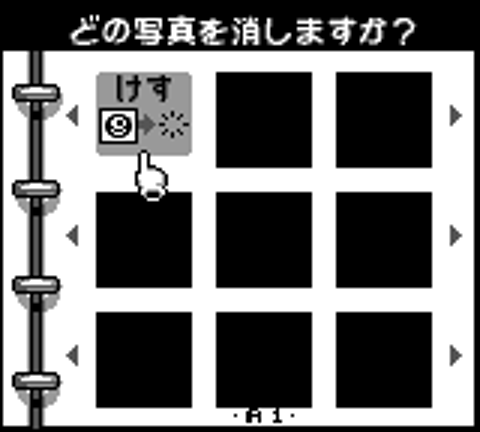

[README](../README.md) · [Section index](index.md)

## 8. Boot procedure & hidden factory test mode

**Confirmed, fully traced.** During normal boot, bank $0A's `Cam_BootSelfTest_Entry` (`$6A52`) is
called unconditionally (far-call from bank $000's init sequence) with interrupts briefly disabled.
It:

1. Reads the **held** buttons (`$ffa1`, not newly-pressed — this has to be held *through* power-on).
2. If held buttons `== $FD` (everything **except B**) → jumps into the hidden diagnostic screen (below).
3. Else if held buttons `== $FF` (literally everything) → jumps to `0A:6B73` (it is the **STORE PLEASE WAIT** first-boot calibration screen, below). Not exercised: BGB's demo input `$FF` is read as no key (`$FFA1` = 0), so this branch is static reading only (?).
4. Else (normal boot): calls two far stubs of bank $0A, `0A:7D04` (`Cam_FarStub_ValidityCheck`; it is a `call $45C9` = `Cam_Calib_ValidityCheck`, which loads the SRAM calibration vector and then runs `Cam_Calib_Loader` → `Cam_Calib_BootMeasureSeq` → the gain probe `Cam_ExposureBandSelect`) and `0A:7D10` (`Cam_FarStub_LiveInit`; `call $50AA` = `Cam_LiveInit`, which runs the gain probe again and loads the first live registers). **They are not "pings": the first one measures**, with 58 register loads on a real camera's sensor bus (§18.4). It returns nonzero (`$FF`) only when both SRAM copies of the calibration vector are twelve `$AA`; then the boot goes to `0A:6B73`, prints **STORE PLEASE WAIT** and runs the first-time calibration (`Cam_FullCalibration`, via the stub `0A:7D0A`; §6, §18.5) and ends on a `jr` loop at `0A:6BDB`. So `0A:6B73` is reached by holding every key or by a blank calibration vector, **not** by a sensor that does not answer.

### The hidden combo, decoded completely

Hold **A+Select+Start+Right+Left+Up+Down** (everything except B) while powering on. This enters
`Cam_FactoryDiag_AllButtonsExceptB`, a genuine factory self-test screen never shown in normal play:

**Screen 1** (font from bank `$24` `$57E0`, layout from bank `$25` `$5840`, decoded via the
discovered charset):
```
*******CHECK**####**############
####PLEASE#WAIT#################
#GAIN8##########################
#GAINA##########################
```
It then pokes four live SRAM reads onto this screen as hex digit pairs:
- `$04FF0`,`$04FF1` → next to "GAIN8"
- `$04FFC`,`$04FFD` → next to "GAINA"

(plus further readouts from WRAM `$d5bf`/`$d5c0` and HRAM `$ff8d-$ff91` at other screen positions —
these are the calibration-checksum result bytes from §6, displayed live).

Final pass/fail: `$ff91 == 0` → loads a row reading **"OK"** (plays sound `$16`); nonzero → loads a
row reading **"NG"** (plays sound `$29`, the tune that the "no blank frames" screen asks for one time in three: §16.20). Either way it then **spins forever** (`jr $-2`) — this is
a true production-line test screen, dead-ends by design, requires a hard reset to leave.

**Screen 2** (same font, tilemap at bank `$25` `$5AC0`) is the ordinary player-visible message,
confirmed byte-for-byte:
```
#######STORE####################
####PLEASE#WAIT#################
```
— i.e. this **is** the same "STORE... PLEASE WAIT" screen that appears on completely ordinary boots
when the SRAM calibration data needs (re)writing, which is why holding all-buttons-except-B during
a normal cold boot with valid save data still shows it: the diagnostic screen is a superset of the
normal calibration-repair flow, not a separate code path.

### Second hidden combo (Select+Start+Up) — RESOLVED: "erase ALL photos?" shortcut in the *erase* album

**Short answer.** Select+Start+Up is a hidden shortcut that exists **only on the "erase a photo"
album screen** (「どの写真を消しますか？」, *which photo do you want to erase?*). Pressing it there swaps the
message for **「すべての写真を消しますか？」 ("Erase ALL photos?")** and pops up a Yes/No box
(**A はい / B いいえ**). **A** erases every photo in the album (one after another, with a sound and
animation per photo, until the photo count reaches 0); **B** cancels and nothing changes. It is the
"all photos" counterpart of the documented boot-time Start+Select+A, which erases *all save data*
(settings, Game Face, high scores, …) rather than just the photos. It does nothing at boot, nor on
the "どの写真を見ますか？" (view) screen, by construction (see below). The [GameFAQs cheats page](https://gamefaqs.gamespot.com/gameboy/564359-game-boy-camera/cheats) lists both erase shortcuts in its erase-memory entry (Start + Select at power-on; Select, Start and Up in the delete setting); §16.18 reran them in my core and in BGB and ran both copies of the test (states `0F:03` and `0F:02`).

| | |
|---|---|
| Screen (emulator, thumbnails black because of the stand-in MBC, see note) |  |
| After Select+Start+Up |  |
| Same screen, background layer reconstructed from ROM with real thumbnails from a JP save (Yes/No sprites omitted) |  |

*Capture note:* the two emulator shots come from PyBoy with the cartridge header patched to MBC5 and
the camera self-test call at `$2EA1` and the sensor busy-wait loops NOP-ed out in the **emulation copy
only** (the ROM in the repo is untouched), because PyBoy has no Pocket-Camera mapper. Album UI logic is
unaffected; photo thumbnails/viewer images come out black. The third image is built offline by
`tools/render_state10.py` from the ROM tiles + a real save.

`$d561` already holds the photo count (30 in the test save) at the main menu, before any other mode
is visited, and the screen is the *erase* picker, not the view picker.

**How the game is organised (new, needed to read the above).** `$d5ce` is the *mode*, `$d5cf` the
*state inside the mode*. Modes are dispatched from a table of 3-byte entries (entry lo, entry hi,
ROM bank) at `$2F3F` (used by `Call_000_2f39`). Bank $004 hosts modes `$01`, `$09`, `$0A`, `$0F`,
`$10`, `$11`, so "bank $004" is not one screen. The relevant ones:

| mode | bank:entry | what it is |
|---|---|---|
| `$0A` | 4:`$7488` | "どの写真を見ますか？" — view picker (message index `$d5d6=1`, icon `$d5d7=2` = みる) |
| `$09` | 4:`$683f` | sibling picker, same family |
| **`$0F`** | 4:`$4649` (= `Bank004_State*` table) | **"どの写真を消しますか？" erase picker** (`$d5d6=2`, `$d5d7=0` = けす) and its photo viewer/animation states |

(The full 34-entry mode table is in §2.3.)

**Code path.** In mode `$0F` the browse loop is local state 3 (state 13 is its twin, state 2 is the
variant after a page change). Both contain the same test (`Bank004_State02` ~`$4859`,
`Bank004_State13` ~`$490e`):

```
    ldh a,[$ffa1]       ; buttons HELD this frame
    cp  $4c             ; must be EXACTLY Select(bit2)+Start(bit3)+Up(bit6), nothing else held
    jr  nz, not_combo
    ldh a,[$ffa2]       ; buttons NEWLY pressed this frame
    and $4c             ; at least one of the three must be new (edge, not level)
    jr  z, not_combo
    ld  a,[$d561]       ; photo count
    and a
    ret z               ; no photos -> nothing to erase -> ignore
    ld  a,$03 : call Call_000_2a7c    ; sound $03
    ld  a,$0a : ld [$d5cf],a          ; local state 10 = Bank004_State10 ($4d1b)
```

It is evaluated only after A, B and the D-pad handlers have declined the frame, so pressing A/B or any
other direction at the same time prevents it. `Bank004_State10` ($4d1b) then:

1. redraws the thumbnails of the current page (`Call_004_440b`, 8 per page, from SRAM slot+`$0E00`);
2. loads bank `$19:$7560` (0x280 bytes, 40 tiles) to `$8800` — **the Japanese message strip
   「すべての写真を消しますか？」** (render: `roms/jp_rev_a/captures/erase_all_confirm_reconstructed_bg.png`) — and
   bank `$19:$77e0` (0x600 bytes) to `$8080`, the big **A はい / B いいえ** sprite lettering
   (`Call_004_4df9` jitters these two sprites, OAM templates `$B4/$B5`, by ±1 px every other frame);
3. waits: **B** → sound `$04`, restore the normal strip (`$0E:$4500`) and tiles (`$13:$5880`), back to
   state 2; **A** → `$dbcd=1`, `Call_004_5104` plays a sound (`$05`) and an 8-step effect over the 8
   thumbnails, then loops
   `while [$d561] != 0 { far-call bank2:$44FB(photo 0) ; Call_004_50e5 }`.
   `bank2:$44FB` marks one entry of the state vector `$FF`, rewrites it to SRAM and re-compacts
   (`$4466`, which also recounts `$d561`), so the loop terminates when the album is empty.

**Verified in the emulator** (save with 30 photos, mode forced to `$0F`, state 0): pressing
Select+Start+Up moves `$d5cf` from 3 to 10 and shows the confirmation; **A** takes `$d561` from 30 to 0
and the 30-byte state vector at `$d563` to all `$FF` in about 2 s; **B** leaves `$d561=30` and the
vector unchanged.

**Why it "does nothing" on a real camera.** (1) The check exists only in mode `$0F`'s browse states,
so it is dead at boot, on the main menu, in the camera, and in the view picker. (2) `$ffa1` must equal
exactly `$4c`. (3) With 0 photos (`$d561==0`) it silently returns. 

**How the game enters mode `$0F` (C, BGB; §16.31).** Three routes from the main menu, each with its own writer of `$D5CE`: STUDIO page (Select) > EDIT (Down, A) > ALBUM (A) writes the mode from the table `03:7D17` (`$0F` = ALBUM, `$12` = ANIMATION) at `03:7CD7` and enters at state 0, then 3 (the delete grid); VIEW > ALBUM > the photo menu > Down (DELETE page, mode `$0A` state 8) > A writes `$0F` at `04:7ACA` and enters at state 5, then 6 (the DELETE?? YES / NO confirm); SHOOT menu > CHECK > photo > Down (mode `$09` state 6) > A writes it at `04:6D2A`, the same entry. The two `ld a,$0F` writes (`04:6D28`, `04:7AC8`) follow an A = yes answer to the sliding Yes / No dialog of the photo menu and carry the photo index (`$D5ED` / `$D5EE`) into `$D5D8`; the EDIT route chooses the photo in the grid.

---
