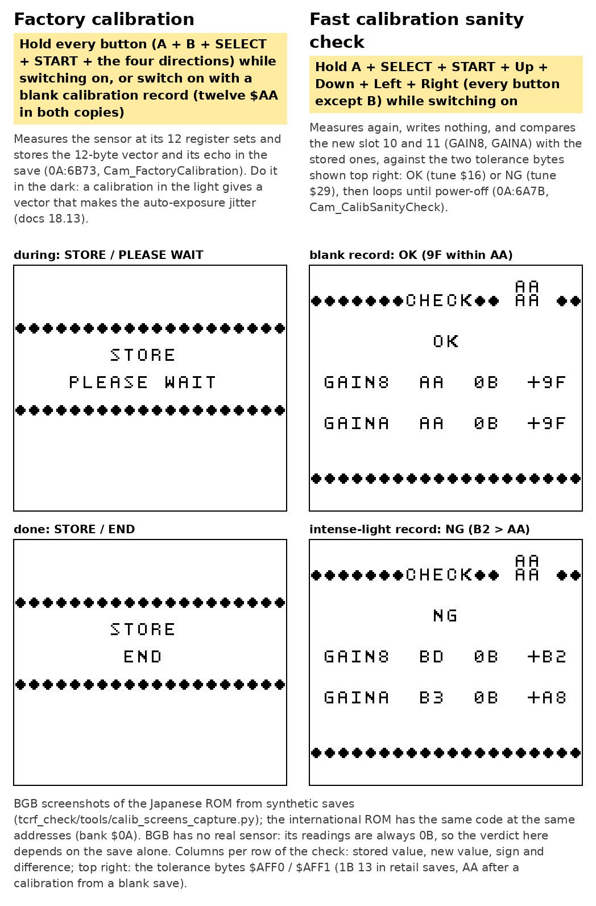
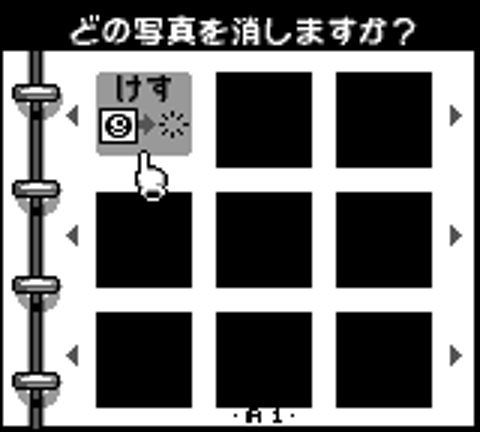
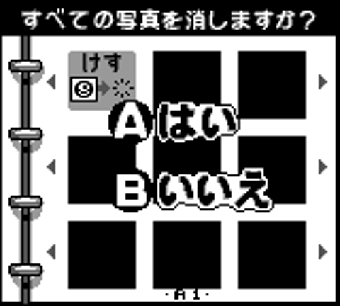
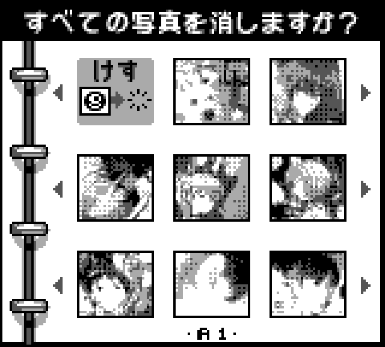

[README](../README.md) · [Section index](index.md)

## 8. Boot procedure, the factory calibration and the fast calibration sanity check

The two hidden boot screens are named, by the owner (2026-11-02), the **factory calibration** (every button held, or a blank calibration record) and the **fast calibration sanity check** (every button except B). These names are used throughout this repository (labels `Cam_FactoryCalibration` and `Cam_CalibSanityCheck`).

**Confirmed, fully traced.** During normal boot, bank $0A's `Cam_BootSelfTest_Entry` (`$6A52`) is
called unconditionally (far-call from bank $000's init sequence) with interrupts briefly disabled.
It:

1. Reads the **held** buttons (`$ffa1`, not newly-pressed — this has to be held *through* power-on).
2. If held buttons `== $FD` (everything **except B**) → the **fast calibration sanity check** (`Cam_CalibSanityCheck`, `0A:6A7B`, below).
3. Else if held buttons `== $FF` (literally everything) → the **factory calibration** (`Cam_FactoryCalibration`, `0A:6B73`, below). Not exercised: BGB's demo input `$FF` is read as no key (`$FFA1` = 0), so this branch is static reading only (?).
4. Else (normal boot): calls two far stubs of bank $0A, `0A:7D04` (`Cam_FarStub_ValidityCheck`; it is a `call $45C9` = `Cam_Calib_ValidityCheck`, which loads the SRAM calibration vector and then runs `Cam_Calib_Loader` → `Cam_Calib_BootMeasureSeq` → the gain probe `Cam_ExposureBandSelect`) and `0A:7D10` (`Cam_FarStub_LiveInit`; `call $50AA` = `Cam_LiveInit`, which runs the gain probe again and loads the first live registers). **They are not "pings": the first one measures**, with 58 register loads on a real camera's sensor bus (§18.4). It returns nonzero (`$FF`) only when both SRAM copies of the calibration vector are twelve `$AA`; then the boot goes to the factory calibration as well. So the factory calibration is reached by holding every key or by a blank calibration record, **not** by a sensor that does not answer, and **not** on an ordinary boot with a valid record.



*BGB screenshots* (C; `roms/jp_rev_a/experiments/secret/`, taken by `tools/jp/calib_screens_capture.py` from synthetic saves and composed by `tools/jp/secret_screens_pair.py`). Left, the factory calibration, opened through a blank record (BGB reads a demo byte of `$FF` as no key, so the every-button way in cannot be replayed; both reach `0A:6B73`): STORE / PLEASE WAIT during the measurement, STORE / END when it is done. Right, the fast calibration sanity check, with the demo byte `$FD` held through the boot: **OK** with a blank record, **NG** with the intense-light record of camera `CE10245109` (§18.13). BGB has no sensor model; its readings are always `$0B`, so there the verdict depends on the save alone. The verdict comes after about 3,900 frames (the 537 captures of the measurement). The international ROM has the same code at the same addresses (bank `$0A`, §1.5).

### The factory calibration (every button, or a blank record)

`Cam_FactoryCalibration` (`0A:6B73`) loads the font of bank `$24` (`$57E0`) and the tile map `Map_25_5AC0_Cam_FactoryCalibration` (STORE / PLEASE WAIT), plays `MUSIC_JINGLE`, and calls `Cam_FullCalibration` (`0A:4947`, via the stub `0A:7D0A`): 12 offset searches (`Cam_FactoryMeasure1`), 12 threshold scans (`Cam_FactoryMeasure2`), then `Cam_CommitVectorToSRAM` writes the 12-byte vector and its checksum to both copies (`$04FF2` and `$11FF2`, §6, §18.5). It then writes the row `Map_25_5D00_Cam_FactoryCalibration` (END) over PLEASE WAIT, plays song `$3F` (`MUSIC_RUN_RACE`, the music of the RUN! RUN! RUN! race), and stops on a `jr` loop (`Cam_FactoryCalibration_EndLoop`, `0A:6BDB`) until the power is cycled. It does **not** write the two tolerance bytes `$04FF0-$04FFF` (`$AFF0-$AFF1`): after a calibration from a blank save they stay `$AA`, while retail saves hold `1B 13` (§18.13). The light during the calibration matters: in the dark the vector is normal; under a strong or changing light the stored references are far apart and the auto-exposure jitters at its band switches afterwards (§18.13).

**What the sensor sees (C, code).** None of these captures is dithered: the boot and calibration loops fill the whole matrix `$A006-$A035` with one flat value (§7), so each capture is a binarized image, and only 12 pixels of it are read (`Cam_PixelTestHelper`, in the hidden lines above the photo, §18.3). The flat value is `$80` for the gain probe and for the 12 offset searches of part 1; in the 12 threshold scans of part 2 it starts at `$80` and moves by one per capture until 8 / 9 of the 12 pixels flip, and that midpoint is the stored vector byte; the five offset searches of every ordinary boot use the five band references of the vector (§18.4, §18.15). The prototype's source shows the same idea in an earlier form (§18.14, §19.9): `GET_OFFSET` fills the matrix with one value ("threshold `$55` (1 V)", `$80` in the version it runs) and lowers the offset until `CHECK_BLACK` finds every pixel of a probe tile in the middle of the picture black ("dots" in those comments are black pixels); the retail code keeps the flat threshold and the black-pixel test but probes 12 hidden pixels (9 of 12), searches in 8 captures and stores one reference per register set.

### The fast calibration sanity check (every button except B)

Hold **A+Select+Start+Right+Left+Up+Down** (everything except B) while powering on. `Cam_CalibSanityCheck` (`0A:6A7B`):

1. Loads the same font and the tile map `Map_25_5840_Cam_CalibSanityCheck`: a frame with CHECK at the top, PLEASE WAIT, and two rows labelled **GAIN8** and **GAINA** (gain index 8 and gain index `$A` = 10: slot 10 and slot 11 of the vector, the two highest-gain references).
2. Prints four stored bytes of RAM bank 2 in hex (`Cam_CalibSanityCheck_HexDigitWrite`): the **tolerance bytes** `$AFF0` and `$AFF1` (flat `$04FF0-$04FFF`) at the top right, one above the other; the **stored** slot 10 `$AFFC` after GAIN8 and the stored slot 11 `$AFFD` after GAINA.
3. Plays `MUSIC_JINGLE` and runs `Cam_CalibSanityCheck_Measure` (`0A:455A`, via `Cam_FarStub_CalibSanityCheck` `0A:7CE0`): the same `Cam_FactoryMeasure1` and `Cam_FactoryMeasure2` as the factory calibration (the same 172-row bus pattern, 537 captures in BGB), so a new 12-byte vector in WRAM, but **no `Cam_CommitVectorToSRAM`: the save is not changed**. It compares only the new slot 10 (`$D5BF`) with `$AFFC` and the new slot 11 (`$D5C0`) with `$AFFD`: for each, the absolute difference goes to `$FF8E` / `$FF90` and a sign tile to `$FF8D` / `$FF8F` (`$24` = "+" when the stored value is the larger, `$25` otherwise). The test passes when difference 10 ≤ `$AFF0` **and** difference 11 ≤ `$AFF1` (`hCalibSanityPassFlag` `$FF91` = 0).
4. Prints, on each GAIN row, the new value, the sign and the difference (`Cam_CalibSanityCheck_ByteToTiles`), then replaces PLEASE WAIT with **OK** (`Map_25_5A80_Cam_CalibSanityCheck_OkRow`, song `$16` `MUSIC_CALIB_SANITY_OK`) or **NG** (`Map_25_5AA0_Cam_CalibSanityCheck_NgRow`, song `$29` `MUSIC_TOTAKA_TUNE`, the tune that the "no blank frames" screen asks for one time in three: §16.20), and **spins forever** (`jr` at `0A:6B54`): only a power cycle leaves it.

So it is a **sanity check of the stored calibration**: the sensor measured now, in the current light, must give the two highest-gain references within the tolerances written in the save. **I:** a production-line check, presumably made in the dark like the calibration: slots 10 and 11 react most to light and to a faulty sensor. It sees only 2 of the 12 references, so a vector spoiled only in slots 0-9 would pass, and it is not faster to run than the factory calibration (it makes the same measurement); what it saves is the write.

**What it would say with the three calibrations of `CE10245109`** (§18.13; from the code, I for the readings of a real sensor): with the tolerance bytes those saves hold (`AA AA`, 170), a difference fails only beyond 170, so a dark reading (new slot 10 / 11 about `$67` / `$68`) passes for all three records; it fails only for readings far from the stored ones (BGB's `$0B` against the intense-light `$BD` / `$B3`: 178 and 168, NG on slot 10, the screenshot above). With the retail tolerances `1B 13` (27, 19):

| stored record (slot 10 / 11) | check run in the dark (new ≈ `$67` / `$68`) | check run in the same strong light |
|---|---|---|
| dark (`67 68`) | OK (a few units) | probably NG |
| intense light (`BD B3`) | **NG** (86 > 27, 75 > 19) | probably OK |
| varying light (`BC B3`) | **NG** (85, 75) | probably OK |

A test on a real camera (owner, if wanted): write `1B 13` at flat `$04FF0-$04FFF` (outside the vector's checksum, nothing else to change), boot with every button except B held in the dark, once with the intense-light save and once with the dark save: NG, then OK, is predicted.

**Earlier text corrected (2026-11-02).** This section used to say that the tolerance bytes are printed next to GAIN8 and the stored references next to GAINA, that STORE / PLEASE WAIT appears on ordinary boots, that the check is "a superset" of the calibration, and that BGB never shows the verdict. The screen code (`0A:6AB6-6B20`) and the BGB runs above show the layout given here; STORE / PLEASE WAIT appears only for the factory calibration; the check does not calibrate; the verdict comes after about 3,900 frames.

### Second hidden combo (Select+Start+Up) — RESOLVED: "erase ALL photos?" shortcut in the *erase* album

**Short answer.** Select+Start+Up is a hidden shortcut that exists **only on the "erase a photo"
album screen** (「どの写真を消しますか？」, *which photo do you want to erase?*). Pressing it there swaps the
message for **「すべての写真を消しますか？」 ("Erase ALL photos?")** and pops up a Yes/No box
(**A はい / B いいえ**). **A** erases every photo in the album (one after another, with a sound and
animation per photo, until the photo count reaches 0); **B** cancels and nothing changes. It is the
"all photos" counterpart of the documented boot-time Start+Select+A, which erases *all save data*
(settings, Game Face, high scores, …) rather than just the photos. It does nothing at boot, nor on
the "どの写真を見ますか？" (view) screen, by construction (see below). The [GameFAQs cheats page](https://gamefaqs.gamespot.com/gameboy/564359-game-boy-camera/cheats) lists both erase shortcuts in its erase-memory entry (Start + Select at power-on; Select, Start and Up in the delete setting); §16.18 reran them in my core and in BGB and ran both copies of the test (states `0F:03` and `0F:02`).

| | |
|---|---|
| Screen (emulator, thumbnails black because of the stand-in MBC, see note) |  |
| After Select+Start+Up |  |
| Same screen, background layer reconstructed from ROM with real thumbnails from a JP save (Yes/No sprites omitted) |  |

*Capture note:* the two emulator shots come from PyBoy with the cartridge header patched to MBC5 and
the camera self-test call at `$2EA1` and the sensor busy-wait loops NOP-ed out in the **emulation copy
only** (the ROM in the repo is untouched), because PyBoy has no Pocket-Camera mapper. Album UI logic is
unaffected; photo thumbnails/viewer images come out black. The third image is built offline by
`tools/render_state10.py` from the ROM tiles + a real save.

`$d561` already holds the photo count (30 in the test save) at the main menu, before any other mode
is visited, and the screen is the *erase* picker, not the view picker.

**How the game is organised (new, needed to read the above).** `$d5ce` is the *mode*, `$d5cf` the
*state inside the mode*. Modes are dispatched from a table of 3-byte entries (entry lo, entry hi,
ROM bank) at `$2F3F` (used by `Call_000_2f39`). Bank $004 hosts modes `$01`, `$09`, `$0A`, `$0F`,
`$10`, `$11`, so "bank $004" is not one screen. The relevant ones:

| mode | bank:entry | what it is |
|---|---|---|
| `$0A` | 4:`$7488` | "どの写真を見ますか？" — view picker (message index `$d5d6=1`, icon `$d5d7=2` = みる) |
| `$09` | 4:`$683f` | sibling picker, same family |
| **`$0F`** | 4:`$4649` (= `Bank004_State*` table) | **"どの写真を消しますか？" erase picker** (`$d5d6=2`, `$d5d7=0` = けす) and its photo viewer/animation states |

(The full 34-entry mode table is in §2.3.)

**Code path.** In mode `$0F` the browse loop is local state 3 (state 13 is its twin, state 2 is the
variant after a page change). Both contain the same test (`Bank004_State02` ~`$4859`,
`Bank004_State13` ~`$490e`):

```
    ldh a,[$ffa1]       ; buttons HELD this frame
    cp  $4c             ; must be EXACTLY Select(bit2)+Start(bit3)+Up(bit6), nothing else held
    jr  nz, not_combo
    ldh a,[$ffa2]       ; buttons NEWLY pressed this frame
    and $4c             ; at least one of the three must be new (edge, not level)
    jr  z, not_combo
    ld  a,[$d561]       ; photo count
    and a
    ret z               ; no photos -> nothing to erase -> ignore
    ld  a,$03 : call Call_000_2a7c    ; sound $03
    ld  a,$0a : ld [$d5cf],a          ; local state 10 = Bank004_State10 ($4d1b)
```

It is evaluated only after A, B and the D-pad handlers have declined the frame, so pressing A/B or any
other direction at the same time prevents it. `Bank004_State10` ($4d1b) then:

1. redraws the thumbnails of the current page (`Call_004_440b`, 8 per page, from SRAM slot+`$0E00`);
2. loads bank `$19:$7560` (0x280 bytes, 40 tiles) to `$8800` — **the Japanese message strip
   「すべての写真を消しますか？」** (render: `roms/jp_rev_a/captures/erase_all_confirm_reconstructed_bg.png`) — and
   bank `$19:$77e0` (0x600 bytes) to `$8080`, the big **A はい / B いいえ** sprite lettering
   (`Call_004_4df9` jitters these two sprites, OAM templates `$B4/$B5`, by ±1 px every other frame);
3. waits: **B** → sound `$04`, restore the normal strip (`$0E:$4500`) and tiles (`$13:$5880`), back to
   state 2; **A** → `$dbcd=1`, `Call_004_5104` plays a sound (`$05`) and an 8-step effect over the 8
   thumbnails, then loops
   `while [$d561] != 0 { far-call bank2:$44FB(photo 0) ; Call_004_50e5 }`.
   `bank2:$44FB` marks one entry of the state vector `$FF`, rewrites it to SRAM and re-compacts
   (`$4466`, which also recounts `$d561`), so the loop terminates when the album is empty.

**Verified in the emulator** (save with 30 photos, mode forced to `$0F`, state 0): pressing
Select+Start+Up moves `$d5cf` from 3 to 10 and shows the confirmation; **A** takes `$d561` from 30 to 0
and the 30-byte state vector at `$d563` to all `$FF` in about 2 s; **B** leaves `$d561=30` and the
vector unchanged.

**Why it "does nothing" on a real camera.** (1) The check exists only in mode `$0F`'s browse states,
so it is dead at boot, on the main menu, in the camera, and in the view picker. (2) `$ffa1` must equal
exactly `$4c`. (3) With 0 photos (`$d561==0`) it silently returns. 

**How the game enters mode `$0F` (C, BGB; §16.31).** Three routes from the main menu, each with its own writer of `$D5CE`: STUDIO page (Select) > EDIT (Down, A) > ALBUM (A) writes the mode from the table `03:7D17` (`$0F` = ALBUM, `$12` = ANIMATION) at `03:7CD7` and enters at state 0, then 3 (the delete grid); VIEW > ALBUM > the photo menu > Down (DELETE page, mode `$0A` state 8) > A writes `$0F` at `04:7ACA` and enters at state 5, then 6 (the DELETE?? YES / NO confirm); SHOOT menu > CHECK > photo > Down (mode `$09` state 6) > A writes it at `04:6D2A`, the same entry. The two `ld a,$0F` writes (`04:6D28`, `04:7AC8`) follow an A = yes answer to the sliding Yes / No dialog of the photo menu and carry the photo index (`$D5ED` / `$D5EE`) into `$D5D8`; the EDIT route chooses the photo in the grid.

---
