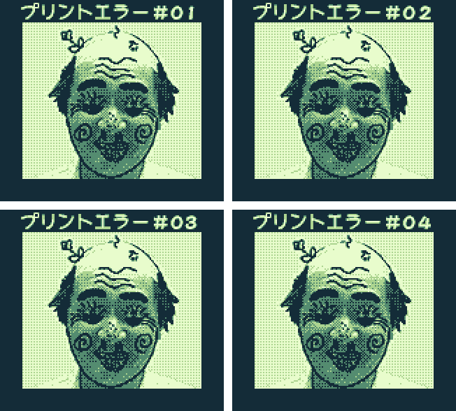
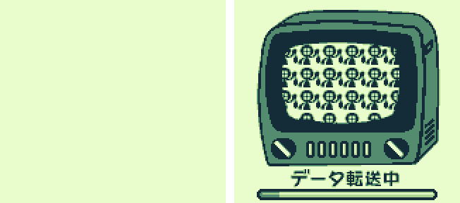
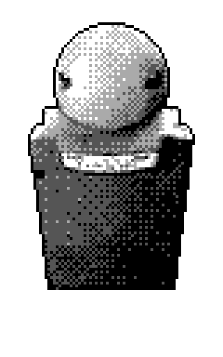
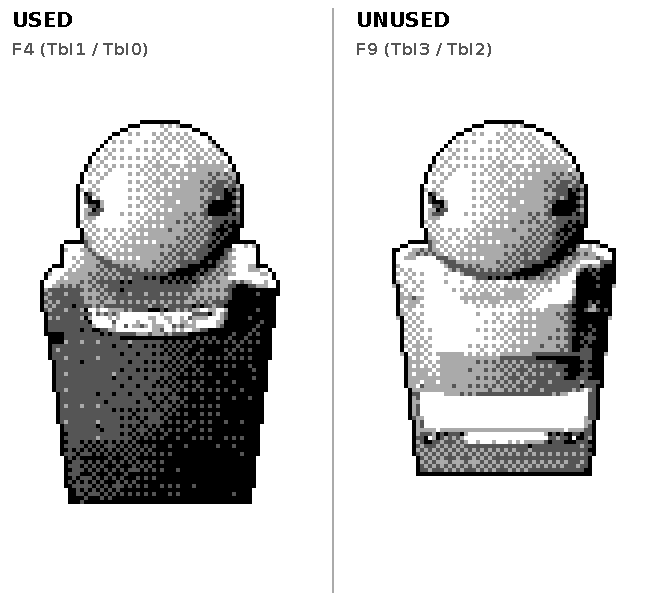
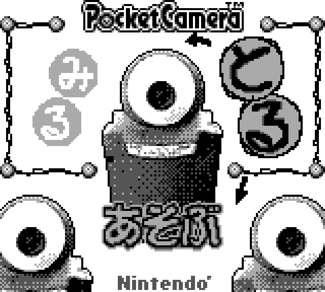
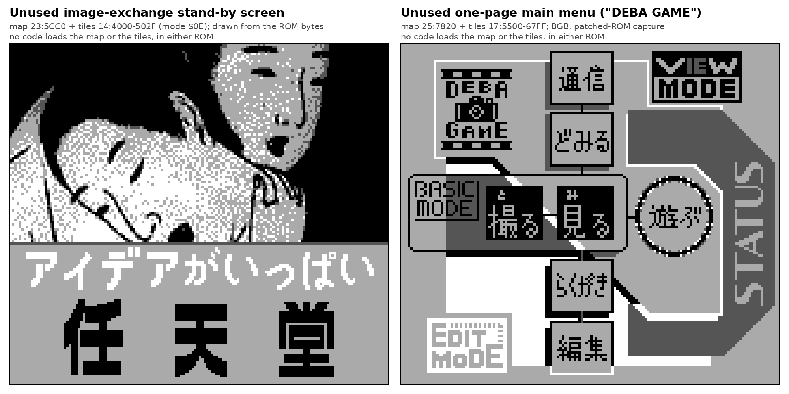
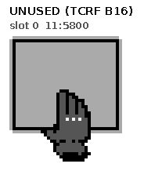

[README](../README.md) · [Section index](index.md)

## 16. Menu names, the international ROM, and BGB cross-validation

*Why this section exists.* The owner attached the Funtography guide (the US manual) and BGB and asked: when there is no idea what a menu is, enter the same joypad sequence on the international ROM and show the menu if it is not in the guide; he had earlier asked to confirm findings in BGB. This section gives both results. Evidence tags: **C** = code traced, or seen on a screenshot, or reproduced in BGB; **I** = inferred; **?** = not established (never guessed). "Guide" = the Funtography guide; page numbers are the *printed* ones of its table of contents (Arcade 34, Music 36, Link 42, Special 44, Doodle 47, Edit 48). The first lines of this README still apply: none of this has been validated by a human.

### 16.1 The Japanese and the international ROM are two different builds (C)

Byte comparison, bank by bank (16,384 bytes each), Japanese Rev A against the international ROM used here (md5 `42d2f65e2549be9d1d126a6828b5d1c1`):

| Banks | Bytes that differ |
|---|---|
| `$00`-`$09` (all the menu and mode code) | 12,696 · 8,874 · 11,329 · 14,932 · 10,792 · 14,883 · 12,487 · 14,067 · 9,113 · 11,778 |
| `$0A` (sensor driver, §10) | **61** |
| `$22` | 138 |
| `$35` | 0 (the only identical bank) |
| all 64 banks | 466,317 of 1,048,576 |

So the menu logic of banks `$003`-`$009` is **not** structurally identical: only the sensor / exposure bank is nearly the same. What the two builds share is the **numbering of the modes and the flow of the states**. Replaying the 206 joypad-only paths of the Japanese corpus (one target (mode, state) each; my core reaches the target 156 times on the Japanese ROM): on the international ROM the same inputs reach the same (mode, state) **128 times** (92 with the inputs unchanged, 36 after the single rule of §16.3) and the same mode 162 times; a native exploration of the international ROM reaches 140 of its 187 targets; **150** distinct (mode, state) signatures were reached on both ROMs (161 on the Japanese ROM, 166 on the international ROM counting both international runs). What each path reached is in `tcrf_check/assets/atlas2/{JP,INTL,INTL2}/result.json`, the Japanese / international pairs of the same inputs are the contact sheet `tcrf_check/assets/intl_compare/sheet_same_inputs.png`. Tool: `tcrf_check/tools/atlas_replay.py` (`MIRROR=1 GBCAM_ROM=...`), `tcrf_check/tools/atlas_sheet.py`, `tcrf_check/tools/intl_replay.py`.

### 16.2 Names of the 34 modes (screen text, Japanese / international / guide)

Read from the screens (C for what is printed on them; the guide column says where the guide uses the same word). Items in **bold** are what the guide or the international screen calls the thing; the Japanese texts are copied as I read them from the screenshots (CJK in screenshots is the part most likely to contain a misreading).

| Mode | Japanese screen | International screen | Guide |
|---|---|---|---|
| `$00` | main menu: みる (VIEW, left), とる (SHOOT, right), あそぶ (PLAY, below); lower page (Select): らくがき, つうしん, とくしゅ, へんしゅう. State 0 also carries the power-on prompt "セーブデータを全て消しますか? はい···A いいえ···B" | **SHOOT** (left), **VIEW** (right), **PLAY** (below) — **mirrored** (§16.3); lower page shows **DOODLE** and **SPECIAL**; prompt "erase all saved data? YES···A NO···B" | "Shoot/View/Play Menu"; Select = the "Studio Menu" (Link, Special, Doodle, Edit) |
| `$01` | とる / アイテム / まほう / チェック / にげる, caption 女王さまがあらわれた! (an RPG battle window). In the core: とる → `$15` → `$14`; アイテム → states 6-7 of the same mode (then `$15`); まほう → `$16`; チェック → `$09`; にげる → states 9-A of the same mode | **SHOOT / ITEMS / MAGIC / CHECK / RUN**, captions "Welcome to my parlor!" / "Let's play!" | Game Face sidebar: "the Shoot Menu … is modeled after RPG menus"; "Check mode serves essentially the same function as Album" (code: CHECK → `$09`, the album viewer); "Run is a joke command that has no practical use" (code: stays in mode `$01`) |
| `$02` | みる / どみーる (the label どみーる is on the right button, which opens SHOW: SLIDE SHOW / ANIMATION / HOT-SPOT; the owner: "a good approximation for HOT-SPOT", I) | **ALBUM / SHOW** | View: Album, Show |
| `$03` | ピクトリップ / ごうせい (picture of a stone lantern and a doll, caption "Happy?") | **HOT-SPOT / COMPOSE** (Mario in a kart) | Special (44): Hot Spot, Compose |
| `$04` | caption スタンプ | caption **[STAMP]** | Doodle (47): Stamp, Paint |
| `$05` | アルバム / アニメーション (dog photo with two speech bubbles) | **ALBUM / ANIMATION** | Edit (48): Album (Copy, Delete), Animation (Frame, Speed, Loop, Sort, Pack, Test, Clear) |
| `$06` | **ACCESS**: プリント / こうかん | **LINK**: PRINT / TRANSFER | Link (42): Print, Option, Transfer |
| `$07` | Space Fever II (the logo "SPACE FEVER II"); first-wave menu: **?** / **D.J.** / **BALL** with targets 30 / 10 / 5 | same | Arcade (34): Space Fever II, Ball, Run! Run! Run!; Music (36): DJ |
| `$08` | user screens: RECORD (撮影 / 消した写真 / 交換 / もらった写真 ♂♀ / プリント), HI-SCORE, NAME & SEX, BIRTH DATE, credits | **RECORD** (SHOTS / DELETED / TRANSFERS / RECEIVED ♂♀ / PRINTS), **HI-SCORE** (SPACE FEVER II / BALL / RUN! RUN! RUN!), credits ("CLIP THIS", "HELLO! … THANK YOU FOR USING THE GAME BOY CAMERA. PLEASE TAKE GOOD CARE OF IT. THE STAFF") | Start = "User Screen": Record, Hi-Score, Credits, Name & Sex, Birth Date, User Name, User ID |
| `$09` | single-photo viewer of the album (film-strip border, photo number) | same | Album (28-): Paint, Color, Speed, Stamp, Frame, Comment, Delete, Print |
| `$0A` | photo grid どの写真を見ますか? with the みる icon | **view which photo?** with the **VIEW** icon | View → Album |
| `$0B` | スライドショー / アニメーション / ピクトリップ (a monkey) | **SLIDE SHOW / ANIMATION / HOT-SPOT** | Show: Slide Show, Hot-Spot, Animation |
| `$0C` | photo grid with the ピクトリップ icon, then the photo (pointer hand) | **view which photo?** with **HOT-SPOT** | View → Show → Hot-Spot ("the Hot-Spots will no longer be visible") |
| `$0D` | スライドショー 1号, A おすざんす B やめるざんす; options ランダム再生 (ON/OFF) | **SLIDE SHOW #1**, A **ROLL IT**, B **CUT**; option **SHUFFLE** ON/OFF | Show: "ROLL IT" and "SHUFFLE" appear on the guide's menu map; Up/Down changes the speed |
| `$0E` | あげる / もらう (caption 待望のレディースコーナー); after the exchange あげました / もらいました and よろしい | **SEND / RECEIVE** (caption "PRESS A TO BEGIN"); after the exchange **sent / received** and **GOOD** | Link → Transfer: "one must highlight Send while the other picks Receive … both cameras will display 'good'" |
| `$0F` | どの写真を消しますか? (けす icon); confirm 消しますか?? はい / いいえ | **delete which photo?**, **DELETE??** YES / NO | Album → Delete; Edit → Album → Delete |
| `$10` | ペイント (photo grid with the らくがき icon) | **PAINT** (grid caption **DOODLE**) | Doodle: Paint (Speed: Fast ··· Slow) |
| `$11` | スタンプ; confirm セーブしますか? はい / いいえ | **STAMP**; **SAVE?** YES / NO | Doodle: Stamp |
| `$12` | animation tools bar: ループ, コマおとし (popup title), two more entries I could not read, オールクリア | **LOOP / SORT / PACK / TEST / CLEAR** ("TOOLS"), popup SORT: CANCEL / Normal / Shuffle | Edit → Animation: Loop, Sort, Pack, Test, Clear (the guide does not mention a "Normal / Shuffle" choice of SORT) |
| `$13` | アニメーション (A ボタンではじまるよ) | **ANIMATION** "press A to begin. use ↕ to select music." | Edit → Animation |
| `$14` | live view "のこり30"; option cross はんてん / パレット / (ベタぬり) / シャッター音; きろく / やめる | "30 left"; **flip / palette / dither / shutter**; **SAVE / CANCEL**; "no blank frames." | Shoot: Brightness, Contrast, Flip, Dither, Palette, Shutter |
| `$15` | セルフタイマー (…秒) / かんかく · さつえいまいすう | **Self-timer** / **Interval · Exposures** | Items (18): Self-timer, Time-lapse |
| `$16` | とーるくん: とくしゅレンズ / モンタージュ / パノラマでポイ / ゲームモデル | **SHUTTERBUG**: **TRICK LENSES / MONTAGE / PANORAMA / GAME FACE** | Magic: Trick Lenses, Montage, Panorama, Game Face (Shoot, Play, Doodle) |
| `$17` | 4ぶんかつ / フュージョン (つくる) | **SPLIT / FUSION** (BEGIN) | Special → Compose: Split, Fusion |
| `$18` | パノラマプリント (A プリント / B やめる) | **PANORAMA** (A PRINT / B CANCEL, "scroll ↕ to select") | Panorama Print |
| `$19` | title / copyright scenes: "© 1995 Creatures / © 1995 GAME FREAK", then, **only with the CoroCoro tag**, a second screen naming two authors and 小学館 (こしたてつひろ, 樫本学ヴ; the second name is read from the 8 × 8 glyphs, §16.12), then the title | "© 1995 Creatures / © 1995 GAME FREAK", then the title (no second screen, §16.5) | — |
| `$1A` | 写真をえらんで下さい (ピクトリップ icon) | **select photo.** (**HOT-SPOT**) | Special → Hot-Spot (Album A only) |
| `$1B` | GAME BOY Printer: プリント / オプション | **PRINT / OPTION** | Link → Print, Option |
| `$1C` | どの写真をプリントしますか? | **print which photo?** | Link → Print |
| `$1D` | データ転送中 (TV with dancing figures) | **transferring…** | — |
| `$1E` | OPTION: かんかく / ごうけい | **OPTION**: **FEED MARGIN / TOTAL PRINT** | Link → Option |
| `$1F` | **TRIPY-H** (page tabs SOUND I / SOUND II / NOISE; title screen 「TO COOL YOU DOWN, STIR YOU UP, AND DRIVE YOU CRAZY.」 with COOL DATA: SAMPLE / NEW / SAVE DATA); reached in the replay of §17.6 from the `D.J.` target of mode `$07` | | Music (36): DJ |
| `$20` | BGM 2, 顔ボル, ゲーム A スタート B でる | **BALL**, GAME A START B EXIT, "FACE 12?" | Arcade: Ball ("the juggling game") |
| `$21` | RUN! RUN! RUN! (speech bubbles with instructions) | **RUN! RUN! RUN!** ("▲ to jump") | Arcade: Run! Run! Run! |

What this settles: what the main-menu items 3-6 and mode `$0B` are and which game each of the modes `$07`, `$1F`, `$20`, `$21` is are answered by the screens; the names of the **mode `$16` pages and the SHOOT variants** are answered as far as the screen text goes (TRICK LENSES, MONTAGE, PANORAMA, GAME FACE: Chapter "Magic"), the visible effect of each variant is measured in §16.28. Not answered by the guide: the "Normal / Shuffle" popup of SORT, the printer OPTION screen's FEED MARGIN / TOTAL PRINT meanings, the Japanese captions (女王さまがあらわれた!, 待望のレディースコーナー), and **どみーる**, which the pair above identifies with **SHOW** (the literal reading of the word is still open).

### 16.3 The main menu is mirrored in the international ROM (C)

Japanese: みる (VIEW) at the upper left, とる (SHOOT) at the upper right, あそぶ (PLAY) below; international: **SHOOT upper left, VIEW upper right, PLAY below**. The default cursor is SHOOT in both, so the single rule needed to replay a Japanese path on the international ROM is: **swap Left and Right while mode `$00` is in states 0-2**. After the swap the same keys lead to the same modes: A on items 0-6 goes to modes `$01 $02 $07 $04 $06 $03 $05` (`07:7804 + item`, both ROMs). Probe: `tcrf_check/assets/intl_compare/probe_jp/`, `probe_intl/`, `sheet_mainmenu_probe.png`; tool `tcrf_check/tools/mainmenu_probe.py`.

### 16.4 What the guide says that the code could check (C unless marked)

* **Hold A in the stamp tool**: the guide says "hold the A Button (for **about two seconds**)" to flip the stamp. The code needs **180 frames** (about **3.0 s**) before the first mirror and then 100 frames per further flip (§15.4); BGB agrees (§16.6). The guide's "two seconds" is an approximation or a different build; the name of the effect (reversal / mirror image) is the owner's, the code does the bit-reversal and the period 2. The [GameFAQs cheats page](https://gamefaqs.gamespot.com/gameboy/564359-game-boy-camera/cheats) says only "hold A while a stamp is selected".
* **Credits**: the guide says "finish the game in less than 22 seconds" (and, elsewhere, "a 22-second finish or better"). Code: stored `[$DAA7:$DAA6] >= $7799`, displayed **22:00 or lower** (§15.2): "or better" is the right reading. The guide's Record example shows "RUN! RUN! RUN! 15:99" and its Album B list asks for "17 seconds" / "16 seconds": the Run!Run!Run! record **is a time in seconds:hundredths** (C by the guide). The [GameFAQs cheats page](https://gamefaqs.gamespot.com/gameboy/564359-game-boy-camera/cheats) agrees: 22 seconds or less, and a displayed 22:00 exactly qualifies (§16.18).
* **Run!Run!Run! needs 2,000 points in Space Fever II** (guide, "Run! Run! Run!" under the hidden features). The code (`07:59F9-5A0E`) tests the best Space Fever II score (BCD, `DAA3-DAA0`): if `DAA3 = DAA2 = 0` and `DAA1 < $20` (below 2,000) the third target of the first-wave menu is shifted by `$40`: same figure (was "probable unlock, I", now C by the guide). The [GameFAQs cheats page](https://gamefaqs.gamespot.com/gameboy/564359-game-boy-camera/cheats) gives the same figure (2,000 or more points in Space Fever II); §16.18 plays Space Fever II past 2,000 and runs the gate with the real score.
* **Pokémon stamps / Ball 500** (TCRF) are not in the guide (the guide has no Pokémon stamps, see §16.5).
* **Transfer**: the guide says the photo "will disappear from the sender's album and reappear in the receiver's album", that both cameras display "good", and that the transferred photo shows the **name and gender of the sender in Comment mode**: exactly the SRAM effect of §14.6 (sender entry set to `FF`, receiver slot filled, owner ID, name and gender kept in the copied tag) and the end screens of §16.6. The [GameFAQs cheats page](https://gamefaqs.gamespot.com/gameboy/564359-game-boy-camera/cheats) asks for 5 transferred pictures for B19 (and, in a separate B3 line, for 15): the code needs 15 (§16.18).
* **Hot-spot**: "five hot spots per photo", effects are "transitional fade or wipe visuals (Effect)" plus Sound and Jump; "you won't be able to plant a trigger in Album B". All consistent with the block `$D643-$D660` (five flags, X, Y, sound, effect, jump) and with the tests `$D5D8 >= $1E` (stock picture).
* **Tools of the animation editor**: five tools (Loop, Sort, Pack, Test, Clear) = the five entries of the tools bar of mode `$12`.

### 16.5 Differences between the builds that the guide revealed (C)

1. **Album B unlock test.** Japanese `02:4D05` tests **8** conditions (`d` register: shoot 60, print 30, transfer 15, Ball 700, Ball 1000, Space Fever II 3000, 5000, Run!Run!Run! 17 s, §3.2). The international routine `02:4D0D-4DA0` tests **14**, exactly the guide's list for **B-17…B-30**, in the guide's order: bit 0..7 of `e` = shoot 60 (`DA96/97`), **delete 60** (`DA98/99`), transfer 15 (`DA9A/9B`), **receive 5 from males** (`DA9E >= 5`), **receive 5 from females** (`DA9F >= 5`), print 30 (`DA9C/9D`), Space Fever II 3000, 5000; bit 0..5 of `d` = Space Fever II **7000**, Ball **500**, 700, 1000, Run!Run!Run! 17 s (`DAA7 >= $82`), **16 s** (`DAA7 >= $83`). So the counters `10C3/10C4` (received from male / female senders, §14.6) are **used by the international ROM** to unlock B-20 / B-21 (the guide: "Photos B19, B20, and B21 will appear in Album B only after you've used the Link function"); the Japanese ROM does not test them. With saves whose counters are 99, the Japanese ROM shows Album B as pages B1-B3 and, **only with the CoroCoro tag**, a fourth page B4 with the CoroCoro pictures; the international ROM shows B1-B4 with or without the tag (`tcrf_check/assets/intl_compare/albumB/`; tool `tcrf_check/tools/albumb_pages.py`). The [GameFAQs cheats page](https://gamefaqs.gamespot.com/gameboy/564359-game-boy-camera/cheats) lists the same 14 conditions with the numbers B17-B30 and in the same order (apart from B19: 5 on the page, 15 in both ROMs); every threshold was run at the exact value in §16.18.
2. **The CoroCoro flag is always set in the international ROM.** Both ROMs contain the tag routine (`08:72E0` Japanese, `08:730E` international, constant `56 56 53`, "2 of 3 bytes" rule, rewrite of the tag). In the Japanese ROM the caller sets `$D582 := 1`, `$D562 := $1E` only when the tag matched. In the Japanese ROM the call at `08:72B2` (`call $72E0`) is followed by `jr nc` that skips the loads when the tag does not match. In the international ROM state 0 of mode `$19` calls the routine at `08:730E` (the call is at `08:72FC`) **and then loads `$D582 := 1`, `$D562 := $1E` unconditionally** (`08:72FF-7308`; the carry returned by the routine is not tested). Observed: in my core (table `tcrf_check/assets/intl_compare/boot_flags.txt`: `_ff`, `_zero`, a real save without tag and a save with the tag) **and in BGB** (`tcrf_check/assets/bgb/results/corocoro_tag_intl.txt`: the six tag values of §16.6 row 3 on the international ROM, all give `$D582 = 1`, `$D562 = $1E`, and a tag that does not match is left untouched) the international ROM leaves the boot with `$D582 = 1`, `$D562 = $1E`, the Japanese ROM only with the tag (`$D582 = 0`, `$D562 = $18` otherwise). Consequence: the content that the flag gates in `04:595B`/`5972` (stamp category 3) and `08:532A` (wild-frame pages 6 → 8) is available without a tag in the international ROM, and the image counts of Album B differ (`$D562` = 24 → 30 pictures in the Japanese ROM). What the international slots show, answered in §16.12: the flag gates **one** extra wild-frame page (7 pages instead of 6, `ld c,7` at `08:532A`; the Japanese `ld c,8` is at `08:52E0`) and the stamp category 3, and neither is CoroCoro art: wild frame 07 is Mario Kart 64, category 3 is Mario and Luigi stamps (BGB, C). The owner's answer for the real camera: it contains no CoroCoro content (I, the owner's report; the camera's ROM is byte-identical to this international ROM, §11.9).
3. **Second copyright screen** (mode `$19`): the Japanese ROM shows it only with the tag; the international boot never shows it (observed in the core over 1,000 frames, with and without tag): only the flag of point 2 is set.

### 16.6 BGB cross-validation (BGB 1.5.x under Wine, headless; demo files)

Method: BGB runs a **demo** (`-demoplay`: one joypad byte per frame, A=1 B=2 Select=4 Start=8 Right=$10 Left=$20 Up=$40 Down=$80), then dumps a **state file** (`-stateonexit`, WRAM/VRAM/SRAM chunks) and the **last screen** (`-screenonexit`); my tool `tcrf_check/tools/bgb_run.py` builds the demo, runs BGB and parses the state (mode `$D5CE` is at offset `$15CE` of the WRAM chunk). BGB needs **3 more boot frames** than my core for the same path (core free time 400 = BGB 403): with that shift the replay agrees. All the results below are in `tcrf_check/assets/bgb/results/*.txt` (screens and demos next to them; the 200 MB of BGB state files are not kept). Two instances can be linked on one computer with `-listen` / `-connect`, and they then run with **identical timing**.

| # | Check (README section) | Result in BGB | Tag |
|---|---|---|---|
| 1 | **Sweep**: the 206 joypad-only paths of the Japanese corpus replayed in BGB and compared with my core's end state (`tcrf_check/tools/bgb_compare.py`, `bgb_sig.py`) | 166 paths comparable (40 need the printer and were skipped): **135 exact**, 13 same mode but another state, **18 different** (targets `0B:00-01`, `0C:01/03`, `0D:00-04/06-08`, `13:01/02/07`, `14:05`, `1E:01/03`, the slide-show, hot-spot, animation-player and print-option paths: BGB ends in the album grid `0A:0x`, in `0F:06/07`, `01:01`, `01:04` or `14:02` instead). Without the 3-frame shift: 124 / 14 / 28 | C (agreement), ? (the 18) |
| 2 | **Credits gate** (§15.2): path to the credits (`08:17`) on the unlocking save CE10229233 and on its ordinary twin | unlocking save (stored `DAA6/DAA7 = 99 99`, displayed 00:00): reaches `08:17` (dancing man + real credits); ordinary save (stored `93 77` = displayed **22:06**, six hundredths above the gate): stays at `08:01` | C |
| 3 | **CoroCoro tag** (§15.2): tag bytes at `$1FFD-$1FFF` in an ordinary save | `56 56 53`, `56 56 00`, `00 56 53` → `$D582 = 1`, `$D562 = $1E`, tag rewritten to `56 56 53`; `56 00 00`, `00 00 00`, `AA AA AA` → `$D582 = 0`, `$D562 = $18`, bytes untouched. On the **international** ROM all six give `$D582 = 1`, `$D562 = $1E` (`results/corocoro_tag_intl.txt`, §16.5) | C |
| 4 | **Pokémon pages** (`04:5827`): `$D642 = min($DAA5, 5) + 4` | with the Ball value set in SRAM (`10CA`, checksums recomputed): `00..06, 10` → `$D642 = 04 05 06 07 08 09 09 09`; on 25 saves: rule holds on 18, on 7 the path did not reach the stamp tool (not a failure of the rule) | C |
| 5 | **Hold A mirrors the stamp** (§15.4), both ROMs | stamp work buffers unchanged at 150 / 175 frames, **mirrored at 185 / 230 / 275**, original again at 285 / 330 / 385, mirrored again at 395: first flip between 176 and 185 frames, the second between 276 and 285, the third between 386 and 395 (period about 100 frames), on the Japanese **and** the international ROM (`$D641` = 180, then 100 after the first flip; `results/stamp_hold_jp.txt`, `stamp_hold_intl.txt`; also on the [GameFAQs cheats page](https://gamefaqs.gamespot.com/gameboy/564359-game-boy-camera/cheats)) | C |
| 6 | **Hot-spot effects** (§15.5): effect k = 0..15 on a photo with one armed hot spot | BGB and core are in the same state at +30 and +90 frames after the A press for all 16 effects (`0C:04` at +30 for effects 1, 2, 3, 5, 6, 7, `0C:03` for the shorter ones 0, 4, 8-15; `0C:03` at +90 for all); **98.7 % of the pixels equal** on average (32 screen comparisons: 16 effects × two delays, +30 and +90 frames after the A press, `results/hotspot_effects.txt`); effects 8-15 behave alike | C |
| 7 | **Link exchange** (§14), BGB to BGB, both ROMs | sender vector entry 0 → `FF`; receiver first free entry → photo number `00`; receiver slot compared with the sender's: `F14` 0 → 1, checksums `F5A-F5B` / `FB6-FB7` and the echo byte `F70` change, the rest of the tag equal (the owner block `FB8-FC9` of slot 1 differs because each of the two test saves keeps its own owner there); sender counter `10BF` +1; end screens: Japanese あげました / もらいました + よろしい, international sent / received + GOOD. Same bytes on both ROMs | C |
| 8 | **Gender key** `$DA56` (§16.7) | see below | C |

(The two `bgb_link` instances confirm the **result** of the exchange, the SRAM signature of §14.6; they do not log the byte timing: the sniffer of §14 stays the only record of it. The receiver of the test already had `10BF-10C0` and `10C3/10C4` at 99 (cap), so the male / female counter itself was not seen to move in BGB; on the sender `10BF-10C0` went from `00 00` to `01 00` in BGB on both ROMs, `results/link_counters.txt`.)

### 16.7 Gender key: `$DA56` bit 0 = male, bit 1 = female (C)

Owner registration (Start on the main menu, name keyboard, page button, gender page) with an unregistered save (`CE10517662`), cursor on the first symbol after "?" and on the second: BGB gives `$DA56 = 00` for "?" (no move), **`01`** for the first symbol (♂), **`02`** for the second (♀). The Japanese record screen shows "もらった写真 ♂ 00 ♀ 00" (received photos by sender gender), the guide's "Receive 5 Pics from Males / Females" (B-20 / B-21): so the counters `10C3` / `10C4` count senders with bit 0 / bit 1, and the reception counters `F12` / `F13` of a tag count receivers with bit 0 (male) / bit 1 (female). The bit assignment is C; the message texts behind `$DBCF` are still open (§12).

### 16.8 Hot-spot effects: what each one does on screen (C, BGB on both ROMs; I for the wording of the descriptions)

**The effect of a hot spot is the transition to the photo named in its JUMP field**; without a jump target there is nothing to transition to (the owner of the cameras explained it). Method (BGB, both ROMs): every used slot of the unlocking save carries hot spot 0 at (8, 7) with effect *k* (0-15) and jump target = raw slot index 1 (an edit of the tag bytes `F36-F53` of the slot, checksums recomputed, `tools/bgb_us_jp_capture.py effects`), the pointer sits on the hot spot (mode `0C:03`) and a real A press is given; screenshots at +3, +8, +14, +20, +28, +38, +50 and +70 video frames after the press (`tcrf_check/assets/us_jp_compare/hotspot_effects_played_with_jump_values_0-7_jp_vs_us.png`, `..._8-15_...`). The icon of each value is the 16 × 16 picture at `1C:5760 + 64 × value` (`hotspot_16_effect_icons.png`); the in-game picker offers OFF and values 0-6 only (§15.5).

| Value | Icon | Frames in `0C:04` (core) | What the screen does (BGB) |
|---|---|---|---|
| 0 | arrow over a checkerboard | 25 | the other photo comes in through a checkerboard of tiles (dissolve, about +14 to +28) |
| 1 | arrow pointing left | 78 | ragged stripe wipe from the side (I: right to left), not finished at +70 |
| 2 | crescent | 75 | fade through black (black at +50, the other photo coming at +70) |
| 3 | arrows up and down | 75 | the picture turns into a dark negative from +14 and is still negative at +70 (the end of the transition is beyond what I sampled) |
| 4 | sun | 27 | flash to white (+20 to +28), then the other photo |
| 5 | four arrows pointing at each other | 80 | the picture is cut into columns that shear and re-form |
| 6 | concentric squares | 33 | a rectangular window opens at the centre (+20 to +28) (I) |
| 7 | **S shape** | 51 | **wave**: rows displaced sinusoidally (+20 to +38) |
| 8-15 | eight further icons in the ROM (value 15 has none), never offered by the picker; reachable with the Game Genie of B05 or a save edit | 22 each | **the same quick page flip** for every value (all point to `03:6983`) |

So the TCRF statement is right on the screen: of the eight extra icons only the S shape (value 7) has its own effect, the other seven are one page flip. The Japanese and the international frames are the same picture apart from the caption strip (PICTRIP / HOT SPOT): 97.2 % of the pixels are equal in the frames where nothing moves (`effects_jp_vs_us_pixel_equality.json`); during the transitions the fraction falls (down to about 57-64 % at +70 for values 1 and 2), I did not analyse whether the timing of the effects differs between the builds (?). The guide's "transitional fade or wipe visuals" fits. The names of the sixteen icons are still open: I need them from the effect menu of the real camera (§12 item 20).

### 16.9 The twenty Pokémon stamps (names given by the owner of the cameras; `tcrf_check/assets/us_jp_compare/pokemon_stamps_20_jp_vs_us.png`)

Stamps 1-20 of category 2 (ROM `2C:6000 + n × $190`), named by the owner from left to right and top to bottom: **1 Charmander, 2 Bulbasaur, 3 Squirtle, 4 Rattata, 5 Nidoran female, 6 Clefairy, 7 Pikachu, 8 Cubone, 9 Poliwhirl, 10 Eevee, 11 Meowth, 12 Jigglypuff, 13 Dragonair, 14 Machop, 15 Horsea, 16 Psyduck, 17 Abra, 18 Oddish, 19 Diglett, 20 Mew** (my own identification of the 40 × 40 pixel sprites agreed for 19; stamp 5, the spotted one with wings that I could not decide, is the Nidoran female). The names are not in the ROM or in the guide. **The international ROM holds six of them, with the same 400 bytes: Japanese stamps 1, 2, 3, 7, 11 and 20 (Charmander, Bulbasaur, Squirtle, Pikachu, Meowth, Mew); the other fourteen are Japanese only** (BGB, same key presses on both ROMs: `pokemon_stamp_chooser_jp_vs_us_pages1-3.png`, all ten Japanese pages in `pokemon_stamp_chooser_jp_all_10_pages.png`).

### 16.10 What is still open

* The 18 sweep paths on which BGB and the core end in different modes (§16.6, row 1): timing or random-number dependent, not analysed.
* The byte timing of the link in BGB (§14.9): BGB was not made to log the bytes.

### 16.11 The five Funtography flowcharts walked key by key in BGB, on both ROMs (C)

The owner supplied the five flowcharts of the Funtography guide (USER, SHOOT, VIEW, PLAY, STUDIO) and asked whether every menu in them had been explored. Method: every node of the charts became a key path from the main menu (`tools/guide_nodes.py`, one line per node; tokens A B L R U D s S, `V` = the key that puts the main-menu cursor on VIEW: Left on the Japanese ROM, Right on the international one, §16.3; `D s` = Select with the cursor on PLAY, which opens the STUDIO page). Each path was replayed (a) in my core with real key presses (`guide_core_check.py`) and (b) in BGB on the **Japanese and the international ROM** with the same fixed waits (hold 4 frames, then 200 frames after A / B / Start / Select and 60 after a direction; unlocking save `unl_CE10238211`; `guide_bgb_walk.py`), and the game's (mode, state) was read from the BGB state file at the end. The Space Fever II routes (BALL, D.J.) shoot the first-wave targets with the key pulses of §17.6 (`guide_bgb_walk_specials.py`). Screenshots are BGB's, so the tiles are not scrambled as in my core.

**Result: 125 key paths on 2 ROMs = 250 BGB runs; every run ended on the screen of the node it was meant to reach, and every node of the five charts has such a path.** My core and BGB end in the same (mode, state) on all 110 menu paths of the international ROM and on 109 of 110 on the Japanese ROM (the exception, the SHOOT menu, is the same menu: `01:01` in the core, `01:04` in BGB); the 15 Space Fever II routes were checked by hand in the core (BALL `20:04`, D.J. title `1F:01`, confirm `1F:03`, performance screen `1F:05`, pages `1F:09-0B`). Japanese and international end in the same (mode, state) on 122 of 125 paths; the three that differ are real differences between the builds:

* **Blood type (`08:0A`) exists only in the Japanese edit chain** (name, sex, birth date, blood type): on the international ROM the same keys leave the editor after the date.
* **GAME FACE has a third item DOODLE only in the international ROM** (A → `04:01`, the DOODLE menu of STUDIO, then the stamp tool `11:04`); the Japanese page has two items (とる / あそぶ), so the same keys end in BALL (`20:04`) there.
* The **second credits page** is `08:17` in the Japanese ROM and `08:18` in the international one (the dancing man on both).

Other differences seen on the screens (C): the user ID on the card is `PC-10711523` (Japanese) / **`GC-10711523`** (international); the international edit keyboard is Latin (A-Z with accents, `FWD` / `BACK` / `abc`), the Japanese one kana; the D.J. title says 「TO COOL YOU DOWN, STIR YOU UP, AND DRIVE YOU CRAZY.」 with SAMPLE / NEW DATA / SAVE DATA in Japanese and "MAKE YOUR OWN BEATS AS THE DJ." with SAMPLE / NEW / SAVED in the international ROM (the guide's wording); RUN shows a face (にげてどうする) in Japanese and the "YOU ARE NOW CROSSING THE EQUATOR / JAMBO NINTENDO!" joke in the international ROM; the main menu is mirrored (§16.3) but every other path of the five charts is identical on both ROMs.

**"SPORADIC VACUUM" (TCRF C03) found.** The VIEW menu (`02:01`, node V00) of the **Japanese ROM draws "SPORADIC VACUUM" in the lower band; the international ROM shows a plain panel there**. The lettering is 36 tiles: VRAM tiles `$4C-$6F`, BG map rows 15-17, columns 3-16, loaded from **`13:54C0-56FF`** (read in every coverage run). The core garbles the band (§15.8), BGB draws it correctly. `tcrf_check/TCRF_CHECKLIST.md` C03 is C.

Table (one row per box of the charts; the node ids are the keys of `tcrf_check/assets/guide_walk/guide_nodes_verdict.json`, the screens of every node are in the contact sheets `tcrf_check/assets/guide_walk/guide_chart_{user,shoot,view,play,studio}.png`; the states are the (mode, state) BGB reported, `JP / international` when they differ):

| Chart | Guide node | Node ids | JP / international `mode:state` (BGB) | What the screen shows |
|---|---|---|---|---|
| USER | USER (Start): the four boxes RECORD / CREDITS / USER NAME / HI-SCORE | `U00` `U01` `U02` `U03` | `08:01` `08:01` `08:01` `08:01` | a map of four planets, Left / Right moves, A opens: Japanese captions OWNER NAME / REPORT / SCORE / STAFF ROLL (オーナーネーム / レポート / スコア / スタッフロール), international USER NAME / RECORD / HI-SCORE / CREDITS (exactly the guide's boxes) |
| USER | RECORD → SHOTS / DELETED / TRANSFERS / RECEIVED / PRINTS | `U20` | `08:0D` | five counters on the screen (撮影 / 消した写真 / 交換 / もらった写真 ♂♀ / プリント); `S R A` |
| USER | CREDITS | `U40` `U41` | `08:13` `08:17 / 08:18` | planet STAFF ROLL / CREDITS: "CLIP THIS." page, then the dancing man (JP `08:17`, international `08:18`) |
| USER | USER NAME → NAME & SEX | `U10` `U11` `U12` | `08:04` `08:07` `08:08` | card, name keyboard (Latin letters on the international ROM, kana on the Japanese one), sex page |
| USER | USER NAME → BIRTH DATE | `U13` `U14` | `08:09` `08:0A / 08:04` | digit page; the **blood-type page `08:0A` exists only on the Japanese ROM** (the international edit stops after the date: the same keys leave the editor) |
| USER | USER NAME → USER ID | `U10` | `08:04` | shown on the card: `PC-10711523` on the Japanese ROM, **`GC-10711523`** on the international ROM |
| USER | HI-SCORE → SPACE FEVER II / BALL / RUN! RUN! RUN! | `U30` | `08:10` | three records; `S R R A` |
| SHOOT | SHOOT menu (A on the main menu) | `H00` | `01:04` | とる / アイテム / まほう / チェック / にげる (JP, RPG window) = SHOOT / ITEMS / MAGIC / CHECK / RUN (international); the cursor is a column of three plus a column of two |
| SHOOT | SHOOT → BRIGHTNESS / CONTRAST | `H10` `H1U` `H1D` `H1L` `H1R` | `14:01` `14:01` `14:01` `14:01` `14:01` | Up/Down move the vertical BRIGHTNESS gauge, Left/Right the CONTRAST gauge at the bottom (the test pattern changes, BGB camera) |
| SHOOT | SHOOT → Select → FLIP / DITHER / PALETTE / SHUTTER | `H11` `H12` `H13` `H14` `H15` | `14:04` `14:05` `14:06` `14:07` `14:08` | Select opens the cross (`14:04`); Up = FLIP (はんてん), Left = DITHER (ベタぬり), Down = PALETTE (パレット), Right = SHUTTER sound (シャッター音) |
| SHOOT | (not in the chart) shutter: save / cancel | `H16` `H17` `H18` `H19` | `14:0B` `14:02` `14:01` `14:01` | with the album full the shutter answers "フィルムに空きが必要です" / "no blank frames."; after one photo is deleted it reaches `14:02` (save / cancel), A and B both return to the live view |
| SHOOT | ITEMS → SELF-TIMER / TIME-LAPSE | `H20` `H21` `H22` `H23` | `01:07` `01:07` `15:02` `15:06` | セルフタイマー / れんぞくどり; the time-lapse page reads かんかく / さつえいまいすう (Interval / Exposures); H20 and H21 are the same path: the message window of ITEMS (`01:06`, any key) hands over to the list (`01:07`) by itself after about 100 frames |
| SHOOT | MAGIC → TRICK LENSES | `H30` `H31` | `16:02` `16:03` | caption とーるくん (JP) / SHUTTERBUG (international) |
| SHOOT | MAGIC → MONTAGE | `H32` | `16:04` |  |
| SHOOT | MAGIC → PANORAMA (A → LENS / PRINT) | `H33` `H35` | `16:05` `14:01` | the page shows the two lines LENS and PRINT (とる / プリント), A starts the 1-2-3-4 capture view; the print screen (mode `$18`) was reached by the printer corpus and the atlas, not by this key path (partial) |
| SHOOT | MAGIC → GAME FACE (A → SHOOT / PLAY / DOODLE) | `H34` `H36` `H37` `H38` | `16:06` `14:00` `20:04` `20:04 / 04:01` | SHOOT = the four-face "reshoot these photos?" page (`14:00`), PLAY = BALL played with the face (`20:04`); **the third item DOODLE exists only on the international ROM** (A → `04:01`, the DOODLE menu of STUDIO); the Japanese page has two items (とる / あそぶ) |
| SHOOT | CHECK | `H40` | `09:01` |  |
| SHOOT | RUN | `H50` | `01:0A` | Japanese にげてどうする (a face); international: the "YOU ARE NOW CROSSING THE EQUATOR / JAMBO NINTENDO!" joke |
| VIEW | ALBUM → (A, choose photo, A) | `V00` `V10` `V11` `V12` | `02:01` `0A:01` `0A:03` `0A:04` | `02:01` → `0A:01` → `0A:03` → `0A:04`; the VIEW menu of the Japanese ROM carries the "SPORADIC VACUUM" lettering (§15.3, C03) |
| VIEW | ALBUM → PAINT (Start → PEN / COLOR / SPEED) | `V20` `V21` `V22` | `0A:05` `10:03` `10:04` | Left on the photo menu |
| VIEW | ALBUM → STAMP (Start → PIC / ABC / SYM) | `V30` `V31` | `11:04` `11:03` | Left, Down |
| VIEW | ALBUM → FRAME | `V40` `V41` | `0A:06` `0A:0B` | Right |
| VIEW | ALBUM → COMMENT | `V50` `V51` | `0A:0E` `0A:0E` | Right, Down; Start opens the comment keyboard |
| VIEW | ALBUM → DELETE | `V60` `V61` | `0A:08` `0F:06` | Down; "消しますか??" / "DELETE??" YES / NO |
| VIEW | ALBUM → PRINT (Select → EXPOSURE / FRAMES (NORMAL / WILD); Start → PRINT COMMENT) | `V70` `V71` `V72` `V73` `V74` `V75` | `0A:07` `1C:03` `1C:04` `1C:05` `1C:06` `1C:03` | Up; Select opens うすい/こい (EXPOSURE) and フレーム (FRAMES) with NORMAL / WILD; Start toggles the comment card without changing the screen (§17.4) |
| VIEW | SHOW → SLIDE SHOW (Select → BGM (CLASSIC / P. VOICE), SHUFFLE; ROLL IT (A); CUT (B)) | `V80` `V81` `V82` `V83` `V84` `V85` `V86` | `0B:01` `0D:01` `0D:02` `0D:03` `0D:04` `0D:07` `0D:01` | Select page, Up = BGM (♪CLASSIC / P.VOICE), Down = SHUFFLE (ON / OFF; Japanese ランダム再生); A = ROLL IT (おすざんす), B = CUT |
| VIEW | SHOW → ANIMATION | `V90` `V91` | `13:01` `13:07` |  |
| VIEW | SHOW → HOT-SPOT (choose photo) | `VA0` `VA1` | `0C:01` `0C:03` | `0C:01` → `0C:03`; the caption PICTRIP (JP) / HOT SPOT |
| PLAY | SPACE FEVER II | `P00` `P01` `P02` | `07:02` `07:02` `07:04` | first wave with ? / D.J. / BALL; Start = PAUSE |
| PLAY | shoot B spaceship → BALL | `P20` | `20:04` | Left held 12 frames, A pulsed from frame 6 (the route of §17.6 mirrored) |
| PLAY | shoot D → D.J. → SAMPLE / NEW / SAVED | `P30` `P31` `P32` `P33` `P34` `P35` `P36` `P37` `P38` | `1F:01` `1F:01` `1F:01` `1F:03` `1F:03` `1F:03` `1F:05` `1F:05` `1F:05` | COOL DATA title (`1F:01`): the three items are chosen with Left / Right, A = confirm (`1F:03`), A again = the performance screen (`1F:05`); the international title says "MAKE YOUR OWN BEATS AS THE DJ." and "SAMPLE / NEW / SAVED"; the Japanese one "TO COOL YOU DOWN, STIR YOU UP, AND DRIVE YOU CRAZY." and "SAMPLE / NEW DATA / SAVE DATA" |
| PLAY | D.J. → Select → SOUND I / SOUND II / NOISE | `P39` `P3A` `P3B` `P3C` `P3D` | `1F:09` `1F:09` `1F:09` `1F:0A` `1F:0B` | Select cycles `1F:09`, `1F:0A`, `1F:0B` |
| PLAY | shoot ? → RUN! RUN! RUN! | `P10` | `21:01` | A at once in the first wave |
| STUDIO | STUDIO page (Select on the main menu, whichever item the cursor is on) | `T00` | `00:04` | `00:04`; Up = LINK, Right = SPECIAL, Down = EDIT, A on the first = DOODLE. Select works with the cursor on SHOOT too (BGB, both ROMs: Start, Select with the cursor on SHOOT ends on `00:04`; code `07:72CE-72E9` tests Select in the SHOOT state exactly as in the VIEW and PLAY states) |
| STUDIO | DOODLE → PAINT (choose photo, Start → PEN / COLOR / SPEED) | `T10` `T11` `T12` `T13` | `04:01` `10:01` `10:03` `10:04` | `04:01` opens on STAMP, Down gives PAINT |
| STUDIO | DOODLE → STAMP (choose photo, Start → PIC / ABC / SYM) | `T14` `T15` `T16` | `11:01` `11:04` `11:03` |  |
| STUDIO | LINK → PRINT → PRINT / OPTION | `T20` `T21` `T22` `T23` `T24` `T25` | `06:01` `1B:01` `1C:01` `1C:03` `1E:01` `1E:02` | `06:01` (ACCESS / LINK) → `1B:01` → `1C:01`-`1C:03` / `1E:01`-`1E:02`; printing itself in §17 |
| STUDIO | LINK → TRANSFER (SEND / RECEIVE) | `T26` | `0E:01` | the page only (あげる / もらう, "PRESS A TO BEGIN"); the exchange with a partner is §14.6 / §16.6 |
| STUDIO | SPECIAL → HOT-SPOT (choose photo → SOUND / EFFECT / JUMP) | `T30` `T31` `T32` `T33` `T34` `T35` `T36` | `03:01` `1A:01` `1A:03` `1A:04` `1A:05` `1A:06` `1A:07` | `1A:01`, `1A:03` (photo), `1A:04` (slot), `1A:05` SOUND, `1A:06` EFFECT, `1A:07` JUMP |
| STUDIO | SPECIAL → COMPOSE (SPLIT / FUSION) | `T40` `T41` `T42` | `17:01` `17:02` `17:02` | 4ぶんかつ / フュージョン, "SPLIT / FUSION" with BEGIN; the composition itself is not walked (partial) |
| STUDIO | EDIT → ALBUM (DELETE / COPY, choose photo) | `T50` `T51` `T52` | `05:01` `0F:03` `0F:0D` | `0F:03` delete grid, A on the function icon switches to the copy grid `0F:0D` |
| STUDIO | EDIT → ANIMATION (Select → LOOP / SORT / PACK / TEST / CLEAR) | `T53` `T54` `T55` | `12:01` `12:01` `12:08` | `12:01` editor, Select = the tools bar `12:08` (ループ / コマおとし / … / オールクリア); what each tool does is not walked (partial; popups of mode `$12` are in the atlas) |

**The FunkyLizard map (the owner attached it on 2026-10-14 with a blog link).** A fan-made map of the same five sections (USER green, SHOOT magenta, VIEW blue, PLAY red, STUDIO yellow, titled "Menu of Gamboy Camera"); every box of it is a node of the table above (RECORD with its five counters, CREDITS, HI-SCORE, USER NAME with name / sex / birth date / user ID, SHOOT with ITEM / MAGIC / CHECK / RUN, the SHOW and ALBUM branches, the four PLAY targets with D.J. SELECT x1 / x2 / x3 = SOUND I / SOUND II / NOISE (`P39` / `P3C` / `P3D`), the STUDIO page), so it adds no menu. Two things differ and were checked: (1) its box "Shoot - Press Select - Shots / Deleted / Transfers / Received / Prints" is **not reproduced**: Select with the cursor on SHOOT opens the STUDIO page (`00:04`, JP and international, BGB screenshot), and Select inside the SHOOT window shows no counters; the five counters are the USER > RECORD screen (`08:0D`, row `U20`), so I read that box as the RECORD list drawn under the wrong node (I); (2) one branch under ALBUM has no label on the map (six lines leave ALBUM, five are named): the walk has DELETE (`V60`) there (I, the map does not say). Its note "beat Space Fever II with over 2,000 points to get the ? spaceship" is the rule already traced at `07:59F9-5A0E` (§16.4). The blog post that came with it (jofamo.com, "Secrets of the Pocket Camera", an archive.org copy) could not be fetched in this session (the fetch tool refuses the site): its content is **not compared**.

**What this walk does not prove.** It proves that every screen of the charts exists and that the guide's key route reaches it on both builds; it does not walk what happens *behind* some leaves: the panorama capture and its print screen (mode `$18`: reached by the printer corpus and the atlas, not by this path), the result of COMPOSE (SPLIT / FUSION), what each animation tool (LOOP / SORT / PACK / TEST / CLEAR) does, the SAVE / CANCEL dialog of the shutter beyond the two keys (it needs a free frame: one photo is deleted first, nodes H17-H19), the TRANSFER exchange with a partner (§14.6, §16.6) and the printing itself (§17). With the cursor on SHOOT, Select does nothing in the core (the STUDIO page opens from the VIEW and PLAY cursors; BGB: PLAY cursor, node T00). Chart sheets and screenshots: `tcrf_check/assets/guide_walk/`; tools: `guide_nodes.py`, `guide_core_check.py`, `guide_bgb_walk.py`, `guide_bgb_walk_specials.py`, `make_guide_sheets.py`, with `walk.py`, `explore.py`, `shots.py` and `nav_bfs.py` (the exploration helpers that found the paths) in `tcrf_check/tools/`. The side-by-side sheets of §16.8 and §16.9 come from `bgb_us_jp_job.py`, `bgb_us_jp_capture.py`, `make_us_jp_sheets.py`.

### 16.12 CoroCoro content on the international build: the owner's answer and a BGB check (C for the ROM and BGB, I for the real camera)

**The owner's answers (Sunday 2026-10-11).** (1) "Real international camera do not contain the CoroCoro content at all. It must be replaced by padding." (2) "The name of the 16 hot spot icons does not matter." (3) "Effect timing don't care." Recorded as: (1) **I**, the owner's report about the real camera; the owner's international camera runs the same ROM as the one analysed here (md5 `42d2f65e…`, §11.9). (2) and (3) closed, not wanted. The open items of §12 (item 20) and §16.10 are updated accordingly.

**What I checked against the international ROM, to see whether "replaced by padding" is the whole story** (BGB, `tools/bgb_corocoro_intl.py`, 48 runs, screenshots and states in `tcrf_check/assets/corocoro_intl/`; each screen reached by joypad input only, with the unlocking save carrying the tag `56 56 53` and the same save with the three tag bytes set to `AA`):

| screen | Japanese ROM, tag | Japanese ROM, no tag | international ROM (tag or not: 12 of 12 screens pixel-identical) |
|---|---|---|---|
| wild-frame pages (VIEW > PRINT > Select, Down > frames > wild, mode `1C:0D`; Right changes page) | **8 pages**: 01 Mario, 02 / 05 / 06 Pokémon, 03 Pocket Camera, 04 Yoshi, **07 CoroCoro "おっぱ…"**, **08 Let's & Go!! MAX** | 6 pages (01-06) | **7 pages**: 01 Mario, 02 Super Mario World, 03 Game Boy Camera, 04 Yoshi, 05 Zelda (Link's Awakening), 06 Wario characters (my reading of the art), **07 Mario Kart 64**; no frame 08 |
| stamp categories (11:03, category column, Down) | category 3 = **CoroCoro stamps**, 4 = hiragana | category index jumps from 2 to 4 (hiragana): category 3 is skipped (`04:59AB-59D0`) | category 3 = **Mario and Luigi** stamps (first page; the other pages were not walked), 4 = ABC |

* **The code agrees with the screens.** The page count of the wild-frame screen is `ld c,6` then `ld c,8` if `$D582` = 1 in the Japanese ROM (`08:52E0`) and `ld c,6` then `ld c,7` in the international ROM (`08:532A`): the flag, always set there (§16.5), gates exactly one page, the seventh (Mario Kart 64). So a real international camera shows seven wild frames and a third stamp category, **none of them CoroCoro**, which is what the owner reports (a camera without CoroCoro content).
* **The Japanese CoroCoro data is not in the international ROM.** Cutting the Japanese CoroCoro areas into 64-byte chunks that are not padding and searching the whole international ROM: stamps `2B:4000-52BF` 0 of 281 chunks found; wild frames 07-08 `33:5000-7FFF` 1 of 559; Album B pictures B25-B30 `3C:6000-7FFF` 0 of 434 and `3D:4000-7FFF` 1 of 792 (each of the two hits is a single 64-byte chunk, so no picture was copied).
* **The same addresses are not padding in the international ROM**, so "replaced by padding" is not literally what the ROM image holds: at `33:5000` (wild slot 07, ROM `0CD000`) it has the Mario Kart 64 frame, at `2B:4000` the Mario and Luigi stamps, and in the next wild slot (`0CE800`, not reachable with 7 pages) a second Super Mario World frame that differs from the frame of page 02 in 18 bytes of 6144. The raw tiles are in `assets/corocoro_intl/intl_rom_wild_slots_7_8_9_and_jp_8_raw_tiles.png` (static ROM dump, not a screenshot). For the behaviour of the camera it makes no difference: nothing CoroCoro can be reached.
* **One CoroCoro remnant is left in the international ROM, as dead data.** `21:6BC0-71BF` (`$600` bytes, the tiles of the second copyright screen) is **byte-identical in the two ROMs**: it holds the two lines "© こしたてつひろ・小学館" and "© 樫本学ヴ・小学館" (`assets/corocoro_intl/second_copyright_tiles_in_intl_rom_21_6BC0.png`; the second name is read from the 8 × 8 glyphs, I). The only code that loads it is the Japanese `08:72C1` (`ld a,$21` / `ld hl,$6BC0`, then the copy at `08:72B7-72DF`); the byte pattern `3E 21 21 C0 6B` occurs nowhere in the international ROM, so the screen is never drawn there (C for the byte search, I for "no other way of addressing it"). This agrees with §16.5 point 3 (observed in the core over 1,000 frames: the international boot never shows the second screen); the data are an unused leftover.
* **Not walked:** the other pages of the international stamp category 3 and the Album B pages beyond what §16.5 already shows.

### 16.13 What the never-read data is: the owner's readings of the reachability map, checked (C for the wild-frame strips and the SGB border, I for the rest)

**The owner's readings (Sunday 2026-10-11), recorded as I until checked:** (1) banks `$31`, `$32`, `$33` are pure assets, the red areas are the lateral borders of the wild frames just above, and the cause is a quirk of my printer emulator code; (2) banks `$28` and `$2A` are pure assets of the Japanese alphabet, with the same function for the unknown tiles as for the known assets around them; (3) the unknown areas of banks `$10`, `$14`, `$17`, `$19`, `$1A`, `$1C`, `$1E` are assets too; (4) the untouched parts of banks `$25`, `$26`, `$27` are probably tilemaps; (5) bank `$0B` is Super Game Boy data.

**Result: all five hold** (with two nuances: `$2A` also holds Latin letters, and the second half of `$28` is the credits ending picture, which is read). The 10,020 non-padding bytes of *data* that the v8 run never read are now labelled, 10,017 of them in `roms/jp_rev_a/assets/asset_map_jp.csv` (95 ranges, written by `tcrf_check/tools/asset_map_build.py`); the 3 left are inside the code bank `$1F`. On the map they were orange; since 2026-10-13 the wild-frame strips (1), the data sent to the Super Game Boy (5) and the small-kana stamps of `$2A` (§16.24) are **green**, 1,143 B lie in spans that §16.24 found really unused and are **yellow**, and 2,372 B stay orange; the **red that remained was 5,271 B** (5,268 B of code that never ran, §13, + those 3 B; §16.14 takes 3,276 B of the code out of it, which leaves 1,995 B). "Identified" means: *what the bytes are*, not *that the game can show them*. Evidence is **I** (rendering, structure, community sheets) except for the wild-frame strips and the SGB border data (**C**, BGB).

| region (never-read, non-padding bytes) | bytes | what it is | tag |
|---|---|---|---|
| wild-frame sheets: `31:6CD6-6CFF`, `32:4180-44FF`, `33:61F0-64FF`, `33:7980-7CBB` (the strips of frames 05 and 06, `32:7180-74FF` and `33:4980-4CFF`, are all `$FF` and counted as padding; frames 01 and 04 are read in forced runs) | 2,089 | the **lateral border strips** of the 8 wild frames (below) | **C** (6 frames), I (2) |
| `2A` (56 runs) | 1,959 | tiles of the small kana / ASCII font: voiced and semi-voiced katakana, Latin letters | I |
| `25`, `26`, `27` | 1,280 | rows of 32-column BG tilemaps (below) | I |
| `14:4000-4553` | 1,117 | the banner part of a banner + dithered picture block | I |
| `0B` | 3,002 | Super Game Boy data: border tiles (4bpp), border tilemap, palettes, DATA_SND packets (below) | **C** (the border), I (unused tiles, DATA_SND code) |
| `28:51B8-53C9` | 330 | white-on-black Japanese text glyphs (kana strings) | I |
| `10`, `17`, `19`, `1A`, `1C`, `1E` | 171 | single bytes and short runs inside tile blocks that are read organically on both sides | I |
| `27:4AA0-4CAF` | 69 | a small tile set read in part only by forced runs | I |

**(1) Wild frames: a coverage gap, confirmed on 6 of 8 frames (C).** A wild frame is a 20 × 30-tile print (160 × 240 px): the photo sits at columns 2-17, rows 6-19 (16 × 14 tiles) and the frame is drawn around it. Its ROM sheet (`0C4000 + k × $1800`, 384 tiles; k = 0..7 = frames 01-08) holds the frame tiles of the top (sheet tiles 0-99, printed rows 1-5) and the bottom (tiles 100-279, rows 20-28) in raster order (rows 0 and 29 repeat one tile), then in sheet tiles 280-335 the **lateral strips** (4 tiles wide × 14 rows: sheet tile `280 + 4 × (row − 6) + {0, 1, 2, 3}` is printed at column `{0, 1, 18, 19}` of that row; read off the printout of frame 07, idx 6) and in tiles 336-383 a block of 48 blank tiles (`$00`, 768 B, in every sheet). Those 104 tiles (`$1180-$17FF` of each sheet, 1,664 B) are what the map shows red for 6 of the 8 frames. Test, with the printer helper in BGB (`tools/bgb_print_wild.py`, the whole page chooser path `1C:0D` → `1C:03` → `1D:0A`, 3 printer pages per print):
1. The printout of frame idx 2 (03, "Pocket Camera") reproduces **378 of its 600 tiles byte for byte** from the sheet (no flips; the other 222 are the photo) and every one of the 104 tiles of the red strip. Alone that does not prove the printer *reads* them, because most lateral tiles repeat the lattice of the banner (only 5 of the 104 have no twin elsewhere in the sheet; for frame idx 4 it is 56 of 56).
2. **Blanking test:** in a copy of the ROM the 104 tiles (`$1180-$17FF`) of one sheet were overwritten with one fill byte (`$FF`, or `$00` where the strip was `$FF`) and the same print was made. Result: **exactly the 56 lateral tiles change** (columns 0, 1, 18, 19 × rows 6-19) and nothing else, for the frames **02, 03, 05, 06, 07** (56 of 56); frame **08** changes 33 tiles, the other 23 lateral tiles were already `$FF`. Frames 01 and 04 were not blanked (their strips are read in forced runs, class `r`). Printer pages of the six blanked runs side by side: `tcrf_check/assets/never_read/wild_lateral_blanking_6_frames.png`, numbers: `wild_lateral_check.txt`, tool `tcrf_check/tools/wild_border_check.py`.
3. So the red strip is **used by the print path** (mode `1D:0A`), not unused data. **Why the core runs did not read it:** the runs read the strips of frames 01 and 04 only (idx 0 and 3, class `r`, reader `00:0468`, forced states). Whether the other six were simply never printed in the core runs, or the core's printer code is at fault (the owner's reading), was **not determined** (?). The community sheet "Frames (JPN)" contains tiles of this region (cluster `33:5720-6500`, 897 B of it never read by the run), a third witness that they are real tiles.

**(2) `$2A` and `$28`: glyph banks (I).** `2A:4000-7FFF` is a glyph set: kana and ASCII glyph tiles in a small font (`tcrf_check/assets/never_read/bank2A_glyphs_*.png`, the never-read tiles tinted red). The red ones are, by eye, rows of voiced and semi-voiced katakana (ガ ギ グ ゲ ゴ … パ ピ プ ペ ポ forms, `bank2A_unread_katakana_7060-7440.png`) and of Latin letters (`bank2A_unread_latin_75D1-7A24.png`); individual glyphs were not listed. The sheet "Stamps (JPN)" (ripped by rabidrodent) matches 2,379 windows of `2A:5FFA-7886`, and 2,045 of the 2,663 untouched bytes of `$2A` (padding included) lie in windows that match it; the sheet brackets its small-font block (kana, ASCII) with the question "**Unused?**". Reading: this font block is real data whose tiles are not all drawn by the paths that were run; the sheet's question mark is the ripper's, not a finding. **Update (§16.24, 2026-10-13):** `2A:6000-7E9F` is stamp categories 4 and 5 (small kana, 245 items x `$20` B, label `StampCat04_05_SmallKana_Gfx`, C) and the 1,610 never-read non-padding bytes of it are on screen in the stamp-menu walks (green on the map); the 349 B of `2A:5160-5E97`, below the stamp range, are not on screen in any replay and stay orange (I). `28:4000-5FFF` is white-on-black Japanese text (`bank28_text_glyphs_4000-5FFF.png`, the red part is more kana text); the second half of `$28` is the credits ending picture ("Don't butter me up! Be happy!!"), which is read.

**(3) The small holes (I).** In `$10` (20 B), `$17` (15 B), `$19` (16 B), `$1A` (31 B), `$1C` (78 B), `$1E` (11 B) the never-read bytes are 1-byte to 31-byte runs (a 64-byte run at `1C:5160-519F` is small icon tiles) that sit between organic reads by the generic copier `00:17E8` on both sides: bytes of tile blocks of which only some tiles are loaded. The only larger area is bank `$14`: `14:4000-502F` (259 tiles) is **the tile set of an unused alternate version of the image-exchange screen (mode `$0E`), and its tile map is `23:5CC0-5F03`** (580 B, `Map_23_5CC0_Mode0E_ExchangeAlt_Unref`; the owner named the screen: **the SEND / RECEIVE screen during an image exchange**; the tile list of the catalog is de-duplicated, the map gives the layout). The map is **18 rows x 32 columns (576 B) + 4 trailing `$16` bytes**; its ids index the 259 tiles at `14:4000` directly (id = (address - `14:4000`) / 16; every neighbouring tile pair seams, checked on the picture); columns 0-19 are the visible 20 x 18 screen, columns 20-27 are `$0F` (grey) and 28-31 `$16` (white). Drawn with those tiles (`tcrf_check/assets/unidentified/23_5CC0_map_screen.png`, tool `tcrf_check/tools/map_23_5CC0_screen.py`; a direct draw of ROM bytes in four greys, not a console capture) it is a dithered picture (a face close-up and a second face at the upper right; checklist C09 calls the shipped art an ukiyo-e) over a grey band that reads "アイデアがいっぱい" in white katakana and "任天堂" in large black kanji (glyphs read by eye). **The tile ids descend in raster order of first appearance**: `$F4` (tile 244 at `14:4F40`, a solid black tile, the first tile of the picture) is followed by `$F3`, `$F2`, ... for every tile seen for the first time, while repeats reuse their id (`$F4` x 65, `$0F` x 145, `$16` x 72, `$ED` x 47, and `$10`, `$17`, `$38`, `$40` a few times); 245 distinct ids = tiles 0-244, all used. That is why the area looked like reversed strips of different widths (6 x 16 for the picture, 10 and 17 for the text): wherever a tile repeats, the stream skips a cell. In the 32 cells that my stepped reading of the picture's top had left empty, 25 are tile 244 and 7 are tiles that were already stored (`$F3` and `$F2` at row 0 columns 9-10, `$E6` and `$E5` at row 2 columns 1-2, `$DC`, `$DB` and `$DA` at row 3 columns 0, 1 and 4). Not used by this map: tiles 245-258 (`14:4F50-502F`, 14 outlined kanji tiles in forward order, a heading row; ids 256-258 cannot be reached by an 8-bit id), whose own map, if any, is not found. `14:5030-57FF` is zero padding.

**Which screen it belongs to, and what the game really loads (BGB, C; §14.4, `tcrf_check/tools/exchange_screens_check.py`, `tcrf_check/assets/unidentified/mode0E_exchange_screens_vs_unref.png`).** The exchange screen needs a real exchange (two BGB instances linked, a sender with photos). The display tracker's 36 "on screen" tiles of `23:5CC0` in forced runs had their reader sites in `Mode0E_LinkTransfer` (`07:4209`, `07:421E`, `07:422D`, `07:4135`: the link code) and pointed at this mode; I had set them aside as value matches (the span is mostly runs of `$0F`, `$16`, `$F4`), and the BGB VRAM below agrees that the shipped screen does not load this map. In BGB the Japanese exchange screen (states 8 / 16, 100-450 frames after the confirm) has the same design: a dithered ukiyo-e picture (checklist C09), the band "アイデアがいっぱい" and the three large kanji 任天堂 (drawn as 18 sprites at y = 124 / 140, tiles 0-34), plus a scrolling label "つうしん" (sprites, tiles 36-48), but **its VRAM equals bank `$15` and `$24` exactly** (tiles `15:6C00` / `15:7400` / `15:7C00`, map `24:5180`, second map `24:53C0`, all 1.000, copied by `Mode0E_State06_ExchangeSetup` `07:44F4` and `State0A_ExchangeSetupB` `07:4645`) and shares almost nothing with `14:4000` (0.17 / 0.07) or `23:5CC0` (0.00); in that map the picture is 20 columns wide, its tile list is de-duplicated too but ascending (ids `$00`-`$AE` in raster order of first appearance, repeats reusing `$0B` / `$0F`) and the katakana sit on rows 11-12. The international ROM shows a picture of Wario with a scrolling "transferring" from the same addresses (`15:6C00`, `24:5180`, second map `22:6340`; all 1.000). So the `14:4000` / `23:5CC0` screen is **a second rendering of the same screen** (what looks like the same print, by eye, in a closer crop and with a different dither, picture 16 columns wide, the big kanji in the background instead of sprites, no scrolling label), **byte-identical in the Japanese and international ROMs** (`14:4000-502F`, `14:5030-57FF` and `23:5CC0-5F03` compared) and **loaded by neither**: no `ld hl,$5CC0` with bank `$23`, no `ld hl,$4000/$4800/$5000` with bank `$14` and no `{C0 5C 23}` / `{00 40 14}` pointer exists in either ROM (the byte hits of `C0 5C` are two bank-`$0C` loads, `03:56A8` and `03:5D47`, and coincidences inside graphics, map and data banks; I: a pointer built another way would not be found). Older or newer than the shipped art is not known. The only code that read the tile set is the thumbnail reducer through the nibble expander `00:289C` (table at `00:36F0`), and it starts at `14:4554`, **not on a tile boundary** (`4554 mod 16 = 4`, while the tile grid sits on `$xxx0`): the three bytes `54 45 54` at `02:527B` (inside the OAM pointer table at `02:5272`, read as entry 33 of the 30-entry `AlbumB_SlotTbl`, i.e. a photo number `$3F` reaching `Photo_GetSramAddress_Far`) decode to address `$4554`, bank `$54` = `$14` on the 6-bit mapper. So the read is a stray pointer (consistent with the start offset, not traced to the caller), and the display tracker follows these bytes to the screen for up to 21,196 frames (19,610 in organic runs) **only as a reduced thumbnail built by that reducer**, never as tiles (I).

*Left: shipped, Japanese ROM, `15:6C00` + `24:5180` (BG layer from BGB's VRAM, no sprites; the game shows it inverted). Right: unused, `14:4000` + `23:5CC0` (both ROMs). Same plain palette for both; the unused version's own palette is unknown.*

**(4) `$25`, `$26`, `$27`: BG tilemaps (I).** The untouched ranges are 32-byte rows in the format of the maps copied to `$9800` (`roms/jp_rev_a/assets/catalog_jp.csv`): fill tiles (`$FE`, `$FF`, `$FD`) and the 16-wide photo ramp (`00-0F`, `10-1F`, … 14 rows, wrapping at `$80`) with icons at the sides, e.g. `25:4B80`: `ffffffff 000102030405060708090a0b0c0d0e0f ffffffffff fefe…`. `25:4A80-4DBF` sits between the maps copied from `25:47C0` and `25:4DC0`; `27:4772-486F` is a run of blank `$FD` rows right before the map copied from `27:4870`; the first two rows (tile ramp `00-27`, 20 wide) of the maps at `25:5080` and `25:5320` are not read while their other rows are; `26:4500-487F` has no neighbour in the catalog. No copy site that loads these rows was found; the tile set they index was not identified, so they were not rendered as pictures. `27:4AA0-4CAF` is a small 2bpp tile set.

**(5) `$0B`: Super Game Boy data (C: the border is rebuilt from it and equals BGB's).** Bank `$0B` holds what the SGB sequence `00:1D38-1EA0` sends when the multi-player probe (`00:1CF5-1D43`) finds a Super Game Boy (`$FFC3`). The sequence uses two helpers: `00:1C93` sends one 16-byte packet at `0B:hl`; `00:1D45` copies the **`$1000` bytes that follow the packet** (`hl + $10`) to `$8800`, shows them as 256 tiles on the BG map and sends the packet, so the SGB reads the 4 KB off the screen. `tcrf_check/tools/sgb_border_check.py` scans the sender for `ld a,$0B / ld hl,ADDR / call` and decodes the packets (command = header >> 3); the international ROM has the same calls at other `00:` addresses (`00:1DEC-1F94`, helpers `1D95` / `1E47`) and **the same bank-`$0B` addresses**:

| sender calls (JP) | packet at `0B:` | command | 4 KB data window |
|---|---|---|---|
| `00:1CEA`, `1D2B`, `1D38` | `4010`, `4000` | MLT_REQ (2 players, 1 player), the multi-player probe | none |
| `00:1DAA-1E0C` | `69E6 … 6A56` (8 packets) | DATA_SND: 11 bytes each to SNES `$085D` down to `$0810` (88 contiguous bytes) | none |
| `00:1E1A` | `40A6` | PAL_TRN | `40B6-50B5` (17 palettes of 8 bytes, ids 0-16; the one PAL_SET selects is id 16 at `4136`) |
| `00:1E28` | `4030` | ATTR_TRN | `4040-503F` (zeros, then `40 40 40 90 90 90 E4 E4 E4`; not used by this sequence) |
| `00:1E36` | `4020` | PAL_SET: ids `$0010` × 4, `$80` | none |
| `00:1E44` / `1E52` | `4156` / `5166` | CHR_TRN tiles 0-127 / 128-255 | `4166-5165` / `5176-6175` |
| `00:1E60` | `6176` | PCT_TRN | `6186-7185`: map `6186-6985` (32 × 32 words), palettes 4-7 at `6986-6A05` |
| `00:1E71` / `1E92` | `6A66` / `6A76` | MASK_EN freeze / cancel | none |

The windows **overlap** (the PAL_TRN window contains the CHR_TRN packet and the first tiles; the PCT_TRN window contains the DATA_SND packets, which sit where palette 7 would be). The sender runs only when the SGB is detected, which the core never sees (§13.4); of the 4,064 bytes the border needs (tiles and map), 3,126 are class U (never read) and 938 class r (read only in forced runs). `roms/jp_rev_a/assets/asset_map_jp.csv` (110 rows) identifies the same 10,017 bytes.

**Test (C).** (a) BGB with `SystemMode=2` and a visible window under Xvfb (`tcrf_check/tools/bgb_sgb_capture.sh`; the `-screenonexit` screenshot is only the 160 × 144 LCD and never shows the border): in the captures at 20 s of wall-clock time and later the border is drawn (blue left panel, gold right panel, a light frame around the game window, the "Pocket Camera" logo bottom right); at 6 s and 12 s BGB still shows the transfer screens. (b) `sgb_border_check.py` rebuilds the 256 × 224 border from the ROM bytes (Pan Docs "SGB Border": 4bpp tiles, 32 × 28 visible map cells, palettes 4-5 as BGR555) and compares it with the BGB capture outside the 160 × 144 window: **34,304 of 34,304 pixels identical**, for the Japanese ROM (71 of the 256 tiles used: 2,272 tile bytes + 1,792 map bytes; the 360 cells of the game window, rows 5-22 × columns 6-25, are tile 0 / attribute 0) and for the international ROM (102 tiles used, the "GAME BOY camera" logo): `tcrf_check/assets/never_read/sgb_border_jp_rom_vs_bgb.png`, `sgb_border_intl_rom_vs_bgb.png` (left: rebuilt from the ROM, game window black; right: BGB). (c) The community sheet "Super Game Boy Borders" (`source/Spriter_ressources_check/`) contains both pictures and is **pixel-identical to the two rebuilt borders** (offsets (1,1) = international, (1,226) = Japanese; the tile search of the next paragraph reported no match for it only because that search is 2bpp). (d) The game window in BGB shows exactly the 4 colours of PAL_TRN palette 16 (`4136-413D`: `FF7F B55A 6B35 6310`) that the PAL_SET at `4020` selects. Not checked: the DATA_SND payload (88 bytes that look like 65816 code, e.g. `4C 20 08` = JMP `$0820`; it was not run, I), the unused 185 tiles, map rows 28-31 (below the 224 lines the SGB shows) and PAL_TRN palettes 0-15 (I).

**What the community sprite sheets add (I).** The owner added 17 sheets from The Spriters Resource to the repository (`source/Spriter_ressources_check/`; "Album B Photos (1)" is byte-identical to "Album B Photos"). `tcrf_check/tools/sheet_tile_match.py` looks up every 8 × 8 window of a sheet (4 flips, 2 shade orders) in the ROM and keeps windows with at least 12 non-zero pixels, two shades and at most 4 ROM locations; `sheet_map_table.py` clusters the hits: **`roms/jp_rev_a/assets/spriter_sheet_map_jp.csv`** (217 ranges, with bytes read / never read and the catalog copy site). Strongest matches (windows):

| sheet | ROM range (windows) |
|---|---|
| Animation Title | `17:6800-7A4A` (418) |
| Link Menu | `12:4000-4440`, `12:4490-4686` |
| Shoot Menu | `1C:4670-4E38` (151), `1D:72A0-7630`, `21:5FD0-6520` |
| View Menu | `13:4004-48B0` (177), `13:4CE0-5700` (312) |
| Space Fever II | `20:7FFC-21:4860` (182), `21:49FC-4CC0` (157) |
| Error Faces | `1E:414A-5C00` (582) |
| Heads | `0E:6410-747A` (4 ranges) |
| Dancing Man | `22:44FE-49D0`, `22:4A60-4DD0`, `27:4100-4464` |
| Doodle Rips | `14:76B0-7A00`, `14:7A80-7E30` |
| Album B photos | `38:5FF4-7F00`, `39:73A0-7CD0`, `3A:4000-7F00`, `3B:5000-6F00` |
| Frames (JPN / USA) | `31:485C` … `35:7A38` (wild and normal frames; `33:5720-6500` covers the side strip of frame 07) |
| Stamps (JPN / USA) | `2A`, `2B`-`30`, `1B:4700-4A5E` (the small font, the stamps) |
| Super Game Boy Borders | no tile match (the tile search is 2bpp), but the two pictures equal the borders rebuilt from `0B` pixel for pixel (point (5), C); Title Screen: only weak clusters |

The matches do not name anything the code does not already say; they tell which sheet a ROM range is. Windows of dithered photos match weakly (many photos share dither patterns), so only clusters of 30 or more windows are kept.

**Not done / open.** (a) Blanking was not run for wild frames 01 and 04 (their strips are read in forced runs). (b) Whether the 48 blank tiles of each sheet are used by anything (the on-screen frame, a print mode) was not checked; no print path changed when they were blanked. (c) The tilemaps of `25`-`27` were not rendered with a tile set; no copy site for them was found. (d) The glyph banks were not transcribed glyph by glyph; whether the unread kana forms are reachable by a stamp page nobody walked, or truly unused (the sheet says "Unused?"), is open (?). (e) The SGB DATA_SND payload was not disassembled or run (the border itself is C).

### 16.14 Code the v8 run never executed: what later runs already executed (green on the map), and what is left

"Never executed" in the v8 merge is not "unreachable": later runs (twenty-two witnesses, the table below) executed part of it. Each was turned into bytes with `tcrf_check/tools/blocks.py` (a BGB block-head hit means the whole straight-line block ran) or from the core's executed-byte array, and intersected with the 5,268 B of class N of `coverage/v8/report_v8/rom_map.csv` by `tcrf_check/tools/witness_map.py` (output: `roms/jp_rev_a/assets/witness_jp.csv`, 138 ranges; a byte is credited to the first witness of the table). Evidence **C** for all of them. "Joypad only" below means the keys of the real console from a save file, with no RAM poke; the hot-spot test and the last two rows (§16.21) are the rows that poke RAM or patch a save; the very last row is a table overrun, not a designed path.

| witness | bytes of class N | what ran | source |
|---|---:|---|---|
| BGB, `SystemMode=2` (Super Game Boy) | 346 | the whole SGB sender `00:1D38-1EA3` (50 block heads, 144 instructions; §17.7, §16.13 (5)) | `tcrf_check/assets/bgb_retrace/trace_report.json` (`sgb_only_heads`) |
| BGB, music-editor corpus | 37 | `05:517D-519B`, `05:5249-524E`: the branch on NR52 bit 0 / NR12 that my core cannot take (it does not emulate the sound registers; §17.7) | same file (`contradictions`) |
| my core, hot-spot test | 808 | the hot-spot effect code reached through the table `03:655D` (the handlers of effect values 0-8 and the code before them): `03:657F-6624`, `6642-669E`, `66AF-66DB`, `67D5-695C`, `697D-69E6`, `69EF-69F4`. `tcrf_check/tools/hotspot_effects.py` arms hot spot 0 of the displayed photo by a WRAM poke of the mirror `$D643-$D65C` and presses A for each effect value 0-15 (the effects run on screen in BGB too, §16.8, but that run was not traced) | `tcrf_check/assets/hotspot_effects/exec_ranges.csv` (bytes executed beyond the replay, 1,307 B in 16 ranges) |
| BGB + Game Boy Printer helper (prints of §17.3-17.6, the still-unwitnessed block heads logged) | 753 | **comment card** (the Start option of the print menu): `08:46A3-477E` (220 B, gated by `$D806` bit 0). **D.J. score print** (TRIPY-H): 533 B, of which `05:5EC0-6028` (361 B) are the print-sheet slots 23-26 of the table `05:5A67`, which the code skips unless the wave pattern `$D985` is 2 (user wave), and the rest are helpers around them (`05:524F`, `5979`, `599A`, `5A15`, `5B51`, `5BDD-5C08`, `5CFE-5D14`, `5E0F`, `603D-607F`, `609B`). A several-photo print hit none of the listed heads | `tcrf_check/assets/bgb_retrace/printer_heads_n/` (`nh_card`, `nh_dj`, `nh_multi`: heads hit, BGB log, printer log) |
| BGB + printer helper with a **status byte injected** (§16.16; 13 runs of the card print and the D.J. score print) | 60 | the resend routine of the printer engine, `00:1A7B-1A86` and `00:1AA8-1AD1` (54 B; `00:1ACB-1AD1`, the bit-4 branch, ran with status `12`), and three 2-byte pieces of the D.J. print: `05:59FE` (status `FF` on a DATA reply), `05:5A31` (bit 4 on INIT), `05:5A47` (`FF` on an INQUIRY poll) | `tcrf_check/assets/bgb_retrace/printer_status_heads/` (heads hit, BGB log, printer log, screenshot per run; `bgb_vs_core.csv`) |
| my core, hold A in the stamp placement state (joypad only) | 407 | `04:5E46-5E47`, `04:5E4C-5FE0`: the mirror (bit-reversal) routine behind `ret nz` at `04:5E4B`, i.e. the hold-A branch of §15.4 (180 frames of A, then every 100); the behaviour itself was already seen in BGB on both ROMs (§16.6 row 5), this row only credits the bytes | `tcrf_check/assets/stamp_hold/exec_ranges.csv` (`stamp_hold_a.py`) |
| my core, every key at every field of the three music-editor pages (joypad only) | 346 | SOUND I field 7 `05:6670-670D` (158 B), NOISE field 3 `05:71C3-722B` (103 B) and the branches of the other field handlers (`05:653D-6553`, `661C-6628`, `7158-718F`; 85 B) | `tcrf_check/assets/dj_fields/exec_ranges.csv` (`dj_fields.py`) |
| my core, key search toward the MAGIC option screen (joypad only) | 27 | `06:48CB-48E5`, the hidden third choice of the Game Face page (§16.15) | `tcrf_check/assets/reach_bfs/magic_menu/` (`reach_bfs.py`) |
| my core, RUN! RUN! RUN! played to the end with A pressed at different rates, with jumps and through four races (joypad only); 8 variants replayed in BGB | 326 | the place and result code of mode `$21` in bank 9 (297 B in eleven ranges: `09:6409-640D`, `6414-6418`, `64ED-64F1`, `652D-653F`, `6547-6559`, `665E-6699`, `66A5-66BA`, `6BD4-6BDA`, `6C59-6C6A`, `6C99-6CE0`, `7008-7048`; the three place branches, the winner's flag, the celebration, the confetti) and 29 B of the sound engine, `1F:4EBC-4ED8` (start and tick handler of noise request `$11`, which the flag at the top posts on mailbox 3; §16.17) | `tcrf_check/assets/run_race/` (`run_race.py`, `bgb_run_race.py`; places and states in `run_race.log`, `race_runs.csv`, `bgb/`) |
| my core, a status byte injected at every packet of both prints (§16.16; 1,185 + 2,445 variants) | 0 | nothing that the BGB row above does not already credit: the core ran the same resend code and the same three pieces (and nothing else of class N) | `tcrf_check/assets/printer_status/{card,dj}/exec_ranges.csv` (`printer_status.py`) |
| my core, the D.J. performance screen: sound effects SE 4, SE 8 and SE 9 (26 presses) played with A (joypad only); BGB hits the same block heads | 38 | the end-of-table branches of the sound engine: `1F:4940-4953` (SE 4, echo), `1F:49E3-49F2` (SE 8, restart) and `1F:4A42-4A43` (SE 9, the 25th press restarts the 24-note table; §16.18) | `tcrf_check/assets/dj_se/` (`dj_se.py`, `bgb_dj_se.py`, `bgb/`) |
| my core, Space Fever II played with the joypad only to 7,113 points (11 boss kills, three boss variants, the death dialog; not replayable in BGB, random wave offsets) | 92 | the boss-destruction code: `07:6232-624A`, `6276`, `6767-678A`, `67BE-67CB`, `693A-6941` and its copy `00:16AE-16B5` (§16.18) | `tcrf_check/assets/sf2/` (`sf2_play.py`) |
| my core, the cheats of the GameFAQs page tried with the keys only (28 scenarios; BGB reaches the same states) | 36 | both copies of the erase-all-photos shortcut (Select + Start + Up): `04:491E-492F` (state `0F:03`) and `04:4865-4876` (state `0F:02`; §16.18) | `tcrf_check/assets/cheat_checks/` (`cheat_checks.py`) |
| BGB ↔ BGB link runs with both owners ♂ and both ♀, and a partner that answers `$55` (§16.19; 3 runs) | 24 | `02:466D-4671` (male receiver), `07:4A2D-4A33` and `07:4A3A-4A40` (BCD counters `10C3` / `10C4` below the cap), `00:2B20-2B24` (hello `$55`) | `tcrf_check/assets/easy_wins/link_variants/` (`bgb_link_variants.py`) |
| BGB boot with both calibration copies `$AA` (§16.19) | 23 | the loops and the exit of the calibration loader, `0A:470D-4719`, `471A-471D`, `471E-4723` | `tcrf_check/assets/easy_wins/boot_aa/` |
| my core, breadth-first search over every D.J. state with 34 keys: the eight keys and 26 two-key chords (joypad only) | 74 | nine bank-5 handlers: `05:496D-4979`, `497E-4988` (A held with Left / Right), `64F1`, `69A9`, `6AF8`, `70A9`, `7131`, `71AB`, `7214` (§16.19) | `tcrf_check/assets/easy_wins/dj_pages/` (`dj_pages.py`) |
| my core, a save whose 30 slots have F33 = 1, corpus path 595 to the pen-tool exit and save (joypad only, §16.19) | 5 | `02:47FE-4802`: the copy badge drawn on the thumbnail of the editor save-back | `tcrf_check/assets/easy_wins/editor_copy_flag/` (`editor_copy_flag.py`) |
| my core, a Game Face stored in the SRAM (edited in the core at the MAGIC menu): the hidden third choice of the Game Face page, the Game Face editor and its save-back (joypad only, §16.19) | 32 | `06:48E6-48FB` (the 22 B behind the `$D581` test) and `07:6A58-6A61` (the editor save-back with `$D800` ≠ 0, which calls the Game Face writer `02:4C37`) | `tcrf_check/assets/easy_wins/gameface_edit/` (`gameface_edit.py`) |
| BGB and my core, a used save (`unl_PC10696894`), the two-photo COMPOSE layout: A held with Up / Down in the photo pickers (§16.19) | 20 | `06:523B-5243`, `06:5276-527E` (the preview redraw after the photo of picture 1 / 2 changed) and `06:5769-576A` (wrap above the last photo) | `tcrf_check/assets/easy_wins/compose/` (`bgb_compose.py`, `compose_picker.py`) |
| BGB and my core, the unlocking save `unl_CE10238211` patched before the boot with a list and start / end markers in its timing array: the slide-show player and the preview of the editor (§16.19) | 64 | `03:6155-615F`, `03:4D4B-4D55` (start marker on the first entry), `03:6264-627A` (end marker: replay the range or leave it), `03:629A-62AA` (start marker after a finished range) and the two `xor a` of the repeat-all wrap, `03:628B`, `03:4E21` | `tcrf_check/assets/easy_wins/slideshow_markers/` (`slideshow_markers.py`, `bgb_slideshow.py`) |
| my core, **WRAM / SRAM pokes** like a save or a game state could hold them: an armed hot spot, an out-of-range menu cursor or effect index, a counter at its wrap, the printer size tables, a patched save, a place counter, key chords with A held on the D.J. pages (§16.21; 34 runs: the 31 experiments of `tcrf_check/tools/force_open.py` and three modes of `dj_pages.py`, one process each) | 421 | `00:16D7`, `1A87-1AA7`; `02:43EC`; `03:41E8`, `4B17`, `552F`, `555A`, `6533`, `6625`, `79AE`; `04:4E3B`, `4FB8`, `52E4`, `5D63`, `75C5`; `05:` nine D.J. pieces (`49C2`, `4B1D`, `5445-5466`, `5769`, `60E0`, `686A`, `6ACC`, `6AE1`, `6E7E`, `7397`); `06:64ED`, `7417`; `08:482C`; `09:5CAF`, `63FE`, `6435`, `66BB`, `7273`; `0A:5853`, `5E40`, `61AE`, `61AF` | `tcrf_check/assets/easy_wins/force/<experiment>/` (`exec_ranges.csv` per experiment) |
| my core, a state number (every mode), a mode number (from the main menu) and a hot-spot effect number poked **past the end of their word tables** (§16.21): the handler fetched is whatever word follows the table | 137 | fragments of `00:05EA-05F0`, `06F6`, `0788-07BD`, `10C0-10CF`, `1AFE-1B2C`, `1C2F-1C3B`, `1CD2`, `253E-2552`, `2969`, `07:503E`: pieces of code entered at an arbitrary address, **not a designed path** (a byte is credited here only when no designed experiment above ran it) | `tcrf_check/assets/easy_wins/force/state_sweep/`, `hotspot_sweep/` |
| **total** | **4,076** (77.4 %) | | |

The first printer re-trace (§17.1-17.6, `printer_heads`) hit **no** class-N byte: it only logged heads my core had already executed. The runs of the printer row above repeat the card, the several-photo print and the D.J. score print with the 622 block heads that were still unwitnessed at that time logged (`n_heads_listed.json`; 16 heads hit by the card, 0 by the several-photo print, 108 by the D.J. print). The hot-spot witness is my core with a RAM state set by a poke, not BGB and not a real save with hot spots; the BGB evidence for the same effects is the screenshot of §16.8. The seven joypad-only core rows prove that the code runs in my core (it has no APU and draws the VIEW band wrongly: §17.7, §15.8); the stamp mirror was also seen in BGB, the RUN! row was replayed in BGB (§16.17: all 326 B lie inside block heads BGB logged), the D.J. sound-effect row too (the same block heads in BGB), the erase-all row reaches the same states with the same keys in BGB (heads not logged), and the Space Fever II row cannot be replayed in BGB (§16.18); the COMPOSE and slide-show rows were also run in BGB, with logging markers on their block heads (§16.19).

**What is left (§16.21): 1,192 B of class N (0.1 % of the ROM) + 3 B of data in `$1F`.** 1,191 B of code are **purple** on the map (proven dead: UNREFERENCED = no reference to the entry anywhere in the ROM, UNREACHABLE = a branch that no value of any WRAM / SRAM byte selects; evidence I) and **1 B is red**: `00:1137`, the clamp of the D.J. envelope (a timing problem, §16.21). The 121 components hold 1,197 B of traced instructions, **five of which the overrun row above executed** (`00:0788`, `00:1AFE-1AFF`, `07:503E-503F`, all UNREFERENCED), so the exact tally, recomputed 2026-10-14 from `rom_map.csv`, `witness_jp.csv` and `reach_ranges_jp.csv`, is:

| | bytes | components |
|---|---|---|
| class N (never run) in the v8 run | 5,268 | |
| executed by the later runs (`witness_jp.csv`) | 4,076 | |
| **never executed after all runs** | **1,192** (0.11 % of the ROM) | 121 |
| of which UNREFERENCED, purple (825 listed − 5 executed) | **820** | 48 |
| of which UNREACHABLE, purple | **371** | 72 |
| of which EDGE, red (`00:1137`) | **1** | 1 |

So the purple layer is 820 + 371 = 1,191 B (plus 1 B red), listed as 825 + 371 + 1 = 1,197 B in the component list (OPEN 0, PRINTER 0; `roms/jp_rev_a/assets/reach_components_jp.csv`, one row per component; `roms/jp_rev_a/assets/reach_ranges_jp.csv`, its byte runs, which the map draws). The data findings of §16.25 (banks `$23-$27`) do not change this count: they concern data, not code. The only code they touch is two dead components already in the list, the 15-byte loaders `Unused_LoadTilemap24_7120` (`04:6403`) and `Unused_LoadTilemap25_4B00` (`04:6412`), which nothing calls (the maps they would copy are yellow / orange). Not counted here: code that ran only in forced or poked runs (class F, 14,182 B, executed), and 3 B of data in `$1F` that no run read. None of the 1,192 B touches the MAC-GBD register window (§18.11).

**Not done.** Nothing that a joypad, a save or a RAM poke could still reach is known to be open. What is not proven is in §16.15 ("what is not proven") and §16.21 (the desperate cases): the "cannot run" verdicts are inferences from the code (I), the credits of the last two rows are forced states, not played ones, and `00:1137` could not be timed.

### 16.15 Sorting the code that is still never run: what keeps each piece out (C for the runs, I for every "cannot run" verdict)

The plan the owner approved had three steps: (1) record the runs already made (§16.14); (2) a static reachability analysis of what is left, to sort it into *reachable* and *unreachable*; (3) targeted runs where the analysis says an input or a state could reach it. Step 2 is `tcrf_check/tools/reach_analysis.py`; the runs of step 3 are the last rows of §16.14 and §16.16 (the printer status bits).

**Static analysis (I).** The tool rebuilds the executed-byte arrays from `rom_map.csv` (classes C and F) plus the witnessed bytes, runs the component analysis of `coverage/tools/gating_branches.py` on them (connected never-run traced instructions, the gating branch, the variable it tests), then applies these checks to each component:
* **Dead roots** (DEAD components: code with no caller in the trace). The ROM is scanned for any `call` / `jp` / `jr` / `ld rr,nn` whose operand is the root's address (in the same bank, in bank 0, or with a `ld a,bank` just before), and for any 16-bit word equal to it that sits in a pointer-like table of the code banks (two more words within 4 bytes that point into `$4000-$7FFF`; bank 1 is left out, it holds sprite-composition lists). Nothing found = **UNREFERENCED**.
* **The effect table `0A:541A`** (96 entries, 24 of whose slots hold never-run code). Its only caller is `06:781A` → `0A:7CFE` (the far-call pattern occurs once in the ROM). The index is read from the 88-byte table `06:60DB` (4 × SHOOT variant `$D7E3` ≤ `$15` + phase `$D7E4` ≤ 3) and OR-ed with `$00`, `$20` or `$40` from `$D7EB`: 63 index values can occur. A slot whose index cannot occur = **UNREACHABLE**. The parallel table `06:73AF` (slots chosen by the same 88 values, without the OR) is checked the same way.
* **Printer**: the gating variable is a printer-engine variable (`prn_*`, `$DC0D`, `$DC27`, `$DC3B`): the code needs a printer status the BGB helper did not return = **PRINTER**. After the status runs of §16.16 no component has this verdict any more: the pieces that ran left the list, the three that did not got a hand-written UNREACHABLE.
* **Edge**: a component of one instruction / one byte behind a carry or zero test of a pointer or loop update (`jr nc,$xxxx+1`-like) = **EDGE**.
* The hand-written verdicts of `roms/jp_rev_a/assets/reach_manual_jp.csv` (first address, verdict, evidence, note) override the automatic ones.

**Result (as of §16.21): 121 components, 1,197 B** (full list: `roms/jp_rev_a/assets/reach_components_jp.csv`; `python3 tcrf_check/tools/reach_analysis.py OUT_DIR pocketcamera_jp.gb` rebuilds it, a summary and the byte runs `reach_ranges.csv`):

| verdict | components | bytes | meaning | evidence |
|---|---:|---:|---|---|
| UNREFERENCED | 48 | 825 | dead roots: nothing in the ROM refers to them (43 / 742 B found by the scan, five more by hand: the dead copies `00:0781` and `00:069F`, the helper `00:0751`, `00:1AEB`) | I |
| UNREACHABLE | 72 | 371 | effect-table slots whose index the only caller never produces (20 / 218 B, plus two slots of `06:73AF`, 2 / 16 B), then 50 hand verdicts (137 B): the printer-engine pieces `00:1B2D`, `1B36`, the two slide-show loop ends, the 2-byte tail and the ROM-source branches of the copy helpers `00:0586`, `00:080C`, `00:2583`, the table-end branches `07:5291`, `07:5473`, `08:4095`, the wave-channel flush `1F:5234` / `522A` and **35 one-byte carry steps proven by arithmetic** (§16.21) | I |
| EDGE | 1 | 1 | `00:1137`, the D.J. envelope clamp (§16.21) | ? |
| OPEN | 0 | 0 | | |
| PRINTER | 0 | 0 | needed a printer status other than "clean": all five components ran or were reclassified in §16.16 | I |
| **total** | **121** | **1,197** | | |

**What the targeted runs found (C, my core, joypad only, no RAM poke).**
* **Music editor** (`dj_fields.py`, 346 B). From the Space Fever II ship (corpus entry 197, route in `tcrf_check/assets/bgb_retrace/dj_route.json`) the pages SOUND I (`1F:09`), SOUND II (`1F:0A`) and NOISE (`1F:0B`) were searched breadth-first over single taps of Right, Left, Up, Down, A and Select, the state being the page and the three field cursors (`$D8C8`, `$D8F3`, `$D8FA`), so every (page, field, key) combination was pressed once. The two field handlers no earlier run had entered are SOUND I field 7 (`05:6670`: Up, Up from the note grid, then Right × 7) and NOISE field 3 (`05:71C3`: Select, Select, Up, Up, Right × 3).
* **Hidden third choice of the Game Face page** (`reach_bfs.py`, 27 B). On the page `16:06` (MAGIC → GAME FACE; the Japanese page shows two items, the international one a third, DOODLE, §16.11) the cursor `$D5EB` stops at 1, but while **Select** is held `06:487A-4887` lets it go to 2, and A on it runs `06:48CB`: a far call into bank 2 (`02:506A`) and a test of `$D581` (Game Face stored, SRAM `$B0D1`). Key path from the MAGIC menu `16:01` (corpus entry 2186): Right (`16:05`), B (`16:02`), Down, A (`16:06`), Down (cursor 1), **Select+Down** (cursor 2), A (`06:48CB` runs, the mode stays `16:06`). With the unlocking save `$D581` is 0, so the 22 B after the test (`06:48E6`) did not run: they need a save with a Game Face. With a Game Face stored in the SRAM the 22 B ran (§16.19): `06:48E6` opens the Studio tools on the face and the editor saves it back through `02:4C37`.
* **RUN! RUN! RUN!** (`run_race.py`, `bgb_run_race.py`, 326 B, now in §16.17). All three places and all six podium orders were reached with keys only (my core and BGB); the three place branches (`09:652D`, `6414`) and the hoisting of the winner's flag ran, and with it the sound handler `1F:4EBC` (noise request `$11`). The race counter `$D04F` is what makes the chick win (4th race of a session).
* **Printer in BGB**: the comment card and the D.J. score print executed 753 B (§16.14). The user-wave sheet (`05:5EC0-6028`) needs `$D985` = 2, a wave drawn in the editor.
* **Printer status bits** (§16.16, BGB and core, 60 B): the same two prints with an error status byte injected at every packet. The resend code `00:1A7B` / `00:1ACB` and the three pieces `05:59FE`, `05:5A31`, `05:5A47` ran; `00:1A87` (33 B, left over from the old `00:1A7B` component), `00:1B25` and `00:1B36` cannot be selected by any status (below).
* **Hold A in the stamp tool** (407 B): the routine is the one of §15.4.

**Findings by verdict (I).** The counts are those of the table above; the pieces themselves, with the evidence of each verdict, are listed in §16.21.
* **UNREFERENCED** (48 components, 825 B; the largest are listed in §16.21). The scan excludes a direct reference; **a computed jump or a table of another shape is not excluded**.
* **UNREACHABLE** (72 components, 371 B): slots of the effect table `0A:541A` whose index the only caller never produces (the 96-entry table has more slots than the game ever asks for; the SHOOT variants and phases fill 63 of them) and hand verdicts. Three printer-engine pieces (48 B, hand verdicts in `roms/jp_rev_a/assets/reach_manual_jp.csv`): `00:1B25` (11 B) and `00:1B36` (4 B) belong to the INQUIRY routine `00:1B1E`, whose only caller is `00:0F4B` inside the idle poll `00:0F2D`; that poll returns unless `$DC0D` = 1 and `$DC3B` = 0, which are exactly the two conditions that would lead to those two pieces; `00:1A87` (33 B) is the branch of the resend routine taken when `$DC0B` is not 0, and no instruction of the ROM writes `$DC0B` (it is read at `00:1A1B` and `00:1A7E` only; the boot code clears WRAM at `00:0181`). I, not C: a write through a pointer built from another address is not excluded. Three pieces of the RUN! state machine (12 B) are in the same case: `09:6435` (6 B, state `09` of the table `09:5FE7`, and `08` / `0A` are never selected either), `09:66BB` (1 B, state `0D`, a lone `ret`) and `09:63FE` (5 B, the branch for runner 0 without a place, which the end-of-race test excludes); hand verdicts in `roms/jp_rev_a/assets/reach_manual_jp.csv`, evidence in §16.17. Two end-of-list tests of the slide show (10 B) are I as well: `03:4E50` (editor preview) and `03:62BA` (player) sit behind a `dec b ; jr nz` whose B is cleared by `ld b,$00` before every `dec` (the end of the list is caught by `cp $2f`; §16.19).
* **PRINTER** (0 components left). The five components were `00:1A7B-1ACA` (80 B, status `$DC27` bit 0 / 1 → resend), `00:1ACB-1AD1` (7 B, bit 4), `00:1B25`, `00:1B36` and `05:5A47`; §16.16 ran the resend code (all of it but the 33 B of `00:1A87`), the bit-4 branch and `05:5A47`, and shows that the two others cannot be reached (above).
* **EDGE** (1 component, 1 B: `00:1137`, §16.21). The other one-byte pieces behind a carry or zero test of a pointer or loop update are red on the map only because the map credits executed bytes: they ran when the data crossed a 256-byte boundary (§16.18, §16.19) or are the 35 carry bytes proven unreachable by arithmetic (§16.21).

**Key searches that found nothing** (`reach_bfs.py`, from every distinct (mode, state) of the corpus entries (2,864 in all) whose mode is in the list; each tap = key held 4 frames then 30 frames released; keys Right, Left, Up, Down, A, B, Select, Start, Select+Down, Select+Up, Start+A; state key = (mode, state, `$D5D0-$D5FF`); targets = first addresses of OPEN components of the bank, mostly the larger ones; logs in `tcrf_check/assets/reach_bfs/not_reached/`):

| bank | modes | targets | states | result |
|---|---|---:|---:|---|
| 3 | `04 05 06 0B 0C 12 13 1A` | 12 (`03:6264`, `629A`, `6533`, `4D4B`, `6155`, `4E50`, `62BA`, `79AE`, `4B17`, `552F`, `555A`, `6625`) | 2,896 | none reached (`6264`, `629A`, `4D4B`, `6155` ran in §16.19 with a save that holds slide-show markers, which no key sequence can make; `4E50` and `62BA` cannot run) |
| 4 | `01 09 0A 0F 10 11` | 6 (`04:4865`, `491E`, `5D63`, `75C5`, `4FB8`, `52E4`) | 2,672 | none (`04:4865` and `491E` are the Select + Start + Up shortcut of §8: the key set had no three-key chord; they ran in §16.18) |
| 5 | `1F 20` | 19 (`05:5445`, `5456`, `69A9`, `6AF8`, `496D`, ...) | 3 | none; only mode `20` has corpus entries, the D.J. pages are covered by `dj_fields.py` (§16.19 then searched every D.J. state with 34 keys and ran 9 of the 22 bank-5 targets) |
| 7 | `00 02 03 07 0D 0E` | 7 (`07:6232`, `6A58`, `4A2D`, `4A3A`, `5291`, `5473`, `6767`) | 559 | none (`07:6232` and `6767` are Space Fever II boss code and ran when the game was played, §16.18; no corpus entry had destroyed a boss, which is why the key search never entered them; `07:4A2D` and `4A3A` ran in §16.19 with a link partner) |
| 8, 9 | `19 1B 1C 1E 08 21` | 9 (`08:482C`, `4095`, `09:6C59`, `6C99`, `6BD4`, `5CAF`, `64ED`, `652D`, `6547`) | 2,782 | none (`09:6C59`, `6C99`, `6BD4`, `64ED`, `6547` were reached by the race instead, and `09:652D` too, but only from the 4th race: the state key of the search does not contain the race counter `$D04F`, §16.17) |

No class-N byte was executed by these searches (checked against `roms/jp_rev_a/assets/witness_jp.csv`). The searches of banks 3, 4 and 8-9 stopped expanding at the cap of 2,500 states, so they are **not exhaustive even for key sequences**; the search of bank 5 had no start state in mode `1F` (§16.19 searched from `1F:05` with 34 keys and ran 9 of its targets).

**What is not proven.**
* Every "cannot run" verdict (UNREFERENCED, UNREACHABLE, EDGE) is **I**: a computed `jp hl`, a table of a shape the scan does not recognise, a far call that loads its bank differently from the searched pattern, or a RAM state a save can hold and the code never writes would each defeat it. The 371 + 825 B are "no reference found" and "no value selects it", not "cannot exist".
* The key searches are blind to conditions outside the joypad (a printer status, which §16.16 then ran, a link partner, a save content, the random numbers of a mini-game); they also stop at their cap. §16.19 then ran a link partner, a blank calibration vector, a save with F33 = 1, a stored Game Face and markers in the slide-show list.
* The key searches did not play the games (Space Fever II and BALL were played in §16.18). The printer status runs (§16.16) covered the card and the D.J. print only; the several-photo print (mode `$1E`) and the single-photo print were not run with an error status.
* Of the first twenty witnesses of §16.14 (the two of §16.21 are my core too, pokes and an overrun), nine are my core with no BGB confirmation of the bytes (the hot-spot one pokes RAM; the Game Face one writes the SRAM in the core before the first key; the stamp, music-editor, MAGIC-menu, Space Fever II, erase-all and D.J.-pages, editor-badge ones use the joypad only, and the Space Fever II one cannot be replayed in BGB), two are BGB only (link counters, blank calibration), two ran in BGB and in my core (the COMPOSE pickers, the slide-show markers), the RUN! and D.J. sound-effect ones were replayed in BGB (§16.17, §16.18) and one more (printer status, core) added nothing to its BGB twin.

**Reproduce** (working root with the ROM, the core and the corpus, see the Appendix; the outputs described above are committed):
`python3 tcrf_check/tools/witness_map.py roms/jp_rev_a/assets/witness_jp.csv --rom pocketcamera_jp.gb` · `python3 tcrf_check/tools/reach_analysis.py OUT pocketcamera_jp.gb` · `python3 tcrf_check/tools/rom_reach_map.py jp_rom_reachability_map.png --rom pocketcamera_jp.gb` · `python3 tcrf_check/tools/dj_fields.py OUT` · `python3 tcrf_check/tools/reach_bfs.py OUT 16 06:48CB --keys Right,Left,Up,Down,A,B,Select,Start,Select+Down` · `python3 tcrf_check/tools/run_race.py OUT` · `python3 tcrf_check/tools/bgb_run_race.py OUT/bgb OUT/race_paths.json` (§16.17) · `python3 tcrf_check/tools/printer_status.py OUT --grid` (§16.16) · BGB: `bgb_print_run.py unlock_runs/f1_organic/corpus.jsonl 289 pocketcamera_jp.gb OUT --ins "13:Right:4:40,Right:4:40,Right:4:40,Right:4:40,Right:4:40" --seq "Start:4:40,A:4:100" --tail 4000 --heads tcrf_check/assets/bgb_retrace/printer_heads_n/n_heads_listed.json` (card) and `bgb_dj_print.py OUT --print --tail 3000 --br LIST` (D.J.) · §16.19: `bgb_link_variants.py`, `dj_pages.py`, `editor_copy_flag.py` (reproduction commands there).

### 16.16 Printer status bits: what the Camera does when the printer answers with an error (C for the runs, I for the explanations and the bit names)

The helper of §17.1 answers only the status bytes of the real traces (`00`, `08`, `06`, `04`), so the Camera's reaction to any other status byte had never been seen; that was the PRINTER verdict of §16.15 (5 components, 104 B). This section answers with each of the eight status bits and with some combinations, at every packet of two prints (the comment card of §17.4 and the D.J. score print of §17.6), and records the end state, the number of packets and the code that ran. The status byte is the second reply byte of every packet; the Camera keeps the last one in `$DC27`. The names of the bits are not needed: the Camera only tests them (bit 1 behaves as "busy" in the wait loop below, I). The usual names from the printer documentation (bit 0 checksum error, bit 4 packet error, ...) are from memory and were **not** checked in this project (I).

**Method.**
* *BGB* (C): `PRN_ERR=CMD:N:HEX[,CMD:N:HEX...]` for `tools/bgb_printer.py` replaces the reply of the N-th packet of CMD (`init`, `print`, `data`, `inq`) by the status byte HEX (`PRN_ERR=inq:12:80`); a DATA packet answered with bit 0 or bit 4 set is not added to the page. Runs with `bgb_print_run.py` (card) and `bgb_dj_print.py` (D.J.), the block heads of the printer engine logged (`--heads`, `--br`), `BGB_HF=-headless` (§17.1).
* *My core* (C): `coverage/src/gbcov.c` has a printer stand-in with the replies of the real traces (`gb_printer_model(1)`; it reproduces the BGB baselines exactly: card 69 packets, 2 pages, end `1C:03`; D.J. 153 packets, 5 pages, end `1F:09`) and an injection (`gb_printer_inject(cmd, n, status, count)`, `gb_printer_inject_clear`, `gb_printer_log`). `tools/printer_status.py` restores a snapshot taken just before the print key, runs 4,100 frames (D.J. 3,000) and records the end `mode:state`, the packets and the class-N code executed. `--grid` = every packet of the baseline × 15 status bytes (the eight single bits and `03 11 12 13 0A F0 FF`), plus `01 02 10 12 F0 FF` for 2, 3, 5, 8 and 25 packets in a row at five places: 1,185 variants for the card, 2,445 for the D.J. print (`tcrf_check/assets/printer_status/{card,dj}/status_runs.csv`; the baseline path and replies in `baseline.txt`). `--errors` = every status at INIT 1, PRINT 1, DATA 1 and 10, INQUIRY 1, 12 and 23, with `$DBCF` in the csv (`error_numbers.csv`).
* The core was the explorer and BGB the check: **13 BGB runs** of single injections (`tcrf_check/assets/bgb_retrace/printer_status_heads/bgb_vs_core.csv`) all end in the same `mode:state` and with the same number of packets as the core's variant.

**The error screens (BGB, C).** The Camera shows 「プリントエラー #0N」 (mode `$1D` state `$0A`):

Top left #01 (status bit 7: `INQUIRY 12 → 80`), top right #02 (bit 4: `DATA 1 → 10`), bottom left #03 (bit 5: `INQUIRY 12 → 20`), bottom right #04 (bit 6: `INQUIRY 12 → 40`). The number is chosen at `00:340F`: `$DC27` = `FF` → #02; else bit 7 → `$DBCF` = 0 (#01), bit 6 → 3 (#04), bit 5 → 2 (#03), none of them (bit 4 alone) → 1 (#02); then the engine is stopped (`00:1914`) and the state goes to `$09` (clean-up, `00:348D`) and `$0A` (screen, `00:34A5`). `$DBCF` is the number minus 1 (C, code read and seen on the screens; `error_numbers.csv` has it for every variant).

**What each status does in the card print** (my core, one packet changed at a time; "no change" = same end `1C:03` and 69 packets; the INQUIRY columns are the polls before PRINT plus the first four after it, and the later polls after PRINT; the whole list is `status_runs.csv`):

| status (bits) | INIT | DATA | PRINT | INQUIRY: before PRINT, first 4 polls after | INQUIRY: later polls after PRINT |
|---|---|---|---|---|---|
| `01` (0) | no change | sent again (+1 packet, +2 in 3 of 20; `00:1A7B` in 18 of 20) | one more packet, ends normally | no change | wait ends early (bit 1 clear), print ends normally |
| `02` (1), `03`, `0A` | no change | as `01` | +20 packets, ends normally | no change | no change |
| `04`, `08` (2, 3) | no change | no change | no change | no change | wait ends early, as `01` |
| `10` (4) | error #02 | error #02 | error #02 | before PRINT: error #02; first 4 polls after: **stuck** in `1D:06` | error #02 |
| `11` (4, 0) | no change | error #02 | error #02 | as `10` | error #02 |
| `12`, `13` (4, 1 [, 0]) | no change | `00:1ACB` runs, the print goes on (+0 or +1 packet) | +20 packets, ends normally | no change | error #02 |
| `20` (5), `40` (6), `80` (7) | no change | no change | no change | no change | error #03, #04, #01 |
| `F0` (4-7) | no change (+1 packet) | **stuck** in `1D:04` | error #01 | before PRINT: **stuck** in `1D:04`; first 4 polls after: **stuck** in `1D:06` | error #01 |
| `FF` (all bits; also the byte a Game Boy reads when nothing is connected, I) | error #02 | error #02 | error #02 | before PRINT: error #02; first 4 polls after: **stuck** in `1D:06` | error #02 |

The same status for 2, 3, 5, 8 and 25 packets in a row (`01 02 10 12 F0 FF` at DATA 1, 5, 10 and INQUIRY 1, 8) gave nothing new: `01` and `02` never lead to an error screen even 25 times in a row (the Camera resends a few times, then the print ends normally); `10` and `FF` end in #02 or in the `1D:06` stuck state, `F0` in the stuck states, `12` as a single packet.

Reading of the code (I for the reasons, C for what was seen):
* **Wait ends early / bits 5-7.** The wait for the end of the print is state `1D:07` (`00:33DC`). It loops while status bit 1 is set (`bit 1,b` / `ret nz` at `00:33EB`), so a poll answered without bit 1 (`01`, `04`, `08`) ends the wait. It is also the only place that tests bits 7-5 (`and $F0` → `00:340F` at `00:33E7`): a status with these bits that arrives earlier is overwritten by the next reply before anyone reads it, which is why `20 / 40 / 80` do nothing at INIT, DATA, PRINT and the first polls. The state starts after the fourth poll after PRINT in this run (the poll rate and the state changes make it four; I did not vary the timing).
* **Resend** (`00:1A51-1ADB`, reached when `00:196F` returns carry after status bit 0 or 1): bit 4 → `00:1ACB` first (clears `$DC3B`, sets `$DC3C`), else the packet is rebuilt and sent again at `00:1A7B-1AC8` unless the counter `$DC3E` is 1 (`00:1A77`). `00:1A7B` ran with `01`, `02`, `03`, `0A` on DATA (a PRINT packet answered `01` is also followed by one more packet, without passing there); `00:1ACB` with `12` and `13` on DATA. Why `11` shows an error while `12` does not was not traced (observed in the core and in BGB).
* **Stuck in `1D:06`** (C: the state stays after 30,000 frames in the core, after 4,000 in BGB; the core's PC sits in the frame wait `rst $08`, `$DC40` = 0, `$DC0D` = 0). Bit 4 in one of the first four polls after PRINT switches the engine off (`00:1990-1998` sets `$DC0D` = 0; `FF`: `00:19A7`). State `1D:06` (`00:3388-33D7`) then waits at `00:3391-3397` for `$DC40` = 1, a counter that only the idle poll `00:0F2D` advances (it returns when `$DC0D` is not 1 or `$DC27` is `FF`). Nothing ever advances it: the screen stays blank, there is no error screen and no more packet (screenshot below, left).
* **Stuck in `1D:04`** (C: state and packets as above, BGB and core). `F0` on a DATA reply or on an early INQUIRY: the engine is off and `00:19EB` returns the last status (`$DC27` = `F0`); that is also the value the routine returns for "not ready yet", and the DATA state `1D:04` (`00:32F2-3316`) treats `F0` as "wait": it only leaves on `FF` (error, `00:340F`) or on a press of B (`00:330C-3310` → `jp nz,$344C`, state `$08`). The screen shows データ転送中 (right). I did not press B (I).

**BGB confirmations** (`tcrf_check/assets/bgb_retrace/printer_status_heads/`, run name = file prefix; end state and packets equal the core's in all rows):

| run | injected | BGB end | packets | what the run shows |
|---|---|---|---:|---|
| `bc_d1_01` | card, DATA 1 → `01` | `1C:03` | 70 | `00:1A7B`, `1AA8`, `1AB0`, `1AC0` hit once: the resend |
| `bc_d1_12` | DATA 1 → `12` | `1C:03` | 69 | `00:1ACB` hit once |
| `bc_d1_10` | DATA 1 → `10` | `1D:0A` | 2 | error #02 |
| `bc_d1_11` | DATA 1 → `11` | `1D:0A` | 2 | error #02 |
| `bc_i12_12` | INQUIRY 12 → `12` | `1D:0A` | 24 | error #02 |
| `bc_i12_80` | INQUIRY 12 → `80` | `1D:0A` | 24 | error #01 |
| `bc_i12_20` | INQUIRY 12 → `20` | `1D:0A` | 24 | error #03 |
| `bc_i12_40` | INQUIRY 12 → `40` | `1D:0A` | 24 | error #04 |
| `bc_i5_10` | INQUIRY 5 → `10` | `1D:06` | 17 | stuck, blank screen |
| `bc_d1_F0` | DATA 1 → `F0` | `1D:04` | 2 | stuck, データ転送中 |
| `dj_data_FF` | D.J., DATA 1 → `FF` | `1F:09` | 2 | `05:59FE` |
| `dj_inq_FF` | D.J., INQUIRY 2 → `FF` | `1F:09` | 14 | `05:5A47` (and `05:5A21`, `5A39`) |
| `dj_init_10` | D.J., INIT 1 → `10` | `1F:09` | 1 | `05:5A31` (and `05:5A21`) |

**The D.J. score print** never shows an error screen: every variant ends in the editor page `1F:09`, the print is a blocking routine of that mode (`05:59E4-5A32`, wait loop `05:5A33-`). What changes is how far it gets. The four pieces that ran (core: `tcrf_check/assets/printer_status/dj/status_runs.csv`) are: the resend code of the engine (`00:1A7B` with `01`, `02`, `03`, `0A` on 39 of the 44 DATA packets), `00:1ACB` (`12`, `13` on DATA), and the three `scf` / `ret` error returns of the D.J. send routines, the "print failed" exits: `05:59FE` (the DATA routine `05:59E4`: `00:19EB` returned `FF`; `FF` on any of the 44 DATA replies or on an INQUIRY before PRINT), `05:5A31` (the PRINT routine `05:5A00`: `00:19B2` returned `FF`, because the engine was switched off by an earlier bit-4 status or by the PRINT reply itself; status `10` at INIT, DATA, PRINT or an early INQUIRY, `11` at DATA, PRINT or an early INQUIRY, `F0` or `FF` on PRINT) and `05:5A47` (the wait loop `05:5A39`, `$DC27` = `FF`: `FF` on a poll after PRINT, 95 of 99). The same `F0` rule as in the card print holds: `F0` on a DATA reply or an early INQUIRY leaves the routine in its retry loop (`05:59E6` / `05:5A28`: `rst $08`, `jr`) with no further packet; in the core the PC stays in the frame wait `rst $08` of that loop (C, core only, sampled over 300 frames after 3,000). Bits 5-7 (`20`, `40`, `80`) do nothing but shorten the wait.

**Never-run code executed** (§16.14: 60 B in BGB, 0 more in the core): `00:1A7B-1A86`, `00:1AA8-1AD1`, `05:59FE`, `05:5A31`, `05:5A47`. Not executed and not selectable by any status: `00:1B25`, `00:1B36`, `00:1A87` (UNREACHABLE, I, §16.15).

**What is not proven.**
* The bit names, and whether a real printer can answer `11`, `F0` or `FF` in the middle of a print: not checked (I). The Camera's reaction is the Camera's code run in BGB / my core against a helper that returns whatever it is told to; a real printer was not used. The helper's timing is also not the real one (20 busy polls instead of about 140, §17.1), which matters for the "first four polls" boundary.
* Only the card print and the D.J. print were run. The single-photo print (mode `$1C`, no card), the several-photo print (`$1E`) and a print of the card with other options were not run with an error status; their code is shared (the engine in `00:1900-1D00`) but the state handlers around it are not.
* The status was changed one packet at a time (and for runs of up to 25 packets at five places); a status that changes from one packet to the next in a pattern was not tried.
* The two stuck states were seen as a state that does not change and packets that stop (card, 4,000 frames in BGB, 30,000 in the core); B was not pressed; the PC check is core only.
* The explanation of `11` vs `12` is missing. The "first four polls" are a property of this run's timing.
* My core has no APU, draws the VIEW band wrongly (§17.7) and is not a real console: the 13 BGB runs agree with it on every injected case, the other 2,400 variants are core only.

**Reproduce** (working root as in §16.15): `PRN_ERR=inq:12:80 BGB_HF=-headless python3 tcrf_check/tools/bgb_print_run.py unlock_runs/f1_organic/corpus.jsonl 289 pocketcamera_jp.gb OUT --ins "13:Right:4:40,Right:4:40,Right:4:40,Right:4:40,Right:4:40" --seq "Start:4:40,A:4:100" --tail 4000 --heads tcrf_check/assets/bgb_retrace/printer_status_heads/engine_heads.json` (card; the 153 block heads of the printer engine, `00:1900-1D00`, and of the D.J. status routines, `05:59F1-5A60`) · `PRN_ERR=data:1:FF BGB_HF=-headless python3 tcrf_check/tools/bgb_dj_print.py OUT --print --tail 3000 --br 05:59FE,05:5A47` (D.J.) · core: `GBCAM_CORE=<dir with gbcov.py and libgbcov.so> GBCAM_REPO=<repository> python3 -I tcrf_check/tools/printer_status.py OUT --grid` (card) and `... --scenario dj --frames 3000 --grid` · `--errors` instead of `--grid` for the error numbers · `python3 tcrf_check/tools/witness_map.py roms/jp_rev_a/assets/witness_jp.csv --rom pocketcamera_jp.gb` · `python3 tcrf_check/tools/reach_analysis.py OUT pocketcamera_jp.gb` · `python3 tcrf_check/tools/rom_reach_map.py jp_rom_reachability_map.png --rom pocketcamera_jp.gb`.

### 16.17 RUN! RUN! RUN!: the rules, the three podium places, the result screen and the sounds it asks for (C: bank 9 read, the race played in my core with the joypad only and replayed in BGB; I where marked)

The owner's suspicion was that the last never-run bytes are conditions of the mini-games (a score reached, a place on the podium) that ask for a sound. For RUN! RUN! RUN! (mode `$21`, bank 9, §16.2) this was tested by playing the race to the end in my core with the joypad only (`tcrf_check/tools/run_race.py`, 27 variants), then replaying the key paths of 8 of them in the real BGB (`bgb_run_race.py`, block heads of the class-N code of banks `$09` and `$1F` logged). **No RAM poke anywhere.** The audio was not recorded (not asked for, not done): only the requests are traced. Start state: corpus entry 649 (the unlocking save + 9 key groups from the boot menu: Space Fever II first wave, shoot the RUN! ship, character pick, start) = state `21:06`, the race loop of race 1.

**Result in one line.** All three places (1st, 2nd, 3rd) and all six orders of the three runners were reached with keys only, in my core and in BGB (8 of 8 BGB runs end with the places of the core). The witness row of §16.14 for this race is now 326 B of the class-N code (it was 289 B; this section adds `09:652D`, `6414` and `667B`, 37 B): `09:6409-640D`, `6414-6418`, `64ED-64F1`, `652D-653F`, `6547-6559`, `665E-6699`, `66A5-66BA`, `6BD4-6BDA`, `6C59-6C6A`, `6C99-6CE0`, `7008-7048` and the sound handler `1F:4EBC-4ED8`. All 326 B lie inside block heads that BGB logged in the 8 replayed runs (C). What is left of bank 9 is listed at the end.

**Rules (C, read in bank 9 and checked on the runs)**

* **States** (`$D5CF`, table `09:5FE7`): `00` init `09:6005`, `01` character pick `60A8` (Left / Right change `$D9F8` and request sound `$01`; A confirms, request `$03`; B goes back to the main menu, request `$04`), `02` `614A`, `03` `61EF` (calls `09:66D2`, which clears `$D000-$D047`), `04` countdown `6204` (ends with `$D04F++`, `09:6245`), `05` `62C1`, `06` race loop `634F` (Start leaves for `0E`), `07` `63A3`, `08` / `09` / `0A` `642F` / `6435` / `643B`, `0B` result setup `6441`, `0C` result screen `6642` (B or Start leaves for `0E`), `0D` `66BB` (a lone `ret`), `0E` `66BC` (to state 0). Bank 9 stores only 0, 3, 6, `$0B` and `$0E` to `$D5CF` and uses `inc [hl]` on it only in states 0-6 and `0B`, so states `08`, `09`, `0A`, `0D` are never selected (I: a store from another bank is not excluded).
* **Keys** (`$FFA2` = keys newly pressed this frame: a held key counts once).
  * **A** = one running step. Each press adds to a speed counter `$D003` (table `09:678A`) that decays by 1 per frame; the speed level `$D002` is read from the table `09:68BF` at `$D003` and is 0-6 px/frame (level 6 needs A every 2nd frame, which is the maximum rate). A held key does nothing.
  * **Up** = jump (`09:67C5`, request `$35`): about 30 frames in the air, during which A is ignored and the counter frozen.
  * **B** is not the jump key: it only does something in the air (`09:6830`, raises `$D007`; the "B jumps" of the owner's note is not what the code does).
  * 12 hurdles at x = `$180, $380, $580, $680, $880, $940, $B40, $C40, $D00, $F00, $1000, $1200` (table `09:6F9B`). A runner on the ground with 0 < x − hurdle ≤ 24 (`09:69EF`) stumbles: request `$04` on the noise mailbox, the hurdle falls, `$D044` = 5 and the speed collapses for about 5 frames. Jumping when the next hurdle is at most 30 px ahead avoids all twelve: the player is placed at frame 897 instead of 939 (A every 2nd frame; frames counted from the first frame of state `06`).
* **The two other runners are not driven by keys.** Runner 1 (the chick) follows the table `09:69AB`, steady 3 px/frame, or `09:69B7`, steady 5 px/frame, when `$D04F & 3` = 0. Runner 2 (the mole) follows `09:69DF`, steady 4 px/frame, or `09:69E3`, steady 5 px/frame, once `$D050` = 1 (set at `09:6B4E` when the player leads by at least `$A0`; cleared at the start of each race, `09:623E`). Start x: player 0, chick 248, mole 424. A runner that reaches x ≥ `$1400` gets the next place (`++$D047`), stored in `$D00D` / `$D016` / `$D01F` for runner 0 (player) / 1 (chick) / 2 (mole). The race ends (state `0B`) when runner 0 is beyond `$1580` and `$D047` ≥ 2; a runner without a place gets 3 then (`09:63FE`, `6409`, `6414`).
* **Race counter `$D04F`.** Incremented once per race at the end of the countdown (`09:6245`), cleared nowhere in bank 9. Races 4, 8, 12... counted from power-on have `$D04F & 3` = 0, and then the chick runs at 5 px/frame instead of 3 and finishes before the mole (frame 1,004 against 1,172 for the mole of a slow race). In my runs race 1 sees the value 1 and race 4 the value 4 (the first race of the session; races 1-3 were played with A every 2nd frame and Start on the result screen). Whether the counter survives leaving the mode, a reset or the other mini-games, which also use `$D000+`, was **not tested** (?).

**The three places and the six orders** (C, my core; BGB replays one variant of each order and ends with the same places):

| podium (1st / 2nd / 3rd) | race | keys | places runner 0 / 1 / 2 | frame at which each is placed | BGB |
|---|---|---|---|---|---|
| player / mole / chick | 1 | A every 2nd, 3rd, 4th or 6th frame; with or without Up before the hurdles | 1 / 3 / 2 | A every 2nd: player 939 (897 with jumps), mole 1,016, chick placed by `09:6409` at 1,028 | yes (A every 2nd + Up before each hurdle) |
| mole / player / chick | 1 | A every 8th or 12th frame | 2 / 3 / 1 | mole 1,172, player 1,219 (every 12th: 1,490), chick 1,312 (placed by `09:6409`) | yes (every 8th) |
| mole / chick / player | 1 | A every 16th or 30th frame | 3 / 2 / 1 | mole 1,172, chick 1,622, player 1,884 (every 30th: 3,137) | yes (every 16th) |
| player / chick / mole | 4 | A every 2nd or 3rd frame | 1 / 2 / 3 | player 939 (958), chick 1,004, mole 1,027 (1,031) | yes (A every 2nd + Up before each hurdle) |
| chick / player / mole | 4 | A every 4th or 6th frame | 2 / 1 / 3 | chick 1,004, player 1,029 (1,107), mole 1,056 (1,122) | yes (every 6th) |
| chick / mole / player | 4 | A every 8th, 12th or 16th frame | 3 / 1 / 2 | chick 1,004, mole 1,201, player 1,219 (1,490, 1,884) | yes (every 16th) |

Rates tried: every 2nd, 3rd, 4th, 6th, 8th, 12th, 16th and 30th frame (race 4: all but the 30th). The thresholds therefore lie between every 6th and 8th frame (player beats the mole in race 1: about 10 presses a second; the mole speeds up to 5 px/frame when the player leads by `$A0`, `$D050` = 1 in the four fast variants) and between every 12th and 16th (player beats the chick in race 1); the rates in between were not run. No key, or A held, or A every 16th frame with Up every 32nd (the jump freezes the counter) never ends the race (3,000 or 6,000 frames, state `21:06`). `tcrf_check/assets/run_race/podiums_bgb.png` shows the six BGB podium screens:

The race of the chick needs the counter: **runner 1 first requires the 4th race** (or a multiple) of a session (C for the runs; I that nothing else changes the steady 3 px/frame of the chick); with a counter that is not a multiple of 4 the only orders are the first three rows. **Runner 2 unplaced when the race ends** (`09:6414`, 5 B, gets place 3) happened when the race ended before the mole had crossed `$1400`: race 4 with the jumps before each hurdle (core and BGB: player placed at 897, chick at 1,004, the race ends at 1,004 and the mole gets 3), and in the core also the same run with 40 frames without a key at the start (C). **Runner 0 without a place** (`09:63FE`) cannot happen: the race ends only when runner 0 is beyond `$1580` and its place is given at `$1400` every frame before the end test (I).

**Result screen** (C for the screens and the sound requests, BGB; I for the names)

* `09:6567`, `65A2`, `65D3` place the three characters from the tables `09:6596` (player, by `$D00D`: 3 records of 4 bytes copied to `$D000` = x, `$D005` = jump height, `$D009` = pose, `$D00B`), `09:65CA` (chick, by `$D016`) and `09:65FB` (mole, by `$D01F`): 3 records of 3 bytes {x; screen y; animation list entry}, copied to `$D00E` / `$D013` / `$D014` (chick) and `$D017` / `$D01C` / `$D01D` (mole), x `$80` / `$C0` / `$40` and y `$5C` / `$6C` / `$74` for the chick (entry `$13`), x `$78` / `$B8` / `$38` and the same y for the mole (entry `$14`), places 1 / 2 / 3 (C, code `09:6567-6604`; `Run_DrawChick` `09:6E06` and `Run_DrawMoleAndScene` `09:6E96` pass `$D013` / `$D01C` as the y coordinate in `C` to `Run_DrawMeta`). They are initial states, not far pointers: nothing hands them to a banked copy, and they are typed `data,3` records. The flag pole on the right carries a flag whose height is `$D048` (`$74` = at the foot, 2 = at the top; I, from the screenshots and the code; `09:6504` sets `$74`).
* **Runner 1 first** (`09:652D`, 19 B): the flag graphics `19:7310` (`$1B0` B, to `$8A40`) are loaded and `$D048` = 2, the flag starts at the top. **Runner 2 first** (`09:6547`): the same with `19:7160`. Both ran only without the player at the top: 652D from the 4th race (the key search of §16.15 did not find it: its state key does not contain `$D04F`), 6547 in race 1 with A every 8th frame or slower.
* **Player first** (`09:64ED` calls the confetti `09:7014`): the flag stays at the foot, and **A presses hoist it**: `09:6A40` counts the presses in `$D04A` / `$D049`, `09:6BB1` computes `$D048 = min($74, $D048 + 5 or 6) − $D049` (I). One tap lifts it by a few pixels and it falls back (request `$41` when it leaves the foot, `09:6691`, and `$40` when it lands again, `09:667E`, the 13 B at `09:667B` that no earlier run reached); A every 2nd frame for 1,500 frames takes it to the top: request `$11` on the noise mailbox (`09:6BD7`), a crown on the player's head, the chick waves (`09:6CA1`: request `$30` at the start of the celebration and `$16` at its end, pose table `09:6CE1`). The [GameFAQs cheats page](https://gamefaqs.gamespot.com/gameboy/564359-game-boy-camera/cheats) describes it the same way (tap A repeatedly after winning to hoist the flag). `tcrf_check/assets/run_race/flag_hoist_bgb.png` shows the three states in BGB (no key, one tap, A every 2nd frame):

* `09:713E` counts a BCD time (`$D027-$D029`, `+$000167` per frame) until the player is placed, and `09:725E` compares it with the record `$DAA6/7` (stored as the nine's complement of the displayed digits, §16.4, §15.2) and writes it if it is better: the unlocking save already holds the best possible record, so no run here updated it (`09:7274-728F` is not class N: an earlier run executed it).

**Sound requests of the mode** (C for the IDs and call sites, read in bank 9; "seen" = the value was seen in the mailbox in my core; the mailboxes are those of §2.9: `00:2A7C` → `$DD60` channel-1 SFX, `2A88` → `$DD68` song / jingle request, `2A84` → `$DD78` noise SFX):

| request | mailbox | call site | when | seen |
|---|---|---|---|---|
| `$3C` | `$DD68` | `09:6099` | state 0 | |
| `$01` / `$03` / `$04` | `$DD60` | `09:6133` / `6100` / `6109` | character pick: Left or Right / A / B | |
| `$43` | `$DD68` | `09:61E3` | state 3 | |
| `$3D` | `$DD68` | `09:6236` | end of the countdown (state 4) | |
| `$3E` | `$DD68` | `09:6346` | start of the race loop (end of state 5) | |
| `$35` | `$DD60` | `09:67D5` | jump | |
| `$04` | `$DD78` | `09:6A27` | stumble over a hurdle | yes (12 times) |
| `$3F` | `$DD68` | `09:639A` | the player is placed (after the record compare `09:725E`) | yes |
| `$40` | `$DD68` | `09:64D2`, `09:667E` | result setup; the flag lands | yes |
| `$41` | `$DD68` | `09:6691` | the flag leaves the foot | yes |
| `$11` | `$DD78` | `09:6BD7` | the flag reaches the top | yes |
| `$30` / `$16` | `$DD60` | `09:6CB3` / `6CBE` | celebration start / end | yes |

The noise mailbox accepts 1..18 (§2.9: init table `1F:431A`, 18 words, step table `1F:433E`). Request `$11` = 17 is index 16: `1F:431A[16]` = `$4EBC` and `1F:433E[16]` = `$4EC4` (read from the ROM, C). So the 29 B `1F:4EBC-4ED8` are the start handler (`ld a,$0C; ld hl,$4EB8; jp $520A`) and the seven-step tick (counter `$DD7C`, then `jp $4F5B`) of noise effect 17, and **the RUN! flag at the top is what runs them** (C: BGB logged the heads `1F:4EBC`, `4EC4`, `4EC7`, `4EC9` and `4ED3` only in the run that hoists the flag; that this is a "sound effect" in the audible sense was not checked, I). The other requests of the table all ran handlers that earlier runs had already executed.

**What is left of bank 9** (67 B, §16.15): `09:721D` (34 B, UNREFERENCED, a second copy of the character-graphics loader `09:7206` that stores to `$9700` and `$8800`), `09:6D00` (18 B, UNREFERENCED, a 16-bit subtraction helper without caller), `09:6435` (6 B, state `09`), `09:63FE` (5 B, above), `09:5CAF` (2 B, OPEN: inside the code of mode `$08`, the user screens, not of RUN!), `09:66BB` (1 B, state `0D`), `09:7273` (1 B, EDGE). Everything that depends on a place, the race counter, the flag or the result screen of RUN! ran.

**Not done.** The sound was not recorded or heard. Space Fever II and BALL were examined afterwards (§16.18: played to 7,113 and 1,100 points). The sound-engine handlers `1F:4940` (20 B), `49E3` (16 B) and `4A42` (2 B), listed here as OPEN, are the end-of-table branches of the D.J. sound effects SE 4, SE 8 and SE 9 (§16.18, C); `1F:5234` (8 B) and `522A` (2 B) are still not tied to a request (?). Whether `$D04F` is cleared by anything outside bank 9 was not searched. The characters of `$D9F8` only change the graphics (`09:7240`, I); the three characters were not played one by one.

**Reproduce** (working root of §16.15): `python3 tcrf_check/tools/run_race.py OUT` (writes `exec_ranges.csv`, `exec_by_variant.csv`, `race_runs.csv` and `race_paths.json`), `python3 tcrf_check/tools/bgb_run_race.py OUT/bgb OUT/race_paths.json` (replay in BGB; `bgb_race_runs.csv` and the heads hit per run); committed: `tcrf_check/assets/run_race/` (`race_runs.csv`: places and frames per variant; `bgb/bgb_race_runs.csv`: the BGB end states and heads).

### 16.18 The GameFAQs cheats page against the code: every line tried, Space Fever II and BALL played to their Album B scores (C for the runs, I where marked)

The owner asked to confirm or try every cheat of [the GameFAQs cheats page of the Game Boy Camera](https://gamefaqs.gamespot.com/gameboy/564359-game-boy-camera/cheats) (read on 2026-10-12) while going on with Space Fever II and BALL ("they probably unlock other areas of the code"), and to cite the page wherever a finding matches. The page has an "Unlockables" list of 17 lines (the real credits, the RUN! RUN! RUN! game, the pictures B3 and B17-B30) and nine "secrets" (title speed, VIEW speed, D.J. scratch, erase-all, stamp mirror, music print, the RUN! flag, slide-show options, the D.J. song "London Bridge"). It describes the international camera; this README's main target is the Japanese ROM, so every line was run on the Japanese ROM and, where the unlock code differs or the line is about the international pictures, on the international ROM too. **No RAM poke** except where a row says so.

**Method.**
* *Key scenarios* (`cheat_checks.py`, 28 scenarios): a corpus entry (a joypad-only path from a boot) or a boot with a key combination held, then keys, then a few WRAM / SRAM bytes read, in my core and in BGB. BGB's WRAM is read after the demo has released the keys, so the variable of a held key is back at its idle value; for those lines the branch of the cheat was logged with a BGB breakpoint (`DebugMsgFile`, as in §17.7) and its hit count compared with the control run.
* *Album B gates* (`albumb_thresholds.py`): for each of the 8 (Japanese) / 14 (international) conditions a save is built from an unlocking save with the 18 counter bytes SRAM `$10BB-$10CC` zeroed and **one** counter written just below and exactly at the threshold (settings-block checksum and echo recomputed, so the game accepts the save). Two checks per save: the ROM's unlock routine (Japanese `02:4D05`, international `02:4D01`, §16.5) called for every picture index (the program counter is set to it, a `jr $-2` is the return address, the Z flag says locked / unlocked: this is the only forced step), and the album pages walked with Right and compared with the zero-counter pages. Routine and pages agree for every threshold (8 of 8 Japanese conditions, 14 of 14 international ones, and the 5-transfer check).
* *Played scores*: `sf2_play.py` and `ball_play.py` play the two games with the joypad only (below); `play_effects.py` copies the SRAM bytes they left into the zero-counter save and feeds that to the same routines and to the RUN! route. `run_record.py` plays the RUN! race with different A rates and feeds the record the game wrote to the same gates.
* The audio was not recorded or heard (the owner's instruction): sound lines are code and mailbox values only.

**The "Unlockables" lines** (all numbers: the code reads `>=`)

| page line | what the code does | result |
|---|---|---|
| "Real" credits: finish RUN! RUN! RUN! in 22 seconds or less | The credits path takes the real states `08:13-08:15` only if the record `[$DAA7:$DAA6]` is at least `$7799`, i.e. displayed 22:00 or lower (`09:4CFC`, §15.2, §16.4); otherwise only `08:12`, `08:17`, `08:18` are visited. **JP, run_record.py** | The record written by real races: A every 8th frame = 20:85 (2nd place), record `$7914` → real credits; A every 9th frame = 22:11, `$7788` → only `08:12`, `08:17`, `08:18`. By hand: `$7799` (22:00) → the real states, `$7798` (22:01) → not. **C**. The record is the player's own time at any finishing place (2nd place with 20:85 counts). International credits gate not rerun here |
| "Run! Run! Run!" secret game: 2,000+ points in Space Fever II | The best score `[$DAA3-$DAA0]` (`07:59F9-5A0E`): below 2,000 the third target of the first-wave menu is shifted by `$40` (§16.4). **JP** | The corpus route that shoots the third target (entry 649) ends in `21:06` (the race loop) with a best of 2000 and with my played 7113, and stays in Space Fever II (`07:02`) with 0000 and with 1999. **C**. The score that counts is the live best in WRAM; it reaches the save only when the death dialog is left with B (below) |
| Photos B17-B30, B3 (14 conditions) | Table below | all thresholds confirmed at the exact value, none at one less; the page's B19 and B3 lines disagree with each other and with the code (below) |

**The pictures** (the page numbers are the international ones; counters `$DA96-$DAA7` = SRAM `$10BB-$10CC`, BCD)

| page | condition on the page | international ROM (`02:4D01`) | Japanese ROM (`02:4D05`) |
|---|---|---|---|
| B17 | take 60 pictures | B17 at `DA96/97` = 60 | B17 at 60 |
| B18 | delete 60 pictures | B18 at `DA98/99` = 60 | no such condition |
| B19 | "transfer 5 pictures" (the page's B3 line says 15) | B19 at `DA9A/9B` = **15**; 5 unlocks nothing | B19 at 15; 5 unlocks nothing |
| B20 / B21 | receive 5 pictures from 5 males / 5 females | B20 at `DA9E` >= 5, B21 at `DA9F` >= 5 | no such condition |
| B22 | print 30 pictures | B22 at `DA9C/9D` = 30 | B18 at 30 |
| B23 / B24 / B25 | Space Fever II 3,000 / 5,000 / 7,000 | B23 / B24 / B25 at `DAA0-A3` >= 3000 / 5000 / 7000 | B22 / B23 at 3000 / 5000, no 7000 |
| B26 / B27 / B28 | Ball 500 / 700 / 1,000 | B26 / B27 / B28 at `DAA4/A5` >= 500 / 700 / 1000 | B20 / B21 at 700 / 1000, no 500 |
| B29 / B30 | RUN! RUN! RUN! in 17 / 16 seconds | B29 at `DAA7` >= `$82`, B30 at >= `$83` | B24 at >= `$82`, no 16 s |

*Match* (C): all 14 conditions of the international routine are the 14 lines of the page, in the page's order and with the page's numbers, apart from the points below. This is the independent confirmation of the list of §16.5 (item 1), which was taken from the Funtography guide. The Japanese ROM keeps 8 of them under other numbers (B17-B24; the pictures are the ones of §16.5). Output: `tcrf_check/assets/albumb_thresholds/` (`albumb_thresholds_{JP,INTL}.csv`, `albumb_routine_*.csv`, the zero-counter pages as PNG).

*Where the page and the code differ* (C unless marked):
* **B19: 5 or 15?** Both ROMs unlock B19 at 15 transferred pictures; 5 gives nothing (checked by calling the routine with `DA9A` = 5). The page's own "B3: transfer 15" line is the same condition under another number: no picture B3 is gated by any counter, so the "B3" is probably a typo for B19 (I).
* **"5 males" / "5 females".** The counters count *pictures received from a camera whose owner byte has bit 0 / bit 1 set*, at `07:4A17-4A41` (`DA9E` +1 if bit 0 of the sender's `$CFFF`, `DA9F` +1 if bit 1, cap `$99`, §14.6, §16.7). Five pictures from one male owner are enough; the code never compares senders.
* **"17 / 16 seconds"** means the displayed time is *below 18:00* / *below 17:00* (17:99 and 16:99 qualify): the record is stored as the nine's complement of the time in seconds and hundredths (`$8200` = 17:99, `$8300` = 16:99, §16.4). The lowest record that unlocks B29 / B24 is `$8200` (17:99), `$81FF` does not; real races: 17:68 (`$8231`) unlocks, 18:37 (`$8162`) does not.
* The page lists no Japanese numbering; it also does not say that the Space Fever II / Ball / RUN! pictures are read from the *best* score (WRAM `$DAA0-$DAA7`, copied from the save), not from the last game.

**Space Fever II played** (`sf2_play.py`; mode `$07`, bank 7 from `$54ED`; start: corpus entry 197 with a `_ff` save = the shooter at the start of its first wave, nothing shot; joypad only. The bot is mine, not the ROM's: it aims at the lowest ship, fires when the three shot slots are free and dodges bullets; when the ship dies the core goes back to an earlier snapshot and perturbs the next frames with random moves until it survives)
* A 31,161-frame key log (8 min 42 s of game time, `tcrf_check/assets/sf2/sf2_keys.json`; 51 roll-backs of the search to earlier snapshots, the final log replays from the start in my core and reaches the same end): 1,000 reached at frame 5,608, **2,000 at 8,195**, 3,000 at 14,474, 5,000 at 23,655, **7,000 at 31,161 (7,113 then)**; the boss (wave state `$D863` 8 → 9 → 10, hits `$D865` = 50) was destroyed **11 times**, the round `$D88E` counted 0 → 7 (its cap) and the boss variant `$D88F` went 0 → 1 → 2 → 0 three times over (wraps at frames 8,521, 16,246 and 23,981); the ship was destroyed at frame 32,002 (dialog `07:03`). `sf2_timeline.csv` lists every event.
* The best score `[$DAA3-$DAA0]` follows the score during play; the **save RAM keeps 00000000 at the dialog and receives `13 71 00 00` (7,113, SRAM `$10C5-$10C8`) only when the dialog is left with B** (to `00:03`). With that save: Album B Japanese **B22 B23**, international **B23 B24 B25**, and the route to the RUN! race of the previous row (`play_effects_{JP,INTL}.txt`).
* **92 bytes of never-run code ran** (`witness_map.py`, row `sf2`): `07:6232-624A` (25 B) the end of the boss-destruction animation (frame `$D502` = 5; `$D867` counts 50 frames, then `$D502 := $0C` and the request `$38` on the channel-1 mailbox `$DD60`); `07:6276` (1 B) the wrap of `$D88F` from 3 to 0; `07:6767-678A` and `07:67BE-67CB` (36 + 14 B) the rest of the boss-destroyed handler behind the call `07:691E`: the next boss's graphics are loaded (`05:7F69`, VRAM `$8C00`), `$D502 := 5`, `$D867 := 0`, and the bonus loop (50 points × `07:6792[$D88F]` = 4, 8 or 16: 200, 400 or 800 points, WRAM map); `07:693A-6941` and its copy `00:16AE-16B5` (8 + 8 B) the test of the variant selector `07:6932` / `00:16A6` for variant 2, run with `$D581` bit 0 = 0 (no Game Face stored, as in my save): the third boss then takes entry 3 of the table `07:694C` (= 1) instead of entry 2 (= 6) of the graphics-group list `05:7F69`; what groups 1 and 6 are was not looked at, and the case with a stored Game Face was not played. **Consequence:** the three masks `$D000/$D040/$D080` built by `00:1668` are the hit maps of the three bosses (`07:66E9`, the shot-vs-boss test, runs in wave state 9 only, and the boss fights were played): the question left open in §2 and §12 (which game uses them) is answered (C).
* The same key log **does not replay in BGB**: the wave offsets come from the random-number table (a subtractive generator seeded from SRAM `$02FFF`) and BGB's differ from my core's; the BGB run ended at score 0 with none of the five probes hit (`tcrf_check/assets/sf2/bgb_sf2.json`). So the 92 bytes are credited on the core alone.

**BALL played** (`ball_play.py`; mode `$20`, bank 5 from `$74CC`; start: corpus entry 1976, game state `20:04`; joypad only)
* The game: the face stands at one of three places `$D9D7` = 0 / 1 / 2 (Left / B and Right / A move it one place); three balls fly between the places; a ball caught at the right phase scores 1 (`$D9E6/7`, BCD); a ball that falls ends the game (state 6). The ROM contains an **autopilot** for it: the demo state 5 (`05:7859`) calls `05:7DCC-7E88`, which clears `$FFA2` and writes a Right (`$10`) or Left (`$20`) press from the phases of the balls. `ball_play.py` is a port of that routine pressing the same keys in the real game state 4; the demo itself, entered by a poke of `$D5CF`, ran for 115,000 frames without a miss and reached 2,045 points (forced, **C** for the number, not part of the witness).
* A 67,680-frame key log (18 min 53 s): 100 at frame 10,318, 300 at 26,461, **500 at 37,944, 700 at 47,887, 1,000 at 62,778**, 1,100 at the end; then the ball was let fall (state `20:06`) and the best `$DAA4/5` became 1100, written to SRAM `$10C9-$10CA` (`00 11`) at the end of the game. Album B: Japanese **B20 B21**, international **B26 B27 B28**. The game is deterministic: **BGB replays the same key log to the same score** (1100, state `20:04`, `ball/bgb_ball.json`).
* **No byte of never-run code ran** in BALL (`ball/exec_ranges.csv`: 0 bytes of class N): what is left in bank 5 near the game is the two dead copies `05:7F1C` and `05:7F33` (23 B each, UNREFERENCED in §16.15).

**Is there an end? The score caps and the loops of the two games** (the owner's question of 2026-10-13; `tcrf_check/tools/ball_cap.py`, `tcrf_check/assets/score_caps/`; C in my core unless marked).
* **Both scores saturate, they never wrap.** Both games add with the generic BCD routine `00:0F9C` (A = amount, HL = number, B = bytes: `add [hl]` / `daa` byte by byte; if the carry leaves the last byte, the B bytes are filled with `$99`). BALL adds 1 to `$D9E6/7` with B = 2 (`05:7D4D`); Space Fever II adds to `$D868-$D86B` with B = 4 (`07:67BE`, `07:67CC`, 9 call sites). The routine was called directly in the core (program counter set to `00:0F9C`, interrupts off, 16 cases, `add_cases.csv`): 9998 + 1 = 9999, 9995 + 9 = 9999, **9999 + 1 = 9999** (carry out, no wrap), 0999 + 1 = 1000; 4 bytes: 00009999 + 1 = 00010000, 99999995 + 9 = 99999999, **99999999 + 1 = 99999999**. So the largest possible scores are **9999 (BALL)** and **99,999,999 (Space Fever II)**; nothing compares a score with a final value. The B = 4 case was called with HL = `$D868` while the core was in BALL: the Space Fever II call sites were read (`ld hl,$d868` / `ld b,$04`), not played to the limit.
* **BALL has no ending.** With the score poked to 9990 (`$D9E6/7` = `90 99`) the ROM's own autopilot (the port of `05:7DCC-7E88`, §16.18 above) caught the nine balls to 9999 in 384 frames (about 43 frames per point), the score stayed at 9999 for the 3,000 frames I let it run and the game stayed in state `20:04` (`ball_cap_timeline.csv`). Only a missed ball ends the game (state 6). The pace is set by the table `05:7B6D` (`ball_speed_jp.csv`): one word per score step, the ball moves one step each time the 16-bit accumulator `$D9E3/4` overflows; the first word (score below 5) is `$0C30` = 21 frames per step, then the index is 10 × the hundreds digit + the tens digit (words `$0E38` = 18.0 frames per step at 5-9 up to `$3555` = 4.8 frames per step at 390-399), and **from 400 on the index is 40 + the tens digit**, so the speed is a saw-tooth that repeats every 100 points (7.8 frames per step at xx00, 4.8 from xx50 to xx99) and never goes beyond 4.8 frames per step. A flawless run to 9999 would take about 2 to 2.5 hours (I: 50 frames per point between 500 and 1,000 in the played log, 43 at 9990-9999; the autopilot alone ran 115,000 frames to 2,045 points without a miss, §16.18 above).
* **Space Fever II is an endless loop of three waves and a boss.** The wave state `$D863` (jump table `07:59A9`): 0-1 the opening wave with the target menu, 2-7 three waves, 8-9 the boss. When the boss is destroyed (`07:625E-627A`) `$D863 := 10`, the round `$D88E` is incremented up to **7** (`cp $07` / `jr z`) and the boss variant `$D88F` goes 0 → 1 → 2 → 0; states 10 and 11 (`07:62D5-6379`) end, on every path, with `$D863 := 2`: the first of the three waves starts again and **the target menu is never shown again**. The played run (`sf2_timeline.csv`) shows it: 11 boss kills, each followed by a new boss set-up; round 7 is reached at the 7th kill (frame 18,955) and then stays, the variants keep cycling. The round is the only difficulty knob: it indexes tables of 8 bytes that set the enemy path speed `$D844/5` (waves 1-3: `07:5B82`, `5D6B`, `5F55` = `80 90 A0 B0 C0 E0 F0 FF`; boss wave: `07:6130` = `50 60 70 80 90 A0 B0 C0`), so after the 8th boss the game is as hard as it will ever be. In the played run the game ended only when the ship was destroyed (dialog `07:03`); no counter of rounds, lives or time was found that stops it. The bot made 12.4 points per second in round 7 (2,104 points between frames 18,955 and 29,063), which puts 99,999,999 at about 93 days of nonstop play (I, extrapolated from my bot's pace).

**Record and counter increments.** `counter_scan.py` replays every untainted corpus entry (2,255) from a save whose 18 counter bytes were zeroed and reads them at the end: 59 entries end with a non-zero counter, all of them the shoot counter `DA96` (3 entries, up to 2), the delete counter `DA98` (30, up to 2) or the Space Fever II best (26); **no joypad-and-save path of the corpus changes the transfer, print, receive, Ball or RUN! counters** (the first three need a printer or a link partner, §14.6; Ball and RUN! need the end of a game, which my played runs reach). `assets/counters/counter_scan.csv`.

**The "secrets"** (core = my core, joypad only; BGB = the real BGB with the same keys)

| page line (contributor) | what the code does | result | tag |
|---|---|---|---|
| Title screen: Up = Mario dances faster, Down = slower (Pyro_Vesten) | Title state `08:7445-745A`: the step routine `08:7483` runs the animation script (`$D500` frame, `$D510` tick). `$FFA1` bit 6 (Up): `$D510 := $FF` and the step routine is called again at once; bit 7 (Down): an extra `rst $08` (a wait for VBlank) before the return, so a pass takes two frames | BGB: the Up branch `08:744E` is hit 9 times with Up and never without, the Down branch `08:7459` 12 times with Down and never without; core: `$D510` = `$FF` after Up. The speed itself was not timed | C (branches) / I (speed) |
| View menu: hold Up / Down = the face-in-face animation faster / slower (Pyro_Vesten) | `07:5304-5317`: `$D679` := 3 (Up), 7 (none), `$0F` (Down); the background frame advances when `$FFC8 & $D679` = 0 (every 4 / 8 / 16 frames; WRAM map) | core: `$D679` = 3 / 7 / 15; BGB: `07:530D` hit 40 times with Up (0 without), `07:5315` 70 times with Down against 30 without | C |
| D.J. mode: hold A instead of tapping = the character keeps scratching, silently, until release (Pyro_Vesten) | `05:5477-549E`: on the **new** press (`$FFA2` bit 0) the SE is requested (`$DD60`) and the scratch state `$D897` := 6 with timer `$D8A6` := `$1C`; in the state `05:508C-50CF`, `05:5093-509D` tests `$FFA1` bit 0: with A held the stepping branch `05:50AD` is taken, on release `05:509F` sets the timer to `$20` and the state ends (`05:50B9`) | core: after 100 frames of A held `$D897` = 6, timer 30 (below `$20`); after a 4-frame tap `$D897` = 0, timer `$20`. BGB: the stepping branch `05:50AD` is hit 234 times in the held run against 146 in the tapped run, the end branches `05:509F` / `05:50B9` as often in both (6 and 36), i.e. the scratch did not end during the hold. "Silently": a held key makes no new request (`$FFA2` is the newly-pressed byte), the audio itself was not heard | C (silence: C for the code, not heard) |
| D.J. mode: SE 9 and A pressed repeatedly = the hidden song "London Bridge" (nensondubois) | Performance screen `1F:05`, control 4 = the level `$D8B7` 0..8 = SE 1..9 (**this corrects the WRAM map, which said `$D8B7` has no reader**: `05:547D` reads it). A posts `[05:554D + 2*$D8B7]` = `$2C` + SE − 1 on the mailbox `$DD60` (SE 9 = `$34`). The handler `1F:4A44` plays one note of a 24-note table (`1F:4A2A`, six pitch records at `1F:4A02`) per request, counter `$DD08`, and restarts at the 25th request (`1F:4A42`). The 24 table values are, as steps of the six records: 5 6 5 4 3 4 5 · 2 3 4 · 3 4 5 · 5 6 5 4 3 4 5 · 2 5 · 3 1 | core: `$DD08` goes 1, 2 … 24, then 1, 2 over 26 presses (`dj_se.csv`); the melody is the first two lines of "London Bridge Is Falling Down" if the larger record byte is the higher pitch (**I**: not heard). SE 4 and SE 8 left to play ran the end-of-table branches `1F:4940-4953` (SE 4: replays the table with the volume − `$30`, an echo, until it reaches 0) and `1F:49E3-49F2` (SE 8: restarts the table with the high frequency bits + 1). BGB hits the same block heads for SE 4, SE 8 and SE 9 × 26 (`dj_se/bgb/`) | C (code, mailbox, branches); I (tune) |
| Erase all memory: Start + Select at power-on = prompt, A yes / B no (D_Schneider, nensondubois) | Boot code `09:5FAC-5FDA` (§3.5) | Prompt reached in core and BGB (state `00:00`, waiting); B: normal boot, SRAM identical to the no-key control in each emulator; A: photo slot 0 first 8 bytes `d5a9200057760000` → zeros in both | C |
| …"to delete all photos hold Select, Start and Up" in the delete setting, A confirms, B cancels | The shortcut of §8: in the erase picker (mode `$0F`) `$FFA1` = `$4C` exactly with one of the three keys new, photo count `$D561` ≠ 0 → sound `$03`, state `$0A`. **Both copies of the test now ran to the end**: `04:490E-492F` (state `0F:03`; its last 18 B `491E-492F` were the never-run part) and `04:4859-4876` (state `0F:02`, entered after a B at the confirmation; last 18 B `4865-4876`) | core and BGB: the chord (12 frames) → `0F:0A`; B → back, count 30; **chord again from `0F:02` → `0F:0A`** (second copy); A → count 0 and the variant byte `$DBCD` = 1; Select + Start without Up → nothing. The page places the shortcut in the delete setting of the "Animation Album", a name I cannot match: the shortcut is in the erase picker of the photo album (§8), the animation editor's own delete was not tried | C |
| Stamps: hold A with a stamp selected = it goes the other way (howellgames) | §15.4: `$D641` = 180 frames, then 100 per flip; a mirror (bit reversal), period 2; BGB on both ROMs (§16.6 row 5) | no new run; the guide says "about two seconds", the code 3.0 s (§16.4) | C |
| Printing music: on the Sound 1 screen hold Start and A (Baseman) | §17.6: SOUND I page `1F:09`, Start held, then A starts `05:5959`; five pages printed in BGB with the printer helper | no new run | C |
| RUN! RUN! RUN!: after winning, tap A as fast as possible to raise the flag (Pyro_Vesten) | §16.17: player first → each A press hoists the flag (`09:6A40`, `09:6BB1`); A every 2nd frame for 1,500 frames takes it to the top and posts noise request `$11` | no new run (BGB screenshots `run_race/flag_hoist_bgb.png`) | C |
| Slide show: Select shows the BGM and Shuffle options; Up = BGM, Down = shuffle, Select again exits (slimjim25c) | Mode `$0D` state 1 → 2 on Select; Up → state 3 (BGM, `$D7D2`), Down → state 4 (shuffle, `$D7D3`); Left / Right + A set the option; Select again leaves | core and BGB identical in all 9 scenarios: Select → `0D:02`; Select, Select → `0D:01`; Select, Up → `0D:03`; Select, Down → `0D:04`; Up, Right, A → `$D7D2` 0 → 1 (`$D674` = 1); Down, Left, A → `$D7D3` 1 → 0; Up, Left, A and Down, Right, A leave the defaults; B returns to `0D:02`. What BGM and shuffle do in the show was not checked | C (menu), ? (effect) |

**What this added to the never-run map (§16.14):** 38 B (`dj_se`: the three sound-engine handlers of §16.17's "Not done"), 92 B (`sf2`) and 36 B (`cheat_checks`: the two erase-all tests), 166 B in all; BALL added none. Of the OPEN components of §16.15, `07:6232`, `07:6767`, `00:16AE`, `07:693A`, `04:491E`, `04:4865`, `1F:4940`, `1F:49E3` and `1F:4A42` are gone (one EDGE verdict, `07:6276`, was a real wrap and is witnessed too).

**Not done.** The audio (not asked for); the real-camera counters `DA9A-DA9F` (transfer, print, receive) by real transfers and prints (the thresholds were tested by writing the counters into the save and by the routine call; the increments by code and, for transfers and receives, by the two-core run of §14.6); the international credits gate and the international 16 s race; the third Space Fever II boss with a stored Game Face (`$D581` = 1); the effect of the slide-show BGM and shuffle options; the page's "Animation Album" wording for the delete screen. Space Fever II cannot be replayed in BGB (random wave offsets); every other row has a BGB twin or a code argument as stated.

**Reproduce** (working root of §16.15): `tools/cheat_checks.py core OUT && tools/cheat_checks.py bgb OUT` · `albumb_thresholds.py JP OUT`, `MIRROR=1 GBCAM_ROM=intl.gb albumb_thresholds.py INTL OUT` · `run_record.py OUT` · `sf2_play.py search OUT`, `replay OUT`, `bgb OUT` · `ball_play.py play OUT`, `replay OUT`, `bgb OUT` · `play_effects.py JP|INTL OUT/sf2_after.sav OUT/ball_after.sav OUT.txt` · `dj_se.py OUT`, `bgb_dj_se.py` · `counter_scan.py unlock_runs/f1_organic/corpus.jsonl OUT`; committed outputs in `tcrf_check/assets/{cheat_checks,albumb_thresholds,run_record,sf2,ball,play_effects,counters,dj_se}/`.

### 16.19 Easy wins on the never-run code: link counters, the `$55` hello, a blank calibration, the D.J. pages, the editor copy badge, the Game Face editor, the COMPOSE pickers, the slide-show repeat markers (C for the runs, I for what is left)

The owner asked which untouched code could be reached easily (a printer emulator plus BGB was the example). Seven runs came out of it. They credit **242 B** of class N (`roms/jp_rev_a/assets/witness_jp.csv`, seven new witnesses), which leaves **1,750 B in 157 components** (was 1,992 B in 183; the tables of §16.14 and §16.15 are updated).

| piece (class N) | bytes | what it is | run | witness |
|---|---:|---|---|---|
| `02:466D-4671` | 5 | reception counters of the receiver, **male** branch (`F12` +1, §16.7) | BGB ↔ BGB link, both owners ♂ | `link_variants` |
| `07:4A2D-4A33` | 7 | the sender is male: `+1` on the BCD counter `10C3` (cap 99) | same | `link_variants` |
| `07:4A3A-4A40` | 7 | the sender is female: `+1` on `10C4` | both owners ♀ | `link_variants` |
| `00:2B20-2B24` | 5 | the hello byte `$55` accepted (sets `$DC5D`) | the partner runs a copy of the ROM that answers `$55` | `link_variants` |
| `0A:470D-4723` | 23 | the loop tails and the exit of the calibration loader (blank vector) | BGB boot, both calibration copies `$AA` | `boot_aa` |
| bank 5, 9 components | 74 | D.J. page handlers (list below) | my core, key search, joypad only | `dj_pages` |
| `02:47FE-4802` | 5 | the copy badge drawn on the thumbnail by the editor save-back (`$CF33` ≠ 0) | my core, save with F33 = 1, pen-tool exit | `editor_copy_flag` |
| `06:48E6-48FB`, `07:6A58-6A61` | 22 + 10 | the hidden Game Face item and the editor save-back that writes the Game Face (`$D581` ≠ 0, `$D800` ≠ 0) | my core, a Game Face in the SRAM, Select+Down then A, pen tool | `gameface_edit` |
| `06:523B-5243`, `06:5276-527E`, `06:5769-576A` | 9 + 9 + 2 | the COMPOSE photo pickers: preview redraw after the photo of picture 1 / 2 changed, wrap above the last photo | BGB and my core, used save, A held + Up | `compose_picker` |
| `03:6155-615F`, `03:4D4B-4D55`, `03:6264-627A`, `03:629A-62AA`, `03:628B`, `03:4E21` | 11 + 11 + 23 + 17 + 1 + 1 | the slide-show repeat ranges: start marker on the first entry (player, editor preview), end marker (replay the range or leave it), start marker after a finished range, wrap to the first entry | BGB and my core, used save with markers in the timing array | `slideshow_markers` |

**Link: owner byte, counters and the `$55` hello (C, `tcrf_check/tools/bgb_link_variants.py`).** Two BGB instances, `-listen` / `-connect` on 127.0.0.1, the unmodified Japanese ROM on both, the sender on `link_protocol/saves/flow1_A_sender_before.sav` (27 photos, owner ♂) and the receiver on `flow1_B_receiver_before.sav` (empty album, both BCD counters `10C3` / `10C4` at their cap 99: this is why every earlier link run skipped the increments). The tool sets the owner byte (`$2FC5` and its copy `$2FD1`, checksums recomputed) of both units and clears the receiver's counters `10BB-10CC`; it hits the markers listed in its header and reads the SRAM at the end. One photo was sent in each run:

| run | owners | receiver tag of the new photo `F12 F13 F14` | receiver `10C3` / `10C4` | code that ran |
|---|---|---|---|---|
| V1 | ♂ → ♂ | `01 00 01` | `01` / `00` | `02:466D`, `4671`; `07:4A2D`, `4A31` |
| V2 | ♀ → ♀ | `00 01 01` | `00` / `01` | `02:4678`, `467C`; `07:4A3A`, `4A3E` (the two `02:` pieces were already run before) |
| V3 | ♂ → ♂, hello `$55` | `01 00 01` | `01` / `00` | V1 plus `00:2AFA`, `2B20`, `2B25` |

`F14` (all receivers) is +1 in both runs, `F12` for bit 0 (male) and `F13` for bit 1 (female) of `$DA56`, the `10C3` / `10C4` increments are the peer's gender (§16.7). The routine of `02:4660` ran twice per photo (once per tag copy, I). V3: the partner is a copy of the ROM with **one byte changed**, file offset `0x2D65` (`$12` → `$55`, the operand of `ld a,$12 ; ldh [$ff01],a` at `00:2D64`, which arms the idle unit's `SB`); the real ROM, as initiator, reads `$55` in reply to its `$29`, takes `00:2B20` (which sets `$DC5D`) and **falls into `00:2B25`: the exchange then ends exactly as in V1** (same counters, same tag, same final state `0E:00`). So a received `$55` is a `$12` with a flag that nothing uses: `$DC5D` is written at `00:2B22`, `00:2D14`, `00:2DAC` and never read (absolute-operand scan of all banks, I); no shipped code sends `$55` (§14.3). This settles the `$55` byte for the receiving side; what a sender of `$55` would be is unknown. `tcrf_check/assets/easy_wins/link_variants/` has the markers, heads and `run_link_variants.sh`; the patched ROM is not stored (it is a ROM).

**A blank calibration (C, BGB, `tcrf_check/assets/easy_wins/boot_aa/`).** `Cam_Calib_Loader` (`0A:46FD-4723`, §6, §18) compares the 12 bytes `$AFF2-$AFFD` (SRAM bank 2) and then `$BFF2-$BFFD` (bank 8) with `$AA` and returns `$FF` only if both copies are entirely `$AA` (blank); any other byte jumps to `Cam_Calib_BootMeasureSeq` (`0A:4724`). Every save used so far has a vector, so the loop tails and the exit never ran. The unlocking save with both copies set to `$AA`, booted in BGB: both loops run 12 iterations (`0A:470D`, `471E` hit 12 times each, `4710` and `4721` once), the loader returns `$FF` and the boot runs the full calibration (`FullCalibration`, `FactoryMeasure1`, `FactoryMeasure2` and `CommitVector` once each, 12 threshold convergence steps, 537 pixel tests), as §18 describes for a first boot. 23 B: `0A:470D-4719`, `471A-471D` (not marked, but `0A:471E` is reachable only by falling through it: implied), `471E-4723`. `0A:470D` (23 B) needs no input, only a save with a blank vector.

**D.J. pages (C, my core, joypad only; `tcrf_check/tools/dj_pages.py`, `tcrf_check/assets/easy_wins/dj_pages/`).** The bank-5 search of §16.15 had **3 states** (mode `1F` has no corpus entry) and `dj_fields.py` tapped only six keys. The new search starts at the performance screen `1F:05` (the route of `dj_route.json`) and presses **34 keys**: the eight keys and the 26 two-key chords (all pairs except Left+Right and Up+Down), breadth first, a state being (mode, state, `$D8C5`, `$D8C8`, `$D8CC`, `$D8F3`, `$D8F6`, `$D8FA`, `$D8FD`, `$D985`), without leaving the editor (B leaves it, Start prints). Targets: the 22 OPEN / EDGE components of bank 5. Pass 1 (fine key, cap 4,000 states, depth 7): 5 components ran. Pass 2 (coarse key = (mode, state, `$D8C8`, `$D8F3`, `$D8FA`, `$D985`), cap 8,000 states, depth 14; 1F:05 1,940 · 1F:06 1,707 · 1F:09 1,495 · 1F:0A 1,463 · 1F:0B 1,391 states): 9 ran, 74 B:

| component | bytes | key path from `1F:05` (a `+` is a chord held together) |
|---|---:|---|
| `05:496D` | 13 | Select, Up, **Left+A** (A held with Left: the decrement branch of the shared field editor, `$FFA3` bit 5, stores 6 in `$D92E`) |
| `05:497E` | 11 | Select, Up, **Right+A** (the increment branch, bit 4, stores 7) |
| `05:69A9` | 16 | Select, Select, Up, Up, Right+A (a `keys_held` test) |
| `05:6AF8` | 16 | same path (a `frame_counter` test) |
| `05:70A9` | 10 | Select ×3, Up, Up, Up+A (NOISE envelope) |
| `05:64F1` | 2 | Select, Up, Up, Right ×3, Up+A (SOUND I envelope) |
| `05:7131`, `05:71AB`, `05:7214` | 2 each | Select ×3, Up, Up, Right, Down+A / Right ×2, Up+A / Right ×3, Up+A (NOISE envelope / gate) |

All nine need **a direction held together with A** (the key searches of §16.15 had no such chord). The 13 components of bank 5 that did not run (`05:5445` 17 B, `5456` 17, `49C2` 11, `6AE1` 10, `4B1D` 7, `686A` 5, `6E7E` 5, `60E0` 4, `7397` 4, `5769` 2, `5310`, `5319`, `6ACC` 1 each) stay OPEN: both passes hit their cap, so they are not exhaustive. The key paths replay in the core only (not in BGB; evidence C for the core).

**The copy badge of the editor save-back (C in my core, not replayed in BGB; `tcrf_check/tools/editor_copy_flag.py`, `tcrf_check/assets/easy_wins/editor_copy_flag/`).** `02:47C4`, called from `07:6A4E`, writes an edited photo and its thumbnail back to the album. It draws the copy badge on the thumbnail (`02:47F8-4800`: `ld a,[$CF33] ; and a ; jr z ; ld d,$CE ; call $29F9`) only when `$CF33` is non-zero. `$CF33` is byte `$33` of the work buffer `$C000-$CFB7`, which holds the RAM image of the album slot being edited (§2.4): it is the copy flag F33 of the edited photo. F33 is 0 in every slot of every save of the corpus (the album Copy, `02:45A1`, mode `$0F`, sets it), so no earlier run took the branch. An attempt through the game (key searches from the album, the pen tool and the stamp tool after a Copy) did not reach it, and I did not find out why, so whether a real Copy yields a slot that the editor treats as F33 = 1 is **not shown (?)**. I therefore edited the **save file**, not the RAM: F33 = 1 in both tag copies of all 30 slots of the unlocking save (block checksums recomputed), then replayed the recorded corpus path of entry 595 (27 recorded steps, joypad only). In the exit state 9 of the pen tool (`10:09`), the step **Right held 12 frames** (entry 591, first action) runs `07:6A4E` and then **`02:47FE-4802`** with `$CF33` = 1 (`f33_save/`). Control: the same path on the unmodified save runs `07:6A4E` but not `02:47FE` (`control_f33_0/`). 5 B. The tool tests after every recorded action, because the core's executed-byte array is cumulative (a test made only after the replay would credit the first key tapped). What the badge looks like on the thumbnail was not looked at.

**The Game Face editor: the hidden third choice of the Game Face page (C in my core, not replayed in BGB; `tcrf_check/tools/gameface_edit.py`, `tcrf_check/assets/easy_wins/gameface_edit/`).** On the page `16:06` the hidden item 2 (Select held while the cursor goes down, §16.15) calls `02:506A`, which copies SRAM `$B0D1` to `$D581` and, when it is set, the Game Face image `$B1FC-$BFFB` to `$C000`. With `$D581` = 0 the code plays sound `$0B` and returns (`06:48DC-48E5`); with a Game Face stored it runs the 22 B at **`06:48E6`**: `call $0D6D`, `call $03AD` (screen set-up, not followed), `$D800 := 1`, then mode 4, state 0. §16.15 stopped there because the unlocking save has no Game Face. The corpus path to the page starts from the blank save `_ff`, which the game formats at boot (a file patched before the boot would be formatted again), so the SRAM was written **in the core once the game sat at the MAGIC menu, before the first key**: flag `$10D1` and its echo `$11AA` = 1, the 3,584 B of photo slot 1 of a real unlocking save copied to `$11FC-$1FFB`, both settings checksums recomputed (checked valid with `sram_analyze.status`). That is what a save looks like after the game has stored a Game Face (§3.2), and the game reads `$B0D1` and the image afresh at the A press. **Result:** A on item 2 goes to **mode 4, state 1, `$D800` = 1, with the image in `$C000`**: the same state `04:01` as the STUDIO / DOODLE flow of §16.11 (STAMP / PAINT choice), now working on the face. A breadth-first search from there with 34 keys (the eight keys and 26 chords) found Left+A (pen tool `10:03`), A+B (exit state `10:09`), Right, A, Right, which runs **`07:6A58-6A61`** (10 B): the editor's save-back with `$D800` ≠ 0 calls `02:4C37` (the Game Face writer) instead of `02:47C4` (the photo writer, §16.19 above). After that key the game's own writer has left both settings blocks valid, the flag at 1 in both copies and the SRAM image identical to the work buffer `$C000-$CDFF`, and different from the patched image (the pen had drawn). So the hidden item **edits the Game Face with the Studio tools**; that it is the DOODLE item that the international page shows as a third entry is a guess (I: the item of the international ROM was not run). Control: the same keys on the blank save run `06:48CB`, leave `$D581` = 0 and the page stays `16:06`, and `06:48E6` does not run (`control_no_face/`). 32 B: `06:48E6-48FB` and `07:6A58-6A61`. **Not done:** what the face looks like on the screen; the games that read `$D581` (modes 0, 5, 6, 7), among them the third Space Fever II boss, which takes the other entry of the table `07:694C` with a Game Face (§16.18), were not played with one.

**The COMPOSE photo pickers (C in BGB and in my core; `tcrf_check/tools/bgb_compose.py`, `compose_picker.py`, `tcrf_check/assets/easy_wins/compose/`).** The two-photo layout of the COMPOSE screen (mode `$17`, `$D600` = 1, the フュージョン / FUSION tab, §16.11) shows picture 1 and picture 2 (`$D7F7`, `$D7F8`). In state `17:0A`, A opens the picker of the selected picture (`17:0B` / `17:0C`, `06:5750`): Up = +1 (wrap to 0 after the last photo: `06:5769`), Down = −1 (wrap to the last one: `06:5779`); the count is `$1E + [$D562]`, 60 positions on the save used. **The photo only changes while A stays held:** the picker returns at `06:524D-5251` while `$FFA1` bit 0 is set, and the state goes back to `17:0A` as soon as A is released. The key searches of §16.15 pressed A as a tap, so every one left the picker at once; the pieces `06:523B` and `06:5276` (the "photo changed, redraw the preview" arms) and `06:5769` never ran. The run, on the used save `unl_PC10696894` (30 photos), corpus entry 610 (`17:0A`): hold A, then A+Up (`06:523B`), A+Down, A+Down (wrap), A+Up (wrap above the last), release, Right, hold A, A+Up (`06:5276`). **BGB** (logging markers, `bgb/debugmsg.txt`): `06:523B` 4 times, `06:5276` once, `06:5769` once, `06:5779` once, the picker `06:5750` 106 times; end state `17:0A` with `$D7F7` = 0 and `$D7F8` = 1. The screenshots show the changed thumbnails and the fused preview (`bgb_compose_picker1_changed.png`: picture 1 selected; `bgb_compose_end_picture2_changed.png`: picture 2 selected). The core gives the same hits; the control (A tap, then each single key) hits none (`core_tap_control/`). 20 B: `06:523B-5243`, `06:5276-527E`, `06:5769-576A`. A head marker credits only the block up to the next call, so the bytes after the two calls are credited from the core run. Same pattern as the D.J. handlers: **a direction pressed while A is held**, which taps and single keys cannot produce. **Not done:** the result of the composition (the つくる step), which §16.11 listed as not walked; the four-photo layout's pickers ran before.

**The slide-show repeat markers (C in BGB and in my core; `tcrf_check/tools/slideshow_markers.py`, `bgb_slideshow.py`, `tcrf_check/assets/easy_wins/slideshow_markers/`).** The show of VIEW → SHOW → ANIMATION (mode `$13`) plays the list `$D681` (SRAM `$1000-$102E`: photo number, `$FE` empty, `$FF` end), and the editor of STUDIO → EDIT → ANIMATION (mode `$12`) can mark **ranges** that are played several times: the timing array `$D6B2` (SRAM `$1030-$105E`, one byte per entry) holds 0 (none), `$80 + t` on the first entry of a range, `t` inside it and `$40 + t` on the last one (`t` = number of plays, 1-50), and `$D6B0` (SRAM `$102F`) is the repeat-all flag. The same logic is in the player (`03:623D`, state 4) and in the preview of the editor (`03:4DDA`, state `$12`), each with its own start-up copy (`03:6155`, `03:4D4B`). At the start the first filled entry is looked up; if its marker has bit 7, the loop start `$D727` := its index, the play counter `$D728` := 1 and the flag `$D729` := 0, otherwise `$D729` := 1. After every tick the marker of the entry just shown is tested for bit 6 (`03:6264`: `t` ≠ `$D728` → `$D728` + 1 and the next entry is `$D727`; `t` = `$D728` → bit 0 of `$D729` set, "range finished", and the next entry follows), then the marker of the next entry for bit 7 (`03:629A`: if bit 0 of `$D729` is set, clear it, `$D727` := this entry, `$D728` := 1). Past the last entry, `$D6B0` ≠ 0 sends the show back to entry 0 (`xor a`, `03:628B` / `03:4E21`), otherwise `$D72A` := 1 ends it. The unlocking saves hold an empty list and no marker (none of the 63 save files at hand has a marker in a valid settings block), no corpus run played a marked list in the player, and in the editor preview the end-marker test `03:4DFA` had run in v8 (so ranges can be made there) but no run had a start marker on the first entry when a preview began. The six pieces `03:6264`, `629A`, `4D4B`, `6155`, `4E50`, `62BA` (72 B) therefore stayed OPEN, and the key searches of §16.15 (which tapped keys and never wrote the save) could not reach them.

**The run.** The save is the unlocking save `unl_CE10238211` (valid, 30 photos) **patched before the boot** (a save with a valid settings block is not formatted, unlike the blank `_ff` of the Game Face run): list = photos 0-5 then `$FF`, timing `$82 $02 $42 $81 $41` (entries 0-2 as a range played twice, entries 3-4 as a range played once), both settings checksums recomputed. **Core** (joypad only after the boot): the corpus path of entry 995 (main menu → SHOW → ANIMATION, `13:01`) and A starts the show; the displayed index `$D51A` goes **0 1 2 0 1 2 3 4 5** and the show ends with `$D72A` = 1 (control without markers: 0 1 2 3 4 5), and `03:6155`, `03:6264`, `03:629A` run. With the repeat-all flag `$102F` = `$FF` the sequence repeats forever (`03:628B`). The preview of the editor (path of entry 2379: Select menu, item 3, A; state `12:12`) runs `03:4D4B` at its start and, with the flag, `03:4E21` at the wrap (the control does not). **BGB** with the guide-walk timing (A at the title, then Left, A, Right, A, Down, A, A for the player; Down, Select, Down, A, Down, A, A, Select, Right ×3, A for the preview; logging markers on the block heads, `bgb/debugmsg_*.txt`): the player hits `03:6155` once, `03:6264` 31 times, `03:629A` 31 times (the head is also reached when the loop jumps back to a start entry, where the flag is clear) and `03:628B` 10 times; the preview hits `03:4D4B` once and `03:4E21` 6 times; the control save (same list, no marker, `bgb_control/`) hits none of the six, and the screenshots show the photos with the frame (`bgb/slideshow_player_end.png`, `slideshow_preview_end.png`). (The corpus lineage of entry 995, used in the core, diverges in BGB already at its third action, `00:02` instead of `00:03`, and ends in `0A:03`; hence the guide-walk timing, which both emulators follow.) 64 B are credited: `03:6155-615F` (11), `03:6264-627A` (23), `03:629A-62AA` (17), `03:4D4B-4D55` (11) and the two `xor a` of the repeat-all wrap (EDGE, 1 + 1); BGB credits the blocks up to the next call or jump, the core run credits the rest (witness `slideshow_markers`).

**`03:4E50` and `03:62BA` (10 B) cannot run (I).** Both are `ld hl,$d72a ; inc [hl] ; ret` behind `dec b ; jr nz` at the end of the scan for the next filled entry (`03:4E4D`, `03:62B7`). B is cleared by `ld b,$00` (`03:4DF0`, `4E26`; `03:625A`, `6290`) before every `dec b`, so the `jr nz` is always taken (the `ld b,$2f` before the loop is dead) and the end of the list is caught by `cp $2f` (`03:4E12`, `03:627C`) instead. They did not run in the core or in BGB with a six-entry list (41 empty entries to skip), with and without the repeat-all flag; hand verdicts UNREACHABLE in `roms/jp_rev_a/assets/reach_manual_jp.csv`. **Not shown:** a range of one entry (`$C0 + t`), `t` above 2, a range that ends on the last entry, and what the editor itself writes for a range: I wrote the marker bytes into the save, and the format `$80 + t` / `t` / `$40 + t` is the reading of the editor code of §1.2 (the player reads it as described, C).

**What is left (§16.15 updated):** OPEN 37 components / 327 B (was 62 / 555 B), INPUT none (was 22 B), UNREACHABLE 35 / 464 B (was 33 / 454 B: the two slide-show loop ends), EDGE 42 (was 44), the rest unchanged. **Not done:** the other 13 bank-5 components, the third Space Fever II boss with a stored Game Face, the `$D7C1` border items (`04:75C5`, `08:482C`), and the audio of every tune (not asked for).

**Reproduce** (working root of §16.15): `bash tcrf_check/assets/easy_wins/link_variants/run_link_variants.sh` · `python3 tcrf_check/assets/easy_wins/boot_aa/boot_aa_run.py` · `python3 tcrf_check/tools/dj_pages.py OUT` and `... OUT2 --cap 8000 --coarse` (with `REACH_CSV` = the components file of commit `991fc4e`, which is where the 22 targets came from) · `python3 -I tcrf_check/tools/editor_copy_flag.py OUT --f33 --starts 10:07` (and without `--f33` for the control) · `python3 -I tcrf_check/tools/gameface_edit.py OUT --chords --depth 10 --cap 4000` (and `--no-face` for the control) · `BGB_HF=-headless python3 tcrf_check/tools/bgb_compose.py unlock_runs/f1_organic/corpus.jsonl 610 pocketcamera_jp.gb OUT` (add `--shot` for the screenshot) and `python3 -I tcrf_check/tools/compose_picker.py OUT` (`--tap` for the control) · `python3 -I tcrf_check/tools/slideshow_markers.py OUT --preview` (`--no-markers` for the control, `--loop` for the repeat-all flag, `--out-sav FILE` writes the patched save) and `BGB_HF=-headless python3 tcrf_check/tools/bgb_slideshow.py pocketcamera_jp.gb FILE OUT` (`--preview` for the editor) · `python3 tcrf_check/tools/witness_map.py roms/jp_rev_a/assets/witness_jp.csv --rom pocketcamera_jp.gb` · `python3 tcrf_check/tools/reach_analysis.py OUT pocketcamera_jp.gb`.

### 16.20 Totaka's Song? The "no blank frames" screen and the factory-test NG jingle (C for the code and BGB; the resemblance to the real song is the wiki's claim, not checked by me)

The owner asked whether Totaka's Song is in the ROM (https://nintendo.fandom.com/wiki/Totaka%27s_Song: "you have to fill the camera slots until no blank frames are left"). **Yes, as far as the page describes it: sound `$29` of the sound driver is the tune it describes, and the ROM asks for it in two places.** As my fetch of the page reads it, it lists the Game Boy Camera under "unconfirmed games" with the tune on the *NO BLANK FRAMES* error screen: "the first 6 notes of Totaka's Song, then the first 5 notes repeated in a higher key", with note lengths "somewhat different", and remarks that Kazumi Totaka is not in the credits (so the resemblance may be accidental). It gives no note list and no tempo; I could not read the YouTube video the owner linked afterwards (HTTP 429), and I cannot listen to audio, so the pitches below are **not compared with the real song**.

**Where the tune is asked for (C).**
* **The shared result / error screen `09:7290`** (the screen of the shutter on a full album, mode `14:0B`; JP「フィルムに空きが必要です。」, international "no blank frames.", message id `$DBCF` = `$0D`, written at `06:726F`). Its first state picks a number A, shows the picture `A` of the table `09:7332` (3-byte entries: pointer, bank; the tiles go to `$9000`, `$8800` and `$8000`) and asks for the tune `A` of the table `09:733E` (`$28 $29 $30 $2A`, each followed by `02` = channel 2 = the music mailbox `$DD68`, through the table routine `00:2A4B`): `09:72B0` calls `09:7346` for A, `09:7322` posts the tune. The intl build has the same code and tables (`09:73A7` for the tunes, `09:73AF` for the picker).
* **The picker `09:7346`**: if `$DBCF = $0E`, A = 3; otherwise A = the high byte of (R × 3), R = the next byte of the 55-byte subtractive table (`00:08F9`, §2.5; values 0-254), i.e. `A = floor(3R / 256)` ∈ {0, 1, 2}: R 0-85 → 0 (86 values), 86-170 → 1 (85), 171-254 → 2 (84), about a third each if R is uniform. **A = 3 never comes from the picker.**

| A | tune | picture (tiles) | chosen when |
|---:|---|---|---|
| 0 | `$28` | `1E:4E00` | R ≤ 85 |
| 1 | **`$29`** | `1E:6A00` | 86 ≤ R ≤ 170 |
| 2 | `$30` | `1E:4000` | R ≥ 171 |
| 3 | `$2A` | `1D:4F00` | only `$DBCF = $0E` (written once, `04:71BB`; its text strip is blank; if a random byte is below `$4C` the id becomes `$04`, "にげてどうする", the text README §16.11 gives for the SHOOT-menu item RUN: traced, not run) |

So the face and the tune are **random on every message of this screen**, not only "no blank frames": the table of 15 texts (`09:739E`; `tcrf_check/assets/easy_wins/totaka/result_screen_messages_jp_ids_00_0D.png`) holds the four print errors `#01-#04`, 「にげてどうする」, 「なにもはいってない」, 「アニメつくってね」, 「まだおしえたらん」, 「おろかもの」, the album-full, nothing-to-receive, nothing-to-send and communication-error texts, and 「フィルムに空きが必要です。」 (id `$0D`); the others were not run. **BGB, same key path on both ROMs** (corpus entry to `14:0B`, unlocking save; `bgb_result_screen.py`, `$DD68` watchpoint): the Japanese run asked for **`$29`** (`SND68 29` at clock `0405EC72`, written from `00:2A63`, A = 1; the picture is the face with spiral cheeks: `tcrf_check/assets/easy_wins/totaka/result_screen_jp_no_blank_frames.png`), the international run for `$28` (A = 0, a face with a star on the forehead: `result_screen_intl_no_blank_frames.png`, same folder). Two samples of a random choice: they show that the choice differs between runs, not its odds. To hear `$29` one has to hit the screen until A = 1: each shutter press on the full album re-enters the state and draws again (I, not tried many times).

**The tune (`tcrf_check/tools/song_decode.py`, C for the data, I for "sounds like").** Song `$29` is id 41 of the song table (`1F:57C6` Japanese, `1F:57D1` international; id = index + 1; header at `1F:5B6D` / `1F:5B78`): transposition +2, three tracks, durations `[2, 4, 8, 16, 32, 64, 12, 24, 48, ...]` driver ticks. Each track plays a short three-note intro (track 1 G E C♯, track 2 G♯ F D, track 3 rests, 12 ticks each) and then loops the **same figure in unison, in octaves 2, 3 and 4** (tracks 1-3, instruments `(147,0,128)`, `(179,0,128)`, `(34,65,33)`):

`C♯ (rest) C♯ D♯ F D♯ C♯ | rest rest | D (rest) D E F♯ E | rest rest`, lengths 16 16 16 16 32 32 64 · 64 64 · 16 16 16 16 32 32 · 32 32

that is **six notes, then the first five of them again one semitone higher with the same rhythm**: the structure the wiki describes. (Note names are the nearest equal-tempered note of the Game Boy frequency after the transposition; the first-six-notes figure is for the reader to compare with the real song.) The other three: `$28` is a slow two-voice drone (a short descending flourish F♯ D♯ C / G E C♯, then `G♯2` and `D♯2 → F2` held 80 ticks), `$30` a two-voice tune around F (a flourish F♯ F E, then A♯ A♯ G♯ F G♯ F on track 2 under the melody D5 C5 G♯4 F4 D5 D5 C5 of track 3), `$2A` a four-voice tune (D6 A♯5 F5 ... on track 1): none has the six + five shape (`tcrf_check/assets/easy_wins/totaka/songs_*_28_29_30_2A.txt`).

**The second place: the hidden factory test (C, BGB; §8 already says NG plays `$29`).** `0A:6B23-6B54`: `$FF91 == 0` → "OK", tune `$16` (`0A:6B36`); otherwise "NG", tune **`$29`** (`0A:6B4E`: `ld a,$29 ; call $2A88`), then an endless `jr $-2`. In BGB, booting with the combo `$FD`, the test ends **NG** (`$FF91` = `$FF`; 12 threshold convergence steps and 537 pixel tests before) and spins at `0A:6B54` (1.5 million marker hits before I stopped it; `bgb_factory_test.py`, `tcrf_check/assets/easy_wins/totaka/factory_test_bgb_markers.txt`). BGB's sensor is a constant, not a model, so this says that the NG branch runs, not that a camera fails the test.

**Not checked.** The pitches against the real Totaka's Song (no note list on the page, the video not readable); the audio; how often each face really comes up (R of the real RNG, the timing of the shutter press); the texts and tunes of the print-error and link-error ids on this screen (code only); whether the Japanese and international builds differ in the six-plus-five figure (the decoded notes of `$29` are identical, the 11-byte header differs only by position).

### 16.21 Forcing the last never-run code with WRAM / SRAM pokes, and the pieces that cannot be run (C for the runs, I for every "cannot run" verdict)

The owner asked to try to reach every red piece that was left (§16.14: 1,753 B, 157 components) "by manipulating WRAM or SRAM if necessary", with reasonable efforts: what cannot be reached "is unreachable and must be tagged as such", the desperate cases go to the README, and the map is updated. **Result:** 34 runs (31 experiments of `force_open.py` and three modes of `dj_pages.py`) ran 421 more bytes of designed code (witness `force_open`, §16.14) and a state / mode / effect number poked past the end of its table ran 137 more (witness `state_overrun`: code entered at an arbitrary address, **not a designed path**); of the 1,192 bytes of class N that were left, 1,191 now carry a hand or scanned verdict UNREFERENCED / UNREACHABLE (evidence I; **purple** on the map) and 1 B (`00:1137`) stays red. Nothing is OPEN any more.

**Method (`tcrf_check/tools/force_open.py EXPERIMENT OUTDIR`; one process per experiment because the core's executed-byte array is cumulative).** The experiment replays the cheapest corpus path to a state (§13), then pokes WRAM (`g.poke`) or the SRAM (`g.sram()`, or a save patched **before** the boot with the settings checksums fixed), presses real keys like a player, and looks at the executed-byte array for its targets. No register, no program counter and no ROM byte is ever touched, so a piece that runs here is entered by the game's own code with a RAM state that a save, a counter or a cursor could hold (or, for `state_overrun`, an index past a table). Two limits of the core's interface shaped the work: a poke lands between two frames, and a frame ends right after the VBlank handler, so a variable that the main loop recomputes every frame cannot be forced (`dj_envelope`, below); and a value that is only known in the frame where it is used (a race time) needs the **two-pass trick** of `run_record_equal`: snapshot before every frame, and in the frame where the event happens restore, poke the value computed from the first pass, run the frame again. Credits: `force_open` = a value that a save or a game state can hold, or an out-of-range cursor that makes a ROM table byte equal a designed value (effect indexes 13 / 15 / 60 / 61, the `$FF` end of a menu table); `state_overrun` = the number of a state, a mode or a hot-spot effect poked to 0-255, so that the word table is read past its end (the bytes are credited only when no designed experiment ran them).

**What ran (C, my core; the gate, and the poke that opens it).**

| experiment (`force/<name>/`) | bytes | target | gate and recipe |
|---|---:|---|---|
| `hotspot_ff`, `hotspot_jump` | 45 | `03:6625-6641` (slot 0 of the hot-spot jump table `03:655D`), `03:6533-6542` | hot spot 0 of the displayed photo armed through the mirror `$D643-$D65C`: effect `$FF` (slot 0 copies `$C000` / `$C800` to VRAM), then a jump target `$D65C` = 2 (draws the target photo) |
| `show_menu_ff` | 5 | `03:79AE` | SHOW menu `0B:01`: the chosen item `$D5EF` := 41, so that the 3-entry table `03:79E0` is read at a ROM byte `$FF`; then A |
| `editor_count_digits`, `editor_d6e2_wrap`, `editor_picker_wrap` | 13 | `03:4B17`, `03:41E8`, `03:552F`, `03:555A` | slide-show editor: repeat count `$D519` ≥ 10 with `$D71C + $D71D` = 30; `$D6E2` := 99 then A held + Down (wraps 100 → 0); A held + Left below photo 0 and the album-B chooser below its first stock picture (joypad only) |
| `erase_browse`, `stamp_cancel_d640`, `copy_ten`, `scatter_x_off`, `erase_all_list` | 50 | `04:75C5`, `04:5D63`, `04:4FB8`, `04:52E4`, `04:4E3B` | `$D67E` := 1 with `$D5ED` := 1 (photo 1 has another border than photo 0); `$D640` := 3 while the stamp save dialog is open, then B; ten copies on a save with ten free slots (joypad only: the copy counter splits in tens and units); the 16 particle X positions `$DACC-$DADB` := `$B0`; erase-all with a save patched to hold a six-entry slide-show list (the stored saves hold none) |
| `print_stock_border` | 9 | `08:482C` | print mode `$1C`, layout state, `$D5F3` := 30 (a stock picture, whose border answer is the default `$12`) just before B redraws the preview |
| `owner_blocks_bad` | 3 | `02:43EC` | boot with a valid save whose two copies of the owner block at `$AFB8` / `$AFD1` both fail their checksum (magic intact): the loader formats the save |
| `name_dakuten_blank` | 2 | `09:5CAF` | owner NAME keyboard: A on the dakuten key with the name still blank |
| `effect_cursor`, `effect_cursor_ret` | 160 | `0A:5853`, `5E40` (`652E`, `5900`, `5EBF`, `65A5` ran too), `61AE`, `61AF`, `06:7417` | SHOOT: the variant cursor `$D7E3` / `$D7E4` and the page `$D7EB` poked out of their menu range so that `4 * D7E3 + D7E4` indexes a ROM byte past the 88-byte table `06:60DB` that equals 13, 15, 60 or 61 (e.g. k = 140, 111, 167, 151); the slot 13 / 15 / 60 / 61 handlers of `0A:541A` then run |
| `shoot_burst_clamp` | 1 | `06:64ED` | live view with the burst variant: photo count `$D561` := 0 (and the burst slots `$D563-$D580` := `$FF`) makes the next count equal the cap `$D7E8` |
| `sf2_gameface` | 4 | `00:16D7` | Space Fever II replayed from the key log of §16.18; when the wave state `$D863` reaches 6-8: `$D88F` := 2 (third boss) and `$D581` := 1 (a Game Face stored): the boss set-up asks for graphics group 6 whose pointers are in WRAM and takes the `bit 7,h` branch of the loader |
| `printer_dc0b`, `printer_dc0b_retry` | 33 | `00:1A87-1AA7` (and `1A24`, `1A5B`, `1AD2`, `1ADC`) | comment-card print with the compression switch `$DC0B` := 1 (nothing in the ROM writes it) and the size / flag tables `$DBEC` / `$DBFE` filled, the printer answering a DATA packet with an error status: the retry path reads `$DC0B` again |
| `run_states`, `run_record_equal` | 13 | `09:63FE`, `09:6435`, `09:66BB`, `09:7273` | RUN!: on the first frame of state 7 the runner positions poked past the finish with the place counter `$D047` := `$FF` (runner 0 gets place 0 and the race-end test finds it unplaced); `$D5CF` := 9 and `$0D` (states no code selects); the best time `$DAA6` / `$DAA7` := the time just run (two-pass trick) |
| `dj_cursor`, `dj_hold`, `dj_latch`, `dj_noise_hold`, `dj_grid_hold`, `dj_numbers` (`dj_pages.py --cursor / --hold / --latch`) | 83 | `05:49C2`, `4B1D`, `5445-5466`, `5769`, `60E0`, `686A`, `6ACC`, `6AE1`, `6E7E`, `7397` | the D.J. key search of §16.19 again with the state key extended by the performance-screen cursor `$D8B3` and level `$D8B7` (`--cursor`), with a direction pressed while A (or B) is **already held** (`--hold`) and with A kept held between presses (`--latch`; the wave grid `05:6A82` is edited only while A stays held); a stepper value above its minimum; `$D8B4-B6` := 50 (the index `3 * value + $6B` carries into the high byte); `$D9D1` := 7 in the D.J. score print (hundreds digit 0) |

**What did not run (tried, negative).**
* `sound_ports`, `sound_mailboxes` (`1F:5234`, `1F:522A`, the channel-3 flush of the sound set-up `1F:520A` and its default exit): every sound number 1-255 into each of the four request ports of the main menu (150 frames each), then every id 1-`$48` into the seven mailboxes `$DD60`, `$DD61`, `$DD68`, `$DD70`, `$DD71`, `$DD78`, `$DD79` (4 frames each, 504 trials). `1F:522C`, `523C`, `5259` and the wave code `4F72` ran, the two targets never: the wave-channel handlers write NR30-34 themselves and do not call `520A`.
* `dj_envelope` (`00:1137`): `$D8CF` := `$FF` poked while the SOUND I page plays; the envelope is `$D941 - $D8CF`, clamped to 0 by `xor a` when negative. Both bytes are rewritten inside the frame by the editor, after the poke and before the read; no poke between frames survives (negative).
* `list_overrun_18` (`06:5D3B`): the four-slot picker of mode `$18` with its bound `$D562` := 99, every slot value 0-`$80` cycled with Down; the draw ran (`06:5D0F`), the carry of the source pointer did not (the table bytes read past the table never end in `$10-$17`; computed for every value, below).
* `printer_dc0b` alone did not reach `00:1A87` (the first pass had no error status); the retry variant did.

**Verdicts of the pieces that did not run (hand-written rows of `roms/jp_rev_a/assets/reach_manual_jp.csv` and the automatic checks of `reach_analysis.py`, evidence I; the note of each row says why).**
* **Copy-helper branches that no caller selects.** The 2-byte tail of the four-bytes-per-pass VRAM copy, `00:05E0` and `05F1`, is entered only when the count is 2 mod 4, and every call site of `00:0586` passes a multiple of 4. The ROM-source branches of the VRAM chunk copy `00:080C` (`00:0810`, `0861`) and of the 4 × 4 tile loader `00:2583` (`00:258F`, `2611`) need a source below `$8000` / `$A000`, and every caller passes WRAM, VRAM or SRAM. Table-end branches `07:5291`, `07:5473`, `08:4095`: the cursors `$D5EC`, `$D5FE`, `$D5FA` index tables of 1-byte codes and the branch needs a `$FF` that none of the 256 bytes after the table start holds, so no cursor value, even out of range, selects it.
* **Printer engine.** `00:1B2D`, `00:1B36` (and the head `00:1B25`): the idle poll `00:0F2D` returns unless `$DC0D` = 1 and calls `00:1B1E` only with `$DC3B` = 0, which are exactly the two conditions that lead to these pieces; poking the variables before the call changes nothing, because the caller tests them first.
* **Slide show**: `03:4E50`, `03:62BA` (the register `B` is zeroed before every `dec b`).
* **Effect-table slots** whose index the only caller never produces (`0A:6037`, `60B1`, `6704`, `59E9`, `5A01`, the one-byte slots 25-31, 57, 59, 63, 89-95, and slots 19 / 21 of `06:73AF`): the index comes from the 88-byte table `06:60DB` or, with the out-of-range cursor of the table above, from the ROM bytes after it; enumerating the cursor over 0-255 produces 13, 15, 60 and 61 (run above) and never the others.
* **Dead functions** (UNREFERENCED, 48 components, 825 B): no `call`, `jp`, `jr`, `ld rr,nn` with a matching bank or word of a pointer-like table reaches the entry, so no state or SRAM value can call it. The largest are `04:7C9D` (90 B), `07:4A4D` (65), `00:07BE` (46, what is left of the dead deferred-copy routine `00:0781` after the overrun below ran its first 55 B), `1F:53B9` (46), `00:069F` (43), `07:4BC3` (39), `09:721D` (34), `07:4BEA` (30). Five of the 48 were OPEN until now and got their verdict by hand: `00:0758` (the dead helper `00:0751`), `00:07AD` and `00:07BE` (`00:0781`), `00:06F8` (the tail of `00:069F`) and `00:1B07` (`00:1AEB`).
* **The 35 carry bytes** (`inc d`, `inc h`, `dec d` behind a `jr nc` / `jr nz` of a 16-bit pointer update): proven by arithmetic over the loop, the pointer and the counts being immediates, so the low byte never wraps. Examples: the SRAM photo-block copies `02:487F`, `48E7`, `493B`, `4998` (E goes `$00 → $5C → $B8`, two passes), `02:4C2A` (`$00 → $19 → $32`), the thumbnail copies `03:5C13` and `08:4D0B` (E ends at `$60`), the tile-map writers `06:4BA3-4D60` (`$C7 − 5 × $20` never borrows), the strip copy `06:5715`, `572C`, `5743` (all 15 call sites load `ld de,$93/94/95/96 00`, so E = 0 + `$D0` + `$10` + `$10`), the list updaters `05:5310`, `5319`, `07:7918`, `7921`, `0A:4036` (C = A ≤ `$9F`). The six `06:7529`, `758A`, `7645`, `76B2`, `7776`, `77E3` were also run in a small SM83 simulator (`tcrf_check/tools/sm83sim.py`, `sim_blit.py`) over the blit stubs `06:73F7-7477` with the mask bytes `$DA40-$DA5F` set to `$FF`, `$55`, `$01`, `$A5` and to periodic masks: the gates run, the bytes never. `06:5D3B` needs the source low byte in `$10-$17`; the source is `$0E00 + BC` with BC from `02:517B`, whose table `02:5218` has 30 entries with low byte `$00`, and values ≥ `$3C` read past it (computed for every value up to `$7F`: low bytes `$08`, `$33`, `$34`, `$36-$39` or ≥ `$40`; values with bit 7 set are not drawn).

**The desperate cases.** What a WRAM / SRAM poke, a key or a patched save cannot make run, and what is only inferred:
1. **`00:1137`, 1 B, red on the map, evidence ?** (`ld a,[$d941] ; sub c ; jr nc ; xor a`, the clamp of the D.J. SOUND I envelope when `$D941 < $D8CF`). It is certainly selectable by data; the two bytes are rewritten inside the frame by the editor, and the interface of the core cannot place a poke inside a frame. A poke of a different shape (a patched sound table) was not tried.
2. **`1F:5234`, `1F:522A` (10 B).** The channel-3 flush and its default exit of the sound set-up: 504 mailbox trials and 255 × 4 port trials never reached them; the wave handlers never call the routine that falls into them. The verdict is I and rests on the same trials: a request that I did not try (an id above `$48` into a mailbox, a second request while one plays) is not excluded.
3. **`00:1B2D`, `00:1B36` (7 B), the printer-engine idle poll.** Only a serial interrupt that changes `$DC0D` or `$DC3B` between the test in `00:0F2D` and the entry `00:1B1E` could reach them, with no packet in flight; the core cannot place that interrupt. (The head `00:1B25-1B2C` was executed by the state overrun below, which is not the designed entry.)
4. **Dead functions and tails (UNREFERENCED, 825 B).** No poke can create a call. A computed jump through a table of an unusual shape, or a pointer built arithmetically, would defeat the scan (I); the largest ones are listed above.
5. **Branches that no value selects (UNREACHABLE, 371 B).** Every verdict rests on a reading of the code: a call-site immediate, a table, a register that is zeroed. A far call that loads its bank differently from the searched pattern, or a write from another bank that the scans missed, would defeat them (I).
6. **The 137 B of `state_overrun`.** Green on the map, but only because an out-of-range number made the game fetch a handler from the words after a table; they are fragments of code that the game was not built to enter (`00:0788-07BD` lies inside the dead copy routine `00:0781`, `00:1AFE-1B2C` inside the dead `00:1AEB` and the idle INQUIRY routine `00:1B1E`). They prove that the bytes are code, not that the game runs them.
7. **What the credits do not show**: every experiment of this section is my core (no APU, VIEW band drawn wrongly: §15.8, §17.7); none was replayed in BGB.

**Reproduce** (working root as in §16.15; the outputs are committed under `tcrf_check/assets/easy_wins/force/`):
`python3 -I tcrf_check/tools/force_open.py --list` · `python3 -I tcrf_check/tools/force_open.py NAME OUTDIR` (`SF2_KEYS=$PWD/tcrf_check/assets/sf2/sf2_keys.json` for `sf2_gameface`; `GBCAM_CORE=<working root>/pcore` (the core with the printer stand-in) for `printer_dc0b`, `printer_dc0b_retry` and `dj_numbers`; `S18=1` or `2` for `list_overrun_18`) · `python3 -I tcrf_check/tools/dj_pages.py OUT unlock_runs/dj_route.json --cursor` (or `--hold`, `--latch`; `REACH_CSV` = the components file before §16.19 for the targets) · `python3 tcrf_check/tools/witness_map.py roms/jp_rev_a/assets/witness_jp.csv --rom pocketcamera_jp.gb` · `python3 tcrf_check/tools/reach_analysis.py OUT pocketcamera_jp.gb` (writes `reach_components.csv`, `reach_ranges.csv`, `reach_summary.md`; copy the first two to `roms/jp_rev_a/assets/reach_components_jp.csv` and `roms/jp_rev_a/assets/reach_ranges_jp.csv`) · `python3 tcrf_check/tools/rom_reach_map.py jp_rom_reachability_map.png --rom pocketcamera_jp.gb`.

### 16.22 The real credits end to end, the SHOOT-parlor RUN, the Space Fever II and stamp sounds (C for the code and the runs; the sounds are mailbox logs, nobody listened; every screenshot is BGB's)

*Why this section exists.* The owner asked (2026-10-13) to run the unlocking save to the end of the real credits, to push the parlor's RUN command until every picture had been seen, to explore the sounds of Space Fever II and of the stamp tool, and pointed out that **my core's screen renderer drops tiles** (the game shows more than 256 background tiles at once with a V-Blank trick that `render2.py` ignores; BGB draws it): every picture below is a BGB screenshot (`tcrf_check/assets/credits_parlor/`), the core is used for the runs and the sound logs only. The runs are `credits_real.py` (core), `bgb_jobs.py` / `bgbgrab.py` (BGB, 1.3 s per run), `run_parlor.py`, `sf2_sound.py`, `stamps_sound.py` (`tcrf_check/tools/`; `GBCAM_ROOT` = the working root of §16.15).

**The real credits (mode `$08`, states `$12`-`$18`; unlocking save `unl_CE10229233`, record stored `99 99`).** Frames counted from the entry (`08:12`), core and BGB agree:

| frames | state | on screen | music (`$DD68`) |
|---|---|---|---|
| 0 | `08:12` `Mode08_State12_CreditsEntry` | record `[$DAA7:$DAA6] >= $7799`: `Mode08_CreditsReal` (else the short credits below) | |
| +9 .. +443 | `08:13` page A | "CLIP THIS." (a smiling face drawn with scribbled eyes on a magazine banner) | `$03` |
| +443 .. +964 | `08:14` page B | "Dub up to the Future / One Love" with 8 jittering sprites (`Credits_DrawJitterSprites`); `$C005` counts to `$43` | `$03` (stops at +964) |
| +996 .. +12,682 | `08:15` staff roll | scrolling text + a dancing figure (13 frames of 12 ticks, a 156-frame cycle); 11,686 frames = **3 min 15 s** | `$02` |
| +12,682 .. | `08:16` | the ending plate: a fork and a half-eaten plate on a chequered border, "Don't butter me up!" / "Be happy !!" ; waits for A (I pressed it after 900 frames) | `$02` still running |
| +13,585 .. | `08:18` -> `08:00` -> `08:01` | back to the planet map | `$34` |

* **B on any of the pages `08:13`-`08:16` is `Mode08_CreditsAbort`, which falls into the code of the *short* credits** (`09:4D0E`): the dancing man, state `08:17`, music `$11`. A record below `$7799` gets the same screen. The corpus path of §15.2 / §16.6 that "reached `08:17` on the unlocking save" pressed B on page B (`[32,6,2]` then `[2,1,160]`), so it had entered the short credits by the abort, not the real ones; the gate itself (`$7799`) is unchanged. The real credits were only run to their end in this section (13,585 frames).
* **The tables the sym was missing.** `09:509C` is **13 records of `{lo, hi, bank, duration}`** (not 3 bytes + a 13-byte table): the dancer's frames `25:4480, 24:4000, 22:5240, 22:4000, 17:7B00, 25:4000, 26:4000, 22:56A0, 22:6F40, 23:4000, 22:4DE0, 22:5B00, 23:6C80`, `$500` bytes each, 12 ticks each, copied alternately to `$8000` / `$8500` by `Mode08_State15_CreditsScroll` (6,500 bytes that the first sym pass had cut into "unreferenced" pieces, 27 of which were on the owner's worklist page; he recognised them by eye as parts of the credits dancer and was right on all of them; some frames overlap in ROM: `22:5240` starts `$A0` bytes before the end of `22:4DE0`'s frame, `22:56A0` and `22:5B00` likewise). `09:5145` is **4 records** (`22:4500`, `22:4970`, `27:4000`, `22:4970`; `$470` bytes, 8 ticks each) and `09:517D` **5 records** of `{lo, hi, bank}` (maps `26:5E80`, `25:6860`, `26:7500`, `26:7740`, `26:7980`, `$240` bytes) for the short credits' dancing man; the owner's correction: **the dancer is Kentaro Nishimura** (the staff roll lists にしむら けんたろう twice: under CORDINATOR, spelled so in the game, and as the third SOUND COMPOSER after たなか ひろかず and はまの みなこ), not Miyamoto (a classic error on the web); the staff roll's dancing girl is **not identified**. Labels: `Credits_ScrollFrameTbl`, `Gfx_xx_xxxx_CreditsGirlFrameNN`, `Credits_NishimuraDanceFrameTbl`, `Gfx_xx_xxxx_CreditsNishimuraDanceFrameNN`, `Map_xx_xxxx_CreditsNishimuraDanceMapN`. The ending plate is `28:7000` / `28:7800` (`$800` each, to `$9000` / `$8800`) with the map `26:4C80` (`$240`).
* **The credits text is a table, not strings.** `29:4000`, 234 records of 32 bytes (`Credits_ScrollRowTbl`; a 5-byte header, then 27 tile numbers, `$FE` / `$FF` = blank; the kana rows come in pairs of tile `n` / `n+1`): drawn with the glyph sets `20:4000` (128 tiles at `$9000`), `20:4800` (96 tiles at `$8A00`) and `13:7800` (32 tiles at `$8800`, the Latin header letters loaded by `Mode08_CreditsReal`), it reads from HELLO!! ("あそんでくれてありがとう / これからも ぽけっとかめら / だいじにつかってね / すたっふより"), THANK EVERYONE / INVOLVE IN / THIS WORK (the game's spelling) (にんてんどう ...), POCKET CAMERA STAFF (DIRECTOR, HARDWARE DESIGN, ASSISTANT DIRECTOR, COORDINATOR, MAIN PROGRAMMER, GRAPHIC DESIGNER, ADDITIONAL PROGRAMMER, SOUND COMPOSER, ADDITIONAL STAFF, PHOTO MODEL, HARDWARE STAFF, ART WORK, SPECIAL THANKS) to PRODUCER, EXECUTIVE PRODUCER, PRESENTED BY NINTENDO (`credits_script_sheet.png`). **Cross-check with the Totaka claim the owner pasted (a search summary quoting the Fandom page, 2026-10-13 14:29):** it says the composers are mainly Hirokazu Tanaka, Minako Hamano and Kentaro Nishimura and that Kazumi Totaka is not credited. The staff roll has exactly that SOUND COMPOSER trio (`たなか ひろかず`, `はまの みなこ`, `にしむら けんたろう`; Tanaka is also DIRECTOR), and I find no Totaka among the names of `credits_script_sheet.png` (checked by eye on the sheet, not by a string search; kana-only names, so a different spelling of the same person would escape me). The tune itself is §16.20 (sound `$29`, six notes then the first five one semitone higher): nothing new was decoded from the pasted text.

**The SHOOT parlor RUN (mode `$01`, states `$09`-`$0B`, "にげる").** `Mode01_State09_RunInit` draws `Rng_Next`: below `$4C` (30 %) `$DBCF` = `$04`, else `$0E`. The shared result / error screen `09:7290` then picks the picture (`ResultScreen_ChoosePicture`): `$0E` forces **picture 3**, any other id picks one of **pictures 0-2** uniformly (`Rng_Next * 3`); the tune comes from the list `09:733E` (`{28,2}{29,2}{30,2}{2A,2}`, one per picture); the message strip comes from `09:739E[$DBCF]` (`$04` = "にげてどうする", `$08` = "おろかもの", `$0E` = the equator plate). `Mode01_State0B_RunEnd`: with `$0E` back to the parlor; with `$04` a second draw below `$4C` sets `$08` and shows the result screen again (another random picture), else back to the parlor. So **seven results exist** and all seven were seen in my core (400 RUNs: 280 x `$0E`/pic 3, `$04` x 57 / 22 / 41 for pictures 0 / 1 / 2, `$08` x 17 / 2 / 7); in BGB (488 jobs with different waits, because the game's RNG depends on timing; 66 of them reached a result screen: `$04` x 6 / 4 / 5 and `$08` x 12 / 0 / 7 for pictures 0 / 1 / 2, equator plate x 32; `tcrf_check/assets/credits_parlor/parlor_run_results.csv`): six of the seven results, the missing one being `$08` with picture 1 (tune `$29`, 2 times in the 400 core runs, never in BGB: see the table).

| picture (ROM) | what it is | tune | message | seen in BGB |
|---|---|---|---|---|
| 0: `1E:4E00` | a man with horns of hair and a drawn moustache | `$28` (the owner's "Who are you running from 1") | `$04` / `$08` | both |
| 1: `1E:6A00` | a bald man with spirals drawn on his face | `$29` = **Totaka's Song** | `$04` / `$08` | `$04` (the `$08` one: core only) |
| 2: `1E:4000` | a woman with ribbons and spirals on her face | `$30` ("Who are you running from 2") | `$04` / `$08` | both |
| 3: `1D:4F00` | "YOU ARE NOW CROSSING THE EQUATOR", map of Africa, "JAMBO NINTENDO!" | `$2A` (the owner's "Jambo Nintendo !") | `$0E` | yes |

The parlor itself: page A (intro music `$06`, 75 % of the visits) shows a **prince** ("王子さまがあらわれた!"), page B (music `$07`, 25 %) the **queen** (女王さまが...), both with the planet name "Jupiter" at the right; the cursor of the page is remembered, so a script must walk to the top left before going Right, Down, A. The pictures sit in `$E00`-byte blocks (`$800` + `$100` + `$500` bytes to `$9000` / `$8800` / `$8000`); the table `09:7332` now types them as `Gfx_xx_xxxx_ResultPicN_*`.

**Space Fever II sounds** (`sf2_sound.py` replays the 31,161-frame key log of §16.18 and goes on until the ship dies; `tcrf_check/assets/credits_parlor/sf2_sounds.csv`; "request" = a value seen in the mailbox, the channel's running id is also logged). Heard by the engine: music `$31` (start, `Mode07_State01_Start`), `$42` (boss, `SpaceFever_Boss_Init`), `$32` (boss destroyed), channel-1 effects `$25` (wave 0 start), `$27` (shot), `$0C` (enemy killed, 127 requests), `$0D`, `$0E` (hit), `$26` (boss hit; it posts noise `$03` itself), `$38` (boss destroyed, 12 times), `$3C` (stop music, at the end), channel 3 `$03` (boss hit, 497), channel 4 `$07` (the shots, 831), `$08` (ship destroyed), `$02` (chained by `$3C`). **Not requested anywhere in the Space Fever II code and not heard:** channel-1 effect `$24` (its handler sits between `$25` start and `$26` boss hit in the table, which fits the owner hearing it as a Space Fever II sound; I) and song `$1F` (the owner: "from Space Fever", likely; my inventory of the sound requests of the whole ROM finds none for it, only its entry in the song table). Effect `$0F` (`SpaceFever_Wave0_ReapKilled`) was not triggered by this log.

**Stamp tool sounds** (`stamps_sound.py`, random key sequences with snapshot rollback, three seeds, 15,000 key steps, about 250,000 frames; `stamp_sounds.csv` lists the states and keys of each id): music `$24` (the stamp tune, set up in `11:02`), `$0F` (the photo picker tune, `11:01`), `$0A` (requested by `Mode04_State00_Init` after B leaves the tool for the album); channel 1 `$01` (the most frequent: Left / Right / Up in `11:01` and `11:03`), `$02` (Up / Down in `11:01` and `11:03`), `$03` (Left / Up in `11:03`), `$04` (B in `11:01`), `$12` (A in `11:03` / `11:07`) and `$13` (B, Start, Left in `11:04` / `11:07`), which I read as opening and closing the stamp palette (I: no screenshot taken of the transitions), `$3A` (A in the photo picker `11:01`); channel 4 `$01` (`Stamp_Commit`, 1,709 requests). The hold-A mirror (§15.4, 200-frame holds were included) asks for no sound.

**What changed in the sym.** The owner's answers (`roms/jp_rev_a/disasm/owner_answers_jp.csv`, 42 answers) resolve all 32 asset items of the worklist page by the tables above. His by-ear answers on songs are in the notes of the song headers: `Song1F_Hdr` (from Space Fever II, likely), `Song28_Hdr` ("Who are you running from 1 / error message", sure), `Song19_Hdr` (the header shared by ids `$19` and `$2A`; `$2A` is "Jambo Nintendo !", sure), `Song2D_Hdr` (Ball BGM, sure), `Song30_Hdr` ("Who are you running from 2 / error message", sure) and `Song48_ErrorIncomplete_Hdr` (likely); the credits songs are `Song02_CreditsB_*` and `Song03_CreditsReal_*` (fixed by the code). Effects: `Sfx1_Init_28_Shutter`, `Sfx1_Init_14_HotSpot` / `15`, `Sfx1_Init_24_LoopTone` (C: the handler loops a falling tone of about 910 Hz and nothing requests id `$24`; the owner heard it as a Space Fever II sound).

**Not done.** Nobody listened: every "tune" above is an id and a mailbox log (the 162 rendered clips of the worklist page are the engine's output in an emulator, not a recording). The BGB capture of `$08` with picture 1; the staff-roll frames were photographed once per frame, not compared pixel by pixel with the VRAM copies; the dancing girl is not identified; no stamp page was re-photographed (the 17 category sheets of §16.8 stand); Space Fever II was replayed from my own key log, so waves the log never reached (effect `$0F`) stay unheard.

### 16.23 Frame ranges checked against gb-camera-frames; the open assets on one sheet (C for the layout, the sheet is a view)

*Why.* The owner saw that some of the open spans of `open_gfx_03` (banks `$32`, `$33`) were wild-frame pieces and pointed to https://github.com/cristofercruz/gb-camera-frames (`gbc-fr.py`, which patches the Camera ROMs including Pocket Camera GBD-PCAJ-1). Its constants, read from the source (shallow clone): **standard frames** from flat `0xD0000` (bank `$34`), `0x600` bytes of tiles + `0x88` bytes of map = `0x688` per frame, frame `n < 9` at `0xD0000 + 0x688 n`, `n >= 9` at `0xD4000 + 0x688 (n - 9)`; **wild frames** `0xC4000 + 0x1800 k` (k = 0..7, 384 tiles each, a flat offset, so a sheet may cross a bank boundary); the tile positions it keeps are 100 + 180 top / bottom tiles plus 56 lateral tiles for a wild frame (the same strips as §16.13). It gives no bank numbers.

| wild frame | k | ROM range | note |
|---|---|---|---|
| 01 | 0 | `31:4000-57FF` | |
| 02 | 1 | `31:5800-6FFF` | |
| 03 | 2 | `31:7000-7FFF` + `32:4000-47FF` | crosses banks 31 / 32: tiles 0-255 in 31, tiles 256-279 `32:4000-417F`, strips (280-335) `32:4180-44FF`, blank tail (336-383) `32:4500-47FF` |
| 04 | 3 | `32:4800-5FFF` | |
| 05 | 4 | `32:6000-77FF` | strips all `$FF` |
| 06 | 5 | `32:7800-7FFF` + `33:4000-4FFF` | crosses banks 32 / 33: tiles 0-127 in 32, tiles 128-279 `33:4000-497F`, strips `33:4980-4CFF` (all `$FF`), blank tail `33:4D00-4FFF` |
| 07 | 6 | `33:5000-67FF` | CoroCoro (page 7 with the tag) |
| 08 | 7 | `33:6800-7FFF` | CoroCoro (page 8 with the tag) |

All eight starts equal the sym's `WildFrameN_Tiles`, and the 18 standard frames equal `BorderNN_Tiles` / `BorderNN_Map` (`34:4000 + 0x688 n`, `35:4000 + 0x688 (n - 9)`; checked name by name). The two continuations in banks `$32` and `$33` are `WildFrame2_TilesPart2` / `_LateralStrips` / `_TilesTail` and `WildFrame5_TilesPart2` / `_LateralStrips` / `_TilesTail` (C: the layout is the repository's formula, and the blanking test of §16.13 changed exactly the lateral tiles of frames 03 and 06); the 12 blank bytes at `33:4FF4` are the tail of frame 06. Blocks of `$00` / `$FF` that carry a label are typed as data, not padding.

**The open assets on one sheet:** `tcrf_check/assets/unidentified/open_assets.png` (`tcrf_check/tools/unidentified_sheets.py`; when written: 137 graphic spans and tile maps as 2bpp straight from the ROM, 182 small unread data blocks, 341 rows; **the list that §16.24 and §16.25 work from, after the exact relabel of the stamp banks in §16.24 and the identification of six spans in §16.25: 154 rows, 24,249 B = 80 graphic spans and tile maps (59 `Gfx`, 17 `Sheet`, 4 `Map`; 24 are `_Unref`, no consumer) and 74 small unread data blocks** (161 rows, 30,877 B after §16.24); the TCRF ids in the captions only say which checklist section covers the range) and `open_assets.csv` (all 154 rows, with the byte pattern; `display_report.py` reads it). The sheet is a snapshot of 2026-10-13: the picture was drawn from 155 rows (the data block `25:77F4`, 12 B of `$FF`, is padding and was dropped from the csv afterwards) and most of its spans have been settled since; the current list of doubtful names is `roms/jp_rev_a/disasm/sym_unconclusive_jp.csv` (§1.1.1). Most of the drop from 341 rows is the exact relabel of the stamp banks `$2A-$30` (about 170 rows, TCRF A05 / A09 / A10 ranges, §16.24) and the `11:5800` split; what remains are menu and glyph strips of banks `$0C-$26`.

*The open assets of §16.24 and §16.25 (`open_assets.png`, drawn from 155 rows; `open_assets.csv` has 154 rows). Orange on the bank pictures of `roms/jp_rev_a/disasm/sym_unconclusive_banks/` marks the same spans; the really unused ones among them are in §16.24.*

### 16.24 Which assets are really unused: display tracking, the TCRF images against the ROM, the stamp ranges, the sounds nobody asked for (C for the replays and the pixel matches, I for every "unused" verdict; nothing was heard)

*Why.* The owner asked for the unknown assets on one picture, then for the stamp menus (CoroCoro or not) and the D.J. / Trippy-H menus to be explored, then for the REALLY unused assets on one PNG, for the sounds too, and for the TCRF images of `Unused_graphics_according_to_TCRF.zip` to be labelled (tiles may be flipped). **Nine of the 19 TCRF PNGs are 2x enlargements** (all pixels in 2 x 2 blocks): they are reduced before matching.

Five open assets of the SHOOT menu are displayed on the BGB screens (C).

*Method (core `tcrf_check/tools/gbcov_display.c`, wrapper `gbcov_display.py`, replays `display_replay.py`, `display_stamps.py`).* The coverage core of §16.13 carries a **taint of the ROM source offset for every RAM byte** (a ring of 8 tainted reads matched by value; `00` / `FF` carry none) and, for each visible scan line at cycle 160 (so the V-Blank trick of §15.8 is followed), evaluates BG, window and OBJ and counts the tiles and map cells that reach the screen, per ROM byte. A byte is **on screen** when it is fetched in at least **15 frames**: a screen being loaded flashes tiles for 1-3 frames, and the first pass without this rule flagged nearly everything as shown. A run is **organic** when no state was poked in its lineage. Corpora replayed depth-first with snapshots: v3 18,739 nodes (307 mode / state signatures), unlock-fuzz 2,864, state-18 3,227, worker-15 hot-spots 6,752, worker-3c 5,446, D.J. 342 (154 signatures) = 37,370 nodes, plus walks through all 17 stamp categories with and without the CoroCoro tag. Limits: tiles composed by software (blits, text composition) and hot-spot pattern fills are invisible to it, and a tile whose 16 bytes occur twice in the ROM is credited to either copy. The counters are cumulative over a whole replay and over the corpora, so one-frame events in different nodes add up; for the spans whose organic verdict rests on such a sum, `display_node_max.py` records the largest count in ONE node (`display_node_max.csv`) and `display_report.py` does not call a span on screen when that maximum is below 15 frames.

*Verdicts* (`tcrf_check/assets/unidentified/really_unused.csv`, one row per span; picture `really_unused.png`; builder `display_report.py`; the union of the replays is `assets/display_run/display_union.npz`):

| tier | spans | bytes | meaning |
|---|---|---|---|
| **no loader in either ROM** (hand-listed, `unused_manual.csv`) | 5 | 10,164 | `14:4000-4553`, `14:4554-502F`, `23:5CC0-5F03`: the unused alternate stand-by screen of the image exchange (§14.4, §16.24 (3)), 4,724 B; `17:5500-67FF` + `25:7820-7A5F`: the unused one-page main menu (§16.25.1), 5,440 B; the tracker had put them in two other tiers (below) |
| TCRF label (`Unused_TCRF_*`) | 13 | 6,752 | spans that match a TCRF image (table below); display evidence per span in the CSV |
| never on screen, never read organically | 13 (11 graphics, 2 tile maps) | 4,934 | no replay showed them, only forced runs read them (was 21 spans, 6,907 B before the second L3 pass: the eight spans of the printer text font `10:7600-7FFF` left the list, they are glyphs that only a Game Boy Printer prints, see below; was 24 spans, 7,623 B before §16.25: `25:7820` moved to the first tier, `24:6360` and `25:7160` are head rows of used maps, §16.25.3) |
| on screen only when state is forced | 4 | 2,048 | the frames 5-8 of the ten-frame camera ball head animation (called main menu icon strip A before the owner's note of 2026-10-14), `16:7380`, `7580`, `7780`, `7980` (512 B each): only Tbl2 / Tbl3 of the page transition A list them and those two tables have no caller in either ROM (L3 pass), hand-listed in `unused_manual.csv` because the strip was not an open asset) |
| leftovers (`Data`, never shown, never read organically) | 42 | 436 | padding or tile slack |
| head rows of used maps (hand-listed) | 2 | 128 | `24:6360`, `25:7160`: rows 0-1 of mode-`$16` option pages that the loader skips (§16.25.3); not unused assets, not painted yellow |
| read in play, never shown | 43 | 448 | small tables and tails (28 `other` + 15 graphic slots of the glyph fonts, labelled since the L3 pass) |
| withdrawn, used (`unused_manual.csv`, tier `used (withdrawn)`) | 9 | 2,246 | `10:74A3` (157 B, numeral table) and the eight glyph spans of the printer text font `10:7600-7FFF` (2,089 B), see "The really never used assets" |
| on screen in normal play | 46 | 13,965 | listed as open, but used (was 41 spans, 13,848 B before the glyph-font relabelling of the L3 pass, 42 spans, 16,628 B before that: `14:4554-502F` moved to the first tier, its 21,196 "on screen" frames are the thumbnail reducer reading it through a stray pointer, not tiles) |

*Twenty-seven spans are tiered by hand* (nine of the first pass, then 9 + 4 + 5 at the second L3 pass: the withdrawn font spans, the four strip frames and five row tails that stay `scrap` although the L3 pass gave them map labels) (`tcrf_check/assets/unidentified/unused_manual.csv`, read by `display_report.py`; I for the verdict, C for the BGB check behind it). Five of them (tier "no loader") are two unused screens, the alternate stand-by screen of the image exchange (§14.4, §16.24 (3)) and the one-page main menu (§16.25.1): a code search and BGB say that no code of either ROM loads them, but the tracker had filed their bytes under other tiers; two more (`25:75E0`, `26:7080`, tier "never shown") are tile maps that no copy site reaches (§16.25.2) and two (`24:6360`, `25:7160`, tier "head rows") are skipped rows of used maps (§16.25.3). For the stand-by screen: `14:4554-502F` (2,780 B) as "on screen in normal play" (21,196 frames) because the thumbnail reducer `00:289C` reads it through a stray pointer and the tracker follows those bytes into the thumbnail, `23:5CC0-5F03` (580 B) as "on screen only when state is forced" (36 tiles, 264 frames: value matches), and `14:4000-4553` (1,364 B) was not an open asset in the sym at all, so it had never been checked. The tracker's own numbers stay in the CSV columns. The other tiers are the tracker's verdict, unchanged.

**The really unused assets, updated list** (`tcrf_check/assets/unidentified/really_unused.md`, written by `display_report.py` with the CSV; the tiers "no loader", "never on screen" and "forced runs only", plus the 13 TCRF-labelled spans that were never on screen in a run without state pokes). These are the yellow bytes of the map at the top of this README: 21,516 B there, 23,898 B here, the difference being 2,382 B of runs of 16+ `00` / `FF` that the map keeps as padding. The table below is `really_unused.md`. **I: "never on screen" means that the replays of the core never showed it; nothing was seen or heard on a real camera, and a tile composed by software would not have been seen.**

| span | bytes | label | tier | what the replays saw |
|---|---|---|---|---|
| `0D:7000` | 1632 | `Gfx_0D_7000_FillPatternTiles` | never shown | never on screen; read only in forced runs |
| `0D:7660` | 384 | `Unused_TCRF_KanjiMiddleBeforeAfterHave_Gfx` | TCRF label | never on screen; read only in forced runs |
| `10:7A80` | 32 | `Unused_TCRF_SoundPrintModulationIcon_TopRow_Gfx` | TCRF label | never on screen; read only in forced runs |
| `10:7B80` | 32 | `Unused_TCRF_SoundPrintModulationIcon_BottomRow_Gfx` | TCRF label | never on screen; read only in forced runs |
| `11:5800` | 4416 | `Unused_TCRF_HandNewspaperFrames_Gfx` | TCRF label | never on screen; read only in forced runs |
| `13:5CA0` | 96 | `Unused_TCRF_AlbumHandGestures_Gfx` | TCRF label | forced runs: 6 of 6 tiles stable, max 65535+ frames; organic runs: at most 4 frames (transitional); cumulative organic count 26 frames = the sum of events of at most 4 frames in different nodes (display_node_max.csv) |
| `14:4000` | 1364 | `Gfx_14_4000_Mode0E_ExchangeAlt_Tiles` | no loader (hand-listed) | no loader in either ROM (code search + BGB); tracker: 0 of 79 tiles on screen, 0 frames; tile set (tiles 0-84) of the unused alternate stand-by screen of the image exchange: no loader in either ROM (code search + BGB, README 14.4 / 16.24 (3)); not an open asset in the sym, so the tracker never listed it |
| `14:4554` | 2780 | `Gfx_14_4554_Mode0E_ExchangeAlt_StrayPtr` | no loader (hand-listed) | no loader in either ROM (code search + BGB); tracker: 173 of 173 tiles on screen, 21196 frames; tiles 85-258 of the same screen; the tracker's 'on screen' is the thumbnail reducer 00:289C reading it through a stray pointer (14:4554, not a tile boundary), never these tiles as tiles |
| `15:4480` | 16 | `Unused_TCRF_JapaneseMenuTile_CircledX_Gfx` | TCRF label | forced runs: 1 of 1 tiles stable, max 546 frames; organic runs: never on screen |
| `15:4500` | 16 | `Unused_TCRF_JapaneseMenuTile_CircledX_Copy2_Gfx` | TCRF label | forced runs: 1 of 1 tiles stable, max 1786 frames; organic runs: never on screen |
| `15:4580` | 16 | `Unused_TCRF_JapaneseMenuTile_CircledX_Copy3_Gfx` | TCRF label | forced runs: 1 of 1 tiles stable, max 1588 frames; organic runs: never on screen |
| `15:5200` | 512 | `Gfx_15_5200_MainMenu_DrawUpperItem2_Aux` | never shown | never on screen; read only in forced runs |
| `15:5500` | 256 | `Gfx_15_5500_SlidePlay_ReadKeys_Aux` | never shown | never on screen; read only in forced runs |
| `16:7380` | 512 | `Gfx_16_7380_MainMenu_BallHeadAnim_F5_Unref` | forced runs only | on screen only in forced runs (666 frames); frame 5 of 10 of the camera ball head animation (16:6980-7D7F; the head in the centre of the main menu, which plays when Up / Down is pressed on SHOOT / VIEW / PLAY, owner 2026-10-14): listed only by Tbl3 of the page transition A; Tbl2 / Tbl3 (07:7C33 / 07:7C3F) have no caller in the JP or the international ROM, and BGB reads frames 0-4 only for Up / Down / Left / Right on both main-menu pages (C); the second set of frames, 10-11 of 32 tiles differ from frames 0-4 (all inside the ids `$20-$2F`, the lower row of the ball and the collar: the eye is the same, the collar fits the back body `11:4000` of the lower page and set A the front body `16:5580`, see the paragraph below the table) |
| `16:7580` | 512 | `Gfx_16_7580_MainMenu_BallHeadAnim_F6_Unref` | forced runs only | on screen only in forced runs (666 frames); frame 6 of 10 of the camera ball head animation: Tbl2 step 1 / Tbl3 step 3, no caller of Tbl2 / Tbl3 (C); never read in BGB |
| `16:7780` | 512 | `Gfx_16_7780_MainMenu_BallHeadAnim_F7_Unref` | forced runs only | on screen only in forced runs (666 frames); frame 7 of 10 of the camera ball head animation: Tbl2 step 2 / Tbl3 step 2, no caller of Tbl2 / Tbl3 (C); never read in BGB |
| `16:7980` | 512 | `Gfx_16_7980_MainMenu_BallHeadAnim_F8_Unref` | forced runs only | on screen only in forced runs (666 frames); frame 8 of 10 of the camera ball head animation: Tbl2 step 3 / Tbl3 step 1, no caller of Tbl2 / Tbl3 (C); never read in BGB |
| `17:5500` | 4864 | `Gfx_17_5500_Unused_MainMenuTiles` | no loader (hand-listed) | no loader in either ROM (code search + BGB); tracker: 194 of 262 tiles on screen, 664 frames; tile block (304 tiles; the map uses ids 0-233) of the unused one-page main menu: BGB draws it with the map 25:7820 (README 16.25); byte-identical in the international ROM; no copy site and no table entry reaches it (copy_sites_jp.csv); the tracker saw it only in forced runs |
| `18:5A50` | 96 | `Unused_TCRF_MarginPrint_BFilmRoll_Gfx` | TCRF label | never stably on screen (6 flash tiles) |
| `18:5F90` | 192 | `Unused_TCRF_MarginPrint_OutlinedText_Gfx` | TCRF label | never stably on screen (7 flash tiles) |
| `18:7D80` | 256 | `Gfx_18_7D80_Mode0F_State04_LeaveSelected_Aux` | never shown | never on screen; read only in forced runs |
| `1A:5182` | 90 | `Gfx_1A_5182_Unref` | never shown | never on screen; read only in forced runs |
| `1A:7D80` | 96 | `Unused_TCRF_PhotoOption_BCancel_Gfx` | TCRF label | never on screen; read only in forced runs |
| `1A:7E00` | 501 | `Gfx_1A_7E00_Unref` | never shown | never on screen; read only in forced runs |
| `1C:5920` | 512 | `Unused_TCRF_HotSpotEffectIcons_Extra_Gfx` | TCRF label | forced runs: 20 of 32 tiles stable, max 3192 frames; organic runs: at most 8 frames (transitional) |
| `1C:5C20` | 64 | `Gfx_1C_5C20_Mode09_State02_PhotoArrows_Aux` | never shown | never on screen; read only in forced runs |
| `1D:7B41` | 63 | `Gfx_1D_7B41_Tbl539D_Aux` | never shown | never on screen; read only in forced runs |
| `1E:6620` | 848 | `Unused_TCRF_CannotCombineSamePicture_Gfx` | TCRF label | never on screen; read only in forced runs |
| `1E:7D00` | 184 | `Gfx_1E_7D00_Unref` | never shown | never on screen; read only in forced runs |
| `21:6AC7` | 177 | `Gfx_21_6AC7_Unref` | never shown | never on screen; read only in forced runs |
| `21:6B91` | 47 | `Gfx_21_6B91_Unref` | never shown | never on screen; read only in forced runs |
| `23:5CC0` | 580 | `Map_23_5CC0_Mode0E_ExchangeAlt_Unref` | no loader (hand-listed) | no loader in either ROM (code search + BGB); tracker: 36 of 36 tiles on screen, 264 frames; the tile map of the same screen (18 x 32 + 4 bytes); the tracker's 36 forced-run tiles are value matches, BGB shows that the exchange screen loads 15:6C00 + 24:5180 instead |
| `25:75E0` | 576 | `Map_25_75E0_Unused_PhotoScreen` | never shown | never on screen; read only in forced runs; tile map (18 rows of 32) of an unused photo screen: rows 0-1 and 16-17 are $E0 across the 20 visible columns, rows 2-15 are $E0 $E0, the straight 16-wide photo ramp $00-$DF and $E0 $E0 (the layout of the used hot-spot viewer map 3F:7D00, which loads the tiles 3F:7700 as ids E0-FE and has the frame $E2); no copy site reaches it; the photo tiles are dynamic, drawn here with the viewer's frame tiles (I) and hatched photo cells (README 16.25.2) |
| `25:7820` | 576 | `Map_25_7820_Unused_MainMenu` | no loader (hand-listed) | no loader in either ROM (code search + BGB); tracker: 0 of 36 tiles on screen, 0 frames; the tile map of the unused one-page main menu (18 rows of 32, the picture is in columns 0-19, the 12 hidden columns are $29): BGB draws a flow-chart menu with tsushin / mi-ru / toru / miru / asobu / rakugaki / henshuu and BASIC / VIEW / EDIT MODE, STATUS; identical in the international ROM (25:75E0) |
| `26:7080` | 576 | `Map_26_7080_Unused_Picture` | never shown | never on screen; read only in forced runs; full-screen picture map (18 rows of 32, picture in columns 0-19, $A5 filler in 20-31; 245 distinct ids: 4-column side strip, 16-column picture and two small blocks DB-F5); no copy site reaches it and no tile block of either ROM fits it (tile_seam_search.py against a shuffled-map control: whole map 0.69 and ids 00-7F 0.52, true blocks of two known maps 0.33-0.37; tile_seam_offsets.py at every byte offset in 13 layouts: none costs less than 0.74 of its controls), no shipped map has its pattern of repeated tiles (map_pattern_match2.py, every window of both ROMs: 0.16 at most, its international counterpart 26:6E40 apart), and the hand-newspaper span 11:5800 is not its tile set (130 different tiles for 245 ids), so what it shows is not known (README 16.25.2) |
| | **23,898** | **35 spans** | | |

*The sheet of the REALLY unused assets (`really_unused.png`, `display_report.py`): first the four unused tile maps, each beside the tile set it uses (`23:5CC0` drawn through `14:4000-502F`, `25:7820` through `17:5500-67FF`, from the BGB captures `23_5CC0_map_screen.png` and `25_7820_map_screen.png`; `25:75E0` beside the frame tiles of the hot-spot viewer `3F:7700-78EF` (ids `E0` and up), composed from the ROM tiles with the photo cells hatched, not a BGB capture; `26:7080` has no tile set: empty box; the pairing is the `tileset` column of `unused_manual.csv`), then the TCRF-documented spans, the other spans never on screen, those shown only in forced runs (the four ball head frames, each drawn under its used twin `F0-F3`: same eye, other collar), the 42 scraps and the 15 sounds no organic run requested. 2bpp tiles straight from the ROM, 16 per row, x2; a tile list that is de-duplicated (like `14:4000`) reads as strips.*

*Why the ball head animation is stored twice* (`tcrf_check/tools/head_sets.py`, the figures `main_menu_head_collar_sets.png`, `main_menu_head_body_pairing.png` and `main_menu_lower_page_two_paths.png` in `tcrf_check/assets/unidentified/`; C for the tile comparison, the code and the BGB runs, I for the intent). The ten frames are not ten different heads: `F5-F9` are `F0-F4` with another collar. The tiles of a frame and of its twin `F(j+5)` differ only inside the ids `$20-$2F` (10 or 11 of those 16 tiles: the lower row of the ball and the collar, the BG rows 6 and 7 of the head); the 16 tiles `$10-$1F` above them (the eye) are identical in all five pairs. The cause is an overlap in VRAM. The head block is copied to `$9100-$92FF` (ids `$10-$2F`) and the **body strip** (80 tiles, ids `$20-$6F`, `$9200-$96FF`; seven frames `16:5580`, `5A80`, `5F80`, `6480`, `11:4000`, `4500`, `4A00`, played by `MainMenu_SlideB_Step` in the page transitions) to `$9200-$96FF`, so the ids `$20-$2F` belong to both. On a page entry `MainMenu_LoadIconTilesB` copies the strip first and `MainMenu_LoadIconTilesA` (`F0` / `F4` / `F9` by `[$DA16]`) second, so the head frame replaces the first 16 tiles of the strip; a transition copies the strips only and leaves the head's ids `$10-$1F`. The body is drawn twice, the dark front body of the upper page (`16:5580`) and the pale back body of the lower page (`11:4000`; the transition turns it through `16:5A80`, `5F80`, `6480` and `11:4000`, then `4500` / `4A00` open the tray). A collar has to meet its body, so the head was stored once per body: the seam between the bottom pixel row of the collar and the top pixel row of the body (64 px, `head_sets.py`) costs 47-48 for the five frames of set A on `16:5580` (the strip's own collar: 48) against 78-82 for set B, and 41-42 for set B on `11:4000` (own collar: 41) against 95-96 for set A; `F4` has the eight collar tiles `$28-$2F` of `16:5580` byte for byte and `F9` the 16 tiles `$20-$2F` of `11:4000`. So `F0-F4` is the head of the front body (resting frame `F0` for item 0, `F4` for items 1-2) and `F5-F9` the head of the back body (resting frame `F9`, items 3-6 of the lower page), and Tbl2 (`F6 F7 F8 F9`) / Tbl3 (`F8 F7 F6 F5`) would turn that head as Tbl0 / Tbl1 turn the other; nothing calls them (I for why: the tables exist and have no caller). The ROM stores whole 512-byte frames, not one eye with two collars, so 2,560 B are stored twice and 2,048 B of them are never read. A side effect, seen in BGB (C): the final body of the lower page (`11:4500` / `11:4A00`) has a collar of its own (seam 17) that fits neither set (77-88), so the lower page looks different by the way it is reached. By the transition from the upper page the strip's collar stays (the VRAM head block equals `F9` in 24 of its 32 tiles), after an item and back (A on the cursor item of the lower page enters mode `$04`, B returns to the main menu, `LoadIconTilesB`, then `LoadIconTilesA` with `[$DA16]` = 3) `F9` is copied over it (32 of 32 tiles), and 406 of the 23,040 pixels of the screen change, the central collar and the collars of the two corner heads (`main_menu_lower_page_two_paths.png`: left via the transition, right via the return; BGB, blank save, `bgb_run.py` sequences `A:4:300,Select:4:390` and `A:4:300,Select:4:300,A:4:400,B:4:400`). `F9` was drawn for the body `11:4000` that the transition passes through, not for the one it ends on (I: the tray body was probably drawn later and the head not redrawn).

*The camera turning* (`main_menu_camera_turn.gif`, `tcrf_check/tools/menu_head_gif.py`; C: the composition of the head block and the body strip equals the BGB VRAM `$9100-$96FF` in 96 of 96 tiles for the upper page at rest and for the lower page entered by the transition and by a return): the body strips `16:5580`, `5A80`, `5F80`, `6480`, `11:4000`, `4500`, `4A00` copied over the head `F4` in the order of `MainMenu_SlideB_Tbl0` / `Tbl2` and back (`Tbl3` / `Tbl1`), then the head frames `F3-F0` and `F1-F4` copied over the body `16:5580` (`MainMenu_SlideA_Tbl1` / `Tbl0`), 4 game frames per step, 4x nearest neighbour, the central column of the upper-page map without the boxes and the corner heads. `main_menu_head_turn_set_B.gif` plays the set nothing calls (`F9`, `F8-F5`, `F6-F9`) on the back body `11:4000`.

*Used and unused head turn side by side* (`main_menu_head_turn_used_vs_unused.gif`, `tcrf_check/tools/menu_head_gif.py`; C for the tiles and tables, I for the intent): left the head turn the main menu plays, `F4` to `F0` and back on the front body `16:5580` (`MainMenu_SlideA_Tbl1` then `Tbl0`); right the twin frames `F9` to `F5` and back on the back body `11:4000` (`MainMenu_SlideA_Tbl3` then `Tbl2`, which no code loads), frame `F(j)` beside `F(j+5)`, 4 game frames per step and the same rests: 9 GIF frames, 2.9 s, endless loop. A red line goes around the head tiles (`$10-$2F`, the block copied to `$9100`) while the right side shows `F5-F8`, the four frames nothing reads; `F9` (the resting head of the lower page, `MainMenu_LoadIconTilesA`) and the back body `11:4000` are used, so they are not outlined.

*The whole screen turning its page* (`main_menu_page_turn.gif`, `tcrf_check/tools/menu_screen_gif.py`, with the renderer `tcrf_check/tools/gb_screen.py`; C: the pictures are BGB's own LCD output, one BGB run per game frame for the page-down run and the rests and one per two frames for the page-up run, 4x nearest neighbour; 306 game frames in 143 GIF frames, 5.13 s, endless loop). It is what two presses of Select do on the Japanese ROM. **Page down** takes 84 frames (1.4 s) from the key to the return of the sprites: the head turns `F1-F4` (`MainMenu_SlideA_Tbl0`, 4 frames each) with the labels, arrows and the blinking `と る` ball still on screen; the sprites are then cleared and the strips `16:5A80`, `5F80`, `6480`, `11:4000` follow every 4 frames; a 3-frame shake (BG scroll `(0,+1)`, `(0,-1)`, `(-1,-1)` in this run: `Rng_Next & 3 - 1` per frame, so another run shakes another way) is followed by `11:4500` and `4A00` (twice each), by the map of the lower page in four steps (`27:54B0`, `5830`, `5670`, `5F30`, 4 frames each: the menu icons slide over the camera, which keeps its pale back body) and, two frames after the mode state becomes 4, by the sprites of the lower page. **Page up** takes 80 frames: the maps `27:5670`, `5830`, `54B0` and `26:5A60` (the upper page again), the strips back (`11:4500`, `4000`, `16:6480`, `5F80`, `5A80`, `5580`), the head `F3-F0` (`MainMenu_SlideA_Tbl1`, which the code runs only when `[$DA18]` is 0, i.e. not on a return from an item) and, last, the sprites of the upper page. No sprite is drawn while a slide runs, and the idle blink of the `と る` ball and the 1-pixel bounce of the lower-page labels are the only motion of a page at rest. A copy takes about one frame, so a few frames show a half-copied block (7 of 264 captured states match no ROM head block or strip: `F015`, `F021`, `F026`, `F031`, `F055`, `R040`, `R050`). `--check` of the tool renders the BG tiles, map and OAM of every captured state with `gb_screen.py` and gets the BGB picture to the pixel in 235 of 264 frames; the 29 others are frames where state and picture are a fraction of a frame apart during an update (the `と る` blink, a block being copied).

*Who read the bytes that only forced runs read* (`tcrf_check/assets/unidentified/forced_first_readers.csv`, written by `tcrf_check/tools/forced_first_readers.py` from `coverage/v8/merged_v8/cov.npz`; C for the reader, I for the cause). A forced run is a run in which a RAM byte or the mode byte was written from outside (§13): its reads show that the code runs from that state, not that a button leads there. The coverage file keeps, for every ROM byte, the first instruction that read it (a reader, never the only one). Of the 147,419 ROM bytes that some run read, no organic run read and no run executed, `Prn_SendPacketByte` (`00:17E8`, the `ld a, [hl]` that sends `[wPrnSrcPtr] + [wPrnTxIdx]` to the link port) is the first reader of 69,258 (47.0 %) and `Mem_CopyFromBank` (`00:0468`, the bank copy) of 40,994 (27.8 %). The organic pointers of the printer are the packets of bank 0 (`$1B73`, `$1B7F`, `$1B8F`) or a WRAM buffer (`$DC2D`, `$CF00`, `$C200`; `roms/jp_rev_a/wram/wram_dc00.csv`), never an address of a switched bank, so a read of `$4000-$7FFF` through it means that a forced run pointed `wPrnSrcPtr` into the mapped bank and the printer streamed whatever it held (I). 80 of the 94 spans of `really_unused.csv` that have such bytes have `Prn_SendPacketByte` as their most frequent first reader, among them `25:75E0`, `25:7820` (574 of 576 B), `26:7080`, `24:6360` and `25:7160`: **those reads say nothing about a use**, and no loader is behind them. The ball-head frames `16:7580`, `16:7780` and `16:7980` and most of `17:5500` are first read by `Mem_CopyFromBank`, a real copy routine.

*The TCRF images against the ROM* (`tcrf_check/tools/tcrf_exact_match.py`: reduces 2x pictures, tries every monotone palette fold, the three flips, every byte offset, and clusters per-tile hits; ROM tile sheets are 16 tiles wide, rows 0x100 bytes apart, so a crop of a sheet is not contiguous):

| TCRF image | ROM | match | status |
|---|---|---|---|
| Cannot combine the same picture | `1E:6600-697F` | 56 of 56 tiles, 8 wide | exact (B09) |
| Kanji 中 前 後 持 | `0D:7660-76DF` + `0D:7760-77DF` | 16 of 16, shaded palette | exact (B10) |
| Photo option B CANCEL | `1A:7D80-7DDF` | 6 of 6, 0 of 384 pixels differ | exact (B11) |
| SOUND print modulation icon | `10:7A80`, `7A90`, `7B80`, `7B90` | 4 of 4 (2 x 2 tiles, rows 0x100 apart) | exact (B15); printed by `DjPrintRow_S2WaveTitle` (`05:5E78`) in the title row of the SOUND II wave sheet when `$D985` = 1 (C, code; printer only) |
| Photo option icon | `1A:7C90` / `7CA0` | 2 identical tiles, pixel-exact; **drawn in normal play** (Right page of the photo-option menu) | exact (B11), not unused |
| Album hand gestures | sheet `13:5A00-5FFF` | all 31 non-blank cells and the half cell at the right edge are exact tiles of the sheet (not a straight crop: the blocks come from several places of it); rebuilt from them the picture differs by 0 pixels (`tcrf_check/tools/tcrf_cell_rebuild.py`, `tcrf_check/assets/unidentified/13_5CA0_hand_gestures_check.png`); the six tiles at `13:5CA0` are loaded with the sheet and never drawn in an organic run | located (C, B06, B13) |
| Magic bank tile / tiles | `0D:7000-765F`, `0D:7870-7AB0` | a dither tile at many offsets; 20 of 20 tiles occur but not in the picture's layout | candidates |
| Hot-spot effect icons | `1C:5920-5B1F` (8 x 64 B) | span only | B05 |
| Margin print B film roll, font | `18:5A50`, `18:5F90` | 4 of 24 and 5 of 40 tiles | span (B07) |
| Japanese menu tile (circled X) | `15:4480` / `4500` / `4580` | the picture is 14 x 14, the tile 8 x 8 | candidate (B08) |
| R!R!R! star | `1B:6180` + `1B:6190` (an 8 x 16 OBJ pair; the first matcher's `1B:618A` was the same star read ten bytes into the first tile) | the 6 x 6 picture is the top-left of a 7 x 7 star that straddles the two tiles; the only block in the ROM; drawn on a hurdle hit | exact (B18, §16.29) |
| Unused X | international ROM `0D:5200-5CFF` | not in this ROM | B12 |
| Unused Graphic Bank 11, a hand flipping a newspaper | `11:5800-693F` | nine 40 x 40 sprite frames arranged by OAM list `$BA`; every non-blank cell of the picture is an exact tile of the span, 5 frames pixel-equal; owner: yes | located (C, B16) |
| D.J. music tile (a 5 x 6 glyph) | eight identical tiles of `1A:4000-4D7F` (`1A:4360`, `4460`, `4490`, `44D0`, `4570`, `45C0`, `4740`, `47F0`) | exact; seven of them in the international ROM | exact (B14, §16.29) |
| bank tile, menu tile, photo option tile | - | no match | not located |

The sym carries 13 `Unused_TCRF_*` labels (I = pixel match with doubts, C = exact): `0D:7660` kanji strip (I), `10:7A80` / `10:7B80` SOUND icon rows (C), `11:5800` hand flipping a newspaper (C), `13:5CA0` hand gestures (C), `15:4480` / `4500` / `4580` circled X (I), `18:5A50` film roll (I), `18:5F90` outlined text (I), `1A:7D80` B CANCEL (C), `1C:5920` eight extra hot-spot icons (I), `1E:6620` cannot combine (C). The TCRF "photo option icon" `1A:7C90` is `Gfx_1A_7C90_Album_ShowPageScreenB_ArrowGlyph` (C), a used glyph, and no `Unused_TCRF_*` label. The checklist rows B05-B11, B13-B16, B18 carry the new evidence.

*The two TCRF candidates that the tracker had put on screen* (`tcrf_check/tools/photo_option_icon_check.py`, `hand_tiles_check.py`, `display_node_max.py`; evidence in `tcrf_check/assets/unidentified/`: `photo_option_right_page_icon.png`, cropped to the icon, `hand_tiles_check.csv`, `display_node_max.csv`). **`1A:7C90` / `7CA0` is used (C).** The album page screen B (`Album_ShowPageScreenB`, `04:6E3D`) copies `1A:7600-7CFF` to `$8900`, and the map `24:73E0` draws the two tiles at the cells (22, 8) and (23, 8): they are off screen in mode `$09` state 2 and on screen (x 144 and 152, y 48) on the Right page of the photo-option menu, mode `$09` state 4, in BGB. **`13:5CA0-5CFF` is loaded and not drawn (C for the loading, I for "never drawn").** The album loaders (`PhotoPicker_Init` `04:400A`, `Mode0F_State01_ReInit`, `LinkPick_Substate0_Init`, ...) copy the whole sheet `13:5800-67FF` to `$8000`, so the six tiles sit in the VRAM slots `$4A-$4F` whenever one of those screens is up. In BGB, on the five (mode, state) screens of the organic corpus that load the sheet (`$0F/2`, `$0F/3`, `$0F/12`, `$0F/13`, `$10/1`), at 0, 15 and 45 frames after the entry, the six tiles are in VRAM in all 15 samples and no OBJ entry and no BG or window cell uses them; the hands drawn there use other tiles of the sheet (`13:5A60-5AD0`; `5B90-5BD0` and `5E70`; `5C00`, `5C10`, `5D00`, `5D10`, `5E00`, `5E10`). The 22-26 frames that the tracker had reported are a sum: the counter of a ROM byte is cumulative over a replay and over the corpora, so events of one to four frames in different nodes (a screen being loaded over the VRAM or the OAM of the previous one) reach the threshold of 15. The largest count in ONE node is 4 frames in an organic run (9 corpora, 65,592 node replays; the other two rows of the TCRF block, `13:5DA0-5DFF` and `13:5EA0-5EFF`, give 5 and 3 frames), while the poked runs reach 1,112 frames in one node through VRAM residue. 1,979 of the node replays ended in another mode / state than the corpus records, because the snapshot restore of the core does not always reproduce the straight replay; they are counted, not removed. The lists of the OAM meta-sprite helper `00:24AF` that draw tile numbers `$4A-$4F` are the ids `$14-$1D`, `$67`, `$68`, `$6C`, `$6D`, `$D7`, `$D8`, `$DA` and `$DB`; none of the 90 byte patterns `call $24AF` in the ROM has an immediate `ld a,$14..$1D` just before it, and the picker cursor (`PhotoPicker_DrawCursor`, `04:419D`: `D5DA` + `$0F`, with `D5DA` = `$00`, `$01`, `$0F`, `$10` or `$11` plus up to three steps of the exit animation) draws `$0F-$13` and `$1E-$23`. This is an inference from the replays, not a proof for every state (I); the label keeps the TCRF name.

**The hand flipping a newspaper (B16) is `11:5800-693F`** (owner, 2026-10-13: "11:5700 is exactly the TCRF image with the tiles reorganised"; it is, with the first 256 bytes taken off, see below). The asset holds nine frames of 25 tiles in 512-byte slots, slot `j` at `11:5800 + $200 * j` (the last one is cut at `11:693F`, 320 bytes). The arrangement is **not a tile map but an existing OAM sprite list**: `OamList_B01_4000_BA` (`01:5504`, id `$BA` of the bank-01 table at `01:4000`; of the lists of the two OAM pointer tables, banks 01 and 02, it is the only one with 25 sprites using the tiles `$50-$68`): 5 x 5 sprites (Y = 0, 8, 16, 24, 32; X = 248, 0, 8, 16, 24), attr `$10`, stored from the bottom-right sprite to the top-left one, so that tile `T` of frame `j` is the ROM tile at `11:5800 + $200 * j + 16 * (T - $50)`. Cell search in the owner's picture (reduced 2x, every 8 x 8 cell looked up among the tiles of the span): every non-blank cell of the nine frames is an exact tile of this span (none unmatched), nothing comes from another asset. Rendered from the ROM (`tcrf_check/tools/oam_frames_11_5800.py`, `tcrf_check/assets/unidentified/11_5800_frames_list_BA.png`): frames 0, 1, 3, 7 and 8 equal the picture pixel for pixel (1,210 / 1,328 / 605 / 1,335 / 1,116 pixels), frames 5 and 6 differ by 3 and 2 pixels where they overlap their neighbour, frame 2 matches 827 of 851 pixels but the picture shows a **sixth tile row above it** (the list has five), frame 4 is clipped by the right edge of the picture, matches in its top two tile rows (16 pixel rows), has a stray pixel column below them and lacks its bottom tile row in the picture. The picture is therefore a hand-made or hand-edited assembly of the same tiles, not a straight capture of list `$BA`. The first checker result for B16 (161 of 496 tiles, README above) was for the picture taken from the PDF and is superseded. What is not known: no call that draws list `$BA` and no loader of the slots was found (the slots are read in forced runs only; no `ld a,$BA` is followed by a `call Oam_AddMeta_B01_4000`, `00:24AF`; `tcrf_check/tools/oam_list_use.py`, C: none of the 90 calls of `00:24AF` has `ld a, $A6` to `$BB` within 12 bytes before it, the same test finds 46 sites for 24 other ids, and 50 of the 90 calls take the id from a table or a RAM byte; no organic run reads the list `$BA`, its pointer entry or any of the 22 lists `$A6-$BB` (63 of the 249 lists are unread in organic runs); the reads are those of non-organic runs (the list `$BA` was first read by `Oam_AddMeta_Common`, `00:24D0`, whose caller I did not identify); the ids `$A6-$B9` are 4-sprite lists of the tiles `$6C-$7D`, `$BB` one of the tiles `$66-$77`), so drawing `$BA` needs a call that nothing in the ROM makes and the slots in VRAM, which nothing loads (I); the frames count as unused as TCRF says; the first 256 bytes `11:5700-57FF` (16 tiles, organic, on screen) are the second half of the 512-byte main-menu frame that `MainMenu_DrawUpperItem1` loads from `11:5600`, whose label now covers 512 bytes.

*The two unused full screens, large* (`unused_screens_pair.png`, `tcrf_check/tools/unused_screens_pair.py`): the two pictures of the sheet above at full size (160 x 144 at 6x), side by side. Left, the alternate stand-by screen of the image exchange, drawn from the ROM bytes (`map_23_5CC0_screen.py`); right, the one-page main menu with the "DEBA GAME" logo, a BGB capture of a patched ROM. Neither map nor tile set has a loader in either ROM.

*The frames animated* (`11_5800_hand_newspaper.gif`, `tcrf_check/tools/oam_frames_11_5800.py --gif`): the nine slots drawn through the list `$BA` as above, played 0 to 8 and back, 6 game frames (100 ms) per step and 1 s on slots 0 and 8, 4x, sprite colour 0 drawn white. C for the frames; the order and the speed are chosen here (I): no code plays them, and the slot order reads as one continuous turn of the page, the grey back turned edge-on (slots 3-4) to show the newspaper front (slots 5-8), the hand leaving the picture in slot 8.

*The stamp banks, relabelled exactly* (from the code tables and the coverage, all gaps are zero padding): `2C:4000` category 0 faces, `2D:4000` 1 icons, `2C:6000` 2 Pokémon, `2B:4000` 3 CoroCoro, `2A:6000` 4 / 5 small kana, `2E:4000` 6 / 7 hiragana, `30:4000` 8 / 9 katakana, `2F:7000` 10 / 11 digits, `30:6000` 12 / 13 Latin, `2E:5800` 14 / 15 kanji, `2F:5800` 16 symbols; the 1bpp masks are at `2D:7000`, `2F:4000`, `2E:7000`, `2B:5800`, `30:7000`. 16 range labels (`StampCatNN_*_Gfx`, `StampCatNN_Mask`) replace 279 per-glyph guesses. Consequence for the map at the top: the stamp pictures are not unknown data any more, and the 1,610 bytes of `2A:6000-7E9F` that the v8 run never read are green (the stamp-menu walks show them on screen); no other stamp bank has a never-read non-padding byte (all gaps are zero padding).

*Sounds* (`sound_inventory.csv`, 162 ids with caller, picker list and handler; `really_unused_sounds.csv`). A sound counts as requested when a replay wrote its id to a request mailbox (`$DD60` effects 1, `$DD68` songs, `$DD70` effects 3, `$DD78` effects 4) in an organic run: **147 of 162 were, 15 were not** (a first count said 17: songs `32` and `sfx1 26` were listed in tier D because the menu and stamp replays never play Space Fever II; the key-log replay of `sf2_sound.py`, an organic corpus without pokes, requests `32` 12 times from frame 3128 and `sfx1 26` 12 times from frame 2799, `credits_parlor/sf2_sounds.csv`, and `display_report.py` now reads that file). A = no caller, no list, never requested: song `48`, effects `sfx1 24`, `sfx3 04`, `sfx3 07`. B = in a picker list but never chosen: song `47`, `sfx1 2F`, `sfx3 0A`. C = same data as a used id: song `08`, `sfx1 2B`, `3D`, `3E`. D = has a static caller but only forced runs reached it: songs `27`, `44`, `sfx4 05`, `11`. D is not proof of dead code.

*What this does not show.* **Nobody listened**: the sound results are mailbox logs. The core is not a console and the exploration, though large, is not exhaustive: "never on screen" is strong evidence, not proof. **Answers (2026-10-13, 53 rows in `roms/jp_rev_a/disasm/owner_answers_jp.csv`: 13 TCRF cards, 27 asset cards, 13 sounds):** of the 13 TCRF cards, 12 were marked "right" by eye (cannot combine, kanji strip, B CANCEL, SOUND icon, the 8 hot-spot icons, margin-print film roll and font, circled X at `15:4480-4580`, the Magic-bank tile and tiles, the photo-option icon `1A:7C90`, the R!R!R! star `1B:618A`) and one, the album hand gestures, "partly" (a matcher of that day found 23 of 32 non-blank tiles; on 2026-10-25 the picture was rebuilt from 31 exact tiles of the sheet with 0 pixels of difference and the owner answered "right"; the sheet is on screen in normal play except for the six tiles at `13:5CA0`); **27 asset cards** were answered: 14 "graphic" (`10:74A3`, `10:78B8`, `10:7F00`, `15:5200`, `15:5500`, `17:5500`, `18:7D80`, `1A:5182`, `1A:7E00`, `1C:5C20`, `1D:7B41` with the note "looks like an enemy in Space Fever", `1E:7D00`, `21:6AC7`, `21:6B91`), 3 "map" (`23:5CC0`, `25:7614`, `25:7814`; the last two maps start at `25:75E0` and `25:7820`, §16.25) and 10 "unsure" (small unread blocks `10:78E8`, `10:7A08`, `10:7BC2`, `10:7BE4`, `1A:5160`, `1C:5620`, `1C:5623`, `1C:564E`, `1C:5720`, `1C:5BC0`). No notes were left. "Right" is an eye check of the ROM bytes against the TCRF picture: it does not change the display-tracking evidence (the photo-option icon is still on screen in normal play). **Sounds heard by the owner (13 answers, by ear, from engine clips):** `used` for music 08 ("printer waiting jingle during multiple print selection"), 27 ("jingle during the waiting time while the Game Boy Printer is busy printing"), 32 ("Space Fever main theme during gameplay"), 44 ("credits, short"), sfx1 24 ("Space Fever probably", tier A: no caller was found, so "no caller" is not proof of unused), 26 ("boss death in Space Fever"), 3D and 3E ("death in Ball or Space Fever") and sfx4 05 ("player death in Space Fever ?"); `unused` for music 47 ("classical music theme (Mozart ?)", tier B: only in the slide-show list); `known` for music 48 (error message, incomplete); `unsure` for sfx1 2F and sfx3 04. They fit the callers for 08 and 27 and disagree with two names built from callers: song 32 is `Song32_SpaceFeverBossEnd` (caller `SpaceFever_Boss_EndA`) and sfx4 05 is `EraseAnim` (caller `EraseAnim_Run`); both names are kept with the owner's answer in the label note until someone settles them (?). **Song 32.** Its only static caller is `SpaceFever_Boss_EndA` (`07:62D5`, state 10, "boss gone; back to wave state 2"); a request made as the game returns to the waves can as well restart the gameplay music, so the name taken from the place of the call is doubtful (?). The Space Fever II key-log replay (§16.18, `sf2_sound.py`) requests it 12 times from frame 3128 (after the boss music `$42` at frame 2049; `$31` runs 138 frames at the start), and `sfx1 26` 12 times from frame 2799, so both count among the sounds that organic runs requested (the count of sounds that no organic run requested is 15; `display_report.py` reads `sf2_sounds.csv`). What plays during waves 1-3 of that replay, and whether the owner's "main theme" is `$31` continued or the same melody as `$32`, was not checked (I). The 14 "graphic" and 3 "map" spans are typed `C` in the sym (type confirmed by the owner, the answer is in the label note; the doubt list still carries them, with "type confirmed by the owner; role and consumer not found", because the role is unknown and the really-unused picture is built from that list). The 10 "unsure" blocks are unchanged.

**Tables that point at the open assets (negative; `tcrf_check/tools/table_scan.py`, result in `tcrf_check/assets/unidentified/table_scan.txt`).** Question (owner): is there an untagged table whose entries are the starts of the 161 open spans (30,877 B)? Domain: the 33,590 B of `data` bytes of banks 00-28 that carry no asset label and are not inside an open span. Forms searched: words (low, high) read in order, words followed by a bank byte, and split low / high arrays (high bytes at distance ±1024 from the low bytes, stride 1) or interleaved records of stride 2-8, a word counting when it equals the exact start of an open span, the cluster being at least 3 hits in the same bank within 40 bytes with at least 85 % of its entries in `$40xx-$7Fxx`. Null model: every span start moved to a random address of the same bank with the same alignment (largest power of two dividing the start, at most `$100`), 40 trials. **Result:** nothing consistent in one bank for the in-order word and bank-byte forms; for the split and strided forms the real data gives 1,147 clusters of at least 3 hits against 908 for the null (range 495-1,201), and 9 clusters of at least 8 hits against a null mean of 61 (the null reaches 393 when a shifted start lands on a value that many words repeat, such as `$4000`); the twelve strongest real clusters all sit inside labelled tables (`WildFrame_PageSrcTbl`: 20 identical words `$4000`, `Stamp_PaletteCursorTbl`, `AnimEd_DrawHandSprite_Tbl5466`, `OamPtrTbl_B02_5272`, `AlbumB_SlotTbl`) or a zero fill. **Evenly spaced series:** 16 runs of at least 4 span starts with a constant gap, against 0.18 for the null, but all of them are the 2, 8 and 10 byte leftovers at the end of fixed-size tile slots (bank 23 `58C0-5AE0`, 18 spans of 2 B at `$20` steps; bank 27 `5BF8-5D20`, 8 B at `$40`; bank 2A `5430-54F0`, 10 B at `$40`), i.e. the layout of the sheets around them and not an index. **Bank switching:** every bank that holds an open span is selected in the organic runs (`bank_select.csv`, v8), so the question "which banks are never switched in" does not separate anything, and a selected bank says nothing about which address is read; the callsite-to-span mapping was therefore not built. **What this cannot exclude:** a table in bytes typed as code, a pointer to the inside of a span (not its start), a base + index × stride lookup whose base the scan does not see, a table in banks 29 and above (not scanned; bank 2A holds 7 open spans), and a table whose entries were never in this form. Evidence I (absence of a match, not a proof).

### 16.25 Banks $23-$27: what the yellow tile maps and the orange blocks are (C for the BGB captures and the loader code, I for every "unused" verdict)

*Why.* The owner (2026-10-13): "same for banks 23 to 27, yellow data are tilemaps. Orange data to double check too", after the same question had found the unused stand-by screen of the image exchange in banks `$14` / `$23` (§14.4, §16.24 (3)). For each span: which screen is it, which tile set draws it, and does anything load it.

**Result in one line: the biggest yellow pair is a second, unused main menu (map `25:7820`, tiles `17:5500`, BGB draws it, §16.25.1); four of the "unused" maps were the first two rows of the option pages of mode `$16`, which their loader skips (§16.25.3); the orange blocks are filler, a map loaded only by dead code, and two maps and a tile set that nothing loads (table below); and the unused menu is only a picture: driven by the shipped menu code it takes the shipped inputs but nothing in it reacts to the picture (§16.25.4).**

*Method.* **(a) Loader search.** Every call of the banked copy helpers (`Mem_CopyFromBank`, `Vram_CopyFromBank`, `Vram_CopyFromBankAuto`, `Vram_CopyFromBank_4` / `_8`) in the disassembly, with source, destination and length when they are immediates (`tcrf_check/tools/copy_sites.py`, result `roms/jp_rev_a/assets/copy_sites_jp.csv`): 941 sites, 791 with the three constants known (290 of them were not in `catalog_jp.csv`), 150 with a register-computed argument. The far-pointer tables are those of §16.24 (`04:539D`, `06:4B67`). **(b) Tile-set search.** A picture map lists each tile id once, in the order of a de-duplicated tile list (§16.24 (3)), so the right tile block makes the picture continuous across tile seams: `tcrf_check/tools/tile_seam_search.py ROM BANK:ADDR` scores every aligned block of the ROM by the pixel difference across the seams of the drawn picture (a filter keeps only blocks in which all the tiles the map uses are distinct). Controls: the credits picture map `26:72C0` finds `19:5260` (0.42 per pixel) and `25:7820` finds `17:5500` (0.43). A flat or smooth picture scores low against any block, so the tool also scores the same seams with the ids of the neighbours shuffled and ranks the blocks by the ratio of the two costs: for ids `00-7F` of the two controls the true block has a ratio of 0.33-0.37 and the next block 0.46 or more, a flat region about 1; the upper halves are a weak test (the true block is not ranked first for `26:72C0` ids `80-FF` and `25:7820` ids `80-E9`: wrong blocks reach 0.40 and 0.49). `--ids LO-HI,…` gives each id range a block of its own (a tile set loaded in two pieces, or ids that belong to another list) and `--1bpp` reads the ROM as 8-byte tiles. **(c) Look-alike search.** `tcrf_check/tools/map_pattern_match.py ROM BANK:ADDR` compares the pattern of repeated ids of a map (which neighbouring cells hold the same id) with every window of the ROM, whatever the numbering (Jaccard index, 1.00 = the same pattern), so a renumbered copy of a shipped map would show. **(d) BGB capture.** A copy of the ROM is patched in the bank-0 padding to boot into a routine at `$3600` that copies chosen ROM blocks into VRAM and freezes (`tcrf_check/tools/bgb_show_unused.py ROM OUT.png --copy BANK:SRC:DST:LEN[,…] [--scx N]`); the screenshot is BGB's (not my core's, §15.8), with the palette `$E4` because the one the game would use is not known.

*The spans of banks `$23-$27`* (every row of `roms/jp_rev_a/assets/asset_map_jp.csv` and `really_unused.csv` in these banks that is yellow or orange on the map; where a colour is followed by a byte count, that count is what is really orange, the rest of the span being read by forced runs (class `r`) or padding):

| span | bytes | colour | what it is | evidence |
|---|---|---|---|---|
| `23:5CC0-5F03` | 580 | yellow | tile map of the unused alternate stand-by screen of the image exchange, drawn with `14:4000-502F`; the shipped screen loads `15:6C00` + `24:5180` instead (§14.4, §16.24 (3)) | C (BGB), I (unused) |
| `25:7820-7A5F` | 576 | yellow | **tile map of the unused one-page main menu**, drawn with `17:5500-67FF` (§16.25.1) | C (BGB), I (unused) |
| `17:5500-67FF` | 4,864 | yellow | **tile block of that menu** (304 tiles, the map uses ids 0-233) | C (BGB), I (unused) |
| `25:75E0-781F` | 576 | yellow | photo-screen map (18 rows of 32) with the layout of the used hot-spot viewer map `3F:7D00`: the straight 14-row photo ramp `$00-$DF` in a frame of `$E0` (the viewer's frame tiles `3F:7700-78EF` are the ids `E0-FE`); the photo tiles are dynamic; no copy site reaches it (§16.25.2) | C (look-alike), I (unused) |
| `26:7080-72BF` | 576 | yellow | full-screen picture map (18 rows of 32; picture in columns 0-19, `$A5` filler in 20-31): 245 distinct ids, a 4-column side strip (`00-23`), a 16-column picture (`24-DA`) and two small blocks (`DB-F5`), the construction of the unused menu; no copy site reaches it, no tile block of either ROM fits it and no shipped map has its pattern, so **what it shows is not known** (§16.25.2) | I, tile set `?` |
| `24:6360-639F`, `25:7160-719F` | 64 + 64 | light blue (were yellow) | rows 0-1 of the option pages 2 and 0 of mode `$16` (§16.25.3): used maps, not unused assets; read by forced runs | C (loader code) |
| `25:5080-50BF`, `25:5320-535F` | 64 + 64 | orange (34 B + 26 B) | rows 0-1 of the option pages 1 and 3: never loaded | C (loader code), never read |
| `25:4A80-4AFF` | 128 | orange (94 B) | four blank rows (`$FE`) between the map copied from `25:47C0` and `25:4B00`: filler | I |
| `25:4B00-4DBF` | 704 | orange (431 B) | 22-row map (16 x 14 photo ramp `00-8F` / `00-4F`, icon blocks `A0-DF`, two icon rows below), whose only loader is `Unused_LoadTilemap25_4B00` (`04:6412`: `ld a,$25 / ld hl,$4B00 / ld de,$9800 / ld bc,$02C0 / call Vram_CopyFromBank`), which no code calls (UNREFERENCED, §16.15) | C (code), I (dead) |
| `26:4500-487F` | 896 | orange (539 B) | 18-row map with the same 16 x 14 ramp, icon columns (`A0-A7`, `B8-E5`, `F2-FC`, `90-9B`) and icon blocks in rows 14-17, then `$FF`; no copy site and no table entry reaches it; the icon tiles it uses were not identified | I, tile set `?` |
| `27:4772-486F` | 254 | orange (156 B) | blank rows (`$FD`) between the map copied from `27:44B2` and the one copied from `27:4870`: filler | I |
| `27:4AB0-4CAF` | 512 | orange (69 B) | small 2bpp tile set (round shapes, then `$FF` / `$00` filler) that follows the last row of the map copied from `27:4870` (its start moved from `4AA0`: the last 16 bytes of that map were counted in it); no consumer found | I |

Of the 2,372 orange bytes of the map, 1,349 are in these banks (34 + 26 + 94 + 431 + 539 + 156 + 69). The two twin loaders `Unused_LoadTilemap24_7120` (`04:6403`) and `Unused_LoadTilemap25_4B00` (`04:6412`) are both dead code that would copy a whole `$02C0`-byte screen map to `$9800`; no shipped screen goes through them.

#### 16.25.1 The unused one-page main menu: map `25:7820`, tiles `17:5500` (C for the picture, I for "unused")

*Left: the shipped Japanese main menu (BGB, mode `00:01`). Right: the unused map `25:7820` copied to `$9800` with the tiles `17:5500` copied to `$8000` (BGB, patched-ROM capture, no scroll). The grey palette is the same on both sides (the BGB frame's greens swapped for greys); `25_7820_map_screen.png` is the same screen at full size.*

* **The map** `25:7820-7A5F` is 18 rows of 32 tile ids (576 B, a standard map: 20 visible columns, then 12 hidden ones). The picture is in columns 0-19 and the hidden columns hold the blank tile `$29`, so it shows without scrolling when the map is copied to `$9800`. It has the construction of a de-duplicated picture map (§16.24 (3)): the 16-column picture (columns 0-15) numbers its tiles `E9` down to `2C` in raster order of first use, and the 4-column strip at the right (columns 16-19, the STATUS band) numbers its own tiles `2B` down to `00`; 233 distinct ids in all (`00-E9`, one of them, `AA`, used once at row 10). The bank holds a chain of maps `0x240` bytes apart: `25:73A0` (loaded by mode `$16`), `25:75E0` (§16.25.2), this one and `25:7A60` (loaded by `09:5F8E`); the `$FF` bytes in front of the map are the hidden columns of the previous one.
* **The tiles** `17:5500-67FF` are 304 tiles (4,864 B); the map uses ids 0-233 (`$00-$E9`); tiles 234-303 are fragments of lines, arcs and strokes, in grey and black pairs, that the map does not use (by eye; §16.25.4). The tile block and the map are **byte-identical in the international ROM** (the map is at `25:75E0` there).
* **What BGB draws** (by eye): a flow chart in the style of the shipped screens, with **all the choices on one page**: boxes `通信`, `どみる`, `撮る`, `見る`, `遊ぶ`, `らくがき`, `編集`, the plates BASIC MODE, VIEW MODE and EDIT MODE, a camera pictogram with film strip and the word GAME below it, and a STATUS band along the right edge. The shipped menu has the same seven items on two pages, three on the upper page and four on the lower one, between which it slides (`MainMenu_DrawUpperItem0-2`, `MainMenu_DrawLowerItem3-6`, `MainMenu_TransitionToLowerPage` / `…UpperPage`), so this is a **different, unused design of the main menu with the seven items on one page**; which of the two is older is not known. Whether it is functional is tested in §16.25.4: it is not; it is a picture.
* **No loader (I):** no copy site of `copy_sites_jp.csv` has either block as its source, none of the far-pointer tables (`04:539D`, `06:4B67`) names them, and the ranges are never on screen in a run without state pokes (§16.24; the tracker credits 194 of the 262 tiles of `17:5500` as on screen in forced runs, for 664 frames, and none of the 36 tiles of the map `25:7820`; I: value matches with tiles of other screens, not traced). The forced-run reads that coloured them light blue before (`r` in `rom_map.csv`) were not traced to an instruction.
* **Palette:** the BGB capture uses BGP `$E4`; the palette the game would have used is not known.
* This is **not a TCRF item** (it is not in `tcrf_check/TCRF_CHECKLIST.{md,csv}`); like the alternate stand-by screen of §14.4 it is a find of this repository, tagged I until a second pair of eyes or a ROM with a loader shows otherwise.

#### 16.25.2 The two other yellow maps: `25:75E0` has a used look-alike, `26:7080` has none (I)

**`25:75E0-781F`** (576 B; `25:73A0` in the international ROM). Rows 0-1 and 16-17 are `$E0` across the 20 visible columns, rows 2-15 hold `$E0 $E0`, the straight 16-wide photo ramp `$00-$DF` and `$E0 $E0`, and the 12 hidden columns are `$FF`. This is the layout of a used map, the hot-spot viewer's `3F:7D00` (mode `$0C`): `Mode0C_State02_Setup` (`03:633F`) copies it to `$9800` and the 31 tiles `3F:7700-78EF` (`$1F0` B) to `$8E00`, i.e. the ids `E0-FE`, while the photo tiles `00-DF` are the dynamic photo tiles. The ramp cells are identical (C); the viewer's frame is `E2`, its header `E0` / `E1` and its footer `E3-FB`, where the unused map has `$E0` everywhere. These two are the only maps of the Japanese ROM with a straight 14-row ramp `00-DF` (the other photo screens split it, `00-8F` + `00-4F`, and `06:49BB-49D7` loads the photo in three pieces). Drawn with the viewer's tiles the unused map is a photo inside a striped band on four sides (I: the band is the viewer's tile `E0`; the sheet draws it from the ROM tiles with the photo cells hatched, it is not a BGB capture). No copy site and no table entry reaches it (I), and the photo is drawn with dynamic tiles, so there is nothing more to show.

**`26:7080-72BF`** (576 B; `26:6E40` in the international ROM). A full-screen picture map: picture in columns 0-19, `$A5` in the hidden columns, 245 distinct ids numbered in descending raster order of first use (a de-duplicated picture, §16.24 (3)): a 4-column strip on the right (`00-23`), the 16-column picture (`24-DA`) and two small blocks inside the picture that are numbered after it (`DB-E6`, 4 × 3 cells, and `E7-F5`, 5 × 3 cells). It sits between the maps of two used screens, `26:6E40` (mode `$16`, `Mode16_State08_StartShoot`) and `26:72C0` (credits page A). **No tile set in either ROM and no look-alike among the shipped maps (I):**

* *Seam search* (method (b); the controls above): the whole map (ids `00-F5`) scores 0.80 per pixel, ratio 0.69 (best block `14:4040`; a true set costs about 0.42 per pixel); ids `00-7F` alone 0.52 (`19:4760`), against 0.33-0.37 for the controls; ids `80-F5` alone 0.57 (`1B:74C0`, a weak test); ids `00-DA` alone 0.65; read as 1bpp tiles 0.81. The international ROM gives the same (whole 0.69, halves 0.52 and 0.57). The extra ids `DB-F5` alone (27 tiles, 39 seams) score as low as 0.27-0.30 (`1A:7E40`, inside the never-shown span `1A:7E00`; `34:41A0`), but that sample is too small to mean anything and, drawn in place, those tiles are line fragments that do not join into a picture (by eye). The decisive negatives are the whole map and the lower half, for which the controls do recover their blocks.
* *Seam search at every byte offset, descending, rotated, 1bpp and block by block* (the owner's request of 2026-10-19, "test matching with existing assets to see any image appearing"; `tcrf_check/tools/tile_seam_offsets.py`, results in `tcrf_check/assets/unidentified/map_26_7080_seam_offsets.csv`, renders in `map_26_7080_seam_candidates.png`; C for the numbers, I for the verdict). The search above looks only at 16-aligned blocks with the ids in ascending order. This one takes every byte offset (assets such as `1A:5182` start at odd addresses), tile id v at S + 16 (v - lo) or at S + 16 (hi - v) (the numbering is a descending raster), the `$8800` signed order, 1bpp, and each block of the map alone (strip `00-23`, picture `24-DA`, small blocks `DB-F5`); an offset counts only when at least 97 % of the used tiles differ from each other, and the control is five shuffled copies of the map under the same filter: 13 variants. **No variant is a fit:** the best ratio of the best score to the median of the controls is 0.74 (picture `24-DA` descending, `2F:7FD2`: 0.397 against 0.536; the small blocks `DB-F5` reach 0.74 ascending but, with 27 tiles, their controls scatter over 0.115-0.183 (descending), too few to mean anything), the whole map reaches 0.416 descending (`30:40A2`, controls 0.51-0.54) and 0.456 ascending (`30:41D1`), the `$8800` order 0.501 (controls 0.52-0.55), and 1bpp is at the level of its controls (0.258-0.266 against 0.263-0.272), while a true block costs 0.33-0.37 of its control with the older tool. The lowest whole-map and picture scores sit in a font: `30:40A2` and `30:41D1` are inside `StampCat08_09_Katakana_Gfx`, and `2F:7FD2` starts in the padding at the end of bank 2F and runs into the same font. Drawn there (`map_26_7080_seam_candidates.png`: the ROM bytes as 2bpp tiles in a grey ramp, not a BGB capture) the map is a mass of katakana stroke fragments, so the lower score only says that glyph tiles are mostly blank at their edges; the fourth panel (`12:6F00`, inside `Gfx_12_6800_Mode21_State00_Init`) shows real graphics whose cells do not join. So no existing asset of the Japanese ROM draws the map (I): a tile set that is compressed, composed by software or absent from this build cannot be found by a seam search.
* *Is it the tile set of the hand-newspaper frames `11:5800-693F`?* (the owner's question of 2026-10-19: could that asset be its animation tilemap; C for the counts, I for the verdict; `tcrf_check/tools/map_vs_span_layouts.py`). **No.** That span is tile data, not a map (nine 5 x 5-tile sprite frames arranged by the OAM list `$BA`, §16.24), and it cannot be the tile set of `26:7080`: a de-duplicated picture of 245 different ids needs 245 different tiles, but the span holds 276 tiles of which 95 are blank and only 130 are different (the seven spare tiles of every 512-byte slot are blank). The natural layouts of the span (contiguous ascending or descending from `11:5800`, then the slots of 25 tiles every `$200` bytes, ascending or descending) cost 1.10, 0.76, 1.09 and 0.83 per pixel, against about 0.4 for a true set; the two descending ones score below their shuffled controls only because consecutive tiles of a raster-ordered sheet are neighbours. The map is a 160 x 144 px full screen, the frames are 40 x 40 px.
* *Pattern of repeated ids* (method (c)): the best window of the Japanese ROM has a Jaccard index of 0.41 (a flat fill at `23:44C0`), the best of the international ROM 0.37, so no shipped map, the credits picture `26:72C0` and the unused menu `25:7820` included, is a renumbered copy of it. A stronger version (the owner's question of 2026-10-19, "no pattern matching other tilemaps?"; `tcrf_check/tools/map_pattern_match2.py`, `tcrf_check/assets/unidentified/map_26_7080_pattern_match.csv`) takes ALL pairs of cells that hold the same id, not only the neighbours, and compares them with every byte offset of a ROM at the row strides 32 (stored maps), 24, 22 and 20 (packed and album maps); the score is the Jaccard index of the two sets of pairs, so a renumbered copy scores 1.000 and a variant with a few changed cells stays high. **No window of either ROM is a copy or a variant of `26:7080`:** the best is 0.154 in the Japanese ROM (`23:44BF`, a flat fill; 0.131 at the packed strides) and 0.133 in the international ROM (`2F:642A` at stride 22), apart from the map's own counterpart `26:6E40` (1.000). Two controls: the unused menu `25:7820` finds its counterpart `25:75E0` at 1.000 and nothing else above 0.158, the credits picture `26:72C0` has no copy in the international ROM (best 0.155), so a real copy scores 1.000 and an unrelated map 0.13-0.16.

In the coverage file every byte of it is first read by `00:17E8` (`Prn_SendPacketByte`, §16.24: the printer sender streaming a switched bank through a poked pointer), so the forced-run read is no sign of a loader. What it shows stays open (?): its tile set is either not in this build or not stored as a plain 2bpp block that follows the numbering. If another ROM ever shows the same map, its tile set may be there: `HOWTO_NEW_ROM.md` (Stage C, item 6) gives the fingerprint and the two tools to run.

*Is it the printing of the Album B pictures and their comments?* (the owner's question of 2026-10-19; C for the counts, I for the verdict). The map is 20 columns wide like the printer band and Album B holds 30 stock pictures with names and comments, so the guess was fair; the data say no. (1) *Coverage:* the 30 pictures (`0D:A000` + n × `$1000`) are read in organic runs (120,720 of 122,880 B), `26:7080-72BF` is not (0 of 576 B), while its neighbours `26:4C80` and `26:72C0` are (576 of 576 B each): the bank is not hidden from the organic runs. (2) *BGB, two prints of a copied picture:* a B picture is printed from the A album, after EDIT > ALBUM > COPY has written the picture, the name `F04-F0C` and the comment `F15-F2F` into a slot (§16.27; the card of §17.4 prints name and comment from the slot). `tcrf_check/tools/bgb_albumb_copy_stage1.py` makes that album (B01-B08 in slots 0-7; `--swap 0:5` puts B06 first), `bgb_print_run.py` prints on the Game Boy Printer helper with a logging read watchpoint on `26:7080-72BF`, controls on the rest of bank 26 (`26:4000-707F`, `26:72C0-7FFF`) and on the printer packets (`00:1B73-1B9F`) (`tcrf_check/assets/unidentified/map_26_7080_print_watch.csv`): B01 alone (1 page, 35 packets) and B06, a bird on a branch, with its comment card (2 pages, 69 packets; `map_26_7080_print_B06_card.png`, the card says 「プリントするとき スタートボタンを おしておけば」, the comment of B06 as copied): **the watch on `26:7080-72BF` fired 0 times in both**, the controls 6,592 and 7,168 times (`26:4000-707F`), 96 times (`26:72C0-7FFF`) and 213 and 418 times (packets), so the watch works. (3) *Static:* the byte pair `80 70` occurs 59 times in the ROM, never inside a proven instruction, so no proven code loads `$7080`. (4) *Shape:* the printed page is also 20 × 18 tiles, but its frame is 2 + 16 + 2 columns around a 16 × 14 photo, the map is 16 + 4: no match. **Verdict (I): not a print layout of the Album B pictures or of their comments in this build.** Only these two scenarios were watched (not the multi-photo print of mode `$1E`, the wild frames, the DJ score print), and nothing says what the picture is.

#### 16.25.3 Four of the "unused" maps were head rows of the mode `$16` option pages (C for the loader, I for the rest)

`Mode16_BuildOptionList` (`06:4B39`) reads the four-entry table `06:4B67` of `{lo, hi, bank}` and copies **`$200` bytes (16 rows) to `$9840`, row 2** of the background map: entry 0 `25:71A0`, entry 1 `25:50C0`, entry 2 `24:63A0`, entry 3 `25:5360`; the builders `Mode16_BuildList2` / `4` / `6` then read further pieces and 3-4 row tails (`25:51E7` + `25:52C0`, `24:6507` + `24:65A0`, `25:5507` + `25:5560`) into the rows below, and `Mode16_BuildList0` is a bare `ret`. In front of each page the ROM carries two more rows (`24:6360`, `25:7160`, `25:5080`, `25:5320`: the tile ramp `00-27` with an `$FF` fill) that the loader never copies: they are the head rows of the full 18-row map that the page was cut from. So they are not unused screens; they are two skipped rows of used maps. `25:71A0` is table entry 0 and is read. `24:6360` and `25:7160` are read in forced runs and are light blue on the map; `25:5080` and `25:5320` are not read at all (orange, 34 B and 26 B after the `$FF` fill is counted as padding). The option pages of mode `$16` are now `Map_25_71A0_Mode16_OptionPage0`, `Map_25_50C0_Mode16_OptionPage1`, `Map_24_63A0_Mode16_OptionPage2`, `Map_25_5360_Mode16_OptionPage3`, typed as 32-wide maps.

#### 16.25.4 Is the unused menu functional, does it take inputs? An experiment with the shipped code (C for what BGB shows; nothing about how the menu was meant to work)

*The owner's question (2026-10-14):* can one navigate through it, does it take inputs? **Short answer: no. It is a picture. In the ROM as shipped nothing loads it, so it can never be on screen, and a picture has no input handling of its own; the one way to see it react to buttons is to put it under the shipped menu code, and then the code answers to its own logic, not to the picture.**

*Experiment* (`tcrf_check/tools/bgb_unused_menu_try.py`, BGB, Japanese ROM, a real camera's save, A pressed to leave the Mario greeting, then one key, capture 90-150 frames later). A copy of the ROM is patched in two places: the `call Pal_AllWhite` of `Mode00_State00_Init` (`07:723A`) becomes a call to a hook at `$3600` (bank-0 padding) that copies the tiles `17:5500` (ids 0-127 to `$9000`, 128-255 to `$8800`: the game's LCDC has bit 4 = 0, so background tile ids are signed from `$9000`) and the map `25:7820` to `$9800`, then jumps on to `Pal_AllWhite`. All the rest, the state machine, the sprites, the animations, the sounds, is the shipped code.

| key pressed in the main menu | mode:state read from BGB (patched = unpatched ROM) | what the shipped logic did | what the unused picture shows |
|---|---|---|---|
| none | `00:01` | item 0 (Shoot) selected | the circled `とる` sprite and its arrows are at the shipped place, over the box `通信` and the `遊ぶ` circle; the sprite `あそぶ` sits over `撮る` / `見る` |
| Left | `00:02` | item 1 (View) | the `みる` sprite moves to the left, over `BASIC MODE`; the camera-head animation writes tiles into the picture (garbage on the right edge) |
| Down | `00:03` | item 2 (Arcade) | the arrows move; same garbage |
| Right, Up | `00:01` | nothing (no neighbour on that side of item 0) | unchanged |
| Select | `00:04` | lower page, item 3 | the shipped lower page loads its own map and tiles over the picture (`27:5F30` to `$9860`, the code at `07:78A7`): the picture is overwritten |
| A | `01:01` | launches the SHOOT parlor (mode `$01`) | - |
| Start | `08:01` | launches mode `$08`, the owner registration / statistics screens (§2.3) | - |
| B | `19:03` | back to the title scenes (mode `$19`) | - |

*What this shows (C):*
* **The inputs are the shipped menu's, and they are unchanged** (all eight keys gave the same mode and state on the patched and the unpatched ROM). The picture has no part in them: the highlights are **sprites at fixed, shipped coordinates** that land on arbitrary boxes of the unused picture, and the picture changes only where the shipped code writes tiles into it.
* **The map shows one state only, but its tile block holds more**: each of the seven boxes appears once in the map, and the 70 tiles the map does not use (ids 234-303) are fragments of lines, arcs and strokes that come in **pairs, a grey and a black version of the same shape** (by eye). No code of either ROM writes them into the map (I); the picture is drawn with BGP `$E4`, the game's own, and no other palette was tried.
* The picture has the **same seven names as the shipped menu** (`通信`, `どみる`, `撮る`, `見る`, `遊ぶ`, `らくがき`, `編集`, in kanji where the shipped menu has hiragana) and a **STATUS** band; the Start key of the shipped menu goes to the statistics screen of mode `$08`, which is the nearest shipped counterpart of "STATUS" (I). The three plates BASIC MODE (`撮る`, `見る`), VIEW MODE and EDIT MODE (`らくがき`, `編集`) group the items by kind, which the shipped two-page menu does not do. Whether a cursor ever moved over these boxes in some build cannot be decided from this ROM (?): there is no loader and no input code for it, no cursor coordinates were found, and the same picture is in the international ROM, so it is unused in both builds.
* **What the experiment cannot show:** how a menu built for this picture would have behaved. For that one would need an earlier ROM, or a table of cursor coordinates that match the boxes; none was found (the coordinate search was not done beyond the shipped `MainMenu_SlideA_Tbl*` tables, which belong to the shipped layout).

#### 16.25.5 What is still open

* **Tile sets:** `26:7080` (none found, and no look-alike among the shipped maps, §16.25.2) and the icons of `26:4500` / `25:4B00` (the rank of the candidate blocks on the icon cells was inconclusive).
* **Who reads what (§16.24):** the first reader recorded for `25:75E0`, `26:7080`, `24:6360` and `25:7160` (every byte) and for `25:7820` (574 of 576 B) is `00:17E8`, the data read of `Prn_SendPacketByte`: in forced runs the printer sender streamed the mapped bank through a poked pointer (I), which is no loader. `17:5500` is first read by `Mem_CopyFromBank` (3,415 B) and `Prn_SendPacketByte` (1,395 B). The copy-site list still says that no static call reaches any of them.
* **The screen of `25:75E0`**: the hot-spot viewer layout with an `$E0` frame (I); what would have loaded it, and with which tiles, is not known.
* **The palette, the age and the purpose of the unused menu** (§16.25.1, §16.25.4: it is a picture without loader or input code).
* **Bank-by-bank sweep:** only banks `$23-$27` were reviewed this way; the same loader search and seam search can be run for any other bank with `tcrf_check/tools/copy_sites.py` and `tile_seam_search.py`.

**Files.** `roms/jp_rev_a/assets/asset_map_jp.csv` (110 rows): the four head rows, the dead-code map `25:4B00`, the maps `26:4500` / `25:4A80` / `27:4772` and the tile set `27:4AB0` are described as above (all evidence I); `unused_manual.csv` now lists nine hand-tiered spans (the three of §16.24, `17:5500` and `25:7820` with tier "no loader", `25:75E0` and `26:7080` "never shown", and the two head rows with tier "head rows", which the map does not paint yellow); `display_report.py` reads that tier column and the live sym labels. Sym labels (C unless marked): `Gfx_17_5500_Unused_MainMenuTiles`, `Map_25_7820_Unused_MainMenu`, `Map_25_75E0_Unused_PhotoScreen` (I), `Map_26_7080_Unused_Picture` (I), the four `…_Mode16_OptionPageN_HeadRows` and `…_Mode16_OptionPageN` maps, `Map_25_4A80_BlankRows` (I), `Map_26_4500_Unused_IconFrame` (I), `Map_27_4772_BlankRows` (I). The yellow layer is 21,516 B in 35 spans (the two head rows are not in it) and the open-assets sheet has 154 rows.

### 16.26 The purple code forced by a program-counter jump and by a flipped branch, then replayed in BGB: tile sets, maps and sounds (C for the runs, I for what each piece was for)

*Why.* The owner (2026-10-14): "Can you try focused computer jump to force these codes? Use you tool to go fast and BGB then to confirm and record tileset and sounds?". §16.21 stopped at what a WRAM / SRAM poke and a key can reach and tagged the rest dead (UNREFERENCED: no reference to the entry anywhere in the ROM, 48 components, 825 B; UNREACHABLE: a branch no value selects, 73 rows, 372 B). A dead piece can still be **run on purpose**: set the program counter on its first byte (UNREFERENCED) or make one conditional branch go the other way (UNREACHABLE), and see what it writes. **Result in one line: all 121 components (48 dead functions, 73 unreachable rows, 1,197 B) were entered by force: 730 of the 825 B of the dead functions in the generic sweep (the rest needs an argument, column `bytes_run` of the CSV) and all 372 B of the unreachable rows; in BGB 8 of the dead functions and 23 of 24 flipped gates were confirmed; nothing new turned up on screen: the dead loaders write tile sets and maps that are already known (a hex font, ten 8 x 16 digits, two tiles, and the two twin map loaders), the dead sound code is nine sound presets that the D.J. editor asks for and nobody plays (now recorded), and the "unreachable" effect-table slots are 10-row and 4-row versions of the live copy handlers.**

*Method, core (fast, `tcrf_check/tools/gbcov_display.c` + `.py`: a forcing interface was added; `dead_jump.py`, `dead_flip.py`, `dead_effects.py`, `dead_targeted.py`).* The base states are the cheapest corpus path to each of the 30 game modes that have a safe idle point (all but modes `$08`, `$14`, `$17`, `$1F`, where the main thread is not parked in `Rst10_WaitFlagSet`); a state is the moment the main thread executes `halt` at `00:0013`. **Jump:** the program counter is set on the first byte of the component with the idle point as the return address (bank register `$FF9B` and the real bank switched), one of 10 register presets (registers as they are at the idle point, all zero, or one joypad bit set in every joypad byte `$FFA1-$FFA3`, `$FFA7-$FFA9`), 300 runs per component, 96 frames each, the writes logged until the return and the end state compared byte by byte with an unforced control run of the same base (WRAM, VRAM with the ROM offset each byte came from, OAM, SRAM, sound mailboxes `$DD60` / `$DD68` / `$DD70` / `$DD78`, mode and state). **Flip:** the branch (`jr cc`, `jp cc`, `call cc`, `ret cc` whose target, or fall-through, is the component) is found in the listing and the core decides the other way at that ROM offset (`gb_force_flip`); 13 key sequences (idle, each key, A + direction) from every base = 390 trials per component, so the game's own code walks into the piece with the state it has. **Direct calls:** the sound routines need their arguments (`$D92E`, the channel pointer `DE`), so they are called with them; the effect table is called through its dispatcher with every handler number.

*Method, BGB (`bgb_dead_hook.py`, `dead_cases.py`, `dead_sheets.py`).* A copy of the ROM carries a small hook assembled into free bytes of bank 0 at `$3600`, called instead of `call Joy_ClearSticky` in `Main_Loop` (`00:2F33`, `CD 82 0A` becomes `CD 00 36`). The hook waits a given number of frames in the base mode and state with no key held, then pokes the joypad bytes and WRAM bytes of the case, loads the registers of the core's idle point, calls the component through a bank switch, and writes the mailboxes. The demo (the corpus path of the base, then the call, then the tail) is replayed in BGB with logging breakpoints on the entry of the piece (`ENTRY`, `%TOTALCLKS%`), write watchpoints on `NR10-NR14` and the sound mailboxes, a screenshot, and VRAM / OAM / WRAM dumps; the control run is the same ROM and demo with no call. A flipped gate is the opcode of the branch patched in the ROM (`20 <-> 28`, `30 <-> 38`, `C2 <-> CA`, `D2 <-> DA`, `C4 <-> CC`, `D4 <-> DC`, `C0 <-> C8`, `D0 <-> D8`) and a replayed key sequence, no hook. Sounds: BGB writes a 44.1 kHz WAV; the music is stopped first (`$DD68 = $FF`), the sound is requested 60 frames later and the clip is the last burst of the WAV (BGB's WAV time is not a constant offset from emulated time: it varied by about a second between runs, so the clips are found by content). **Limits.** BGB refuses VRAM writes in PPU mode 3 (a plain copy into VRAM with the LCD on lands about 160 of 256 bytes; the rest of a tile set is rendered from the ROM span and marked); 13 of the 30 modes were not reached in the replays (the replay or its timing differs from the core's, or the mode does not go through `Main_Loop`); the core has no APU (sounds are BGB only).

**What the 48 dead functions do (`roms/jp_rev_a/assets/force_unref_jp.csv`: component, label, what it is, runs, returns, bytes run, effects in the core, BGB, evidence).** 38 ran completely in the sweep, 10 partly (the rest sits behind an argument: `00:10AC` needs `$D92E`, `04:7C9D` has key-dependent paths); 39 returned in every run, 7 in some, 2 never (`00:07BE`, the body of the dead deferred-copy routine, and the far-call stub `0A:7CEC`). The nine that did not always return (`00:069F`, `06F8`, `0758`, `0781`, `07AD`, `07BE`, `0A:7CE6`, `0A:7CEC`, `1F:5743`) were entered with registers they never get or as tails without their prologue (a tail pops a frame that was never pushed), so their runs go on at whatever the stack holds: their effects in the CSV are not designed paths and are not listed. The pieces that matter:

| component | what the forced run shows | BGB |
|---|---|---|
| `04:6412`, `04:6403` (twin map loaders) | copy a whole `$02C0`-byte map to `$9800`: `25:4B00`, `24:7120` | VRAM `$9800` = ROM `25:4B00` **704 / 704** bytes (the control run 548); `24:7120`: 704 / 704, **the control run already shows exactly that map** (mode `$10` draws it), so the loader would change nothing on screen |
| `07:4BC3` | the 16-glyph hex font `24:57E0` (256 B) to `$8EF0`, then a hex number to the map (a link-checksum display) | 161 of 256 bytes land (mode 3 lock), the number is on the screenshot; the full font is rendered from the ROM span |
| `07:4A4D` | a two-digit counter: 8 x 16 glyphs, `17:4800 + 32 x digit`, to `$8700` / `$8720` | 32 / 32 bytes of the first glyph pair |
| `07:503D` | alternate entry of a live loader: tiles `13:5800` and `13:5830` (the glyphs "A" and "1") to `$8EC0` / `$8ED0` | 16 / 16 + 16 / 16 |
| `04:7C9D` | the old photo stepper of the photo grid (mode `$0A`) with wrap-around: Right and Left each request sfx1 id 1 | the same request in BGB |
| `00:10AC` | the dead UI sound player: `$D92E` = 1-8 loads one of eight presets into channel 1 (table `00:10D0`); the D.J. editor writes `$D92E` (81 writes, §2), this reader is never called | all eight, register values equal the core's, clips below |
| `1F:46DD` | an unused sfx1 starter that nothing selects: through `Snd_Sfx_Start` it loads `NR10-NR14` = `00 00 D1 C1 87` | reached through the real sound engine by pointing the sfx1 init-table entry of id 1 at it: the same register values, clip below |
| `05:622D`, `05:7F1C`, `05:7F33`, `09:721D` | a third / fourth VRAM placement (`$9100`, `$9480`; `$9700` + `$8800`) of the 56-tile (`$0380`-byte) D.J. performer, Ball and RUN! character sets that the live loaders put at `$8D80` / `$9480`: the same graphics, a destination that no code uses | core only (the source is chosen by a game variable, so the span differs per mode) |
| the rest | `reti`, `ret`, `inc b`, IE bit 0 clear / set, delay loops, VRAM-safe AND / read helpers, serial-stop and printer helpers (`00:190B`, `190F`, `19A2`, `1AEB`), OAM meta-tile prologues (`00:24F1`, `2523`, `253C`), the RUN! 16-bit subtract (`09:6D00`), SHOOT timer stepping (`06:71CC`), a state setter (`07:41C8`), the checksum sum (`07:4BEA`), the sound-engine pieces `1F:4A61`, `4FBC`, `524B`, `53B9`, `53E7`, `5743`, `7FF3` | core only |

**Tile sets and maps (`tcrf_check/assets/forced/`).** `tiles_24_57E0_font.png`: the hex font `0-F` (16 tiles), the ROM span, what BGB held after the call and the control; `tiles_17_4800_digits.png`: ten 8 x 16 digit glyphs (tile 2d over tile 2d + 1) and what BGB held; `tiles_13_5800.png`: the two tiles; `maps_dead_loaders_mode16.png`: the two dead map loaders in BGB, control | forced. **The map `25:4B00` has no tile set among the shipped ones:** its loader was run in BGB over the tile set of 17 modes (`map25_4B00_survey.png`: modes `$03-$07`, `$09`, `$0A`, `$0E`, `$0F`, `$10`, `$11`, `$16`, `$18`, `$1A`, `$1C`, `$1E`, `$21`); in none do the icon cells `A0-DF` draw a picture (the sheet shows whatever tiles each mode keeps at those indices; the 16 x 14 photo ramp at `$00-$8F` is the photo area of the screen). That agrees with §16.25.5 (tile set `?`, I). The 13 modes not shown (`$00-$02`, `$0B-$0D`, `$12`, `$13`, `$15`, `$19`, `$1B`, `$1D`, `$20`) were not reached by the replay.

**Sounds (`tcrf_check/assets/forced/*.mp3`, mono, 8-130 ms bursts padded by 60 ms before and 250 ms after).** The eight presets of `00:10AC` (`sfx_ui_effect_1..8.mp3`; the core and BGB agree register by register) and the unused sfx1 starter next to the real sfx1 id 1 (`sfx1_unused_46DD.mp3`, `sfx1_id1_real.mp3`):

| preset (editor writes) | `NR10` sweep | `NR11` duty, length | `NR12` envelope | `NR13` `NR14` | start tone | BGB peak, length |
|---|---|---|---|---|---:|---|
| 1 (55 sites) | `17` up, shift 7 | `78` 25 %, 8/256 s | `F1` vol 15, decay 1 | `00 C7` | 512 Hz | 565 Hz, 39 ms |
| 2 (1 site) | `17` | `7D` 25 %, 3/256 s | `F1` | `40 C7` | 683 Hz | 660 Hz, 20 ms |
| 3 (1 site) | `1F` down | `7D` | `F1` | `40 C7` | 683 Hz | 660 Hz, 20 ms |
| 4 (7 sites) | `77` up, time 7 | `60` 25 %, 32/256 s | `F3` | `80 C7` | 1,024 Hz | 1,156 Hz, 132 ms |
| 5 (6 sites) | `7F` down, time 7 | `60` | `8B` vol 8, decay 3 | `80 C7` | 1,024 Hz | 919 Hz, 132 ms |
| 6 (2 sites) | `17` | `7E` 25 %, 2/256 s | `F0` constant | `C0 C7` | 2,048 Hz | 2,017 Hz, 14 ms |
| 7 (2 sites) | `1F` | `7E` | `F0` | `C0 C7` | 2,048 Hz | 2,017 Hz, 14 ms |
| 8 (6 sites) | `17` | `7E` | `F1` | `00 C7` | 512 Hz | 545 Hz, 15 ms |
| `1F:46DD` | `00` | `00` 12.5 %, no length | `D1` vol 13, decay 1 | `C1 87` | 2,080 Hz | 2,081 Hz, 0.20 s (13 / 64 s of decay) |
| real sfx1 id 1 | | | | | | 852 Hz, 0.03 s |

Clips: [1](../tcrf_check/assets/forced/sfx_ui_effect_1.mp3), [2](../tcrf_check/assets/forced/sfx_ui_effect_2.mp3), [3](../tcrf_check/assets/forced/sfx_ui_effect_3.mp3), [4](../tcrf_check/assets/forced/sfx_ui_effect_4.mp3), [5](../tcrf_check/assets/forced/sfx_ui_effect_5.mp3), [6](../tcrf_check/assets/forced/sfx_ui_effect_6.mp3), [7](../tcrf_check/assets/forced/sfx_ui_effect_7.mp3), [8](../tcrf_check/assets/forced/sfx_ui_effect_8.mp3), [unused `1F:46DD`](../tcrf_check/assets/forced/sfx1_unused_46DD.mp3), [real sfx1 id 1](../tcrf_check/assets/forced/sfx1_id1_real.mp3).

(Tone = 131072 / (2048 - x), x = `NR13` + 256 x (`NR14` & 7); the measured peak is the FFT maximum of the clip, shifted by the sweep and the 25 % duty harmonics.) Presets 2/3, 6/7 differ only in the sweep direction and sound alike at this length. The eight presets are the sounds that the D.J. editor (bank 5) asks for through `$D92E`: 1 at 55 places (the cursor, §2), 4 and 5 (select), 8 (value change), 6 and 7 on the decrement / increment branches of the field editors (A held with Up / Left stores 6, at `05:4938` / `4973`; with Down / Right stores 7, at `05:4949` / `4984`), 2 and 3 once each (`05:490E`, `05:48FD`); the only reader, `00:10AC`, is never called, so the editor requests them and the game never plays them (the editor's audible sounds go through the other mailboxes). Nothing points sfx1 at `1F:46DD`. **Nobody listened**: the clips are what BGB's APU produced; what the nine sounds were meant to be is not known beyond the editor's requests (I).

**The effect-table slots (22 TABLE components, `0A:541A` and `06:73AF`).** The index of the camera effect (`4 x $D7E3 + $D7E4`, `| $20` / `| $40` by `$D7EB`) is read from the 88-byte table `06:60DB`, whose values are 0-12, 14, 16-18, 20, 22-24, so handler numbers `$0D`, `$0F`, `$13`, `$15` and `$19-$1F` (and the `$20` / `$40` copies) are never produced (§16.21 reached `$0D`, `$0F`, `$3C`, `$3D` with an out-of-range cursor). `Cam_DispatchEffect` (`0A:5406`) was called with every number `$00-$5F` over the same pattern in SRAM `$A000-$BFFF` and the WRAM it wrote compared (`dead_effects.py`): **`$13`, `$33`, `$53` copy / mirror the first 10 tile rows (2,560 B) and `$15`, `$35` the first 4 rows (1,024 B), byte for byte the first rows of the live `$00` (`Fx00_Copy`, 14 rows), `$20` and `$40`**; the 15 one-byte slots (`$19`, `$1B-$1F`, `$39`, `$3B`, `$3F`, `$59`, `$5B-$5F`) are a lone `ret`. The second consumer, the 8-byte slots 19 and 21 of `06:73AF` (`06:7457`, `7467`), is the XOR pass over 10 and 4 rows from `$C000` (key `$DA44-45` nonzero), the same bytes as slot 0 over 14 rows. **BGB** (`effect_*`, WRAM marked with `$5A` at rows 0, 3, 4, 9, 10 and 13 before the call): `$13` / `$33` / `$53` leave the markers of rows 10 and 13, `$15` / `$35` those of rows 4, 9, 10, 13, `$19` changes nothing; the bytes written equal those of `$00` / `$20` / `$40` (2,560 / 2,560 and 1,024 / 1,024); the XOR slots 13 / 15 change 2,560 and 1,024 bytes against 3,584 for slot 0, equal on the common rows. So these entries are shorter copies (an image of 80 or 32 pixel rows instead of 112): the table never selects them.

**The 73 unreachable rows (`roms/jp_rev_a/assets/force_flip_jp.csv`).** 24 gates were reached by flipping (each executed in 1 to 13 of the 390 trials; **23 of the 24 were confirmed in BGB, `00:1B36` was not reached there**), 27 had a gate that none of the 390 trials executed, and were jumped into directly (idle and zero registers in each of the 30 modes: 60 runs, all bytes ran), 22 are the effect-table slots above. Three flips keep a menu on screen instead of leaving it: `07:5291` (mode `$02`, みる / どみーる, whose A should go to the photo grid `$0A`), `07:5473` (mode `$03` instead of `$1A`) and `08:4095` (mode `$1B` instead of `$1C`) are the table-end branches of the cursor handlers (§16.21: they need a `$FF` code in the cursor's table); taken, the menu restarts its own state 1 (BGB, control above, forced below), no new screen. The others change a few bytes: the 1-byte carry increments (`inc d`) of the pointer loops of §16.21 shift one copy by 256 bytes (`0A:4036`: 1,466 WRAM bytes differ), the 2-byte tails of the VRAM copies (`00:05E0`, count 2 mod 4) copy two bytes, the wave-channel flush `1F:5234` writes one WRAM byte. `00:1137`, the D.J. envelope clamp, ran in the jump sweep (30 distinct outcomes); the flip never reached its gate.

**What this does not change.** The map keeps its purple layer: every run here needed a patched program counter or a patched branch, which no input can do, so the bytes stay *never executed by the game* and the verdicts stay I (§16.21); the runs are recorded in the two CSVs, not as map witnesses. A jump into the middle of a routine is a view of what the bytes do, not of what the game would have done: the tails (`00:06F8`, `0758`, `0781`, ...) pop a caller's frame and go astray.

**What changed in the repository.** `roms/jp_rev_a/assets/force_unref_jp.csv` (48 rows), `roms/jp_rev_a/assets/force_flip_jp.csv` (73 rows), `tcrf_check/assets/forced/` (3 tile sheets, the map survey and loader pictures, the flip contact sheet, 10 MP3 clips, `bgb_cases_jp.csv` with the 84 BGB cases); tools `dead_jump.py` (`CACHE_DIR OUT.json`), `dead_flip.py`, `dead_effects.py`, `dead_targeted.py`, `dead_cases.py`, `bgb_dead_hook.py`, `dead_sheets.py`, `dead_report.py`; the core got `gb_jump`, `gb_set_stop`, `gb_stop_hit`, `gb_force_flip` / `_clear` / `_hits`, register get / set, the write log and `gb_step`. `TCRF_CHECKLIST` is unchanged: none of its rows is about dead code (the wiki does not list it).

**Reproduce** (`GBCOV_LIB` = the compiled core with the forcing interface, `GBCAM_ROOT` = the directory with `unlock_runs/f1_organic/corpus.jsonl`): `dead_jump.py CACHE OUT.json` (first run builds the base states in `CACHE`), `dead_flip.py CACHE flip.json`, `dead_effects.py CACHE effects.json`, `dead_targeted.py CACHE targeted.json`; `dead_cases.py CACHE cases.json [--survey | --flips flip.json | --effects]`, `bgb_dead_hook.py cases.json OUTDIR [--wav] [--only A,B] [--worker K/N]` (BGB under wine, `BGB_DIR`), `dead_sheets.py` and `dead_report.py DEAD_DIR BGB_DIR assets tcrf_check/assets/forced`.

### 16.27 The jofamo.com article "Secrets of the Pocket Camera" against the repository: the names and comments of Album B read from the ROM, BGM 04, the P.VOICE (C for the runs, the bytes and the code; I for every reading of kana; what the article takes from the guide book, the manual, nintendo.co.jp and Tanaka's tweets cannot be checked here)

On 2026-10-14 the owner attached a PDF copy (Wayback Machine of 2025-09-27, 48 pages) of Jonathan Traynor's blog post ("Something new?"). Every claim was compared with this README, and whatever the ROM can settle was run in the real BGB (`bgb_albumb_comments.py`, `bgb_jofamo_checks.py`). In short: **one real gap is closed** (the names and comments of the stock pictures, which needed a character table the repository did not have), **one cross-reference and one theory are confirmed** (BGM 04 belongs to the international RUN! RUN! RUN! title; the P.VOICE is the photo checksum), **the article disagrees with the code in four places** (B24, the Pokémon stamp rate, "more than" for thresholds that unlock at the exact value, the "repeat" on TEMPO) and in a few translations of the kana; the rest was already here.

**1. New in the repository**

| # | finding | evidence |
|---|---|---|
| 1 | **Character table of the Japanese name and comment fields**, codes `$01-$F5` (`roms/jp_rev_a/disasm/charset_jp.csv`, 245 rows). The glyph of code c is the 8 × 16 pair of 2bpp tiles at bank `$2A:4000 + (c-1) × 32` (`Glyph_LoadFromCharCode`, `09:4802`); `$00` is a blank cell, `$87` a blank glyph. `$01-$32` hiragana `、。` `〜` `♥`; `$33-$4F` voiced and small hiragana; `$50-$55` `・` and small `ぁぃぅぇぉ`; `$56-$87` katakana, `!`, `?`, `ヴ`; `$88-$AA` voiced / small katakana and `ー`; `$AB-$C8` `A-Z _ ' , .`; `$C9-$E2` `a-z`; `$E3-$E5` three small icons (a phone and two faces, by eye); `$E6` `-`; `$E7-$F5` `0-9 / : ~ " @` | rule **C**: the 21 BGB comment screens equal the bank-`$2A` glyphs pixel for pixel (21 × 3,456 pixels, 0 differ, shades 255/174/92/25) and the sentences read as sentences. The reading of each glyph is **I** (by eye, `assets/albumB_comments/charset_jp_atlas.png`); the `evidence` column says C for the 122 codes that occur in a comment and I for the other 122 (only in names, or in no stock text) |
| 2 | **The 21 names and comments of B01-B21** (table below, `assets/albumB_comments/albumB_comments_jp.csv`). Each stock slot (`0DA000 + i × $1000`) has a 9-cell name at `F04-F0C` and a 27-cell comment at `F15-F2F`, 3 lines of 9 (§3). B22-B30 (Pokémon, CoroCoro) have neither: B17-B21 have a comment and B22-B24 do not, as the article says | the bytes: **C**. COPY (EDIT > ALBUM, B01-B21 into the A album) copies the photo, the name and the comment (21 of 21 A-album slots equal the ROM slot in all three), and the Comment screen of VIEW > ALBUM (`0A:0E`) draws the comment at (72 + 8 × column, 48 + 16 × line): `comment_screens_bgb/`, `albumB_comment_screens_bgb_montage.png`. The name is drawn on the same card, bottom right, in a wider bold font that I did not match pixel by pixel: the name codes are **I** (they decode to the names the article gives too). The English glosses are my own reading: **I** |
| 3 | **A stock picture cannot be commented before it is copied.** VIEW > ALBUM on B01 and on B09: `A A` shows the picture in the "アルバムB" frame (`0A:03`, `$D5D8` = 30 / 38); the keys that open the Comment screen on an A-album picture (`R D A`) do nothing | **C**, BGB (`jofamo_albumb_view.csv`, `albumB_view_only_bgb.png`) |
| 4 | **BGM 04 is song `$13`** (the 4th entry of the animation list `03:61FD`; the hot-spot picker's music list `03:7655` has it at the same place) **and only the international ROM plays it outside the pickers: its RUN! RUN! RUN! title requests `$13`, the Japanese title `$3C`.** The two lists agree in 27 of 32 entries (they differ at entries 1, 7, 16, 31 and 32: `22/10`, `41/16`, `43/1F`, `10/3F`, `25/2B`). The song data of `$13` is the same music in both ROMs, `$0B` bytes further on in the international one (only 83 of its first 768 bytes differ, at what look like pointer positions: I) | **C**: the music mailbox `$DD68` logged in BGB on both ROMs at the RUN title (`jofamo_bgm_run_title.csv`: `$FF $01 $05 $31`, then `$13` / `$3C` at 27.6 s); the tables and the song bytes **C**. Whether the pickers print the entries as 1-32 is **?** (the article calls the 4th entry "BGM 04"; I did not read the numbers off the screen) |
| 5 | **The P.VOICE is the checksum of the photo**, so the article's theory is right. Slide show > Select > Up > Right > A picks it (`$D7D2` = 1, music off); each slide then splits `F34` and `F35` (sum and xor of the 3,584 photo bytes, §3) into four nibbles in `$DD03-$DD06` and requests sfx1 `$10` (`Snd_PlayTagDigits`, `00:16F4`). The same happens when a freshly shot photo is saved. All 30 stock slots of both ROMs carry `F34/F35` equal to the sum / xor of their own photo bytes, so every stock picture has its own voice; **B01 (all `$00`) and B02 (all `$FF`) both give `0000`**, the same voice | **C**: BGB logged the nibbles and the sfx1 request; 21 of 21 slides equal `F34/F35` (`jofamo_pvoice_digits.csv`); the photo shot and saved gave `2 F 0 9` = stored `2F 09` = recomputed `2F 09` (`jofamo_shoot_save_digits.csv`). Nobody listened; that the four nibbles are four notes of the sfx1 `$10` handler (`1F:4745-474D`) is **I** |
| 6 | **International ROM: the 30 stock slots have no name and no comment** (`F04-F0C` and `F15-F2F` are zero in all 30, same slot layout at `0DA000`): the article's "all the developer comments have been removed" is right | **C** (ROM bytes) |
| 7 | **The D.J. hint of B14 ("further right than SE, further left than TEMPO") is in the code** (`05:5411-5466`, cursor `$D8B3`): on SE (cursor 4) Right + Up / Down raises / lowers the pitch shift `$D8C5` by 1 per input step, limited to −12…+11, and it decays to 0 when Right is released (`05:53FA-5408`); on TEMPO (cursor 0) Left held sets the step increment `$D8C4` to `$FF`, so the tracks play backwards while it is held; a *new* Right press on SE without Up / Down zeroes the three step counters `$D8CC`, `$D8F6`, `$D8FD` (`05:5434-5444`) | **C** from the code (read, **not run in BGB**); that zero means "restart the tune" is **I** |

**The 21 texts** (the ROM's own kana, line breaks of the screen as `/`; gloss and name translation are mine, **I**; `albumB_comments_jp.csv` has the codes):

| pic | name | comment | my reading |
|---|---|---|---|
| B01 | フリップくん | スタンプをおすとき / にAボタンをおしっ / ぱなしにしてみよう | When you put a stamp, try keeping the A button held down. (name: Flip-kun) |
| B02 | ミスターブラック | BALLをがんばっ / たひとはポケモンス / タンプが・・・ | Those who do their best at BALL get a Pokemon stamp... (name: Mister Black) |
| B03 | よこがき のりこ | S.FEVER2で / 2000てんをだせ / ば・・・・・・ | If you get 2000 points in S.FEVER2... (name: Yokogaki Noriko ("horizontal writing")) |
| B04 | たてがき しょうじ | メモにつかってね | Use it for memos. (name: Tategaki Shoji ("vertical writing")) |
| B05 | ガッコウスキー | あしたのよういは / きょうのうちに | Get tomorrow's preparations done today. (name: Gakkosuki (gakko = school)) |
| B06 | コメント プリボー | プリントするとき / スタートボタンを / おしておけば | When printing, if you press the Start button (beforehand)... (name: Comment Puribo) |
| B07 | プリンタ5800 | プリントシールは / はがきにはっても / いいよね | Print stickers can be stuck on postcards too, cant they. (name: Printer 5800) |
| B08 | スタッフいちどう | RUNRUNRUN / 22びょういないを / めざせ!! | RUNRUNRUN: aim for within 22 seconds!! (name: Staff, everyone) |
| B09 | DJ PAPA1 | EDITモードの / SOUND1のがめ / んで・・・・つづく | On the SOUND1 screen of EDIT mode... to be continued (name: DJ PAPA1) |
| B10 | DJ PAPA2 | STARTボタンを / おしながらAボタン / をおすと・・つづく | If you press the A button while holding the Start button... to be continued (name: DJ PAPA2) |
| B11 | DJ PAPA3 | がくふデータをプリ / ントできる。ねぇき / こえた? | You can print the score data. Hey, did you hear that? (name: DJ PAPA3) |
| B12 | スライド ジョー | じょうげキーで / スピードチェンジだ | Change the speed with the up/down keys. (name: Slide Joe) |
| B13 | のむら ふじこ | ぼくポケタ!なかよ / くしてね♥いっぱい / しゃしんをとってね | I'm Poketa! Let's be friends (heart). Take lots of pictures. (name: Nomura Fujiko) |
| B14 | DJテクニシャン | SEよりさらにみぎ / TEMPOよりさら / にひだりだワン | Further right than SE, further left than TEMPO, woof. (name: DJ Technician) |
| B15 | ゲームモデル | えっ・・らくがき? / あそぶのしたにひみ / つが・・・ | Huh... a doodle? Under 'play' there is a secret... (name: Game Model) |
| B16 | けんたろう | ちいさくなるあなた / のすがたみえなく / なるまでてをふるの | I keep waving until your shrinking figure can no longer be seen. (name: Kentaro) |
| B17 | たたいちゃ だめよ | うでやあしをけして / アニメをつくって / みよう! | Erase the arms and legs (frame by frame) and try to make an animation! (name: Don't hit (me)) |
| B18 | がんそマリオ | こいびととあそぶと / きなかよくきょうり / ょくしあうのもいい | Playing with your sweetheart, working together well is nice too. (name: Original Mario) |
| B19 | ほそかわ たけひこ | ワリオシリーズも / よろしく。 / タマノリパパ | Please look after the Wario series as well. (signed) Tamanori Papa (name: Hosokawa Takehiko) |
| B20 | エレクトロライオン | エレクトロニクスが / うんだユニークあふ / れるターゲット | Unique, overflowing targets born from electronics. (name: Electro Lion) |
| B21 | SPガン980えん | あんぜんでかがくて / きなフィーリングが / たのしめます | You can enjoy a safe, scientific feeling. (name: SP Gun 980 yen) |

**2. Already in the repository, and the article agrees**

| article | where it was | tag |
|---|---|---|
| B01: hold A while placing a stamp and the stamp is flipped | the "secrets" table above (§16.18, `$D641`; BGB on both ROMs, §16.6): B01's own text is that hint | C |
| B03, B08: 2,000 points in Space Fever II open RUN! RUN! RUN!; finishing it in 22 seconds opens the real credits (before that, a looping dancer) | §16.18 "Unlockables" rows and §16.22: the credits test is `>= $7799` = displayed **22:00 or lower**, so exactly 22:00 qualifies | C |
| B06: Start before confirming a print adds the comment card | §17.4 (the Start option = the 「Camera コメント」 card) | C |
| B09-B11: D.J. EDIT, SOUND I page, Start held + A prints the music sheet | §16.18 "secrets" table, §17.6 (five pages printed in BGB) | C |
| B12, title and VIEW menu: Up / Down change the animation speed; also in the slide show | §16.18 rows 1-2, re-run here on both ROMs (`jofamo_speed.csv`: title `$D510` = `$FF` while Up is held; VIEW `$D679` = 3 / 7 / `$0F` for Up / none / Down); the slide-show interval is `SlidePlay_ReadKeys` (`07:717F`) | C |
| Slide show: Select offers BGM or P.VOICE | §16.18 table (Select → `0D:02`, Up → `0D:03`); `$D7D2` in §2 had the mechanism (0 = song `$21`, 1 = music off and the picture code spoken); item 5 adds that the digits are the checksum. | C |
| 16 stock pictures from the start, 8 more behind counters: 60 photos, 30 prints, 15 sent, BALL 700 and 1000, Space Fever II 3000 and 5000 | §3.2, §16.5, §16.18, `albumb_thresholds_JP.csv` (BGB at the exact value and one below) | C |
| B17 Judge, B19 Tamanoripu, B22-B24 Pokémon | the Album B picture table (§15.6, `assets/albumB/`) | C / I |
| SPORADIC VACUUM on the VIEW menu, absent from the international ROM | §16.11 (TCRF C03) | C |

**3. Where the article and the ROM or the code differ**

| article | ROM / code | tag |
|---|---|---|
| B24: more than 3,000 in Space Fever II (the same line as B22) | B24 is the **RUN! RUN! RUN!** picture: stored record `>= $8200`, displayed 17:99 or better (`albumb_thresholds_JP.csv`: `$81FF` no, `$8200` yes); B22 / B23 are the two Space Fever II ones (3,000 / 5,000). The article's B24 line looks like a copy of B22's | C |
| thresholds written "more than 60 / 30 / 700 / 1000 / 3000 / 5000" | each unlocks at the exact value (`>=`) and not at one below (BGB) | C |
| B02: "every 100 points a new Pokémon stamp", 20 to collect | ten are free; each 100 Ball points opens a page of **two**, up to 500 = all 20 (`04:5827`, `$D642` = 4 5 6 7 8 9 9 for `$DAA5` = 0…6, §16.6 row 4) | C |
| B14, TEMPO: "press LEFT again and the track repeats" | the code has no repeat on a Left press: Left held on TEMPO plays backwards at once; the restart is on the other end, a new Right press on SE (item 7) | C (code read, not run) |
| B17: "stretch arms and legs" | the kana read `うでやあしをけして` = erase the arms and legs (frame by frame); "stretch" would be のばして | I |
| B05: "tomorrow's mood today" | `あしたのよういは きょうのうちに` = tomorrow's preparation, today (用意, not mood) | I |
| B06 "Private Comment", B12 "SLIDE SHOW" (the signature lines) | the name fields read `コメント プリボー` and `スライド ジョー` (Slide Joe) | I |
| B15: "a secret beneath the playground" | `あそぶのした` = below "play" (あそぶ = to play); which menu entry that is, the ROM does not say | I |
| B18: "Isn't it, Mario?" | the signature is `がんそマリオ` ("Original Mario"); the sentence is about cooperating when playing with your sweetheart (こいびと) | I |

**4. Not checkable here (?)** The box and its stand, Tanaka's tweets and his answers about BGM 04 (that it is a MOTHER 1 relative) and the music of "Livin' in your town" (a comparison by ear: nobody listened), the lyrics and the guide book, the identity of the dancer and the dish in the ending (the guide book), who the signatures are (Noriko, Shoji, Fujiko, Kentarō, Hosokawa Takehiko), "Sporadic Vacuum" being Tanaka's label, which Pokémon sprites come from which version (B22, B23), the remark that the D.J. keeps one song, and whether the Wario / Game & Watch comments say anything beyond what the kana say.

**What changed in the repository.** `roms/jp_rev_a/disasm/charset_jp.csv`; `tcrf_check/assets/albumB_comments/` (`albumB_comments_jp.csv`, `bgb_albumb_comments.csv`, `albumB_comment_screens_bgb_montage.png`, `charset_jp_atlas.png`); `tcrf_check/assets/jofamo_article/` (the five CSVs of the BGB checks and `albumB_view_only_bgb.png`); tools `charset_jp.py`, `albumb_comments.py`, `bgb_albumb_comments.py`, `bgb_jofamo_checks.py`; `sym_names_jp.csv`: `Snd_PlayTagDigits` I → C and the notes of `Mode0D_State03_OptionA`, `Mode13_State01_MusicSelect`, `Song13_Hdr`, `SlidePlay_ShowNext`; TCRF checklist A08 (the same sentence in `.md`, `.csv` and `tcrf_checklist.py`; the tag stays C and no TCRF flag moves). **Reproduce:** `charset_jp.py ROM --csv roms/jp_rev_a/disasm/charset_jp.csv --atlas OUT.png`; `albumb_comments.py ROM OUT.csv [--check SCREENSDIR]`; `bgb_albumb_comments.py OUTDIR` (two copy runs and 21 Comment screens in BGB, about six minutes, ends with the pixel check); `bgb_jofamo_checks.py OUTDIR OUTDIR/copy/stage2.sram [bgm pvoice shoot speed bview]`.

### 16.28 The 96 effect slots of bank `$0A` and the 14 hot-spot helpers of bank `$03`, named by what they do (C for the BGB runs and the code, I for the menu words)

The jump table `0A:541A` (`Cam_EffectJumpTbl`, 96 slots, called through `Cam_DispatchEffect` `0A:5406` with the slot in A) holds the image effects of the SHOOT modes: each routine reads the 128 x 112 photo (16 x 14 tiles, 2 bpp, 3,584 bytes) at SRAM bank 0 `$A100` and writes the work buffer `$C000`. Its labels used to give the first source and destination pointers of each routine (`Fx26_Copy_A140toC0F0`, tag I). All 96 slots were run in BGB on test photos, the picture each one writes was measured, and the routines are now named after the effect (`Fx26_StretchH2x_OnFlipH`); `tcrf_check/assets/effect_slots/effect_slots_bgb.csv` has one row per slot and `effect_slots_sheet.png` the contact sheet.

**Method (C).** BGB cannot set the program counter, so the ROM is patched (the patch is the experiment, not a feature of the game): the `call Joy_ClearSticky` of the main loop (`00:2F33`) calls a stub in the bank-0 padding (`00:3600`). After a delay the stub copies a test photo P into SRAM bank 0 `$A100` (the game clears that bank at boot, so P travels in the save, bank 1 `$B000`), puts an old work buffer Q into WRAM `$C000-$CDFF`, fills `$CE00-$CFFF` with `$5A`, selects ROM bank `$0A`, calls `Cam_DispatchEffect` and stops; the state BGB dumps on exit (`-stateonexit`: WRAM, HRAM, SRAM) is the state right after the routine. Ten runs per slot: P = random 2-bit pixels (every output pixel has exactly one possible source), a readable picture (the sheet), and eight pictures in which each pixel carries two bits of its own x or y coordinate (four per axis), which decode **the source coordinates of every output pixel**. In every 8 x 8 tile these fit exactly `sx = floor(a x + b)`, `sy = floor(d y + e)` with a, d in {1, -1, 2, -2, 1/2, -1/2}, and the random run must equal the photo at the decoded coordinates. 75 of the 96 slots write the buffer; the other 21 (`$19-$1F`, `$39-$3F`, `$59-$5F`) are a lone `ret`. For 73 of the 75 the output is exactly the photo's grey levels at the decoded coordinates (no look-up, no blend); the two others are the next paragraph. No slot writes SRAM, none writes WRAM outside `$C000-$CDFF`, the only HRAM bytes that change are loop counters in `$FF8B-$FF8D`. The same result (identical CSV) came from a run that fired the stub 120 instead of 200 main-loop passes after boot, so it does not depend on the game state. `python3 tcrf_check/tools/bgb_effect_slots.py OUT --all --workers 2` repeats it (BGB under Wine, RGBDS, numpy, Pillow; about 970 runs, 16 minutes; the raw runs are cached).

**The 32 base effects (slots `$00-$1F`).** Lens = `$D7E3 - 2`: the nine TRICK LENSES write `$D7E3 = $03 + $D5E5` (`06:44D9`), the seven MONTAGE layouts `$0C + $D5E7`, the PANORAMA toggle `$13` / `$14`, the Game Face `$15`; the column below is the SHOOT variant and phase (`$D7E4`) that the 88-byte table `06:60DB` maps to the slot (C).

| slot | label | what the slot writes (x, y = output pixel) | produced by (`$D7E3`, phases) |
|---|---|---|---|
| `00` | `Fx00_Copy` | the photo, `sx = x`, `sy = y` | `$00-$02` (shot, self-timer, interval) and `$13`, `$14` (panorama), every phase; the first photo of each montage layout |
| `01` | `Fx01_MirrorRtoL` | left half = right half of the photo mirrored (`sx = -x + 127`), right half = photo | `$03` (lens 1), all |
| `02` | `Fx02_MirrorLtoR` | right half = left half mirrored | `$04` (lens 2) |
| `03` | `Fx03_MirrorBtoT` | top half = bottom half flipped (`sy = -y + 111`) | `$05` (lens 3) |
| `04` | `Fx04_MirrorTtoB` | bottom half = top half flipped | `$06` (lens 4) |
| `05` | `Fx05_StretchV2x` | the band of rows 24-79 stretched to double height (`sy = (y + 48) // 2`) | `$07` (lens 5) |
| `06` | `Fx06_StretchH2x` | the columns 32-95 stretched to double width (`sx = (x + 64) // 2`) | `$08` (lens 6) |
| `07` | `Fx07_Zoom2x` | the centre (x 32-95, y 24-79) magnified x2 | `$09` (lens 7) |
| `08` | `Fx08_Reduce2xTile2x2` | the photo at half size (every second pixel and row: `sx = 2x`, `sy = 2y`) four times, one per quadrant | `$0A` (lens 8) |
| `09-0C` | `Fx09_Reduce2xQuadTL` ... `Fx0C_Reduce2xQuadBR` | the same half-size picture into one quadrant (56 of 224 tiles), the rest of the buffer untouched; the four stubs load DE and share `FxShared_ReduceBody_G0` | `$0B` (lens 9) and `$15` (Game Face), phases 0-3 |
| `0D` | `Fx0D_CopyLeftHalf` | the left half only (112 tiles) | never |
| `0E` | `Fx0E_CopyRightHalf` | the right half only | `$0C`, phases 1, 3 |
| `0F` | `Fx0F_CopyTopHalf` | the top half only | never |
| `10` | `Fx10_CopyBottomHalf` | the bottom half only | `$0D` phases 1, 3; `$0F` phase 2 |
| `11` | `Fx11_CopyQuads_TR_BL` | top-right and bottom-left quadrants | `$0E` phases 1, 3 |
| `12` | `Fx12_CopyQuads_TR_BL_BR` | all but the top-left quadrant | `$0F` phase 1 |
| `13` | `Fx13_CopyTop10Rows` | tile rows 0-9 (160 tiles) | never |
| `14` | `Fx14_CopyBottom4Rows` | tile rows 10-13 (64 tiles) | `$10` phases 1, 3; `$11` phase 2 |
| `15` | `Fx15_CopyTop4Rows` | tile rows 0-3 | never |
| `16` | `Fx16_CopyBottom10Rows` | tile rows 4-13 | `$11` phase 1 |
| `17` | `Fx17_CopyWindow` | the window of tiles 3-12 x 3-10 (80 tiles) | `$12` phases 1, 3 |
| `18` | `Fx18_CopyQuadBR` | the bottom-right quadrant | `$0F` phase 3 |
| `19-1F` | `Fx19_Nop` ... `Fx1F_Nop` | nothing (lone `ret`) | never |

The partial copies are the layouts of the MONTAGE (I for the word, C for the table): every phase writes only the part of the buffer its photo belongs to and leaves the rest to the earlier photos. `$0F` is the four-photo mosaic (phase 0 everything, phase 1 all but the top-left quadrant, phase 2 the bottom half, phase 3 the bottom-right quadrant: top-left = photo 1, top-right = 2, bottom-left = 3, bottom-right = 4); `$0C` left | right, `$0D` top | bottom, `$0E` the diagonal, `$10` ten rows and four rows, `$11` three bands (4, 6 and 4 tile rows), `$12` a window in the middle. Phases 2 and 3 repeat phases 0 and 1 in the two-photo layouts. Four of the partial copies are never selected (`0D`, `0F`, `13`, `15`): they are the left / top counterparts of four that are (`0E`, `10`, `16`, `14`).

**The options (the Up key of the option cross, `$D7EB`).** The slots `$20-$38` and `$40-$58` are the 25 writing base effects with the photo flipped left-right (`$20`) or upside down (`$40`); `Fx20_FlipH` and `Fx40_FlipV` are the plain flips of the whole photo. Measured on every pixel: **38 of the 50 slots are the base slot applied to the flipped photo** (`_OnFlipH`, `_OnFlipV` in the label; four are aliases: slot `$21` jumps to the routine of `$02`, `$22` to `$01`, `$43` to `$04`, `$44` to `$03`, because flipping the photo and mirroring one half is mirroring the other half, so the 96 slots hold 92 routines). **12 flip the finished picture instead** (`_FlipH`, `_FlipV`): `$28`, `$45`, `$47`, `$48` flip the whole picture of the base slot, and the eight single-quadrant reductions `$29-$2C`, `$49-$4C` flip it inside their quadrant (`sx = -2x + 126` / `-2x + 254`, `sy = -2y + 110` / `-2y + 222`). The reason is visible in the rules: the stretch of `$05` and the zoom of `$07` read the band of rows 24-79, which is not centred on the picture (rows 0-111), so a flipped photo would shift the band by eight rows; the half-size reduction keeps the first column and the first row of each pair, so a flipped photo would keep the second one. The other stretch and zoom slots (`$25`, `$26`, `$27`, `$46`) are exact and stay `_OnFlip`: the flip leaves the band where it was, because the band is centred on the flipped axis (columns 32-95). The caller column of the CSV (`v8+o1.p0123`) gives variant, option and phases for each slot.

**One wrong byte of a look-up table (C).** In the mirrored double-width slots `$26` and `$27` each source plane byte goes through two 256-byte tables (`0A:7700`: the high nibble, bits reversed, every bit doubled; `0A:7800`: the same for the low nibble). Entry `$4D` of the first table is `$C0` where the pattern gives `$0C` (the byte was already noted in `Cam_ZoomX2Mirror_HiTbl`). In BGB, 36 pixels of the random picture (slot `$26`) and 24 (slot `$27`) out of 14,336 differ from the sampling rule, always at x mod 16 = 8, 9, 12, 13, and a model of nothing but that table byte (a plane byte `$4D` moves its plane bit from source pixel 1 to source pixel 3 of the left four pixels) reproduces every one of them (0 left). On a photograph it shows only where a plane byte of the central 64 columns equals `$4D`, in lens 6 and lens 7 with the left-right option.

**Labels.** `FxNN_<effect>` with NN the lowest slot that uses the routine; `_OnFlipH` / `_OnFlipV` = the effect of slot NN - `$20` / - `$40` applied to the flipped photo; `_FlipH` / `_FlipV` = the finished picture flipped; `Nop` = lone `ret`; `FxShared_ReduceBody_G0` / `G1` / `G2` (`0A:6866`, `6906`, `69AA`) are the bodies the stubs of `09-0C`, `29-2C`, `49-4C` share (tag I -> C). 71 routine labels were renamed, tag I -> C; the old pointer names are in the notes (`was ...`) and in `roms/jp_rev_a/disasm/renamed_jp.csv`.

**The 14 hot-spot helpers of bank `$03` (C, code read).** The helper routines and tables the hot-spot effects of §16.8 call, named from their code: `HotSpotFx_00_Checkerboard_CellTbl` (`03:669F`, not tile graphics: the 16 tile-index offsets of the checkerboard cells), `HotSpotFx_MirrorColumnsDE` (`6872`, D and E `^= $0F`), `HotSpotFx_MoveColumn14` / `HotSpotFx_CopyColumn14` (`687B`, `6892`: 14 tiles of a column inside VRAM / from the work buffer), the four spiral steps `HotSpotFx_SpiralStepLeft` / `Right` / `Up` / `Down` (`68C3`, `68CF`, `68DB`, `68EA`: tile index = row x 16 + column, so the steps are -1, +1, -`$10`, +`$10`; **the old names of the left / up / down steps pointed the wrong way**; the spiral of `HotSpotFx_06_CentreWindow` runs left, up, right, down out of tile `$79`), `HotSpotFx_Delay`, `Delay2`, `Delay3` (`68F9`, `697D`, `69EF`), `HotSpotFx_WaveTbl` (`695D`, the SCY offsets of the wave) and `HotSpotFx_PageFlipRamp` (`69A3`, the raster ramp of the page flip). `03:69E7` is eight zero bytes that nothing reads (`Unused_HotSpotFx_PageFlipTbl`: the ramp loads HL with the address and never uses it).

**Limits.** The stub calls the routine with a test photo; it is not the real shot flow (`Shoot_SetupCapture`, `06:781A`), which feeds the processed sensor frame to the same code, and no real shot saved through a lens was compared. The 33 slots the game never selects (21 lone `ret`, 12 copies) run only because the stub forces them. The lens numbers 1-7 follow from `$D7E3 - 2`, with the numbering of the owner's reading for lenses 8 and 9 (§18.12) (I for the numbers, the slots are C); the on-screen icons of lenses 1-7 and of the MONTAGE layouts were not compared. What the effects do to the dither and the exposure of the live view (§18) is unchanged.

### 16.29 The five TCRF items that had no location: the D.J. marker tile, the RUN! star, the printer-menu icon, the D.J. labels, B during a hot-spot song (C for the matches, the code and the BGB runs, I for the reading of the marker)

The checklist rows B14, B18, C06, C12 and C16 were tagged `?` (§15.3). Each now has a location or a verdict, found with `tcrf_check/tools/` scripts that read the two ROMs and, where marked, the real BGB (2026-10-19). Two of the pictures needed a search that `tcrf_exact_match.py` (§16.24) does not do: a glyph that sits anywhere inside a blank tile (B14) and a glyph that straddles two tiles (B18, where the single-tile candidate `1B:618A` of the first matcher was the same star read ten bytes into the first tile of the pair).

**B14, the D.J. tile like め (C for the location; I for what it is).** `dj_marker_tile.py` reads the TCRF picture (12 x 10 px = 1 px margin + a 5 x 6 glyph at 2x: `#...#` / `.#..#` / `..###` / `..##.` / `.##.#` / `##...`) and looks at every byte offset of the ROM as an 8 x 8 tile that is blank except for the glyph (any position in the tile, any flip, one ink colour). The Japanese ROM has 13 hits, **8 on a tile boundary and all with the same 16 bytes** `00 00 44 44 24 24 1C 1C 18 18 34 34 60 60 00 00` (the glyph at (1,1), colour 3 on colour 0): `1A:4360`, `4460`, `4490`, `44D0`, `4570`, `45C0`, `4740`, `47F0`; the other 5 are the same tiles read one row up or down. All eight lie in the D.J. performer sheet `1A:4000-4D7F` (`$D80` B, copied to VRAM `$8000` by `05:438F`), as the tile ids `$36`, `$46`, `$49`, `$4D`, `$57`, `$5C`, `$74`, `$7F`. In the **international ROM the sheet is byte-identical except for those 16 bytes**: it holds seven copies of the glyph, at the same addresses but `1A:4740`, where it has a tile of the patterned run around it (`99 99 99 99 99 99 81 81 F9 F9 F9 F9 F9 F9 FF FF`; the neighbours `1A:4730` and `1A:4750` are equal in both ROMs). What the glyph is: the owner reads it as **a marker, a tile that shows a wrong tile reference** (2026-10-19), which fits eight identical copies and one of them replaced by a real tile in the international build; the code does not say it (I). No display check was made: the display tracker (§16.24) is value-matched and cannot tell eight identical tiles apart. Figure and table: `tcrf_check/assets/unidentified/dj_marker_tile_sheet.png` (the sheet with the eight tiles boxed), `dj_marker_tile_hits.csv`.

**B18, the RUN! star (C; it is drawn).** `run_star_pair.py` takes the TCRF picture (14 x 14 = 1 px margin + 6 x 6 at 2x, white / grey / black) and looks at every byte offset as an 8 x 16 block (two stacked tiles = one 8 x 16 OBJ), the picture at every position, the rest of the block blank except the column and the row next to it. It is the **top-left 6 x 6 of a 7 x 7 star**: its 7th row (`###.###`) and its 7th column (three pixels) are not in the TCRF picture. One block holds it, the **aligned tile pair `1B:6180` + `1B:6190`** (rows 5-7 of the first tile, rows 0-3 of the second; the other five hits are the same star read 1-5 rows further down in the window), in the Japanese and in the international ROM at the same address. It is OBJ id `$B0` in 8 x 16 mode (VRAM `$8B00`, loaded with `1B:6100-667F` by `Mode21_State02_RaceSceneInit`, `09:614A`). **It is not unused**: OAM list `$1C` of the table `02:6E4B` (`02:727F`: sprites `$B0` at y -8, `$AE`, `$AC`) is the first frame of the hurdle's knocked-over animation (`Run_DrawHurdles_Tbl6FB3`, `09:6FB3`: `1C 02 1D 02 1E 02`, then `FF 04`); the hurdle is upright with list `$1B`. In BGB (`bgb_run_star.py`: race of corpus entry 649, then a fixed stream of A / Left / Right presses; the logging watchpoint `00:2464//x` counts the list ids) list `$1B` is requested 158 times in all four runs, list `$1C` 2 times after 30 presses and 6 times after 31, then `$1D` and `$1E` (`run_star_bgb_list_requests.csv`), and the screen after 31 presses shows the star on the hurdle at the runner's feet (`run_star_hurdle_hit_bgb.png`). Figure: `run_star_pair.png` (the picture and the 8 x 16 block), `run_star_pair_hits.csv`.

**C06, the printer syringe (C).** The screen is mode `$1B` state 00, the ACCESS > PRINT / OPTION menu (`Mode1B_State00_Init`, `08:400A`): BG tiles `18:6470` (ids `$00-$7F` at `$9000`) and `18:6C70` (ids `$80-$FF` at `$8800`), the map `25:7CA0` at `$9800` (rows of 32 B; `roms/jp_rev_a/assets/copy_sites_jp.csv`). The syringe is the **6 x 5 cells at map rows 9-13, columns 1-6** (`25:7DC1-7E46`, 24 distinct tile ids, tiles in `18:6930-6FA0`). The international ROM draws its Game Boy Printer in the same 30 cells from the same two tile blocks with the map `25:7A60` (23 distinct ids; 29 of the 30 cells have another tile id than the Japanese map). `printer_menu_icon.py` draws both screens from the ROM bytes and compares them with BGB captures of mode `$1B` state 01 on each ROM (`bgb_capture_state.py`: the cheapest organic corpus entry of that state, id 865; the replay of the Japanese entry on the international ROM ends in the same state): **1,920 of 1,920 icon pixels equal on both ROMs, and 23,019 of 23,040 over the whole background**, the 21 others being the dot cursor sprite. Figures: `printer_menu_icon_jp_vs_intl.png`, the captures `printer_menu_bgb_jp.png` / `printer_menu_bgb_intl.png`, the cell table `printer_menu_icon_cells.csv`.

**C12, "TRIPY-H" and "FEQ." (C).** On the SOUND I page (mode `$1F` state `$09`, reached with `unlock_runs/dj_route.json`: corpus entry 197, the shoot sequence, then Select) BGB shows the label top right and "FEQ." in the MOD. block. The two are not drawn the same way. **"TRIPY-H" is six sprites**, not background: OAM list `$A7` of the table `01:5D47` (`01:6ED2`: six 8 x 8 sprites, OBJ ids `$47-$4C` = tiles `1C:78D0-792F`), requested by `DjEd_DrawPageTabs` (`05:46AD`, the call at `05:46B8`, with the tab list `$A5`; the three pages call it). The **international ROM's list `$A7`** (table `01:5D2B`, list at `01:6E9E`) holds **seven** sprites (`$47-$4D`, tiles `1C:78D0-793F`): the extra P. **"FEQ." is background**: BG ids `$76` and `$77` at map row 3, columns 15 and 16 of the SOUND I overlay `23:6B00` (`23:6B2F` and `23:6B30`; the NOISE overlay `23:6900` has them at `23:692F` and `23:6930`), tile data `1D:4500` (copied to `$9500` by `Mode1F_State09_PageSound1`) + 16 x (id - `$50`) = `1D:4760` / `4770` (the NOISE page loads `1D:4000`: `1D:4260` / `4270`). With SCX 0 and SCY 252 the BG map and these tiles reproduce the top 99 scan lines of the BGB screen exactly (0 of 15,840 pixels differ; the window starts at line 100). The map overlays are identical in both ROMs; **only the tile `1D:4760` (and its copy `1D:4260`) differs, rows 2-6: "FE" in the Japanese ROM, "FR" in the international one**, the tile `4770` with the "Q." is equal. Figure: `dj_labels_jp_vs_intl.png` (`dj_labels_jp_vs_intl.py`, from the two ROMs), `dj_labels_jp_vs_intl.csv`.

**C16, B during a song in the hot-spot editor (C; confirmed on both ROMs).** The hot-spot editor is mode `$1A`; its sound picker is state 05 (`Mode1A_State05_PickSound`, `03:6C96`). The picker's values `$20-$3F` start a **song** (the list `03:7615` holds `{sound, channel}` pairs: values `$00-$13` sfx 1, `$14-$17` sfx 3, `$18-$1F` sfx 4, `$20-$3F` channel 2 = music; `HotSpotEd_PreviewSound`, `03:75E9`, stops the music before an sfx and not before a song). **B** in state 05 (`03:6CD1-6CE7`) calls `HotSpotEd_StoreSpotFields` (`03:6CEB`) and then `HotSpotEd_PickerSlideOut`. The two ROMs differ by **one call**: the international routine starts at `03:72F5` with `push af / ld a,$FF / call Snd_Music (00:2B8A) / pop af / rst $08` (mailbox `$DD68` = `$FF`, "reset the music", then one frame), the Japanese one (`03:72F9`) starts at the sfx `$12` and never touches the music mailbox; the international bank 3 has exactly one more `Snd_Music` call (11 against 10), and the same routine is also called from the confirm state 08 (`03:6DE6`), so A there stops the music in the international ROM too. **BGB** (`bgb_hotspot_picker_b.py`, the same key path on both ROMs from corpus entry 1042 = state `1A:05`, then Down twice: the picker requests the songs `$2B`, `$3F`, `$42`, `$40`; then B, or nothing as a control): Japanese ROM, no `$DD68` write after the B, only the sfx `$12`, and the playing-song variable `$DD69` is `$40` 400 frames later, the same as in the control; international ROM, `$DD68` = `$FF` written from `00:2B8A` at the B, `$DD69` = 0 (`c16_hotspot_picker_b_bgb.csv`). TCRF's "the music will continue to play outside of the Hot-Spot selection menu" is right for the Japanese ROM. Side note: the list `03:7615` of the Japanese ROM and the list at `03:7643` of the international one differ in one entry, value `$2E`: song `$1E` (the alias of the title music, §16.27) in the Japanese ROM, `$2D` (the BALL music) in the international one. Nobody listened: the evidence is the mailbox and the song variable.

**What changed in the repository.** `tcrf_check/tools/dj_marker_tile.py`, `run_star_pair.py`, `printer_menu_icon.py`, `dj_labels_jp_vs_intl.py` (ROM only), `bgb_run_star.py`, `bgb_hotspot_picker_b.py`, `bgb_capture_state.py` (BGB); figures and tables in `tcrf_check/assets/unidentified/`; the checklist rows B14, B18, C06, C12 and C16 (39 C, 7 I, 8 open instead of 34, 7, 13); the §16.24 table. No `Unused_TCRF_*` label was added: the star and the printer icon are drawn, and the marker tiles are not unused graphics in the sense of the other labels (the label count stays 13).

### 16.30 Who calls `Snd_PlayTagDigits`, and who reads the four nibbles of F34-F35: no screen shows them, they are only heard (C for the BGB runs and the code; the Split call is the code alone)

§3 and §12 said that `00:16F4` splits `F34-F35` into four nibbles `$DD03-$DD06` "for the display routine `$2A7C`" and that no screen showing them had been found. **`00:2A7C` is `Snd_Sfx1`**, the request mailbox of sound channel 1 (§2.9), not a text routine; the sentences are corrected in place. `bgb_tagdigits_callers.py` asks BGB (logging watchpoints, 2026-10-19): the execution of `00:16F4` and of each of its call sites with the mode and state (`$D5CE`, `$D5CF`) at that moment, every read and every write of `$DD03-$DD06` with the bank and the address of the instruction, and the writes of the sfx-1 mailbox `$DD60`.

**The callers.** The ROM has six `call $16F4` and no jump to it: `06:514C`, `06:53AE`, `06:639A`, `06:63C6`, `06:6404` and `07:717B`.

| call site | routine | screen | BGB |
|---|---|---|---|
| `07:717B` | `SlidePlay_ShowNext` | slide show with the P.VOICE option, mode `$0D` state `$07` | 26 calls in the run, 26 requests of sfx1 `$10` (C) |
| `06:639A`, `06:63C6`, `06:6404` | `Shoot_ShutterVariant0` / `1` / `2` | the save after the shutter, mode `$14` state `$02` | variant 0: 1 call, 1 request of `$10` (C); variants 1 and 2 were not run (same code shape, I) |
| `06:53AE` | `Mode17_State0F_Fusion_Result` | COMPOSE, FUSION layout, result screen, mode `$17` state `$0F`: A = save the picture (far call `02:46F0` = store a new shot, then `00:16F4`) | 1 call, 1 request of `$10`; **forced**: the album-full test of state `$0D` (`06:52C1`, `cp $1E`) was switched off in a copy of the ROM, because every corpus entry that reaches COMPOSE is on a save with 30 photos and a save with fewer photos changes the album part of the replay (C for the call; the album-full test is the only thing forced; what the store does with a full album was not looked at) |
| `06:514C` | `Mode17_State09_Split_Result` | COMPOSE, SPLIT layout, result screen, mode `$17` state `$09` | not run; its code (`06:510C-5155`) is the same as the Fusion result (`06:536E-53B7`) (C for the code) |

BGB logs an execution watchpoint on a 3-byte `call` twice, so the site rows of `tagdigits_callers.csv` carry twice the number of calls; the entry of `00:16F4` gives the count.

**The readers.** In all three runs the only instructions that read `$DD03-$DD06` are in bank `$1F`, the sound driver: `1F:476C` (`Sfx1_10_DigitPtr`, the reader of the four digits of sfx1 `$10`; 104 reads in the slide-show run, 4 in each of the other two) and `1F:5600` (`Snd_Trk_FetchOp`, which reads `$DD03` as the high byte of the duration-table pointer: the alias of §2.9). No text routine and no other bank reads them. The writes are the four stores of `00:16F4` (`16FB`, `1703`, `170D`, `1715`, one set per call), the sound driver's own set-up (`1F:5347`, `541E`, `555F`) and the cold-boot clear (`00:0440`). **F34-F35 is not displayed on any screen: it is heard, as the four notes of sfx1 `$10`, the P.VOICE of §16.27 item 5**, in the slide show, after a shot, and after a COMPOSE save. (Nobody listened; that the four nibbles are four notes is evidence I, as there.) Nothing in the code compares the value either (§3).

**Not shown:** the Split call and the shutter variants 1 and 2 in BGB; a path that no run reached and that reads `$DD03-$DD06` (the static rule of §2.9, that no bank-0 instruction other than the mailbox helpers and `00:16F4` touches `$DD00-$DD7F`, covers bank 0 only).

**What changed in the repository.** `tcrf_check/tools/bgb_tagdigits_callers.py`; the table `tcrf_check/assets/unidentified/f34_tagdigits_callers_bgb.csv`; the two sentences of §3 and §12.

### 16.31 Who computes `$D561` at boot, and the three routes into mode `$0F` (C for the code and the BGB runs)

Two points that §8 and §12 listed as open. `bgb_mode0f_route.py` replays corpus entries and key paths in BGB with logging watchpoints (2026-10-19): writes of `$D561` with the address of the writing instruction, writes of `$D5CE` / `$D5CF` with the mode and state they replace, and the execution of the boot routines.

**`$D561` at boot.** The only instruction that writes `$D561` directly is `02:44A9` (`ld [$D561],a`), the last store of `Photo_RenumberVector` (`02:4466`): it copies the 30-byte state vector `$B1B2` to `$D563`, renumbers the used entries 0..n-1 and counts the entries that are not `$FF`. The routines of bank 2 that change the album (delete, copy, store a picture, store a new shot) end with `jp $4466` (`02:4528`, `462D`, `46E4`, `47B1`), so the count is recomputed after every change. At power-on the order is (BGB, root save of the replay with 30 photos):

| frame | event | `$FF9E` |
|---|---|---|
| 0 | the cold start `00:0150` clears WRAM `$C000-$DFFE` with `Mem_Zero` (call at `00:0187`): `$D561` := 0, written from `01:0440` | |
| 2 | `00:0202` far-calls `Boot_EraseAllPrompt_Far` (`09:5F4B`); without Start + Select held it goes to `09:5FCC` (`Boot_EraseAllPrompt_Far_Validate`; the prompt path, A = erase, ends there too) | 0 |
| 2 | `09:5FCC` far-calls `Sram_ValidateAll_Far` (`02:442C`: owner, vector, 30 slots, settings, with repairs), then `Photo_RenumberVector` (`02:4466`) | |
| 2 | `$D561` := `$1E` (30), written from `02:44A9` | |

The soft reset (A + B + Start + Select, `Boot_SoftReset` `00:0210`) does the same: `Mem_Zero` over `$C000-$DFFF` (`00:0243`, `$D561` := 0 at frame 1258), then the far call from `00:0295` with `$FF9E` = 1 and the same validate and renumber, `$D561` := `$1E` at frame 1260. So **`$D561` is computed at boot by `Photo_RenumberVector`, called from `Boot_EraseAllPrompt_Far_Validate` (`09:5FCC`)**, after the validation of the save; before that call it is 0. Table: `tcrf_check/assets/easy_wins/mode0f_route/mode0f_boot.csv` (BGB logs an execution watchpoint on a far-call stub twice, so the call rows appear twice).

**The routes into mode `$0F`.** Mode `$0F` is the album's delete grid and the copy grid (§8). It is entered from three places, each by its own instruction; the keys are those of the guide walk of §16.17 (the title A first; `V` = Left on the Japanese ROM), the writer and the states are what BGB logged on the save `unl_CE10238211`:

| route | keys from the main menu | mode written by | enters at | lands in |
|---|---|---|---|---|
| STUDIO > EDIT > ALBUM | `D s D A A` (Down, Select, Down, A, A) | `03:7CD7` from mode `$05` state 2: the mode is read from `EditMenu_TargetModeTbl` (`03:7D17` = `$0F`, `$12`) | state 0 | `0F:03`, the delete grid (A on the function icon: the copy grid `0F:0D`, then `0F:0C`) |
| VIEW > ALBUM > photo menu > DELETE | `V A A A A D A` | `04:7ACA` from mode `$0A` state 8 (`Mode0A_State08_PageDown`) | state 5 | `0F:06`, DELETE?? YES / NO |
| SHOOT menu > CHECK > photo > DELETE | `A R A A D A` | `04:6D2A` from mode `$09` state 6 (`Mode09_State06_PageDown`) | state 5 | `0F:06`, DELETE?? YES / NO |

The first route writes the mode through the table, so a search for `ld a,$0F` finds only the other two (`04:6D28`, `04:7AC8`), which was the reason for the open point. All seven corpus entries that sit in mode `$0F` and that were replayed (`mode0f_route.csv`: entries 656, 658, 448, 465, 2847, 2852, 684) enter it through one of the three writers; the two on the blank pseudo-save use the EDIT route. This is the game's own key flow replayed in BGB; no real console was used.

**What changed in the repository.** `tcrf_check/tools/bgb_mode0f_route.py`; `tcrf_check/assets/easy_wins/mode0f_route/` (`mode0f_boot.csv`, `mode0f_route.csv`, `mode0f_guide.csv`); the paragraph of §8 and the item of §12.
