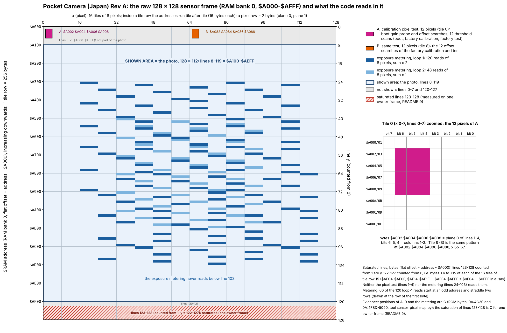

[README](../README.md) · [Section index](index.md)

## 18. The sensor registers: what the ROM sends, and what the camera does at boot, in calibration and in normal use

> **Where this comes from.** (1) Three register-load recordings made by the owner with a bus analyser hooked on the M64282FP wires of a real camera: `Search_for_sensor_at_boot.xlsx` ("at boot"), `Calibration_procedure.xlsx` ("during sensor calibration"), `Exposure_strategy_regular_camera_volts.xlsx` ("normal use"); the first two also carry an identical extra sheet `print` (859 more register loads, see 18.9). One row = one capture = the eight sensor registers as the sensor received them. The workbooks are the owner's data and are not in git; their decoded rows are `tcrf_check/assets/sensor/{boot,calibration,live}_rows.csv`. (2) The Mitsubishi M64282FP datasheet (ver. 1.1E, §11), read against the recordings (18.8). (3) The Japanese ROM: bank `$0A` (sensor driver) and the two capture starts in bank 6. (4) BGB, which emulates the MAC-GBD with a **fake sensor** (a made-up picture that does not behave like a sensor: at fixed registers and matrix the pixel sum drifts from frame to frame, e.g. 3,168, 3,087, 2,967, 2,823 at the same exposure and band, and with gain index 3 the sum rose from 3,478 to 4,311 while the exposure grew from `$066F` to `$0954`, where a real sensor gives a smaller sum for a longer exposure): the code path, the order of the registers and every constant can be compared with the real bus; the pixel-dependent decisions (which gain wins, where the search stops, how long a scan lasts) cannot, and they differ. Tags as everywhere: **C** = traced in the ROM and reproduced (bus recording and/or BGB), **I** = inferred, **?** = not established. Tools and data: 18.10.

### 18.1 The three phases in a few lines

* **Boot (C).** `Cam_BootSelfTest_Entry` (`0A:6A52`) reads the held keys, then calls two far stubs: `0A:7D04` (= `Cam_Calib_ValidityCheck`, §6: SRAM calibration vector → WRAM, no sensor traffic, then `Cam_Calib_Loader` → `Cam_Calib_BootMeasureSeq`) and `0A:7D10` (= `Cam_LiveInit`). On the bus this is **58 register loads**: one *gain probe* (9 captures), five *offset searches* (8 captures each: the five modes the live view will use), and a second gain probe (9). Nothing is taken from the image except 12 pixels per capture.
* **Calibration (C), first start of a camera whose SRAM vector is blank (twelve `$AA` in both copies).** `STORE PLEASE WAIT` appears and `Cam_FullCalibration` (`0A:4947`) runs: 12 offset/bias searches at 12 gain/mode points with long exposures (`Cam_FactoryMeasure1`, 96 captures), then 12 *threshold scans* at one short exposure (`Cam_FactoryMeasure2` + `Cam_ThresholdConverge`, 76 captures on the real unit) whose 12 results are the 12 bytes of the calibration vector, written with their two checksums to the two SRAM copies (`Cam_CommitVectorToSRAM`); the camera then stays on that screen (an endless `jr` at `0A:6BDB`) until the power is cycled. The hidden factory test (hold everything except B at power-on) runs **the same two measurement routines but does not store anything**: it compares two of the 12 results with the stored ones (18.5).
* **Normal use (C).** `Cam_LiveInit` loads the first live registers (2-D edge enhancement at 50 %, gain index 4 or 5, exposure `$1000` = 65.5 ms, offset found at boot). After that, each live frame: the CPU sums the 2-bit pixel values of a sparse, centre-weighted sample of the frame (168 tile-row reads, §10-B), divides by the BRIGHTNESS setpoint (`$D59A`, default 84) to get a level 0-159, and nudges the 16-bit exposure by `e >> s` up or down (`s` from a 160-byte table). When the exposure leaves its range the camera changes **band** (a coherent set of N, VH, G, V, O): five bands from 14 dB H-edge at 0.26 ms to 32 dB positive image at 1.05 s. 207 of 207 register loads of the real live recording and 2,377 of 2,377 live steps in BGB (11 scenarios) obey this rule.

The user-visible menus change none of the sensor registers directly: BRIGHTNESS moves the setpoint `$D59A`, CONTRAST selects the dither-table row `$D59B`, the option cross selects the dither variant `$D59C` (18.7).

### 18.2 What the ROM writes, and the datasheet names

The ROM never talks to the sensor directly. It writes the **MAC-GBD** registers at `$A000-$A035` (RAM bank `$10`), and the MAC-GBD sends the eight sensor registers itself. Of the eight, the ROM supplies five; **P, M and X (sensor registers 4-6) are sent by the MAC-GBD, not written by the ROM**; they have the same value on every row of the three recordings (58 + 172 + 208 rows): `P = $01, M = $00, X = $01` (the datasheet's typical "1-D filtering kernel" row, §11.6.10). The ROM does influence P and M through bits 2-1 of `$A000`, which it sets to 01 at every capture start (see "`$A000` bits" below). Column "owner's column" is the heading in the left columns of the workbooks.

| ROM address | sensor register (bus address) | datasheet symbols | owner's column(s) | WRAM shadow | ROM usage |
|---|---|---|---|---|---|
| `$A001` | reg 1 (`001`) | `N VH1 VH0 G4-G0` | Edge Exclusive / Edge Operation / Analog output gain | `$D595` | band id: `$20 \| G` (H-edge), `$E0 \| G` (2-D edge), `$0A` (positive); G = gain index |
| `$A002` | reg 2 (`010`) | `C17-C10` ("C1") | Exposure Time A | `$D596` | exposure, high byte |
| `$A003` | reg 3 (`011`) | `C07-C00` ("C0") | Exposure Time B | `$D597` | exposure, low byte |
| `$A004` | reg 7 (`111`) | `E3-E0 I V2-V0` | Edge Enhancement Ratio / Invert / Output node bias voltage | `$D598` | E (0 or 2), I = 0, V = Vref index |
| `$A005` | reg 0 (`000`) | `Z1 Z0 O5-O0` | Zero Point Calibration / Output Ref Voltage | `$D599` | `$80 \| O` = Z = 10 (calibration for a positive signal) and offset O; `O` alone (Z = 00) in the last capture of each gain trial of the gain probe |
| not written | reg 4, 5, 6 | `P7-0`, `M7-0`, `X7-0` | (not in the left columns) | - | `01 / 00 / 01` on every row: sent by the MAC-GBD; P and M follow bits 2-1 of `$A000` (= 01, set by the ROM), X = 01 in all 21 rows of both datasheet tables (§11.6.10, §11.6.11), so a fixed value; P = X = 01 on all 438 recorded rows. The M64283FP datasheet (another sensor) says that only X0 = 1, X1 = X2 = X3 = 0 is effective (§18.8) (I) |
| `$A000` | (MAC-GBD control) | - | - | `$D594` (= 2) | start: `$D594 \| 1` = `$03` written, then **bit 0** (busy) is polled until it clears (the capture is done); bit 1 = 1 is never tested; bits 2-1 select P and M (below) |
| `$A006-$A035` | (MAC-GBD matrix, not on the sensor bus) | - | - | `$D583-$D586` anchors | 16 cells × 3 thresholds: the 2-bit quantiser of the pixels |

Bus order of the eight registers in the workbooks: `001, 010, 011, 100, 101, 110, 111, 000`. The README's older "REGn" names (§2, §6, §10) are **cartridge indices** (`$A00n`), not sensor register numbers: REG1 = `$A001` = sensor reg 1, REG2/REG3 = `$A002/$A003` = C1/C0, REG4 = `$A004` = sensor reg **7**, REG5 = `$A005` = sensor reg **0**. 
**`$A000` bits (C for what the ROM does, I for what the hardware does).** The ROM writes `$D594 | 1` = `$03` at every capture start (`$D594` = `$02` is stored once, `0A:4745` and `0A:4864`; **4,374 of 4,374** writes of `$A000` in the 14 BGB logs are `$03`) and polls **bit 0** (`bit 0,a` / `bit 0,[hl]` at all 12 poll sites, `assets/sensor/register_sites.csv`): bit 0 = the capture is running (busy), cleared by the MAC-GBD when the sensor data have been read out. **Bit 1 is never tested by the ROM.** In BGB the value read back is `$03` while busy and `$02` afterwards (409,590 + 111 reads in one boot): only bit 0 changes, bit 1 stays as written. Pan Docs (Game Boy Camera, `A000`) says bits 2-1 are readable and writable and "affect the value written to registers 4, 5 and 6"; its emulator code maps `(A000 >> 1) & 3` = 01 to `P = 01, M = 00`, which is what every recorded row shows (it does not describe X). The three cases are the three simple rows of the datasheet table §11.6.11: bits 2-1 = 00 → *Neg.* P = 00, M = 01; 01 → *Posi.* P = 01, M = 00; 1x → *V (PM)* P = 01, M = 02; X = 01 in all of them, so X looks hard-wired and only P and M are selected; the M64283FP datasheet states that X is fixed this way (§18.8) (I). So the data are consistent with bit 1 being a **configuration bit set by the ROM** (a P/M selector), not a status flag. **The owner's reading** (2026-10-12: bit 1 tells whether the sensor is sending data or busy, and is written by the MAC-GBD) fits bit **0** and what the ROM polls; it is not supported for bit 1 by the ROM, but the ROM cannot exclude that the real MAC-GBD also changes bit 1, because it never reads it. A bus test that would settle it: write `$A000` with bits 2-1 = 00, 10, 11 (for example `$01`, `$05`, `$07`) and look at registers 4 and 5 on the analyser (Pan Docs predicts P/M = 00/01, then 01/02 for both). Every static write site of the Japanese ROM is listed in `assets/sensor/register_sites.csv` (164 sites: 39 `$A001`, 17 `$A002`, 17 `$A003`, 41 `$A004`, 27 `$A005`, 11 `$A000` writes and 12 busy-bit reads: 9 in bank `$0A`, and `06:5F82`, `06:5FEB`, `09:5F54` through `ld hl,$A000 ; bit 0,[hl]`; the only `$A000` writes outside bank `$0A` are the two capture starts `06:5F7C` and `06:5FAB`; the wait at `09:5F4B` selects RAM bank `$10` and polls bit 0, no direct caller found by byte pattern, ?).

**Conversions** (datasheet §11.6, checked against the recordings; all `Z = 10`, `I = 0`, `P/M/X = 01/00/01` on every row):

| field | rule | ROM values seen |
|---|---|---|
| exposure | `(C1·256 + C0) × 16 µs` (C1 step 4.096 ms, C0 step 16 µs) | `$0010` = 0.256 ms (boot, calibration, band 0 floor); `$0030` = 0.768 ms; `$1000` = 65.5 ms (first live value); `$FFFF` = 1,048.6 ms |
| O (offset) | 6-bit sign-magnitude, 32 mV per step: `$20` = 0 V, `$3F` = +0.99 V; `$00` = 0 V, `$1F` = −0.99 V | `$3F` / `$1F` (search ends), `$20` (search start), `$22`-`$29` (live) |
| V (Vref) | `V × 0.5 V` (0.0 … 3.5 V) | 5 (2.5 V) in the gain probe, 3 (1.5 V) in everything else on the real unit |
| G | 14.0 dB (G = 0), 15.5, 17.0, 18.5, 20.0 (G = 4), 21.5 (G = 5), 23.0, 24.5, 26.0 (G = 8), 29.0, 32.0 (G = `$0A`); +6 dB with G4 | G = 0-3 (index chosen at boot), 4 or 5, 8, `$0A`; G4 never set |
| E | α = 50 % (E = 0), 75, 100 % (E = 2), 125, 200, 300, 400, 500 %; E3 = 1 would be edge *extraction* | E = 0 in live view, E = 2 in some boot/calibration points; E3 never set |
| N, VH | N = 1 forces P and M to the vertical kernel and ignores them; VH = 01 horizontal, 10 vertical, 11 2-D edge mode | band 0: N = 0, VH = 01; bands 1-3: N = 1, VH = 11; band 4 and the gain probe: N = 0, VH = 00 |

### 18.3 The primitives (C)

**One capture.** The ROM writes the five registers, optionally refills the 48-byte matrix (`$A006-$A035`) with one flat value, writes `$03` to `$A000` and polls bit 0. The MAC-GBD then sends the 8 × 8 bits to the sensor (bus recordings: one row per capture).

**The pixel test `Cam_PixelTestHelper` (`0A:4C30`).** Looks at 12 pixels of the capture just taken, in the first tile row of the 128 × 128 frame (RAM bank 0 `$A000-$AFFF`; the 112-line photo is `$A100-$AEFF`, so these are among the 8 lines above it that the photo does not use; BGB confirms the frame location): the four bytes at `[DE], [DE+2], [DE+4], [DE+6]` with `DE = $A002` (tile 0, rows 1-4, plane 0), columns 1, 2, 3 (bits 6, 5, 4) of each byte; `DE = $A082` (tile 8) in `Cam_FactoryMeasure1`. It counts the set bits and returns **A = 1 when the count ≥ H** (H = 9 in the searches, 8 in the second scan of `Cam_ThresholdConverge`) else 0. Two details: it is **12 pixels, not 4 × 4** (the test of bit 3 is jumped over at `0A:4C51`, so only bits 6-4 count), and the pixel data it reads are the **MAC-GBD's 2-bit result for the flat matrix** (all cells equal), so the test asks "does this pixel's analog value sit below the flat threshold": a one-bit comparator read-out of the sensor signal.



*Figure (C for the positions; `tcrf_check/tools/sensor_pixel_map.py`, the metering addresses come from the ROM bytes).* The 12 + 12 test pixels sit in lines 1-4 of tiles 0 and 8 (`$A002-$A008`, `$A082-$A088`), the 168 metering reads between lines 24 and 103, the photo is lines 8-119 (`$A100-$AEFF`). The saturated lines 123-128 (counted from 1, y 122-127 from 0, bytes +4 to +15 of the 16 tiles of tile row 15) are measured on one frame supplied by the owner (§9, C for that frame): neither the pixel test nor the metering reads them.

**Offset/bias search `Cam_ORegister_SAR_Search` (`0A:4B6A`).** Finds, for the current N, VH, G, E, C, V and matrix, the offset O at which the pixel test flips (successive approximation, plus a coarse Vref step if O alone cannot reach):
1. `reg0 = $BF` (Z = 10, O = **+1 V**); capture; pixel test. **Pass** (≥ 9 pixels still below the threshold even with the maximum lift): V += 1 (reg 7 low bits, up to 7) and repeat, then go to 3. **Fail:** go to 2.
2. `reg0 = $9F` (O = **−1 V**); capture; test. **Fail** (still above the threshold with the lowest offset): V −= 1 (down to 1) and repeat. **Pass:** go to 3.
3. Six captures that follow the two tables at `0A:7BA0` ("Above", used when the test passed) and `0A:7BE0` ("Below"): start at `reg0 = $A0` (O = 0), next `reg0` = `Above[reg0 & $3F]` after a pass, `Below[reg0 & $3F]` after a fail; the table lookup after the sixth capture is the result. They are a sign-magnitude binary search: steps of 16, 8, 4, 2, 1 LSB (0.51 V … 32 mV) around zero. The result is written to reg 0 and `$D599`; `V` stays in `$D598 & 7`.

So each search is 8 captures when V does not move (`$BF, $9F, $A0, $B0/$90, …`). **On the real unit V never moved** in the recordings of 18.4-18.6 (it does move when the factory step runs under a strong light, 18.13) (reg 7 is constant inside every search of all three recordings), so what is visible on the bus is the offset search only. **Check (C):** every table-driven step of the real recordings is one of `Above[O]` / `Below[O]`: **35 / 35** at boot, **60 / 60** in calibration; BGB 55 / 55 (boot), 60 / 60 (blank record: calibration), 60 / 60 (hidden factory test), 55 / 55 (boot with `$FF` keys) (`sensor_sar_check.py`; `assets/sensor/sar_check_real.txt`). The pass/fail decisions themselves are not on the bus, so the result of a search is only known to be one of two table entries (see the boot / live cross-check in 18.5).

**Threshold scan `Cam_ThresholdConverge` (`0A:4E44`).** Registers fixed; the flat matrix value `t` runs from `$80`: if the test (H = 9) fails at `$80`, `t` goes up one per capture until it passes, then down until the test with H = 8 fails; if it passes at `$80`, `t` goes down until the H = 9 test fails, then further down until the H = 8 test fails. The result `(t₁ + t₂) / 2` is the flat threshold between the 8th and 9th of the 12 pixels (the "8.5th order statistic" of the 12 analog values). The bus shows it as **N identical register rows** (the matrix is not on the sensor bus). **Check (C):** in BGB, for a result below `$80`, `N = $81 − result` to within 1 on 11 of 11 runs (`sensor_tc_check.py --bgb`).

### 18.4 Phase 1: boot (C), on the real unit and in BGB

Sequence on the bus (real recording, 58 rows, `assets/sensor/boot_rows.csv`; P/M/X = 01/00/01, C = `$0010` on every row):

| rows | ROM routine | reg 1 | reg 7 | what it is in datasheet terms |
|---|---|---|---|---|
| 0-8 | `Cam_ExposureBandSelect` (`0A:4859`), gain index G = 0 | `$00` (N = 0, VH = 00, G = 0) | `$05` (E = 0, I = 0, **V = 5 = 2.5 V**) | positive image, no edge operation, 14 dB, 0.256 ms. Eight search captures (`$BF $9F $A0 $B0 $A8 $A4 $A2 $A3`), then a ninth with **Z = 00** and the found O (`$23`) and a flat matrix `$80`: the pixel test (H = 9) decides whether this gain is usable. It passed at the first gain here. |
| 9-16 | `Cam_Calib_BootMeasureSeq` (`0A:4724`), search 1 | `$20` (N = 0, **VH = 01**, G = D588 = 0) | `$03` (E = 0, V = 3) | **H-edge enhancement 50 %** (band 0 mode), matrix = reference byte `$D5CB` |
| 17-24 | search 2 | `$20` | `$23` (**E = 2 = 100 %**) | H-edge enhancement 100 %, matrix `$D5CC` |
| 25-32 | search 3 | `$24` (G = D589 = 4) | `$23` | H-edge 100 %, G = 4 (20 dB), matrix `$D5CD` |
| 33-40 | search 4 | `$28` (G = 8, 26 dB) | `$23` | H-edge 100 %, G = 8, matrix `$D5BF` |
| 41-48 | search 5 | `$0A` (N = 0, VH = 00, **G = 10, 32 dB**) | `$03` | positive image, no edge operation, matrix `$D5C0` |
| 49-57 | `Cam_LiveInit` → `Cam_ExposureBandSelect` again | `$00` | `$05` | same 9 captures as rows 0-8 |

What each step does:
* The **gain probe** tries G = 0, 1, 2 (`$D587`) and keeps the first for which the test passes at Z = 00 with the O just found; if none passes G = 3 is kept (`$D588` = winner). It then sets `$D589` = 4 when the winner is 0 or 1 and 5 when it is 2 or 3 (the gain index of the second band), and copies three bytes of the calibration vector into `$D5CB-$D5CD` (table in §6). **I:** it compensates the unit-to-unit spread of the sensor's dark level/gain by choosing among the four lowest gain steps (14.0, 15.5, 17.0, 18.5 dB). The real unit passed at G = 0 (both probes), so its group is `reg1 = $00`; BGB's fake picture never passes, so BGB walks G = 0, 1, 2 (with Vref moving, see the quirk below) and ends on G = 3 (`$D588` = 3, `$D589` = 5): its later groups are `$23, $23, $25, $28, $0A` instead of `$20, $20, $24, $28, $0A`. Same constants, different decisions.
* The **five searches** are run with the matrix filled with one of the five reference bytes of the calibration vector (the *threshold at which a black frame flips* for that mode, see 18.5) so each search finds the **offset O that puts the black level at the stored reference** for that mode. Their results are kept in `$D5C1-$D5C5` (V = `$D598 & 7`) and `$D5C6-$D5CA` (O = `$D599 & $7F`), one pair per live **band**: search 1 → band 0, 2 → band 1, 3 → band 2, 4 → band 3, 5 → band 4 (the band-switch code reads exactly these pairs: `0A:4155/415E`, `40D7/40E0`, `4254/425D`, `4199/41A2`, `4222/422B`). Searches 2-4 use the **H-edge mode with E = 2** although bands 1-3 will run in 2-D edge mode with E = 0: **I:** the search exposure (0.256 ms) is below the datasheet's 0.768 ms minimum for vertical / 2-D edge modes (§11.6.6), so the nearest allowed mode is used as a proxy.
* `Cam_LiveInit` (`0A:50AA`) runs the gain probe once more, then loads the first live registers (18.6).
* **What can happen at boot (all traced; "B" = also run in BGB):** keys held `$FD` (all but B) → the hidden factory test (`0A:6A7B`: `Cam_FactoryTest` `0A:455A` via the stub `0A:7CE0`; it measures and compares, 18.5; B: 537 captures, no SRAM write); both SRAM copies = twelve `$AA` → `Cam_Calib_Loader` returns `$FF` → `0A:6B73` = `STORE PLEASE WAIT` and the full calibration with commit (18.5; B: 537 captures); anything else (valid record, one valid copy repaired from the other, an invalid record replaced by the default vector `7E 7F 7F 7F 7E 7D 7E 7E 7D 7E 7D 6A` in WRAM only) → the boot measurement above (B: 111 captures; an SRAM of `$FF` bytes gives the same 111: **only the all-`$AA` pattern triggers calibration, not every invalid record**). The path `cp $FF` at `0A:6A59` (also `0A:6B73`) is not reachable with BGB's demo input `$FF`: the ROM reads `$FFA1 = 0` at `0A:6A54` for that input (and `$FD` / `$FB` are read correctly), so it was not forced from the keys (?).
* **A ROM quirk, reproduced in BGB:** `Cam_ExposureBandSelect` writes `$05` to `$A004` but not to its shadow `$D598`, so if the `$BF` test *passes* (BGB's fake picture does) the V step of the search starts from the stale shadow: reg 7 goes `$05 → $01 → $02 …`; and when the stale V is 7 the `+1` carries into bit 3 = **I (inverted output)**: BGB's third trial runs with reg 7 = `$08 … $0F`. The real unit never passed at `$BF`, so its reg 7 stays `$05` in both gain probes.

**Check (C): boot offsets → live offsets.** The five live bands of the real live recording use O = `$A2`, `$A3`, `$A5`, `$A9`, `$A5` (Z = 10, 0.064 / 0.096 / 0.160 / 0.288 / 0.160 V): each is one of the two candidates (`Above` / `Below` of the last captured O) of the matching boot search of the real boot recording (`{A3,A2}`, `{A3,A2}`, `{A5,A4}`, `{A9,A8}`, `{A5,A4}`): **5 / 5** (two different sessions of the same unit).

### 18.5 Phase 2: calibration (C), what the factory routine measures

`Cam_FullCalibration` (`0A:4947`) = `Cam_FactoryMeasure1` (pointer `DE = $A082`), then `Cam_FactoryMeasure2` (`DE = $A002`), then `Cam_CommitVectorToSRAM`. Real recording: 172 rows (`assets/sensor/calibration_rows.csv`).

**Part 1: 12 offset searches at the 12 operating points (rows 0-95, 8 captures each, flat matrix `$80`).** C is the typical exposure of the band the point belongs to; V and O of every point are kept in `$D59D-$D5A8` (V) and `$D5A9-$D5B4` (O):

| points | reg 1 | reg 7 | C | datasheet mode |
|---|---|---|---|---|
| 1-4 | `$20 $21 $22 $23` (G = 0-3) | `$03` | `$0030` = 0.768 ms | H-edge enhancement 50 %, 14.0 / 15.5 / 17.0 / 18.5 dB |
| 5-8 | `$E0 $E1 $E2 $E3` | `$03` | `$0900` = 36.9 ms | 2-D edge enhancement 50 %, same gains |
| 9-10 | `$E4 $E5` (G = 4, 5) | `$03` | `$2000` = 131 ms | 2-D edge enhancement, 20.0 / 21.5 dB |
| 11 | `$E8` (G = 8) | `$03` | `$3200` = 205 ms | 2-D edge enhancement, 26.0 dB |
| 12 | `$0A` (G = 10) | `$03` | `$8000` = 524 ms | positive image, no edge, 32.0 dB |

`$0030` = 0.768 ms is exactly the datasheet's minimum exposure for the vertical edge / 2-D modes; the long exposures (131-524 ms) show that part 1 is made in the dark or under a fixed light, not in a lit room (**I**; the conditions of the factory step are unknown).

**Part 2: 12 threshold scans at one short exposure (rows 96-171 on the real unit).** All 12 with `C = $0010`, V and O from part 1 (`reg 0 = $80 | O`, reg 7 = V, or `V | $20` = E = 2 for the second group); matrix scanned by `Cam_ThresholdConverge`:

| scan (= vector byte) | reg 1 | reg 7 | mode |
|---|---|---|---|
| 1-4 (bytes 0-3 `$D5B5-$D5B8`) | `$20 $21 $22 $23` | V | H-edge, E = 0, G = 0-3 |
| 5-11 (bytes 4-10 `$D5B9-$D5BF`) | `$20 $21 $22 $23 $24 $25 $28` | V `\| $20` | H-edge, **E = 2**, G = 0, 1, 2, 3, 4, 5, 8 (V, O taken from points 5-11 = the 2-D modes) |
| 12 (byte 11 `$D5C0`) | `$0A` | V | positive, G = 10 |

This is the **slot map of the 12-byte vector** (§6): slot 0-3 = H-edge E = 0, slots 4-10 = H-edge E = 2, slot 11 = positive G = 10; the boot picks slot `g`, slot `4 + g` and slot 8 or 9 (`$D5CB-$D5CD`) for its first three searches and slots 10 and 11 (`$D5BF`, `$D5C0`) for searches 4 and 5. The two checksums (`Σ + $0D`, `XOR + $23`) and the two SRAM copies are §6.

**I:** a vector byte is the flat comparator threshold at which 8.5 of 12 pixels flip when the sensor is run in that exact mode (G, VH, E) at the offset found in part 1 with the short exposure `$0010`: **a reference level per mode**. The boot searches then use, for each of their five modes, the byte measured at the factory in the *same* mode (slot `g` for search 1, `4 + g` for 2, 8 or 9 for 3, 10 for 4, 11 for 5: each boot search's reg 1 / reg 7 / C equals its slot's scan) and re-find the offset O at which the pixel test flips at that reference. So the offset follows the sensor's drift (temperature, supply, ageing; and the light on the 12 test pixels, §18.9) while the reference stays the factory one: the camera re-trims its offsets at every cold boot (18.4) but its reference level changes only if the SRAM vector is rewritten.

**Check (C/I): the recorded unit's vector.** Each scan lasts about `$81 − byte` captures (18.3), so the run lengths of the real recording, `3 4 4 3 | 4 5 4 6 5 6 9 | 23`, imply the bytes `7E 7D 7D 7E | 7D 7C 7D 7B 7C 7B 78 | 6A` (±1 each) — the same pattern as the vectors in the real saves (§11.3, e.g. `7D 7E 7C 7D 7D 7C 7D 7C 7A 7A 78 6A`). **Result (2026-10-26):** the save of that camera after the calibration (`Calibrated_Camera.sav` of the owner's sensor repository, before it `Calibration_procedure.sav` = all `$AA`) holds `7E 7D 7D 80 7D 7C 7D 7B 7C 7B 79 6A` with both checksums valid: 11 of the 12 predicted bytes within ±1, byte 3 off by 2 (18.13).

**The hidden factory test (`Cam_FactoryTest`, `0A:455A`; C, BGB: 537 captures).** It calls `Cam_FactoryMeasure1` and `Cam_FactoryMeasure2` exactly as above (so the bus traffic of a factory test and of a first-boot calibration is the same 172-row pattern) but **does not call `Cam_CommitVectorToSRAM`**. It then compares only the last two scans, slot 10 (`$D5BF`, G = 8) and slot 11 (`$D5C0`, G = 10), with the stored `$AFFC` and `$AFFD`: the absolute differences must not exceed `$AFF0` (= `$1B`, 27) and `$AFF1` (= `$13`, 19) respectively (§3.3); `$FF91 = 0` → "OK" (sound `$16`), else "NG" (sound `$29`), then an endless loop (`0A:6B54`). The screen shows the four stored bytes before the test and the re-measured ones, the sign (`$24` / `$25`) and the differences after it. So production testing re-measures the two highest-gain reference levels of a camera against its own stored vector: a drift check, not a re-calibration. The recording of the calibration cannot say which entry was used (the same 96 + 76 register loads); the commit writes SRAM, not the sensor.

**BGB:** with a blank record (`boot_aa`): 537 captures = 100 (part 1: 96 plus 4 extra captures where V moves because the fake picture is out of range) + 437 (part 2); `STORE PLEASE WAIT`, the 12 `Cam_FactoryMeasure1` searches, the 12 scans and `Cam_CommitVectorToSRAM` all run in the order and with the constants of the real recording (C `$0030 $0900 $2000 $3200 $8000` then `$0010`; reg 1 `$20-$23`, `$E0-$E5 $E8`, `$0A`; reg 7 `$03` and, in part 2, `V \| $20`, with the V of BGB's moved searches). `Cam_CommitVectorToSRAM` (`0A:4F58`) copies the 12 bytes with `Σ + $0D` and `XOR + $23` to `$AFF2` (bank 2) and `$BFF2` (bank 8) (checked in the BGB state file, §6). The scans of BGB last 3 to 118 captures and the same cost law holds there (18.3).

### 18.6 Phase 3: normal use (C)

**Start (`Cam_LiveInit`, `0A:50AA`).** After the gain probe: `reg 1 = D589 | $E0` (`$E4`: N = 1, VH = 11, G = 4; or `$E5`), `C = $1000` (65.5 ms), `reg 7 = $D5C3` (E = 0, I = 0, V from boot search 3), `reg 0 = $D5C8 | $80`; setpoint `$D59A = $54` (84), contrast `$D59B = 8`, dither variant `$D59C = 1`; the dither matrix is built (18.7). The same defaults are written again every time the SHOOT live view is entered (`06:5F65-5F6C`), so BRIGHTNESS and CONTRAST do not survive leaving the live view.

**The frame loop (bank 6, `06:5FAB-6019`).** Start a capture (`$A000 \| 1`, `06:5FAB`); while the sensor works, run the per-frame code of the SHOOT variant (`06:738F`) and copy the WRAM tile buffer to VRAM; wait for the busy bit (`06:5FE8`); handle the keys (`06:6133` BRIGHTNESS, `06:615E` CONTRAST, then `6254`, `6296`, `6317`); then run the auto-exposure step `Cam_MainDispatch` (`0A:4000`, via the stub `0A:7CF8`, A = `$D59A`) on the frame just captured; its registers are used by the next start (`06:600F-6019`). The step is skipped (exposure frozen) when `$D7E3 ≥ $13`, `$D7E3 ≠ $15` and `$D7ED ≠ 0` (`06:5FFE-600D`; which variants those are is not established, ?). Once per frame:

```
Σ    = 2·S1 + S2, S = sum of popcount(plane 0) + 2·popcount(plane 1) over 120 (S1) and 48 (S2) tile-row reads   # Cam_PopcountSampleLoop 0A:4FBD, §10-B; Σ ≤ 6,912
L    = floor(Σ / D59A), at most 159                                                    # L >= 36 lengthens the exposure, so a large Σ means a dark picture
s    = ShiftTable[L]                                                                   # 160 bytes at 0A:7B00 (§10)
e'   = e + (e >> s) if L >= 36 (too dark: lengthen),  e - (e >> s) if L < 36, saturating at $FFFF; s = 16 means no change (L = 35, 36, 37)
```

* The setpoint is `L = 36`: with the default `D59A = 84` the loop is at rest when Σ is between 2,940 and 3,191. **BRIGHTNESS** is `D59A` itself (Up: −12 down to 12, Down: +12 up to 192); a smaller divisor means a larger L for the same picture, so Up makes the loop settle at a longer exposure (BGB: `D59A` 12 … 192 seen, every step of every dispatch reproduced by the formula).
* **The correction table** (§10): the shifts run 2, 3, 3, 3, 4, … up to 9 at L = 34, then **16 (= no correction) for L = 35, 36, 37**, then 9 at L = 38, falling to 5-6 around L = 44-49, 4-5 for L = 50-79 and 3 from L = 80 on. The largest steps are therefore 25 % per frame (`e >> 2`, L = 0: a very bright picture) and 12.5 % (`e >> 3`, L ≥ 80: a very dark picture).
* The calibration vector does not enter the loop at all (`L` is not compared with "target popcount values", `Cam_MainDispatch` does not count "dark pixels"); the only inputs are the sampled tile rows, `D59A`, the 16-bit exposure and the band. The WRAM copy of the vector (`$D5B5-$D5C0`) is read only by `Cam_Calib_BootMeasureSeq`, the gain probe and the factory test, and their far stubs are called from the boot code only (`0A:7D04` from the `ld hl` at `0A:6A63`, `0A:7D10` from `0A:6A72`, `0A:7CE0` from `0A:6AF1`, all in the boot self-test `0A:6A52`; no caller of the stub `0A:7CE6`; C, scan of the ROM for the far-call pattern): the live loop reads only `$D5C1-$D5CA`, the offsets and Vref the boot found.

**Bands.** The band is `(N, VH, G)` of reg 1: band 0 = (0, 01, 0), band 1 = (1, 11, G < 4), band 2 = (1, 11, 4 or 5), band 3 = (1, 11, 8), band 4 = (0, 00, 10). After the exposure update, only the thresholds of the current band are tested (all constants are in `sensor_exposure_check.py`); the band's V and O come from `$D5C1-$D5CA`, and on a switch the dither matrix is rebuilt:

| band | reg 1 | mode (datasheet) | exposure range seen on the real unit | leaves upward when | leaves downward when |
|---|---|---|---|---|---|
| 0 | `$20` | H-edge enh. 50 %, 14.0 dB | `$0010` (floor) … `$002C` = 0.26-0.70 ms | `e ≥ $30` (0.768 ms) → band 1 at `$0048` (1.15 ms) | `e < $10` is floored to `$10` |
| 1 | `$E0`-`$E3` | 2-D edge enh. 50 %, 14-18.5 dB | `$0048`-`$1014` = 1.15-65.9 ms | `e ≥ $1200` (73.7 ms) → band 2 at `$0D80` (55.3 ms) | `e < $31` → band 0 at `$1F` (0.50 ms) |
| 2 | `$E4`/`$E5` | 2-D edge enh. 50 %, 20/21.5 dB | `$0D80`-`$58D0` = 55-364 ms | `e ≥ $6000` (393 ms) → band 3 at `$3500` (217 ms) | `e < $0800` (32.8 ms) → band 1 at `$0B00` (45.1 ms) |
| 3 | `$E8` | 2-D edge enh. 50 %, 26.0 dB | `$3500`-`$AC17` = 217-705 ms | `e ≥ $C000` (786 ms) → band 4 at `$8500` (545 ms) | `e < $2800` (163.8 ms) → band 2 at `$4500` (282.6 ms) |
| 4 | `$0A` | positive image, no edge op., 32.0 dB | `$8500`-`$FFFF` = 545-1,049 ms | saturates at `$FFFF` | `e < $6000` → band 3 at `$8C00` (573 ms) |

Reading the table with the datasheet: (a) **the band 0 / band 1 boundary is the datasheet's 0.768 ms limit**: the vertical / 2-D edge modes need an exposure *greater than* 0.768 ms, and the camera enters band 1 at `e ≥ $30` (0.768 ms) with a first value of `$48`, and leaves it for the H-edge mode below `$31`; (b) each upward switch is a +6 dB gain step (G = 0→4, 4→8, 8→10: 14 → 20 → 26 → 32 dB) with the exposure reloaded to 55-75 % of the value that triggered it (`$1200→$0D80` 0.75, `$6000→$3500` 0.55, `$C000→$8500` 0.69), i.e. the product exposure × gain (±6 dB = ×2 or ×½) rises by 10-50 % at an upward switch and falls by 14-31 % at a downward one (`$0B00 / $0800` = 1.4, `$4500 / $2800` = 1.7, `$8C00 / $6000` = 1.5 for ½ the gain): **I:** a hysteresis, so the loop cannot flip straight back; (c) band 4 drops the edge operation (positive image, N = 0, VH = 00) and tops out at the datasheet's maximum, 1,044.5 ms + 4.08 ms. In the real data the datasheet's plain **positive image (VH = 00) is only used in band 4 and in the gain probe**: bands 0-3 all apply edge *enhancement* at the lowest ratio (E = 0, 50 %), band 0 in the horizontal mode, bands 1-3 in the 2-D mode.

**Check (C): 207 of 207 steps.** `sensor_exposure_check.py` replays the rule on the real live recording: every one of the 207 frame-to-frame steps is `e ± (e >> s)` for a shift in the table (or a band switch with the exact reload above); the four switches 0→1, 1→2, 2→3, 3→4 occur once each (`assets/sensor/exposure_check_real.txt`, `live_exposure_bands.png`). The same holds for the `print` sheet (859 of 859, with 12 switches in both directions). The level `L` is not on the bus, so for an ordinary step the check says "some `L` produces it"; the exact reload values and thresholds are what a band switch tests. **In BGB** `sensor_bgb_law.py` replays Level, ShiftLoaded and ExposureNew of the ROM: `shift == table[L]` and `e'` equals the formula on **2,377 of 2,377** dispatches of 11 scenarios (`live` 236, `live_bc` 388, `live_dark` 270, `live_bright` 678, `live_opt` 21, `shutter` 21, `shutter_save` 180, `trick_go` 136, `montage_go` 156, `gameface_go` 135, `panorama_a` 156; L runs from 0 to 152: 1,423 dispatches shorten the exposure (L ≤ 34), 397 leave it unchanged (L = 35-37) and 557 lengthen it).

### 18.7 What the menus and the other modes do to the sensor (C)

* **BRIGHTNESS** (Up/Down, `06:6133`) → `D59A`; **CONTRAST** (Left/Right, `06:615E`) → `D59B` (1-16, default 8), which rebuilds the dither matrix (`Cam_BuildDitherMatrix`, `0A:42BA`; rows of 4 anchor bytes at `0A:7C20`, or `0A:7C60` only while `D587 = D589`, i.e. in band 2): row 1 = `80 8F D0 E6`, row 8 (the default) = `89 92 A2 D2`, row 16 = `92 92 92 92`: the ramp step `(b − a)` shrinks from `$0F` to 0 as CONTRAST rises, so **I:** row 1 is the softest picture (thresholds spread over `$80`-`$E6`) and row 16 a single flat threshold (a pure two-level picture); all rows of the three tables are in `assets/sensor/dither_tables.csv`. **No sensor register is written by either key** (BGB: `live_bc`, 500 captures, `D59A` 36…144 and `D59B` 5…12 with every register row still of the five band types; the matrix is on the MAC-GBD).
* **Dither variant `D59C`** (0, 1, 2): 0 = the same three thresholds in all 16 cells (`0A:440C`), 1 = a 16-level ramp in 4x4 Bayer order (`0A:4427`), 2 = four levels in 2x2 blocks of cells (`0A:4307`; both decoded in 18.12). It is set to 1 (2 for SHOOT variants with `$D7E3` = `$0A`, `$0B`, `$15`) when the live view is entered (`06:5E3E-5E47`) and by the option cross (`06:6753`, from `$D674`). **On screen (C, BGB, `assets/sensor/dither_variants/option_cross_betanuri_menu_up_down.png`):** it is the first option of the option cross (Left key), labelled ベタぬり in the Japanese ROM, with an OFF / ON selector; Down = ON = `0` (flat fill), Up = OFF = `1`, or `2` in the variants `$D7E3` = `$0A`, `$0B`, `$15` (`06:6776-678E`), so those three variants offer flat or ramp B and never ramp A. `$D59C` is read only by `Cam_BuildDitherMatrix` (`0A:42F9`), which builds the picture's matrix; its 6 calls in bank `$0A` sit in `Cam_LiveInit`, the bank-6 far stub and four request entries of `Cam_MainDispatch`, none in the boot or calibration routines, which use their own flat fills (18.3) (C, static). Images of the three variants: 18.12.
* **The other SHOOT features** (self-timer, time-lapse, trick lenses, magic montage, panorama, game face, shutter and save): every static register write site is in bank `$0A` and the two capture starts are the same two; in BGB the live view, trick lenses, montage, game face, panorama (A) and the shutter-and-save path (`shutter_save`, 293 captures) produce only the band registers above (same capture site `06:5FAB`); the shutter does not switch to a different mode, a photo is a live frame. The self-timer and time-lapse runs stopped on their countdown screens within the wait (111 captures = boot only), so for those two the only evidence is the static site list.
* **Printing.** The two printing paths I could drive in BGB from a capture mode (panorama → PRINT, `panorama_print`) stopped on their print screen with no capture beyond the boot (111); the printer helper (§17) was not attached in these runs. So the print menus add no sensor traffic that I could see (?, not conclusive). The workbooks' extra sheet `print` is a second *live-view* recording of another unit (18.9).

### 18.8 Reading the datasheet against the recordings

The datasheet (ver. 1.1E, "preliminary") is a poor translation; these are the points where the recordings and the ROM settle what it leaves unclear or contradicts:

| datasheet | what the data say |
|---|---|
| C0 and C1: "the sum of the value of C0 register and that of C1 register determines the actual exposure time" | the *times* add: `C1 × 4.096 ms + C0 × 16 µs`, i.e. `(C1·256 + C0) × 16 µs`; C1 is the high byte (reg 2), C0 the low byte (reg 3). The ROM's 16-bit exposure `$D596:$D597` is big-endian C1:C0 (live recording, 207/207) |
| "set C0 and C1 to 00: optical black" | the ROM **never** sets C = 0: the floor is `$0010` (0.256 ms), also used for the gain probes and every threshold scan; the datasheet's offset-level mode is not used |
| "exposure time should be greater than 0.768 msec" (vertical edge modes) | `$30` (0.768 ms) is the exact band 0 / band 1 switch (18.6): the camera uses H-edge below it |
| N: "if set, P and M are exclusively set to a specific vertical edge mode… In the case of H, P is 02 and M is 05" | the text mixes H and V; the typical-mode table of §11.6.10 gives *V Enh.* as N = 1, VH = 10 with P/M = 01/00, while §11.6.11 gives *V Enh.* as N = 0 (!), VH = 10 with P/M = 02/05. The ROM uses N = 1 with VH = 11 (2-D) for bands 1-3 and N = 0 with VH = 01 (H) for band 0; P/M are `01/00` on every row (`$A000` bits 2-1 = 01), so with N = 1 they are ignored by the sensor, with N = 0 they are the plain pass-through |
| Z: "calibrates the zero value by setting the dark level output signal to Vref"; the table lists 10 = positive, 01 = negative | the ROM uses only Z = 10 (every search and every live row) and, for the two test captures of the gain probe, Z = 00 |
| O: sign bit O5 "H for plus"; `$20` = 0 V, `$3F` = +1 V; `$00` = 0 V, `$1F` = −1 V | both `$20` and `$00` are zero; the ROM's searches start at `$20`, walk through the positive side first and into the negative side (`$90 …`) through the tables |
| V (Vref 0.0-3.5 V) and G (14-38 dB) | G table is laid out with the 6 dB (G4) column in a second column: G = 0 is 14.0 dB, G = `$0A` 32.0 dB, G = `$0A` + G4 38.0 dB; the ROM never sets G4. V = 5 (2.5 V) is used only for the gain probe, V = 3 (1.5 V) everywhere on the real unit |
| E: E3 = 1 edge *extraction*, 0 *enhancement* | E3 is never set: the ROM uses enhancement (50 % live, 100 % in the proxies) |
| "Typical register settings": P/M/X = 01/00/01 | those are the values on every recorded row (P = X = 01 on all 438). **P = X holds in the §11.6.10 table (all 14 rows) but not in §11.6.11** (P = 00, 01 or 02, X always 01: 5 of its 7 rows have P ≠ X), and the datasheet never describes X beyond "8 bits × 3, 1-D filtering kernel": X = 01 in all 21 rows of both tables, so it is a constant, not a copy of P. P and M follow bits 2-1 of `$A000` (= 01, set by the ROM, §18.2). **Cross-check with the M64283FP datasheet (owner's pointer, 2026-10-12; a different, later Mitsubishi sensor, so I, not C):** its register map (§12.3) puts P, M, X in the **low nibbles (4 bits each)** of registers 4, 5, 6 (reg 4 = `SH AZ CL - P3-P0`, reg 5 = `PX PY MV4 OB M3-M0`, reg 6 = `MV3-MV0 X3-X0`), and §12.4.2 says: *"for the X register, only one mode, X0 = 1 and X1 = X2 = X3 = 0, is effective"*; Figures 3-5 draw X0-X3 = 1 0 0 0 in all five examples, and the 19 rows of its examples table (§13) all have reg 6 = `01` (`assets/sensor/m64283fp_examples.csv`, `tools/sensor_m64283_table.py`) with P = 1, M = 0 in the low nibbles (edges are made with N/VH/E in regs 1 and 7). So X is never anything but `01` there, which fits all 438 recorded rows and all 21 M64282FP table rows. Those upper-nibble fields (`SH AZ CL PX PY MV OB`) and its registers 8-9 (`ST`, `END`) **exist only on the M64283FP, not on the M64282FP (owner, 2026-10-12; none of these names appears in the M64282FP datasheet text, which has 8 registers and lists reg 4-6 as `P7-P0`, `M7-M0`, `X7-X0`)**. So on the M64282FP the upper bits of regs 4-6 carry nothing known, and all values seen (datasheet tables and recordings) fit in the low 4 bits (max `05`). The datasheet's "8 bits × 3" is only the register width |

### 18.9 What was not established, and what the extra sheet is

* **Not on the bus, therefore not checked on the real unit:** the pixel-test result of each capture, the matrix, the level `L`, and V when it moves (it did not).
* **Bit 1 of `$A000`** (18.2: a P/M selector set by the ROM according to Pan Docs and the data, a status bit written by the MAC-GBD according to the owner: open, a bus test is proposed in 18.2), the **purpose of `$D5` in the matrix of the first search of the gain probe** (the second capture uses `$80`), and why the search order is Above/Below around **zero** rather than around the previous result: ?
* **The metering loop's sampling** (§10-B): sparse, centre-weighted vertically (the sum of the first 120 reads is doubled; horizontally those 120 reads sit one tile to the right of the frame centre, centroid x 68.6 against 63.5, as BGB's read log shows) and, in every second iteration of its first loop, starting at an odd address (plane 1 read as plane 0). Read from the ROM and reproduced in BGB (C); whether the odd start is intended, and why the picture is metered this way, is not known (?).
* **Do the test pixels see the scene? (C for one frame; for the boot itself: ?)** In the frame of §9 (supplied by the owner) lines 0-7 are ordinary image lines and the 12 + 12 test pixels read like the dark scene around them: they are scene pixels, not reference lines like lines 122-127. The boot test runs at the shortest exposure (`C = $0010`, 0.256 ms), which keeps the effect of the light small (I), but the boot offsets may absorb the light at the top of the picture; the reading of the vector as a black-level reference (§18.5, I) holds only as far as that effect is small. Test: record the five boot offsets of one unit with the lens covered and in bright light (BGB cannot, its picture is fake).
* **Interpretations tagged I:** the gain probe as a unit-spread compensation, the vector as a black-level reference, the proxy modes of the boot searches, the dark/fixed-light condition of the factory step, `E = 2` as the proxy ratio.
* **The `print` sheet** of two of the workbooks (identical in both): 859 register loads of N, VH, E, Z, I, C (ms), O, V, G (no raw bits), band 1 → 0 / 1 → 2 and back, O = `$29` / `$29` / `$2B` for bands 1, 0, 2 (different from the live recording's `$A3`, `$A2`, `$A5`, so another unit or another session). It obeys the live-view rule 859 / 859, so it is another live-view recording; I cannot tell from the data which action produced it (the "printing menus" were tried in BGB, 18.7, without any camera traffic).
* **BGB limits:** its fake picture is not a sensor model (above), so BGB's live view only visits bands 1, 2 and 3 (reg 1 = `$E3`, `$E5`, `$E8`: the switches 1 ↔ 2 and 2 ↔ 3 are run by the ROM there), never band 0 or 4 and no 0 ↔ 1 or 3 ↔ 4 switch (those are validated on the two real recordings only), and its V / gain decisions differ from the real unit's (18.4).
* **Not done:** the effect of the option cross choices on the matrix beyond what 18.7 states; a run of the printer helper with a capture; the SRAM of the recorded unit.

### 18.10 Tools and data of this section

* `tcrf_check/tools/sensor_more_recordings.py DIR_2024 DIR_CAMERA2 OUTDIR` (the recordings of 18.13: `assets/sensor/more_recordings/`).
* `tcrf_check/tools/sensor_decode.py` (decodes the workbooks, writes `assets/sensor/{boot,calibration,live}_rows.csv`: raw registers and datasheet fields), `sensor_sar_check.py` (35/35, 60/60), `sensor_exposure_check.py` (207/207, 859/859), `sensor_tc_check.py` (threshold-scan cost, implied vector), `sensor_sites.py` (writes `assets/sensor/register_sites.csv`, 164 sites), `sensor_a000_reads.py` (every read and write of `$A000` in a BGB boot: `assets/sensor/a000_reads_boot.txt`), `sensor_plots.py` (the two figures), `sensor_bgb_log.py` (BGB with write watchpoints on `$A000-$A005` and breakpoint markers on the routines: `-wp 'A00n//w/…'`, `-br 'addr///MK name …'`, `-setting DebugMsgFile=1`; BGB writes a debug file that is kept in a private BGB folder), `sensor_scenarios.py` (24 boots / live view / SHOOT-variant scenarios), `sensor_bgb_law.py ROM EVENTS.csv…` (the exposure law on BGB's own dispatches: 2,377 of 2,377; and `L = floor(Σ / D59A)`: 236 of 236 where the sum was logged), `sensor_meter_geom.py ROM [FRAME.bin [EVENTS.csv]]` (the exact read addresses of the metering loop `0A:4FBD` taken from the ROM bytes, and its sum for a frame buffer). `sensor_window_scan.py DISASM_DIR rom_map.csv [ROM_JP ROM_US]` (18.11: every operand in `$A000-$A0FF`, the sites not run organically, the RAM-bank selects, the shadow accesses, and the Japanese / international comparison of bank `$0A`). `bgb_dither_variants.py OUTDIR` (18.12: BGB screenshots of the three dither variants, one patched byte), `bgb_lens9_quadrants.py OUTDIR` (18.12: Trick Lens 8 and 9 in BGB, the four quadrants), `sensor_matrix_order.py ROM [--csv assets/sensor/dither_matrix_order.csv] [--example A B C D] [--reference patterns.mjs]` (18.12: the order in which the three writers of `Cam_BuildDitherMatrix` fill the 16 cells x 3 bytes, the level of each cell, and the rebuild of the 4 x 16 reference patterns of dither-pattern-gen from the ROM tables).
* `tcrf_check/assets/sensor/`: `*_rows.csv`, `register_sites.csv`, `sar_check_real.txt`, `exposure_check_real.txt`, `live_exposure_bands.png`, `sar_traces.png`, `dither_tables.csv`, `dither_matrix_order.csv`, `dither_variants/` (BGB screenshots of the three variants and of the option screen), `m64283fp_examples.{csv,txt}`, `meter_check.txt` (the metering sum recomputed from BGB's frame buffer = the ROM's own sum), and `bgb/` (`live_frame_bank0.bin` = RAM bank 0 `$A000-$AFFF` at the end of the `live` run, `NAME_captures.csv` for the 24 scenarios, `NAME_events.csv` for the 14 that were logged with breakpoint markers: boot, boot_ff, boot_aa, live, live_bc, live_dark, live_bright, live_opt, shutter, shutter_save, trick_go, montage_go, gameface_go, panorama_a).


### 18.11 Is there any trace of more MAC-GBD registers, or of code for an M64283FP? (scan: C; "none" only means none found by these scans)

Question of the owner (2026-10-14): does the ROM, in used or unused code, use more of the MAC-GBD / sensor registers than §18.2 lists, for instance a variant written for the M64283FP (its extra fields `SH AZ CL PX PY MV OB` and registers 8-9 `ST`, `END`, §18.8)? **Answer: no trace in the Japanese ROM, and none in the sensor-driver bank of the international ROM.** `tcrf_check/tools/sensor_window_scan.py` (usage in its header; run on the mgbdis listing and the byte-class map of the v8 coverage run) gives:

| check | result |
|---|---|
| Every instruction operand in `$A000-$A0FF`, whole ROM | **283 instructions, 54 distinct addresses, all in `$A000-$A035`; none in `$A036-$A0FF`** (the matrix `$A006-$A035` included). By bank: `$0A` 271 (the driver); bank 6: 5; bank 2: 6; bank 9: 1. Outside the driver, the sites that run with RAM bank `$10` selected touch only `$A000` (start / busy poll: `06:5F7C`, `5F7F`, `5FAB`, `5FE8`, `09:5F51`); the other seven (the six of bank 2 and `06:5E83`) are the base of a photo SRAM block, not registers (I: the registers exist only with bank `$10`) |
| Operands above `$A0FF` | 123 sites, 29 addresses: photo / album SRAM (RAM banks 0-8), not looked at one by one (I) |
| Which of the 283 are not run in organic runs | three, all in `Cam_ThresholdConverge`: `0A:4EA9` (`ld hl,$A006`), `4EBE` (`ld [$A000],a`), `4EC1` (`ld a,[$A000]`), class F (run only in the forced runs of §16.19-16.21). **None is in class N**, so none of the 1,192 B of never-run code (§16.21) touches the window |
| RAM-bank selects (`ld a,imm` before `ld [$4000],a`) | immediates 0, 1, 2, 8 and `$10` (15 times: banks 6, 9, `$0A`); no other value from `$10` up. A bank number built in a register is not seen by this scan |
| WRAM shadows `$D594-$D599` of the five registers | outside organically run code only one access, `0A:4EB9` (`ld a,[$D594]`, class F, in the same routine) |
| Field values | G4, E3, Z = 01 and I = 1 are never produced (§18.2, §18.8: G4 and E3 never set, Z only 10 and 00, I = 0 on every recorded row) |
| Registers of a bigger sensor | the MAC-GBD window has an address for sensor registers 0-3 and 7 (`$A001-$A005`), the control byte `$A000` and the matrix; P, M and X (registers 4-6) are made by the MAC-GBD itself (§18.2). **No instruction operand refers to anything else**, so the ROM has no way to write registers 8-9 (`ST`, `END`) or the upper-nibble fields of 4-6 (`SH AZ CL PX PY MV OB`); a ROM for the M64283FP would need the MAC-GBD to expose them (I) |
| International ROM, bank `$0A` | the same 271 register-window operands at the same addresses with the same values. **61 bytes of the 16,384 differ, all in `$6A67-$7D15`, all operand bytes of `call` (41) or `jp` (20)** (re-linked targets); the register code (`$40C5-$50E2`) is byte-identical |

**What this does not exclude.** (1) A computed address: a pointer that starts in the window and walks past `$A035` is not searched (the matrix loops are read in §18.3 and write 48 bytes from `$A006`). (2) A table of register values that no instruction refers to by an operand in the window: the scans look at operands, not at data. (3) Only two builds were compared (Japanese Rev A, international); no other revision is in the repository. (4) The M64283FP is a different, later sensor read only from the owner's datasheet pointer (§18.8): that no code in this ROM targets it is evidence about this ROM, not about the datasheet.

### 18.12 Two outside implementations against this section: MAME `camera.cpp` and dither-pattern-gen (2026-10-18)

Both are software models, not hardware evidence: a statement that rests on them alone is **I**. (1) MAME, `src/devices/bus/gameboy/camera.cpp` (BSD-3-Clause, header "Vas Crabb"; a copy attached by the owner, revision not stated): the cartridge (MAC-GBD window, 16 RAM banks of 8 KB) and a simplified M64282FP. (2) [`HerrZatacke/dither-pattern-gen`](https://github.com/HerrZatacke/dither-pattern-gen) (MIT, read at `master` b153952, 2023-02-10): explains the camera's dither patterns and generates new ones; its `reference/patterns.mjs` holds four sets of 16 patterns (high light / low light, dither / no dither). The README of that repository does not say where the reference sets come from (?); it credits github.com/hatchman with the idea of sorting the values.

**Already here (not new).** The register map `$A000-$A005` and its fields; the matrix `$A006-$A035` as 16 cells of 3 thresholds; P and M chosen by bits 2-1 of `$A000` (MAME: 00 -> P/M 00/01, 01 -> 01/00, 10 and 11 -> 01/02, which is the prediction of 18.2; its `$A000` read returns those two bits back with the busy bit, the selector reading of 18.2, no hardware evidence); exposure in 16 us units; edge ratios 50 / 75 / 100 / 125 / 200 / 300 / 400 / 500 %; O = +/- value/31 V (18.2 says 32 mV per step: same within rounding); V x 0.5 V.

**The dither matrix (the useful part).**

| point | result | tag |
|---|---|---|
| Rebuild of the reference sets | the 4 x 16 reference patterns (1,024 cells of 3 bytes) are exactly what the ROM code computes from the anchor tables: set 1 "High Light" = table `0A:7C20` and set 2 "Low Light" = `0A:7C60` through the ramp of `$D59C = 1`, sets 3 and 4 ("No Dither") = the first value of each sequence in all 16 cells (`$D59C = 0`); **0 of 1,024 cells differ**, on both ROMs (`sensor_matrix_order.py --reference`) | C |
| Order and formula | `$D59C = 1`: 16 levels in 4x4 Bayer order, level of cell n (rows of four) `0 12 3 15 / 8 4 11 7 / 2 14 1 13 / 10 6 9 5`; byte k = `a_k + floor(r (a_k+1 - a_k) / 16)`; dither-pattern-gen's `orderPatternDither` is the same matrix and its `generateValueRange` the same formula (its README: "linear distribution of the 16 values") | C (ROM bytes), the same in the outside source |
| Variant `$D59C = 2` | **in neither outside source**: four levels in 2x2 blocks (top-left 0, bottom-right 1, bottom-left 2, top-right 3), `a_k + floor(g (a_k+1 - a_k) / 4)`. Its use: the dither of the SHOOT live view and shot in the variants `$D7E3 = $0A, $0B` (the last two of the nine TRICK LENSES, `$03 + $D5E5`) and `$15` (GAME FACE), where it replaces ramp A: the option ベタぬり ON = flat, OFF = this ramp (18.7). Not a calibration or exposure mode, and reachable by the player. Why these three modes get it: they reduce the picture to half size and ramp A would then lose its dither (below). Rendering of the three variants in BGB: image below | C (write order, selector, rendering), I (reason) |
| Cell geometry | MAME (`m_threshold[y & 3][x & 3]`) and the filter of dither-pattern-gen (`pattern[y][x]`, x = column) both give cell n = 4 (y & 3) + (x & 3) and the same polarity: black if pixel < t0, dark grey if < t1, light grey if < t2, else white. The ROM only writes 48 bytes, so this is not a ROM fact; with it the level matrix above is the textbook Bayer matrix turned over its diagonal | I (two implementations agree) |
| Names | "high light" for `7C20` and "low light" for `7C60` are the community's; §7 finds `7C60` used only while `D587 = D589` (band 2). I did not check what scene brightness each table suits (?). The third table `0A:7CA0` is listed by dither-pattern-gen as unused too | I |

**The three variants in BGB** (`tcrf_check/tools/bgb_dither_variants.py`; BGB's fake sensor picture, 18.9, so this shows how the matrix is applied, not a real scene; the plain shot with the immediate of `ld a,$01` at `06:5E3F` patched to 0, 1 and 2, nothing else changed). Left to right: flat (`$D59C = 0`, the option ON), 4x4 Bayer ramp (1, the normal setting), 2x2 blocks (2):


The option screen itself (Left key on the SHOOT option cross: the menu, then Up = OFF, then Down = ON): `assets/sensor/dither_variants/option_cross_betanuri_menu_up_down.png`.

**Why ramp B: Trick Lens 8, Trick Lens 9 and the Game Face divide the picture into four quadrants of half size (owner's reading, 2026-10-18; confirmed in the code and in BGB).**

* **The effect ids.** The 88-byte table `06:60DB` (4 bytes per `$D7E3`, one per phase `$D7E4`) gives `$0A` (lens 8) = `08 08 08 08` and `$0B` (lens 9) and `$15` (Game Face) = `09 0A 0B 0C`. The byte, with `$20` / `$40` added by `$D7EB` (the Up key of the option cross, はんてん), is the slot of the effect table `0A:541A` (`Cam_DispatchEffect`): slot 08 = `Fx08_Reduce2xTile2x2` (`0A:573C`), slots 09-0C = `Fx09_Reduce2xQuadTL ... Fx0C_Reduce2xQuadBR` (`0A:583B-584D`), which load DE and run `FxShared_ReduceBody_G0` (`0A:6866`). The destinations are the top-left, top-right, bottom-left and bottom-right quadrants of the 128 x 112 buffer `$C000` (16 tiles of 16 bytes per tile row, `$100` per tile row; the same four regions are the ones `Shoot_FxRegion01-04` (`06:73F7-740F`) XOR for the colour effect of the Down key, I). (C)
* **The reduction is a 50 % decimation, not an average.** The body reads the sensor frame at `$A100`; each output byte is built from one source byte of tile X and one of tile X+1 (pointer +`$10`), each passed through the 256-byte table `0A:7900`, which keeps the **left pixel of each pair** (checked: 256 of 256 entries; `0A:7A00`, used by the `$20` slots, holds the same nibbles bit-reversed: 256 of 256); the pointer then advances 4 bytes per output row, so **rows 0, 2, 4, 6** of a tile are read and 1, 3, 5, 7 skipped; two source tile rows give one output tile row; the output is 8 x 7 tiles = **64 x 56 pixels**. (C)
* **Lens 8** (`Fx08`) writes every output byte four times, at +`$00`, +`$80`, +`$780` and +`$700` of the destination: the same half-size picture in all four quadrants (BGB: image below, icon "0 0 / 0 0" at the top left). **Lens 9** and the Game Face (`$15`, same table bytes) write one quadrant per phase: in the live view of `$0B`, `$0F` and `$15` the A button below the last phase only plays the shutter sound and adds 1 to `$D7E4`, B subtracts 1 (`06:71E4-7205`, maximum 3), and the A press at phase 3 takes the shot (`Shoot_ShutterVariant0`; for `$15` the Game Face save `02:4C37`); each live frame is reduced into the quadrant of the current phase and the other quadrants keep the frame they had, so four shots build a 2 x 2 mosaic in one 128 x 112 picture (BGB: icon "1 2 / 3 4"). (C)
* **Why ramp B (I).** The decimation only sees the cells (0|2, 0|2) of the matrix (even pixel, even row, tile-aligned). In ramp A these are the levels 0, 3, 2, 1, the four lowest of 16, so the thresholds of a byte are squeezed into 3/16 of its span (row 8, byte t1: `92 95 94 93`) and the reduced picture is nearly flat; in ramp B the same four cells are the four blocks (0, 3, 2, 1 of 4: `92 9E 9A 96`), a proper 2 x 2 ordered dither on the half-size picture (`sensor_matrix_order.py --example 89 92 A2 D2`). The argument does not depend on which of the two cell geometries is the real one (the sampled set is symmetric). BGB agrees: with ramp A forced on the mosaic the picture is posterised like the flat one (the last three images below: ramp B, ramp A, flat).


Left to right: lens 8; lens 9 after 0, 1, 2 and 3 steps (ramp B); lens 9 at step 3 with ramp A and with the flat fill (`tcrf_check/tools/bgb_lens9_quadrants.py`: the plain shot is patched to start with `$D7E3 = $0A` / `$0B`, and for ramp A / flat the `$D59C` default is patched; BGB's fake sensor picture changes from frame to frame, so the four quadrants show different frames). Not done: a real shot saved from lens 9 and the Game Face mask in BGB. The effect ids `$29-$2C` / `$49-$4C` (each reduction mirrored inside its quadrant) and the whole effect table were run in BGB later (§16.28); the labels `Fx08-Fx0C` and `FxShared_ReduceBody_G0` are `C` since then.

**Possible naming slip (?).** The option cross has Left = ベタぬり (`$D7EA`, `Mode14_State05_OptionDither`), Right = シャッター音 (`$D7EC`, State06), Up = はんてん (`$D7EB`: adds `$20` / `$40` to the effect id) and Down = パレット (`$D7E9`: six XOR vectors); the state names `Mode14_State07_OptionPalette` (Up key) and `Mode14_State08_OptionFlipEffect` (Down key) look swapped against the on-screen labels; not renamed.

**Where MAME differs from this section or has no counterpart.**

* **Gain.** MAME: `14 + 1.5 G[3:0] + 6 G4` dB, so G = 9 is 27.5 and G = `$0A` is 29.0 dB; the datasheet table of 18.8 has 3 dB steps above G = 8 (29.0, 32.0). MAME uses the formula in its log text only. The ROM goes up to `$0A`. The datasheet value stays (I; I did not re-read the datasheet for this).
* **Registers 4 and 5 only when N = 0.** MAME adds 2 x 256 cycles and updates P/M only `if (!m_n[0])` (its comment says "not clear", the code tests "clear"). In the recordings **one row = the eight registers as the sensor received them** (introduction of §18) and the 203 rows with N = 1 (56 calibration, 147 live) carry P/M/X = 01/00/01 like the others: if the workbooks are raw (the CSV cannot tell if a cell was filled down), the real MAC-GBD sends registers 4-6 also with N = 1 and MAME's model is a simplification (I). A test: the length of the sensor-bus frame, or of the busy bit, for N = 0 against N = 1 with the same exposure; the rows have no timestamps.
* **Capture time.** MAME: `31,166 + 5 x 256 (+ 2 x 256 if N = 0) + 16 C` units of four 4.194304 MHz clocks (about 0.95 us), for example 32,702 for C = `$0010` and N = 1. The constant has no stated source and cannot be checked here (no timestamps) (?).
* **Frame location.** MAME writes the result at RAM page 0 offset `$100` (`$A100`), `(128 x 123) / 8` tile-row pairs = 3,936 bytes, which is 352 bytes more than the 3,584-byte photo area `$A100-$AEFF`, and never writes `$A000-$A0FF`. The ROM's pixel test reads `$A002` and `$A082` (18.3, C), and on the real unit the offset searches answer to it (the O sequences differ from gain to gain, `sar_check_real.txt`), so the real MAC-GBD also fills the first tile row (I). MAME's offset is a simplification; where sensor line 0 lands in the 128-line frame of the real unit is not known (?).
* **123 lines.** MAME's header "128*123 pixel" and `SENSOR_HEIGHT = 123`: a second statement of the figure of §9, no measurement of the lines it never writes (y = 123-127).
* **Not in this section, and not testable with the recordings:** MAME makes RAM unreadable (reads `$00`) and unwritable while a capture runs (the ROM polls bit 0 before it touches RAM at the 12 poll sites of 18.2; nothing contradicts it); registers answer to A6-A0 only; write-only registers read `$00` (the ROM reads only `$A000`); its TODOs say it does not know what the filters do at the image edge (it clamps the coordinates), whether a capture can be cancelled, or how the levels move during the sweep at start.

**Verdict.** Nothing in either source contradicts a C statement of this section. The open points of 18.9 (bit 1 of `$A000`, why lines 123-128, y = 122-127, read the clipping level, §9) are not settled, because both are models. Two things are new for the repository: the decoded cell order of the three dither writers (confirmed by the 1,024-cell rebuild) and the 2x2-block variant `$D59C = 2`, which the outside sources do not know.

### 18.13 More recordings: a second camera, the Hello Kitty and prototype ROMs, a zeroed vector, a calibration under strong light (2026-10-26)

**Source.** The owner's sensor repository (github.com/Raphael-Boichot/Play-with-the-Game-Boy-Camera-Mitsubishi-M64282FP-sensor): folder `Research on real camera 2024` (camera 1, the unit of 18.4-18.6; the boot, calibration and live workbooks there are identical, row for row, to the three used above) and folder `Research on real Camera` (camera 2, another unit; its probe wires are in another order, the workbooks are already decoded). `tcrf_check/tools/sensor_more_recordings.py` decodes them with `sensor_decode.rows_of` into `tcrf_check/assets/sensor/more_recordings/` (one CSV per recording, `calibration_vectors.csv`, `report.txt`).

**One offset per register set (C).** Both cameras run each live band at its own offset O (reg 0), and each is the one its boot search found (18.4):

| band (register set) | 0: H-edge 14 dB | 1: 2-D 14 dB | 2: 2-D 20 dB | 3: 2-D 26 dB | 4: positive 32 dB |
|---|---|---|---|---|---|
| camera 1 (live, 18.6) | `$A2` | `$A3` | `$A5` | `$A9` | `$A5` |
| camera 2 (`Violent_exposure_change`) | `$A9` | `$A9` | `$AB` | `$AF` | `$A7` |

The absolute values are those of each sensor; the pattern is the same: O rises with the gain (about +2 steps at 20 dB, +6 at 26 dB) and falls for the positive mode. Camera 2's boot gives `$A9/AA`, `$A9/AA`, `$AB`, `$AF`, `$A9` for the five searches: 4 of 5 equal the live offsets, band 4 is 2 steps away (another session). Its `Violent_exposure_change` crosses all four band boundaries up and down (reloads `$0048`, `$0D80`, `$3500`, `$8500` up, `$001F`, `$0B00`, `$4500`, `$8C00` down, as in 18.6).

**What the calibration is for (I, consistent with the C facts above, the owner's reading of 2026-10-26).** The dark level of the sensor depends on the gain and the edge mode, so without an offset per band the black point would jump each time the auto-exposure changes register set. The vector holds one black reference per register set (18.5), each boot re-trims the five offsets to those references, and at a band switch the exposure is reloaded so that exposure x gain stays close (18.6): the picture passes from one register set to the next without a visible jump. Not exact: exposure x gain still steps by +10-50 % / -14-31 % (a hysteresis), and bands 1-3 are trimmed in H-edge mode (E = 2) as a stand-in for the 2-D mode they use (18.4).

**The vector moves the offset (C/I).** With the vector of camera 1 zeroed (`00_save.sav`: twelve `$00`, checksums `$00 $00`, invalid), the ROM keeps the built-in default vector in WRAM (18.4; only twelve `$AA` triggers a calibration, the same holds for the `$FF` pattern of the owner's `Save_injector.m`). The default differs from that camera's own vector mainly in byte 10, the reference of band 3 (`$7D` against `$79`). In that live session band 3 ran at `$AB` instead of `$A9`, the four other bands at the same offsets as with the camera's own vector: +4 on one reference, +2 steps (64 mV) on that band's offset. (The boot of that session is not in the recording: the default vector is the ROM's documented fall-back, I.)

**The factory step needs darkness (C).** Camera 2 recorded the factory calibration twice. In ordinary light it is the pattern of 18.5 (164 captures: offsets `$A9-$B1`, threshold scans of 3-8 captures, 22 for the last). Under a strong light source it takes 540: from the first 2-D point (36.9 ms) on, the offset searches must lower V (reg 7 = 3 → 2 → 1, the V step of 18.3, never seen in the other recordings) and end on `$93-$9F` instead of `$AB-$B1`, and the threshold scans run 15 to 94 captures. Such a run measures other references and stores them; every later boot then trims the offsets to those references. The long exposures of part 1 (36.9-524 ms, 18.5) only make sense in the dark, which is where the factory step must have been made. The resulting vector was not saved, so its bytes are not known.

**The vector of camera 1 (C).** `Calibration_procedure.sav` (vector and checksums all `$AA`) and `Calibrated_Camera.sav` are the same camera before and after: `7E 7D 7D 80 7D 7C 7D 7B 7C 7B 79 6A`, checksums `$D0 $10` (Σ + `$0D`, XOR + `$23`), both copies equal; the two tolerance bytes `$AFF0-$AFF1` stay `$AA` (the calibration does not write them; retail saves hold `$1B $13`). 11 of 12 bytes are within ±1 of the prediction made from the scan lengths (18.5); byte 3 is off by 2.

**Other ROMs (C).** The Hello Kitty ROM (`Pocket Camera (Hello Kitty)`) gives a boot identical, row for row, to the retail one, the same live offsets and the same band reloads: same calibration, same auto-exposure (and probably the same cartridge hardware). The prototype (`DEBAGAME`, `roms/prototype_debagame/`) uses one register set only (reg 1 `$E4`, reg 7 `$03`, reg 0 `$8B` in all 128 captures), never changes band, and moves the exposure in coarse steps (x 0.5 to x 2): no per-band offsets, no use of a vector. The calibration of the retail ROMs came after that prototype.
