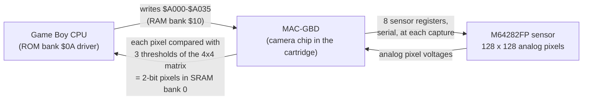
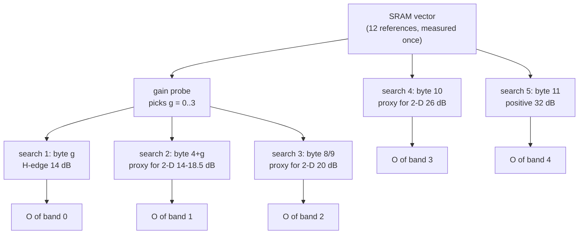

[README](../README.md) · [Section index](index.md)

## 19. How the camera drives its sensor: a guide to the registers, the offset search, the calibration vector and the auto-exposure

> **What this section is.** A reading guide to one mechanism, from power-on to a photo, written for someone who knows the Game Boy but not the M64282FP. It adds no new measurement: every statement comes from §18 (registers, bus recordings, BGB), §6 (the vector in SRAM), §10 (the metering) or §18.13 (the second camera and the other recordings), where the evidence, the addresses and the checks are. Tags as everywhere: **C** = traced in the ROM and reproduced on the bus and/or in BGB, **I** = inferred, **?** = not established. Addresses are Japanese Rev A.

### 19.1 The chain: CPU, MAC-GBD, sensor

* The ROM never talks to the sensor. It writes five registers and a 48-byte **matrix** into the MAC-GBD, sets bit 0 of `$A000`, and waits until the MAC-GBD clears it (C, §18.2).
* The MAC-GBD sends the eight sensor registers (the ROM supplies five of them; P, M, X are sent as `01 / 00 / 01` every time), lets the sensor expose, reads the analog pixels and **turns each one into 2 bits by comparing it with three thresholds** taken from the matrix (16 cells x 3 thresholds, repeated over the picture). The result lands as Game Boy tiles in SRAM bank 0 (C, §18.2-18.3).
* So the camera sees through a comparator. Every "measurement" the ROM makes is a question of the form *is this pixel's voltage above or below this threshold?*, and every adjustment is a register change that moves the voltages.

### 19.2 The registers that matter

| sensor register | written at | what it sets | values the ROM uses |
|---|---|---|---|
| reg 1 `N VH G` | `$A001` | edge mode (N, VH) and analog gain G | `$20` H-edge 14 dB, `$E0-$E5` 2-D edge 14-21.5 dB, `$E8` 2-D 26 dB, `$0A` plain positive image 32 dB; `$00-$03` in the gain probe |
| reg 2-3 `C` | `$A002-$A003` | exposure time = C x 16 µs (big-endian) | `$0010` (0.256 ms) … `$FFFF` (1.05 s) |
| reg 7 `E I V` | `$A004` | edge ratio E, invert I, reference voltage V (x 0.5 V) | E = 0 (50 %) live, E = 2 (100 %) in some boot points; I = 0; V = 3 (1.5 V), 5 in the gain probe |
| reg 0 `Z O` | `$A005` | zero-point mode Z and **offset O** (6-bit sign + magnitude, 32 mV per step) | `$80 \| O`: Z = 10; `$A0` = 0 V, `$BF` = +0.99 V, `$9F` = −0.99 V |
| matrix | `$A006-$A035` | the 48 thresholds of the 2-bit quantiser | a flat value (all 48 equal) for measurements; the dither ramp for pictures |

A **register set** below means one combination of reg 1 (mode and gain), reg 7 (E, V) and reg 0 (O) used together. The datasheet names and the conversions are in §18.2; the points where the datasheet is wrong or unclear are in §18.8.

**The offset O in one sentence (I, from the datasheet and the data):** O shifts the analog output of every pixel up or down before the comparator; it is how the camera decides where "black" sits relative to the matrix thresholds. The right O depends on the sensor unit (camera 1 runs around `$A2-$A9`, camera 2 around `$A7-$AF`, §18.13), on the gain and on the edge mode.

### 19.3 The measuring trick: 12 pixels and a flat matrix (C)

To measure, the ROM fills the whole matrix with one value `t` (a *flat matrix*): all three thresholds of every cell are equal, so every pixel comes out either **black** (2-bit value 3: both plane bits set) or **white** (0). `Cam_PixelTestHelper` (`0A:4C30`) then counts the black pixels of a small fixed block and answers **pass** when there are at least `H` of them (`H` = 9; 8 in the second stage of the threshold scan).

**The exact probing area (C, from the code).** The routine reads the four bytes `[DE]`, `[DE+2]`, `[DE+4]`, `[DE+6]` (plane 0 of four consecutive pixel rows of one tile; with a flat matrix plane 1 is the same) and counts bits 6, 5 and 4 of each (pixel columns 1, 2, 3; the test of bit 3, column 4, is jumped over at `0A:4C51`): **12 pixels, a 3 x 4 block**.

| used by | `DE` | pixels of the 128 x 128 frame | where |
|---|---|---|---|
| the gain probe and the five boot searches, factory part 2 | `$A002` (tile 0) | x 1-3, y 1-4 | top-left corner, in the 8 lines above the photo (the photo is lines 8-119): never visible in a picture |
| factory part 1 | `$A082` (tile 8) | x 65-67, y 1-4 | top centre, same hidden band |

**The criterion in pixel values (C).** "Pass" = at least 9 of the 12 pixels are black at threshold `t`. Lowering the offset O darkens the output (after a pass the search raises O, after a fail it lowers it, 19.4; the prototype source says it in words, 19.9), so the offset search ends on **the highest O at which 9 of the 12 pixels still read black**: the fourth-lightest of the 12 pixels sits at threshold `t`. A few bright or noisy pixels (up to 3) do not change the result. These are scene pixels, not shielded reference pixels (C for one frame, §18.9); the very short exposures of the measuring captures (0.256 ms) stand in for darkness (I), except under a strong light (19.6).

Three procedures are built from that one test:

| procedure | routine | moves | until | gives |
|---|---|---|---|---|
| offset search | `Cam_ORegister_SAR_Search` `0A:4B6A` | O (and V if O runs out) | the test flips | the O at which these pixels sit at threshold `t` |
| threshold scan | `Cam_ThresholdConverge` `0A:4E44` | the flat matrix value `t`, one step per capture | the test flips both ways | the `t` between the 8th and 9th of the 12 pixels |
| gain probe | `Cam_ExposureBandSelect` `0A:4859` | the gain G = 0, 1, 2 (3 by default) | a test capture at Z = 00 passes | the lowest gain step this unit needs |

### 19.4 The offset search, step by step (C)

The search is a **successive approximation** on O: 8 captures when V does not move.

1. `reg 0 = $BF` (O = +0.99 V). If the test still passes (the pixels read dark even with the maximum lift), raise V and repeat; else go on.
2. `reg 0 = $9F` (O = −0.99 V). If the test still fails, lower V and repeat; else go on.
3. Six captures that start at `$A0` (O = 0) and follow two 64-byte tables, `Above` (`0A:7BA0`, after a pass) and `Below` (`0A:7BE0`, after a fail): steps of 16, 8, 4, 2, 1 steps of 32 mV. The value the tables give after the sixth capture is the result.

**Worked example: camera 1, boot search 1** (real bus recording, H-edge 14 dB, matrix = vector byte 0). The captures are `$BF $9F $A0 $B0 $A8 $A4 $A2 $A3`:

| capture | reg 0 | O (volts) | test | next = table lookup |
|---|---|---|---|---|
| 1 | `$BF` | +0.99 V | fail (no V change) | go to `$9F` |
| 2 | `$9F` | −0.99 V | pass | start at `$A0` |
| 3 | `$A0` | 0 V | pass | `Above[$20]` = `$B0` |
| 4 | `$B0` | +0.512 V | fail | `Below[$30]` = `$A8` |
| 5 | `$A8` | +0.256 V | fail | `Below[$28]` = `$A4` |
| 6 | `$A4` | +0.128 V | fail | `Below[$24]` = `$A2` |
| 7 | `$A2` | +0.064 V | pass | `Above[$22]` = `$A3` (after a fail it would have been `Below[$22]` = `$A1`) |
| 8 | `$A3` | +0.096 V | ? | result `Above[$23]` = `$A3` or `Below[$23]` = `$A2` |

The pass / fail of each capture is not on the bus; it is read back from which table entry the next capture took (35 of 35 boot steps and 60 of 60 calibration steps are table steps, C, §18.3). The last decision is invisible, so the result is one of two values: here `$A2` or `$A3`, and the live view of that camera indeed runs band 0 at `$A2` (C, §18.4). In words: about +0.06 to +0.1 V of offset puts this camera's dark pixels exactly at the reference threshold for this register set.

### 19.5 The calibration vector (C for the layout, I for the meaning)

**Where.** 16 bytes at SRAM `$04FF0-$04FFF` (bank 2, `$AFF0`): two factory-test tolerances (`1B 13`), the **12 vector bytes**, and two checksums (`Σ + $0D`, `XOR + $23`); a copy of the last 14 bytes at `$11FF2-$11FFF` (bank 8). A valid copy repairs an invalid one; if both are invalid (or both valid but different) the ROM uses a **built-in default vector** `7E 7F 7F 7F 7E 7D 7E 7E 7D 7E 7D 6A` in WRAM and never writes it back; only **twelve `$AA` in both copies** (a never-calibrated camera) starts the factory calibration (§6, §18.4).

**What each byte is.** Byte *k* is the flat threshold at which a dark frame flips, measured at the factory in one register set (§18.5):

| bytes | register set measured (all at 0.256 ms) | used at boot by | for live band |
|---|---|---|---|
| 0-3 | H-edge 50 %, G = 0 / 1 / 2 / 3 | search 1 (byte *g*, *g* = gain probe result) | band 0 |
| 4-7 | H-edge 100 %, G = 0 / 1 / 2 / 3 | search 2 (byte 4 + *g*) | band 1 |
| 8-9 | H-edge 100 %, G = 4 / 5 | search 3 (byte 8 if *g* ≤ 1, else 9) | band 2 |
| 10 | H-edge 100 %, G = 8 | search 4 | band 3 |
| 11 | plain positive image, G = 10 | search 5 | band 4 |

Camera 1's vector after its calibration: `7E 7D 7D 80 | 7D 7C 7D 7B 7C 7B 79 | 6A` (C, §18.13). The bytes differ by register set because each register set has its own dark level.

**How the boot uses it (C).** At every cold boot the gain probe picks *g*; five offset searches then run, each with the matrix filled with "its" vector byte and the sensor in "its" register set. Each search finds the O that puts the dark pixels at the stored reference; the five (V, O) pairs go to `wCamBootV` / `wCamBootO` (`$D5C1-$D5CA`), one per live band. The live loop never reads the vector itself, only these five pairs (C, §18.6).

Bands 1-3 run in 2-D edge mode, but the boot measures them in H-edge mode with E = 2: the measuring exposure (0.256 ms) is below the datasheet's 0.768 ms minimum for the 2-D modes, so the nearest allowed mode stands in (I, §18.4).

**So the vector changes slowly, the offsets at every boot (I):** the references are fixed at the factory; the offsets follow the sensor's drift (temperature, supply, ageing) because they are re-found each time against those references.

### 19.6 The factory calibration (C)

It runs on the first boot of a camera whose vector is twelve `$AA` (`STORE PLEASE WAIT`, `Cam_FullCalibration` `0A:4947`), or as a measurement only in the hidden factory test (hold every key but B at power-on, §18.5):

1. **12 offset searches** at the 12 register sets (part 1, `Cam_FactoryMeasure1`), with a flat matrix `$80` and long exposures: 0.768 ms (H-edge), 36.9 ms, 131 ms, 205 ms and 524 ms (2-D and positive modes). They find a (V, O) per register set.
2. **12 threshold scans** (part 2, `Cam_FactoryMeasure2` + `Cam_ThresholdConverge`) at 0.256 ms with those (V, O): each scan's result is one vector byte. A scan lasts about `$81 − byte` captures, which is how the vector was predicted from the bus recording (11 of 12 bytes within ±1, §18.13).
3. `Cam_CommitVectorToSRAM` writes the 12 bytes and their checksums to both copies (not the two tolerance bytes), and the camera stays on that screen until power is cycled.

The **hidden factory test** runs parts 1 and 2 without storing, then compares bytes 10 and 11 with the stored ones: |difference| ≤ 27 and ≤ 19 (the tolerance bytes `1B 13`) shows "OK", else "NG" (§18.5).

**What the two parts achieve (I, consistent with every C fact above).** Part 1 is a real dark-level calibration: in the dark, at each band's own exposure, it finds the offset that puts that register set's dark level, dark current at that exposure included, at the threshold `$80`. Part 2 then records, with those offsets but at 0.256 ms, at which threshold the same dark pixels sit: the vector byte is the short-exposure image of "true black for that register set". At every boot the camera can then re-find each band's dark-room offset in a fast 0.256 ms capture, in whatever light, by searching for the offset that puts the pixels back at the stored byte; only the sensor's drift since the factory is corrected. Camera 1's vector fits this: the bytes fall as the band's exposure x gain (and so its dark current) grows:

| bytes | 0-3 | 4-7 | 8-9 | 10 | 11 |
|---|---|---|---|---|---|
| band exposure in part 1 | 0.768 ms | 36.9 ms | 131 ms | 205 ms | 524 ms (32 dB) |
| camera 1 | `7E 7D 7D 80` | `7D 7C 7D 7B` | `7C 7B` | `79` | `6A` |

If the prototype's "`$55` = 1 V" (19.9) gives the scale of the thresholds, `$80` is 1.5 V, the reference voltage V = 3 of every retail measuring and live capture, and the bytes `7E`-`79` sit 20-80 mV below it, `6A` about 0.25 V below (I).

**It must run in the dark (C, §18.13).** Camera 2 recorded the factory calibration twice. In ordinary room light: 164 captures, offsets `$A9-$B1`, scans of 3-8 captures. Under a strong light source: 540 captures; from the 36.9 ms points on the searches must lower V (3 → 1) and end on offsets `$93-$9F`, and the scans take 15-94 captures. The long exposures of part 1 are meant for darkness; under light they measure the light, and the references stored would be wrong for good (I).

### 19.7 The auto-exposure in live view (C)

Each frame (bank 6 loop, `Cam_MainDispatch` `0A:4000`):

1. **Meter.** Sum the 2-bit values of 168 sparse tile-row reads in the middle of the picture, the first 120 counted twice (centre-weighted): Σ, up to 6,912 (§10).
2. **Level.** `L = Σ / BRIGHTNESS` (the setpoint `$D59A`, default 84; Up/Down change it by 12), capped at 159.
3. **Correct.** `s = ShiftTable[L]` (160 bytes at `0A:7B00`); `e ± (e >> s)`: a too-dark picture (L ≥ 38) lengthens the exposure, a too-bright one (L ≤ 34) shortens it, L = 35-37 leaves it alone. The largest steps are 25 % per frame (very bright) and 12.5 % (very dark).
4. **Change band** when the exposure leaves the current band's range: load that band's register set (reg 1, and V and O from the boot) and a new exposure, and rebuild the dither matrix.

| band | register set | exposure range | up when → reload | down when → reload |
|---|---|---|---|---|
| 0 | H-edge, 14 dB | 0.26-0.70 ms | e ≥ 0.768 ms → 1.15 ms | (floor 0.256 ms) |
| 1 | 2-D edge, 14-18.5 dB (gain from the probe) | 1.15-66 ms | ≥ 73.7 ms → 55.3 ms | < 0.78 ms → 0.50 ms |
| 2 | 2-D edge, 20 / 21.5 dB | 55-364 ms | ≥ 393 ms → 217 ms | < 32.8 ms → 45.1 ms |
| 3 | 2-D edge, 26 dB | 217-705 ms | ≥ 786 ms → 545 ms | < 164 ms → 283 ms |
| 4 | positive image, 32 dB | 545-1,049 ms | (saturates) | < 393 ms → 573 ms |

Every upward switch adds 6 dB of gain (x 2) and cuts the exposure to 55-75 %, so exposure x gain rises by 10-50 %; every downward switch lowers it by 14-31 %. The overlap is a hysteresis: after a switch the picture lands inside the new band's range, so the loop has no reason to switch straight back (I, §18.6). 207 of 207 recorded steps and 2,377 of 2,377 BGB steps follow this rule (C). CONTRAST and the option cross change only the dither matrix, never a sensor register; a photo is a live frame (C, §18.7).

### 19.8 What the calibration is for: register sets that join without a jump (I, with real-camera evidence)

The dark level of the sensor's output depends on the register set: gain and edge mode change where "no light" sits. If every band used the same offset, the black point would move each time the auto-exposure changes band. The camera therefore keeps **one offset per register set**, trimmed at every boot against **one stored black reference per register set**, so that black stays where the matrix expects it on both sides of a band switch. Together with the exposure reload and the hysteresis (19.7), the picture passes from one register set to the next without a visible jump (the owner's reading, 2026-10-26; consistent with every C fact below).

What the recordings show (§18.13):

* **Both cameras run each band at its own offset, found by its boot search** (camera 1: `$A2 $A3 $A5 $A9 $A5`; camera 2: `$A9 $A9 $AB $AF $A7`). The values differ per unit, the pattern does not: higher gain, higher offset; the positive mode lower (C).
* **A changed reference moves its band's offset** (C/I). With camera 1's vector zeroed, the ROM falls back to the default vector, which differs mainly in byte 10 (band 3: `$7D` against `$79`): band 3 then ran at `$AB` instead of `$A9`, the four other bands unchanged.
* **A spoiled vector makes the band switches jitter** (owner's observation, 2026-10-26: a camera whose vector was corrupted but had valid checksums; its SRAM was lost). This is what the mechanism predicts (I): a wrong reference gives one band a wrong offset, so the picture jumps at that band's boundary; if the jump is larger than the hysteresis margin, the next metering puts the exposure back across the boundary, and the loop flips between the two register sets near that light level.
* **The prototype has none of it** (C): the `DEBAGAME` prototype uses one register set only (2-D edge 20 dB, offset `$8B` = −0.35 V), never changes band and steps the exposure coarsely (x 0.5 to x 2). The Hello Kitty ROM uses the retail mechanism unchanged.

### 19.9 Before the retail code: the prototype's own sensor source (C for the code, I for the order of the versions)

The prototype ROM (`roms/prototype_debagame/`) carries plain-text leftovers of the developers' source, with Japanese comments, in banks `$1E-$27` (§18.14). Its sensor driver measured the dark level differently:

* **`GET_OFFSET`**: fill the matrix with `$55` (commented "threshold `$55` (1 V)"; `$80` for mode 6 in the version the prototype runs, `$70` in older copies), set the exposure ("charge time") to `$0021` (0.53 ms; `$0000`, the datasheet's optical black, in one older version), start the offset at `$3F` (+0.99 V) and **lower it one step per capture** (+31 … 0, −1 … −31): a linear search of up to 63 captures, where the retail successive approximation needs 8.
* **`CHECK_BLACK`**: "black level reached" when **every pixel of the probe area is black** (all bytes `$FF`): one whole tile at `$A770` (64 pixels, x 56-63, y 56-63: the middle of the picture) in the version the prototype runs, one full line of 128 pixels at y = 109 (`$AD0A`) in an older one. The retail criterion is 9 of 12 pixels in a hidden corner.
* **The auto-exposure** counts the black pixels of the middle 8 x 7 tiles (a checkerboard of 448 bytes), compares the count with a target (`AKARUSA`, "brightness"), changes the exposure by `e >> s` from tables (the retail scheme, 19.7) and refuses exposures below `$21` ("below `$21` is unusable"): the prototype recording of camera 1 never goes below `$0022` (§18.13).
* **One register set**: the modes are set by name (negative image, horizontal / vertical / 2-D edge enhancement, edge extraction) with no gain or offset per band; the prototype recording runs one register set only.

So the retail design kept the idea (an offset search against a flat threshold on dark pixels) and changed everything around it: a 12-pixel probe outside the picture, a tolerant 9-of-12 criterion, an 8-capture search, and one factory reference per register set, re-found at each boot.

### 19.10 What is still open

* The vector a calibration under strong light stores, and what the photos of a camera calibrated that way look like (a test: factory reset under a lamp, dump the save, photograph a dark and a grey scene).
* A recording of the jitter itself (a test: write a vector with byte 10 moved far off, point the camera at a scene that keeps the exposure around 200-400 ms, record the bus: the band should flip between 2 and 3 with the shifted offset).
* Whether light on the 12 top-edge test pixels shifts the boot offsets (record the five boot offsets with the lens covered and in bright light, §18.9).
* Bit 1 of `$A000` and the `$D5` matrix of the gain probe's first capture (§18.9).

### 19.11 Glossary

| term | meaning here |
|---|---|
| MAC-GBD | the camera chip of the cartridge: mapper, SRAM, sensor interface and 2-bit quantiser |
| matrix | the 48 thresholds (16 cells x 3) the MAC-GBD compares each pixel with; flat = all equal |
| pixel test | 12 pixels of the hidden top lines (x 1-3, y 1-4) compared with a flat matrix; pass = at least 9 read black |
| O (offset), Z | reg 0: a voltage added to the pixel output (32 mV steps); Z = 10 in all live and search captures |
| V (Vref) | reg 7: the output node bias, 0.5 V steps; 3 = 1.5 V in normal use |
| G, N, VH, E | reg 1 / reg 7: gain, edge mode and edge ratio |
| register set | one combination of reg 1, reg 7 and reg 0 used together; a live band is one register set plus its exposure range |
| offset search (SAR) | the 8-capture successive approximation that finds O for one register set and one threshold |
| threshold scan | the matrix sweep that finds the threshold between the 8th and 9th pixel: one vector byte |
| calibration vector | 12 stored thresholds, one black reference per register set measured at the factory |
| band | one of the five live register sets, chosen by the exposure |
