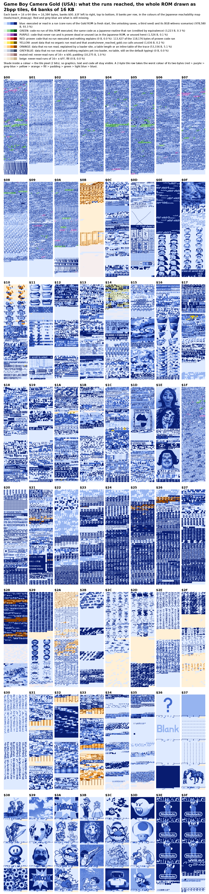

# Game Boy Camera Gold (USA) (SGB Enhanced)

MD5 `b2999cfb6dacb439f501a71f30f91762`. The international ROM with modified assets.

## Levels

| Level | Status | Evidence |
|---|---|---|
| L0 | done | `intake/intake_roundtrip.txt`: mgbdis `95d951a` with no symbol file + rgbasm 1.0.4 rebuild md5 `b2999cfb6dacb439f501a71f30f91762` |
| L1 | done | `gbcam_gold.sym` types every byte; 0 untyped bytes in the port queue (docs §1.5) |
| L2 | done | `trace/trace_gold.json`, 0 unresolved; observed in the core runs `trace/cov_gold_runs.npz` and the witness runs (`port/never_run_gold.csv`; docs §1.5) |
| L3 | done | `disasm/sym_names_gold.csv`: C 5,280 / I 130 (the I names all final, unused, dead or never loaded: `disasm/sym_settled_unused_gold.csv`), 0 doubts (`disasm/sym_unconclusive_gold.csv`) |
| L4 | done | `disasm/ram_names_gold.csv` and the constant tables, applied by `tools/sym_fix.py --const` |
| L5 | done | `src/`, `make TREE=gold check` |
| L6 | partial | the character set, shared with the international ROM (`disasm/charset_gold.csv`) |

*What the runs reached* (`gold_rom_reachability_map.png`, drawn by `tools/reach_map.py --tag gold` in the legend of the Japanese map: blue executed or read in a run, green not run here but the same code as a Japanese routine that ran, purple proven dead or unused, red proven code nothing explains, yellow the Japanese never-reached assets that no run here read, orange data never read but typed):

The map above is drawn by `tools/status_maps.py` (grey-blue = not analysed yet; it fills in as names, types and a trace are added here; per-bank counts in `assets/layout_by_bank_gold.csv`).

Ported 2026-10-31 with `tools/port_build.py` from the Japanese symbol file (the international procedure, SETUP.md): `gbcam_gold.sym`; the names and type rows in `disasm/sym_names_gold.csv` / `sym_types_gold.csv` (C 5,280 / I 130), merged by `tools/merge_name_layers.py --tag gold` from the layers of `disasm/layers/` (port < loaders < reads < checked < hand; edit the hand layer); the trace, its inputs and the runs in `trace/`; the byte map and the port reports in `port/`; the L0 intake in `intake/`; the WRAM access table, its summary and `INDEX.md` (the layout is the Japanese one) in `wram/`; the SRAM map, carried from the Japanese one, and its access sites in `sram/`; the 130 names tagged I, all final (unused, dead or never loaded), in `disasm/sym_settled_unused_gold.csv` and the doubts list (empty) in `disasm/sym_unconclusive_gold.csv` / `.md` (`tools/port_settled.py --tag gold`). The hand layers (`disasm/layers/*_hand.csv`, `trace/extra_roots_gold_hand.json`) were copied from the international folder after a byte check (0 differences at those addresses). Three round trips byte-exact (md5 `b2999cfb6dacb439f501a71f30f91762`).

Differences with the international ROM (byte diff, `difflib` per bank):
* bank 02: `Photo_RenumberVector` (02:4466) has 23 more bytes (02:448A-44AF). The first vector entry equal to the rank being renumbered gets the new number, as before, but any further entry with the same rank now becomes $FF (empty) instead of keeping its old rank, and every entry still >= $1E then becomes $FF before the photos are counted. In the other builds a duplicate or out-of-range entry stays and counts as a photo (the count then exceeds the positions that really hold a photo), so this build repairs a damaged photo order table (in BGB on a 9-photo save with a duplicated or out-of-range entry, docs §16.34: the international ROM counts 9, cannot open one photo and shows a ghost ninth thumbnail that repeats another photo and cannot be deleted; the Gold ROM counts 8 and shows no ghost) (corrected 2026-11-02: the earlier text said every duplicate got the new number; a Python model of both routines gives `0 0 1` -> `0 0 1`, 3 photos, in the other builds and `0 FF 1`, 2 photos, in Gold). The rest of bank 02 moves by +23, hence the one-byte operand changes of the far calls into bank 02 from banks 00 and 03-09.
* banks 2B / 2C: stamps (the Zelda: Ocarina of Time set instead of the Pokémon one); bank 1D: icon sources; banks 37 / 38: the three pictures of album B.

**Source tree (L5, 2026-11-02).** `src/` is written by `python3 tools/make_source.py --tree gold --rom gbcam_gold.gb --check` from `gbcam_gold.sym`, the name layers and the L4 tables of `disasm/` (the same preset as the international tree, with the Gold files; `disasm/rom_operands_gold.csv` is its operand report, `disasm/rom_operands_manual_gold.csv` the one hand decision carried from the international build). `make TREE=gold check` at the top of the repository builds it to md5 `b2999cfb6dacb439f501a71f30f91762`; `tools/check_repo_consistency.py --roundtrip` checks that the tree is fresh.

The ROM is not in the repository (supplied by the owner outside it; md5 `b2999cfb6dacb439f501a71f30f91762`).
