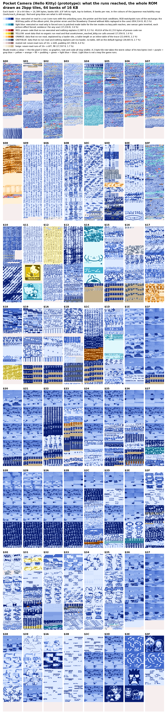
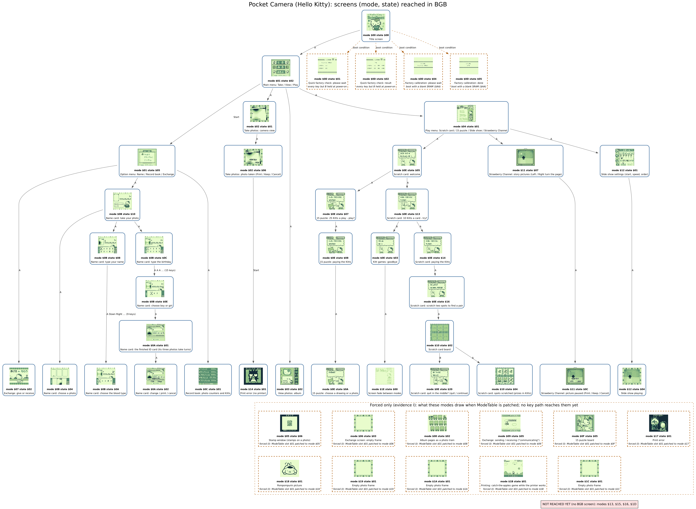

# Pocket Camera (Hello Kitty)

MD5 `0a323bddc4f0159cea76cf44ed0c1a3c`. A late leaked prototype.

The map above is drawn by `tools/status_maps.py` (grey-blue = not analysed yet; it fills in as names, types and a trace are added here; per-bank counts in `assets/layout_by_bank_kitty.csv`).

Notes made before the work started (2026-11-01):

* **A different program, not a port.** Bank 0 shares only 2,698 of its 16,384 bytes with the Japanese ROM: it switches banks through `$2100` with the current bank in `$FF8B` (Japanese: `$2000`, `hRomBank`), and its far-call and table helpers are its own (`RST $18` is a jump-table dispatcher; far-call helpers near `00:0151-0194`). No bank is identical to a Japanese bank, and the internal title is `POCKETCAMERA_SN`. `tools/port_build.py` stops at the tracer here (the Japanese bank-0 entry points do not map); this ROM needs its own trace configuration, like a new ROM ([`HOWTO_NEW_ROM.md`](../../HOWTO_NEW_ROM.md)).
* **The save** (owner's [Inject-pictures repository](https://github.com/Raphael-Boichot/Inject-pictures-in-your-Game-Boy-Camera-saves#2021-07-01-update-structure-of-the-hello-kitty-pocket-camera-save), checked against a clean save that BGB made: Kitty ROM booted on an all-$00 SRAM for 1,200 frames): `$1000-$1009` the counters (taken, erased, transferred, printed, received), `$100A-$100C` the **Kitt** counter (3 x 2 BCD digits, low byte first), `$100D` = `$60` after formatting, `$1012-$1016` "Magic" followed by `$00` (no checksum: the game formats the block without one), `$11B2-$11D6` the photo vector state as in the other ROMs (with its echo after it). A clean save has no CoroCoro tag at `$1FFD-$1FFF`.
* **Unlocks.** The Kitts unlock the Strawberry Channel animations (TCRF: animation 1 and the credits are open, the others at Kitt milestones), and pay for the scratch cards (10) and the sliding puzzles (25). Emulator runs of this ROM must start from a save with the Kitt counter raised (`99 99 99`, 999,999 Kitts; made from the clean save, kept outside the repository), and the milestones are to be read in the code.

## Levels

| Level | Status | Evidence |
|---|---|---|
| L0 | done (2026-11-07) | `intake/intake_roundtrip.txt`: mgbdis `95d951a` with no symbol file + rgbasm 1.0.4 rebuild md5 `0a323bddc4f0159cea76cf44ed0c1a3c` |
| L1 | done (2026-11-07) | `pocketcamera_kitty.sym` types every byte (`tools/sym_build.py` finds no hole or overlap); mgbdis + rgbasm rebuild md5 `0a323bddc4f0159cea76cf44ed0c1a3c` with it (the checker's `kitty` lines) |
| L2 | done (2026-11-07) | `trace/trace_kitty_unresolved.md`: 0 unresolved; `trace/cov_kitty_runs.npz` (core) and `trace/cov_kitty_bgb.npz` (BGB); the screen tree below |
| L3 | done (2026-11-12): every routine entry named; every data block named by kind and consumer (`tools/kitty_data_names.py`), no placeholder name; the 109 runs of bytes that nothing reads, runs or explains are `Leftover_BB_AAAA`, tag I, final (owner rule 2026-11-11; `disasm/sym_settled_unused_kitty.csv`); the 40 other names not tagged C in the doubts list | `disasm/sym_names_kitty.csv` (layers merged by `tools/kitty_names.py`), `disasm/match_jp_kitty.csv`, `disasm/similar_jp_kitty.csv`, `trace/read_screens_kitty.npz` |
| L4-L6 | not started | |

## L0: intake (2026-11-07)

Made by `tools/rom_intake.py` (command in its header); all numbers are byte counts read from [`intake/intake_header.csv`](intake/intake_header.csv) and [`intake/intake_banks.csv`](intake/intake_banks.csv).

* **Header (C).** 1,048,576 bytes = 64 banks; entry `00 C3 6A 17` (`nop; jp $176A`); title `POCKETCAMERA_SN`; cartridge type `$FC` (Pocket Camera mapper), 128 KiB SRAM, SGB flag `$03`, no CGB flag, destination Japan, licensee `33` / `01`, version `$00`; logo, header checksum and global checksum all valid.
* **Round trip (C).** mgbdis with no symbol file and rgbasm 1.0.4 rebuild the ROM byte-exact (L0).
* **Shared content with the sibling ROMs (C for the counts, I for what they mean).** A byte counts as shared when a 16-byte window holding it (not one repeated byte) occurs anywhere in the sibling ROM, at any address. Out of 1,048,576 bytes (226,227 of them padding runs of 16+ `$00` / `$FF`): 262,118 shared with the Japanese Rev A ROM, 263,035 with the international ROM, 263,164 with Gold, 119,140 with the early prototype. 217,204 bytes are shared with the Japanese ROM and not with the prototype, 12,264 the reverse: the Kitty build is much closer to the retail line than to `DEBAGAME`, which fits the owner's hypothesis of a build made from the Japanese version (I, to be tested on the code at L2-L3).
* **Where the Japanese ROM is closest.** Kitty banks `$09` / `$0A` (14,600 / 15,059 shared bytes, the best single Japanese bank being `$30`), `$12` (14,549, best Japanese bank `$2A`), `$11` (11,171, `$2A`), `$1C` (9,426, `$2E`), `$0E` (7,249, `$2F`) and `$04` (5,503, best Japanese bank `$0A`, the Japanese sensor bank). Bank 0 shares 4,155 bytes with the Japanese bank 0 (the README note above: a different bank-0 program).
* **Open (?).** In banks `$1E-$3D` the Kitty ROM shares more with the international ROM than with the Japanese one (60,423 bytes shared with the international ROM and not the Japanese one, mostly there; 65,363 the reverse, mostly in banks `$09-$12` and `$1C`). The owner's view (2026-11-07): the Kitty build is its own port, with its own assets, music and menus; only the sensor, printer and SRAM organisation are expected to be close to the Japanese ROM. Whether these shared windows are whole assets or small common pieces (blank or plain tiles, glyphs, fills) is checked asset by asset at L3; shared bytes are not used as evidence that an asset is shared.

## L1: every byte typed (2026-11-07)

The Kitty engine is not the Japanese one, so this ROM has its own tracer, `tools/kitty_trace.py` (its docstring lists the engine conventions read in the listing: ROM bank register `$2100` with shadow `hFF8B`, SRAM bank register `$4000` with shadow `hFF8C`, far call `$015B` / `$0165` with B = bank and HL = target and the callee returning through `jp $0173`, one-way far jump `$0155`, jump tables `$0189` / `$0194` / `rst $18`, far jump table `$01A0`, routines that take inline arguments after the call, the two LCDC-callback setters, the far callback given to `$1AB7`, the object creation `$205D`). Pipeline (SETUP.md, Hello Kitty): `kitty_trace.py` -> `trace/trace_kitty.json` and `trace/trace_kitty_unresolved.md`; `tools/kitty_types.py` -> `disasm/sym_types_kitty.csv`, `assets/copy_sites_kitty.csv`, `trace/rom_map_kitty.csv`, `disasm/sym_names_kitty.csv`; `tools/sym_build.py` -> `pocketcamera_kitty.sym`. All seven files are generated from the ROM, the hand file `trace/extra_roots_kitty.json` and the run files `port/cov_kitty_*.npz` (L2).

* **Code (C).** 61,153 bytes of proven code: recursive descent from the entry, the five interrupt vectors, the rst and bank-0 helpers, 667 far calls resolved from constants on the straight line before the call, the 124 object descriptors of bank 2 created with a constant address, and 258 entries observed in the runs (L2). The main loop (`00:0CF2`) calls the mode routine through the far jump table `ModeTable` (`00:0D00`, 31 `{lo, hi, bank}` entries, mode in `hFF8D`); each mode dispatches its state (`hFF8E`) through a word table read by `$0189`. Mode and state are set by `$01B2` (mode = A), `$01BD` (state = A), `$01C8` (B, C) and `$01D1` (two inline bytes).
* **Table lengths (I where cut by hand).** A word table is read up to the lowest target seen; 9 tables are cut by hand and 8 indexed `jp hl` tables are read by hand in `trace/extra_roots_kitty.json`, each with its reason (a word that lands inside an instruction or inside argument bytes, a next table that starts there, a mode whose code sets no higher state; the sound driver's id bounds `cp $0B` / `cp $3F` / `cp $13` give 10 / 62 / 18 entries, the counts of the Japanese driver). The trace also reports, per state table, the states that the code sets for that mode (`state_check` in the trace file).
* **Data typed by a reason (C).** 833,541 bytes of data typed by a reason: the jump tables (width 2 or 3), the inline argument bytes after the calls, the sources of 235 of the 333 traced copy-routine calls whose bank, source and length are constants (`assets/copy_sites_kitty.csv`: tiles `data,16`, tile maps `data,32` / `data,20`, WRAM / OAM data), and the bytes the core runs read as data (one block per run of read bytes, the reader routines in the note). Each block start carries a label named by kind and address only (`Gfx_BB_AAAA`, `Map_BB_AAAA`, `Data_BB_AAAA`, `JumpTable_BB_AAAA`, `FarJumpTable_BB_AAAA`, `ModeTable`).
* **The rest.** 74,186 bytes of padding (runs of 16+ `$00` that no run read; 292 fewer since 2026-11-12, where a data or leftover label of L3 falls inside a run); 79,696 bytes of data on the default typing (`.data`, 16 per row): bytes no traced copy names and no run read.

## L2: code proven and observed (2026-11-07)

* **0 indirect sites left unresolved (C).** The dynamic ones are read by hand in `trace/extra_roots_kitty.json` with their reason: the two object engines (per-frame routine and script command calls at `00:2113` / `00:212F` and `01:59E7` / `01:59FE`; objects are 23-byte slots at `$DAEE`, created by `$205D` from a descriptor in bank 2), the script command that calls the word after it (`02:6601` / `02:6612`), and object creations whose descriptor is returned by a far call; their targets come from the runs (observed roots).
* **Observed (C).** 47,717 of the 61,153 bytes of proven code ran: in the project's core (`tools/kitty_coverage.py`, novelty search over joypad input, four runs of 25 minutes, one with the core's printer model on the link port, one from the owner's unlocking save, plus `tools/kitty_scenarios.py` for the boot conditions), and in BGB for the photo exchange between two linked units (`tools/kitty_bgb_link.py`; logging breakpoints on the 389 blocks no core run had executed, 16 hit; `tools/kitty_bgb_hits.py` credits a block when its first instruction ran). The receiving unit's SRAM changes in the first photo slot (C, BGB state).
* **Boot conditions (C, core and BGB).** The keys read at power-on are kept in `$D8D8`: every key but B held gives `$FD` and mode `$0D` state 0, the **quick factory check** (`CHECK`, `PLEASE WAIT`, then `GAIN8` / `GAINA` and `NG` with BGB's fake sensor); a blank SRAM of `$AA` gives `$FF` and mode `$0D` state 3, the **factory calibration** (`STORE`, `PLEASE WAIT`, `END`). The same two entries as the Japanese ROM (§18), with the same key combination.
* **Not run yet.** 13,006 bytes of proven code never ran in any run (what they are: below, "The never-run code"); 4 modes (`$13`, `$15`, `$16`, `$1D`) draw no screen even when forced (the mode table patched in a copy of the ROM, evidence I), and 11 more show a screen only when forced (below). No code stores a constant mode `$13` or `$15`-`$1D` anywhere in the ROM (raw byte search of `ld b / ld a` + the mode setters); `$02:7EA2` sets the mode from an object's fields, so these may be reached through an object script.

* **Printing (C, BGB).** With the project's printer helper on the link (`tools/kitty_bgb_print.py`), START on the photo-taken screen prints: mode `$06` shows a little car and "please wait" (state `$1F`, A spin / B cancel), the car drives off (state `$21`), and A starts a game while the printer works (state `$24`: Hello Kitty jumps to catch falling fruits, the Kitts won and the record at the top right, a row of flowers at the top left). Kept busy by the helper (`PRN_POLLS=1000000`: every inquiry after the PRINT answers busy), the game runs on for 6,000 frames; the helper received one page. The apples caught are counted in `$D94F` (`PrintGame_DrawAppleCount`, state `$23`) and added to the Kitts when the game ends.
* **Printing from the album: the print frames (C, BGB, 2026-11-08).** The third icon of the album binder (mode `$03` state `$02`) opens mode `$06` state `$03`: the photo in one of **six print frames**, chosen with Left / Right (flowers and apples, HELLO KITTY, a plain bevel, a "きょうのいちばん" (today's best) banner, an empty banner, Kitty heads); state `$0A` then offers START (the photo, then a second page with the album comment lines, the ID card fields and Kitty: states `$15` and `$1C`, `Print_SetFrameSide`, `Print_LoadFrameGfx`), A (the photo only) or B. The helper received each frame as printed ([`screens/print_frames.png`](screens/print_frames.png): the screen above, the printed photo page below; the photo is the core's stand-in sensor picture).
* **Printer errors (C, BGB, 2026-11-08).** `PRN_ERR` of the printer helper (§16.16) replaces printer replies: no answer to INIT or `$FF` gives **print error #02** ("is the Pocket Printer connected?"), as does bit 4 (packet error) on one inquiry while printing; held for 200 inquiries while printing, bit 5 (paper jam) gives **#03** ("is the print sticker jammed?"), bit 6 gives **#04**, bit 7 (low battery) gives **#01** (mode `$14` state `$01`, [`screens/print_errors.png`](screens/print_errors.png)); bits 0 to 3 are ignored and the print completes.
* **Print intensity and the album page (C, BGB, 2026-11-12, owner's hint).** On the print frame screen (mode `$06` state `$03`), START held shows the print intensity (state `$0F`, `Mode06_State0F`: うすい light at the top, こい dark at the bottom, a squirrel on the scale that Up / Down move); Up / Down instead fade to state `$02` and then `$04`, the **wild frames** (taller frames printed around the photo: the Hello Kitty pattern, the house, the stickers, Kitty's Family, MEMO, HELLO KITTY; Up / Down change the frame, Left / Right return to the normal frames, A shows the photo in it, state `$06`, then prints it).
* **Printing with no printer: four error pictures at random (C, BGB, 2026-11-12, owner's hint).** START or A in the print menu with nothing on the link gives print error #02, its message sliding from right to left under a picture that `Mode14_State00` draws at random: `Rng_Next & 3` picks one of the four 3-byte records of `06:4464` (`3E:5C00` Badtz-Maru alone, `3E:6A00` three characters, one reading a book, `3F:4000` two characters in hoods, `3D:6A00` three characters and a top hat), $800 bytes copied to `$9000` and $600 to `$8000`; twelve BGB runs with different timings showed all four (the screen tree shows them in the print error panel).
* **The おもしろレンズ slide show (C, BGB, 2026-11-12, owner's key path).** In the live view (mode `$02` state `$01`), Down, Down open おもしろレンズ Ⓐ (the lens chooser, Hello Kitty saying HI! next to a "?" lens); A on the "?" lens starts a slide show of Hello Kitty pictures inside the camera frame (Kitty with her teddy bear, Kitty on lined paper, Kitty with a lion, a bear face, Kitty with a speech balloon, blank pages between them), every few seconds a new picture; the game stays in mode `$02` state `$01`. The 96 picture effects of `04:5E8A`, forced one by one in BGB (each in a patched copy), are transforms of the live picture only: the slide show is not one of them.
* **Stamps (C, BGB, 2026-11-12, owner).** The second icon of the album binder (mode `$03` state `$02`, Down A) opens the stamp screen over the photo (mode `$05` state `$06`, until now seen only with a patched mode table); START opens the stamp window: 8 pages, chosen with Right Right (the tab column) and Up / Down: large Kitty stamps (30), small Kitty and friends stamps, face parts, kana in three sizes, kanji, shapes and arrows. Every row of every page, as the window shows it while scrolling: [`screens/stamps_kitty.png`](screens/stamps_kitty.png).
* **Lenses (C, BGB, 2026-11-13, owner).** In the live view, Up / Down step through 20 lenses: ふつうのレンズ (normal), Up: おばけレンズ ①-⑧ ("ghost" lenses: mirrors, flips, stretches, a 2 x 2 split), Down: おもしろレンズ Ⓐ-Ⓚ ("fun" lenses: Ⓐ the slide show above, the others Hello Kitty pictures beside, above or between 2, 2 x 2 photo windows); every lens, and the live view after A on each fun lens: [`screens/lenses_kitty.png`](screens/lenses_kitty.png).
* **The no-photo picture (I, BGB, 2026-11-13).** `Photo_LoadEmptyPicture` draws `11:7000` (しゃしんがないよ, "no photo") when `Photo_FindSlotA` finds no slot for a photo number (album photo view, stamp screen, exchange receiver, slide show). Normal play keeps the numbers compact (deleting photo 01 of two renumbers the other) and no key path was found; a copy with `Photo_FindSlotA` patched to fail shows it in the album photo view (`screens/extra_03_05_noslot.png`, dashed in the tree).
* **The owner's paths in the core (2026-11-13).** `tools/kitty_core_paths.py` replays the paths above in the core so that the maps count them (`trace/cov_kitty_paths.npz`): the six wild frames printed, the print intensity (START held, Up / Down), printing with nothing on the link (from the photo-taken screen and from the album), the 20 lenses and the slide show, the 8 stamp pages; with them the never-run proven code goes from 7,607 to 7,324 bytes not run by anything.
* **Photo exchange (C, BGB, 2026-11-08).** Two linked BGB units (`tools/kitty_bgb_link.py`), the giving one with a photo it has just taken (title A, take A, shutter A, keep A, B): both open the exchange (mode `$07`), the giver presses A on "あげる" (give) first and the receiver Right A ("もらう", receive); the giver picks the photo on the photo train (mode `$08`, states `$00`-`$05`) and sends it (mode `$09` states `$01`-`$07`), the receiver waits ("ちょっとまってて", states `$08`, `$0A`, `$0E`, `$0F`, `$10`); both return to mode `$07`, and the receiver's SRAM changes in its first photo slot. When the giver has no photo, both show "no photo to give / receive" after a time-out. `Link_SumSlotBuffer` (unused in the Japanese ROM) runs here.
* **Super Game Boy (C, BGB, 2026-11-08).** BGB as a Super Game Boy (`SystemMode=2`, `tcrf_check/tools/bgb_sgb_capture.sh`) shows a pink houndstooth border with the "Hello Kitty" logo and four coloured Kitty faces in the corners ([`screens/sgb_border.png`](screens/sgb_border.png), the title screen, 256 x 224); read watchpoints on the five transfer sources of bank `$08` (`08:40D0`, `4146`, `41F6`, `5206`, `6216`) all hit, so the never-read data of bank `$08` is the SGB data.
* **Strawberry Channel without Kitts (C, BGB, 2026-11-08).** With 0 Kitts the channel shows snow (mode `$11` states `$03` / `$08`, `StrawberryCh_LockedCallback`) and A shows the price ("this channel can be watched with 50 Kitts"; prices `07:4F3A`: 50, 800, 100, 400, 200, 2,000 Kitts and one free channel).
* **Record book flowers (C, BGB).** Opened from a save whose counters were set by hand in the SRAM (taken 5 at `$1000`, erased 3 at `$1002`, printed 2 at `$1006`; Kitts 999,999), the record book (mode `$0C` state 1) grows a flower on the vine under each counter every few frames: [`screens/record_book_flowers.png`](screens/record_book_flowers.png), 20 frames apart.
* **What the flowers count, and why they grow at every visit (C, code and BGB).** Each vine is a script of the slot engine at `$DC67` (6 slots of 20 bytes, `01:597E` ScriptSlots_Add, run by `01:59C6`). State 0 of mode `$0C` empties the slots (`01:596C`) and starts five vines, one per counter, whose first step reads the counter from WRAM `$DAC9` (the copy of SRAM `$1000-$1011`) into hFFEA-EB: taken x1 (`01:571C`), thrown away x1 (`01:5736`), exchanged x11 (`01:5750`), received boys + girls x11 (`01:577D`), printed x6 (`01:57C5`). The shared script `01:56C7` then grows three kinds of flower one by one: one per hundred (0-19, 20 from 2,000 on), one per ten, one per unit, so 12 photos give 3 flowers and one exchange gives 2 (11). BGB pictures with one exchange, one print, one boy and one girl received show 2, 6, 2 and 2 flowers; with 9,999 taken the row is full, but with exactly 100 taken BGB showed no flower 600 frames after opening (?, not explained yet). Nothing of a previous visit is kept: a BGB run with read and write watchpoints over two visits in a row (SRAM `$A000-$BFFF`, `$D800-$D8FF`, the counters `$DAC9-$DAD6`, the slots `$DC67-$DCDE`) shows no SRAM access in mode `$0C`, the counters read only by the digit drawing (`06:581C`, `06:58D4`) and the five vine routines, and the slots emptied again at each entry; the flowers grow again on the second visit with no count changed. The animation is therefore a replay of the current counts, not a comparison with the last visit.
* **Scratch card (C, BGB).** Played with keys: the board (mode `$10` state 2), the six spots scratched (state 4: cherries worth 20 Kitts, bears worth 40 Kitts), and the host's question when B is pressed in the middle (mode `$0E` state `$20`: quit or continue).
* **Name card (C, BGB).** The owner ID card is reached with keys only: take three photos, open Name in the option menu, pick the three photos (mode `$0B` state 4), type a name (state 8), then the blood type (state `$0A`), the birthday (state `$0C`) and boy / girl (state `$0E`); END shows the finished card (mode `$0A` state 1: ID number, name, birthday; its three photos take turns) and its menu (state 2: change, print, cancel). No new code ran on this path: the core runs had already executed it.
* **Strawberry Channel (C, BGB).** Left alone, a channel plays its animation in a loop (channel 1: Hello Kitty driving a little car; 2,400 frames watched, screenshots every 60 frames). Left / Right change the channel (the dots at the bottom; from the unlocking save: car, slide, seesaw, tree, swing, a picnic titled おそとで あそぼ, and channel 7, the **credits**: a spiral, then the staff list rolls ("Hello Kitty Pocket Camera Staff", supervisor, director, programmers, designers, sound, special thanks, producer, "Presented by Nintendo") and starts again, [`screens/strawberry_channel_credits.png`](screens/strawberry_channel_credits.png); then back to channel 1, [`screens/strawberry_channel_pages.png`](screens/strawberry_channel_pages.png)); Up / Down change only the byte `$D8DC` (a bar with arrows shows at the top left when a channel starts: probably the volume, I). No new code ran.
* **What is still missing (C, the runs).** [`kitty_rom_reachability_map.png`](kitty_rom_reachability_map.png), drawn by `tools/reach_map.py --tag kitty` in the legend of the Japanese map (`tools/reach_draw.py`) from the run files, the trace classes, the type rows and the unused-asset table: 3,244 bytes of proven code never executed (red; most in banks `$06`, `$00`, `$0F`, `$07` and `$01`), 28,668 bytes of data never read and explained by nothing (grey-blue; most in banks `$03`, `$16`, `$11`, `$0D`), 22,648 bytes never read but explained by a loader site or a table (orange; it includes the `used` rows of `assets/never_reached_kitty.csv`, shown used in BGB or on a Super Game Boy), 17,056 bytes of the assets that `assets/never_reached_kitty.csv` calls unused (yellow), 854,526 bytes executed or read (blue), the rest never-read padding and fill. Light blue, 37,065 bytes: executed or read only in forced runs (`trace/forced_*.npz`: the mode table patched by `tools/kitty_core_paths.py`, one sensor gate inverted, every picture effect; never a way the game runs). The blocks that the BGB watchpoint runs executed (`trace/wp_exec_kitty.npz`) count as runs. The organic paths of the same tool (album print with the six frames, printer errors, the erase-all question, the Strawberry Channel with and without Kitts; `trace/cov_kitty_paths.npz`) count as runs.
* **Screens the core runs reach (C, the core).** [`trace/modes_seen_kitty.csv`](trace/modes_seen_kitty.csv), written by `tools/kitty_modes_seen.py` from the four corpora: 159 (mode, state) pairs, each with the shortest key history found (one key byte per frame from a cold boot, core mask) that ends on it; 158 of them end on their pair when replayed from a cold boot in the core, 1 (`0E:1E`) shows only in a replay from snapshots. The histories are core timing: in BGB a long one can end elsewhere (convert the mask and check the end).

  

## L3: names (done, 2026-11-12)

* **Data names (L3, 2026-11-12).** The 822 placeholder labels of L1 (`Data_BB_AAAA` 720, `Gfx_` 41, `Map_` 45, `JumpTable_` 16) are gone. `tools/kitty_data_names.py` (layer 5 of `tools/kitty_names.py`) works in the Japanese convention: 241 of them sat on the inline arguments of a call (`Copy_FarInline`, `Lcd_SetupInline` ...) and are dropped, the bytes belong to the call as in the Japanese listing; inside the others, every stretch of 32 bytes or more (padding runs aside) that no run reads or executes, no code names and no loader table explains is cut out as `Leftover_BB_AAAA` (110, tag I, final, `disasm/sym_settled_unused_kitty.csv`), and 10 more such stretches are entries of a table of their bank that no run reached (`Snd_0F_57AE_EntryOf572F`, the songs of the song table never played; `KeyPrompt_LoadSounds_Tbl5F7F_Entry5E8E` ...; tag I, doubts list); a block whose bytes hold two kinds is cut where the kind changes (38 cuts). Each block is then named by its kind, from the evidence of `tools/kitty_layout_kinds.py` (display tracker, loader tables, constant copies, readers) or its reader, and by its consumer: `Gfx_BB_AAAA_<context>`, `Map_`, `Frame_` (print and camera frames), `Snd_`, `OamList_` (sprite layouts), `ObjScript_` (object engine records), `Script_` (script slots), `Pal_..._Palettes`, `Src_` (copied, the destination never seen: kind not settled), `<Routine>_TblAAAA` and `<Routine>_JumpTblAAAA` for the tables of one routine, and the Japanese name (its address part made the Kitty one) for 18 blocks that are unique exact copies of named Japanese blocks (the sound-effect data `Sfx1_*`, `Snd_FreqTbl`, `Rng_InitOrder`, the Super Game Boy packets `Sgb_MltReqPackets` ...). The context is the routine whose code names the address, else the screen the bytes are first read on (`ModeMM_<Mode>_StateSS`, after the fade of mode `$1E`: [`trace/read_screens_kitty.npz`](trace/read_screens_kitty.npz), two 40-minute core runs of `tools/kitty_read_screens.py`; 575 names), else the routine that reads them. Tags: C when an organic run reads the bytes (608), I when only forced runs do or nothing reads them (15).
* **Data kinds and code colours of the layout map (C / I, 2026-11-09, refreshed 2026-11-12).** The data names carry their kind, so the layout map takes it from the name; `tools/kitty_layout_kinds.py` (its evidence: the six print frames and the 108 camera-frame pictures named by their loader tables, the Super Game Boy transfers of bank `$08`, bytes seen in VRAM tile memory or a BG map while the four core corpora were replayed, constant copies, first reads by the sound driver and the object engine) now gives a kind only to the bytes of labels whose name has none (`Src_`, `Leftover_`): 30,690 bytes of kind-less blocks given a kind, 18,511 left uncertain (rule 6, the owner by eye, 2026-11-12: `assets/layout_kind_owner_kitty.csv` gives tile sets to the top halves of banks `$0D` and `$16` and to the rest of banks `$0C`, `$10`, `$12`, `$18`, `$1C`, `$27`, `$2F`, and tile maps, the kind of the data around them, to the bottom halves of banks `$13`, `$14`, `$16`, `$1B`, `$31`; I, for the layout map only: the names keep the evidence of the code and the runs). On the layout map 51,557 bytes stay UNCERTAIN (204,703 before the data names): the `Src_` blocks copied into WRAM buffers and never seen in VRAM, and the leftovers. The code colours are the function groups of the Japanese map, from this ROM's modes and name prefixes ([`assets/layout_groups_kitty.csv`](assets/layout_groups_kitty.csv)); the code under an automatic data label (the bytes after the inline parameters of `Copy_FarInline` and the like) takes the colour of the routine before it, so every traced byte has a group.
* **Names.** 2,220 names (C 2,072 / I 148 / ? 0), merged from six layers by `tools/kitty_names.py`: the block labels of L1 (only `ModeTable` keeps its L1 name), 743 data names and leftovers (above), 304 mode and state names (`ModeMM_<Name>` from the BGB screens, `ModeMM_StateTable`, `ModeMM_StateSS`; the names of `disasm/mode_names_kitty.csv`, tagged I for the 10 modes seen only forced), 134 names ported from the Japanese ROM, 1,036 hand names (bank `$00`, banks `$01`, `$02`, `$04` to `$08` and `$0F`, the unused mode `$18`, the 57 Japanese names whose routine was compared over its whole length or seen running, `disasm/layers/sym_names_kitty_hand.csv`).
* **Same code as the Japanese ROM (C).** `tools/kitty_match_jp.py` searches every Japanese routine of 12+ bytes in the Kitty code with the build-dependent operands as wildcards (16-bit addresses, the HRAM byte of `ldh`): 230 of 1,891 are found, 204 at exactly one place. They are the **printer protocol** (`Prn_*`, bank 0), the **link cable** (`Link_*`, bank 0), the **sensor bank** (the Japanese bank `$0A` in Kitty bank `$04`: calibration copy and check, exposure bands, threshold convergence, dither ramps, the image effects `Fx*`), the **SRAM magic comparison** (`Sram_CompareMagic`, one Kitty routine for the three Japanese copies, tag ?), and **107 sound-effect routines** of the Japanese sound bank `$1F` in Kitty bank `$0F`. A port is tagged C from 16 bytes, I below.
* **Edited copies (C).** `tools/kitty_similar_jp.py` compares the instruction sequences of the routines not found exactly: 52 near matches (ratio >= 0.85), among them the **factory calibration** (`Cam_FactoryMeasure1` / `Cam_FactoryMeasure2`, ratio 0.998 / 0.997), the **quick factory check** (`Cam_CalibSanityCheck_Measure`, 0.993), `Cam_CommitVectorToSRAM`, `Sram_ComputeImageChecksums`, `Sgb_SendPacket`, `Img_ReduceToThumbnail` and the flipped image effects. Each named copy was then compared with its Japanese routine over its whole length (to the first `ret` / `jp`): the same instructions with other addresses, or small edits (variables moved between HRAM and WRAM, bank shadow `hFF8C` stores, a `ret` in place of a jump); the boot measurement `Cam_Calib_BootMeasureSeq` first looks for 12 bytes of `$AA` at `$AFF2` of SRAM banks 2 and 8 and skips the measurement when both are there.
* **Owner's hypotheses so far.** Sensor, printer, link and SRAM code: the same routines as the Japanese ROM (C for the exact matches). Sound: the effect routines are shared; the music data is still to compare. Menus: no routine of the other Japanese banks matches (only banks `$00`, `$02`, `$07`, `$0A` and `$1F` have matches; the 31 Kitty modes have their own code).
* **Bank `$05` (2026-11-08, every routine entry named: 66 hand names).** Context for naming: `tools/kitty_entry_modes.py` replays the four core corpora and notes, for each routine entry, the (mode, state) of the frame it first runs on ([`trace/entry_modes_kitty.csv`](trace/entry_modes_kitty.csv), 1,028 of 1,351 entries; mode `$1E`, the screen fade, runs the set-up of the next screen, so the table also gives the screen that fade ended on). Named: the hex digits of the quick factory check (`FactoryCheck_PutHexByte`), the text buffer `$DA67` and its cursor `$D98C` with the glyph copies (`Text_*`: 8x16 glyphs of bank `$12`, 16x16 glyphs of bank `$09`), the stamp work buffers `$C000-$C77F` (`Stamp_ArrangeGfx`, `Stamp_MirrorGfx`: a horizontal mirror with bit reversal, `Stamp_BlitOnPhoto`), the ID-card record `$DADB-$DAEC` (ID number made at random by `NameCard_MakeIdNumber`, name, blood type, boy / girl, birthday; drawn in the album by `NameCard_Draw*`), the camera frames (index `$D8FD`: their tiles and decoration objects), the stamp loading chain (`Stamp_LoadSelected`), and the fonts: banks `$09` and `$0A` are a 16x16 font of 245 glyphs of 64 bytes (hiragana first; `Font16x16_Bank09`, read in the album, mode `$03` states `$0A`-`$0B`; `Font16x16_Bank0A`, the same but 222 bytes, read in the stamp window). They share 14,600 and 15,059 bytes with the Japanese bank `$30`, where the same kind of glyphs are the letter stamps (I: the same glyph set, used there as stamps and here as text).
* **Bank `$06` (2026-11-08, every routine entry named: 60 hand names).** The ID card drawn on the name card screens and into the print buffer (`IdCard_*`, one routine for the screen and one for the print buffer `$C000+` each: name in 8x16 glyphs of bank `$11`, ID number, birthday, blood type, boy / girl), its editor (`NameCardEdit_*`: the glyph page of each field, the photo shrunk 2:1 from SRAM bank 0 `$A030`), the BCD numbers with leading zeros blanked (`Bcd_DrawNumber*`, digit tiles of bank `$0C`), the record-book counters and the Kitts (`Counters_AddTaken` / `AddErased` / `AddExchanged` / `AddPrinted` / `AddReceived`: load the counters from SRAM, add 1 in BCD, save; `Kitts_Add`, `Kitts_Subtract`, `Kitts_CheckAfford`), the exchange page requests and a menu cursor object (`Menu06_*`, the same 8-byte item records as the Play menu).
* **Bank `$07` (2026-11-08, every routine entry named: 122 hand names).** The camera frames: four animation channels (`FrameAnim_Step*`: indices `$D8FF-$D902`, timers `$D903-$D906`, 5-byte keyframes, `$FF` loops), the decorations drawn into the four corners of the photo buffer (`FrameCorner_Draw*`: a piece from the table `[$D92D]` or a solid shade), and 31 frame types (`CameraFrame_RunType`, `CameraFrame_TypeNN`; types 24-30 are stubs that jump into type 0). The Strawberry Channel: corner table, random story page, price in Kitts, and one music per channel (`StrawberryCh_*`). The 15 puzzle (`Puzzle15_*`: board `$D960-$D96F`, empty cell `$D970-$D971`; the shuffle is played as scripted keys written into `$D8D9`). The scratch card (`Scratch_*`: six spots `$D952-$D957`, prize tables chosen by `$DADA`, two card pictures). The Kitt games host (`KittHost_*`: a text-script engine; 25 Kitts for the 15 puzzle and 10 for the scratch card, checked then subtracted).
* **Bank `$01` (2026-11-08, every routine entry named: 95 hand names).** The save code, rewritten from the Japanese one (best instruction-sequence ratios mostly 0.4-0.6): `Sram_Checksum` (sum and xor, stored + `$4E` / xor `$54`), the Magic string `Data_01_4700` = "Magic" checked by `Sram_CompareMagic` (code read, now C) for four blocks: the photo information of each slot (`+$F00`, `$5A` bytes, checksum and echo), the 30-slot table `$B1B2` (checksum and echo), the ID card record bank 1 `$AFB8` (checksum and echo) and the counters `$B000-$B011` (Magic only, no checksum); all four checks run in the core and every block of a save holds the string. At boot (mode `$00` state `$03`, `05:414C`, code read) a block whose Magic or checksum is wrong is cleared and signed again, never restored: a photo slot is set to zero over `$FB8` bytes (picture included), the slot table and the ID card are cleared, the counters are cleared when their Magic is missing. The counters have no other protection: `Counters_Load` is a plain copy of `$B000-$B011`, so any value under a valid Magic is accepted. The echoes (`+$F5C`, `$B1D7`, `$AFD1`) are written at every store and never read. `Sram_Format` (`01:4907-01:49BC`) clears every SRAM bank. Photos: load and store of a slot (`Photo_Load*`, `Photo_Store`), the slot table (`Photo_AddToVector`, `Photo_RemoveFromVector`, `Photo_RenumberVector`). The script engine of the slots (`ScriptCmd_*`: wait, end, jump, loop, jump by a byte, sound on channel 0-3, set or add to the slot fields `hFFE1-hFFEC`), the name card page turn (`NameCard_Script*`), the printing script (`PrintScript_NextState`: mode `$06` with the next state of the script).
* **Banks `$04` and `$08` (2026-11-08, every routine entry named).** Bank `$04` is the counterpart of the Japanese bank `$0A`: its effect table `04:5E8A` pairs one to one with the Japanese `0A:541A` (96 entries in the same order), so the 62 unnamed effects take the Japanese `FxNN_*` names by table index (C); `Cam_ApplyEffectOrFrame` sends A with bit 7 set to the camera frames of bank `$07` (`CameraFrame_RunType`) and the others to the effects; the far wrappers and a few sensor helpers are named, four of them I. Bank `$08` holds the Super Game Boy code: `Sgb_Detect` (MLT_REQ), `Sgb_InitDataSnd` (the DATA_SND start-up packets), `Sgb_FreezeScreen` / `Sgb_UnfreezeScreen` (MASK_EN), the inline packet senders.
* **Bank `$0F` (2026-11-08, every routine entry named).** The sound driver, the counterpart of the Japanese bank `$1F`: the six effect tables (`Sfx1_InitTbl` / `Sfx1_StepTbl` 62 words, `Sfx3_*Tbl` 10, `Sfx4_*Tbl` 18, the same layout as the Japanese ones) and every handler named by channel and **Kitty** sound id (`Sfx1_Init_0E`, `Sfx4_Step_Shared` ...). The 43 handlers first named from the Japanese driver by exact code match took Japanese game roles (`..._SpaceFeverBossDeath`); they are renamed the same way, the Japanese name kept in the description, because the ids and their uses belong to each ROM. The track engine routines that match the Japanese ones exactly keep their names (`Snd_Init`, `Snd_Trk_LoadFirstPattern`, `Snd_Vib_Lookup` ...). Which Kitty screen plays which id is not named yet (the sound-id table of L4).
* **Bank `$02` (2026-11-08, every routine entry named: 199 hand names).** The object callbacks and script callbacks of every screen. C: the button prompts (`KeyPrompt_*`: each accepts one key, posts its sound id from `$D8E6-$D8EB` on channel 0-3 and ends), the Play menu cursor (`PlayMenu_CursorUpdate`, the item table `02:5AB7`), the 15 puzzle shuffle (`Puzzle15_Shuffle*`: a random direction other than the last one), the frame picker of the camera (`FramePick_*`: `$D931` from 0 to `$18`, 25 frames, drawn by `TakePhotos_DrawRows*`), the print frame choice (`PrintFrame_Next` / `Prev`: `$D935` from 0 to 5), `Objects_ClearAll` (16 slots at `$DAEE`), `Obj_NullCallback`, and the fade end `Fade_SetModeFromObject`. The roles of the other callbacks come from the code and the screen each one runs on in the core replays (album arrows, stamp and text slides, the falling-fruit game while printing).
* **Bank `$00` (2026-11-08, every routine entry named: 141 more hand names).** The restart and interrupt vectors, the fills and copies (`Mem_*`, `Copy_*`, the HBlank-safe VRAM copies), the camera frame records of `05:69E7` (`FrameRec_*`: tiles, map and row records, screen on and off variants), the fade and message entries (`Fade_GoTo*`, `Message_Show`, the return modes `$D8F2` / `$D93D`), arithmetic (`Mul_8x8`, `Mul_8x16`, `Bin_ToBcd`, `Bcd_Add`, `Bcd_Sub`), the joypad (`Joy_Read`, `Keys_SetRepeatInline`), the STAT callbacks that switch the tile data area at a chosen line (`Stat_*`), the object engine: its script commands (`ObjCmd_*`, `00:1EBA-00:204A`), slot load / save to `hFFC3-hFFD9`, motion, sprite drawing (`Obj_DrawSprite`, `Objects_DrawAll`), the slot script slots (`ScriptSlots_Tick`), and the sound trampolines (`Snd_Init_Tramp`, C: it calls `Snd_Init` `0F:5308`).
* **Doubts list (L3, 2026-11-08, data names 2026-11-12).** 41 names: 15 in modes reached only by forcing, 11 in states the runs did not reach, 15 settled as unused (the entries of the ten modes that nothing enters, `$13`, `$15`-`$1D`, with the states of mode `$18`; camera state `$0C`). The 25 data names among them carry their group from `tools/kitty_data_names.py`: `forced only` for 15 blocks read only in forced runs, `not run` for the 10 table entries no run reached; the 107 leftovers are not doubts (final, `disasm/sym_settled_unused_kitty.csv`). The list is in [`disasm/sym_unconclusive_kitty.md`](disasm/sym_unconclusive_kitty.md) (generated by `tools/kitty_doubts.py` from the hand table `disasm/doubts_groups_kitty.csv`, which gives each name not tagged C its group, why and what would settle it). Every other name is C: the names taken from the Japanese ROM by a whole-routine comparison, the rest by reading the code and by the screen each routine runs on in the core replays (`next_screens` of [`trace/entry_modes_kitty.csv`](trace/entry_modes_kitty.csv)); the code read renamed 24 names (for example `Vram_FillSafe`, a fill and not a copy; `FrameRec_LoadMapWin`, the window map; `Photo_LoadEmptyPicture`, the picture of a slot without a photo; `Map_CopyRect`; the fade steps `Fade_StepIn` / `Fade_StepOut`). Modes `$05` (stamp window) and `$0F` (15 puzzle) are reached in the core runs, modes `$08` and `$09` in the linked BGB exchange, the printing states `$15` / `$1C` / `$23` in BGB print runs and the locked Strawberry Channel with 0 Kitts (C).
* **Next.** The sound-id roles (L4) and the music.

### Screens (BGB)

Drawn by `tools/make_screen_trees.py` (`tools/screen_tree.py`, left to right) from `screens/` (collected by `tools/screen_collect.py` from the explorations of `tools/kitty_bgb_explore.py`: a breadth-first search over single key taps in the core, each (mode, state) then replayed once in BGB, which must end on the same (mode, state); the start save is the owner's unlocking save, `tools/make_unlocked_saves.py --hello-kitty`). Panels: one per mode, the boot row from `disasm/screen_panels_kitty.csv` (title, quick factory check, factory calibration, each with its power-on condition). Arrows: reached by the keys written on them (C); two-headed when B leads back, from `screens/cancel.csv` (`tools/screen_cancel.py`: each key path replayed in BGB, then the same path plus B; 33 of 33 screens replayed on their screen). Grey notes: the keys inside a panel and B leading elsewhere. Orange box: forced only (I). Names: `disasm/screen_names_kitty.csv` (C = what the BGB screen shows, I = a forced screen). The checker redraws the tree from these files and compares the pixels; new screens need a new exploration in BGB.

**Unused assets (2026-11-08; C for the loaders and the BGB captures, I for every "unused" verdict).** The never-read data of the reachability map (66,527 bytes not read in a run and explained by nothing) were sorted block by block: the readers of the read part of each block (`trace/cov_kitty_runs.npz`, `reader`), the copy sites, every far pointer `{lo, hi, bank}` and `{bank, lo, hi}` in the ROM, exact tile matches over the whole ROM, the core replays of the print frames and of the Strawberry Channel without Kitts (89 bytes more), and BGB captures of patched copies. 30 blocks (881 bytes) were never touched at all; the rest are the unread parts of blocks that the runs did read. [`assets/never_reached_kitty.csv`](assets/never_reached_kitty.csv) lists 20 items: 5 unused, 4 unused because only an unreachable mode loads them, 10 used but not read in the runs, 1 open; [`assets/never_reached_kitty.png`](assets/never_reached_kitty.png) draws the unused ones:
  1. **A Hello Kitty picture, `11:6000`** (128 x 112, 224 tiles): record 0 of the table `00:249D`, whose record 1 (`11:7000`) is the "しゃしんがないよ" picture of an empty photo slot; all 9 calls of the two loaders pass 1, so record 0 is never loaded.
  2. **A second main menu map, `31:7CB0`**, the next map of the chain after the main menu map `31:7A70`. Put in its place in a patched copy, BGB draws the main menu with another border and background; the block of ids `$42`-`$63` at the lower right does not fit the menu tiles, and no tile set for it is found in the ROM (seam search).
  3. **The names of the image effects, `18:7000`**, as 8x16 sprite text: 反転1-4, 拡大1-3, 分割1-4, 2:3:2タイル, 連コマ5:2, マド, ノーマル (the effects of the effect table `04:5E8A`); nothing reads them.
  4. **A second, thinner 8x16 font, `12:4000-5FDF`**: kana, Latin and digits like the bold font the game draws (`12:6000`); four of its tiles are read in the runs, the rest never, and no loader names it.
  5. **Two Kitty-face half pictures, `31:4380` and `31:4A80`** (64 x 56 each): records `$49` / `$4B` of the picture-part table `07:41CE`, between records `$48` / `$4A` (`31:4000`, `31:4700`) that the camera frame animation draws; no key list read with that table names them (the bytes `$49` / `$4B` are keys only of a Strawberry Channel list, which uses other part tables).
  6. **The pictures of modes `$17` and `$18`** (tiles `14:4000` + map `2D:7820`, tiles `14:5800` + map `2E:7800`), loaded only by those modes (below).
  **Sprite layouts (bank `$03`).** `tools/kitty_sprite_layouts.py` cuts the bank into the layouts that `Obj_DrawSprite` reads (4-byte entries up to the one whose attribute bit 0 is set): 154 layouts (8,364 bytes) are never read in the runs ([`assets/sprite_layouts_unread_kitty.csv`](assets/sprite_layouts_unread_kitty.csv)); 94 are named only by object scripts of bank `$02` that no run started (the scripts `02:4728-484B`, `02:43xx`, `02:45xx`, `02:76xx`), 41 by words that a run read (animation frames the runs did not reach), 4 only from code, 15 by nothing. `tools/kitty_draw_layouts.py` draws each one as `Obj_DrawSprite` would, with the tiles that BGB holds in VRAM on a screen chosen from the read layouts next to it in the bank (`trace/layout_screens_kitty.csv`, `trace/vram_screens_kitty.npz`; the choice is a guess, I): [`assets/sprite_layouts_unread_kitty.png`](assets/sprite_layouts_unread_kitty.png), screens in [`assets/sprite_layouts_drawn_kitty.csv`](assets/sprite_layouts_drawn_kitty.csv). What reads as a picture with those tiles: three Kitt host speech bubbles (`03:41AC` and `03:466C` "イラスト しゃしん カメラ", `03:44B4` "カメラ"), the frames of the "Aきろく" / "Bやめる" key prompts of the photo-taken screen (`03:7188-73F8`), the corner marks of camera frames (`03:5208`, `03:522C`, `03:6EB8-6ED8`); the others draw as noise, so their tile set is on a screen whose VRAM was not dumped (most are next to the layouts of the exchange screens).
  Not unused: **the last 56 tiles of each print-frame block** (`1B:5180`, `1A:5180`, `1A:6980`, `19:6980`, `19:5180`, `18:5180`) are the left and right borders of the six **wild frames** (owner, 2026-11-12): Up / Down on the print frame screen (mode `$06` state `$03`) choose a wild frame (state `$04`: the Hello Kitty pattern, the house, the stickers, Kitty's Family, MEMO, HELLO KITTY), A shows the photo in it (state `$06`) and printing it reads these tiles beside the photo; in BGB a copy of the ROM with the six tails filled with `$FF` prints each wild frame with black side borders and every other page unchanged, while the six normal frames print the same as the original (`PrintFrame_LoadTiles` copies only `$1180` bytes of each block). The core runs never printed a wild frame. 56 tiles = 14 rows x 2 columns x 2 sides, the height of the photo. Also not unused: the never-read bytes of bank `$08` are the Super Game Boy transfers (`Sgb_VramTransferInline`, `$1000` bytes from five sources), the message texts of `1C:5A40` and the album page text of `27:7015` are shown in BGB in screens the core runs did not reach. Open: the unplayed songs of bank `$0F` go with the sound roles (L4); object scripts and sprite layouts of banks `$02` / `$03` that the runs did not reach are not sorted.

**The modes seen only by forcing (C for the code facts and the forced BGB runs, I for their purpose; 2026-11-08).** Ten modes run only when the mode table is patched (`tools/kitty_bgb_forced_modes.py`): `$13`, `$15`-`$1D`. Of the 211 mode changes of the code, the only ones with a constant that names one of them are in that mode's own state `$00` (a fade to its own state `$01`); the 11 computed ones come from menu items, saved return screens and the print flow, and the Play menu table `02:5AB7` has exactly 4 items in a closed Up / Down loop (scratch card, 15 puzzle, slide show, Strawberry Channel). No core or BGB run reached them. What they do when forced:
  * `$13`, `$1D`: back to the main menu at once.
  * `$15`, `$16`: no graphics of their own; a fade to their state `$01`, Select goes to the Play menu.
  * `$17`: one fixed picture, tiles `14:4000` and map `2D:7820`, with "プリントエラー" drawn into it, no text line, no error number; Select goes to the Play menu. It is not one of the pictures of the real error screen: mode `$14` chooses one of 4 pictures at random (`Rng_Next` & 3, table `06:4464`: `3E:5C00`, `3E:6A00`, `3F:4000`, `3D:6A00`) and one of 4 tunes (table `06:4470`), and writes the message `$D8EC` under it; the random number never leads to mode `$17`. Its two characters are also those of one of the random pictures, so mode `$17` looks like an earlier, dedicated print-error screen (I).
  * `$18`: the Pompompurin picture (below).
  * `$19`, `$1A`, `$1C`: the same empty flower-and-apple frame with one object; B goes to the Play menu.
  * `$1B`: the fruit game of the printing screens on its own ([`screens/mode1B_play.png`](screens/mode1B_play.png), after 300, 900, 2,000 and 4,000 frames): the "プリントちゅう" banner, fruits fall, Kitty moves (Left / Right) and jumps (A), the catches are counted in `$D94F`; after a few fruits nothing more falls and the game does not end by itself: B does nothing, Select goes back to the Play menu (BGB and the core), and `Kitts_Add` never runs, so the catches are lost. In the print flow the game is ended from outside, by the print state that watches the printer; without a printer nothing stops it, so mode `$1B` looks like a test of the minigame or an abandoned "fruit game without printing" Play menu item (I).
  The modes `$15` to `$1C` all leave to the Play menu, which suggests former Play menu items (I).

**The Pompompurin picture (mode `$18`) is not reachable (C for the code checks, I for its purpose).** Its handler is complete: state `$00` loads one full-screen picture (`Gfx_14_5800_PompompurinPicture`, 6,144 bytes, and `Map_2E_7800_PompompurinPicture`, 1,024 bytes; no other code loads them), state `$01` waits for Select and fades to the Play menu (mode `$04` state `$00`). Nothing leads to it: of the 195 mode-change calls of the ROM (`$0B16`, `$0B22`, `$01C8`, `$01B2`), the only one with mode `$18` is inside mode `$18` itself (`06:415E`, state `$00` to `$01`); the 16 calls with a computed mode return to a saved mode or go to the printing mode, and none of the 11 code sites that load `$18` stores it into a saved-mode slot; the fade object that sets the mode (`02:7EA2`) is created only by `$0B16` / `$0B22`. The Play menu reads its items from 8-byte records (cursor position, the item for each direction, target mode and state): the table `02:5AB7` holds four, scratch card, 15 puzzle, slide show and Strawberry Channel. No core run and no BGB exploration ever showed mode `$18`. Its routines are named `Unused_Mode18_*` (I). Since it returns to the Play menu with Select, it was most likely a Play menu entry taken out of the menu, or a test picture (I); the tree draws it under the Play menu with a dashed orange arrow and border (a placement from the code, not a path).

**The never-run code (C for the runs, I for every forced run; 2026-11-09).** 11,547 bytes of the trace never ran in an observed run (the core runs, the BGB runs and the 212 points that BGB watchpoint runs executed: Super Game Boy, linked exchange, and since 2026-11-13 ten more linked exchanges with 298 watchpoints on the never-run exchange code (`exchange2_*` rows: give, both give, both receive, B on the photo train, B while waiting, no photo, a late receiver, two photos, B and Start after the transfer); six album prints with printer statuses `$20`, `$80`, `$10` and `$FF` (they reach the error screen 14:01) execute none of the watched entries, only the control; `tools/kitty_red_classes.py`, `trace/red_bgb_hits_kitty.csv`, a watched point credits its straight-line block, 1,904 bytes). `tools/kitty_gates.py` lists the 182 executed conditional branches whose other way never ran (`trace/gates_kitty.csv`). Each red byte is classed by the forced run that executes it (`trace/red_classes_kitty.csv`, per routine):
  * 4,155 bytes, effect: run only by the 85 picture effects of table `04:5E8A` that the selection table `05:4C5F` never names (it names 0-8, `$0E`, `$10`, the frames and `$FF`). `tools/kitty_force_effects.py` runs all 96 in the live view (`add hl,bc; ld a,[hl]` at `05:4A85` patched to `ld a,EFFECT`) and runs every one of these bytes (`port/forced_effects_kitty.{csv,npz}`): the effects work, no menu reaches them.
  * 670 bytes, gate: run when one of the 21 gates of the sensor bank `$04` is inverted (`tools/kitty_force_gates.py`, a control run with the same keys subtracted; `port/forced_gates_kitty.{csv,npz}`). 13 of the 21 flipped sites ran; the other 8 (`Cam_PopcountLevel`, `Cam_ThresholdConverge`, `Cam_CalibSanityCheck_Measure`) do not run on that key path (title, camera, live view, shutter). What a gate tests is the sensor picture, which no emulator gives (§18.9 of the Japanese notes).
  * 857 bytes, forced-mode: run only in the modes reached by patching the mode table (above).
  * 2,245 bytes, forced-run (2026-11-13): run only when a request or a state byte is poked in WRAM (`tools/kitty_forced_runs.py`, `trace/forced_kitty_runs.npz`, each run in `trace/forced_runs_kitty.csv`): every song and sound effect id of the four request bytes of the sound tick, and the 65 (mode, state) pairs that own a never-run piece, each state poked 150 frames into its mode (the exchange, mode `$09`, does not stay up without a link partner); and a fake light (owner, 2026-11-13): a byte plane written over the sensor buffer, SRAM `$A000-$AEFF`, every frame ($FF, $00, $55, $AA, ramps, a flicker) in the live view, with fun lens A, in the Strawberry Channel camera and at the first boot: the exposure moves, the gain band (`$DA08`) stays 5.
  * 3,620 bytes, not-run: none of these runs them; most in banks `$06` (the exchange states that need a follower and a bit-6 command, `Mode09_State06` / `0C` / `0F`), `$00` (`Link_Irq_Connected`, the printer `Prn_SendData` branches, `Mode1D_InterleaveTileRows`), `$0F`, `$07` and `$01`.

**Classified (2026-11-12, `tools/red_classify.py`).** 3,618 bytes in 222 pieces (2026-11-13, after the forced runs, the linked exchanges, the soft reset and the fake light), each with its way in and its gate in [`trace/red_kitty.csv`](trace/red_kitty.csv) (evidence I: where the piece hangs, not a proof that it cannot run). By class: 2,069 B **GATE** (a way in starts at an instruction that ran: a conditional branch whose other side ran, a fall-through after a branch always taken, a far call or callback site), 1,019 B **BEHIND** (reached only through other red pieces; the CSV names their gate), 215 B **TABLE** (an entry of a jump table or record table that no run selected), 304 B **FORCED** (behind code that only a forced run executed), 8 B **HAND** (a target of a hand-resolved `jp hl` table) and 3 B **VECTOR** (the timer interrupt, never raised). **Verdicts (2026-11-13, `tools/kitty_red_verdicts.py`, `trace/red_verdicts_kitty.csv`, one per piece, by rules in that order).** 376 B **UNREACHABLE** (purple on the map): the states of the ten modes that nothing enters, the routines settled unused, and the branches for a photo number with no slot (the album keeps its numbers compact; shown only with `Photo_FindSlotA` patched); 1,148 B **LINK** (a reply or command of the partner that the BGB exchanges did not send), 488 B **SENSOR** (another light level: the fake light does not move the gain band), 469 B **PRINTER** (another printer reply or print-frame descriptor), 212 B **SGB**, 52 B **SAVE** (a Kitt payment with too few Kitts), 873 B **OPEN** (not examined yet). The soft reset (A + B + Select + Start, `Frame_UpdateAll` jumping to `00:1810`) is run since 2026-11-13 (`tools/kitty_core_paths.py`, `soft_reset_*`). The largest gate: `06:6ACF` in `Mode09_State0B` (546 B behind a `ret z` on `$DD4E`, which `Link_Irq_HalfDone` sets).

The ROM is not in the repository (supplied by the owner outside it; md5 `0a323bddc4f0159cea76cf44ed0c1a3c`).
