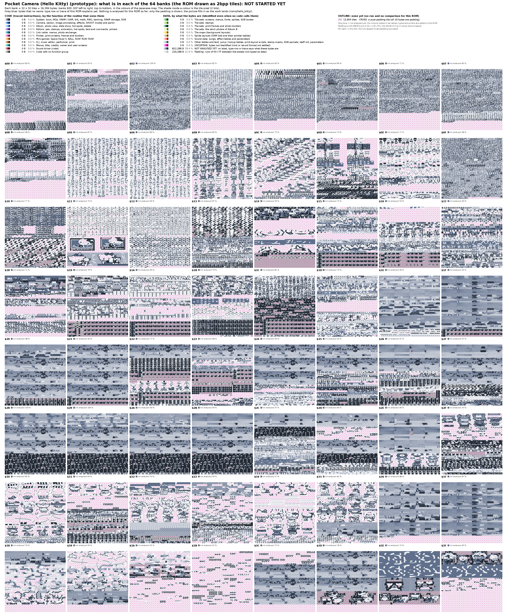

# Pocket Camera (Hello Kitty)

MD5 `0a323bddc4f0159cea76cf44ed0c1a3c`. A late leaked prototype.

The map above is drawn by `tools/status_maps.py` (grey-blue = not analysed yet; it fills in as names, types and a trace are added here; per-bank counts in `assets/layout_by_bank_kitty.csv`).

Not started: this folder will hold the symbol file and the tables of this ROM, built with the tools of the repository and the playbook [`HOWTO_NEW_ROM.md`](../../HOWTO_NEW_ROM.md). The ROM is not in the repository (owner's source pack, `source/Source_material/Source_material.zip`).
