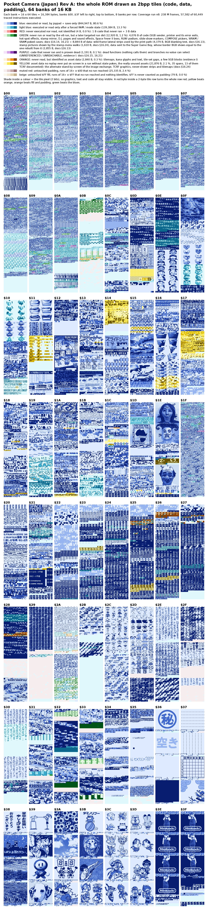

# Pocket Camera (Japan) (Rev A) (SGB Enhanced)

MD5 `fdcfe686cf4df461e870b6e53b2b5a8b`, 1 MiB, MBC: MAC-GBD (camera cartridge). The first ROM of the project; the notes are in [`../../docs/`](../../docs/).

## Levels

| Level | Status | Evidence |
|---|---|---|
| L0 | done | `intake/intake_roundtrip.txt`: mgbdis `95d951a` with no symbol file + rgbasm 1.0.4 rebuild md5 `fdcfe686cf4df461e870b6e53b2b5a8b` |
| L1 | done | `pocketcamera_jp.sym` types every byte (`tools/sym_build.py` finds no hole or overlap) |
| L2 | done | `trace/trace_jp.json`: 60,449 instructions, 0 unresolved; observed: `trace/cov_jp_runs.npz` (95.3 % executed), the never-run bytes classified (docs §16.21, §16.26) |
| L3 | done | `disasm/sym_names_jp.csv`: 5,345 names, C 5,258 / I 87 (the I names all proven unused: `disasm/sym_settled_unused_jp.csv`), 0 doubts (`disasm/sym_unconclusive_jp.csv`) |
| L4 | done | `disasm/ram_names_jp.csv`, the constant tables; `wram/` |
| L5 | done | `src/`, `make check` |
| L6 | partial | the name / comment character set (`disasm/charset_jp.csv`); docs §1.3 |

| Path | What it is |
|---|---|
| `pocketcamera_jp.sym` | the symbol file in mgbdis syntax: every byte typed (`.code`, `.data:LEN[:WIDTH]`, `.padding`, `.text`) and every routine, table and asset named. Generated by `tools/sym_build.py` from `disasm/sym_names_jp.csv` and `disasm/sym_types_jp.csv`; never edit it by hand |
| `src/` | the buildable, editable source (L5): one `.asm` per bank, the includes, `data/` (tiles as PNG, maps, binary blocks), `gfx.mk`. Written by `tools/make_source.py`; `make check` at the top builds it and compares the md5 (docs §1.4) |
| `pocketcamera_jp_ram.sym` | the RAM names as a symbol file (generated by `tools/ram_names.py`) |
| `disasm/` | the tables the listing is built from: names (`sym_names_jp.csv`, tag C / I / ?), block types, RAM names, constants (modes, states, sounds, hardware), the charset and its charmap, the rename log, the doubtful and proven-unused lists, the owner's answers |
| `intake/` | L0: the header, the per-bank comparison with the four other ROMs and the no-symbol round trip (`tools/rom_intake.py`) |
| `trace/` | L2: the static trace `trace_jp.json` (60,449 instructions, 0 unresolved) and its inputs (`extra_roots_jp.json`, `rom_trace_labels_jp.sym`), the first trace `trace_jp_v1.json` that the WRAM notes cite, the static per-bank coverage `coverage_jp.csv`, and the merged coverage of the runs `cov_jp_runs.npz` / `rom_map_jp.csv` (copies of `coverage/v8/report_v8/`) |
| `wram/` | the WRAM / HRAM map by region and the access tables (`wram_access_jp.csv`, `wram_summary_jp.csv`) |
| `assets/` | asset catalog, per-bank layout, reach and witness tables, layout kind evidence, bank atlas |
| `captures/` | three emulator screens of the erase-all dialog |
| `jp_rom_layout_map.png`, `jp_rom_reachability_map.png` | what each byte is, and what the runs reached (drawn by `tcrf_check/tools/rom_layout_map.py` / `rom_reach_map.py`) |

*What the runs reached* (`jp_rom_reachability_map.png`: executed or read, forced only, never reached; legend in the picture):

Details of the levels: [`../../docs/01_toolchain_and_status.md`](../../docs/01_toolchain_and_status.md).
