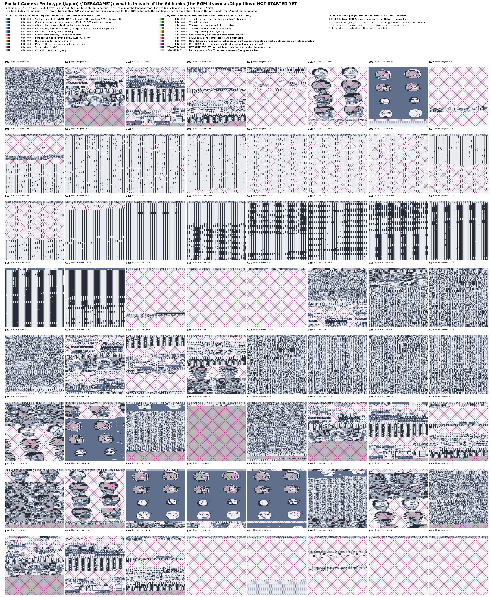

# Pocket Camera Prototype (Japan)

MD5 `1d8097de3497db8b182bcd2a984b6063`. An early leaked prototype, probably the first working version. Its header title is blank; the development paths `C:\DEBAGAME\TOOL` and `C:\DEBAGAME\ISD` left in the ROM (file offsets `$6B382`, `$F50FF`, `$F6322`) give it its name here. TCRF documents it, and the owner's copy of the TCRF pages holds two assembly listings of it with Japanese comments (`source/Unused_graphics_TCRF/TCRF_Prototype_*_big_chunk_assembly_code.txt`).

The map above is drawn by `tools/status_maps.py` (grey-blue = not analysed yet; it fills in as names, types and a trace are added here; per-bank counts in `assets/layout_by_bank_proto.csv`).

Not started: this folder will hold the symbol file and the tables of this ROM, built with the tools of the repository and the playbook [`HOWTO_NEW_ROM.md`](../../HOWTO_NEW_ROM.md). The ROM is not in the repository (owner's source pack, `source/Source_material/Source_material.zip`).

**Leftover source text (2026-10-26).** About 160 KB of the developers' build files survive as Shift-JIS text in the ROM: assembly source with Japanese comments in banks `$1E`, `$1F` and `$24`-`$27` (the sensor driver, the exposure loop, the dither tables; several copies at different stages), symbol listings of the source files (`siowork.dmg`, `f_screen.dmg`, `gallery.dmg`, `def.dmg`, `equ.dmg`, `bk7.dmg`) in banks `$12`-`$15`, and `DEFB` data tables. The sensor routines and how they differ from the retail ROM are in [`docs/18_sensor_registers.md`](../../docs/18_sensor_registers.md) §18.14 and [`docs/19_sensor_guide.md`](../../docs/19_sensor_guide.md) §19.9: a linear offset search until a whole 8 x 8 tile in the middle of the picture is black, one register set, an exposure floor of `$21`. The running copy of that code is compiled in bank 0 (`CHECK_BLACK` at `00:37B8`).

