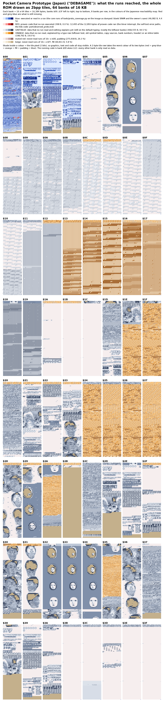
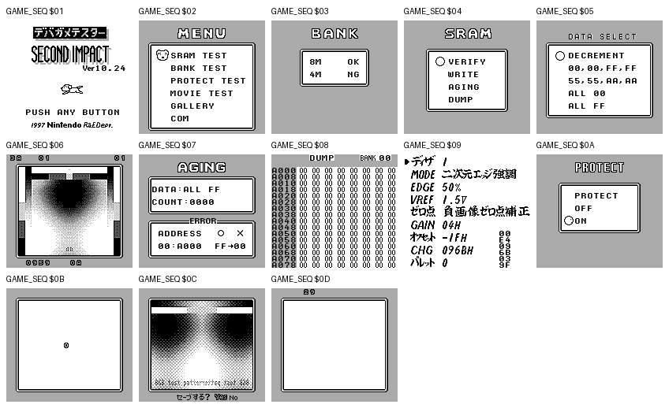
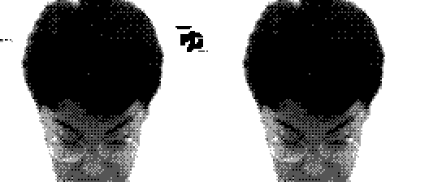
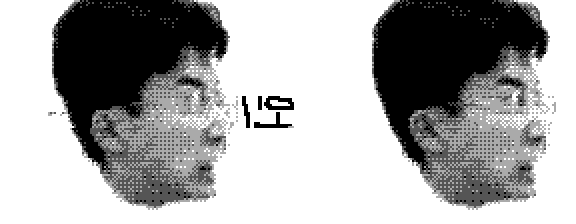

# Pocket Camera Prototype (Japan)

MD5 `19b50a5f67ef4f0d015e7d813370756e` as dumped (`1d8097de3497db8b182bcd2a984b6063`: the header-patched copy for BGB, see "Two images" below). An early leaked development ROM. Its header title is blank, but its title screen reads デバガメテスター ("Debagame Tester"), SECOND IMPACT, Ver10.24, 1997 Nintendo R&D Dept. (C, BGB), and its menu offers SRAM, bank and protect tests, a movie test, a gallery and a link (COM) entry: a test program for the camera cartridge hardware rather than an early camera program (I, from its screens, L2 below). The development paths `C:\DEBAGAME\TOOL` and `C:\DEBAGAME\ISD` left in the ROM (file offsets `$6B382`, `$F50FF`, `$F6322`) carry the same name, and SECOND IMPACT matches the name of the dump, `GBD-IMPACT8M`. TCRF documents it, and the TCRF page shows two assembly listings of it with Japanese comments (https://tcrf.net/index.php?title=Proto:Game_Boy_Camera&oldid=1982808, section Source Code).

The map above is drawn by `tools/status_maps.py` (grey-blue = not analysed yet; it fills in as names, types and a trace are added here; per-bank counts in `assets/layout_by_bank_proto.csv`).

This folder will hold the symbol file and the tables of this ROM, built with the tools of the repository and the playbook [`HOWTO_NEW_ROM.md`](../../HOWTO_NEW_ROM.md). The ROM is not in the repository (supplied by the owner outside it).

| Level | Status | Evidence |
|---|---|---|
| L0 | done (2026-11-08) | `intake/intake_roundtrip.txt`: mgbdis `95d951a` with no symbol file + rgbasm / rgblink 1.0.4 rebuild md5 `19b50a5f67ef4f0d015e7d813370756e`, **without rgbfix** |
| L1 | done (2026-11-08) | `pocketcamera_proto.sym` types every byte (`tools/sym_build.py` finds no hole or overlap); mgbdis + rgbasm / rgblink rebuild md5 `19b50a5f67ef4f0d015e7d813370756e` with it, without rgbfix (the checker's `proto` lines) |
| L2 | done (2026-11-09) | 0 indirect sites unresolved (L1); 7,711 of the 7,915 traced instructions ran in the core (`trace/observed_proto.md`), 0 executed bytes outside the trace; every `GAME_SEQ` reached in the core reached again in BGB (`trace/bgb_game_seq_proto.csv`, 26 of 26) |
| L3 | done (2026-11-11) | every routine entry named (131 of 131) and every data block the code loads or reads named (bank `$00` tables, the trick-lens tables of bank `$04`, the copied tile sets and maps); no placeholder name: the 887 leftovers (bytes that nothing in this build reads, runs or explains) are `Leftover_BB_AAAA`, with a suffix when their content is known (`_<name>` of the block they copy, with `_PartAAAA` / `_Variant` for a part or an edited version, `_AsmSource` / `_SrcListing`, `_PcRam`), tag I, final (owner rule 2026-11-11; `disasm/sym_settled_unused_proto.csv`); the 45 other names not tagged C in `disasm/sym_unconclusive_proto.md`; the round trip with the named `.sym` is byte-exact |
| L4 | done (2026-11-12) | every WRAM / HRAM operand of the source named: `disasm/ram_names_proto.csv` (163 addresses, WRAM 143, HRAM 20; C 126: the older builds' symbol-table name, checked by a routine that touches the address in both builds; I 37, 28 of them named after the routine that touches them; `tools/proto_ram_names.py`), `wram/` (982 access sites on 180 addresses, `INDEX.md`), `sram/` (83 sites; map: bank 0 `$A000-$AFFF` image buffer, `$B000-$BFFF` picture store (?), banks `$01-$0F` the test area), `disasm/ram_proto.inc` and `pocketcamera_proto_ram.sym`; the 14 values of `wGAME_SEQ` as `SEQ_*` constants (`disasm/const_names_proto.csv`, from the handlers of `MAIN_SUB`); 0 raw `ld` / `ldh` RAM operand in `src/` (the checker's `proto` lines) |
| L5 | done (2026-11-12) | `src/` written by `tools/make_source.py --tree prototype_debagame` (64 banks, 288 INCBIN files, 35 tile blocks as PNG); `make TREE=prototype_debagame check` builds the image as dumped, md5 `19b50a5f67ef4f0d015e7d813370756e`, without rgbfix |
| L6 | not started | |

* **Round trip (C).** The standard mgbdis Makefile ends with `rgbfix -v -p 255`, which rebuilds the image as dumped with four header bytes changed: the ROM-size byte `$0148` (`$03` -> `$05`, the size of the padded file) and the three checksum bytes (`$014D` `$4C` -> `$4A`, `$014E-$014F` `$0000` -> `$6145`). The header bytes are data in the listing, so linking without rgbfix gives the image as dumped byte for byte (`tools/rom_intake.py --no-rgbfix`). The BGB copy rebuilds byte-exact with the standard Makefile (rgbfix leaves its already correct header unchanged). Any later build of this ROM (L1 checks, an L5 tree) must skip rgbfix too.
* **Intake (C, `intake/intake_banks.csv`, `intake_header.csv`).** Command in `tools/rom_intake.py`; references: the Japanese, international, Gold and Hello Kitty ROMs. Of the 1,048,576 bytes, 348,519 are padding (runs of 16 or more equal `$00` / `$FF`); 177,724 are covered by a 16-byte window that also occurs somewhere in the Japanese ROM, 161,081 in the Hello Kitty ROM. Shared content is not shared code: much of the prototype is leftover text and copies of its own banks (the section on the source text above and the symbol tables below), and a 16-byte window can be a tile or a table.

## L1: the trace and the symbol file (2026-11-08)

Pipeline (seconds; SETUP.md, prototype): `tools/proto_symtab.py`, `tools/proto_trace.py` (with the hand file `trace/extra_roots_proto.json`), `tools/proto_types.py`, then `tools/sym_build.py`. Every generated file is rebuilt and compared by the checker (`--rom-proto`).

* **The running program is bank `$00` alone (C, static trace).** The trace from the entry and the four interrupt vectors proves 7,915 instructions, 12,893 bytes of proven code, all in bank `$00`, with 0 indirect sites left unresolved (`trace/trace_proto_unresolved.md`). No traced instruction calls or jumps into `$4000-$7FFF`: the other banks are only read as data. The eight hand entries (one jump table; the two bank writes of the ROM self-test; the call of the OAM DMA stub in HRAM; four call sites of two callees, `00:0780` and `00:32E3`, that select a bank without restoring it, which matters only for banked calls and there are none) are in `trace/extra_roots_proto.json`, each with its reason.
* **Engine (C, read in the listing; `tools/proto_trace.py` docstring).** No banked-call helper: every switch is written inline (`ldh a,[$FFFD]; push af`, `ld a,N; ldh [$FFFD],a; ld [$2100],a`, the work, then the saved bank back). `rst $00` / `rst $08` restart at `$0150`; `rst $28` is a jump table of words placed after the `rst` (not used by the traced code); `rst $38` is the fill byte. The main loop calls `00:01FE`, which dispatches on `GAME_SEQ` (`$C0A0`) with a chain of `cp n` tests. A second dispatcher, `00:380C`, masks A to 0-31 and jumps through the 32-word table `JumpTable_00_3822`.
* **ROM self-test (C).** `00:06F5` selects banks `$01` to `$3F` one after the other and compares the bytes at `$4000` and `$7FFF` with the bank number (a second pass at `00:0737`). That is why every bank starts and ends with its own number: the 126 bytes are typed as data with this reason.
* **Banks `$01`-`$03`: tiles and screens (C, the copy calls).** The copy routine `00:02B9` (HL source, DE destination, BC count, the bank mapped at the call) loads a 6 KB tile set from `$4001` of banks `$01`, `$02` and `$03` (bank `$03` has a second one at `$5A41`) and full-screen maps of 576 bytes (18 rows of 32) after it: 12 tile-set copies and 12 map copies with a constant source; the 11 other copies to VRAM take their source from a register (all 50 copy calls are listed in `assets/copy_sites_proto.csv`). The other copy routine, `00:2EF5` (B pages of 256 bytes, unrolled), copies SRAM photo buffers (`$A100`...) to WRAM.
* **What the bytes are.** Of the 1,048,576 bytes: 12,893 bytes of proven code; 181,351 bytes of leftover text in 53 blocks (typed `.text` by the bytes alone: printable ASCII and Shift-JIS lines ending in CR LF, outside the code and the copy sources: the assembly source and listings with Japanese comments); 190,122 bytes of padding (runs of 16 or more `$00`, cut where a label falls inside a run); 401,081 bytes of data typed by a reason (copy sources, the two symbol tables, the self-test bytes, the jump table, the DMA stub, the TCRF unused assets and the leftover copies and variants of identified blocks, below); 263,129 bytes of data on the default typing (no reason yet: the rest of the leftover banks, tables of bank `$00`, the tile sets nothing copies). Runs of printable bytes without a line end stay data on purpose: bank `$00` has byte tables in the printable range (`00:17A1`, `00:1904`).
* **Block names.** `tools/proto_types.py` gives one label per typed block, by kind and address (`Gfx_BB_AAAA`, `Map_BB_AAAA`, `Data_BB_AAAA`, `JumpTable_00_3822`): the first layer of the L3 names below.

## L2: what runs (2026-11-09)

Runs (SETUP.md, prototype L2): the project's core (`tools/proto_coverage.py`, novelty search over key presses, 25 minutes each) on the image as dumped, from blank SRAM and from the owner's prototype save (not in git); then BGB, the judge, on the header-patched copy (`tools/proto_bgb_replay.py`), which replays for every `GAME_SEQ` value the key history that first reached it in the core. The histories are in `trace/runs/*/modes.csv`, the union of the executed bytes in `trace/cov_proto_runs.npz`.

* **Coverage (C, core).** 7,711 of the 7,915 traced instructions ran, 12,495 of the 12,893 bytes of proven code; 0 executed bytes lie outside the trace, and nothing ran outside bank `$00`: the trace's finding holds. The 29 blocks of traced code that never ran (398 bytes) are listed in `trace/observed_proto.md`.
* **Coverage map (C, core runs).** `proto_rom_reachability_map.png`, drawn by `tools/reach_map.py --tag proto` in the legend of the Japanese map (`tools/reach_draw.py`): blue = executed or read in a run, red = traced code no run executed and no verdict explains (6 bytes since 2026-11-13: the BGB runs of the tester credited, the rest given hand verdicts; purple = never run and unreachable, or run only on a faulty cartridge, 213 bytes), orange = data no run read but explained by a type row, grey-blue = data nothing explains yet (mostly the leftover banks), padding and fill. The checker redraws it. Both maps draw every byte as a tile, so the leftover pictures of the older builds (banks `$05`, `$06` ...) show in them.

* **What is behind the blocks that never ran** (read in the code; not run is not dead). The timer interrupt (`00:0050`, handler `00:1266`): the constants written to the interrupt-enable register are `$09`, `$01` and `$02`, never the timer bit, and two writes copy a variable (I: probably never enabled). The error branches of the ROM self-test (`00:0713`, `00:076A`): taken only when a bank does not hold its number (`cp d; jr nz`), never on a sound ROM (C, by the code). Link-cable code (`00:036A-0386`, `00:130B-1364`: serial registers, a link-role byte at `$C0D7`): it needs a second Game Boy, which these runs do not have. The others are not investigated yet.
* **Screens (C, BGB; 26 of 26 replays end on the `GAME_SEQ` the core reached, from both start saves).** `GAME_SEQ` (`$C0A0`) selects the screen; the main loop's dispatcher `00:01FE` has 14 cases, `$00` to `$0D`, and the runs reached `$01` to `$0D`. In BGB: `$01` title, `$02` MENU (SRAM TEST, BANK TEST, PROTECT TEST, MOVIE TEST, GALLERY, COM), `$03` BANK (`8M OK`, `4M NG` in BGB; bank `$20` mapped at the end: the self-test is running), `$04` SRAM (VERIFY, WRITE, AGING, DUMP), `$05` DATA SELECT (fill patterns), `$06` a live sensor picture with counters (bank `$04` mapped), `$07` AGING (with an ERROR box), `$08` DUMP (hex dump of SRAM bank 00), `$09` the sensor settings (dither, mode, edge, VREF, zero point, gain, offset, exposure, palette), `$0A` PROTECT, `$0B` COM (the link test: a frame with the exchanged number), `$0C` the picture save after A on MOVIE TEST (test pattern, セーブする? "save?" Yes / No; bank `$04` mapped), `$0D` GALLERY (a frame with the photo number). The menu path to each value, measured in BGB, is in `trace/menu_paths_proto.csv` (`tools/proto_bgb_scenarios.py`); TCRF describes the same screens (*Proto:Game Boy Camera*, below). The picture below comes from the blank-SRAM run only (a run from a real save can show its photos).

The screen tree (which keys lead where, B back, the AGING and COM conditions) is in the main README: [`proto_screen_tree.png`](proto_screen_tree.png).

**Classified (2026-11-12, `tools/red_classify.py`).** 220 bytes in 22 pieces, all in bank `$00`, each with its way in, its gate and its verdict in [`trace/red_proto.csv`](trace/red_proto.csv): the 398 never-run bytes of the core runs, less what the tester's BGB runs executed (below).

**The tester's BGB runs as coverage (C, BGB, 2026-11-13, `tools/proto_red_bgb.py`).** Every instruction of the 398 bytes is an execution watchpoint (189 points, with the VBlank vector as control) in 88 BGB runs of the tester's own scenarios: every menu path, AGING on each DATA SELECT row and from a protected cartridge, SRAM WRITE then VERIFY after PROTECT TEST > OFF, BANK and PROTECT TEST, MOVIE TEST with every key, its settings screen row by row, GALLERY, COM, four runs from a cartridge of `$FF`, and the COM link test with two linked BGB instances (`tools/proto_bgb_link.py`). BGB executed 98 of the points: the link interrupt `SIO_INT` and the COM screen (`EMI_MAIN`, `N_OBJ_HYOUJI2`, `N_TU_SIN`) in the link run, the DECREMENT pattern's check (`AGE_DEC`), the VERIFY OK path (`SRAM_VERIFY`, `VB_SRAM_MENU`), palette 3 (`CHANGE_PALETTE`), the black-picture check (`CHECK_BLACK`); with the straight line after each hit, 183 bytes, `trace/wp_exec_proto.npz` (hits per run: `trace/red_bgb_hits_proto.csv`).

**Verdicts on the rest (2026-11-13, `trace/red_verdicts_proto.csv`, one per piece).** 145 B **UNREACHABLE** (purple): `GAME_SEQ` `$0E` (never stored), the 4M OK branch (an 8-Mbit ROM), a palette above 5, `SAVE_FLAG` above 2, the timer interrupt (I), and the settings rows GAIN, OFFSET and CHG: the cursor goes `$15`, `$25`, `$35`, then jumps to `$95` (PALETTE) and back (`00:14F0`, `00:150C`), so the held Right / Left of those rows (`Seq09_ConfigMain`, 90 B) and their `Config_PutItem` cases never run; 68 B **FAULT** (purple: only on a faulty cartridge): the NG branches of BANK TEST, AGING (second byte), OFF / ON TEST and their texts; 6 B **DATA** (red: need another sensor value: the offset's sign, a brightness step of `$A6` / `$FD` or more); 1 B **RUN** (a `ret` after a loop BGB ran).

## L3: names (2026-11-09)

The names come in six layers, merged by `tools/proto_names.py` into `disasm/sym_names_proto.csv`: 1709 names (C 777 / I 932 / ? 0), the 887 leftovers among the I (and 459 more leftovers tagged C: the older builds' routines and data whose address and name a symbol table gives). They follow the Japanese ROM's naming (owner, 2026-11-09): routines keep the developers' names; an asset carries the Japanese kind prefix and its own address, with the developers' name as suffix (`Gfx_01_4001_FNTOOE1`, `Map_01_5801_TITLE1`); a run of bytes that nothing in this build reads, runs or explains is `Leftover_BB_AAAA`, tag I (owner rule 2026-11-11), with a suffix when its content is known (the leftovers section below). All 131 routine entries of the trace (94 `call` targets, the 32 entries of `ImageCopy_ModeTable`, the five vectors and the entry) are named; the mgbdis labels `Call_000_xxxx` are gone from the listing.

* **The developers' own names, from the two older builds (122 routines, labels and tables).** The ROM keeps the bank-0 code of the two builds whose symbol tables it holds: table `$2A` fits bank `$2C` (57 % of its bank-0 code labels are a `call` / `jp` target there) and table `$35` fits bank `$37` (51 %) (C, byte scan). `tools/proto_match_old.py` reads each old routine from its label to the next, masks the 16-bit operands and looks for it in this build's traced code; a label not found as code is then looked for as data (its exact bytes, outside the code): 216 of the 470 old labels are found at exactly one place (`disasm/match_old_proto.csv`). The data labels found this way name the aging patterns `PAT_DEC`, `PAT_0F`, `PAT_5A`, `PAT_00`, `PAT_FF`, the dither order patterns `BAYER_PAT` ... `CONCENT_PAT`, the exposure tables `CHG_TIME_TBL_U` / `_D`, the settings-screen texts `DITH_P0`, `EDGE0`, `VREF0`, `ZERO0`, `REV0`, the save texts `SAVE_SURU` (セーブする), `NANBANNI` (何番に, "to which slot"), `SAVESIMASITA` (セーブしました) and the OAM DMA stub `DMADATA`. Where both tables name a routine they agree, except at `00:177E`, where short patterns of several `PUT_` routines of table `$35` also fit; each of those names has a longer match elsewhere, so `00:177E` keeps `PUT_DITH_PAT`, the name both tables give it. As for the Hello Kitty ROM, a ported name is tagged C from 16 bytes of pattern up, I below (all of them are unique matches). The names are romanised Japanese: `GAME_TITL`, `MAIN_MENU`, `SRAM_AGING`, `KAO_ANIME` (顔, face), `WANKO` (the dog on the title screen), `AKARUSA_HYOUJI` (明るさ表示, brightness display), `BUNKATU_HYOUJI` (分割表示, split display), `N_TU_SIN` (通信, link).
* **The developers' asset names (31).** The banked labels of the two tables have the same bank and address in both. 14 fall on a block this build copies and are named as the Japanese ROM names its assets, the old name as suffix: `Gfx_01_4001_FNTOOE1`, `Gfx_02_4001_FNTOOE2`, `Gfx_03_4001_FNTOOE3` (the tile sets), `Gfx_03_5A41_CONF2` (the second tile set of bank `$03`), and the maps `Map_01_5801_TITLE1`, `Map_01_5A41_MENU1`, `Map_02_5801_BG_BANK`, `Map_02_5A41_BGSRAM1` ... `Map_03_7241_BG_CONF`: tag C. The 17 others are neither copied nor read by this build in the L2 runs. Nine of them are TCRF's unused pictures and carry the Japanese TCRF names (the section on unused assets below: `SIMO`, `HOI_U` / `_D` / `_L` / `_R`, `FACE5`-`8`); the eight left (`PROGRAM`, `BG_F_SCR`, `BG_EDIT`, `BG_EDITW`, `HOI_0`, `KAO_1`-`3`) are `Data_BB_AAAA_<name>`, tag I, assets of the older builds whose kind is not settled here.
* **Hand names (88, `disasm/layers/sym_names_proto_hand.csv`, each with its reason).** The 18 TCRF unused assets and the two labels that resume the sheet `FNTOOE2` around the cursor (section below); The vectors, the entry and `RESET` (`00:0150`, the name both old tables give the boot code; the Japanese ROM calls its own `Boot_ColdStart`); the shared tails `ImageCopy_Common2AC0` and `ImageCopy_Common2C4B` of the image-copy modes; the three `GAME_SEQ` handlers no old routine matched (`Seq06_MovieMain`, `Seq09_ConfigMain`, `Seq0D_GalleryMain`, C: their screens in BGB, `trace/menu_paths_proto.csv`); the image-copy dispatcher `ImageCopy_Dispatch` (`00:380C`: A from `BUNKATU_MODE`, `$C167`, selects one of 32 SRAM-to-WRAM copies) with its entries `ImageCopy_Mode00`-`23` and the eight lone `ret` entries `ImageCopy_Mode24_None`-`31`; 15 helpers named from their code (among them `BIT_COUNT`, `00:342E`: popcount(byte) + 2 x popcount(next byte), the routine the source text describes); the tables `CONTRAST_ROWS` (`00:3862`), `NO_DITHER_PAT` (`00:3C9A`) and `MODE0` (`00:17E9`); and the five 256-byte tables of bank `$04` that the L2 runs read (`BitCount_Table` `04:4100` for `BIT_COUNT`; `BitReverse_Table` `04:4200`, `Zoom_TableA` `04:4300`, `BitDouble_Table` `04:4400`, `HalfBits_Table` `04:4500` for the image-copy modes 1, 6 and 8). In this build bank `$04` starts with these tables, not with the picture `HOI_0` the old tables place at `04:4001`.
* **Generated names** (Japanese prefixes, own address): `OldSymbolTable_2A_4B7F` and `OldSymbolTable_35_4A91`, `BankNumber_BB_4000` / `_7FFF` for the 126 bytes the self-test reads, `JumpTable_00_3822`; the 322 leftovers (next section); and 3 `<routine>_PartAAAA` where a routine goes on after a never-traced byte.
* **Doubts list:** the 45 names not tagged C (the leftovers excepted), each with its reason, in [`disasm/sym_unconclusive_proto.md`](disasm/sym_unconclusive_proto.md) and, as a table, `disasm/sym_unconclusive_proto.csv` (both generated by `tools/proto_names.py`).

## Leftovers: copies, source text, PC memory (2026-11-11)

Owner rule (2026-11-11): bytes that nothing in this build reads, runs or explains are leftovers, `Leftover_BB_AAAA`, tag I, final, listed with their size in [`disasm/sym_settled_unused_proto.csv`](disasm/sym_settled_unused_proto.csv) (887 rows) and never in the doubts list. When their content is known the label says it, and the layout map gives it its own colour (`tools/proto_names.py`, steps 4b, 4c, 5b):

| kind | label | blocks | bytes | layout map | how it is found |
|---|---|---|---|---|---|
| copy of an identified block, whole or a part | `Leftover_BB_AAAA_<block name>[_PartAAAA]` | 291 | 240,439 | the kind of the block (tile set, tile map...); a copy of a routine: *code copies* | an exact copy (32 bytes or more) of a named, fully typed or traced block, in bytes nothing identifies; it gets the block's type row (a copy of code is typed data: this build never runs it) |
| assembler source in clear | `Leftover_BB_AAAA_AsmSource` | 48 | 181,355 (with the listings) | *source text* | the text type rows (printable ASCII / Shift-JIS lines, CR LF) with assembler lines |
| listing of the source | `Leftover_BB_AAAA_SrcListing` | 5 | | *source text* | text rows made of `file.dmg(line) : text` lines (a grep of the source) |
| variant of an identified block | `Leftover_BB_AAAA_<block name>_Variant[PartAAAA]` | 28 | 7,158 | the kind of the block; code: *code copies* | 128+ bytes equal to one identified block at one shift for 60 % or more, or (step 4b-3, 2026-11-12) the run between two pieces of one copy at the same shift, where the copy was edited (the `反転` glyph of the settings font in bank `$3A` where bank `$03` has `パレット`, the `Ver.` and µs / ms glyphs of the font copies in banks `$02`, `$22`, `$2E`, `$39`): older versions of identified blocks (the others found before 2026-11-12 are now named from the old tables, below) |
| PC memory | `Leftover_BB_AAAA_PcRam` | 14 | 138,377 (94,505 drawn: the rest is `$00` padding or copies found inside them) | *PC memory* | a leftover run holding strings of the development PC's RAM, x86 code (2 or more `55 8B EC` function prologues, `push bp / mov bp,sp`: `$EC` is no Game Boy opcode; banks `$08`-`$0B`, `$25`, `$26`, `$2C`) or the linker's symbol list as held in memory (bank `$11`, next section; 2026-11-12): the DOS environment of a Windows 95 machine (`COMSPEC=C:\WINDOWS\COMMAND.COM`, `PATH=...;C:\DEBAGAME\TOOL;C:\DEBAGAME\ISD;...`, `TZ=JST-9`, `ORCADEXE=...`), `C:\Program Files\TAC95\TAC32.EXE`, `KERNEL32.DLL`, `PIFMGR.DLL`, `WINDOWS VMM 4.0`, the MS-IME keys. Only the strings are proven; the rest of the run is taken as the same memory |
| bank-0 code and data of the older builds | `Leftover_BB_AAAA_<developers' name>` | 708 | 46,855 | *code copies* (data: tables) | the bank-0 labels of symbol tables `$2A` / `$35` in banks `$2C` / `$37` (C), the same routines found by their bytes in banks `$1D` / `$20` (I); the printer library is part of it (sections below) |
| tiles of no known block | `Leftover_BB_AAAA_Tiles` | 0 | 0 | *tile sets* | 2bpp tiles that no picture of the ROM holds (none left: the bank `$1C` strip first put here is an edited part of photo 10, a variant) |
| not identified | `Leftover_BB_AAAA` | 250 | 82,007 | *UNCERTAIN* | none of the above |

The copies are mostly the older builds' banks: their bank-0 code again in banks `$1D`, `$20`, `$2C` and `$37` (`Leftover_20_4253_INKEY` ...), this build's menu maps in banks `$21`-`$23`, `$2D`-`$2F`, `$39`, `$3A`, and the TCRF pictures (next section).

**Pattern search (2026-11-12, owner: only this ROM's identified assets as references).** `tools/proto_names.py` step 4b-2 looks for every run of 32+ bytes of the leftovers that equals a run of an identified block, at any offset in either and any alignment (a 16-byte seed, extended both ways): 356 partial or shifted copies, mostly pieces of this build's routines in the old builds' code banks and pieces of tile sets and maps (`Leftover_02_6E81_Gfx_01_4001_FNTOOE1_Part4901` ...); then 8-byte seeds vote for one shift between a leftover run of 128+ bytes and one block, kept when 60 % of the bytes or more are equal: the 10 variants. Uncertain bytes on the layout map: 359,102 before, 251,681 after, 178,123 once the PC memory is also recognised by its x86 code and symbol records (below), 171,154 with the printer library, 139,718 with the rest of the older builds' bank 0 (below). What stays uncertain has no counterpart among the identified assets, as raw bytes, as 2bpp tiles (16-byte tiles and 12-byte map windows at any offset: 96 and 448 bytes hit, chance) or as one byte per pixel (pixel strings of the tile sets and pictures, compared with the values relabelled: scattered chance hits only): banks `$08`-`$10` hold one value per byte (`$00`, `$01`, `$03`, `$80`, `$81` ...) in rows of 381 bytes, banks `$11`-`$19` mostly ASCII digits (`0`, `1`, `3` ...) in long runs, bank `$3C` starts with bytes that read as x86 code (`E8` near calls, `CD 2F`: `int 2Fh`; I): buffers of the development PC. Not aging patterns either (owner's question, 2026-11-12): the aging code computes its patterns (a counter from `$55AA` down, fills of `00`/`FF`, `55`/`AA`, `$00`, `$FF`, `$5A`) and reads no ROM table but its five `PAT_*` bytes in bank `$00`; the leftover banks share 48 bytes with the owner's prototype save, chance. The banks with x86 code or in-memory symbol records are now `_PcRam` (above); the others (`$0C`-`$10`, `$12`-`$19`, `$3C`) have none of the three proofs and stay uncertain, although `$0C`-`$10` have the same 381-byte rows as `$08`-`$0B`.

**Every text in clear** is listed in [`assets/text_sections_proto.csv`](assets/text_sections_proto.csv) (generated by `tools/proto_names.py`, compared by the checker): the 53 text blocks (48 of assembler source, 5 of listings: bank, range, line count, first line) and the 68 strings of the PC memory (each with its address). This build's own screen text (the title, the menus) is not text in clear: it is tile numbers in the tile maps.

## The bank 0 of the older builds (2026-11-12, roadmap step 5)

`tools/proto_oldbuilds.py` names the rest of the older builds' bank 0 as the printer library is named (next section): every bank-0 label of symbol table `$2A` at its value + `$4000` in bank `$2C`, of table `$35` in bank `$37` (C: the table gives the address and the name), and every routine of bank `$2C` found again with its 16-bit operands masked in banks `$1D` and `$20` (I) ([`disasm/oldbuilds_proto.csv`](disasm/oldbuilds_proto.csv)). A label is `code` when its bytes decode with no opcode the Game Boy lacks up to the next label, or when its bank calls it, and `data` when the name reads as data (`PAT_*`, `*_TBL`, `*_TABLE`, the dither and screw patterns, the save texts) or when this build has a data label of that name; the 9 labels of table `$2A` below `$02EC` are skipped: the start of bank `$2C` is PC memory now (x86 code). Result: table `$2A` 138 code and 37 data labels, table `$35` 169 and 39, copies in bank `$1D` 53 and in bank `$20` 120; with the printer library, 708 labels, 46,855 bytes, drawn as *code copies* (data: tables). They replace 176 copy labels found before by the byte search (the same bytes, now with the developers' names).

* **The four builds, by the address of the same routines (I).** `MAIN_MENU` is at `$052E` in the build of bank `$20`, `$05B5` in this build, `$05BB` in the build of table `$2A`, `$08B5` in that of table `$35`; the in-memory symbol records of bank `$11` give `$0919` (`MAKE_MENU` `$08A8`, `MEN_FADE` `$07C4`): a fifth build, larger again, whose code is in no bank of the ROM (its routines were searched at its addresses in every bank: no match). The order of the builds is not settled: other routines move the other way (`MAKE_EMI`: `$14E8` in bank `$1D`, `$29B4` in `$20`, `$29ED` in `$2A`, `$31FB` here, `$3A5E` in the bank `$11` records).
* **The old builds' assets named from the tables.** `BG_F_SCR`, `BG_EDIT`, `BG_EDITW` (bank `$03`) are now `Map_BB_AAAA_<name>` (I): every `BG_` block that this build copies is a BG map, and these hold tile numbers like the menu maps (`BG_F_SCR`: 576 bytes, one 18 x 32 screen). `PROGRAM` (bank `$02`) and `HOI_0`, `KAO_1`-`3` (bank `$04`) keep `Data_BB_AAAA_<name>`: in this build their bytes are no longer the pictures the names suggest (bank `$04` starts with this build's tables; the rest is mostly `$00`).

## The printer library of the older builds (2026-11-12)

This build has no printer code: nothing it runs talks to a Game Boy Printer. Its leftover banks keep the whole library four times, in the bank-0 code of four older builds: banks `$2C` and `$37` (the builds of symbol tables `$2A` and `$35`: every label from `SIOINT` to `STARTSTRINGTRANS` is a routine or a data block at table value + `$4000`, with the developers' own name, C) and banks `$1D` and `$20` (two builds without a table: each routine found by its bytes, 16-bit operands masked, in the same order; I). [`disasm/printer_lib_proto.csv`](disasm/printer_lib_proto.csv) (`tools/proto_printer_lib.py`) lists the 39 pieces with their four addresses and the Japanese routine each one matches (operands masked; instruction-sequence ratio): 21 exact, 10 near (0.80-0.97), 4 without a counterpart, 4 too short to pair (a `ret` or two instructions). They are named `Leftover_BB_AAAA_<developers' name>` (156 labels; code that this build never runs, typed data, drawn as *code copies*).

| developers' name | Japanese name | | developers' name | Japanese name |
|---|---|---|---|---|
| `SIOINT` | `Prn_SerialIrq` | | `CONNECTPRN` | `Prn_SendInit` |
| `SIOWATCHDOG` | `Prn_VBlankPoll` (near) | | `CHECKENDOFTRANS` | `Prn_CheckTxDone` (near) |
| `SIOPROC` | `Prn_SerialStep` | | `INSTRUCTPRN` | `Prn_SendPrint` (near) |
| `PREAMBLETRANS` | `Prn_SendSyncByte` | | `DATATRANSPRN` | - (254 bytes; the Japanese `Prn_SendData` family is split in five) |
| `TRANSMIT` | `Prn_SendPacketByte` (near) | | `BREAKPRN` | `Prn_SendBreak_Dead` |
| `SETENDOFTRANS`, `SETENDOFTRANS_DATA` | - | | `NULTRANSPRN` | `Prn_SendInquiry` |
| `FORRETRY_DATATRANS` | `Prn_RestoreHeaderPtr` | | `INITDATATRANS` | `Prn_QueuePacket` |
| `TRANSCHECKSUM` | `Prn_SendChecksumByte` | | `PREAMBLEDATA` | `Prn_SyncBytes` |
| `TRANSDUMMY` | `Prn_SendTrailerByte` | | `PACKET1`, `PACKET2`, `PACKET6`, `PACKET4`, `PACKET5` | `Prn_PktInit`, `Prn_PktPrintHdr`, `Prn_PktDataEnd`, `Prn_PktBreak`, `Prn_PktInquiry` |
| `GETPRINTERSTATUS` | `Prn_ReceiveStatus` (near) | | `PREPAREPACKET1` | `Prn_QueueInit` |
| `PRINT_PICTURE_MAKE` | - (62 bytes) | | `PREPAREPACKET2` | `Prn_QueuePrint` (near) |
| `SIOINITIALIZE` | `Prn_EngineStop` (near) | | `PREPAREPACKET3` | `Prn_QueueData` |
| `SIOFLAGINIT` | `Prn_ClearTxFlags` | | `PREPAREPACKET4`, `PREPAREPACKET5`, `PREPAREPACKET6` | `Prn_QueueInit` (near), `Prn_QueueInquiry`, `Prn_QueueDataEnd` (near) |
| `CLEARFLAGS` | `Prn_ResetPacketState` (near) | | `STARTSTRINGTRANS` | `Prn_StartTransmit` |

The pairing also gives the developers' names of the Japanese printer routines (I for the Japanese ROM: the builds are older, the names may have changed); the Japanese names stay as they are.

## Unused: documented by TCRF or not (2026-11-12)

Every unused block of this ROM is in [`assets/unused_proto.csv`](assets/unused_proto.csv) (`tools/unused_table.py`), in one of two categories, outlined on the layout map (with a third outline for the unused code: the older builds' routines): **documented by TCRF** (orange: the pictures, editor UI, NEO logo and arrow cursor that [Proto:Game Boy Camera](https://tcrf.net/Proto:Game_Boy_Camera) shows, the exact copies and parts of them, and the assembler source, of which the page shows two chunks) and **not documented by TCRF** (cyan: everything else this project found: the older builds' code and data, the PC memory, the listings, the variants, the font and tile copies, the tiles below). TCRF is credited only for what its page shows (`tcrf_check/tcrf_documented.csv`, `tcrf_check/TCRF_SOURCES.md`); the repository keeps no copy of TCRF content.

**Pictures put back together** (owner, 2026-11-12; `tools/proto_reconstruct.py` -> [`assets/reconstructed/`](assets/reconstructed/)):

* **Face photo 6, whole.** Its tile rows 0-1, the top of the head, are not lost: bank `$23` holds them at `23:60E1-62E0` (`Leftover_23_60E1_Unused_TCRF_FacePhoto6_Rows0To1_Gfx`), followed by rows 2-3 equal to `30:4201-43FF` byte for byte, which ties them to the picture whose rows 2-13 are `Unused_TCRF_FacePhoto6_Rows2To13_Gfx`. They were 260 of the uncertain bytes of bank `$23`.
* **Bank `$1D`: an edited face photo 8.** `1D:4001-4200` are tile rows 2-3 of face photo 8 (`05:5001-5200`, the hair) with 75 % of the non-blank bytes equal and marks drawn over the rest (`Leftover_1D_4001_Unused_TCRF_FacePhoto8_HOI_D_Gfx_VariantPart5001`): an altered version, unused, not documented by TCRF. Left: photo 8 with these rows, right: the original. 
* **Bank `$1C`: an edited face photo 10** (owner 2026-11-12). `1C:4001-4200` are tile rows 6-7 of face photo 10 (`05:7001-7200`, the eye and the glasses) placed 3 tiles to the left (tile `c` of the strip is column `c + 3` of the photo): 82 % of the pixels equal there, every tile retouched, and a hand-drawn mark in its last 3 columns (`Leftover_1C_4001_Unused_TCRF_FacePhoto10_HOI_R_Gfx_VariantPart7001`). An altered version, unused, not documented by TCRF. Left: photo 10 with these rows, right: the original. 
* **`PROGRAM` (`02:6581`, copies `2E:6581`, `39:6581`, a part at `22:4CC3`).** The older builds' tables name it; it is 128 tiles, 4 drawn (an outline) and 124 blank: `Unused_PROGRAM_Gfx`, unused tiles not documented by TCRF.

## Unused assets: the TCRF pictures (2026-11-11)

TCRF, *Proto:Game Boy Camera* (row D11-D13 of `tcrf_check/TCRF_CHECKLIST.md`), shows unused graphics of this ROM. Every one is found byte-exact, by matching the pictures against the ROM as 2bpp tiles, and is named as the Japanese ROM names its TCRF items (`Unused_TCRF_<What>_Gfx` / `_Map`, `_TopRow` / `_BottomRow`; C for an exact match that no run reads, I otherwise). None is read in the L2 runs. [`assets/never_reached_proto.csv`](assets/never_reached_proto.csv) lists them (the format of the Hello Kitty table); [`assets/never_reached_proto.png`](assets/never_reached_proto.png) draws the logo, the editor UI and the cursor from the ROM (the photos are of a real person: not drawn in the repository).

| TCRF item | address | label | old name |
|---|---|---|---|
| photos 1-3 | `30:4E01`, `5C01`, `6A01` | `Unused_TCRF_FacePhoto1_Gfx` ... `3` | - |
| photos 4 and 5 | `01:5C81` | `Unused_TCRF_FacePhoto5_SIMO_Gfx` | `SIMO`; TCRF's photo 4 is the same data with the palette inverted |
| photo 6 | `30:4201` (tile rows 2-13) | `Unused_TCRF_FacePhoto6_Rows2To13_Gfx` | -; its first two tile rows are overwritten by leftover text |
| photos 7-10 | `05:4001`, `4E01`, `5C01`, `6A01` | `Unused_TCRF_FacePhoto7_HOI_U_Gfx` ... `10_HOI_R` | `HOI_U`, `HOI_D`, `HOI_L`, `HOI_R` |
| drawings 1-4 | `06:4001`, `4E01`, `5C01`, `6A01` | `Unused_TCRF_FaceDrawing1_FACE5_Gfx` ... `4_FACE8` | `FACE5`-`FACE8` |
| editor UI | `02:7581` (128 tiles) | `Unused_TCRF_EditorUI_Gfx` | - (not `BG_EDIT` / `BG_EDITW` as guessed before) |
| "デバガメ テスター NEO" logo | tiles `38:5001` (96), map `38:5801` | `Unused_TCRF_TitleLogoNEO_Gfx`, `_Map` | - |
| arrow cursor | `02:42E1` and `02:43E1` (2 x 2 tiles) | `Unused_TCRF_ArrowCursor_TopRow_Gfx`, `_BottomRow_Gfx` (I) | inside the live sheet `FNTOOE2` |

* **The logo's tile map (C).** `38:5801` is a full-screen map (18 x 32) laid out as this build's title map `TITLE1` (`01:5801`); drawn with `38:5001` loaded as tiles `$00`-`$5F` it gives TCRF's logo: the title screen of an older build ("Ver1.00" in its text), never loaded by this one.
* **The cursor (I).** Its tiles are `$2E`-`$2F` and `$3E`-`$3F` of `FNTOOE2` (`02:4001`), a sheet this build copies to VRAM; the L2 runs read it with the sheet, and no screen they reached shows it. The sheet resumes as `Gfx_02_4301_FNTOOE2_Tiles30to3D` and `Gfx_02_4401_FNTOOE2_Tiles40to17F`, as the Japanese table does around its row labels.
* **Copies (I, leftovers).** SIMO again at `2D:5C81` and `38:5C81`; `HOI_D`-`_R` at `31:4E01`-`6A01`; `FACE6`-`8` at `32`, `33` and `34:4E01`-`6A01`; the editor UI at `2E:7581` and `39:7581`; the cursor rows at `2E` and `39:42E1` / `43E1`. Each is `Leftover_BB_AAAA_<label>`.

## What the tester does: controls, SRAM aging, link test, dither (2026-11-09)

Each TCRF item of that page is a row of group D of `tcrf_check/TCRF_CHECKLIST.md` (D01-D14). References: TCRF, *Proto:Game Boy Camera* (tcrf.net, revision of 4 December 2025; https://tcrf.net/index.php?title=Proto:Game_Boy_Camera&oldid=1982808: the menus, the MOVIE TEST settings, GALLERY, COM, the unused pictures, two source chunks); the owner's [Inject-pictures-in-your-Game-Boy-Camera-saves](https://github.com/Raphael-Boichot/Inject-pictures-in-your-Game-Boy-Camera-saves) README (the prototype's save layout, and that its aging test needed SRAM written with particular patterns: "It must be possible to generate them onboard but I did not find how"); docs §18.14 (the sensor source left as text in this ROM). BGB runs: `tools/proto_bgb_scenarios.py` and `tools/proto_bgb_link.py`, the BGB copy, blank SRAM.

**At power-on (C).** No key is read before the title: the only joypad reader is `INKEY` (`00:02E6`, keys held in `CNT1` `$FF80`, newly pressed in `TRG1` `$FF81`; buttons A, B, Select, Start in bits 0-3, Right, Left, Up, Down in bits 4-7), and the boot code and `GAME_INIT` test no key. 41 power-on holds in the core (each key, every pair, five larger chords) end as a plain boot does, with not one more code byte run. So there is no boot menu reached by keys. A+B+Select+Start held together restarts the program at any time (`00:01C7`, `jp $0150`). The title leaves on A, B, Select or Start, not on a direction.

**Every key the program tests (C, code; 21 reads of `CNT1` / `TRG1` in all).** Beyond the menus (Up / Down / A / B):

| screen | key | effect | in TCRF |
|---|---|---|---|
| MOVIE TEST | Select | next image-copy ("trick lens") mode, `BUNKATU_MODE` `$C167`, `$00`-`$1F` | yes |
| MOVIE TEST | Left / Right held | `CONTRAST` (`$C165`, `$01`-`$83`): `SET_DITH_MATRIX` rebuilds the 48 thresholds from row C of `CONTRAST_ROWS`, `CONTRAST_HYOUJI` shows it | as "offset" |
| MOVIE TEST | Up / Down held | `AKARUSA` (`$C164`, brightness target of the exposure loop, `$00`-`$A8` by 2), shown by `AKARUSA_HYOUJI` | no |
| MOVIE TEST | A held | take a picture: the save screen (`GAME_SEQ` `$0C`, slot 00-29) | yes |
| MOVIE TEST | B | when the copy mode has bit 0 set, clears that bit (I: back to the moving picture); otherwise back to the menu | partly |
| MOVIE TEST | Start | settings (`GAME_SEQ` `$09`) | yes |
| settings | Left / Right, Up / Down held | repeat every 4 frames after a first delay (Left / Right only on three of the rows); B or Start leaves; Select is not tested | partly |
| GALLERY | Up / Down held | next / previous photo, 00-29, every frame while held | yes |
| GALLERY | B held | back to the menu (the photo number moves on by one first) | no |
| COM | A | start the exchange (this unit becomes the master) | yes |

**BANK TEST: 8M OK, 4M NG is the right answer (C, code).** `BANK_TEST` (`00:06F5`) selects banks `$01`-`$3F` and compares the bytes at `$4000` and `$7FFF` with the bank number (the reason every bank starts and ends with its number); `TEST4M` (`00:0737`) does the same but expects the number AND `$1F`, that is banks `$20`-`$3F` repeating `$00`-`$1F`, as on a 4-Mbit (32-bank) ROM. On this 8-Mbit cartridge the first test passes and the second fails, as TCRF's screenshot and BGB show.

**PROTECT is the SRAM write protection (C, code and BGB).** Only two places write the SRAM enable register (`ld [$0000],a`): `OFF_TEST` writes `$0A` (writes on) and `ON_TEST` writes `$00` (writes off), and `PICT_SAVE_GO` brackets each picture save with the same two writes. `PROT_TEST` inverts the first and last byte of each of the 16 banks and checks whether the write took. This answers TCRF's question "what is this protecting?": the whole SRAM, through the mapper's RAM enable.

**The aging test can be prepared on the cartridge itself (C, BGB, `trace/aging_bgb_proto.csv`).** AGING (`SRAM_AGING`, every frame while its screen is up) runs cycles: write the pattern chosen on DATA SELECT to all 16 banks of `$A000-$BFFF` and read it back (`AGE_DEC`: the 16-bit counter from `$55AA` down, high byte first; `Aging_FillSram`: B, B, C, C repeated with 00 / FF, 55 / AA, 00 / 00, FF / FF; the patterns are the data `PAT_DEC`, `PAT_0F`, `PAT_5A`, `PAT_00`, `PAT_FF`), add 1 to COUNT (`$C0DA`), fill the whole SRAM with `$5A`, and start again; the first wrong byte stops it and shows its bank, address, expected and read values (`AGING_ERROR`, `$C0DC-$C0E1`). Neither AGING nor WRITE enables the SRAM: on a protected cartridge every write is lost and AGING stops at once (in BGB: ERROR `00:A000 55->00`, COUNT 0000, the SRAM untouched). After PROTECT TEST > OFF the same AGING runs without error (in BGB: COUNT 0007 after about 10 s, banks 0-6 holding 55 55 AA AA, the rest the `$5A` of the previous cycle). So no external flasher is needed: **PROTECT TEST > OFF, then SRAM TEST > AGING**. The test functions also write `$01` to `$6000` before using SRAM, which the Pocket Camera mapper does not need: on an MBC1 board it selects the RAM banking mode, and the header as dumped declares MBC1 (I: the tester was written for an MBC1-style development board).

**Choosing and switching the aging pattern (C, code and BGB, `trace/aging_patterns_bgb_proto.csv`).** The pattern is chosen on DATA SELECT, never on the AGING screen:

1. Once per power-on: MENU > PROTECT TEST > OFF, then B back to the menu (without it every pattern stops at the first byte).
2. MENU > SRAM TEST > AGING opens DATA SELECT.
3. Up / Down move the cursor over the five rows; it wraps (Down on ALL FF goes to DECREMENT, Up on DECREMENT to ALL FF).
4. A starts AGING with the row under the cursor: the cursor's height is copied to `R0` (`$FF88`: `$35`, `$45`, `$55`, `$65`, `$75` for the five rows) and AGING picks its pattern from it at every cycle. Entering AGING (`MK_SRAM_AGING`, `00:0AF4-0B00`) clears COUNT and the error flag: COUNT counts from 0 for each pattern.
5. To change pattern: **hold** B on the AGING screen until DATA SELECT comes back, choose another row, A. B on DATA SELECT goes back to the SRAM menu. DATA SELECT keeps the cursor on the last row used.

| row | `R0` | written at every cycle | in BGB after about 10 s: bank 0 begins with | COUNT |
|---|---|---|---|---|
| DECREMENT | `$35` | a 16-bit counter from `$55AA` down, high byte first, through all 16 banks (`AGE_DEC`) | `55 AA 55 A9 55 A8 55 A7` | 4 |
| 00,00,FF,FF | `$45` | `00 00 FF FF` repeated (`Aging_FillSram`, B = `$00`, C = `$FF`) | `00 00 FF FF 00 00 FF FF` | 7 |
| 55,55,AA,AA | `$55` | `55 55 AA AA` repeated | `55 55 AA AA 55 55 AA AA` | 7 |
| ALL 00 | `$65` | `$00` everywhere | `00 00 00 00 00 00 00 00` | 7 |
| ALL FF | `$75` | `$FF` everywhere | `FF FF FF FF FF FF FF FF` | 7 |

Why B must be held: the keys are read once per pass of the main loop (`INKEY` has one caller, `00:01C4`), and a whole aging cycle (writing and reading 128 KB, then the `$5A` fill) runs inside one pass, so a short press made during a cycle is never seen. In BGB a 4-frame B left DECREMENT running; B held for 240 frames, then Down and A, switched to 00,00,FF,FF; B held, then A at once, restarted 55,55,AA,AA (the cursor kept). DECREMENT is the slowest pattern (4 cycles where the others do 7), as it computes every word.

**COM, the link test (C, code and two linked BGB instances).** On entering COM (`MAKE_EMI`) a unit loads `$FE` in the serial data register and waits on the partner's clock. A (`N_KEY_INPUT`) sends `$00` on its own clock. The serial interrupt (`SIO_INT`, `00:034B`; enabled from boot, IE = `$09`, and switched off where IE is set to `$01` at `00:0F5C`, `00:12EA`, `00:1DC9`, `00:1EB9`) settles the roles from the first byte it receives: the idle `$FE` makes it the master (`$C0D7` = 2), `$00` makes it the follower (1). From then on each unit shows the byte it received (`$C0DD`, two hex digits in sprites) and sends it back plus one, the master starting one transfer per frame: both screens count 00-FF in a loop (as TCRF says). There is nothing more: no data, no checksum, no end. Both units must already be on COM: with the partner left on the menu, the unit that pressed A reads `$00` from it, becomes a follower and waits for a master that never comes (in BGB: frozen on 00, the partner still on the menu with no role).

**Dither matrices (C, code; names from the old symbol table `$2A`).** The sensor thresholds are not stored as finished matrices: `SET_DITH_MATRIX` (`00:3447`) builds the 48 values from a contrast row (`CONTRAST_ROWS`, `00:3862`, 131 rows of six bytes: three bases and three widths, chosen by `CONTRAST` 1-131) and a 4 x 4 order pattern (`00:3C9A`, 16 bytes each, chosen by the ディザ setting, `$C0E9`): 12 patterns, as the 1-11 and OFF of TCRF: 0 `NO_DITHER_PAT` (all 8: the same three thresholds everywhere), 1 `BAYER_PAT` (the retail Bayer order, transposed, docs §18.14), 2 `HARF_PAT`, 3 `SCREW_PAT`, 4 `SCREW2_PAT`, 5 `TYUUKAN_PAT`, 6 `CONCENT_PAT`, then five test shapes (7-11). The retail camera has three order variants (one level everywhere, the 16-level Bayer ramp, 2 x 2 blocks of four levels; docs §18.12); the prototype has twelve, each combined with any of its 131 contrast rows.

## Two images: as dumped, and patched for BGB

The owner's rule (2026-11-08): **the patched copy for BGB, the image as dumped for everything else** (the disassembly, the md5 round trip, the static trace, the project's core, every script). `tools/setup_env.sh` installs both.

| Installed as | Owner's file | md5 | Use |
|---|---|---|---|
| `pocketcamera_proto.gb` (`proto.gb`) | `GBD-IMPACT8M.gb` | `19b50a5f67ef4f0d015e7d813370756e` | as dumped from the cartridge: the disassembly target |
| `pocketcamera_proto_bgb.gb` (`proto_bgb.gb`) | `GBD-IMPACT8M_FIX.gb` (= `Pocket Camera Prototype Japan.gb`) | `1d8097de3497db8b182bcd2a984b6063` | BGB runs only (BGB refuses the header as dumped) |

The two files differ in six bytes, all in the cartridge header (C, byte comparison):

| Address | Field | As dumped | BGB copy |
|---|---|---|---|
| `$0147` | cartridge type | `$01` (MBC1) | `$FC` (Pocket Camera) |
| `$0148` | ROM size | `$03` (256 KB) | `$05` (1 MB) |
| `$0149` | cartridge RAM size | `$00` (none) | `$04` (128 KB) |
| `$014D` | header checksum | `$4C` | `$4B` |
| `$014E-$014F` | global checksum | `$0000` | `$6245` |

Both header checksums are right for their own header; the global checksum is not filled in the image as dumped (its bytes sum to `$6145`) and is right in the copy (C, recomputed). The header as dumped describes a plain 256 KB MBC1 cartridge without RAM, which the 1 MB image with the camera mapper and 128 KB of SRAM is not: probably values never updated during development (I).

## Leftover linker symbol tables (2026-11-08)

Besides the source text, two binary symbol tables survive: bank `$2A` (file `$A8B7F`, 674 records) and bank `$35` (file `$D4A91`, 705 records), both sorted by name from `ABORTFLAG` to `ZERO0`. A record is a length byte, the name, a kind byte (`$10` label, `$18` EQU constant, `$00` for the two `REM` records), a byte 0..6 (not decoded) and a little-endian value (C, read from the bytes). [`disasm/leftover_symtab_proto.csv`](disasm/leftover_symtab_proto.csv) lists every record; it is written by `python3 tools/proto_symtab.py $R/pocketcamera_proto.gb`.

* **Older builds, not this one (C).** The two tables disagree on most code addresses (bank-0 labels in table `$2A`: 188 with another value in table `$35`, 28 absent from it, 8 equal), and under 2 % of their bank-0 code addresses are a `call` / `jp` target of this ROM's bank-0 code. The code labels cannot be applied by address.
* **HRAM, I/O and constants are stable (C for the agreement).** All 84 HRAM / I/O names of table `$2A` have the same value in table `$35`, and so do its 51 numeric constants and its 31 banked labels; 98 of its 283 WRAM names agree (166 differ, 19 are absent).
* **Names confirmed by this build's code (C).** The main loop `00:01C8-01DD` and the VBlank handler `00:01E3` use the addresses the tables give: `FLMCNT` (`$FFAA`, incremented by the routine called at `00:01D0`, which then dispatches on `GAME_SEQ`, `$C0A0`), `MAIN_AFURE` (`$FFA9`, set to `$FF` by the main loop at `00:01D5`, read by the VBlank handler at `00:01EA`), `VBFLG` (`$FF85`, set by the VBlank handler at `00:01F4`, awaited and cleared by the main loop at `00:01D7-01DD`) and `BANK_BUF` (`$FFFD`, the copy of the ROM bank number kept next to the writes to the bank register `$2100`: 21 occurrences of the bytes of `ldh [$FFFD], a` in bank 0 (a byte search, not a trace), e.g. `00:0552` just before `ld [$2100], a` at `00:0554`). What each variable means beyond these accesses is I.
* **Every other row is a candidate (I)** until the trace of this build confirms it. `DEBA_BROWSE` is a code label in both tables (`$06A7` in `$2A`, `$09A1` in `$35`): a routine of the older builds, not located in this one yet.
* **A third list, as held in memory (I, 2026-11-12).** Inside the leftover PC memory, runs of the same records with the kind bytes `$D0` (label) / `$D8` (EQU), the kinds above with bits 7-6 set: 34 records in bank `$11` (`LOOP_COUNT` ... `MIRROR_MODE`, three runs) and 34 in bank `$1E` (`B_GAIN` ... `B_TH220`), listed in [`disasm/leftover_symtab_mem_proto.csv`](disasm/leftover_symtab_mem_proto.csv) (`tools/proto_symtab.py --out-mem`). The bank `$1E` run agrees with table `$2A`; the bank `$11` runs are a third build (20 of their 34 values differ from both tables, `MABIKI2` `$C0D6` against `$C0D0`).

**Leftover source text (2026-10-26).** About 160 KB of the developers' build files survive as Shift-JIS text in the ROM (`Leftover_BB_AAAA_AsmSource` / `_SrcListing`, listed in `assets/text_sections_proto.csv`): assembly source with Japanese comments in banks `$1E`, `$1F` and `$24`-`$27` (the sensor driver, the exposure loop, the dither tables; several copies at different stages), symbol listings of the source files (`siowork.dmg`, `f_screen.dmg`, `gallery.dmg`, `def.dmg`, `equ.dmg`, `bk7.dmg`) in banks `$12`-`$15`, and `DEFB` data tables. The sensor routines and how they differ from the retail ROM are in [`docs/18_sensor_registers.md`](../../docs/18_sensor_registers.md) §18.14 and [`docs/19_sensor_guide.md`](../../docs/19_sensor_guide.md) §19.9: a linear offset search until a whole 8 x 8 tile in the middle of the picture is black, one register set, an exposure floor of `$21`. The running copy of that code is compiled in bank 0 (`CHECK_BLACK` at `00:37B8`).

